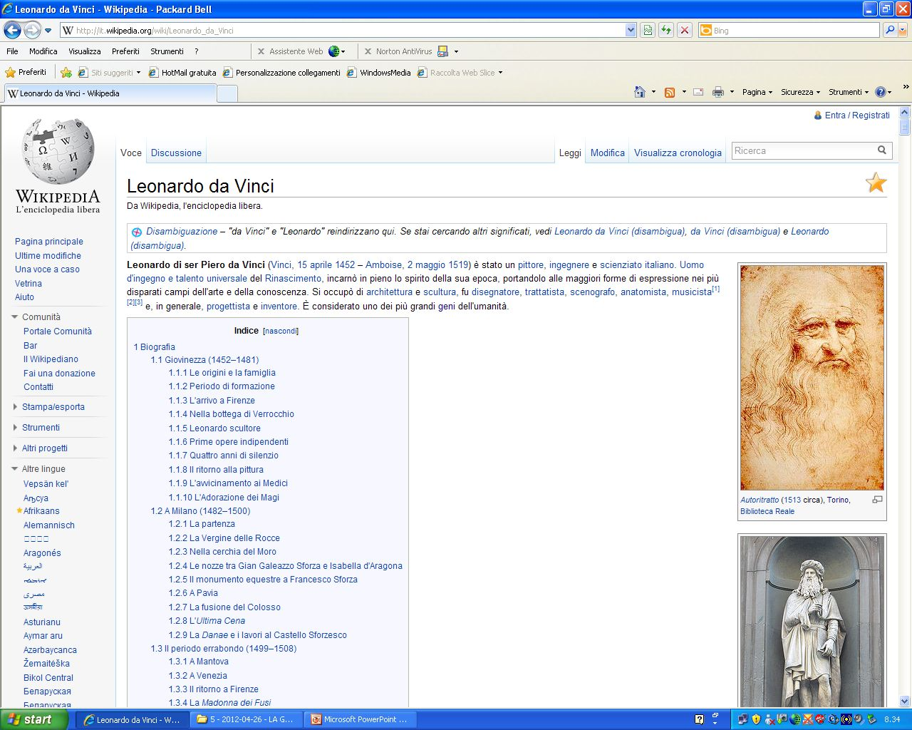
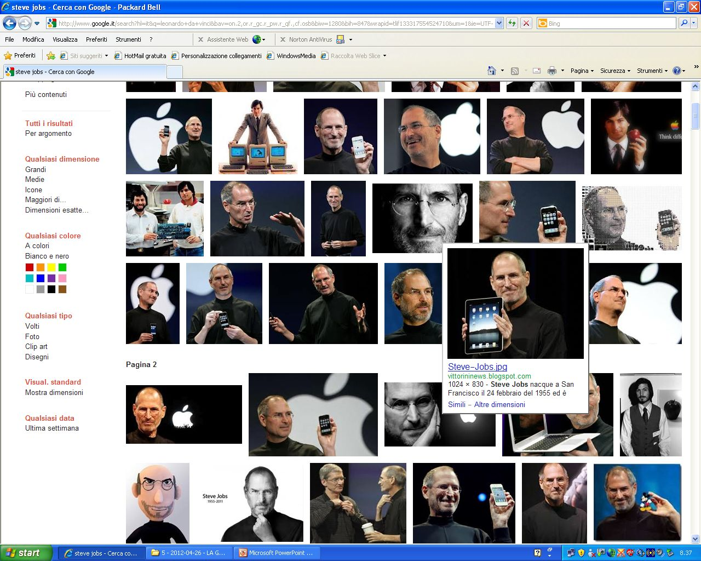
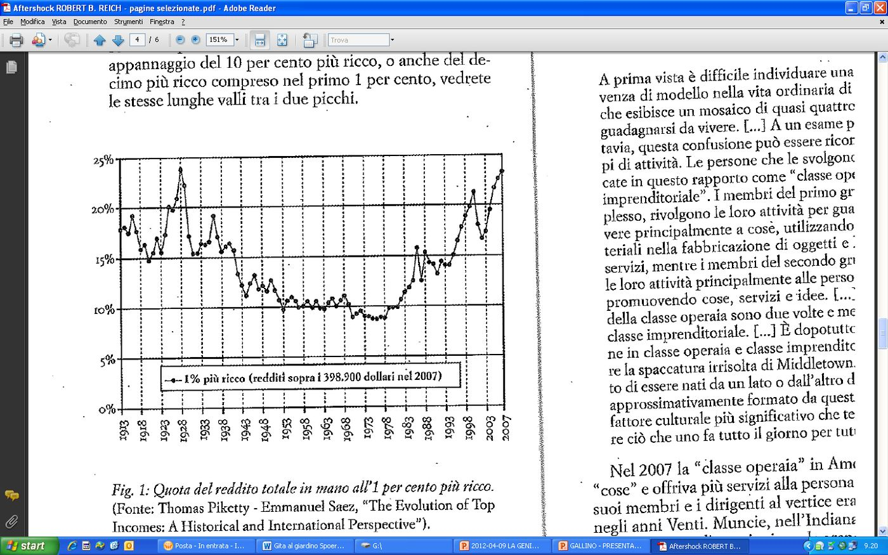
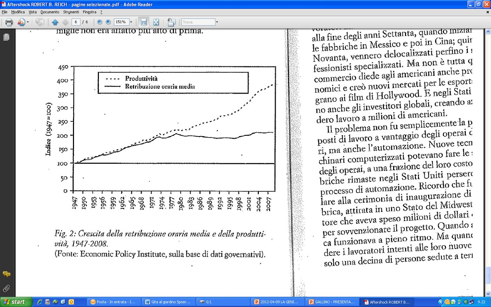
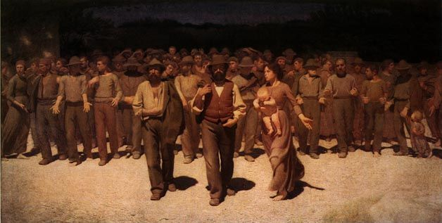
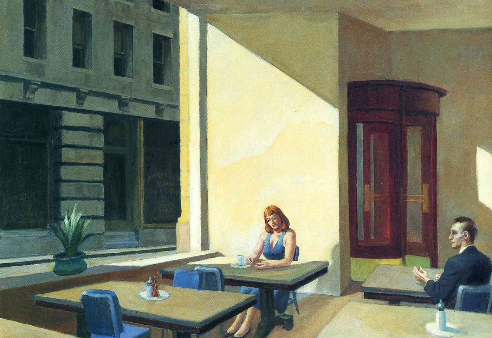
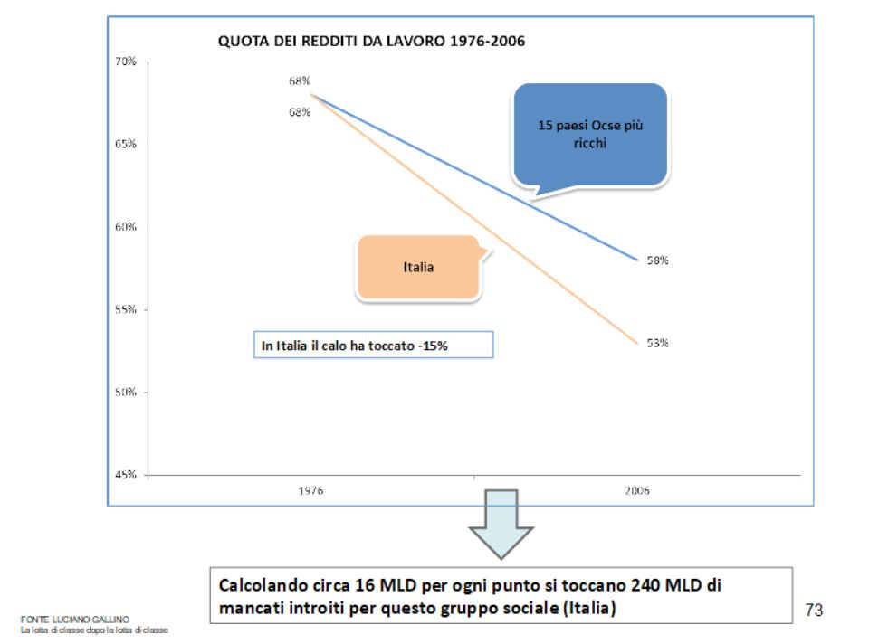
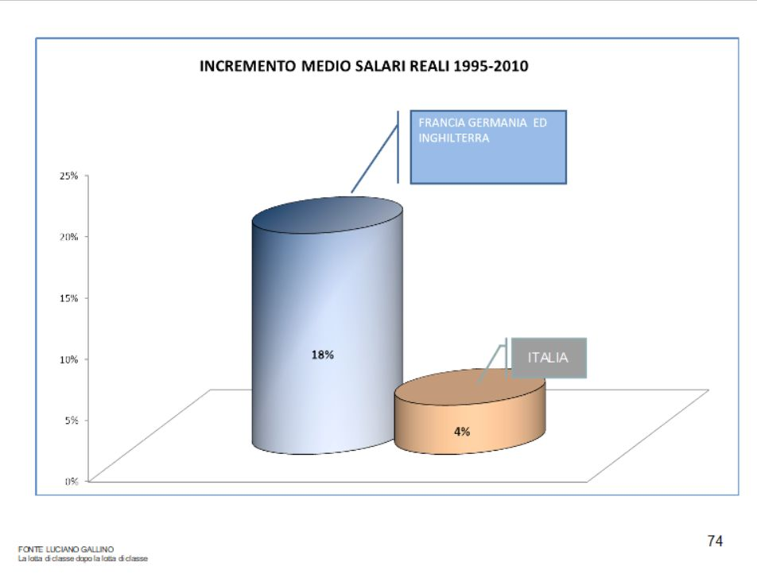
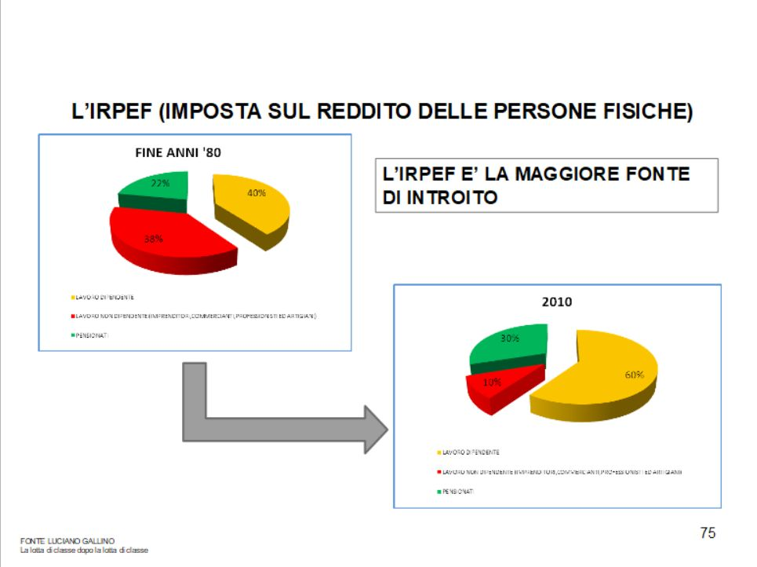

# Il genio

La genialità nel tempo dell’informazione globale

**Data:** 26 aprile 2012 
**Luogo:** Museo della Ceramica, Montelupo 
**Incontro con:** Lorenzo Poggi e Paolo Marcucci

**Interventi:** Paolo Marcucci Lorenzo Poggi

0:01:46

Paolo Marcucci Bene, buonasera a tutti. Grazie di essere venuti anche stasera. Stasera parliamo della genialità: Lorenzo ha trovato il titolo, *La genialità nel tempo dell’informazione globale*. Vedremo di approfondire il legame tra questi due aspetti.

0:02:40

Abbiate pazienza, prendo un attimo di tempo perché ho delle immagini da farvi vedere – sennò potevamo andare anche a braccio. Intanto fai tu l’introduzione, Lorenzo?

0:02:56

Lorenzo Poggi Allora, cominciamo il nostro discorso dalla parola: *genius* e *ingenium* sono strettamente collegati. Parliamo di genialità, ed è quasi sinonimo di creatività, di innovazione, di qualcosa che innova rispetto all’esistente. Il concetto di ingegno, la capacità innovativa e creativa, è legato strettamente anche alle espressioni artistiche.

0:03:45

*Genius*, *ingenium*: qualcosa che è connaturato nell’uomo, in colui che lo possiede, e che non viene acquisito per cultura o per pratica. Quindi qualcosa di innato, che già esiste, quasi fosse l’ispirazione di un dio – come pensavano gli antichi, che una divinità lo ispirasse.

0:04:19

Questo concetto si lega, nella filosofia più vicina a noi, a partire dal Settecento, a partire dall’empirismo e da Kant, alla possibilità di avere una rappresentazione immaginativa del mondo. Che cosa vuol dire? Vuol dire che noi, per conoscere il mondo, abbiamo bisogno di rappresentarci dei collegamenti fra i fenomeni, fra le esperienze, che non sono immediatamente dati dall’esperienza stessa.

0:05:08

Costruiamo qualcosa di più, mettiamo delle aggiunte: è appunto questa trasposizione immaginativa. Istituiamo collegamenti, relazioni, rapporti anche là dove l’esperienza non direbbe che ci sono. E queste costruzioni che facciamo con questa facoltà immaginativa sono quello che ci permette di formarci un’immagine compiuta del mondo, che ci consente quindi di abitare il mondo consapevolmente e di agire su di esso.

0:05:57

Ed è fondamentale. Perché? Perché le conoscenze relative all’uso che si fa delle cose, legate alle esperienze immediate, non ci danno questa immagine globale, non ci collocano dentro il mondo, dentro la rappresentazione. Come abbiamo detto molte altre volte: noi non abitiamo il mondo, abitiamo la rappresentazione del mondo. E per avere questa rappresentazione occorre mettere in atto questa facoltà speciale, particolare, questa capacità che abbiamo di costruire immagini.

0:06:45

Rappresentazione immaginativa: pensate che l’intelligenza stessa, diceva un famoso filosofo, che cos’è? L’intelligenza è una sorta di immaginazione, una specie di immaginazione che sorge dall’uso convenzionale del linguaggio.

0:07:20

Che cosa vuol dire «una sorta di immaginazione»? Vuol dire che, partendo dall’esperienza, ci immaginiamo dei collegamenti, ci immaginiamo un’esperienza futura, ci immaginiamo qualcosa che non esiste nell’esperienza fatta.

0:07:38

Faccio un esempio. Mio figlio era molto piccolo; e si sa, quando i bambini crescono, gli oggetti a cui teniamo un po’ di più li mettiamo fuori della loro portata, sennò finiscono male. Mia moglie aveva un oggettino di cristallo, da mettere al sicuro: messo su un palchetto alto del mobile, dove il bambino non arrivava di sicuro, e sotto il centrino, quello forato, di mia moglie. Benissimo. Cosa fa il ragazzo? Va a prendere l’ombrello, sale sulla sedia, aggancia l’ombrello nel foro del centrino e tira giù.

0:08:40

Ora: è una canagliata o è un atto di intelligenza? Dici: «Ma che atto di intelligenza, ha rotto il vaso!». No, è un atto di intelligenza, perché per fare tutto questo ha dovuto fare una rappresentazione immaginativa: ha dovuto rappresentarsi che va nell’ingresso, prende l’ombrello, e così via. Mi spiego? È una rappresentazione che non c’era: ha collegato insieme delle cose. Questa è l’intelligenza.

0:09:10

È una costruzione del mondo. Non è una canagliata, è un atto raffinato di intelligenza. È questa immaginazione rappresentativa che permette di disporre il mondo e di prevederlo, e che caratterizza la nostra umanità.

0:09:33

È una specie di gioco, e il gioco sublima questo aspetto. Quando uno gioca a scacchi – ma anche a scala quaranta, o a rubamazzo, non ha importanza – qualsiasi tipo di gioco si fonda sull’immedesimazione nell’avversario: prevedere il futuro e prevenire la mossa dell’altro. Quindi è questa immaginazione rappresentativa che ci permette di identificarci con l’altro, di agire e di costruire il mondo.

0:10:12

L’animale non ha questo: ha l’istinto, con il quale già compiutamente compie la sua opera. Questo ha sempre meravigliato gli uomini primitivi, che vedevano nell’animale quasi un dio, quasi qualcosa che riusciva a compiere le proprie azioni portandole a termine senza bisogno di questo sforzo di collegamento, di questa rappresentazione.

0:10:43

È quello che rende l’umanità stessa qualcosa in continuo mutamento, in continua trasformazione: qualcosa che con questa immaginazione deve continuamente riaggiustarsi, costruirsi nel mondo. I filosofi che annunciano la nostra contemporaneità sono chiarissimi su questo.

0:11:25

E il punto che tenteremo di sviluppare è dunque vedere che cosa fa il genio. Il genio è in grado di mettere insieme questa immaginazione rappresentativa. Immanuel Kant, nella *Critica del giudizio*, dice che è appunto questa la funzione di chi dà un giudizio estetico.

0:11:59

Che cosa vuol dire, dice Kant, che un oggetto è bello? Vuol dire che le sue parti, così come io me le immagino, sono disposte in modo da essere in accordo con la mia razionalità. Il bello dunque esprime la disposizione del mio animo, una disposizione di equilibrio fra intelletto e immaginazione; ma non entra nella costruzione dell’oggetto, si limita a disporlo – questa immaginazione – in modo che le sue parti siano in accordo con quell’immagine razionale che mi sono costruito.

0:12:54

Per questo, dice Kant, il giudizio estetico del genio, quello di chi crea la bellezza, è disinteressato: crea un piacere separato da quello legato all’esistenza reale dell’oggetto, all’utilità che l’oggetto potrebbe avere.

0:13:27

Quindi: una percezione rappresentata attraverso questa immaginazione creativa disinteressata. Capite l’estrema importanza del genio, e quindi di coloro che rappresentano in qualche modo il vertice dell’operare in questo modo. Dice Kant: colui che opera così non deve essere imitato, deve essere esemplare. Non perché venga imitato, ma perché deve mostrare come si fa.

0:14:14

Imitarlo non sarebbe utile, non servirebbe. Il genio fa vedere che nelle sue opere – e nemmeno lui sa esattamente come ha operato – c’è un accordo fra intelletto e immaginazione che crea il bello. Ma non lo si può copiare semplicemente: lo si può imitare per creare a nostra volta questo accordo con altri oggetti, mettendo insieme altre esperienze.

0:14:53

Passo la parola; poi continuiamo, perché il discorso del genio è un po’ complesso, e poi mi farete delle domande, perché non si può lasciarlo così.

0:15:14

Paolo Marcucci Stasera abbiamo invertito l’ordine che usiamo di solito. La mia parte sarebbe divisa in tre: un’introduzione al tema; poi l’individuazione di un genio individuale – a cui accennava anche Lorenzo – e di un genio collettivo, con la differenza tra le due impostazioni; e nell’ultima parte il concetto di genio e gli effetti sociali che questa lettura ci può dare.

0:15:48

Mi sono fatto una domanda: esiste un rapporto tra popolazione e genio? Vedendo quello che è successo nella storia, potrebbe essere di sì. Basti pensare alla Grecia, a quel fiorire di architettura, filosofia, scienza, arte ecc. che c’è stato in quel periodo; oppure alla Firenze del Rinascimento, Michelangelo, Brunelleschi ecc.

**ESISTE UN RAPPORTO TRA POPOLAZIONE E GENIO?**

Certe epoche e certi luoghi danno vita, a volte, nella storia, a sorprendenti quantità di genio.

Basti pensare ad Atene, alla straordinaria genialità (che ancora oggi ci guida) e alla produzione nei campi della filosofia, dell’architettura, dell’arte, della storiografia, della drammaturgia; oppure alla Firenze del Rinascimento, dove si concentrarono geni come Leonardo da Vinci, Michelangelo, Brunelleschi, Botticelli, Machiavelli, Poliziano…

0:16:18

A proposito di Firenze: il salvataggio dell’arte prodotta dal genio fiorentino, e la globalizzazione. Tre anni fa ci furono dei lavori a Firenze ed emersero dalle fondamenta, dalle strade, degli oggetti che si pensava fossero più recenti; invece è stato scoperto che risalivano al 1966. Su questi oggetti è stata fatta una mostra di cui dopo vi facciamo vedere un’immagine, una teca, e quello che mi ha un po’ colpito, e in fondo un po’ è vero, è che in fondo la Firenze del genio fiorentino viene salvata da delle persone, ed è la prima volta al mondo che avviene un’alluvione «globalizzata»: tutto il mondo partecipa al salvataggio dell’arte prodotta dal genio fiorentino.

**IL SALVATAGGIO DELL’ARTE PRODOTTA DAL GENIO FIORENTINO E LA GLOBALIZZAZIONE**

Durante dei lavori per l’acquedotto emersero oggetti e rifiuti. Ci si accorse però che erano residui dell’alluvione del 4 novembre 1966, rimasti lì per 45 anni nel punto dove l’acqua faceva i mulinelli.

Sono oggetti d’uso quotidiano strappati alle case dei fiorentini.

Con questi oggetti è stata creata una teca, in una piccola mostra nel corso del 45° anniversario dell’alluvione del 1966.

«Quella di Firenze è stata la prima alluvione globalizzata, che commosse e mobilitò il mondo e lo stupì con l’arrivo degli angeli del fango – spiega Erasmo D’Angelis, presidente di Publiacqua, che è riuscito a rintracciare gli angeli del fango e ha promosso il raduno internazionale nel Salone dei Cinquecento il 4 novembre 2006. I primi ricordi di tutti sono quelli della marea d’acqua e fango che sommerse la città, trascinando con sé tutto ciò che c’era tra abitazioni, botteghe, officine, librerie, negozi. La storia di quei giorni è fatta anche di migliaia di piccoli episodi, di salvataggi e di solidarietà, e con questa teca vogliamo innanzitutto ricordare e riscoprire una memoria dell’alluvione fatta di piccole cose».

0:17:20

{ loading=lazy style="width:66%" }

Questa è la teca con cui è stata costruita la mostra, sulla destra; a sinistra invece si vede una foto degli angeli del fango che salvano le opere. Il genio fiorentino viene salvato per la prima volta in mondovisione: nell’informazione globale passa questa informazione. Il Genio Fiorentino è stata forse una delle invenzioni su cui ha costruito la sua fortuna Matteo Renzi come presidente della provincia: fece questa manifestazione, che tuttora è in piedi.

0:18:08

La Treccani ci dice che la parola *genius* deriva dalla mitologia pagana: era lo spirito, buono e cattivo, che presiedeva al destino degli uomini, dalla nascita alla morte. C’è la variante del *genius loci*, ma la affrontiamo dopo. Sostanzialmente dice che nessun luogo è senza un genio, e che il genio è la somma potenza creatrice dello spirito umano.

**TRECCANI**

Dal lat. *Genius*, nome proprio della divinità tutelare, e fig. (come nome comune, *genius*) «inclinazione, disposizione».

Nella mitologia pagana, lo spirito, buono o cattivo, che presiedeva al destino degli uomini dalla nascita alla morte, e anche lo spirito che aveva sotto la sua protezione una città, un popolo, una nazione.

Il *genius loci* è un’entità naturale e soprannaturale legata a un luogo, e oggetto di culto nella religione romana: associazione tra genio e luogo fisico. Secondo Servio, infatti, *nullus locus sine genio* (nessun luogo è senza un genio) (*commento all’Eneide*, 5, 95).

Somma potenza creatrice dello spirito umano, propria per virtù innata di pochi ed eccezionali individui, i quali per mezzo del loro talento giungono a straordinarie altezze nell’ambito dell’arte o della scienza.

0:18:38

Una sentenza classica: «Non c’è mai grande ingegno senza una vena di pazzia». Questo è un po’ quello che tutti noi sappiamo, anche come luogo comune; è la massima di Seneca, e quindi c’è anche un riferimento dotto.

**SENTENZE GRECHE E LATINE**

*Nullum magnum ingenium sine mixtura dementiae fuit*

Non c’è mai grande ingegno senza una vena di pazzia.

**SENECA**

Lucio Anneo Seneca (4 a.C. – 65 d.C.), autore, filosofo, politico latino, noto come Seneca o Seneca il Giovane, figlio di Seneca il Vecchio.

Nacque a Cordova, capitale della Spagna Betica, una delle più antiche colonie romane fuori dal territorio italico, in un anno di non certa determinazione.

0:18:58

Il genio nei proverbi popolari: ci sono solo cinque definizioni. Questo mi ha colpito, perché in genere, quando trattiamo un tema, io vado sempre a vedere come è trattato dal popolo, dai proverbi. E qui ho trovato solo cinque definizioni di genio. È un po’ strano, perché di altri termini a volte ci sono centinaia o decine di proverbi: forse è una certa diffidenza da parte del popolo.

**IL GENIO NEI PROVERBI POPOLARI**

Nel *dizionario dei proverbi* del Lapucci (pagina 491) ci sono solo 5 definizioni:

*Il genio è pazienza*

*Il genio comincia e il lavoro realizza*

*Non c’è genio senza pazzia*

*Nel genio c’è sempre un ramo di follia*

*I geni si incontrano*

0:19:35

Il genio secondo *Amici miei*. Ve la ricordate, questa battuta fenomenale? «È fantasia, intuizione, colpo d’occhio e velocità di esecuzione», dice il Melandri. Effettivamente è così: è velocità, è intuizione.

0:19:52

Il genio italico. Tutti noi abbiamo sentito parlare più di una volta di questo famoso genio italico; sono stati detti fiumi di parole. C’è un saggio del professor Giorgio Alberti di Sansepolcro, *Francesco, Giotto, Dante e le origini del genio italico*; un altro per esempio è di Gino Saviotti, *Profili biografici dei maggiori ingegni italiani e dei principali viaggiatori dal Medioevo ai giorni nostri*. Cioè: su questo genio italico ci siamo costruiti sopra anche la nostra mitologia.

**IL GENIO ITALICO**

Sul genio italico si sono detti fiumi di parole.

Segnalo come esempio il saggio del prof. Giorgio Alberti (Sansepolcro, 7 agosto 1927 – 1° maggio 2001): *Francesco, Giotto, Dante e le origini del genio italico*.

E il saggio di Gino Saviotti: Profili *biografici dei maggiori ingegni italiani e dei principali viaggiatori dal Medioevo ai giorni nostri*.

0:20:26

Il genio per eccellenza: Leonardo. Questo forse è effettivamente il più grande genio degli ultimi secoli.

{ loading=lazy style="width:30%" }

**IL GENIO PER ECCELLENZA**

Leonardo di Ser Piero da Vinci (Vinci, 15 aprile 1452 – Amboise, 2 maggio 1519) è considerato uno dei più grandi geni dell’umanità.

È stato un pittore, ingegnere e scienziato italiano. Uomo d’ingegno e talento universale del Rinascimento, incarnò in pieno lo spirito della sua epoca, portandolo alle maggiori forme di espressione nei più disparati campi dell’arte e della conoscenza. Si occupò di architettura e scultura, fu disegnatore, trattatista, scenografo, anatomista, musicista e, in generale, progettista e inventore.

*Autoritratto* (1513 circa), Torino, Biblioteca reale.

0:20:38

Steve Jobs è morto il 5 ottobre 2011, considerato da tutti un genio, un grande genio di questa epoca. L’uomo perfetto per questa sera: parliamo di genio e informazione globale, e l’informazione globale transita attraverso le sue invenzioni – l’iPad, l’iPhone ecc.

{ loading=lazy style="width:40%" }

**STEVE JOBS**

Steve Jobs nacque a San Francisco il 24 febbraio 1955 ed è morto a Palo Alto il 5 ottobre 2011.

Nel corso della sua vita fu imprenditore, informatico e inventore statunitense; fu cofondatore della Apple Inc., di cui è stato amministratore delegato fino al 24 agosto 2011, quando si è dimesso da CEO (*chief executive officer*) per diventare presidente del CdA (consiglio di amministrazione); è stato proprietario di NeXT Computer e amministratore delegato di Pixar prima dell’acquisto da parte della Disney.

È noto per aver introdotto presso il grande pubblico il primo personal computer (Apple II) e prodotti di successo come iPod, iPhone e iPad. È stato tra i primi a intuire le potenzialità del mouse e dell’interfaccia a icone presenti sullo Xerox Star, creando il Macintosh.

Jobs venne classificato primo tra i 25 uomini d’affari più potenti del 2007.

L’uomo perfetto per il titolo di questa sera: la genialità nel tempo dell’informazione globale.

0:21:09

Cercando su Google (ricerca del 31 marzo 2012) la parola «genio» insieme a Leonardo appaiono 4.480.000 citazioni; digitando Jobs e «genio» ne appaiono 2.640.000. Questo vi dà la dimensione dell’abbinamento tra queste due persone: Leonardo da Vinci è quasi il doppio – si può capire, nonostante tutta la modernità di Steve Jobs.

0:21:50

Detto questo, proviamo a farci qualche speculazione filosofica, che in fondo è un po’ lo scopo di queste nostre serate.

0:21:57

Non so se a voi piacciono i gialli. Io personalmente ho cominciato ad amarli negli anni Ottanta, nei primi anni Ottanta, quando scoprii Marlowe di Raymond Chandler, e hanno continuato sempre a piacermi. Sostanzialmente ci sono due tipi di gialli: quello dove l’assassino viene rivelato alle prime pagine e quello dove viene rivelato alle ultime. Allora, con un po’ di provocazione, se me la concedete, provo a dire subito l’assassino: il genio non esiste. Esiste invece il genio collettivo. Anzi, questa genialità individuale secondo me ha prodotto molti danni, che poi cercherò anche di spiegare.

**RIVELAZIONE DELL’ASSASSINO**

Non so se a qualcuno di voi piace il genere che una volta si chiamava giallo, e che ora ha preso molte altre direzioni e definizioni.

Personalmente ho iniziato ad apprezzare il genere quando ho scoperto qualche capolavoro della letteratura americana: Sam Spade, nel *Falcone maltese* di Dashiell Hammett; Marlowe di Raymond Chandler, nel *Grande sonno*.

Generalizzando, si potrebbe dire che ci sono un paio di schemi a cui riferirsi:

– l’assassino viene individuato nelle prime pagine, e il resto della storia spiega come ci si è arrivati;

– l’assassino viene svelato nelle ultime pagine.

L’evoluzione ha poi portato a costruire l’architettura del romanzo in modo tale che la soluzione del problema debba essere sempre evidente, ammesso che vi sia un lettore sufficientemente astuto per vederla subito. Se il lettore, dopo aver raggiunto il capitolo finale e la spiegazione, ripercorre il libro a ritroso, deve constatare che in un certo senso la soluzione stava davanti ai suoi occhi fin dall’inizio, che tutti gli indizi designavano il colpevole e che, s’egli fosse stato acuto come il poliziotto, avrebbe potuto risolvere il mistero da sé, senza leggere il libro sino alla fine.

Con un po’ di provocazione, posso provare a dire che l’assassino (il genio) non esiste: esiste invece il genio collettivo.

Anzi, l’insistere sul concetto di genialità individuale (che ha un fascino irresistibile, va ammesso) ha causato immensi danni e tragedie.

0:22:56

Per esempio, riprendiamo un minimo la serata che abbiamo fatto sull’Islam e le scoperte fondamentali dell’umanità avvenute in quello scorcio di terra: i numeri, la scrittura – cioè tutto quello che ha prodotto con la letteratura ecc. – e la moneta. Sono tutte scoperte collettive, fatte da popoli che si sono sovrapposti e che hanno portato ognuno il proprio pezzo di miglioramento.

0:23:33

C’è una lettura che si può fare anche in maniera proprio razionale: come Dio che gioca a dadi. Metti cinquanta milioni di persone su un territorio, e sicuramente qualcuno esce genio: è per forza, è genetico, perché è la natura che sperimenta per procedere, per evolvere e soprattutto per sopravvivere. La sperimentazione tira fuori il genio che porta avanti alcune cose a beneficio poi di tutti.

0:24:08

Credo che non sia né merito né demerito di nessuno, questa genialità. E se ci si pensa, forse è anche una versione romantica, questa, perché – l’accennava prima Lorenzo – il genio non è nemmeno consapevole della sua genialità; e se lo fosse sarebbe tragico, perché guarderebbe alla sua condizione – siccome non dipende da lui ma dipende, secondo me, dal caso, da questa casualità che nasce dalla natura – la guarderebbe anche con un certo rimpianto.

**RIPRENDIAMO LA RICOSTRUZIONE DELLA CIVILTÀ CHE ABBIAMO FATTO NELLA SERATA DELL’ISLAM**

Le scoperte fondamentali dell’umanità (i numeri, la scrittura, la moneta…) sono il frutto di processi e progressi di un sapere collettivo, di contaminazione nel tempo e nella geografia…

**MA TORNIAMO ALL’INTRODUZIONE**

C’è una lettura da fare in maniera più razionale ed evoluzionistica: dal numero di individui che compongono una società, statisticamente ne esce fuori sempre qualche genio.

La natura, nella sua prospettiva evoluzionistica, sperimenta e procede in questo senso, portando avanti la specie.

Non è né merito né demerito di nessuno. E in fondo, se ci si pensa, questa è anche la versione più romantica: perché l’eroe, il genio, quando ne è consapevole (del caso che lo ha portato a essere genio), guarda alla sua condizione con il rimpianto di quello che davvero poteva essere e non è stato.

0:25:03

Forse è affascinante e consolatoria, questa immagine del genio solitario: io posso contare su di me, e so che se sono intelligente e bravo posso uscire fuori da qualsiasi situazione. Che è un po’ quello che diceva prima Lorenzo, citando Kant, quando distingueva tra il genio artistico e il genio scientifico: il genio artistico, secondo Kant, è naturale, mentre il genio scientifico è frutto di lavoro, di sudore, di fatica ecc.

0:25:56

Ma siamo sicuri che esista questa distinzione, forse un po’ classica? Il genio artistico è davvero diverso dal genio scientifico?

**GENIO ARTISTICO E GENIO SCIENTIFICO**

Non è mai il pensiero del genio solitario che inventa, anche se quest’idea è affascinante, e forse anche consolatoria e illusoria: io posso contare sulla mia intelligenza per uscirne fuori, per essere il più bravo, il più ricco, ecc.

A questo punto forse occorrerebbe distinguere tra il genio artistico e il genio scientifico. Usiamo Kant (elabora la sua concezione del genio nell’opera *Critica del giudizio*).

(Se non sbaglio, e Lorenzo mi correggerà) Kant tratta la concezione di genio, per esempio, nel campo della ricerca scientifica: la scoperta d’importanti verità scientifiche non può essere attribuita a un particolare genio.

Nella scienza, infatti, la scoperta «geniale» è in realtà il risultato di un metodo, già elaborato da altri, che può essere insegnato o imitato.

L’imitazione non ha niente a che fare con la produzione artistica geniale, che non segue metodi o regole specifiche: l’artista spesso non sa neppure che cosa l’ha portato a creare la sua opera.

**Ma siamo sicuri che esista questa distinzione? Il genio artistico è diverso dal genio scientifico?**

0:26:07

Qui finiva l’introduzione di Lorenzo, ma penso che abbiamo introdotto diversi temi, che cercheremo di approfondire nella seconda e nella terza parte. Per cui possiamo fare anche una pausa e mangiare qualcosa.

0:26:27

Lorenzo Poggi Questa differenza fra genio artistico – di solito lo si adopera in questa accezione – e invece la scienza, che sembra escludere la genialità e l’invenzione, o perlomeno renderla marginale: probabilmente questa differenza non c’è. Non c’è nemmeno da un punto di vista conoscitivo, costitutivo. Lo riprendiamo dopo; però ricordiamoci che ripartiamo di qui, che è importante.

\[PAUSA\]
{: .nota }

0:56:49

Paolo Marcucci Riprendiamo la seconda parte. Visto che stasera abbiamo invertito un po’ l’ordine consueto, continuiamo così: Lorenzo riprende il concetto che prima aveva accennato.

0:57:05

Lorenzo Poggi Avevamo detto: parlavamo della trasposizione immaginativa, di quell’operazione che è a fondamento di qualsiasi innovazione creativa. Il genio, o chiunque innovi, crea qualcosa di nuovo: che cosa fa? Fa un’innovazione rispetto a quella che è l’esperienza ordinaria delle cose. Questa innovazione non può però essere del tutto estranea, del tutto separata, altrimenti diventerebbe così arbitraria da non consentire più nessun collegamento, e quindi sfocerebbe nella disorganizzazione e nella dissociazione, che è più il carattere della follia che dell’innovazione.

0:58:06

Infatti accennavamo anche prima che genio e follia hanno qualche elemento comune, proprio per questo aspetto. Forse è questo il punto fondamentale: innovazione sì, proporre un mutamento delle esperienze, qualcosa che innova e quindi rende diversamente significative le esperienze precedenti acquisite – ma non lo può fare se non a partire da quelle stesse esperienze.

0:58:52

Deve quindi essere vistoso come innovazione, ma apprezzabile su quella che è l’esperienza condivisa; altrimenti l’operazione della genialità non serve. Kant in questo è chiarissimo, lo possiamo interpretare in questo modo: dice che il genio sì è innovativo, è colui che crea la bellezza, ma questo è apprezzabile in quanto si dispone verso un pubblico, coloro che possono apprezzare, che sono persone di gusto, perché c’è un modo condiviso, comune, di apprezzare.

0:59:36

Altrimenti il genio non potrebbe diventare esemplare. Non può spiegare come ha fatto a realizzare l’opera, non lo può insegnare; è esemplare perché in qualche modo è apprezzabile in quanto si dispone in questa prospettiva rispetto al modo condiviso di fare. Questa, dicevamo, è una caratteristica umana.

1:00:13

Nietzsche dice che è il carattere che ha l’uomo e che ha l’Übermensch, il superuomo. Nell’opera *Così parlò Zarathustra*, l’uomo che cos’è? È questo continuo ricostruire e andare oltre, questo continuo dare una prospettiva diversa alle esperienze precedenti, che quindi assumono globalmente un significato diverso. «L’uomo è una fune tesa fra la bestia e il superuomo, una fune sopra l’abisso: un pericoloso andare di là, un pericoloso essere in cammino, un pericoloso guardare indietro, un pericoloso rabbrividire e arrestarsi. Ciò che è grande nell’uomo è di essere un ponte e non uno scopo; ciò che si può amare nell’uomo è il suo essere un passaggio, un tramonto.»

1:01:27

E continua: «Amo quelli che non sanno vivere che per sparire, poiché sono coloro che vanno al di là. Io amo i grandi disprezzatori, perché sono i grandi veneratori e frecce del desiderio verso l’opposta riva». Grandi veneratori di che cosa? Di questo che è l’atteggiamento fondamentale dell’uomo: dover continuamente ricostruire questo mondo, questa immagine nella quale abitiamo, dove abbiamo costruito la casa per il nostro corpo.

1:02:13

Ora, il punto qual è? Che questo accomuna sia il punto di vista dell’arte sia il punto di vista della scienza, quando la scienza è intesa nella sua essenza. Perché li accomuna? Perché chi opera con la scienza che cosa fa? Cerca, in quelle che sono le esperienze precedenti, dei punti che poi possono essere verificati attraverso l’esperimento e che, se confermati, danno una visione globale diversa di quel particolare argomento a partire da quelle conoscenze. Quindi non è che la sua sia una visione totalmente diversa: è una visione che parte da ciò che già si conosce, lo sviluppa, ma dà qualcosa di nuovo.

1:03:11

Quello che conta nella ricerca, anche dal punto di vista della scienza, non è tanto che il nuovo risultato potrà essere più utile, avere applicazioni tecniche più vaste e così via, ma il realizzare una nuova visione più completa, che ampli l’esperienza. È questo ampliamento, questo rendere più significativa l’esperienza, che sta a cuore alla vera ricerca scientifica, e che la accomuna anche alla ricerca artistica: perché anche quella è un ampliamento, un mutamento dell’esperienza.

1:03:59

Su questo ci sono le conferme anche nelle filosofie contemporanee, ma il concetto è molto chiaro: è proprio questo quello che conta, riuscire a costruire in modo diverso, a partire dall’esistente, la nostra immagine del mondo – nostra in quanto umana, in quanto modo umano di costruire la rappresentazione del mondo nella quale abitiamo.

1:04:47

Tutto questo è stato concepito, ha avuto esposizioni in modi differenti per tutto l’Ottocento – dicevamo Nietzsche, lo citavamo alla fine – ed è un carattere della filosofia e della scienza del secolo passato, anche del Novecento.

1:05:11

Perché a un certo momento tutto questo ha cominciato a entrare in crisi? Perché nel nostro tempo, nel nostro presente, vediamo una prevalenza della tecnica.

1:05:33

I greci avevano due parole, e anche i latini: *ars* e *techne*. *Ars* è l’arte, e l’arte noi la applichiamo anche all’artigiano: a Firenze c’era la corporazione delle Arti e dei Mestieri. Non era soltanto... Giotto aveva una bottega: se qualcuno gli avesse detto che aveva uno studio, si sarebbe offeso. «Io ho una bottega», mi spiego?

1:06:17

E la gente andava da Giotto, andava a bottega. Prima andava dal maestro di legname, che era vicino, e si faceva fare la cassa di nozze per la figlia; poi andava da Giotto e diceva: «Guarda, mi ha fatto questa, la vorrei dipinta». Oppure si faceva fare il pavese in legno di fico lì accanto, poi andava da Giotto e gli diceva: «Senti, me lo dipingi con le armi della mia casata?». E così via.

1:07:06

Che cos’è *ars*, nel nostro tempo, quello che ha inaugurato il Rinascimento e che è poi andato finendo? *Ars* è un disporre dei mezzi per il raggiungimento di un fine, di uno scopo. E lì c’è la *techne*: la *techne* è quella che dice quali mezzi sono più adatti. Il tecnico dice: sì, se fai un pavese deve essere di legno di fico, perché regge meglio gli impatti con i punzoni e con le frecce rispetto a quell’altro, che si scheggia più facilmente ed è più pesante da manovrare.

1:07:53

La tecnica si occupa di questo. Le due cose vanno insieme, ma quella che conta è l’*ars*: la disposizione dell’esperienza e dell’azione sul mondo in vista del raggiungimento di un fine. Questa è *ars*, e l’arte di Giotto è anch’essa nello stesso senso: dispone le immagini per raggiungere un fine.

1:08:28

Questo subisce, con l’avvento dell’età tecnologica contemporanea – negli ultimi cinquant’anni, diciamo – un’accelerazione, una trasformazione che difficilmente rende ancora possibile un atteggiamento di questo genere. E quindi il genio: fino a questo momento, il genio fiorentino chi era? Era quello che genialmente riusciva a disporre in modo differente l’esperienza fatta fino ad allora, per dimostrare un’altra cosa, per arrivare a un altro fine.

1:09:20

Quando abbiamo parlato dell’avvento del Rinascimento e della ricchezza come giustificazione dell’esistenza dei mercanti, che cosa dicevamo? Dicevamo che il mercante giustifica la sua esistenza rispetto alla cultura medievale, che lo rifiutava, e dà una nuova immagine del mondo. L’artista risponde a questo, perché è in grado di utilizzare i mezzi, gli strumenti, ciò che c’era nella conoscenza della pittura fino ad allora, e dispone queste conoscenze al fine di arrivare a un altro risultato.

1:10:09

Tutti sapevano che la Madonna era stata incoronata; ma se la si incorona con la corona d’oro e la si mette all’ingresso della Zecca, dove si conia il fiorino, vuol dire che l’oro, la ricchezza del fiorino, è diventata non qualcosa da disprezzare perché rappresenta i beni del mondo, ma qualcosa di tanto importante e di tanto sacro che Dio Padre stesso l’ha posta sulla testa della Vergine Maria.

1:10:40

Le immagini sono vecchie, i concetti sono già nel passato, chissà quante volte frequentati; ma rivisitati genialmente in quel modo diventano un’altra immagine, rappresentano un’altra cosa. Se fosse stato totalmente diverso sarebbe stata una follia, sarebbe stata qualcosa che nessuno avrebbe compreso.

1:11:06

Il genio è la capacità di rappresentare i bambini così come sono, e non con le deformazioni da piccoli adulti del Medioevo: con i loro giochi, che rappresentano in qualche modo questa esaltazione del mondo e della natura, il nuovo punto di vista che abbiamo visto nelle cantorie di Donatello.

1:11:32

Quindi che cos’è la genialità? È questa capacità innovativa, sensata, perché riprende l’esperienza e la innova. Scusate se faccio degli esempi, ma così è più chiaro. La tecnica invece è quello che bisogna fare per arrivare a certi risultati, come si opera e così via.

1:11:55

Tutto questo va avanti, tutto questo si sviluppa in un senso, finché arriviamo alla contemporaneità: e lì sia il nostro sentire – quindi anche il sentire del genio – sia la capacità di innovazione assumono un significato diverso, perché qualcosa muta e si trasforma.

1:12:35

Eravamo religiosi quando la nostra immaginazione del mondo era fondata sulla religione; eravamo razionali, e riconoscevamo in noi questa razionalità, quando con l’Illuminismo la razionalità trionfava. Oggi, al tempo dell’informazione globale, del web, qualcosa abbiamo mutato, qualcosa si sta trasformando; e quindi stiamo mutando nella nostra rappresentazione del mondo. Ne parliamo dopo; ora passo la parola a Paolo.

1:13:33

Paolo Marcucci Proseguiamo sulla strada che avevo brevemente tracciato prima, andando a individuare le possibili differenze tra genio individuale e genio collettivo.

1:13:56

Abbiamo cercato di porre un dubbio sull’esistenza del genio; però questo è un argomento difficile, da sempre aperto a qualsiasi considerazione e presa di posizione. Vediamo ora, per fare un esempio, alcune idee a favore dell’idea di genio individuale e altre a favore del genio collettivo.

Nell’introduzione abbiamo messo in dubbio l’esistenza del genio.

L’argomento è da sempre aperto all’interpretazione e al rapporto con la genialità:

– per Hegel genio e immaginazione sono solo romantiche fantasticherie;

– Nietzsche vede nella genialità l’origine dell’apollineo, che porta verso un’esperienza creativa dionisiaca (da Dioniso, dio del vino: stato d’animo di sfrenatezza, esaltazione, furore, com’è proprio dello stato di ebbrezza connesso al vino).

1:14:26

Pro genio, per esempio: il 5 marzo 2012, quindi recentemente, l’Università di Bergamo ha fatto un’iniziativa per riconoscere i talenti, un corso su come valorizzare i geni, proprio per dare specificità e valore a questa tipologia di persone. Il presidente di Google, Eric Schmidt, il 19 novembre 2011 in un’intervista disse che le gerarchie in azienda uccidono la creatività.

1:15:03

Se ci si pensa, questo può essere inteso in due modi – è una dichiarazione un po’ ambigua. Uno: che il genio deve essere lasciato libero, quindi ci devono essere spazi non regolati dal tempo del lavoro, dal tempo dell’organizzazione. Oppure: che l’auto-organizzazione dei gruppi dove ci sono geni non necessita di tante gerarchie. Oppure tutte e due le cose.

1:15:45

E vado avanti con opere e persone geniali. Un articolo su *Tecnologia e scienza* parla di Alessandro Magno, che quando conquistò Tiro utilizzò la scienza: la genialità di Alessandro Magno.

1:16:00

Il calcio, lo conosciamo tutti, vediamo le partite di continuo. Qualche mese fa il caso di De Rossi della Roma; ma ce ne sono tantissimi. Da quando sono nato ho sempre sentito parlare di queste cose: Rivera, Baggio, Del Piero, gli estrosi puniti. L’articolo su De Rossi riguardava il fatto che lui si sentiva messo al servizio della squadra, essendo il genio di turno.

1:16:32

Conta più la disciplina o il genio? Questa è la domanda. Gli esperti sono divisi: gli allenatori in genere privilegiano la squadra, chissà perché; i giornalisti in genere privilegiano il campione, il genio di turno.

1:16:50

«Ci salverà un giovane creativo?» Il futuro appartiene alle idee innovative, l’industria investe in questo e punta sui giovani, perché sono creativi, trasgressivi e vanno oltre le regole: un’idea di futuro applicata all’industria. Il futuro appartiene alle idee innovative. E anche l’industria lo sa. Campi di addestramento, incubatori, start-up: si moltiplicano le fabbriche delle invenzioni. E gli ideatori più trasgressivi sono ormai poco più che teenager. L’idea è che il futuro appartiene al genio creativo.

1:17:15

Per esempio un saggio di Walter Isaacson su Steve Jobs, che abbiamo visto prima: la visione del genio. Che cosa aveva Jobs? Aveva, insieme ad altri come Franklin, Einstein ecc., una visione del mondo molto particolare: sono visionari. Invece Bill Gates, che era il concorrente di Steve Jobs ed è tuttora proprietario di Microsoft, è «solo» molto intelligente: fa questa distinzione.

1:17:55

La creatività di Jobs scatta, è qualcosa che diverge, che va oltre. Lui racconta nella sua biografia – non so quanto romanzata – di aver iniziato ad apprezzare l’intuizione, la genialità, quando era giovane e vagabondava per l’India alla ricerca del karma o di qualche altra cosa.

**IL SAGGIO DI WALTER ISAACSON SU STEVE JOBS: LA VISIONARIETÀ DEL GENIO**

Che cosa unisce uomini come Benjamin Franklin, Albert Einstein, Steve Jobs rispetto a Bill Gates?

I primi hanno avuto una visione del mondo, il secondo è solo molto intelligente.

“Think different”, diceva il padre della Apple, ma non era solo uno slogan pubblicitario.

Gli studi sulla creatività dimostrano il ruolo fondamentale del pensiero divergente: dunque meglio visionari che intelligenti.

Jobs raccontò di avere iniziato ad apprezzare il potere dell’intuizione, antitetico al pensiero razionale occidentale, mentre vagabondava in giro per l’India.

1:18:21

Ci sono poi alcuni siti sull’intelligenza, quelli dove si misura il quoziente intellettivo: uno del World Intelligence Network (IQ Society) e l’altro dell’Università dell’Indiana.

**SITI SULL’INTELLIGENZA**

Il sito del World Intelligence Network, www.iqsociety.org, è dedicato a intelligenza e funzioni cognitive, con i test per misurare il quoziente intellettivo.

Il portale dell’Università dell’Indiana, www.indiana.edu/intell, raccoglie studi sull’intelligenza.

1:18:36

Pro collettivo: andiamo sull’altra sponda della visione del genio. Ce ne sono innumerevoli, di queste idee. Per esempio: non è il genio solitario a trovare le grandi idee, ma sono i tanti cervelli che cambiano il futuro. I veicoli pensanti di Braitenberg – Braitenberg è uno studioso italiano, anche se il nome è altoatesino – sono uno strumento per comprendere i comportamenti sociali complessi: cioè il branco che si organizza, e l’insieme delle azioni che produce un comportamento sofisticato.

1:19:25

Ignazio Visco, l’attuale governatore della Banca d’Italia, in un intervento in commemorazione di Padoa-Schioppa citava appunto questa sorta di genio collettivo: diceva «agire coordinato per garantire stabilità», e citava Amiel, un filosofo svizzero: l’esperienza ricomincia da zero in ogni individuo, solo le istituzioni diventano più sagge perché accumulano l’esperienza collettiva. Appunto: gli uomini passano, però il sapere e la genialità si tramandano attraverso le istituzioni. Questo è un concetto fondamentale da questo punto di vista.

1:20:03

Ma anche la scrittura dei libri è nata, da un po’ di tempo, in maniera collettiva: ci sono sul web diverse decine di siti dove si fa questo tentativo. Se pensate al fenomeno Wu Ming, ai Luther Blissett: sono romanzi usciti sotto questo pseudonimo, che in realtà sono una scrittura collettiva fatta a più mani attraverso il web, attraverso rifacimenti. È un’esperienza molto interessante; alcuni sono diventati anche best seller – penso ad *Altai*, e un altro di cui mi sfugge il nome.

**PRO GENIO COLLETTIVO**

Due studiosi (Steven Johnson e Kevin Kelly) svelano i meccanismi delle scoperte: non è il genio solitario a trovare le grandi idee. Dal telescopio al computer, tanti cervelli cambiano il futuro.

I *veicoli pensanti* di Braitenberg sono un utile strumento per comprendere comportamenti sociali complessi legati all’intelligenza collettiva:

– dal branco alle organizzazioni umane: un metodo che descrive bene la capacità di coordinarsi senza leader, massimizzando il vantaggio collettivo;

– l’insieme delle azioni produce un comportamento sofisticato che avviene senza postulare un disegnatore supremamente intelligente, perché il disegno intelligente non è il presupposto ma il risultato.

Valentino (Valentin) von Braitenberg (Bolzano, 18 giugno 1926 – Tubinga, 9 settembre 2011) è stato uno scienziato italiano. Figlio di Carl von Braitenberg, senatore della Südtiroler Volkspartei, si è laureato in Medicina, si è specializzato in neuropsichiatria e ha intrapreso studi sulle strutture cerebrali e sulla teoria dell’informazione, divenendo uno dei fondatori dell’Istituto di Biologia Cibernetica del Max-Planck-Institut di Tubinga, di cui è stato direttore dal 1968 al 1994. In ambito scientifico è noto soprattutto per il suo libro *I veicoli pensanti* (1984), in cui ha descritto 14 ipotetici veicoli dotati di sensori (comunemente noti come veicoli di Braitenberg) i cui movimenti, se studiati da un osservatore esterno che non fosse a conoscenza della loro natura artificiale, potrebbero essere interpretati come comportamenti causati da stati psicologici sottostanti quali la paura, l’amore e persino l’ottimismo.

Ignazio Visco, in un intervento in commemorazione di Tommaso Padoa-Schioppa (16 dicembre 2011) ha affrontato i seguenti punti:

– agire coordinati per garantire stabilità;

– la citazione di Amiel (filosofo svizzero): «l’esperienza ricomincia da zero in ogni individuo, solo le istituzioni diventano più sagge, perché accumulano l’esperienza collettiva».

1:21:11

Questa idea del web, del sapere e del genio collettivo condiviso ci introduce a un altro tema: di chi sono queste idee che circolano? Anche il copyright entra un po’ in discussione. Per chi è amante e frequentatore del web questa è normale strategia: il bene comune e collettivo cambiano la proprietà intellettuale, quindi si rivoluziona un po’ questo tema classico della creatività legata al genio.

1:21:49

Attraverso il web si lega al tema che cerchiamo di trattare questa sera. Il web, se ci pensate, è diviso tra due pulsioni. Forse prevalente è la prima: quella di esserci a tutti i costi – pensiamo a Facebook, a tutti gli altri social network che vanno in quella direzione. Oppure il diritto alla privacy e all’anonimato in rete: il fenomeno Anonymous.

1:22:25

Forse qualcuno di voi ha visto qualche immagine di questi gruppi anonimi che rivendicano la necessità di rimanere anonimi. Questo perché la nostra individualità, che siamo così disposti a mettere in rete con tutti i nostri dati, con tutte le nostre pulsioni, anche i sogni, anche i segreti, è oggetto di compravendita: tutte queste informazioni che mettiamo in rete le stanno rivendendo di giorno in giorno, continuamente. Quindi Anonymous sfida questa interpretazione, rivendicando l’anonimato del web.

**DI CHI SONO LE IDEE?**

Negli ultimi tempi molte branche del sapere, dall’arte all’economia, alla musica, alla letteratura, creano opere aggregando, modificando, rielaborando testi, immagini, concetti. Di chi sono dunque le idee?

Il copyright e il suo concetto entrano in discussione.

Con il web questa tecnica è normale strategia, e quindi il bene comune e collettivo cambiano la proprietà intellettuale.

Ecco appunto il concetto di informazione globale del titolo di questa sera.

**A PROPOSITO DEL WEB E DELLA RETE**

Il web è diviso tra due pulsioni:

– l’esserci a tutti i costi (Facebook e tutti i social network);

– il diritto alla privacy e all’anonimato in rete (il fenomeno Anonymous).

I pericoli della compravendita dei nostri dati, gusti e segreti personali.

Anonymous è un termine dal duplice significato. Come fenomeno di internet afferisce al concetto di singoli utenti o intere comunità online che agiscono anonimamente in modo coordinato, solitamente con un obiettivo concordato.

1:23:22

L’inventore solitario, come diceva Lorenzo poco fa, è un retaggio del passato, mentre la condivisione è favorita dal mondo di internet, dalla rete globale e dall’informazione globale. Sta rivoluzionando anche il modo di fare scienza.

1:23:49

Per esempio John de Jong, l’architetto del PISA, quello dei test OCSE che valutano la qualità dei sistemi scolastici, coniò questo termine e disse: «Leonardo da Vinci che lavora in squadra».

**IL GENIO COLLETTIVO USCITO DAL WEB**

A questo proposito, un saggio di Michael Nielsen: *Le nuove vie della scoperta scientifica* dice che l’inventore solitario è un retaggio del passato, mentre la condivisione della conoscenza favorita da internet sta rivoluzionando il modo di fare scienza.

Database e ricerche devono circolare liberamente per accelerare le scoperte, con spirito di indipendenza.

La Edge Foundation (di John Brockman, editoria) ogni anno pone un tema, affrontato con l’intelligenza collettiva, con il concetto di fondo che la chiave del futuro sta nel dialogo tra saperi differenti.

Edward O. Wilson, nel *Superorganismo*, parla della sociobiologia e cita i parallelismi tra la complessità delle strutture sociali umane e alcuni esempi del mondo animale, con una visione appunto di superorganismo, dove gli animali possono essere considerati un essere unico collettivo, sovraindividuale: i formicai, i coralli, le api, le vespe, le termiti, i pesci, gli uccelli, i delfini, gli elefanti, i leoni, i lupi, le scimmie e l’uomo.

John de Jong, l’architetto del PISA, il test OCSE che valuta la qualità dei sistemi scolastici nel mondo in *Leonardo da Vinci lavora in squadra* dice:

– la scienza oggi è troppo complessa per dare spazio al singolo genio;

– ricerca e industria crescono grazie all’intelligenza collettiva.

1:24:11

Oppure un bel saggio di Domenico De Masi, il sociologo, che tratta dei gruppi sociali europei. Lui dice per esempio che l’Europa è fortissima nelle squadre creative. Che cosa hanno in comune, dice, il gruppo di Bloomsbury, con personalità della letteratura come Virginia Woolf, Keynes ecc., e i ragazzi di via Panisperna, che con Fermi inventarono la bomba atomica? Il fatto di essere gruppi, cioè di aver agito come un cervello collettivo: è questo il fenomeno, capace di esaltare le individualità creative e spingerle verso traguardi di altissimo valore.

1:25:06

Cita poi gli scienziati del CERN di Ginevra e dice: il gruppo funziona come un cervello collettivo, un genio collettivo, perché riunisce individui fantasiosi e individui concreti, uniti da un leader momentaneo carismatico. Questa è la cosa importante. E dice che questo genio collettivo nasce più facilmente in Europa rispetto all’America: è il dato della socialità che rileva.

1:25:37

Pensiamo per esempio al *genius loci*, che l’abbiamo detto prima, è una variante del genio: è stato sperimentato e applicato anche alla gestione dei gruppi di lavoro. La definizione di *genius loci* è che è il genio del luogo, abitato e frequentato dall’uomo.

**IL GENIO E IL GRUPPO**

**DE MASI: «IL GRUPPO? È MEGLIO DI UN GENIO»**

*«L’Europa è fortissima nelle squadre creative: qui, e non in America, è nata la Bauhaus…»*

Che cosa hanno avuto in comune il «gruppo di Bloomsbury», con personalità della letteratura come Virginia Woolf, J.M. Keynes, E.M. Forster, e il gruppo dei «ragazzi» di via Panisperna, con scienziati come Fermi, Majorana, Segrè? Forse il fatto di aver cambiato il mondo? Anche. Ma soprattutto il fatto di essere gruppi; di aver agito, cioè, come un «cervello collettivo», capace di esaltare le individualità creative e di spingerle verso traguardi di altissimo valore.

È l’argomento del libro *L’emozione e la regola. La grande avventura dei gruppi creativi europei* (Rizzoli), a cura del sociologo Domenico De Masi, che viene presentato stasera a Palazzo dei Giureconsulti: ne parlerà lo stesso De Masi, con intermezzi musicali del Quartetto dei Virtuosi Italiani, nell’ambito della rassegna letteraria «Cinque sensi d’autore», organizzata da Porsche Italia.

«Eravamo abituati – spiega il sociologo – a occuparci della creatività individuale, della figura del genio: il grande artista, il grande scienziato, Leonardo, Einstein. Invece, dalla seconda metà dell’Ottocento, sono cresciuti e si sono diffusi i gruppi creativi: oggi, al posto di un genio come Newton, ci sono le migliaia di scienziati del CERN di Ginevra, che studiano, scoprono, fanno ricerca. Un fenomeno, la creatività di gruppo, che non era mai stato studiato prima».

Tredici di questi gruppi, tra i più significativi nella creazione artistica come nelle scienze, sono analizzati nel libro: dalla Bauhaus a via Panisperna, dall’Istituto Pasteur al Circolo di Vienna.

Con qualche sorpresa, come precisa De Masi: «per esempio, abbiamo scoperto che il fenomeno del gruppo creativo non è nato in America, come si potrebbe pensare, ma in Europa: è nostra la primogenitura, nelle arti e nel design, da casa Thonet alla Bauhaus, con la crescita della borghesia e la sua richiesta di beni, di oggetti d’arte, di bello, e così via. Non è più il principe del Cinquecento che è committente di un genio, ma un gruppo sociale che ha una forte domanda di beni. Una domanda di massa, cui la creatività risponde collettivamente».

Conclude il sociologo: «una rivoluzione che spiega i progressi ottenuti nel Novecento nei campi del sapere. Infatti, due sono le doti importanti nella creazione artistica o nella ricerca: la fantasia e la concretezza. Il genio le racchiude entrambe, ma i geni sono rari: la gran parte di noi o è totalmente fantasiosa e per nulla concreta, o molto concreta e per nulla fantasiosa. Il gruppo funziona come un cervello collettivo, un genio collettivo, perché riunisce individui “solo” fantasiosi e individui “solo” concreti, uniti da un leader carismatico».

Ida Bozzi, «Corriere della Sera», 17 gennaio 2006, pagina 19.

1:26:14

Il *genius loci* fornisce una mentalità di gruppo diversa da quella tradizionale. Perché? Perché il *genius loci* alla fine è rappresentato dal singolo, e diviene lui il *genius loci* del gruppo, con una formula a rotazione. Questa è una grande innovazione: non c’è il leader carismatico sempre e comunque, si ruota a turno tra chi ne ha naturalmente le caratteristiche; non c’è un’imposizione unica e fissa.

**IL *GENIUS LOCI* APPLICATO ALLA GESTIONE DEI GRUPPI DI LAVORO**

Il *genius loci* applicato a un gruppo:

– il *genius loci* è il genio del luogo abitato e frequentato dall’uomo;

– del *genius loci* bisogna precisare *sive mas sive femina* («che sia maschio o che sia femmina»), perché non se ne conosce il genere.

Fornisce una «mentalità di gruppo» diversa da quella tradizionale; tuttavia svolge alcune funzioni importanti in rapporto alla vita mentale e sociale del gruppo.

Il concetto del *genius loci* a rotazione nel gruppo.

1:26:55

Un altro esempio che mi era piaciuto: Enrico Cuccia, penso lo riconosciamo tutti, era il presidente di Mediobanca. Ci fu un’intervista interessante, il 9 dicembre 2011, a Cesare Geronzi, che al tempo era presidente delle Assicurazioni Generali, di cui Mediobanca detiene diverse azioni e sulle quali ha molta influenza. Quindi siamo nel gotha della finanza italiana, quella che conta di più.

**A PROPOSITO DI INFORMAZIONE GLOBALE E DEL GENIO**

**ENRICO CUCCIA**

(Roma, 24 novembre 1907 – Milano, 23 giugno 2000) è stato un banchiere italiano, tra i più importanti della seconda metà del Novecento. Rappresenta una delle figure di spicco della scena economico-finanziaria italiana del XX secolo.

Un genio della finanza e del capitalismo domestico: senza capitali è riuscito a tenere in piedi un sistema per 40 anni.

Presidente di Mediobanca.

1:27:44

E racconta un aneddoto su Cuccia del 1996, quando andò ad Arcore insieme a Vincenzo Maranghi e a Cuccia: Geronzi andò da Berlusconi a trattare il famoso salvataggio, che poi fece in prima persona perché a quel tempo era alla Banca di Roma. Dice: andammo ad Arcore in tre, e appena la nostra macchina uscì dal cancello Cuccia disse a me, che ero seduto dietro accanto a lui: «Questa operazione non si può fare». «E perché?», gli chiesi. «Perché i bilanci sono falsi.»

1:28:28

Maranghi, che era il tecnico, seduto davanti, si girò di scatto e per tutto il viaggio rimase in quella posizione. «Ma perché?» «Perché le cifre di Berlusconi non sono vere, ma virtuali. Quanto vale un’antenna?» Perché Berlusconi trattava l’informazione: un’antenna, dice Cuccia, non è una ciminiera, non ha sotto un opificio.

1:28:58

E qui conclude con l’intervistatore, Aldo Cazzullo del Corriere della Sera, e dice: «Faccio valutare a lei quale fosse l’evoluzione del pensiero in Mediobanca a quel tempo». Si parla del 1996, erano gli ultimi anni di vita di Cuccia.

1:29:17

Geronzi si riferiva effettivamente all’informazione globale, cioè a tutto quel sistema di giornali, di televisioni, di reti che Berlusconi in quel momento rappresentava, e che Cuccia non aveva capito: non era più il tempo delle fabbriche soltanto, il mondo era qualcosa di diverso. Quindi un genio come Cuccia, che aveva tenuto in piedi tutto il capitalismo italiano dal dopoguerra in avanti, si era ritrovato a non capire la realtà che si trovava di fronte – al di là del giudizio di merito su Berlusconi. Questo per dire che il genio probabilmente non è nemmeno una condizione stabile: è una pianta forse un po’ delicata, da curare con cura e con continuità.

**INTERVISTA DEL 9 DICEMBRE 2011 AL** ***CORRIERE*** **DI CESARE GERONZI (PRESIDENTE DELLA FONDAZIONE ASSICURAZIONI GENERALI)**

Racconta un aneddoto su Cuccia: «(1996) Andammo ad Arcore in tre: Cuccia, Maranghi e io. Berlusconi ci spiegò l’operazione (del salvataggio famoso che fece poi Geronzi da solo con la Banca di Roma) in modo sintetico e preciso. Ma, appena la nostra macchina uscì dal cancello, Cuccia disse a me, che ero seduto dietro accanto a lui: “Questa operazione non si può fare”. “E perché?”, gli chiesi. “Perché i bilanci sono falsi”. Maranghi, che era seduto davanti, si girò di scatto e rimase per tutto il viaggio di ritorno a Milano con il busto girato verso Cuccia, che proseguì: “Le cifre di Berlusconi non sono vere, ma virtuali. Quanto vale un’antenna? Un’antenna non è una ciminiera, non ha sotto un opificio”. Lascio a lei (al giornalista Aldo Cazzullo) valutare a che punto fosse l’evoluzione del pensiero in Mediobanca riguardo a un settore dell’industria che ha avuto e avrà grande successo», conclude poi Geronzi.

Geronzi si riferiva anche all’informazione globale, o meglio a quel sistema che si rimanda, si cita, si autocita in continuo nella rete infinita del web e delle televisioni, e che da questo sistema autoalimentante si nutre e nutre a sua volta, con i continui rimandi, il gioco collettivo.

L’aneddoto su Cuccia per dire che il genio non è per sempre, non è una condizione stabile ed esistente di per sé: l’intelligenza e la genialità sono come piante delicate di un giardino, che necessitano di cure giornaliere.

1:30:28

Geni si nasce o si diventa? Alcune teorie sembrano privilegiare il «si nasce»: sembra che sia la mielina, questa sostanza che fa funzionare i neuroni, e quindi sarebbe una capacità innata.

1:30:50

Thomas Edison diceva che lo studio e l’esercizio generano la memoria di lavoro, e che il genio è fatto dall’1% di ispirazione – la creatività – e dal 99% di sudore. Questa interpretazione del genio come sudore e lacrime ci introduce al tema che affronteremo nell’ultima parte, perché l’idea del lavoro che ripaga gli sforzi fatti porta direttamente a una concezione del genio che va premiata.

**GENI SI NASCE O SI DIVENTA?**

Le ultime teorie sembrano privilegiare il *si nasce*.

Il merito va alla «mielina», che fa girare i neuroni: quindi una capacità innata (*la Repubblica*, 21 novembre 2011).

Essa però deve essere abbinata allo studio e all’esercizio, che generano la memoria di lavoro.

*Il genio è fatto dell’1% di ispirazione e del 99% di sudore* (Thomas Edison).

La teoria del genio che si conquista con il lavoro è l’ultimo prodotto di quel pensiero che, dal libero arbitrio di Agostino, passando per la *tabula rasa* di John Locke, arriva all’etica protestante, in cui Max Weber individuò nel successo di sé lo spirito del capitalismo.

Questa interpretazione ci porta diritti all’evoluzione sociale ed economica degli ultimi 30-40 anni, legata al mutare del sentire comune verso la genialità.

Ma questo l’affronteremo nell’ultima parte: è tempo dell’approfondimento di Lorenzo.

1:31:46

Era prevista la seconda pausa, per mangiare qualcosa d’altro, l’ultima parte di dolce; vedo che stanno ritardando, quindi o continuiamo... Lorenzo, che ne dici?

Lorenzo Poggi Io direi: chiariamo due o tre cose di quelle che stavamo vedendo, mi sembra un discorso estremamente interessante.

1:32:13

Sul discorso della genialità: pensate nella storia. Manzoni, quando parla di Napoleone, dice: «Lui folgorante in solio / vide il mio genio e tacque». Come? È modesto, accidenti! Ma evidentemente Manzoni, come poeta, pensa a se stesso come portatore di un punto di vista, che è quello della genialità, del genio. Che cosa interpreta lui come poeta? Quello che è lo spirito del suo tempo, lo spirito della nazione, la cui lingua lui parla – e la parla solo quando parla collettivamente alla nazione, perché quando parlava con il suo cocchiere non la parlava, sennò il cocchiere non lo portava da nessuna parte: parlava solo milanese.

1:33:28

Chi è il suo genio? È questo qualcosa che lo mette in comunicazione con lo spirito del tempo e con lo spirito della nazione. Hegel non ha dubbi: dice «ho visto Napoleone a cavallo, ho visto l’imperatore a cavallo, ho visto lo spirito assoluto».

1:33:53

Quindi il genio è colui che è capace di cogliere, di interpretare; ne è portatore. Ecco perché il poeta è anche vate: perché è colui che porta su di sé il compito, l’onere e anche l’onore di dire, nella lingua, quello che lo spirito esprime, lo spirito di un popolo. E questo, per Manzoni che è cattolico, viene da Dio.

1:34:35

Lui parla del «fattore», ricordate, subito dopo: «del massimo fattore», che volle in lui «del creator suo spirito / più vasta orma stampar». Ma in Toscana il massimo fattore è un amministratore agricolo, il più grosso di tutti! Capite? Quindi il genio è colui che è portatore di questo spirito, che lui annuncia e che è condivisibile, perché anche il popolo che parla la stessa lingua e partecipa della stessa storia – e anche dello stesso sangue, e su questo dobbiamo stare attenti, perché i tedeschi ci hanno fatto un macello – è portatore di questo medesimo spirito.

1:35:43

Questo è il genio: colui che interpreta tutto ciò ed è in grado di comunicarlo in modo esemplare e nuovo. È colui che rende pubblica, condivisibile, e quindi partecipa a quelli che fanno parte del suo popolo, questa visione del mondo, questa immaginazione della realtà.

1:36:09

Ha quindi una funzione fondamentale, il vate. Nelle tradizioni antiche il vate, il poeta, era cieco. Cieco perché? Cieco all’esperienza, perché vedeva l’eternità del tempo, e quindi era in comunicazione con gli dèi: trascendeva l’esperienza.

1:36:30

Carducci si definisce così quando parla della storia d’Italia. Pensate, siamo alla fine dell’Ottocento e continua questa idea di genio: «Io, vate d’Italia, alla stagione più bella, in grigie chiome ti canto, re dei miei verd’anni». Lui parla di Carlo Alberto, colui che è stato l’iniziatore dell’unificazione politica dell’Italia: «O re dei miei verd’anni, / re per tant’anni bestemmiato e pianto, / che via passasti con la spada in pugno / ed il cilicio al cristian petto». Sentite: vate, perché il poeta è vate. Perché lui è genio: perché vive in lui questo spirito, senza nemmeno che lui se ne renda conto, e lui lo manifesta.

1:37:37

C’è questa interiorità, l’anima, che è quella del poeta, quella del genio, che si palesa nella lingua della poesia e si mette a disposizione, diventa qualcosa di condiviso, e interpreta questo spirito profondo.

1:38:12

Ora, *anima* è una parola... Va bene, sono parole intoccabili: perché con la parola *anima* è stato come con il secchio dell’immondizia – quando c’era qualche funzione, qualcosa che non si sapeva da dove venisse né dove buttarla, la si attribuiva all’anima, finiva lì dentro, ed eravamo a posto.

1:38:39

Cartesio ha fatto tutto un discorso alla ricerca dell’anima, ed è stato un macello: non si capiva bene dove fosse questo collegamento tra l’io, l’«io penso», e l’estensione. Poi finalmente trovò una ghiandolina al centro del cervello e disse: questa è la ghiandola pineale, in una posizione tale che deve essere per forza importante. Non si sapeva bene a che cosa servisse, però si sapeva che senza quella non si viveva; e allora disse: la piglio io, mi serve, ci faccio il collegamento fra il pensiero, la res cogitans, l’anima, l’«io penso», e il corpo. Sennò non si sarebbe capito come funzionava.

1:39:21

Quindi anima, vate, spirito e genio: dentro c’è un discorso un po’ difficile. È collegato all’educazione, a ciò che si apprende? In parte sì; in parte, dice Kant, no, perché è *ingenium*, è dentro, ma non lo si può insegnare, né si sa bene che cosa sia.

1:40:00

Tutto questo comincia a venir meno nel nostro tempo. Con le comunicazioni globali, con il web – diceva Paolo. Che cosa sia questo web: un macello. C’è gente che chiede: «Mi hanno detto che lo posso mandare via web – ma via web dove?». Ho fortissimi dubbi. «Ditemelo, dov’è via Web?» Poi ci avrà anche un nome, si chiamerà Web e basta?, no, non so, un nome o un cognome...

1:40:34

Però questo ha contribuito moltissimo a che cosa? Alla pubblicizzazione dell’anima. Paolo ci faceva vedere gli anonimi, che vogliono tutelare la privacy: ma c’è una privacy? C’è ancora un’intimità che sia soggettiva? Ci sono delle parole che ancora, come nell’arte e nella poesia, esprimono l’emozione, quella dell’anima del soggetto, dell’individuo? Le parole dell’amore, le parole dell’ira, le parole dello sdegno, le parole della disperazione.

1:41:37

Quelle soggettive, quelle che sono di ognuno di noi e che non sono né pubbliche né condivise: esistono ancora? Oppure non riusciamo più a pensare a noi stessi, anche in questi momenti, se non attraverso qualcosa di acquisito, un’esperienza che abbiamo fatto attraverso un’esperienza del mondo che ci ha visti passivi e che è venuta a noi attraverso la rappresentazione continua, senza tempo, del mondo stesso?

1:42:17

È ridottissima la percezione di ciò che non si può dire. Guardate che si può dire tutto: la tendenza è a rendere pubblico tutto. Tutte le cure dell’io, anche in psicanalisi, le si fanno rendendo pubblico; nelle riunioni degli alcolisti anonimi si comincia a rendere pubblico ciò che è privato, ciò che è nostro, ciò che è intimo: «Io mi chiamo Andrea e ho cominciato a bere perché la ragazza che...» ecc.

1:43:04

E ciò che è amore, o ciò che è risentimento, tutto diventa condiviso, pubblico. Come può esserci l’innovazione e il genio quando l’anima – parolaccia, l’abbiamo detto – che vuol dire troppe cose, perde la propria individualità, la propria esistenza unica, il proprio essere? Vi ricordate: una volta la religione diceva che l’anima individuale è creata da Dio, ognuna diversa dall’altra. Ora non siamo più religiosi, lasciamo andare questo discorso; però la genialità, se era capacità di trasposizione immaginativa nuova rispetto all’esistente, si doveva avvalere di un’anima che aveva in sé esperienze, elaborazioni di esperienze soggettive, uniche, indipendenti, differenti.

1:44:16

Che cosa comunico agli altri, se io non sono qualcosa di diverso, se non ho un punto di vista differente o un’esperienza del mondo diversa da comunicare? Se quell’esperienza del mondo è quella che ci viene «via web» – quella via dove si mandano i documenti quando non si ha tempo di portarli – ed è quindi uguale per tutti, numerosa, sovrabbondante, invasiva...

1:45:05

E noi abitiamo l’immagine del mondo, l’ho detto all’inizio del nostro discorso. Ma se questa immagine del mondo è fatta da quell’immagine, com’è che noi comunichiamo a un altro qualcosa di diverso? L’immagine è comune: arriviamo all’afasia, dicevano i filosofi, al non parlare, perché non abbiamo più nulla da dire.

1:45:44

Altro che un linguaggio differente, che dà una disposizione diversa alla rappresentazione del mondo e che viene da un’intimità diversa, da un’esperienza diversa delle cose: viene sempre meno, ed è sempre più carente, la possibilità di avere un’esperienza unica, nostra.

1:45:59

Qui abbiamo mangiato qualche tempo fa, in una cena precedente, dove parlavamo di filosofia della storia: dicevamo che per dare un’immagine, una direzione al tempo, occorre essere dei soggetti, sentire questo. Com’è possibile? Bisogna in qualche modo rapportarsi al tempo. Diventa difficile: è molto relativizzato lo spazio dell’intimità, dell’anima, dell’esperienza. E quindi la genialità, al tempo della comunicazione globale, comincia a essere difficoltosa.

1:47:07

Ecco perché prevale la genialità collettiva. Per due ragioni: primo, perché si esprime tecnicamente attraverso conoscenze, tecniche e rapporti che la soggettività non sarebbe in grado di gestire; secondo, perché è sempre più difficile che ci sia una vera individualità.

1:47:30

Leonardo da Vinci è un grandissimo genio, ma viene alla fine di un’età, di secoli medievali, dove gli sviluppi tecnologici erano avvenuti all’interno dei cantieri – dei cantieri delle cattedrali, per esempio, che duravano secoli – dove le conoscenze si erano trasmesse e accumulate da parte di persone che non avevano la capacità di trasmetterle per scritto.

1:48:08

Leonardo, che si definisce “omo sanza lettere”, è però in grado di cogliere gli aspetti innovativi, funzionali, tecnicamente validi di ciò che gli è stato tramandato: li traduce, gli dà una traduzione. E molto di quel materiale viene da questo passato, che lui innova. Certo, grandissimo genio, ma si avvale anche dell’esperienza dei secoli precedenti: siamo tutti nani sulle spalle dei giganti.

1:48:52

C’è un mondo che muta, che si trasforma, che cambia. Abbiamo accennato prima al mutamento nella rappresentazione dell’arte, che segna il passaggio dal Medioevo al Rinascimento. Se vogliamo mettere delle date: la peste del 1348, della metà del Trecento, muta profondamente la struttura sociale dell’Europa. Molti giovani con disponibilità di soldi e di beni, perché li hanno ereditati da tutti i parenti che sono morti, si trovano ad avere in mano disponibilità prima nemmeno pensabili, e a dover prendere decisioni che prima erano legate ad altre persone, alla tradizione. Anche questo porta a richieste innovative: c’è un mutamento profondo.

1:49:58

Tutto questo oggi è più difficoltoso. Più difficoltoso perché nel nostro tempo, dicevamo, è più difficile l’intimità dell’anima, è più difficoltosa la soggettività. Ma anche lo stesso modo che abbiamo di... anche la scuola. Una volta si pensava alla scuola come a qualcosa che dava informazione, ma anche come a qualcosa che dava formazione umana. Si può misurare la formazione? Oggi c’è chi pensa che la si possa misurare, e la riduce a un elenco di abilità, di capacità. Che cosa sono le abilità e le capacità? Risposte a determinati quesiti, risposte a determinati esercizi di abilità.

1:51:21

Ciò che è formazione, e che quindi rimane qualcosa che è crescita umana, soggettiva, intima – legata a quel discorso che facevamo sull’anima, legata alle parole dell’amore, dell’odio, del risentimento, quelle che sono solo nostre – deve invece tradursi in che cosa? In abilità misurabili, in capacità, in rispondenza.

1:51:58

E più o meno, prima o poi, diremo che per tutto questo non basta una formazione fondata su un’esperienza di rapporto: basta l’informazione. Basta «via web»: prima o poi ci metteremo di nuovo a quell’indirizzo e basterà questo per acquisire l’informazione. Perché se tutto si misura in questo modo, allora è chiaro che l’informazione può essere anche questo. E se non serve, se non ha sbocchi tecnologici, se non ha funzioni, non esiste neppure.

1:52:51

E così abbiamo chiuso anche con la possibilità di operare nella storia.

1:52:59

Non volevo fare una predica: sono una serie di considerazioni, che si legano anche all’arte. L’artista oggi dovrebbe esprimere qualcosa che supera questo punto, che lo mette in crisi. Ma se lo supera e lo mette in crisi, questo lo rende parzialmente incomprensibile, proprio perché la comprensione avviene attraverso questi elementi condivisi.

1:53:36

Torniamo un attimo al discorso – vi annoio? ditemelo se vi annoio – al discorso che facevamo prima: c’è una differenza fra *ars* e *techne*. *Ars*, per ritornare al nostro discorso, citando anche un po’ di latino, è disposizione dei mezzi per i fini. *Techne* invece riguarda come si adoperano i mezzi più appropriati all’interno di un sistema in cui già tutte le parti sono disposte.

1:54:23

E quindi chi adopera queste *technai* lo fa proprio in funzione della rispondenza delle parti di cui lui si deve occupare. Cioè: l’*ars* si occupa della visione globale, della disposizione delle singole parti per il raggiungimento dei fini; la *techne* si occupa invece del funzionamento delle singole parti, che devono essere rispondenti alla loro funzionalità.

1:55:08

La tecnica prevale. Ciò che è giusto è ciò che funziona tecnicamente. E tutto ciò che noi riteniamo razionalmente programmabile è ciò che rientra nella razionalità tecnica. Pensate all’economia: ciò che è giusto è ciò che è razionale, ed è ciò che rientra all’interno della tecnica economica.

1:55:48

Se uno fa un’ipotesi che potrebbe rappresentare un progetto umano, magari più giusto – quello di dire: dobbiamo assicurare il più possibile lavoro, perché quello è legato alla dignità umana, e senza lavoro l’uomo si sente qualcosa di indegno di esistere – quindi un’ipotesi legata alla dignità più che all’economia, si dice: ma questo progetto è compatibile con quelle che sono le condizioni tecniche dell’economia? Quindi la tecnica condiziona la nostra percezione di ciò che dovrebbe essere il nostro agire.

1:56:33

Non siamo responsabili se non della rispondenza tecnica. Quindi ciò che condiziona il nostro agire non è più una volontà oppressiva, diversa dalla nostra, di cui siamo schiavi. Essere schiavi sarebbe un lusso: perché essere schiavo vuol dire dipendere da una volontà più forte della propria, che opprime e costringe – ma tu la tua ce l’hai, e magari ti ribelli, o sopporti a malincuore.

1:57:08

Non c’è più questo. C’è il sistema che ti costringe. Tu non sei schiavo di nulla, tu sei libero: ma sei libero all’interno del sistema. Quello che puoi fare in economia lo puoi fare se risponde alla tecnica. È diventata il limite, è diventata la nostra immagine del mondo: non c’è altro, anzi, non c’è altro mondo se non quello che questa immagine ci rende possibile.

1:57:49

Il discorso è lunghissimo, lo capisco, questo è solo un accenno.

\[PAUSA\]
{: .nota }

2:21:08

Paolo Marcucci Andiamo verso la conclusione. Permettetemi di fare un ringraziamento all’Antica Osteria del Sole, che stasera ci ha accompagnato divinamente. Grazie.

2:21:33

Dicevo, andiamo a finire con l’ultima parte, dove cercheremo di trattare l’interpretazione del concetto di genio e gli effetti sociali che ha avuto negli ultimi trenta-quarant’anni, e di come questo sia un po’ il motore che condiziona attualmente la nostra società.

2:21:57

Sostanzialmente il concetto è questo: la persona di genio, o la persona in qualche modo sfiorata dall’intelligenza o dalla genialità, è stata piano piano fatta diventare “migliore” – tra virgolette – degli altri, in tutti i campi dove la mente può esercitarsi: quindi tutti i campi sociali, sport, cinema, arte, letteratura, economia ecc.

2:22:36

C’è un passaggio molto raffinato che ha permesso l’accettazione di questa differenza, di uno scarto tra chi è portatore in qualche modo di una genialità e la persona comune, la persona media. Una volta si diceva che era Dio a riconoscere la differenza e a premiare i migliori. Negli ultimi trenta-quarant’anni è un po’ il mito neoliberale che ha imposto questa regola alle economie occidentali, un po’ a tutte: perché si deve premiare questa differenza, questo scarto che esiste tra la persona eccezionale – o comunque la persona che si ritiene eccezionale – e la persona comune; perché deve essere ricompensata in qualche modo.

La relazione tra l’interpretazione del concetto di genio degli ultimi trent’anni e il suo effetto sociale sarà l’argomento di questa ultima parte, e su come questo sia diventato il motore che condiziona la nostra vita.

La persona di genio, o la persona sfiorata dall’intelligenza (la persona di successo*, in definitiva*), è stata piano piano fatta diventare *migliore* degli altri in tutti i campi dove la mente può esercitarsi, quindi in tutti i campi sociali (sport, cinema, arte, letteratura, economia…).

Il passaggio, molto raffinato, che permette l’accettazione di una differenza, di uno scarto, tra chi è portatore di una qualche genialità e la persona media.

2:23:29

Quindi: se io sono un manager di successo, se sono un imprenditore che si è fatto da solo nella vita, se sono un calciatore bello e famoso, se sono un’attrice, una donna di teatro bellissima, vuol dire che sono diverso da chi è comune, sono migliore in qualche modo, e come tale devo essere trattato.

2:24:05

Da qui il percorso che è iniziato tra la fine degli anni Settanta e l’inizio degli anni Ottanta, che progressivamente ha portato a questa caratterizzazione della società: la creatività individuale è stata messa al centro dell’attività economica e sociale. C’è questo bisogno di sentirsi in qualche modo unici, che ci contraddistingue, e che si afferma soprattutto negli ultimi anni con fenomeni come i social network, Facebook e similari.

Dio, o meglio ancora il mito neoliberale che guida le società occidentali, allora non può non premiare questa differenza, perché secondo questo credo chi è migliore deve essere ricompensato, perché migliora la società.

Se sono un manager di successo, se sono un imprenditore che si è fatto nella vita, se sono un calciatore bello e famoso, se sono una bellissima donna, vuol dire che sono diverso da te: migliore di te, e come tale devo essere trattato.

Il nuovo percorso delle società capitalistiche dagli anni Ottanta in poi ha valorizzato la produttività e la creatività individuali: da qui la domanda di singolarità, la distinzione dagli altri, il bisogno di sentirsi unici.

2:24:55

Gli effetti economici di questo passaggio sono stati ben misurati da uno studioso americano, Robert Reich, nel libro *Aftershock*, dove tratta questa concezione della diversità che deve essere premiata e pagata rispetto al sentire comune, all’uomo comune. È un saggio del 2011 sulla distribuzione dei redditi legata a questo concetto.

2:25:37

Non so se si vede molto bene questo grafico: questa è la quota di reddito in mano all’1% più ricco della popolazione. Vedete che sale nel corso degli anni – si parte dal 1913 fino al 2007 – e conta la tendenza, non il dato puntuale: si vede che alla fine degli anni Settanta e negli Ottanta la curva sale, e va a portarsi intorno alla curva che c’era nel 1929. Già questo, insomma, qualche idea ce la fa fare.

2:26:28

Vediamo ancora questo grafico: è la crescita della retribuzione oraria e della produttività dal 1947 al 2008. La linea tratteggiata è la produttività, l’altra è la retribuzione media. Anche qui si vede chiaramente che tra la fine degli anni Settanta e l’inizio degli anni Ottanta la forbice comincia ad ampliarsi: prima erano sostanzialmente uguali, dopo iniziano a essere diverse. E la differenza è proprio quella: la distribuzione del reddito non viene più data a chi ha prodotto davvero quel reddito, ma viene premiato chi era portatore di una qualche diversità – di genialità o di intelligenza.

{ loading=lazy style="width:48%" }

{ loading=lazy style="width:42%" }

2:27:42

È giusto che vi sia questa differenza? Personalmente non lo credo; però questa è un’idea personale.

2:27:54

Come è avvenuto questo passaggio? Uno dei motivi fondamentali è la potenza di fuoco dell’informazione globale. Pensiamo a tutto l’apparato che trasmette questa impostazione: i giornali, le televisioni, le università, le migliaia e migliaia di professori universitari che in tutte le università formano i manager, le classi dirigenti di ieri, di oggi e anche quelle di domani. Danno quest’idea del mondo legata al concetto di genio, al premiare il genio o l’intelligenza differente rispetto alla media. E quindi anche la rete stessa ripropone all’infinito quello che sta succedendo.

2:28:50

C’è uno studioso, lo psicanalista Massimo Recalcati, che citava Lacan e diceva: «una sedia a rotelle fatta viaggiare a una velocità ingovernabile». Ed era un conservatore, non era nemmeno un progressista: quindi lo diceva da un punto di vista conservatore.

**È GIUSTO ALLORA CHE VI SIA QUESTA DISTANZA?**

E non si parla della «normale» differenza.

Io non lo credo.

Credo piuttosto che questa lettura delle differenze ci porti verso una società sempre più difficile, ingiusta e, più che altro, controproducente.

Il percorso che stiamo facendo non trova soluzioni di uscita da questa crisi mondiale.

**MA COME È AVVENUTO QUESTO PASSAGGIO?**

Uno dei motivi è la potenza di fuoco dell’informazione globale.

Pensiamo a tutto l’apparato che trasmette questo credo: i giornali, le televisioni, le università con le migliaia e migliaia di professori universitari che inoculano da decenni questa interpretazione, la rete che principalmente ripropone fedelmente, come uno specchio, quello che vede accadere…

La ricchezza prodotta dal capitalismo finisce per essere tollerata dalla cultura cattolica giansenista, o addirittura accolta dal calvinismo come prova della benevolenza divina.

Massimo Recalcati (psicanalista), citando Lacan: «una sedia a rotelle fatta viaggiare a una velocità ingovernabile…». Questa è l’immagine alla Hitchcock per raffigurare un’economia che già dagli anni Settanta mostrava il suo credo.

Non parlava certo da economista, e in più era un liberale conservatore; eppure sul *Discorso del capitalista* è stato di una chiaroveggenza speciale, perché ne coglieva la dimensione «pulsionale», con il trionfo del narcisismo e il culto dell’*homo felix* impegnato nella ricerca del proprio benessere individuale.

Se la spinta al godimento diventa compulsiva e non conosce limiti, viene meno l’idea di legame sociale.

2:29:16

Dice per esempio un altro francese, Pierre Rosanvallon – non sto a leggere tutto – che le rivoluzioni francese e americana si basavano sull’idea di una società senza privilegi e differenze sociali: essere come gli altri, con gli stessi diritti e la stessa libertà di partenza. Si parla di società liberali, non si parla di società socialiste o altro: si parla di società all’interno del sistema capitalistico, che avevano queste regole di fondo, e che come abbiamo visto prima da quei grafici sono state quasi distrutte, superate da questa concezione.

Nel suo ultimo saggio Pierre Rosanvallon (insegna al Collège de France e dirige *La République des idées*) mette in luce perché la promozione delle differenze economiche sia un rischio:

– il mito della meritocrazia può distruggere la società;

– il culto della creatività individuale può minare il legame tra le persone;

– se prendiamo le retribuzioni dei manager, ci scandalizzano; ma siamo più tolleranti verso i compensi degli artisti o dei calciatori. Si accetta senza troppi problemi l’idea che il merito possa produrre differenze economiche enormi;

– tutto ciò è un segno dello scollamento tra la democrazia come regime politico e la democrazia come forma sociale: possiamo dire la nostra, organizzarci, informare, informarci, ma la democrazia come legame sociale fondato sull’uguaglianza sta pericolosamente declinando;

– le rivoluzioni francese e americana si basavano sull’idea di una società senza privilegi e differenze sociali: essere come gli altri, con gli stessi diritti e la stessa libertà (nota mia: si noti che si parla di società liberali, non comuniste…);

– il nuovo percorso delle società capitalistiche dagli anni Ottanta in poi ha valorizzato la produttività e la creatività individuali: da qui la domanda di singolarità, la distinzione dagli altri, il bisogno di sentirsi unici.

2:30:10

L’offensiva culturale: un altro intellettuale, il sociologo Franco Cassano, dice che non si è fermata alla parte alta della scala sociale, ma è arrivata a pervadere capillarmente la società con tutta la sua egemonia. Diceva che si è passati da *Il Quarto Stato* di Pellizza da Volpedo alle solitudini di Hopper. È un’immagine abbastanza interessante: questo è il quadro che conosciamo tutti, dove domina il gruppo, il collettivo; e si passa ai quadri di Hopper – questo è *Sunlight in a Cafeteria* – dove si vede un po’ la solitudine dell’uomo moderno rispetto al passato.

**FRANCO CASSANO (1° MARZO 2012)**

Le riflessioni del sociologo, che affronta il tema della necessità di superare l’idea che conti solo l’affermazione del singolo.

L’offensiva culturale neoliberale non si è fermata alla parte alta della scala sociale, ma al contrario è riuscita a pervadere capillarmente la società con la sua egemonia.

La grande narrazione che essa propone sa parlare anche al popolo, perché ha messo al centro dell’immaginario il tema dell’affermazione individuale, del successo:

– per realizzare i nostri sogni non abbiamo bisogno degli altri, ma solo di una grande fiducia in noi stessi;

– il legame con gli altri può solo bloccarci, mentre se saremo compiutamente individui un intero mondo sarà a nostra disposizione.

La società non esiste, diceva la Thatcher: esistono solo gli individui.

Il primato del mercato tiene insieme i capitali senza confini e i sogni degli individui.

Dal *Quarto Stato* di Pellizza da Volpedo alle *Solitudini* di Hopper.

{ loading=lazy style="width:47%" }

{ loading=lazy style="width:33%" }

*Il Quarto Stato*, dipinto del 1901 (inizialmente intitolato *Il cammino dei lavoratori*), Milano, Museo del Novecento. Giuseppe Pellizza da Volpedo (1868-1907).

Descrizione dell’autore: «Siamo in un paese di campagna, sono circa le dieci e mezzo del mattino d’una giornata d’estate, due contadini s’avanzano verso lo spettatore, sono i due designati dall’ordinata massa di contadini che van dietro per perorare presso il Signore la causa comune…».

*Sunlight in a Cafeteria* (1958), Edward Hopper (1882-1967), pittore statunitense (celebri i suoi ritratti sulla solitudine nella vita contemporanea).

**FRANCO CASSANO (1° MARZO 2012)**

La politica deve solo garantire la libertà di movimento degli individui e delle merci e un grado minimo di ordine pubblico.

La società civile non è più il luogo di formazione delle domande collettive, ma la trama degli interessi privati: non è l’agorà, ma il mercato.

Ma potrà reggere questa impostazione? E noi che ruolo possiamo avere come cittadini? Di sicuro, se aspettiamo che la soluzione la trovino altri, andremo verso periodi neri.

Viene in mente la celebre poesia di Brecht, dove gli abitanti di una casa in fiamme, invece di uscire, si attardano, e uno chiede al Buddha che tempo fa fuori, se piove o tira vento (*… a colui non ho nulla da dire…*).

Il brillante economista Emiliano Brancaccio, ieri mattina, nel corso del civile talk show di Rai 3 «Agorà», ha dato questo sintetico e acuto giudizio sulla funzione delle «liberalizzazioni» che il governo Monti ha intenzione di varare nei prossimi giorni con inusitata determinazione: «Le liberalizzazioni hanno la stessa efficacia che può avere lo spazzare il pavimento di una casa in fiamme». Personalmente ritengo che queste parole fotografino bene la situazione attuale del nostro Paese, e non solo.

**BERTOLT BRECHT (PARABOLA DEL BUDDHA)**

«Non molto tempo fa vidi una casa. Bruciava. Il tetto era lambito dalle fiamme. Mi avvicinai e m’avvidi che c’era ancora gente, là dentro. Dalla soglia li chiamai, ché ardeva il tetto, incitandoli a uscire, e presto. Ma quelli parevano non aver fretta. Uno mi chiese, mentre la vampa già gli strinava le sopracciglia, che tempo facesse, se non piovesse per caso, se non tirasse vento, se un’altra casa ci fosse, e così via. Senza dare risposta uscii di là. Quella gente, pensai, deve bruciare prima di smettere con le domande. Amici, davvero, a chi sotto i piedi la terra non gli brucia al punto che paia meglio qualunque cosa piuttosto che rimanere, a colui io non ho nulla da dire».

2:31:05

In ultimo, per vedere ancora con qualche dato economico gli effetti che questa impostazione ha prodotto, volevo concludere con questi altri dati. Questo è per dire che non è una tendenza italiana: non sto parlando dell’Italia, anche se l’Italia ha caratterizzazioni ancora un po’ più negative, e dopo vi mostro un grafico che lo dice. Questi sono i dati dei quindici paesi OCSE più forti, i più ricchi: quindi ci sono l’Italia, la Germania, gli USA, il Canada, il Giappone ecc.

2:32:01

Dal 1976 al 2006 la quota sul PIL dei redditi da lavoro dipendente – e riprendo un po’ il grafico che abbiamo visto prima – passa dal 68% al 58% per i quindici paesi più ricchi del mondo, con una perdita di dieci punti; e in Italia, che al tempo era allineata, passa dal 68% al 53%. Quindi c’è una picchiata della quota di reddito totale sul PIL del lavoro dipendente.

{ loading=lazy style="width:48%" }

2:32:40

Questa è la differenza, con un raggio un po’ più corto, tra il 1995 e il 2010: in Italia gli incrementi dei salari reali sono stati del 4%, mentre in Francia, Germania e Inghilterra sono stati del 18%, pur in quella discesa che vedevamo prima.

{ loading=lazy style="width:51%" }

2:33:08

L’ultimo grafico – penso dica molto anche questo. Se si prende questa torta, che è della fine degli anni Ottanta, e questa, che è della fine del 2010, e si guarda il lavoro dipendente – che è il giallo, quello che mi interessava – alla fine degli anni Ottanta rappresentava il 40% delle entrate sul reddito, nel 2010 è il 60%: cioè il carico fiscale si è spostato dal 40% al 60% sul lavoro dipendente.

{ loading=lazy style="width:52%" }

2:33:48

Questo per dire che quella concezione della società basata sull’individuo e sul portatore di genialità in fondo è stata tradotta anche in qualcosa di economicamente rilevabile. Perché alla fine quello che conta è la redistribuzione della ricchezza di un paese, di un sistema – in questo caso non solo l’Italia, ma tutto il mondo occidentale: la tendenza è questa.

2:34:27

Se Lorenzo vuole chiudere in qualche modo questa nostra serata, ti passo la parola.

2:34:34

Lorenzo Poggi Dunque, voi capite, è difficilissimo; ma c’è una serie di considerazioni che stiamo facendo sulla condizione attuale del nostro modo di fare conoscenza, del nostro modo di rapportarci al mondo. Evidentemente la perdita di valore del lavoro, che è uno degli elementi di base che caratterizza la nostra condizione, è anch’essa portatrice di effetti sul modo di concepire l’operare umano.

2:35:16

Perché se il lavoro perde di quotazione economica, è chiaro che l’uomo come lavoratore, come qualcuno che interviene sul mondo attraverso il lavoro, perde di importanza. Quindi si valutano sempre di più i caratteri eccezionali di questo intervento, ma non è un’altra cosa: nell’ordinario scorrere delle cose il modo di rapportarsi al mondo diventa sempre più passivo, ha sempre meno valore – ed è quello che è più diffuso, quello che più conta.

2:35:56

Ora, tutto questo non perché sia possibile una reazione, o perché si sia lì a lodare il tempo trascorso. Con un amico artista commentavamo pochi giorni fa le parole... Lui aveva esposto oggetti d’uso, modi di rappresentarsi al mondo di un contadino che si chiamava Zeno alla Biennale di Venezia del 1978: l’opera si chiamava *La coscienza di Zeno*, e l’artista si chiama Poli.

2:36:36

Aveva esposto oggetti d’uso, modi di rappresentarsi nel mondo di questo contadino che si chiamava Zeno: *La coscienza di Zeno* era la rappresentazione del mondo di Zeno, che era questo contadino.

2:36:53

Se ve la ricordate, è la Biennale rappresentata nel film di Alberto Sordi, *Le vacanze intelligenti*, dove la signora si addormenta su questa sedia... Era quella Biennale; le opere degli artisti fiorentini erano state scelte da Lara-Vinca Masini, e c’era fra queste anche quest’opera con *La coscienza di Zeno*.

2:37:35

Zeno si sente estraneo a questo mondo: aveva vissuto una vita da contadino, dipendente da un padrone, quindi non una vita più libera, con meno dolore – forse con più dolore, con più sofferenza – ma carica di rapporti umani, di esperienze, con una sua soggettività, con un suo punto di vista, con una sua coscienza. Con un rapporto con il mondo che è ancora un rapporto che lascia spazio anche alla genialità e al racconto.

2:38:22

Questo sta diventando per noi più difficile. Se quello che subiamo dal deprezzamento del lavoro non è più imputabile a una forza ostile che ci domina, ma rientra tutto in quella che è la tecnica ordinaria dello sviluppo dell’economia, non c’è più una volontà oppressiva, non c’è più un nemico da battere, non c’è più una battaglia da vincere.

2:39:02

Non è possibile dare una direzione alla storia, dicevamo; non è possibile nemmeno la rivoluzione, perché la rivoluzione come soluzione della storia è possibile in quanto si contrappone una volontà, una visione del mondo, a un’altra visione del mondo. Nessuna visione del mondo può essere formulata se non è compatibile con questo schema, che è uno schema della tecnologia. Ed è uno schema che prevale anche nel nostro modo di vedere.

2:39:34

Quindi non è nostalgia della coscienza di Zeno, dei bei tempi quando Zeno faceva il contadino mezzadro e dipendeva. No, non è una nostalgia di quei tempi: è una considerazione sulla diversità, che ci deve portare a capire quali strade percorrere per tornare di nuovo a fare dell’operare artistico, della genialità, qualcosa che innova, che trasforma; qualcosa che ci consente di nuovo di recuperare la nostra dimensione umana, cioè di costruire la nostra immagine del mondo, e di costruirla personalmente, indipendente, comunicabile, con la riscoperta del linguaggio e la possibilità di usare in modo veramente comunicativo anche le parole.

2:40:41

Grazie, ci lasciamo qui; continuiamo in questo modo. Grazie.

2:40:52

Paolo Marcucci Grazie a voi per la pazienza di essere stati qui. Se volete ci rivediamo il prossimo mese, con il tema della follia. Grazie, buonanotte a tutti.

