# La follia

Variazione della dimensione della salute, o nuova dimensione della vita

**Data:** 31 maggio 2012 
**Luogo:** Museo della Ceramica, Montelupo 
**Incontro con:** Lorenzo Poggi e Paolo Marcucci

**Interventi:** Paolo Marcucci Lorenzo Poggi

0:04:30

Paolo Marcucci Buonasera a tutti, spero che si senta anche un po’ più in fondo: le casse non sono tanto grandi, però ci proviamo. Buonasera, questa è l’ultima serata di questa stagione. Il tema è la follia. Lorenzo ha trovato questo titolo, perché è lui che poi sceglie i titoli delle nostre serate: *Variazione della dimensione della salute, o nuova dimensione della vita*.

0:05:19

Allora, cercheremo di dividere la serata, come sapete, sempre in tre parti: un’introduzione, poi facciamo una pausa; poi riprendiamo e parleremo della follia dell’uomo solo e della follia collettiva; e poi l’ultima parte, la follia come generazione d’arte e la follia economica, visto anche il periodo che stiamo vivendo.

0:05:48

Allora inizierei da alcune simbologie. Per esempio *le fou*, il Matto dei tarocchi: il Matto è la carta numero zero, questo perché, essendo il primo numero, è quello che li rappresenta tutti. Nella cartomanzia rappresenta sempre l’innocenza, l’energia originaria, il caos e appunto la follia. È una delle carte degli arcani maggiori, ed è appunto la prima in assoluto. E qui è rappresentata un po’ la follia.

**IL FOLLE (MATTO) DEI TAROCCHI**

*Le fou*, il matto, è la carta numero zero degli arcani maggiori dei tarocchi: è l’arcano «0», in quanto non può essere identificato numericamente.

Lo zero è il moltiplicatore universale: ogni numero, moltiplicato per zero, è ancora zero, e rappresenta dunque l’unità del tutto; essendo il primo di tutti i numeri, rappresenta anche un nuovo inizio.

Il matto rappresenta quindi l’energia primordiale senza limiti, la divinità che è senza forma perché le contiene tutte.

In genere nella cartomanzia rappresenta sempre l’innocenza, l’energia originaria del caos, e la follia. La follia pura è ciò che permette di affacciarsi alla vita di nuovo per ricrearla dal principio.

**ASPETTI GENERALI:** Il significato del matto assume tutte le sfumature tra l’innocenza e la follia, compresi l’istinto, l’originalità, la spensieratezza, le azioni incomprensibili, il distacco della mente. È la parte irrazionale dell’uomo, che può condurlo sia al bene sia al male.

**ASPETTI POSITIVI:** In positivo è la forza della vita, che raccoglie tutto il cammino fatto e ci proietta verso un nuovo inizio.

**ASPETTI NEGATIVI:** In negativo è la follia, intesa come alienazione dalla realtà, il restare confinati nel proprio mondo interiore.

0:06:30

Se prendiamo per esempio il *Dizionario dei simboli cristiani*, per i cristiani la follia consiste nel vivere come se non ci fosse Dio: questa è la vera follia di fondo. Ci sono delle simbologie, come questo simbolo che vedete a sinistra, che è appunto il bastone dei buffoni di corte, rappresentativo di una serie di altre simbologie: per esempio l’aquilegia, che è questo fiore che c’è nel mezzo, oppure l’elleboro, che è l’erba delle streghe. Infatti le simbologie richiamate in questo dizionario parlano di streghe che cavalcano legni o cavalli di legno, oppure della gazza, che sembra chiacchierare senza alcuna ragione.

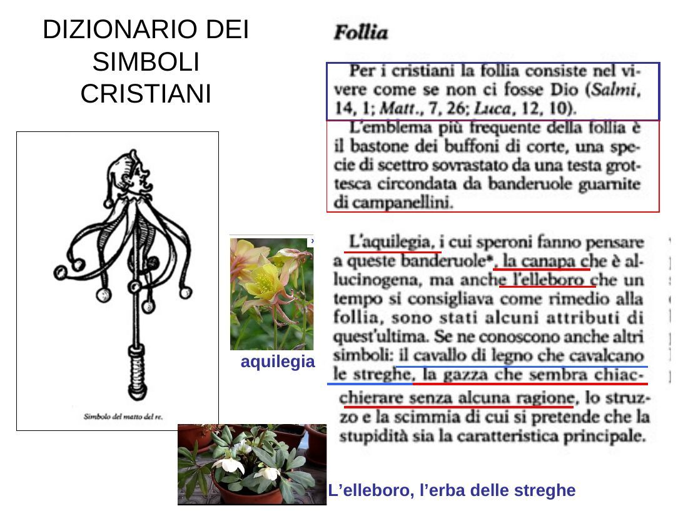{ loading=lazy style="width:59%" }

0:07:27

Per esempio la gazza la troviamo in questo dipinto della Natività di Piero della Francesca, databile al 1470-1475 e oggi alla National Gallery di Londra: vedete sul tetto (non so se si vede tanto bene), qui c’è una gazza, appunto perché è il simbolo dello sproloquio, e simboleggia la fine che poi farà Cristo successivamente. Questa è una rappresentazione medievale: per esempio il legno poi si è tramutato nel bastone del cavallo di legno; sono simbologie medievali, in questo caso il legno è cavalcato dalle streghe.

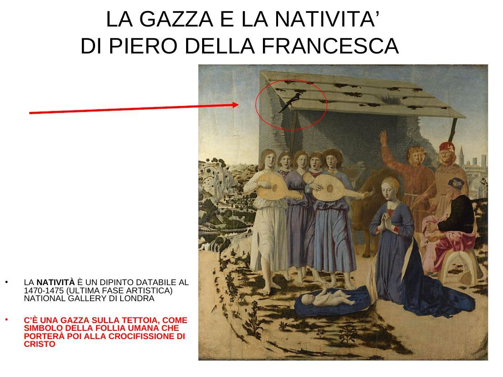{ loading=lazy style="width:47%" }

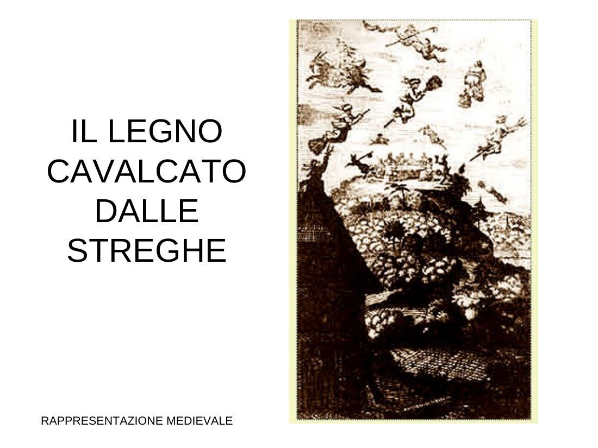{ loading=lazy style="width:47%" }

0:08:07

La follia lecita del carnevale: sappiamo tutti che in tutte le società occidentali c’è questa festa di carnevale, dove tutto è lecito e i ruoli si ribaltano; quindi siamo autorizzati a comportarci come se fossimo persone diverse, altre persone. René Guénon (1886-1951), per esempio, nei *Simboli della Scienza sacra* ci ricorda la festa dell’asino nel Medioevo. Questo è molto interessante, perché questo animale nella simbologia cristiana è un animale satanico, e in questa festa veniva addirittura introdotto nella chiesa e messo nel coro centrale. Quindi immaginate cosa voleva dire, da un punto di vista filosofico, spirituale, introdurre questa simbologia del male all’interno della Chiesa.

**LA FOLLIA (LECITA) DEL CARNEVALE**

A carnevale, in quasi tutte le società occidentali, in una sorta di rito collettivo, in un ben definito periodo di ogni anno, tutti sono autorizzati a non rispettare le convenzioni religiose e sociali, a comportarsi quasi come se fossero altre persone.

Si tratta di un rito liberatorio, che permette a una comunità di prepararsi in modo gioioso all’adempimento dei propri normali doveri sociali.

Deriva dalla locuzione latina *Semel in anno licet insanire*: una volta all’anno è lecito impazzire («uscire da sé stessi»).

Il concetto fu espresso, con leggere varianti, da vari autori: Seneca; Sant’Agostino (*Tolerabile est semel anno insanire*, *De civitate Dei VI, 10*); Orazio (*Dulce est desipere in loco*, *Carm. IV,* 12, 28: è cosa dolce ammattire a tempo opportuno).

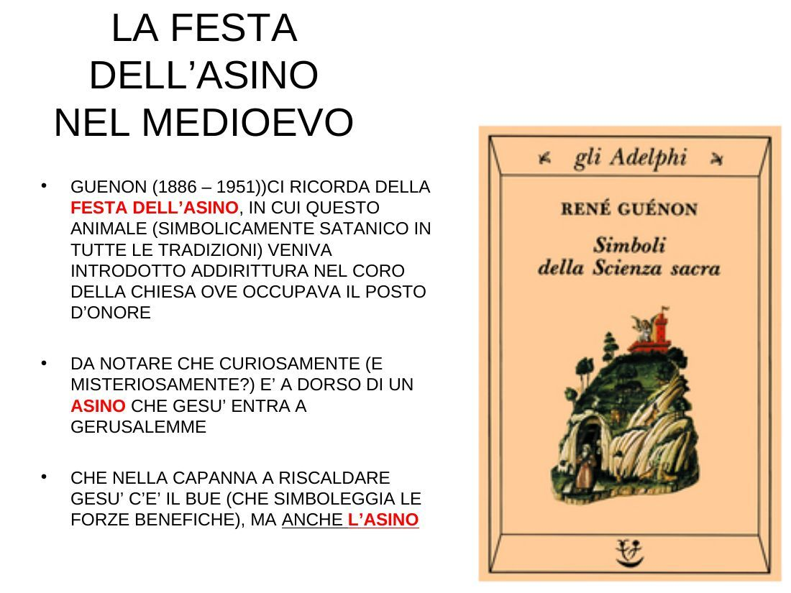{ loading=lazy style="width:59%" }

0:09:05

Guénon si fa altre due domande molto interessanti, a cui forse Lorenzo, nella sua infinita sapienza, ci potrà anche rispondere. Se vi ricordate, Gesù entra a Gerusalemme a dorso di un asino: è particolare, forse misterioso, insomma c’è da farsi qualche domanda. E nella capanna, a riscaldare Gesù Bambino, c’è il bue, simbolo della bontà, ma c’è anche l’asino. Quindi è particolarmente interessante questa simbologia.

0:09:47

Per esempio William Shakespeare, in *Sogno di una notte di mezza estate*, quando Titania si sveglia e si innamora di Bottom, lo raffigura come uno con la testa d’asino, per un sortilegio di Puck: qui è Johann Heinrich Füssli, *Titania accarezza Bottom*, del 1793-1794. Quindi ritorna sempre questo concetto dell’asino. C’è un bel saggio di Marco Taddei dove parla per esempio dei rituali di rovesciamento nell’antichità; richiama anche lui la festa dell’asino del Medioevo, o i Saturnali nella Roma antica. Vedete anche questa figura: è la bandiera della Mère Folle di Digione, del XV-XVI secolo, che mostra il sedere, in questo avvinghiamento particolare.

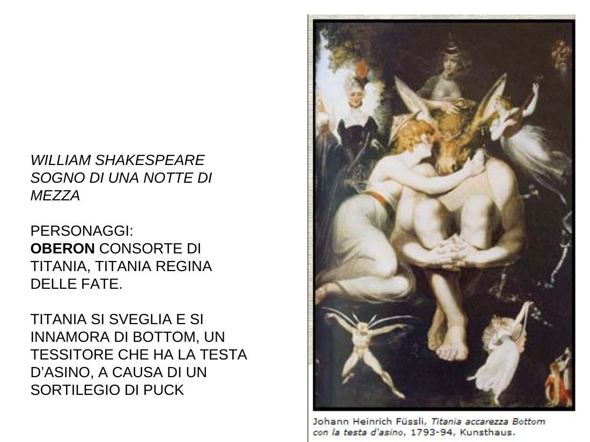{ loading=lazy style="width:47%" }

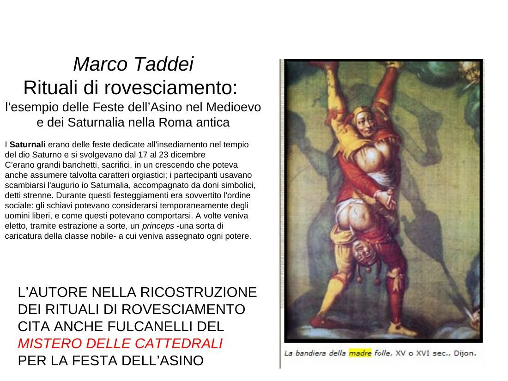{ loading=lazy style="width:47%" }

**MARCO TADDEI – *RITUALI DI ROVESCIAMENTO**

L’ESEMPIO DELLE FESTE DELL’ASINO NEL MEDIOEVO E DEI SATURNALIA NELLA ROMA ANTICA

I Saturnali erano feste dedicate all’insediamento nel tempio del dio Saturno e si svolgevano dal 17 al 23 dicembre. C’erano grandi banchetti, sacrifici, in un crescendo che poteva anche assumere talvolta caratteri orgiastici; i partecipanti usavano scambiarsi l’augurio *io Saturnalia*, accompagnato da doni simbolici, detti strenne. Durante questi festeggiamenti era sovvertito l’ordine sociale: gli schiavi potevano considerarsi temporaneamente uomini liberi, e come tali potevano comportarsi. A volte veniva eletto, tramite estrazione a sorte, un *princeps* – una sorta di caricatura della classe nobile – a cui veniva assegnato ogni potere.

Nella ricostruzione dei rituali di rovesciamento l’autore cita anche Fulcanelli, *Il mistero delle cattedrali*, per la festa dell’asino.

0:10:32

Taddei ricorda anche Fulcanelli, un autore francese (forse uno pseudonimo: non si è mai accertato chi fosse in realtà) conosciuto per *Il mistero delle cattedrali*, del 1926, e c’è un passo molto interessante del *Mistero delle cattedrali* che richiama anche lui la festa dell’asino, e dice: «Nella navata di Notre-Dame di Strasburgo, scrive Witkowski, il bassorilievo di uno dei capitelli dei grandi pilastri riproduce una processione satirica, dove si riconosce un maiale che porta un’acquasantiera» (quindi siamo in questa direzione) «seguito da asini vestiti di abiti sacerdotali, da scimmie munite di diversi attributi religiosi e da una volpe chiusa in una cassa: è la processione della volpe o la festa dell’asino». Quindi è un filo conduttore che attraversa un po’ tutta la cultura occidentale.

0:11:33

Sempre Guénon ci ricorda la festa dei folli, dove in questo caso è invece il basso clero che si abbandona a tutta una serie di comportamenti che sconvolgono tutto l’ordine a cui era abituato nel resto dell’anno. In alcune di queste feste (il paradosso è interessante) si giungeva a conferire a uno schiavo o a un criminale le insegne della regalità: il criminale veniva fatto re per quel giorno, con tutto il potere che questo comportava naturalmente, salvo che a fine festa lo uccidevano subito. Quindi per un giorno era re, però alla fine della giornata era morto.

0:12:29

Prima di addentrarci più a fondo in questo tema della follia, cerchiamo di dare una visione di quello che significa follia. Follia, dal vocabolario Treccani, è lo stato di alienazione, di grave malattia mentale; il termine follia è associato molte volte a un concetto collettivo, a un comportamento di gruppo. Invece pazzia, per esempio, significa qualsiasi forma di alterazione, persistente o temporanea, delle facoltà mentali, ed è più abbinata ai singoli individui. Alcuni proverbi popolari: «Mancando i saggi, i folli tengono banco»; «Il saggio si convince con la ragione, il folle col bastone»; «Gran follia, gran saviezza»; «La tassa sulla pazzia farebbe ricco un regno»; «Chi non fa pazzie in gioventù le fa in vecchiaia». Quindi nei proverbi popolari c’è sempre il tutto e il contrario di tutto, dipende un po’ da come si fa.

**TRECCANI**

**FOLLIA**

Stato di alienazione, di grave malattia mentale (sinon. quindi di *pazzia*): *essere colto da follia improvvisa; essere sull’orlo della follia*. Con accezione partic., *f. collettiva*, comportamento di gruppi che, in determinate circostanze e per reciproca suggestione, rivela una comune situazione psicopatologica, manifestandosi con allucinazioni, delirî paranoici, fanatismo sociale e religioso, ecc.; l’espressione è spesso usata in senso attenuato e scherz., con allusione a mode, infatuazioni temporanee.

**PAZZIA**

Nel linguaggio com., qualsiasi forma di alterazione, persistente o temporanea, delle facoltà mentali (è termine raro nel linguaggio scient., dove si parla invece di *infermità* o *malattia mentale*, o più specificamente di *psicosi*, *psicopatia*, ecc.): *dare segni di p.* (non com., *dare in p.*); *esser colto da p.*; estens., *ci dev’essere in lui un ramo di p.*, di chi fa cose strambe e si comporta in modo poco assennato. *P. ereditaria*, espressione con cui gli scienziati francesi del sec. 19° indicavano forme cliniche oggi considerate nell’ambito della psicosi maniaco-depressiva; per *p. morale*, espressione anche questa disusata, v. *morale*.

La follia è più spesso riferita ai comportamenti collettivi, la pazzia al singolo individuo.

0:13:26

Se si va a vedere l’etimologia, folle deriva dal latino follis, cioè mantice, soffietto, pallone pieno di vento per giocare, e quindi si usa per definire un uomo con la testa vuota di senno. Invece pazzo, come etimologia, viene dal latino patior, soffro, e dal greco pathos, infermità di corpo e d’animo: privo di ragione. In questo caso può essere furibondo, bestiale: quindi c’è una netta differenza tra folle e pazzo. Il folle è leggero, è un pallone, come diceva prima l’etimologia, e quindi vola, svolazza, perdendosi in vani pensieri.

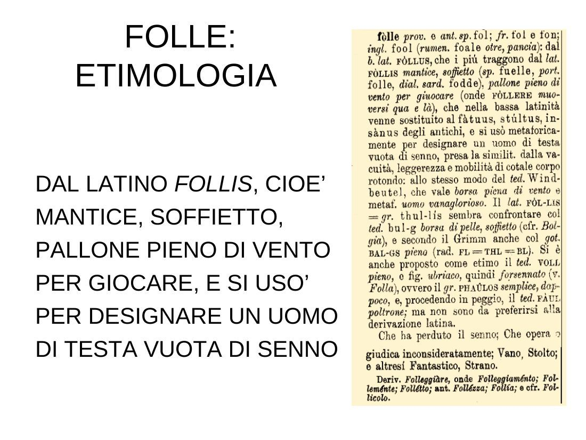{ loading=lazy style="width:47%" }

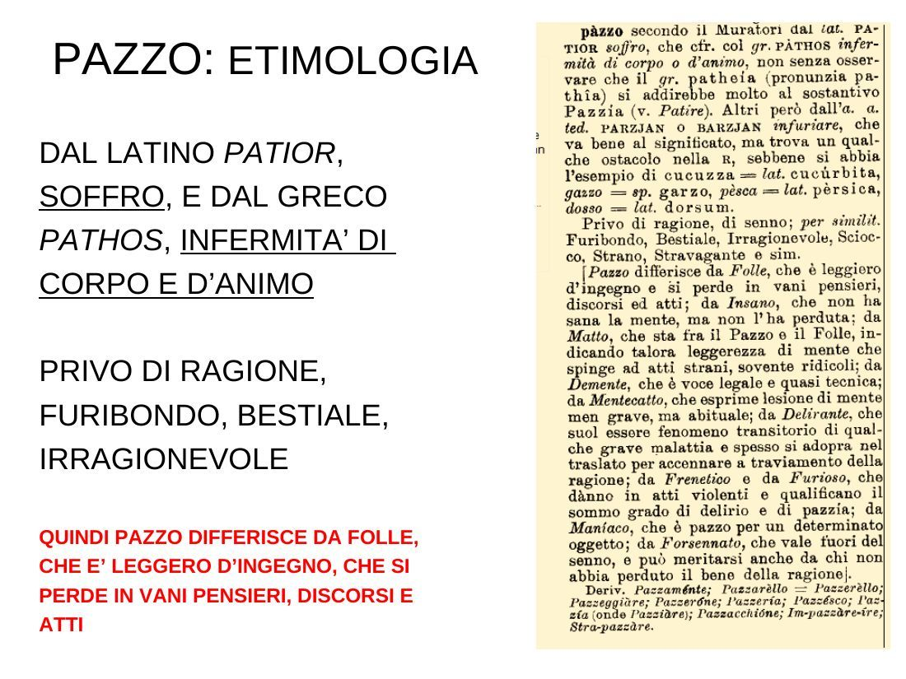{ loading=lazy style="width:47%" }

0:14:16

Possiamo dire per esempio della follia nella medicina, che viene definita come il mancato adattamento del malato nei confronti dell’ambiente in cui vive. La concezione della follia naturalmente varia nel corso del tempo: brevemente ora vediamo di tratteggiare come si è evoluta. Secondo una lettura psicoanalitica, la follia è il momento in cui c’è una sovrapposizione della parte istintuale della persona su quella invece razionale, tipica dell’uomo. Nel mondo classico la follia era vicina alla sfera sacra, e quindi il folle rappresentava anche la voce del divino. Si arriva al Medioevo, dove invece la follia era il simbolo del demonio, e quindi il pazzo rischiava la vita, perché bisognava riparare anche il corpo, che era guastato dalla follia e quindi dal demonio.

**LA FOLLIA NELLA MEDICINA**

La follia viene generalmente identificata come la mancanza di adattamento che il malato mostra nei confronti dell’ambiente in cui vive.

Occorre tenere presente che la definizione di follia è sempre influenzata dal momento storico, dalla cultura e dalle convenzioni del tempo: perciò è possibile (ed è stato possibile) considerare folle qualcosa o qualcuno che prima era normale, e viceversa.

La follia può manifestarsi come violazione delle norme sociali, compresa la possibilità di diventare un pericolo per sé stessi e per gli altri.

Nell’uso moderno «follia» è più comunemente usato come termine informale che denota instabilità mentale (anche in ambito giuridico). Nella medicina non si usa il termine instabilità mentale, bensì quello di malattie mentali; la branca della medicina che se ne occupa è la psichiatria.

**UNA INTERPRETAZIONE PSICOANALITICA**

Si potrebbe definire «follia» il momento in cui c’è una sovrapposizione della parte istintuale su quella razionale, con una modifica quindi della comune dialettica tra queste due parti del nostro cervello.

Tra gli effetti più diffusi vi sono sicuramente la schizofrenia, ovvero l’interpretazione alterata della realtà per uscire fuori dal mondo; la fuga come distacco graduale dal mondo, dagli affetti, dalle relazioni e dagli interessi sociali (depressione); le ossessioni, i ritualismi e la maniacalità del potere.

**BREVE STORIA DELLA FOLLIA**

Nel mondo classico la follia era imprescindibilmente legata alla sfera sacra: il folle rappresentava la voce del divino, da ascoltare per interpretarla.

Nel Medioevo, invece, il folle diventò spesso il rappresentante del demonio: perciò bisognava liberarlo dal male, in qualche modo esorcizzarlo. Si diffuse la dicotomia spirito-corpo che, nel caso di malattia mentale, impose come primo atto l’intervento riparatorio sul corpo guasto. Quando le «cure» non avevano successo si prevedeva l’eliminazione fisica del folle: nel Medioevo i folli rischiavano il rogo.

0:15:24

Al Museo del Prado a Madrid c’è questo dipinto, del 1480, che si chiama *Estrazione della pietra della follia*. Vi si vede un chirurgo (non so se si vede l’immagine): c’è un paziente a cui viene aperto il cranio e viene estratta la pietra della follia, che risiede nella testa. È una visione un po’ satirica: infatti il chirurgo è rappresentato con un imbuto in testa, l’assistente con un libro sulla testa; è una rappresentazione un po’ satirica anche della medicina di quel tempo. Il tema si rifà al detto popolare che indicava i pazzi come coloro che hanno un sasso nella testa. L’iscrizione in alto recita «Meester snijt die keye ras», cioè «Maestro, cava fuori la pietra»; quella in basso «Myne name is Lubbert Das», cioè «il mio nome è sempliciotto».

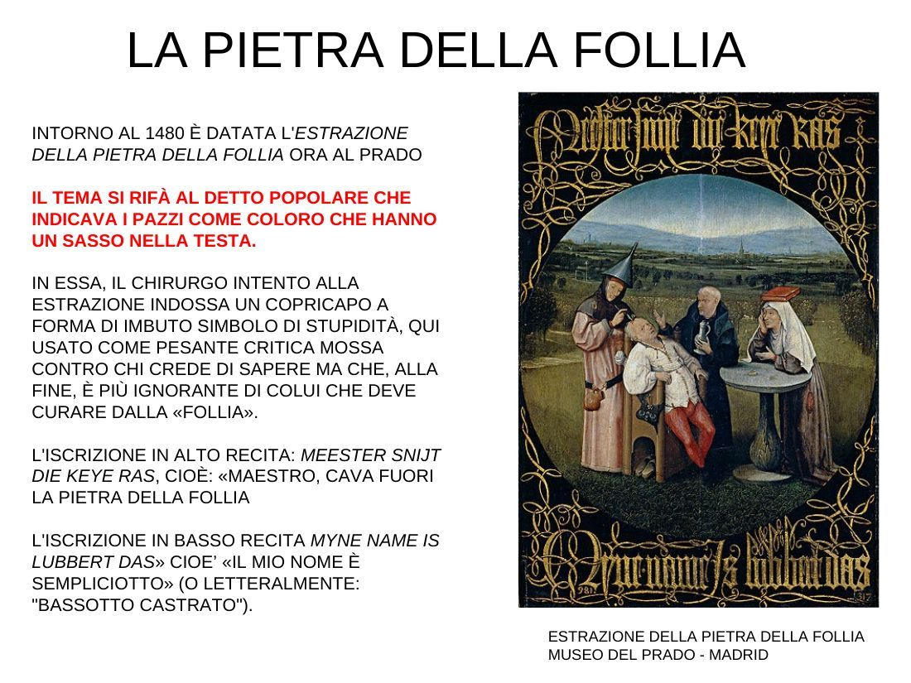{ loading=lazy style="width:30%" }

0:16:20

Infatti questi erano gli antesignani della lobotomia, quella che poi è stata fatta dalla metà dell’Ottocento in avanti, dove venivano fatti dei fori nella testa e venivano estratti dei lobi di cervello, nei primi esperimenti di lobotomia. Poi è stata perfezionata, ma nelle prime espressioni era terribile, se ci pensate. Sostanzialmente la lobotomia è durata per un secolo, anche di più, un secolo e mezzo, fino a che non hanno scoperto una medicina che si chiama (lo devo leggere perché non lo so) clorpromazina, che ha sostituito sostanzialmente l’uso della lobotomia nei casi più gravi. Questa è un’immagine che ho trovato della lobotomia: vedete questo povero essere disteso su questa barella, dove attraverso i canali del naso gli praticano questo intervento.

**L’EVOLUZIONE DELLA PIETRA DELLA FOLLIA NELLA LOBOTOMIA**

La lobotomia è un intervento di neurochirurgia che consiste nel recidere le connessioni della corteccia prefrontale dell’encefalo.

Nel 1890 il dottor Burckhardt praticò lobotomie parziali su alcuni pazienti in un ospedale psichiatrico in Svizzera: creò dei fori con un trapano nel cranio ed estrasse parti dei lobi frontali.

La prima lobotomia umana controllata venne praticata dal medico e neurologo portoghese António Egas Moniz nel 1935-1936. Il suo metodo prevedeva la trapanazione in vari punti del cranio e la distruzione della sostanza bianca dei lobi frontali mediante iniezioni di alcol al loro interno. Moniz vinse il premio Nobel per la medicina nel 1949 per questa tecnica.

La lobotomia è stata a lungo al centro di dibattiti scientifici, ma solo con l’avvento, negli anni Cinquanta, della clorpromazina tale pratica cominciò a sembrare barbarica e cadde rapidamente in disuso.

Venne abbandonata quasi completamente all’inizio degli anni Settanta, ma alcuni paesi hanno continuato ad applicarla, su scala drasticamente ridotta, anche negli anni Ottanta.

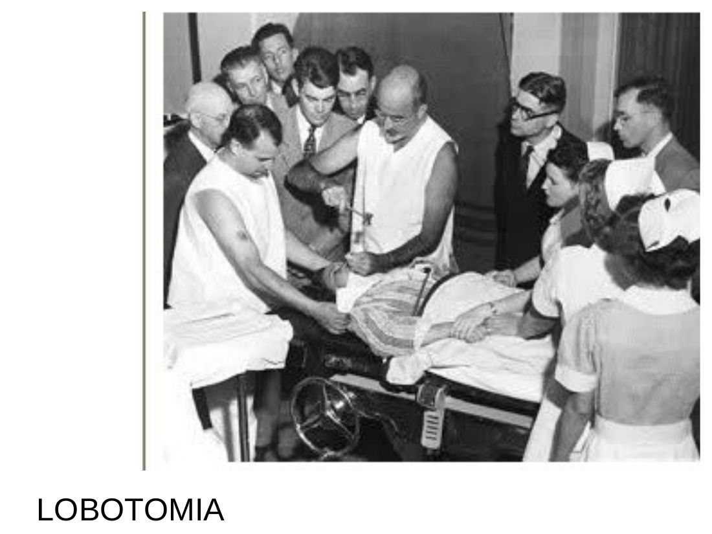{ loading=lazy style="width:38%" }

0:17:37

Appunto, nella storia c’è stata questa diversa interpretazione della follia. Basta pensare al Rinascimento (poi magari lo affrontiamo anche successivamente): l’*Elogio della follia* di Erasmo da Rotterdam, che ha una visione completamente diversa di questo mondo della follia: il folle è considerato una persona diversa, per i valori e per la filosofia di vita, e quindi va rispettato, lasciato libero. Nel Settecento i folli erano rinchiusi nelle carceri, perché non c’erano strutture specifiche in cui internare questi malati. Dall’Ottocento in avanti, influenzati anche dal positivismo, si giunge a dire che il folle è una macchina rotta, e quindi va riparato. Il Novecento, con Freud e poi Jung, introduce invece la parte più psicoanalitica.

**BREVE STORIA DELLA FOLLIA**

Alla metà del Settecento i folli erano detenuti nelle carceri, poiché mancavano strutture sanitarie specifiche. Proprio in questo periodo, in Francia, in Germania e in Inghilterra si mise in moto un processo lento che consentirà, entro una cinquantina di anni, grazie alle prime leggi apposite, di consegnare i folli ai familiari o, in mancanza di questi, di inserirli negli ospedali o nei primi istituti specializzati nati in quell’epoca.

Per quanto riguarda l’approccio terapeutico ai malati, soltanto verso la fine del XVIII secolo il medico chirurgo Jacques René Tenon rivoluzionò la mentalità medica dell’epoca, cercando di imporre il concetto di inviolabilità della persona umana e di libertà, seppure all’interno della struttura, per il malato, e distinguendo la terapia medica da quella soltanto repressiva, di tipo carcerario, in vigore fino a quel momento.

Nello stesso periodo in Francia si impose una visione laica nella gestione dei malati di mente e, grazie all’opera fondamentale del dottor Philippe Pinel, le ideologie democratiche dell’epoca si riversarono sulla mentalità e sul tipo di controllo da applicare ai folli. Fu il periodo in cui la conoscenza delle malattie mentali acquistò credibilità scientifica; le innovazioni di Pinel esalteranno l’importanza del rapporto paziente-terapeuta e del transfert nella psicoterapia.

Dall’Ottocento in avanti emerse la visione, influenzata dal positivismo, del folle come «macchina rotta», ovvero lesionata nel cervello.

Nel Novecento Freud, con l’intuizione della guarigione perseguibile tramite una ricerca interiore e un rapporto più umano con il terapeuta, e con tutta l’architettura della psicoanalisi nel suo complesso, e Jung, con la sua indagine dei contenuti simbolici degli elementi della follia e l’introduzione degli archetipi per definirla con più chiarezza, mutarono nuovamente la storia del folle e del significato della follia. Si arriva infatti anche al concetto di antipsichiatria.

0:18:32

Naturalmente, una volta sfondato il muro, c’è anche l’antipsichiatria (il termine lo usò per la prima volta David Cooper nel 1967), che è della metà del secolo scorso e che negli anni Sessanta si impose come un movimento che contestava le ragioni della medicina ufficiale e si proponeva di vedere la follia sotto altri concetti, che non fossero quelli del malato da rinchiudere. Queste per esempio sono alcune immagini tipiche, tra gli anni Sessanta e Settanta, che rappresentavano la concezione dell’antipsichiatria in questi movimenti.

**ANTIPSICHIATRIA**

Con il termine antipsichiatria ci si riferisce a un indirizzo che si pone fondamentalmente in contrasto con le teorie e le pratiche della psichiatria in generale, e della biopsichiatria in particolare.

La psichiatria biologica è lo studio interdisciplinare delle basi biologiche del comportamento, il cui scopo principale è lo sviluppo di tecniche per la diagnosi e la terapia della malattia mentale.

Le critiche più comuni rivolte dai movimenti antipsichiatrici sostengono che la psichiatria utilizzerebbe concetti e strumenti medici in modo improprio e che sarebbe «compromessa» in ipotetici legami finanziari e professionali con l’industria farmaceutica.

Alla fine degli anni Sessanta il termine «antipsichiatria» (usato per la prima volta da David Cooper nel 1967) definiva un movimento eterogeneo che contrastava le teorie e le pratiche fondamentali della psichiatria dominante.

In pieno periodo della contestazione lo psichiatra Thomas Szasz affermò che l’espressione “malattia mentale” sarebbe una combinazione internamente incoerente di un concetto medico e di uno psicologico, ma sarebbe popolare perché legittimava l’uso della psichiatria per controllare e limitare la devianza dalle norme sociali: per questo era inaccettabile.

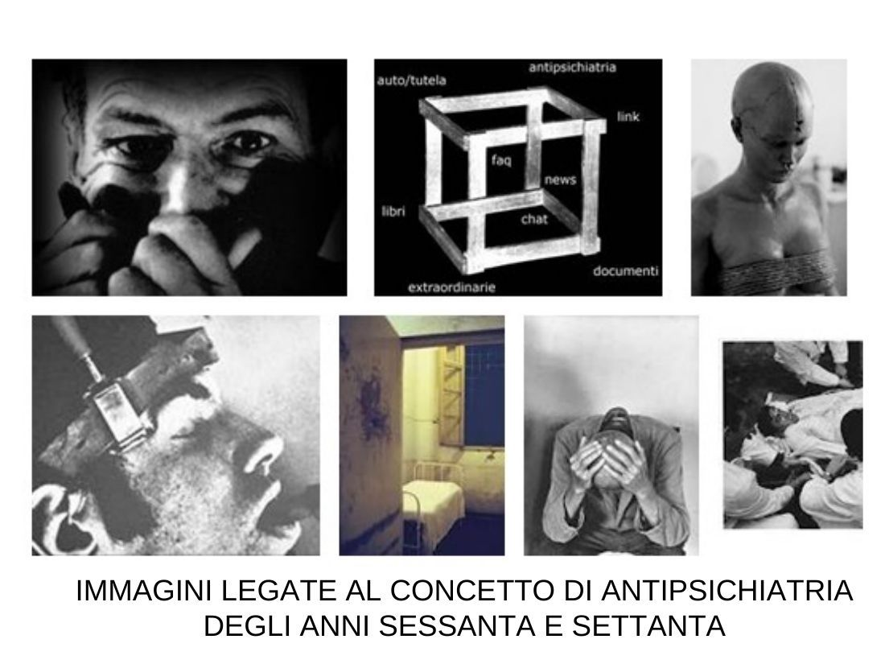{ loading=lazy style="width:41%" }

0:19:21

Ecco, abbiamo introdotto diversi argomenti, però credo sia giusto ora sentire il parere della filosofia, non del filosofo, perché non posso appellarlo.

0:19:38

Lorenzo Poggi Dopo questa introduzione estremamente attenta ed esauriente di Paolo, quale posto può avere in questo una considerazione della filosofia? Intanto vediamo il simbolo. L’asino, se ne parlava prima, è segno della fecondità della terra. L’asino è colui che, secondo gli antichi, mantiene in sé l’anima della natura. Perché? Perché è un animale che spesso fa del vento dalla parte posteriore. E questo vuol dire che ha un animo (*animus*, vento): è vento della natura. Ed è un animale che si sottopone a stento ai comandi dell’uomo: cocciuto, segue la natura e non segue i comandi dell’uomo, che invece vorrebbe sovrapporsi alla natura. Quindi da sempre l’asino è diventato il segno di questa forza vitale, di questa forza ctonia, ed era poi segno anche del dio Priapo e della vitalità della terra. Per questo c’erano i riti antichi. Per la cronaca, il lunedì di Pasqua a Signa c’è un residuo di festa asinaria ancora oggi praticata: gli asinelli vengono dalle chiese vicine e portano i bambini vestiti da angioletti sulla soma (credo che anche Mimolde sia stato un angioletto, una cosa terribile), e portano l’olio per la lampada della Beata Giovanna. È una festa asinaria antica ancora oggi praticata; quindi, se ve lo ricordate e vi capita, può essere una cosa interessante.

0:21:42

Che cosa possiamo dire subito, immediatamente, del discorso di Paolo? Risulta chiarissima una cosa: la follia si pone come perdita della funzione simbolica. La follia è il fallimento dell’azione simbolica della percezione. Che cosa vuol dire? Vuol dire che noi, quando percepiamo le cose e percepiamo il mondo, le percepiamo in modo simbolico: trascendiamo quella che è l’immediatezza della percezione per dare a questa un significato diverso, che prescinde dall’immediatezza.

0:22:40

Perché si chiama fallimento dell’azione simbolica? Perché per operare nel mondo l’uomo ha bisogno di sentirsi sicuro, ha bisogno che le cose siano disponibili, cioè siano disposte in un certo modo e rispondano sempre a determinate azioni. Per far questo bisogna avere un’immagine preconfezionata del mondo, e su questa immagine si fonda la propria sicurezza, e si fondano le immagini del mondo che costruiscono quelle che sono le immagini della cultura. Ecco perché il folle, nel momento in cui prevale la visione simbolica cristiana, è visto come colui che subisce l’effetto delle forze demoniache: perché non è in grado di condividere, non sente la disponibilità delle cose del mondo mediata dalla simbologia della religione cristiana.

0:24:00

Il fallimento dell’azione simbolica è evidentissimo quando pensiamo all’inquietudine che si diffonde quando le cose percepite cambiano di significato. Pensate lo smarrimento che ha dovuto suscitare il fatto che la terra non era più il centro dell’universo, ma c’era il sole: sentirsi emarginati, periferia. Quale sconvolgimento nella disponibilità delle cose, che era data da una certa immagine fisica del mondo, ha dovuto provocare il fatto che a un certo punto si dovette capire che le cose non erano disposte secondo una qualità (quelle peggiori e più pesanti in basso, quelle migliori e più spirituali in alto), ma secondo delle quantità misurabili, legate alla legge di gravitazione universale.

0:25:22

È una variazione totale dell’immagine del mondo, che crea una difficoltà di relazionarsi al mondo, alle cose, perché il mondo e l’esperienza non rispondono più, non hanno più quella consequenzialità, quella disponibilità nella quale l’uomo abita con sicurezza. E allora questo fallimento dell’azione simbolica della percezione genera tutte quelle che sono le forme più evidenti della follia, che non hanno una valenza conoscitiva, non sono dovute a un difetto cognitivo. No, è proprio questo fallimento della percezione.

0:26:12

L’ossessione è quando la parte non rimanda più al tutto, ma diviene di per sé qualche cosa, perché ha preso il posto del tutto e non è più parte di un insieme. Per cui ci sono delle manie ossessive. Che cos’è questo? È il fallimento dell’azione simbolica della percezione. L’allucinazione: un accenno che non riesce più a rimandare a ciò a cui accennava, a tutto quel significato più vasto che c’era sotto, ma rimane accenno privo di significato, che si ripresenta in modo ossessivo, come dicevamo. E il delirio, accentuazione della virtualità percettiva; e l’autismo, mancata percezione totale della disponibilità del mondo, per cui il mondo diventa immediatamente non simbolizzabile, ostile, estraneo. Che cos’è questo? È il fallimento della funzione simbolica della percezione.

0:28:09

Nella storia della cultura abbiamo momenti in cui possiamo ricostruire questo modo. C’è un momento in cui, per esempio, la follia è dovuta al fatto che la ragione viene accecata; qualche volta è accecata dagli dèi, ma lasciamo stare, sono casi antichi. La ragione è accecata, e allora l’individuo, per difendere la propria esistenza, supera l’equilibrio, va al di là dell’equilibrio (*hybris*), e che cosa fa? Pensa di avere più potere, per volgere a proprio tornaconto il possesso delle forze del tutto.

0:29:25

Vi faccio un esempio, sennò il discorso diventa terribile: facciamo un ricordo classico, da liceo classico, che poi conoscono tutti. Voi sapete che la guerra di Troia è una questione di donne, come sempre: le cose nella vita sono terribili. Poi la guerra di Troia è un macello, insomma. E lì il dramma comincia sempre con una questione di corna, no? Quando c’è il comandante, e che cosa fa Agamennone? Siccome lui ha preso come schiava la figlia del sacerdote Crise, sacerdote d’Apollo, che fa Crise? Gli hanno preso la figliola: va lungo il mare e chiede aiuto ad Apollo. È bellissima la scena: «Incamminossi il vecchio pel lido del risonante mar, lungo la riva, e al sacro figlio di Latona, Febo, questo prego: “Dio dall’arco d’argento, o tu che Crisa proteggi e l’alma Cilla, e sei in Tènedo possente imperator, Sminteo”». E gli fa tutto il discorso, e gli dice: i Greci mi hanno rubato la figlia, «e te vendiami il pianto mio», dice Crise, «paghino i Greci per le tue saette».

0:31:00

E Febo l’ascolta. Febo: hanno fatto questo sgarbo a Crise, in fondo l’hanno fatto a lui, è il suo sacerdote. Che cosa fa? Scende giù dall’Olimpo in grande sdegno, «con l’arco sulle spalle e la faretra tutta chiusa; mettean le frecce un orrendo tintinnio al mutar dei gran passi, simile a fosca notte» giù venìa; si mette al cospetto delle navi e comincia a saettare. Scoppia la peste. Non si dice che è un po’ creato: bisogna restituire la figlia di Crise. Allora, nell’assemblea: «Bisogna restituire la figlia di Crise». «Ma era mia, era il mio premio».

0:31:45

Allora, privato della figlia di Crise, Achille è preso dalla follia: il dio lo manda fuori dai gangheri, e dice: «Voglio la schiava in cambio; visto che io la devo restituire, sennò non finisce la peste, voglio la schiava di Achille», Briseide. E siccome lui è il comandante, il capo, gliela prende, e succede un macello: Achille, nero più che mai, non scende più in battaglia, e da quel momento in poi sapete tutto il macello che è successo.

0:32:29

Dov’è la follia? La follia è lì: il dio ha oscurato la ragione, e lui ha superato il limite. Non ha capito che, nel modo ciclico di vedere il mondo, tutti gli esseri viventi subiscono dolore, il dolore fa parte dell’esistenza, e non si può pensare di superare il dolore con un atto di forza perché si è in una posizione più eminente. Se si fa così, si pensa di volgere a nostro conto la forza del tutto; ci mettiamo contro il ciclo della natura: siamo folli. Ecco la follia dell’accecamento. E da quel momento in poi il fato si vendica: questo è il destino.

0:33:27

Quindi nell’antichità il dolore genera la colpa, e la colpa è conseguenza di un atto di follia. Nel cristianesimo ci sarà un rovesciamento completo: è la colpa che ha generato il dolore. Noi stiamo male perché? Dio ci aveva creato e si stava bene nel paradiso terrestre; ma stiamo male perché siamo stati cattivi. Rovesciamento completo rispetto alla mentalità greca. E quindi la follia come non riconoscimento del vero destino dell’uomo, della simbologia, della capacità di operare sul mondo, se ci si mette nell’ordine di questo modo di operare. Quindi la follia come fallimento della capacità, della necessità simbolica. Noi, come uomini, non abitiamo il mondo della natura: abitiamo l’immagine che ci siamo fatti del mondo della natura.

0:34:52

L’immagine ci serve per questo: ci serve per poter trascendere il mondo con il pensiero, per poterlo poi, una volta che lo si è trasceso, dominare, sentircisi dentro come se fossimo a casa nostra, perché così siamo in grado di riordinare le cose. Il folle è colui che non è capace di questa operazione: si ferma ai particolari, e quindi va contro quella che è la trascendenza simbolica della conoscenza. Mi fermo qui, che poi dobbiamo mangiare; riprendiamo dopo.

\[PAUSA\]
{: .nota }

1:01:55

Paolo Marcucci Iniziamo la seconda parte. Allora, per chi di voi era presente alla serata precedente: abbiamo trattato il genio collettivo e il genio individuale. Stasera, allo stesso modo, possiamo farci la stessa domanda: la follia appartiene alla sfera privata o a quella collettiva? Vediamo un po’ di analizzare questa domanda. Nella scorsa serata abbiamo ipotizzato che il progresso che muove il mondo sia in definitiva il genio collettivo; stasera, analizzando la follia, si può forse dire, questa volta in senso negativo, che il male vero risiede nella follia collettiva, e che nella sfera privata albergano le due strade principali dell’uomo folle. Il male individuale è quello che porta con sé la malattia e la sofferenza, con tutto quello che ne consegue; e poi c’è anche un aspetto della genialità (ecco un legame con la serata scorsa).

1:02:54

Se prendiamo la follia individuale, per esempio c’è la follia del serial killer. Il serial killer ormai c’è in quasi tutti gli sceneggiati televisivi. Possiamo dire, a grandi linee, che i profili del serial killer sono due: lo psicopatico e il sociopatico. Lo psicopatico è un individuo disadattato, senza lavoro, generalmente senza titolo di studio, con trascorsi criminali, e quindi si identifica più facilmente. Invece il sociopatico, il folle sociopatico, è intelligente, si è integrato bene nella realtà dove vive, e per questo è molto più difficile da individuare: sparisce nella massa, è uno shock per i suoi vicini, e i suoi delitti avvengono in orari compatibili con un’attività lavorativa, la sera, nel fine settimana. Questa è per esempio la follia dell’uomo solo. Questi sono due serial killer: Ted Bundy, americano, autore di almeno 30-35 omicidi di giovani donne negli Stati Uniti tra il 1974 e l’inizio del 1978, e un italiano invece, Gianfranco Stevanin, un po’ più recente, di una decina di anni fa, mi sembra, nel Veneto, che ha ucciso cinque donne, sbarazzandosi dei corpi seppellendoli o gettandoli nell’Adige.

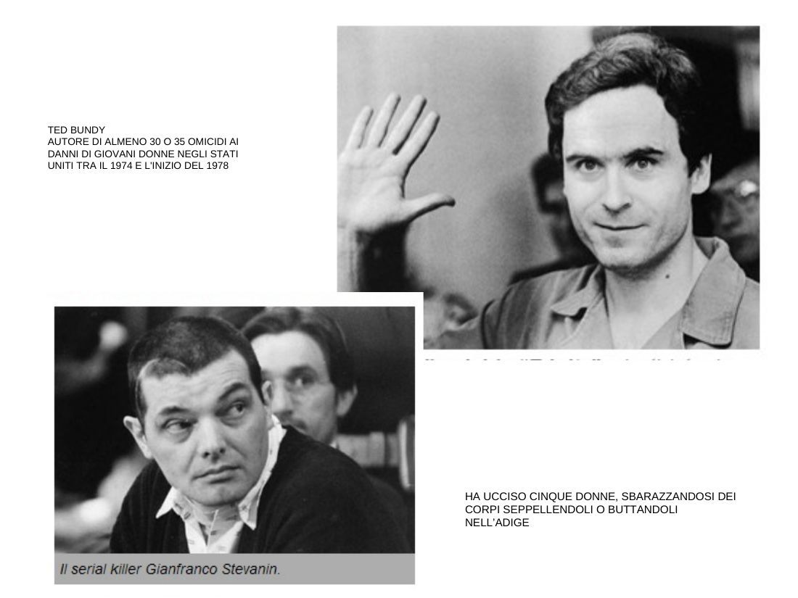{ loading=lazy style="width:49%" }

1:04:05

C’è anche una follia collettiva, con il male collettivo che comporta. E come a volte il collettivo è il bene che fa muovere il mondo, ci sono delle azioni collettive di follia che portano il male. Per esempio i roghi dei libri. Nel 1933, nella Germania nazista, si organizzò forse il più famoso e atroce rogo di libri dell’epoca moderna, perlomeno. E Goebbels vi tenne anche un discorso, in questa giornata in cui furono bruciati tutti i libri non confacenti all’ideologia nazista e non tedeschi. È appunto il 10 maggio del 1933. Questa è una foto; vi faccio vedere il video, sono un paio di minuti.

**I ROGHI DEI LIBRI**

*Bücherverbrennungen* (roghi di libri): nel 1933, organizzati dalle autorità della Germania nazista, durante i quali vennero bruciati tutti i libri non corrispondenti all’ideologia nazista. Furono concepiti per eliminare «lo spirito non tedesco».

Il più grande rogo avvenne il 10 maggio 1933 nell’Opernplatz berlinese, organizzato dall’associazione studentesca tedesca.

Lo stesso giorno il gerarca nazista Joseph Goebbels vi tenne perfino un discorso, in cui affermava che i roghi erano un ottimo modo «per eliminare con le fiamme lo spirito maligno del passato»:

«Studenti, uomini e donne tedesche, l’era dell’esagerato intellettualismo ebraico è giunta alla fine. Il trionfo della rivoluzione tedesca ha chiarito quale sia la strada della Germania, e il futuro uomo tedesco non sarà un uomo di libri, ma piuttosto un uomo di carattere: è in tale prospettiva e con tale scopo che vogliamo educarvi. Vogliamo educare i giovani ad avere il coraggio di guardare direttamente gli occhi impietosi della vita. Vogliamo educare i giovani a ripudiare la paura della morte, allo scopo di condurli a rispettare la morte. Questa è la missione del giovane, e pertanto fate bene, in quest’ora solenne, a gettare nelle fiamme la spazzatura intellettuale del passato. È un’impresa forte, grande e simbolica, un’impresa che proverà al mondo intero che le basi intellettuali della Repubblica di Novembre si sono sgretolate, ma anche che dalle loro rovine sorgerà vittorioso il padrone di un nuovo spirito».

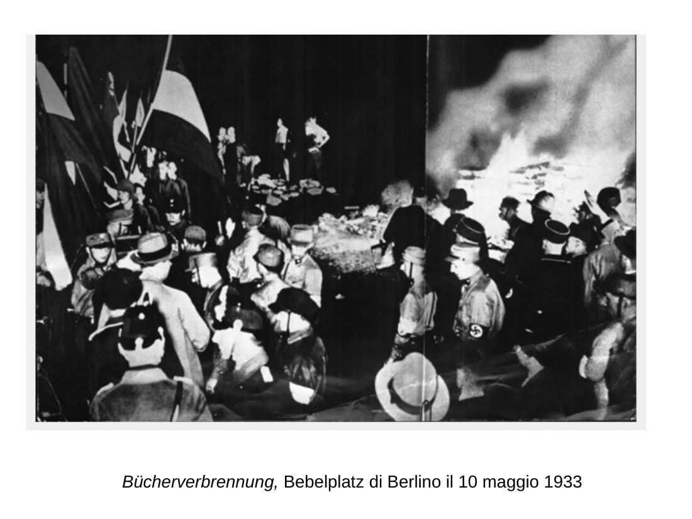{ loading=lazy style="width:38%" }

1:05:28

\[Proiezione di un video d’epoca in tedesco sul rogo dei libri del 1933, con il discorso di Goebbels.\]
{: .nota }

1:07:42

Questo video mi mette ancora qualche brivido. Qui c’erano delle immagini che avevo preparato qualora il video non avesse funzionato. Questa invece è la targa in memoria dei roghi a Francoforte; e questa è molto bella: a Berlino, nella piazza dell’Opera (oggi Bebelplatz), è stata fatta questa opera di libri che ricorda appunto il rogo dei libri del 1933, con tutti gli autori che furono bruciati in quel momento; e sotto la piazza, attraverso un vetro, si vede una piccola stanza ingombra di librerie bianche vuote. Una considerazione così, al volo: si può dire che in tempi moderni il rogo dei libri è un po’ più complesso, visto il mondo informatico in cui viviamo, e quindi i nazisti avrebbero un po’ di difficoltà a bruciare questi libri: la digitalizzazione permette di averne copie infinite e sconosciute nei server di tutto il mondo. La censura e il disprezzo per i libri proibiti magari trovano altre vie: ma questo sarebbe un tema da affrontare nei prossimi cinquant’anni, come dice Lorenzo.

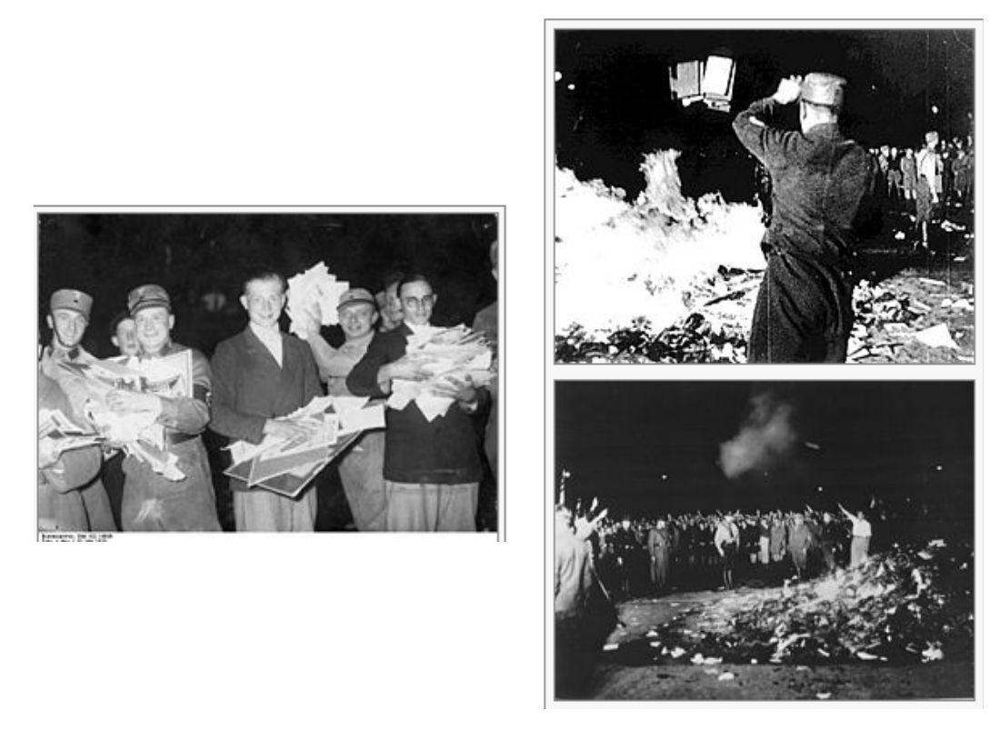{ loading=lazy style="width:47%" }

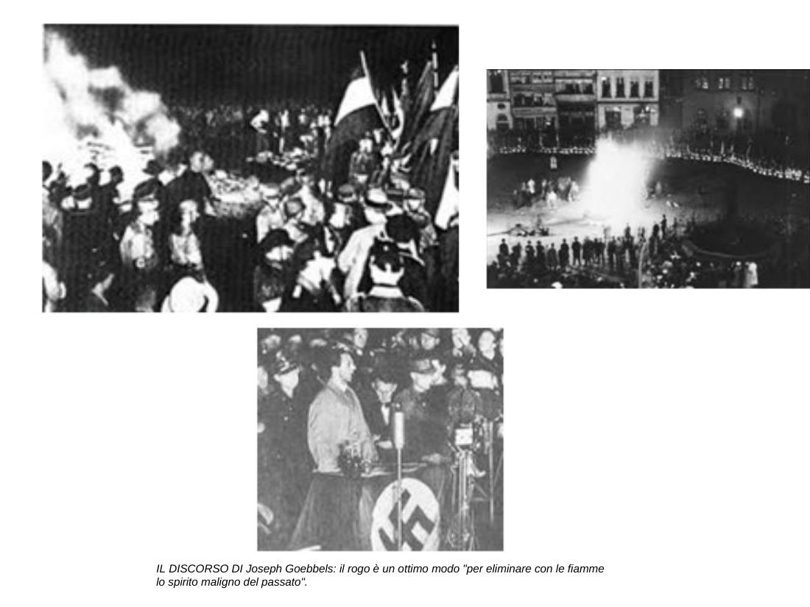{ loading=lazy style="width:47%" }

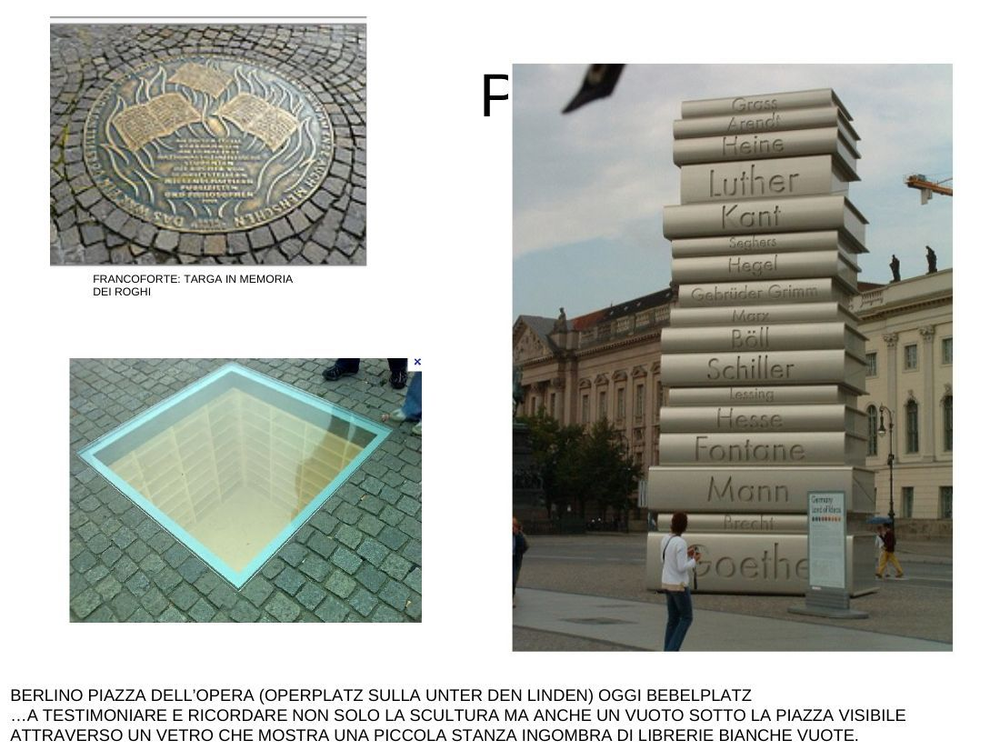{ loading=lazy style="width:47%" }

1:08:34

Nel corso della storia ci sono sempre stati i roghi dei libri. Ne vediamo qualcuno al volo: nel 212 a.C. in Cina; oppure nel 292 d.C. ad Alessandria; Atanasio, nel 367 d.C., vescovo di Alessandria, bruciò tutti i libri del tempo; per arrivare, per esempio, al 1497, il martedì grasso, al rogo del Savonarola. Sandro Botticelli, così persuaso, volente o nolente, portò lui stesso le sue opere e le gettò sul rogo della piazza.

**ROGHI DI LIBRI NELLA STORIA**

212 a.C. – il rogo dei libri in Cina, sotto Qin Shi Huang; molti intellettuali che disobbedirono all’ordine furono sepolti vivi.

292 d.C. – i libri di alchimia di Alessandria furono bruciati dall’imperatore Diocleziano.

367 d.C. – Atanasio, vescovo di Alessandria, emanò una lettera pasquale nella quale esigeva che i monaci egiziani distruggessero tutti gli scritti inaccettabili, a eccezione di quelli che egli stesso etichettò come canonici e accettabili: questa lista è quella che attualmente costituisce il Nuovo Testamento. I testi eretici non sopravvissero nemmeno come palinsesti, cancellati o sovrascritti come i testi pagani; in questo modo molti testi dei primi secoli dell’era cristiana si persero, come se fossero stati pubblicamente bruciati. Il Vangelo di Giuda, recentemente ritrovato in Egitto, fu un libro che si perse proprio per questa pratica di distruzione privata dell’informazione.

7 febbraio 1497 – Firenze, martedì grasso: il falò delle vanità promosso da Girolamo Savonarola. Oltre ai libri vennero bruciati specchi, cosmetici, vestiti lussuosi, strumenti musicali e opere d’arte; Sandro Botticelli stesso portò sul rogo alcuni suoi dipinti sulla mitologia classica.

Questi falò non vennero inventati da Savonarola: erano un naturale e comune seguito ai sermoni pubblici all’aperto tenuti da san Bernardino da Siena nella prima metà del secolo.

Vasari descrisse un rogo così: «Il carnovale seguente, che era costume della città far sopra le piazze alcuni capannucci di stipa et altre legne, e la sera del martedì per antico costume arderle queste con balli amorosi… si condusse a quel luogo tante pitture e sculture ignude, molte di mano di maestri eccellenti, e parimente libri, liuti e canzonieri, che fu danno grandissimo, ma particolare della pittura, dove Baccio portò tutto lo studio de’ disegni che egli aveva fatto degli ignudi, e lo imitò anche Lorenzo di Credi e molti altri, che avevon nome di piagnoni».

1:09:28

Però questi roghi non erano stati inventati da Savonarola, ma da Bernardino da Siena, che in Toscana faceva campagna per questi roghi. Infatti all’Oratorio di San Bernardino a Perugia c’è quest’opera di Agostino di Duccio (1457-1461) che ritrae il santo mentre organizza un falò delle vanità; da lì poi aveva preso spunto anche Savonarola. Naturalmente, come in tutte le vicende della storia, poi c’è il contrappasso, e a Savonarola toccò subire a sua volta quello che aveva imposto ai libri: qui è il *Supplizio di Savonarola* di Filippo Dolciati, al Museo di San Marco a Firenze; il 23 maggio 1498 Savonarola fu bruciato insieme a Buonvicini e Maruffi.

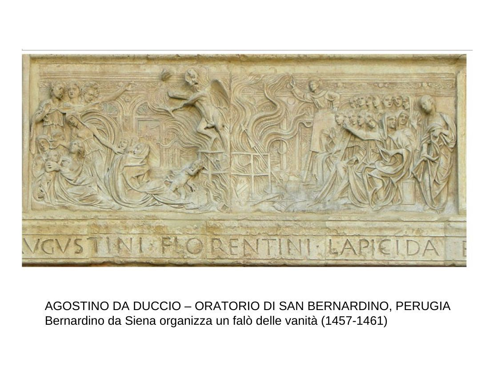{ loading=lazy style="width:47%" }

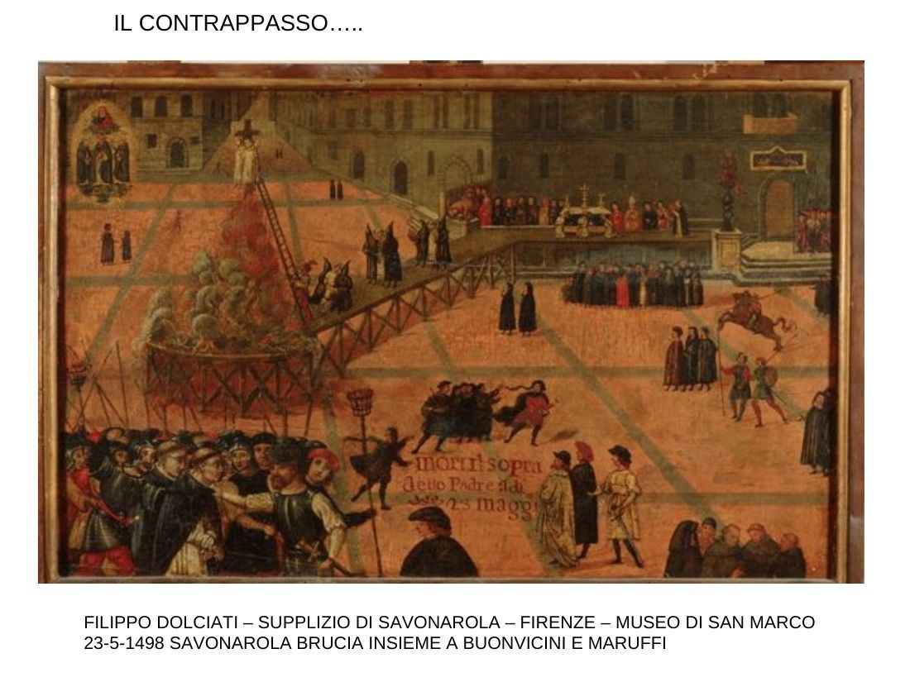{ loading=lazy style="width:47%" }

1:10:11

Nel XVI secolo gli andalusi della penisola iberica avevano l’obbligo di consegnare alle autorità castigliane i libri scritti in arabo, per esempio. Freud, venendo a conoscenza che i suoi libri erano stati bruciati dai nazisti, fece una bella battuta: «Com’è avanzato il mondo: nel Medioevo avrebbero bruciato me». Aveva ragione in parte, perché lui riuscì a fuggire dall’Austria, ma le sue quattro sorelle non riuscirono a fuggire e morirono nei campi di concentramento. L’Inquisizione bruciava i libri, e molte volte anche chi li aveva scritti: questo è il rogo di 600 libri ordinato da Torquemada nel 1490.

**ROGHI DI LIBRI NELLA STORIA**

XVI secolo – gli andalusi della Penisola Iberica avevano l’obbligo di consegnare alle autorità castigliane i libri scritti in arabo: venivano poi restituiti quelli di medicina, filosofia e storia, e bruciati tutti gli altri.

1821 – lo scrittore Heinrich Heine scrisse nella sua tragedia *Almansor*: «là dove si bruciano i libri si finisce per bruciare anche gli esseri umani» (*dort, wo man Bücher verbrennt, verbrennt man am Ende auch Menschen*).

Sigmund Freud (1856-1939), venendo a sapere che i suoi libri erano stati bruciati dai nazisti, esclamò: «com’è avanzato il mondo: nel Medioevo avrebbero bruciato me!». Aveva ragione, ma nei campi di concentramento furono uccise le sue quattro sorelle.

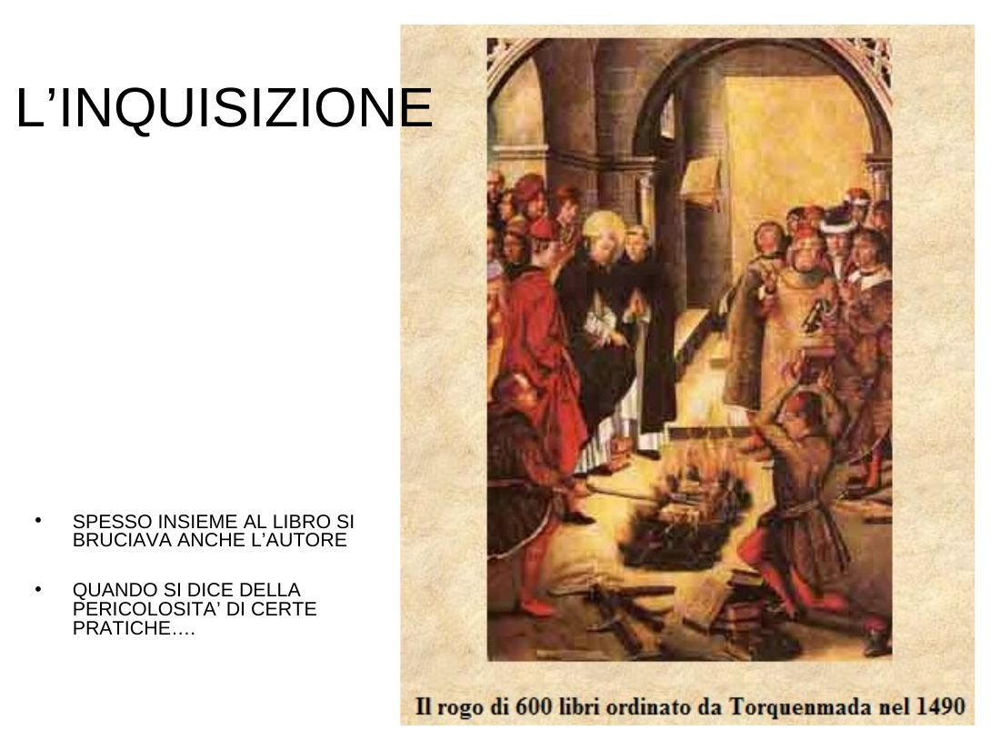{ loading=lazy style="width:59%" }

1:11:06

C’è una bella battuta sul Cile del 1973, sul colpo di Stato in Cile. Si racconta (è un aneddoto che sembra non provato dalla storia, però è carino) che alcuni militari di Pinochet, cercando materiale di carattere marxista, in una biblioteca incontrarono per errore dei libri di arte pittorica con scritto sopra «cubismo»: credendo che fossero libri su Cuba, li diedero alle fiamme. Quindi ogni tanto succedono anche cose di questo genere. Il 29 aprile 1976 in Argentina Luciano Benjamín Menéndez, capo del III corpo d’armata, ordinò un altro rogo collettivo di libri: Proust, García Márquez, Cortázar, Neruda, Vargas Llosa, Saint-Exupéry, Galeano ecc.

**ROGHI DI LIBRI NELLA STORIA**

29 aprile 1976 – Argentina: Luciano Benjamín Menéndez, capo del III corpo d’armata, ordinò un rogo collettivo di libri: opere di Proust, García Márquez, Cortázar, Neruda, Vargas Llosa, Saint-Exupéry, Galeano…

Disse che lo faceva «affinché non rimanga nessuna parte di questi libri, opuscoli, riviste… perché questo materiale non continui a ingannare i nostri figli». E aggiunse: «nello stesso modo in cui abbiamo distrutto con il fuoco la documentazione perniciosa che insidia l’intelletto e la nostra cristianità, saranno distrutti i nemici dell’anima argentina» (quotidiano «La Opinión», 30 aprile 1976).

1:12:07

Allora, detto questo dei roghi di libri, torniamo un attimo al concetto di follia nel singolo, nell’uomo singolo. Qui siamo a Montelupo: sapete che qui a Montelupo abbiamo un manicomio criminale, quindi un breve accenno a questa struttura. Ricordiamo anche che Franco Basaglia (1924-1980), psichiatra e neurologo, tra i fondatori della concezione moderna della salute mentale, fu quello che ideò, combatté e poi riuscì a portare in fondo la battaglia per svuotare i manicomi, con la legge 180 del 13 maggio 1978, nota come «legge Basaglia». Naturalmente non è il caso di Montelupo, perché questo è un manicomio criminale, un penitenziario da questo punto di vista. Basaglia diceva che il manicomio, come luogo di emarginazione e non di cura, nega il mandato di ridare dignità alla persona in quanto malata.

**FRANCO BASAGLIA**

Basaglia individua nel manicomio un luogo di emarginazione e non di cura, che nega il mandato di ridare dignità al malato in quanto persona.

«Dal momento in cui oltrepassa il muro dell’internamento, il malato entra in una nuova dimensione di vuoto emozionale \[…\]; viene immesso, cioè, in uno spazio che, originariamente nato per renderlo inoffensivo e insieme curarlo, appare in pratica come un luogo paradossalmente costruito per il completo annientamento della sua individualità, come luogo della sua totale oggettivazione. Se la malattia mentale è, alla sua stessa origine, perdita dell’individualità, della libertà, nel manicomio il malato non trova altro che il luogo dove sarà definitivamente perduto, reso oggetto della malattia e del ritmo dell’internamento…»

Basaglia si occupa da psicopatologo della malattia mentale con la preoccupazione di salvaguardare la soggettività del malato di fronte alla violenza del sapere psichiatrico, e di riscoprire la dimensione più misteriosa, e dunque più particolare, dell’essere umano. La follia non è malattia. L’analista deve restare in ascolto dell’altro e spogliarsi di ogni certezza.

1:13:15

Questa è la villa del manicomio vista dall’altra parte dell’Arno. È la villa dell’Ambrogiana, che nacque alla fine del Cinquecento per i Medici di Firenze, voluta da Ferdinando I; ebbe il suo massimo splendore con Cosimo II. I lavori finirono intorno al 1590; poi, anche in seguito alle piene che si susseguivano nella zona (perché c’era la Pesa e c’era l’Arno, e la zona non era effettivamente buona da questo punto di vista), i Medici non vennero più molto in questa villa, che cadde un po’ in disuso, fino al 1886, quando venne fatto il manicomio criminale. Anche se una sessantina di anni prima era stata adibita a carcere femminile, come manicomio criminale nasce nel 1886.

{ loading=lazy style="width:34%" }

**IL MANICOMIO DI MONTELUPO**

La villa dell’Ambrogiana fu voluta da Ferdinando I poco dopo la sua nomina a terzo granduca di Toscana, il 24 ottobre 1587, giorno della misteriosa morte di suo fratello Francesco; i numerosi interventi che il granduca fece realizzare sulla villa chiariscono la volontà di Ferdinando di farne la sua residenza personale, già quando era ancora cardinale. Il contratto di compravendita del terreno fu stipulato il 5 febbraio 1573: *Giuseppe Gafoni vende al Cardinale Ferdinando un podere nel popolo di S. Lucia a San Quirico di Montelupo detto dell’Ambrogiana per scudi 300 da depositarsi infra un anno sul Monte di Pietà per rinvestirsi.*

I lavori di costruzione dell’intero complesso dell’Ambrogiana finirono nel 1590, ma già nei primi anni del Seicento si susseguirono costosi interventi di manutenzione e di fortificazione degli argini, in seguito alle disastrose piene dell’Arno e della Pesa.

La residenza conobbe il suo momento di massimo splendore dall’ascesa al trono di Cosimo II: spinto da un notevole fervore religioso, egli fece erigere il convento per i frati minori e la chiesa dei santi Lucia, Quirico e Pietro d’Alcantara, che sostituì la chiesa di S. Lucia, antica parrocchia del distrutto Castello di Malborghetto; la galleria divenne un museo di scienze naturali, arricchito da pregiati quadri di soggetto faunistico e floreale; nel giardino vennero sistemate strane piante esotiche.

Soltanto alla fine del Settecento vennero finalmente portati a termine i lavori di restauro, in previsione dell’arrivo del Granduca Pietro Leopoldo; ma con la Restaurazione, al ritorno dei Lorena, e per il loro completo disinteresse, la villa fu lasciata lentamente deperire, fino al 1824, anno in cui Leopoldo II di Lorena decise di adattare il complesso dell’Ambrogiana a casa di pena femminile, collocata all’interno del vecchio convento, e contemporaneamente a penitenziario maschile.

In una relazione di Enrico Ferri del 1887 si legge: «La relativa vicinanza di condannati di ambo i sessi, resa anche minore dalle inesauribili arti furbesche dei detenuti (…), portava troppi inconvenienti, e allora gli uomini furono sostituiti con i minorenni, facendone una casa di custodia».

Come struttura destinata ai minori rimase in funzione fino al 1886, anno in cui Beltrani-Scalia, direttore generale delle carceri, incaricò il dottor Ponticelli, già creatore della colonia penale agricola di Pianosa, di trasformare la villa in manicomio criminale.

I lavori furono realizzati grazie alla manodopera dei condannati, e le spese si limitarono a 50.000 lire, contro le 100.000 preventivate (bisogna spedire la storia a Monti…).

1:14:28

Interessante questo aneddoto: i lavori furono realizzati grazie alla manodopera dei condannati, cioè di chi ci doveva andare, e le spese si limitarono a 50.000 lire del tempo contro le 100.000 preventivate. Quindi potrebbe essere uno spunto per qualcuno al governo.

1:14:50

Il manicomio compare anche, per esempio, nei censimenti italiani di quel tempo, dal 1871 al 1901. Questo è un sito che abbiamo realizzato per Montelupo, nel Comune, «Montelupo Fiorentino – La storia nei censimenti»: abbiamo messo tutti e tre i primi censimenti, del 1841, 1871 e 1901, e qui uno può fare le sue ricerche via web, cercare la sua famiglia, le sue antenate, e ricostruire tutto il suo albero genealogico, arrivando, partendo dal 1841, fino alla metà del Settecento. Credo sia molto interessante da questo punto di vista; poi ci sono tutti gli spaccati sociologici, storici, di professione, maschi, femmine ecc.

1:15:35

Quello che è interessante, ai fini del nostro discorso di stasera, è che nel 1871 in questo censimento venivano censiti i detenuti dell’Ambrogiana, perché ancora non era un manicomio criminale. Qui si vedono i mestieri che facevano (non sto a elencarli): c’erano 73 maschi e 106 femmine, per esempio, quindi una popolazione totale di 179 persone. Però nel 1901, quando era già diventato manicomio criminale, i detenuti non vengono censiti; vengono censiti invece quelli che vi lavoravano, e si vede che ci lavoravano 7 famiglie, per un totale di 32 persone. Quindi il manicomio criminale in questo caso è rappresentato nel censimento attraverso le persone che vi lavoravano: c’erano il direttore, il medico, l’infermiera, la guardia ecc., con le loro famiglie.

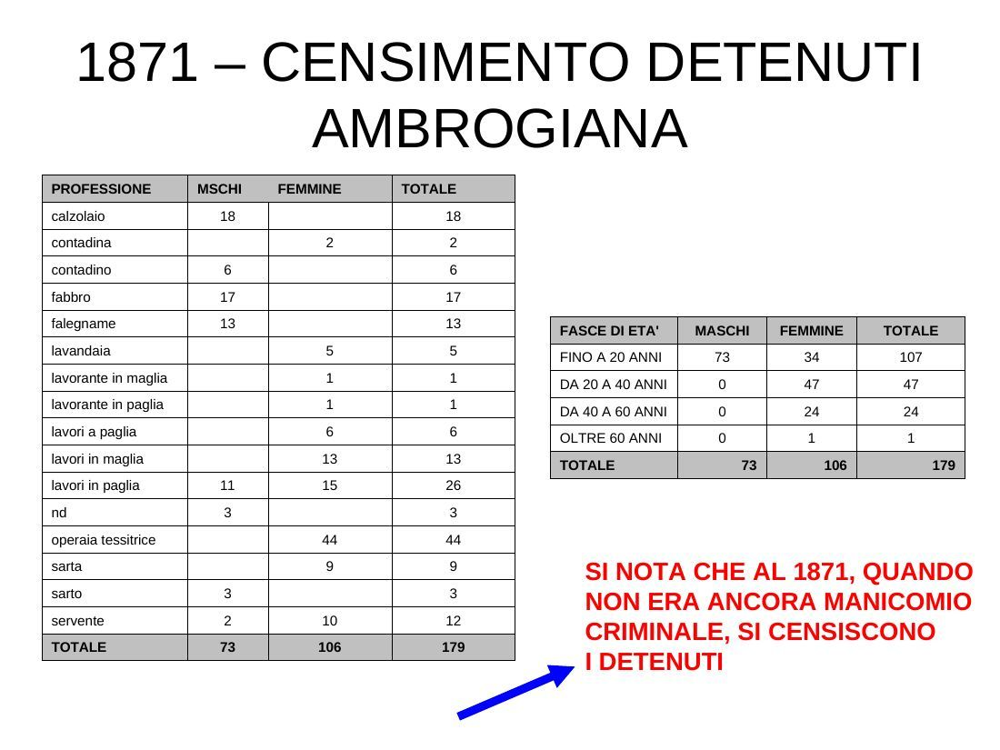{ loading=lazy style="width:47%" }

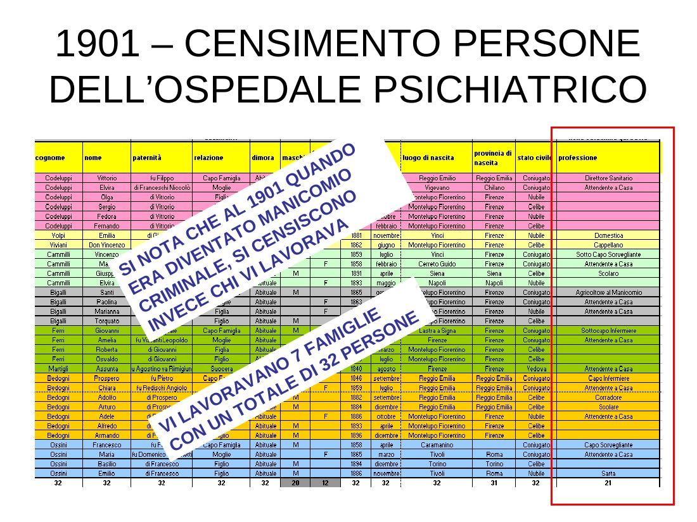{ loading=lazy style="width:47%" }

1:16:57

A proposito di manicomi, non si possono non citare alcuni artisti finiti rinchiusi nei manicomi, i più famosi Van Gogh o Ligabue. Se vi ricordate, la serata scorsa abbiamo fatto una battuta: non c’è mai grande ingegno senza una vena di pazzia, “*nullum magnum ingenium sine mixtura dementiae fuit*”, Seneca. Van Gogh fu internato in un manicomio, una maison de santé, e ci rimase per diverso tempo. Antonio Ligabue, pittore italiano, anche lui finì in un manicomio.

**LA FOLLIA DI VAN GOGH**

Vincent Willem Van Gogh, 1853-1890

Si dice che sia morto per un colpo d’arma da fuoco autoinflitto. Fu da sempre disturbato da problemi psichici e disturbi mentali.

L’8 maggio 1889 Van Gogh, accompagnato dal pastore Salles, entrò volontariamente nella *maison de santé* di Saint-Paul-de-Mausole, un vecchio convento adibito a ospedale psichiatrico, a Saint-Rémy-de-Provence, a venti chilometri da Arles.

**LIGABUE**

Antonio Ligabue, 1899-1965

Nel 1937 fu ricoverato in manicomio a Reggio Emilia per atti di autolesionismo.

Nel 1941 lo scultore Andrea Mozzali lo fece dimettere dall’ospedale psichiatrico e lo ospitò a casa sua a Guastalla, vicino a Reggio Emilia.

Durante la guerra fece da interprete per le truppe tedesche. Nel 1945, per aver percosso con una bottiglia un militare tedesco, fu internato in manicomio e vi rimase per tre anni.

1:17:39

Perché cito questi artisti? Perché hanno un rapporto con la follia, e c’è secondo me in qualche modo un legame con un altro artista, fiorentino, montelupino: Beppe Serafini. Personalmente, i quadri di Beppe Serafini mi sono sempre sembrati venati da questa follia. Questo è l’artista montelupino Beppe Serafini (1915-1987), della Torre, una frazione qui del Comune di Montelupo. E voglio farvi vedere semplicemente una piccola sequenza di tre quadri di questi tre artisti. Questi sono *I mangiatori di patate* di Van Gogh, del 1885; questo è l’*Autoritratto con spaventapasseri* di Ligabue; e questa è una tipica figura di Serafini, *Figure e uccelli*. Sembrano quasi fatte dalla stessa mano, se ci fate caso.

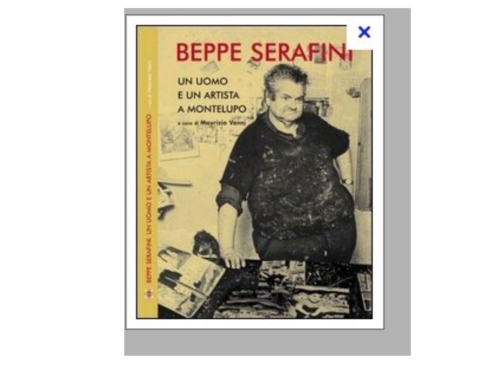{ loading=lazy style="width:59%" }

**BEPPE SERAFINI**

20 ottobre 1915 – 23 giugno 1987

Beppe Serafini nasce alla Torre. Il padre Gino era pescatore in Arno, la madre Amelia una fiascaia, cioè impagliatrice di fiaschi.

Beppe Serafini faceva il ceramista, e per passione il pittore. Le misere condizioni della famiglia non gli permettono di acquistare i colori, e così si inventa una sua tecnica pittorica.

Viene scoperto nel 1970 da Antonio Possenti e inserito nel filone dei naïfs. L’apice della sua carriera arrivò con una prestigiosa mostra a Palazzo Strozzi nel 1976.

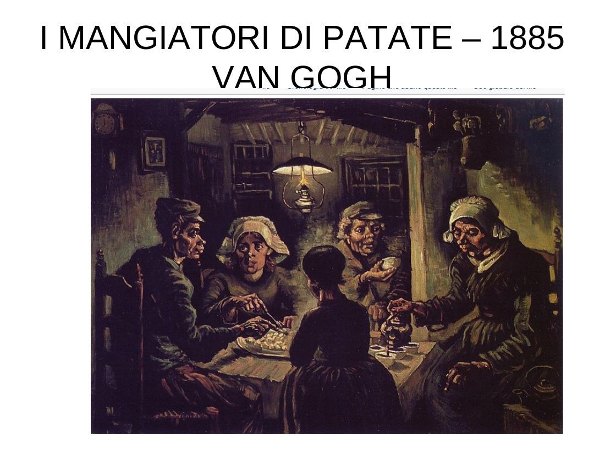{ loading=lazy style="width:38%" }

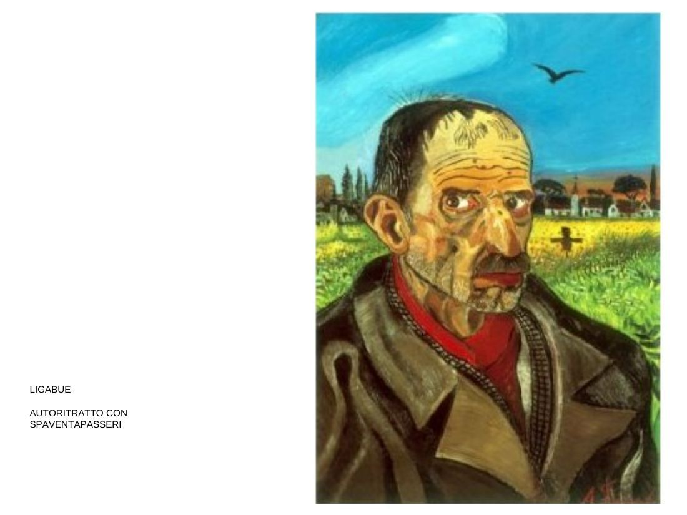{ loading=lazy style="width:34%" }

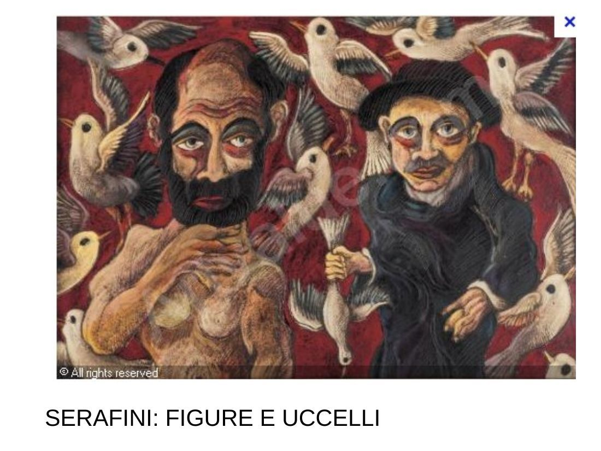{ loading=lazy style="width:44%" }

1:18:53

Quindi mi sembrava un doveroso omaggio al manicomio di Montelupo e a quello che ne è conseguito anche per la città, forse anche nel suo substrato culturale: queste figure forse ricordano anche questo, in qualche misura. Detto questo, Lorenzo, ti lascio la parola per la tua seconda parte.

1:19:22

Lorenzo Poggi Sì, grazie. Continuiamo un attimo, direi, quello che avevamo intrapreso. Avevamo detto che l’uomo non abita il mondo, ma l’immagine del mondo. Questa si costruisce con il pensiero: il pensiero astrae dall’immediatezza delle percezioni, dall’effluvio delle percezioni, astrae e simbolizza, e riesce quindi a costruire un’immagine nella quale la natura, che sarebbe altrimenti inospitale, diventa invece ospitale.

1:20:00

Se non si è in grado di fare questa operazione… perché questa operazione poi assume anche, abbiamo visto, una dimensione culturale. Assume una dimensione culturale nella religione, in un certo modo. Il mondo abitato dal cristianesimo è un mondo dove nel presente occorre operare e scegliere per realizzare il bene, e puntare, aumentando questo agire bene, fino alla fine, fino al ritorno del Figlio dell’uomo nella gloria a giudicare i vivi e i morti, che sarà la fine, la conclusione, il compimento. Quindi tutti siamo chiamati a operare nel presente per preparare questo futuro, e quindi non si può accettare il presente: il presente deve essere dominato, e per essere dominato e reso abitabile bisogna prescindere dal presente, per teorizzarlo; e la teorizzazione serve a renderlo abitabile.

1:21:30

Il folle è colui che non riesce a prescindere, e quindi rimane legato all’effluvio delle percezioni senza poterle simbolizzare e dominare; rimane legato all’immediatezza del significato della parola, senza poterla acquisire e dominare nella sua capacità simbolica; rimane legato all’immediatezza dell’emozione, senza poterne prescindere. Si trova in questa condizione: il folle non abita il mondo, perché non è nel mondo. Il mondo è invece questa costruzione.

1:22:27

I conflitti che vedevamo nel bruciamento dei libri sono conflitti tra visioni simboliche differenti del mondo, contrasti per cui si tenta di far prevalere l’una sull’altra. Ma la follia sta nel pretendere di possedere la visione unica. Come dicevano i colonnelli arabi al loro comandante, vedendo bruciare la biblioteca di Alessandria: arrivavano e dicevano «Ma brucia, brucia la biblioteca di Alessandria, il più grande deposito di sapienza dell’umanità!». E il comandante disse: «Che vi importa? Se in quei libri è contenuto qualcosa di più del Corano, sono eretici, ed è bene che brucino. Se c’è qualcosa di meno, noi abbiamo il Corano: che brucino pure». È una visione simbolica acquisita del mondo, no?

1:23:39

La follia è stata a lungo malattia dell’anima. Malattia dell’anima finché gli uomini hanno avuto un’anima: finché il soggetto conoscente era espressione di una spiritualità interiore che sussisteva, rimaneva invariata, era quella creata fin dall’inizio con quei caratteri e non subiva l’influenza del mondo. Per cui la follia era malattia dell’anima, era qualche cosa che riguardava questa soggettività, questo spirito interiore.

1:24:37

Tutti gli sforzi della filosofia nel Seicento, quando ormai si afferma la scienza moderna, per capire dove stia l’anima: un macello terribile, una cosa incredibile. È un problema che era cominciato con Aristotele. Perché Aristotele (faccio due minuti solo il professore) diceva che quello che rimaneva veramente immortale dell’uomo non poteva essere la forma, perché la forma non poteva stare senza la sostanza sulla quale si imprimeva; e quindi, quando moriva la sostanza corporea dell’uomo, doveva morire anche la forma, e quindi l’anima non sopravvive. Voi capite: Aristotele non poteva essere uno che serviva alle religioni. Che se ne fanno, se l’anima muore? Come si fa a mandarla all’inferno, o in paradiso? Quindi ci voleva qualcosa, un’anima.

1:25:43

Fortunatamente in Aristotele forse alla valenza c’era una teoria sull’intelletto: c’erano vari intelletti nell’uomo, la mente l’aveva divisa in varie parti. C’era un intelletto passivo e c’era un intelletto attivo. In quello passivo finivano le impressioni dei sensi: era passivo, quindi prendeva dal mondo esterno, era una specie di magazzino dove l’esperienza depositava ciò che le veniva. E poi c’era l’intelletto attivo, che andava in questo magazzino e prendeva ciò che gli interessava, specie quando ormai la percezione immediata, l’effluvio delle percezioni, era un po’ attenuato perché era un po’ passato; e con questo costruiva i concetti universali, condivisi da tutti, e questi concetti universali costituivano la vera conoscenza, quella intellettuale.

1:26:41

Platone parla di follia: qual è la follia? È quella che sta dietro agli effluvi, alle percezioni del corpo, e non tiene conto invece che bisogna prescinderne per privilegiare solo quello che riguarda lo spirito. Nessuno ha mai visto un triangolo: tutti hanno visto cose che hanno più o meno una forma triangolare. Bisogna prescindere dalla percezione per arrivare all’idealità pura, perfetta, del triangolo, che ci ricongiunge all’eternità del dio, e quindi fa dell’uomo qualcuno che si avvicina a Dio.

1:27:16

Aristotele era stato tanto tempo allievo di Platone, e qualche residuo gli era rimasto: è rimasto con questo intelletto attivo, e non si capisce cos’è. Poi verrà riscoperto nel cristianesimo, però si dirà che questo intelletto attivo doveva mantenere caratteri individuali, e quella era una cosa difficilissima da fare: perché se era comune a tutti, se era quello che assicurava la condivisione delle conoscenze, aveva anche contenuti uguali per tutti, e quindi era difficile che, se uno era stato cattivo, l’intelletto attivo diventasse un po’ più cattivo. Quindi era universale, sopravviveva, ma mancava di individualità: problema terribile, con quest’anima.

1:27:59

Cartesio ha la *res cogitans*, che pensa indipendentemente dalla *res extensa*. Poi non si capisce bene che cosa pensi: «Penso di pensare». Molto difficile, capite, «penso di pensare». «Penso perché sono cosciente». Che vuol dire «penso che sono cosciente»? «Sono cosciente» non lo dice nessuno, perché se uno parla, si capisce che è cosciente. Uno che dice «sono cosciente», io non riesco a capirlo. Ve la immaginate una situazione in cui uno dice «sono in me, sono cosciente»?

1:28:44

C’è una situazione. Una volta c’erano le commedie rosa: entrava il marito, che sorprendeva la moglie con il postino sul divano, va bene? Entrava nella stanza ed esclamava, no? Che dice uno che entra in salotto e trova la moglie sul divano col postino in una posizione equivoca? Esclama: «Ciel, mia moglie!», no? E lei, naturalmente, che cosa faceva? Sveniva, magari aggrappata alle tende. E poi, ecco la situazione: accorreva la domestica con i sali, e il marito la schiaffeggiava un po’ per farla tornare in sé. E lei voleva dire: «Sono in me». Guardate, è difficile, insomma.

1:30:04

Cartesio su questo costruisce tutto un discorso terribile: «Sono in me, sono cosciente». Ma è un modo per abbreviare, per dire: «Guarda, mi fa male l’orecchio sinistro, mi hai tirato un ceffone sulla guancia destra, mi ciondola un dente, che mi è arrivato un manrovescio: falla finita», no? «Sono in me» serviva a riassumere sinteticamente e a fare prima tutto questo discorso. Ma l’io che percepisce se stesso prima di qualsiasi altra percezione è molto difficile. Non si sapeva quindi che cosa fosse questo pensiero, quest’anima, la cui malattia provocava visioni simboliche differenti.

1:30:54

Tra opinioni diverse, modi diversi, il volo di Ulisse verso l’ignoto, verso il mondo che non c’è, è il volo folle. Folle perché? Perché mette in crisi quella che è la visione simbolica diffusa e condivisa del mondo. «De’ remi facemmo ali al folle volo, sempre acquistando dal lato mancino». E finisce, come sapete, nel naufragio. Vedono la montagna del Purgatorio: «Noi ci allegrammo, e tosto tornò in pianto; ché de la nova terra un turbo nacque e percosse del legno il primo canto. Tre volte il fé girar con tutte l’acque; a la quarta levar la poppa in suso e la prora ire in giù, com’altrui piacque, infin che ’l mar fu sovra noi richiuso». Così finisce il folle volo. Folle perché va al di là di quella che è la visione simbolica che permette agli uomini, nel Medioevo, di abitare il mondo, di dare ordine agli avvenimenti.

1:32:18

Qual è oggi la condizione? Non abbiamo più l’individuo e la follia come malattia dell’anima, perché ci manca l’anima. Cartesio stesso ha una grossa difficoltà; poi arriva a trovare un congiungimento tra la *res cogitans* e la *res extensa*, il corpo, perché poi bisognava mettere in comunicazione l’anima con il corpo, che era materia: si faceva nella ghiandola pineale, al centro del cervello. Era un pezzo che non si sapeva come funzionasse, però si sapeva che era importante, era al centro del cervello, e Cartesio diceva: «Lo prendo io, mi serve». E ne fa il mezzo di congiungimento. Oltretutto si trovava in una posizione interessante, perché è al centro della testa, con tutti e cinque i sensi lì a concentrare le informazioni.

1:33:28

Però torniamo al nostro discorso. Se non è più male dell’anima, se non può essere più questo, l’individualità, l’uomo di oggi come individuo come si pone, in una società che ha un modo di caratterizzare l’individualità che la colloca all’interno di un sistema molto complesso, vastissimo, di relazioni? Questo dà oggi al nostro concetto di individualità, e quindi anche al possibile concetto di follia, un carattere del tutto particolare. Ne parliamo dopo, così concludiamo il nostro discorso. Per me siamo arrivati, grazie.

\[PAUSA\]
{: .nota }

2:00:00

Paolo Marcucci Un applauso per gli amici che stasera ci hanno fatto la cena, il Caffè Centofiori di Montelupo. Grazie, grazie davvero.

2:00:45

Follia, generazione d’arte. Brevemente, nell’arte, nella letteratura, possiamo citare perlomeno il *Don Chisciotte* di Cervantes (1605-1615), *La metamorfosi* di Kafka (1915), *Arancia meccanica* di Burgess (1962), Borges, l’*Amleto* di Shakespeare (1600-1602). Nel *Don Chisciotte*, per esempio, ci sono le vicende della cavalleria e le regole della cavalleria, che ormai non hanno più senso, però lui, a causa della sua locura, la sua pazzia, non se ne accorge e ci crede, e va contro i mulini a vento, e vede il mondo con occhi diversi, come diceva prima anche Lorenzo. La pazzia allora è il modo di vedere il mondo con occhi diversi, non offuscati dalle idee e dai condizionamenti sociali.

2:01:30

Però c’è un’opera ispirata alla follia che ha attraversato tre, quattro, cinque secoli, che è quella della nave dei folli. Per esempio, questa è un’interpretazione moderna della nave dei folli: questo è Mario Ortolani (1901-1955), *La nave dei pazzi*, un’interpretazione in chiave moderna di questo concetto. Ma vediamo da cosa è nata questa nave dei folli. È del 1494 la pubblicazione, a Basilea, di *Das Narrenschiff* di Sebastian Brant, in tedesco alsaziano: sono 112 satire brevi, accompagnate da disegni, e prende il nome da questo; una letteratura satirica. Perché questo? Perché c’è un bisticcio voluto, naturalmente, sulla parola latina navis: navis, barca, è correlata appunto alla navata di una chiesa. Qui la chiesa ritorna ancora una volta come elemento della satira, in questo caso della follia: una chiesa piena di folli, sostanzialmente. Cioè questo gioco di parole.

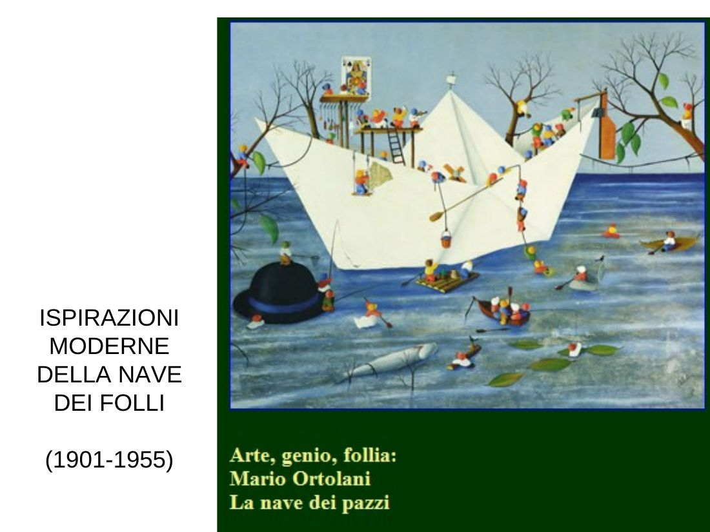{ loading=lazy style="width:59%" }

**LA NAVE DEI FOLLI**

*La nave dei folli* (Das Narrenschiff) è un’opera satirica in tedesco alsaziano, pubblicata nel 1494 a Basilea da Sebastian Brant.

Composta da una serie di 112 satire brevi (con l’aggiunta di due capitoli nell’edizione del 1495), illustrata con xilografie, è degna di nota anche perché molte di esse furono eseguite da Albrecht Dürer, già attivo a Basilea negli anni precedenti.

Buona parte del libro ha un contenuto di critica verso la società dell’epoca: Brant fustiga con vigore e senza posa le debolezze e i vizi del suo tempo.

La nave dei folli forse si ispirava a un motivo frequente nell’arte medievale, e segnatamente nella letteratura satirica, giocato su un bisticcio con la parola latina *navis* («barca»), correlata alla «navata di una chiesa».

Il tema della follia era un mezzo diffuso nel periodo precedente alla Riforma per giustificare la critica: lo usarono in particolare Erasmo da Rotterdam nel celebre *Elogio della follia*, e Martin Lutero in *Alla nobiltà cristiana della nazione tedesca*. I «pazzi di corte» (giullari e simili) erano autorizzati a dire quasi tutto quello che volevano.

2:03:02

Questa è un’illustrazione per la pubblicazione del 1494, di Dürer, che illustra in questo caso i libri che hanno la forma di nave e sono a loro volta navi da trasporto. Questa è un’altra immagine, la *Stultifera navis*, per dire che anche Foucault, per esempio, nella *Storia della follia nell’età classica*, si occupa della nave dei folli, che assumerà in tutto il paesaggio europeo questa caratteristica di essere presente. Lui dice: «Uno strano battello ubriaco che fila lungo i fiumi della Renania e i canali fiamminghi».

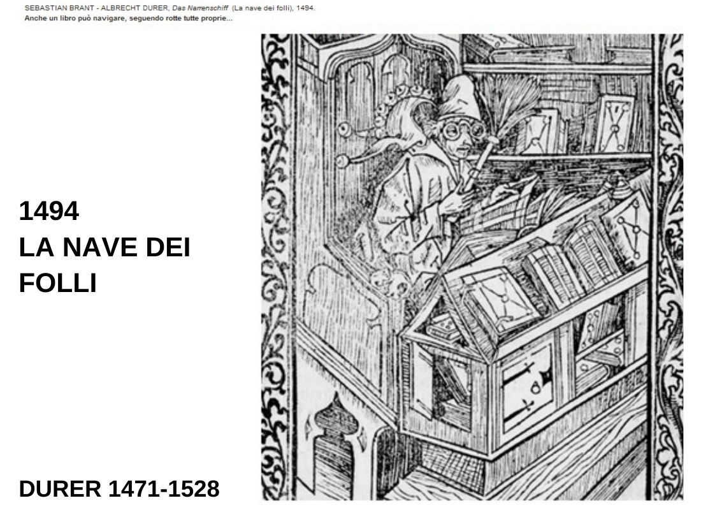{ loading=lazy style="width:40%" }

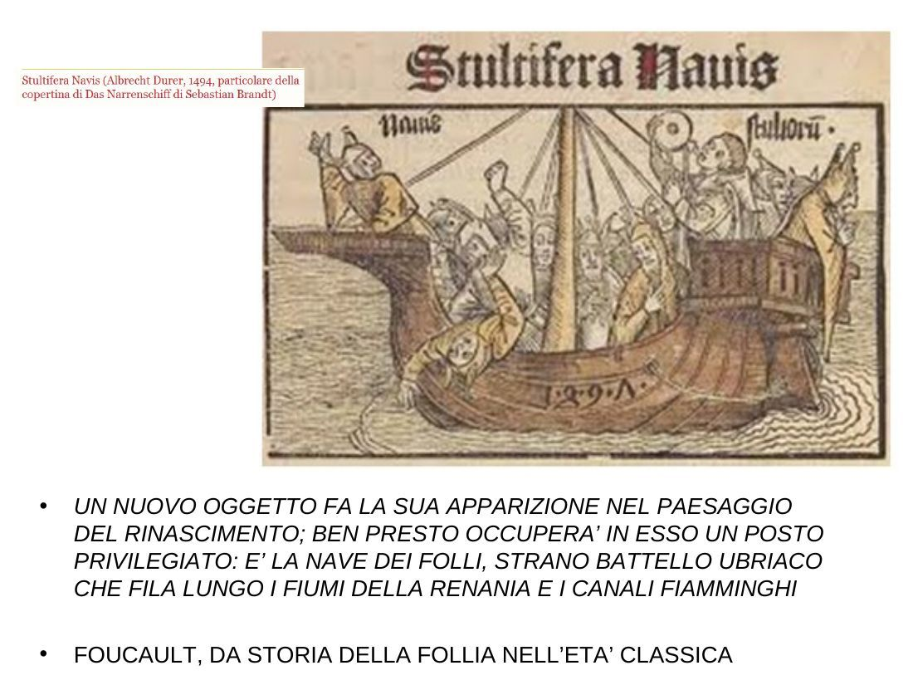{ loading=lazy style="width:40%" }

2:03:53

Ma perché, secondo Foucault, nasce questa nave dei folli? Perché in quel periodo era piuttosto d’uso allontanare i matti, i folli, dalla vita sociale. E quindi cosa succedeva? Si davano alle navi, ai marinai, affinché li portassero lontano; molte volte succedeva che questi folli fossero sbarcati in posti totalmente diversi da quelli che erano stati concordati all’inizio. Foucault ricorda quel fabbro di Francoforte, due volte partito e due volte ritornato, prima di essere ricondotto definitivamente a Kreuznach. E quindi questa nave dei folli continua il suo percorso in questi tre, quattro, cinque secoli. Foucault dedica questa speciale attenzione alla nave dei folli perché la figura del folle, che prima era riconosciuta e accettata dall’ordine sociale, in questo momento invece viene esclusa, viene mandata via, allontanata dalla comunità normale.

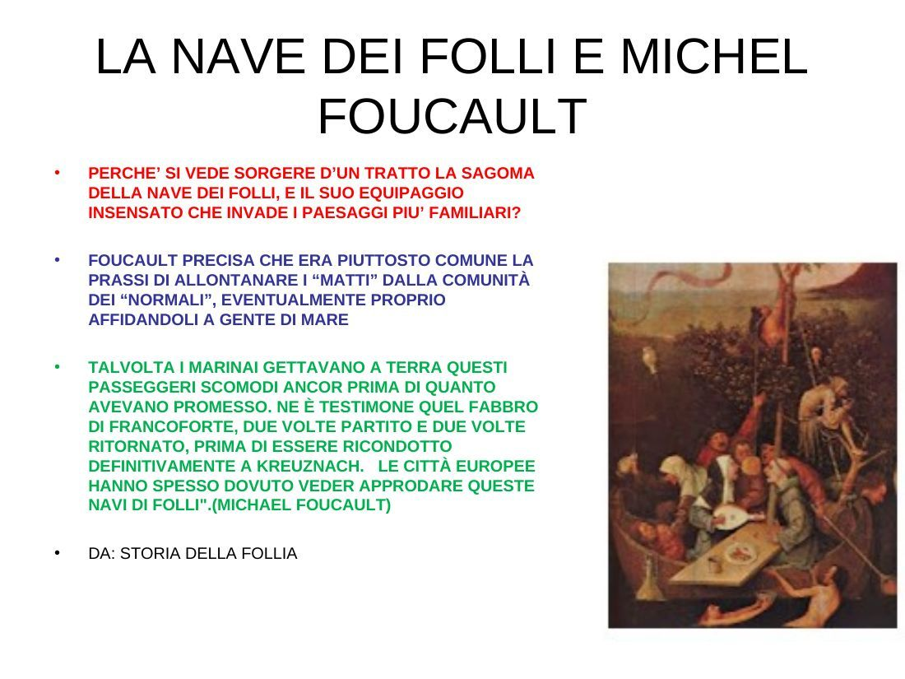{ loading=lazy style="width:59%" }

**STORIA DELLA FOLLIA NELL’ETÀ CLASSICA* – MICHEL FOUCAULT, 1961**

«Sparita la lebbra, cancellato o quasi il lebbroso dalle memorie, resteranno queste strutture. \[…\] Poveri, vagabondi, corrigendi e “teste pazze” riassumeranno la parte abbandonata dal lebbroso, e vedremo quale salvezza ci si aspetta da questa esclusione, per essi e per quelli stessi che li escludono. Con un senso tutto nuovo e in una cultura differente le forme resisteranno: soprattutto quella importante di una separazione rigorosa che è esclusione sociale ma reintegrazione spirituale.»

Foucault dedica speciale attenzione al modo in cui lo status di folle evolve dalla figura accettata – se non addirittura «riconosciuta» – nell’ordine sociale, alla figura dell’escluso, malato da rinserrare tra quattro mura.

Foucault mette in luce che in passato c’erano stati altri tentativi di «asili» riservati ai folli: a Fez nel VII secolo, a Baghdad nel XII secolo, al Cairo nel XIII secolo.

L’autore studia le diverse maniere e i differenti tentativi di trattamento dei folli, e segnatamente le opere di Philippe Pinel e Samuel Tuke. Foucault è netto nel classificare i trattamenti suggeriti dai due pensatori come non meno autoritari di quelli caldeggiati dai loro predecessori.

Il ricovero e i metodi descritti da Tuke si risolvono essenzialmente nel castigo dei folli, perché imparino a comportarsi normalmente: sono costretti a comportarsi in modo perfettamente sottomesso e conforme alle regole accettate.

2:05:01

C’erano stati anche dei tentativi, in altre esperienze, in altri luoghi, di costituire dei luoghi appositi dove rinchiudere i folli. Ricorda Foucault, per esempio, a Fez nel VII secolo, a Baghdad nel XII secolo o al Cairo nel XIII secolo: siamo sostanzialmente nella fascia araba della cultura mediterranea.

2:05:33

In conclusione, vorrei introdurre un altro concetto, che è quello della follia buona. In questo caso cerchiamo di abbinarla alla tragedia greca, che in qualche modo ha poi richiamato Lorenzo prima. Allora, Erasmo da Rotterdam, nell’*Elogio della follia*, parla di due tipi di follia, una buona e una cattiva. Quella cattiva nasce dall’inferno, dal male, e quindi spinge l’uomo a uccidere; mentre c’è un’altra follia, che è quella buona, che lui chiama un giocondo errore, e a cui dà anche un’interpretazione collettiva, nel senso che è uno stimolo alla collettività a evolversi e a fare dei passi avanti. Anche Platone distingue tra queste due parti della follia, tra una parte cattiva e una parte buona, che lui chiama un dono divino.

**LA FOLLIA BUONA**

**ERASMO DA ROTTERDAM,** ***ELOGIO DELLA FOLLIA***

Erasmo parla di due diversi tipi di follia, una «buona» e una «cattiva».

La pazzia «cattiva», dice Erasmo, è fatta nascere nel cuore umano dalle furie vendicatrici che vivono nell’inferno: questa follia, che deriva dagli istinti malvagi, spinge l’uomo a uccidere, a commettere sacrilegi o altri delitti.

Esiste però anche una pazzia «buona», desiderabile, che Erasmo definisce un «giocondo errore»: una sorta di percezione alterata della realtà che colpisce chi ne è affetto in alcuni momenti della vita, permettendogli di distaccarsi dai problemi della realtà e donandogli una serenità che si porta dietro anche nei momenti di lucidità. È una follia che cerca di abbattere i pregiudizi della cultura dominante, aprendo la strada a un mondo nuovo, libero e felice.

La follia di Erasmo, la follia «geniale», è ciò che permette alla società di evolversi e di migliorare. L’insegnamento della storia è chiaro: pensate diversamente, agite diversamente, fatevi chiamare folli e sarete sulla buona via per cambiare il mondo.

**PLATONE, *FEDRO**

In uno dei suoi dialoghi maggiori, il *Fedro*, Platone distingue una follia buona da una follia cattiva; della pazzia non esita a dire che «i maggiori beni ci sono elargiti per mezzo d’una follia che è un dono divino».

Le forme buone di follia sono:

– quella profetica, che consente di antivedere il futuro;

– quella purificatoria, che consente all’uomo di distanziarsi da determinati mali;

– quella poetica, ispirata direttamente dalle muse;

– quella amorosa, suscitata dal ricordo della bellezza ideale.

2:06:44

Allora, la tragedia greca e la follia. La tragedia greca è quasi sempre venata dalla follia che gli dèi si divertono a inoculare: le scelte dell’eroe sono difficili e tragiche: da qui appunto la parola, la locuzione, tragedia greca, perché la scelta che l’eroe farà sarà sempre, in un modo o nell’altro, tragica. *L’Aiace*, una tragedia di Sofocle del 445 a.C. circa, parla proprio di questo: il suicidio di Aiace, perché aveva compiuto degli atti di cui poi si pente, si vergogna, e quindi non trova altra soluzione che quella di uccidersi.

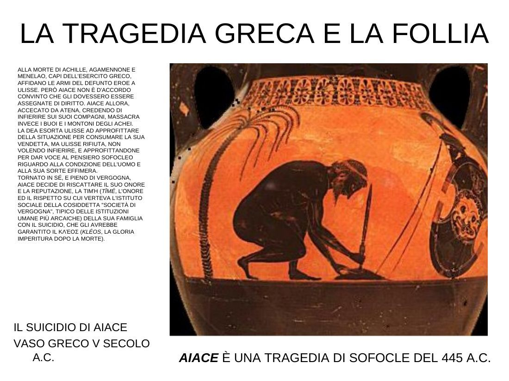{ loading=lazy style="width:59%" }

**LA TRAGEDIA GRECA E LA FOLLIA: *AIACE**

Alla morte di Achille, Agamennone e Menelao, capi dell’esercito greco, affidano le armi del defunto eroe a Ulisse. Aiace però non è d’accordo, convinto che gli dovessero essere assegnate di diritto. Allora, accecato da Atena, credendo di infierire sui suoi compagni, massacra invece i buoi e i montoni degli Achei.

La dea esorta Ulisse ad approfittare della situazione per consumare la sua vendetta, ma Ulisse rifiuta, non volendo infierire, e ne approfitta per dare voce al pensiero sofocleo sulla condizione dell’uomo e sulla sua sorte effimera.

Tornato in sé, e pieno di vergogna, Aiace decide di riscattare l’onore e la reputazione della sua famiglia, la *timé* (τιμή, l’onore e il rispetto su cui si fondava la cosiddetta «società della vergogna», tipica delle istituzioni umane più arcaiche), con il suicidio, che gli avrebbe garantito il *kléos* (κλέος, la gloria imperitura dopo la morte).

*Aiace* è una tragedia di Sofocle del 445 a.C. circa. Nell’immagine: il suicidio di Aiace, vaso greco del V secolo a.C.

2:07:42

Venendo all’attualità, un paradosso, uno scherzo della storia: è proprio la Grecia che è al centro di quella che vediamo essere la nostra follia economica di questo periodo. Quindi la storia sembra divertirsi a prenderci anche in giro, da questo punto di vista. La Grecia cosa può fare, allora? Fallire, o uscire dall’euro, oppure rimanerci e andare in miseria per le politiche che le stanno imponendo? Non è follia, in qualche modo, questo tipo di pensare? Non è forse follia buttare al vento le conquiste sociali ed economiche?

2:08:25

Pensiamo che dal 1950, cioè dopo la fine della seconda guerra mondiale, nel trentennio che va fino al 1980, tutto il sistema occidentale aveva conosciuto forse la più grande espansione di benessere economico, di PIL, che il sistema occidentale e capitalistico avesse mai fatto. Dal 1980 questo cambia, perché iniziano delle politiche folli, in questo senso, che cominciano a erodere tutto il percorso che c’era stato nel dopoguerra. Nel 1971 gli Stati Uniti, l’America, se vi ricordate, escono dalla convertibilità in oro del dollaro, cioè non sono più obbligati ad avere riserve auree per garantire il pagamento del dollaro.

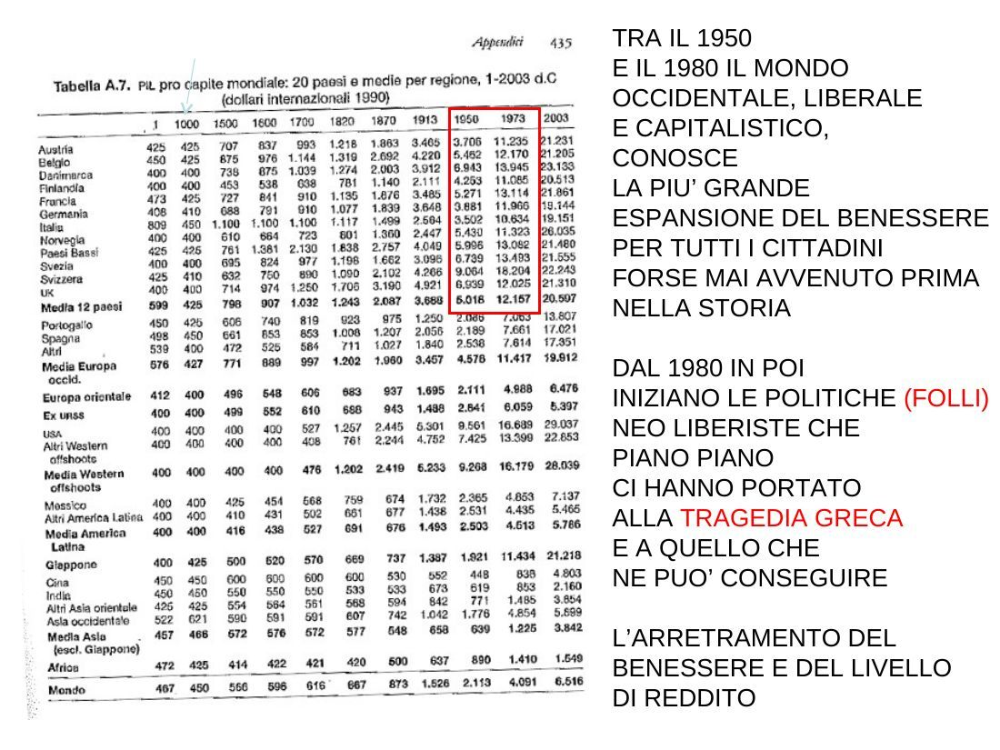{ loading=lazy style="width:59%" }

2:09:32

È questo il punto di partenza della degenerazione che ci ha portato a questo periodo. Perché? Perché dal 1971 al 1981 cambia il paradigma del sistema capitalistico, e non c’è più quell’impostazione nata alla fine della seconda guerra mondiale che ci aveva portato allo sviluppo del benessere di cui dicevamo prima. In questo grafico si vede che tra la riga blu e la riga rossa ci sono i 10 anni tra il 1971 e il 1980, poi la curva parte all’insù: indica la quota di PIL mondiale detenuta dall’1% più ricco della popolazione. Quindi cambia proprio il modo di redistribuzione del reddito. Una politica, se la vogliamo vedere nella chiave del tema di stasera, folle, perché stiamo mettendo in gioco tutto quello che abbiamo conquistato fino a ora.

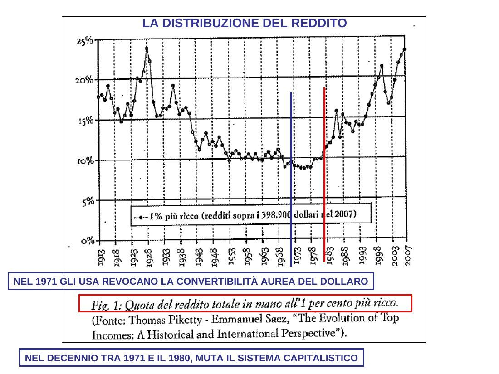{ loading=lazy style="width:59%" }

2:10:41

Se si arriva a pensare, ad acconsentire, che uno Stato dell’area euro (con un PIL all’incirca come quello della Lombardia) possa fallire a causa dei propri debiti, da quel momento niente è stato più uguale: da un anno a questa parte, da quando è stato detto che la Grecia poteva fallire, il mondo e il mercato finanziario hanno cominciato ad avere comportamenti folli. Bisogna dire che nel corso della storia è successo molte volte che degli Stati fallissero, anche in America, per esempio, alcuni Stati federali sono falliti. Non è questo il problema: è che noi siamo in una situazione di euro in costruzione, e quindi è un problema per noi europei questa crisi che sta colpendo ora la Grecia, ma che potrebbe poi espandersi a tutti gli altri Stati.

2:11:35

La storia ci ricorda anche altre cose. Prendiamo la Germania: i debiti di guerra della Germania alla fine della prima guerra mondiale ammontavano a 226 miliardi di marchi, secondo il trattato di Versailles. Keynes, che era nella commissione di Versailles nel 1919, il 7 giugno si dimise da rappresentante dell’Inghilterra perché era contrario a questa imposizione dei debiti di guerra alla Germania: riteneva folle questa imposizione. Non fu ascoltato. Hitler, quando prese il potere, la prima cosa che dichiarò fu di non pagare i debiti di guerra della Germania. E qui è la fine della Repubblica di Weimar: la Repubblica di Weimar, che aveva imposto queste regole di pareggio di bilancio anche in quel periodo, si vede costretta a chiudere, e da quel momento nasce l’ascesa del movimento di Hitler.

**LA FOLLIA ECONOMICA**

I debiti di guerra della Germania per la prima guerra mondiale ammontavano a 226 miliardi di marchi, secondo il trattato di pace di Versailles.

Il 7 giugno 1919 Keynes si dimise da rappresentante dell’Inghilterra alla conferenza di Versailles, sostenendo il pericolo di queste politiche.

Una volta preso il potere, Adolf Hitler dichiara che la Germania sospende i pagamenti, perché non più in grado di fare fronte alla cifra restante: il paese è economicamente troppo stremato.

Al termine della seconda guerra mondiale la Germania federale riprende a pagare il debito: al 1952 erano stati versati un miliardo e mezzo di marchi. Nel 1953 i pagamenti vengono di nuovo sospesi in attesa della riunificazione, avvenuta solo nel 1990.

La Repubblica di Weimar va dal 1919 al 1933 e collassa per la crisi economica e le politiche di «pareggio di bilancio»: è il dogma profondo degli economisti tedeschi degli anni Venti.

Non dimentichiamo, inoltre, il Piano Marshall del dopoguerra, con il finanziamento all’Europa per lo sviluppo e la ricostruzione.

2:12:47

Non dimentichiamo che dopo la fine della guerra, invece, all’origine di quel trentennio di benessere di tutto il mondo capitalistico occidentale di cui dicevo prima, ci fu il Piano Marshall, che finanziò tutta la ricostruzione dell’Europa. Come lo facemmo? Lo facemmo indebitandoci.

2:13:13

Ultimamente c’è anche un’altra lettura che gli economisti danno della situazione economica, brevemente: è la bilancia dei pagamenti, l’ultimo cavallo di battaglia degli economisti per misurare l’affidabilità, considerata anche migliore del rapporto debito/PIL. Sostanzialmente si vanno a vedere solo le entrate e le uscite di cassa di ogni paese. Si vede che i paesi del Nord Europa sono tutti in attivo, quindi vendono all’estero più di quello che acquistano; i paesi del sud, Italia, Francia e Spagna, sono tutti con il segno meno, nella tabella a destra. Aggregando i dati tra Europa e America si vede che l’Europa è a più 240 miliardi, gli Stati Uniti a meno 473 e la Cina a più 197.

**BILANCIA DEI PAGAMENTI**

L’ultimo cavallo di battaglia degli economisti per l’affidabilità, anche migliore del rapporto debito/PIL.

«Economist», maggio 2012 (dati in miliardi):

**EUROPA, PAESI DEL SUD**

ITALIA –66 · FRANCIA –62 · SPAGNA –52

**EUROPA, PAESI DEL NORD**

GERMANIA +205 · OLANDA +76 · DANIMARCA +21 · NORVEGIA +70 · SVEZIA +40 · AUSTRIA +8

**DATI AGGREGATI**

EUROPA +240 · CINA +197 · STATI UNITI –473

Quindi, se è vero che il mutamento ideologico del capitalismo è stato dettato dagli Stati Uniti, è altrettanto vero che noi ne abbiamo approfittato, trainati dalla loro spesa, senza sviluppare un modello autonomo di crescita interna.

2:14:04

Sostanzialmente vuol dire che viviamo alle spalle degli americani. Quindi, anche se è vero che gli americani hanno imposto questa nuova visione del mondo capitalistico, come abbiamo detto, dal 1971 in avanti (perché avevano il potere di stampare dollari, avevano la tecnologia, hanno le armi, hanno tutto quello che ne consegue), è vero anche che noi ci siamo adeguati e siamo sopravvissuti economicamente vendendo, in linea di massima, la nostra merce grazie al debito che si è creato negli Stati Uniti.

2:14:44

Allora, per chiudere questa serata sulla follia, questa follia economica che ci sta prendendo piano piano, non si può chiudere senza una speranza. Ho visto l’altro giorno sul Corriere della Sera un’intervista a Le Goff; il titolo era «L’Europa prenda lezione dall’Unità d’Italia», ma leggendo l’articolo tira fuori cinque punti che voglio condividere con voi. Innanzitutto Le Goff usa il termine espoir, speranza, contrapposto a cauchemar, incubo. E dice che il vecchio continente ha qualcosa che tutti gli altri nel mondo non hanno, cioè un legame culturale profondo.

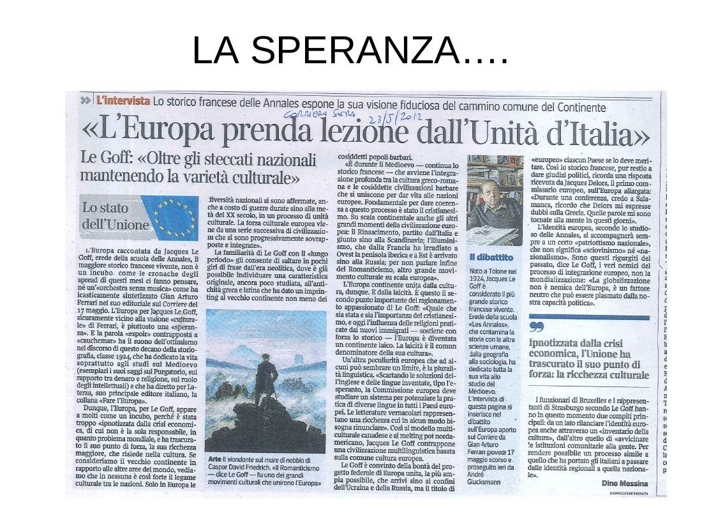{ loading=lazy style="width:59%" }

2:15:32

Vediamo quali sono, secondo Le Goff. Sono cinque. Il primo è l’antichità greca e latina, che ha dato l’imprinting all’Europa; il secondo il Medioevo, che ha permesso di coniugare la raffinatezza del sud Europa con la barbarie dei popoli del nord; il terzo è il Rinascimento, che conosciamo tutti, partito dall’Italia e giunto fino alla Scandinavia; poi l’Illuminismo, che dalla Francia si è irradiato a ovest fino alla penisola iberica e a est fino alla Russia, e alla fine il Romanticismo. Quindi questi elementi, che possano legare i popoli in modo così profondo, non ci sono in nessun’altra parte del mondo. E con la speranza di questo nuovo romanticismo da inventare, a emblema di questo articolo c’era questo quadro di Caspar David Friedrich, il *Viandante sul mare di nebbia* (1818 circa), che credo sia un buon viatico per finire questa serata sulla follia. Non resta che sperare nella vena di follia buona che ogni tanto emerge negli uomini: i debiti sicuramente vanno onorati, ma con intelligenza, soprattutto nel tempo, e senza follia.

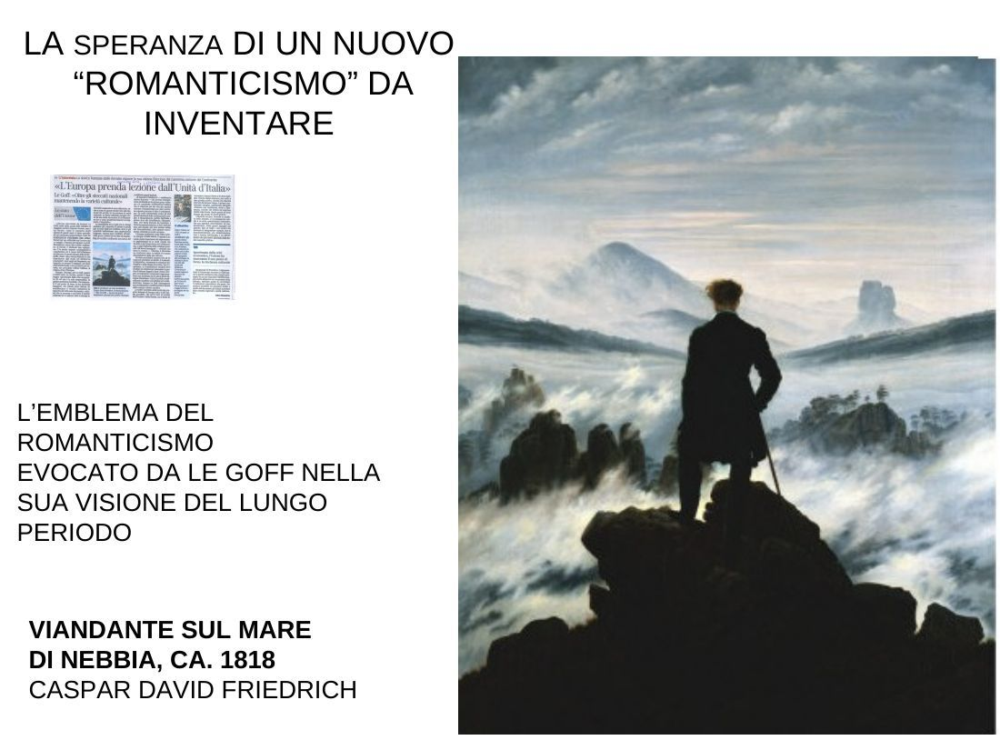{ loading=lazy style="width:59%" }

2:17:02

Lorenzo Poggi Dunque, riprendiamo rapidamente il problema, che a questo punto esamineremo così, molto superficialmente, ma non lo abbiamo detto: il problema è proprio questo. Le Goff, ce l’ha citato adesso Paolo, parla di questo stretto legame culturale che consentirebbe in qualche modo all’Europa di avere un rapporto particolare con i problemi del presente. Legame culturale che cosa vuol dire? Vuol dire che la valenza simbolica delle costruzioni fatte nel passato è ancora ben presente. Pensate al paesaggio: il paesaggio non è qualcosa di naturale, è qualcosa di costruito, nel quale noi ci riconosciamo, e che rende disponibile… parlavamo prima della follia come indisponibilità del mondo: il paesaggio è una costruzione simbolica che rende disponibile la natura. Non è una costruzione naturale, è una costruzione culturale che abbiamo fatto nel tempo e nella quale ci riconosciamo.

2:18:39

Ma moltissime sono le costruzioni culturali di questo genere, che ci consentono di mantenere un’individualità capace di progettare, e quindi di non essere folli, perché non facciamo progetti che vanno al di là di ogni comprensibilità e razionalità, ma nello stesso tempo di avere la capacità di innovare e di essere individui a tutti gli effetti. Il problema da affrontare, dunque, è come oggi si possa definire l’individualità. Come si può essere individui in un mondo dove le relazioni sono infinitamente moltiplicate, dove nella società le relazioni sono non solo moltissime, ma anche sempre più condizionanti?

2:20:00

Una volta, abbiamo visto, c’era l’anima. L’anima era la barriera, il castello dentro ciascuno di noi, che costituiva l’elemento invalicabile dell’individualità: era il principio di individuazione. Ma abbiamo visto che l’anima purtroppo è stata espugnata, non ne è rimasto quasi più nulla, e quindi il principio di individuazione difficilmente lo si ritrova. In questa società, dove la previsione del mondo passa attraverso una tecnicizzazione avanzatissima, per cui ciò che è prevedibile e razionale è ciò che è tecnicamente, tecnologicamente prevedibile e razionale, l’individuo si trova in una condizione estremamente difficile e precaria. Dove sta l’individualità?

2:21:11

Se si adegua a quelli che sono i comportamenti sociali condivisi, necessitati dall’esistere nella società, voluti dalle interrelazioni dovute alle tecnologie, si finisce con l’essere insignificanti, perché ci si omologa a tutti gli altri. Se si esce fuori da questi schemi e si vuole approfondire, come si diceva una volta, la profondità della propria anima («Divieni ciò che sei», ricordate il motto, «gnôthi seautón», conosci te stesso): bellissimi, ma improponibili, perché io stesso, che cosa sono? Quando c’era un’anima che veniva dagli dèi, approfondirla poteva essere anche un modo per porsi in modo creativo, innovativo, nei confronti del mondo: mi ricongiungeva all’eterno e agli dèi. Pensare la geometria, per Platone, era sfuggire alla follia del decadere delle percezioni, che sempre divenivano, per ricongiungersi all’eternità del vero, del pensabile e della bellezza, all’eterno che ci ricollegava agli dèi. Ma questo oggi non c’è più.

2:22:48

Noi, come individui, siamo quell’insieme di relazioni che nella nostra società tecnologica attribuiamo all’individualità. Siamo quel margine che nelle ricerche di mercato si attribuisce a quella che può essere la decisione individuale, se scegliere il passeggino rosa o celeste o a fiorellini, ma è all’interno di questo. Non c’è più la libertà dell’anima. Siamo in un difficilissimo equilibrio tra follia e insignificanza. Follia, perché se scegliamo comportamenti che non hanno una credibilità o un riscontro all’interno delle possibili verificazioni tecnologiche, sono del tutto incomprensibili, non innovativi. Perché ciò che è innovativo parte da una considerazione dell’esistente e su questo porta all’innovazione; quindi, rispetto all’esistente, è prevedibile come trasformazione innovativa. Il folle non è innovativo: è privo di senso, non è giudicabile, non abita il mondo. Quindi la via dell’individualità è una via strettissima fra follia e insignificanza.

2:24:32

Questa via strettissima fra follia e insignificanza, data la libertà che è ancora concessa a certe manifestazioni comportamentali, come l’arte e altre manifestazioni, può essere in qualche modo percorsa attraverso queste. Ma bisogna stare molto attenti, perché non c’è più la sacralità dell’anima, non esiste più questo castello: l’individuo è tale solo all’interno di una collettività, non esiste di per sé. Non c’è la follia da sola: la follia è sempre tale rispetto a qualcosa che è determinato come normalità. E quindi l’uomo è animale politico, come diceva il vecchio Aristotele, perché non esiste da solo, non è definibile come individuo da solo.

2:25:36

E in un mondo che è definito nel suo insieme, in particolare in un’interazione così fitta, dalle tecnologie esistenti, l’individualità è difficilmente sostenibile al di fuori di quei ruoli che sono appunto designati all’interno della società come ruoli dell’individualità. Ma se sono designati come ruoli dell’individualità, dove stanno la creatività e l’individualità? È come avere una galleria per fare le mostre di arte rivoluzionaria: se è rivoluzionaria, come fa a fare le mostre in una galleria? All’interno di questo si sviluppa e si discute il nostro problema.

2:26:29

Una cosa è chiarissima: ci piace ancora molto il romanticismo dell’individuo che approfondisce la sua anima e la percezione di sé, ma purtroppo tende a rimanere solo romanticismo. Paolo ha cominciato il suo discorso con i tarocchi, e c’era la carta zero, il Matto. L’individuo, forse, in questa società (per dare un esempio) è proprio come le carte, che non hanno un valore di per sé: hanno un valore all’interno del gioco che si gioca. Si decide che gioco si gioca, e allora l’asso avrà un valore e il 2 conterà quanto il 2 a briscola, quando si dice. Grazie.

2:27:31

Paolo Marcucci Grazie. Consentiteci: questa è l’ultima serata di tre anni, quindi abbiamo pensato a due regalini. Uno è un’intervista a Daniel Spoerri: per chi è venuto con noi al parco di Spoerri un mese fa, c’è stata questa intervista sul Sole 24 Ore di una quindicina di giorni fa, e quindi vi diamo una copia di questa intervista. L’altro è questo libro, un libro di microstoria su un paese dell’Aretino, Gello di Bibbiena, che è un dono mio personale che voglio fare a tutti voi: stasera abbiamo parlato del rogo dei libri, e allora vorrei regalarne uno. Quindi, se vi accomodate, ve li diamo. Grazie a tutti.

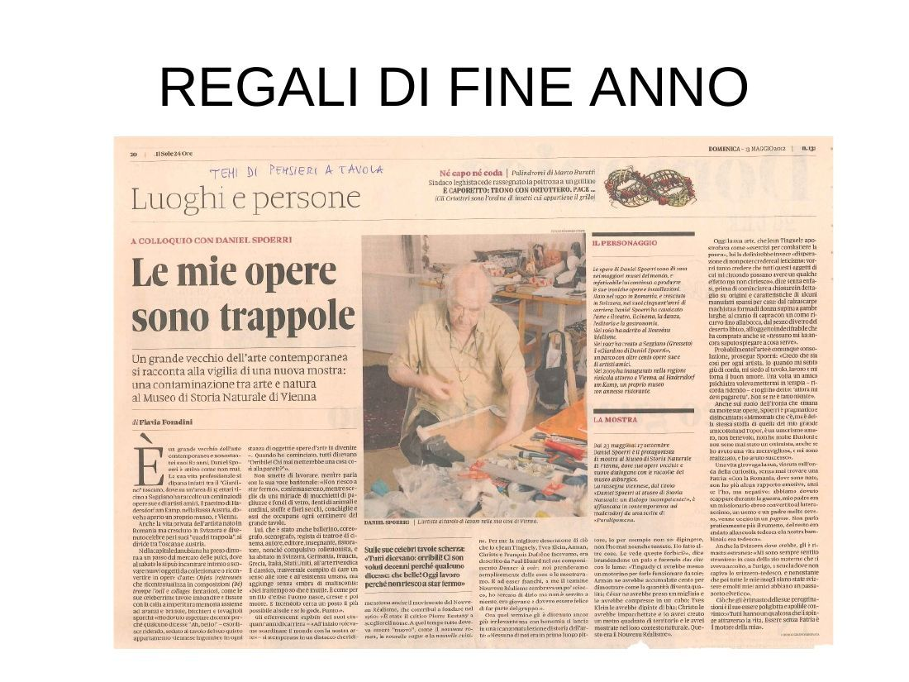{ loading=lazy style="width:47%" }

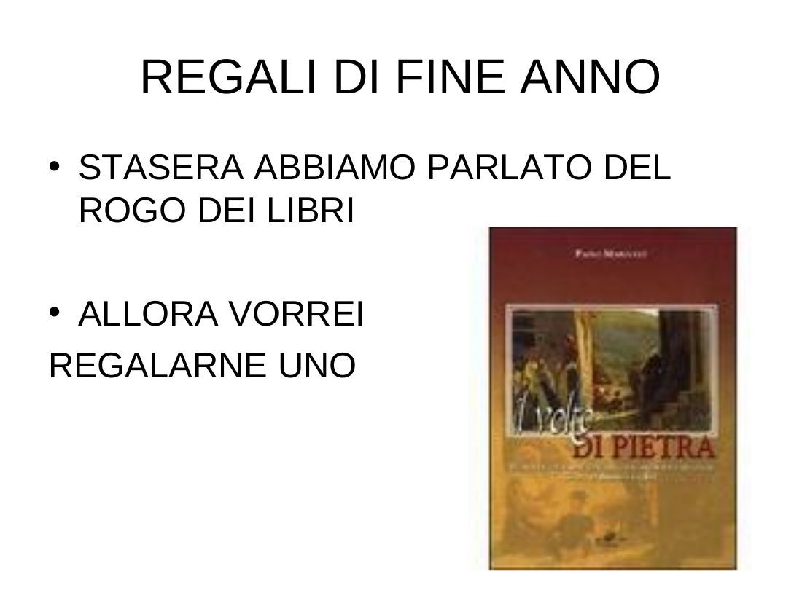{ loading=lazy style="width:47%" }

