# Il cibo

Scambio, relazione, contatto, contagio

**Data:** 15 novembre 2012 
**Luogo:** Museo della Ceramica, Montelupo 
**Incontro con:** Lorenzo Poggi e Paolo Marcucci

**Interventi:** Paolo Marcucci Lorenzo Poggi

0:01:04

Paolo Marcucci Buonasera a tutti, grazie di essere qui, grazie di essere tornati a questa nuova edizione. Siamo alla quarta; gli anni passati facevamo sempre sei serate, quest’anno ne abbiamo aggiunta una – appunto novembre, che di solito non facevamo. Il calendario del 2013 prevede due serate a metà mese, al contrario della tradizione, che era sempre l’ultimo giovedì. Il programma l’avete visto per mail o sulle locandine; l’unica eccezione è aprile, perché andiamo a martedì 23: il 25, ultimo giovedì del mese, non era praticabile.

**PENSIERI A TAVOLA. IV EDIZIONE: 2012-2013**

**1. Il cibo.**

Scambio, relazione, contatto, contagio.

GIOVEDÌ 15-11-2012

**2\. La profezia della fine.**

Il mondo viene dal nulla e al nulla ritorna quando esaurisce il progetto divino.

GIOVEDÌ 13-12-2012

**3\. Identità dell’Occidente.**

L’ombra, il tramonto sono nel nome; sono anche il carattere della nostra cultura.

GIOVEDÌ 31-1-2013

**4\. Debito e colpa.**

Quando tutto è monetizzabile, il debito è peccato e il paradiso pareggio di bilancio nel libro contabile di Dio.

GIOVEDÌ 28-2-2013

**5\. Emozioni e passioni.**

Quando la comunicazione prevale sull’espressione.

GIOVEDÌ 28-3-2013

**6\. Il gioco degli scacchi.**

La trama della scacchiera come lo spazio dell’esistenza.

MARTEDÌ 23-4-2013 (il giovedì è il 25 aprile)

**7\. Santi in paradiso.**

Virtù dei protettori, caratteri e vizi dei protetti.

GIOVEDÌ 30-5-2013

0:02:17

Prima di parlare del cibo, che è l’argomento di stasera, due parole sulle due uscite che pensiamo di fare anche quest’anno – viaggi culturali, come li abbiamo definiti, sempre legati ai temi delle serate. Una a Milano, al Museo del Novecento, che avevamo in programma la settimana scorsa e che abbiamo dovuto spostare a dicembre o a gennaio; l’altra a Roma in primavera, fra marzo e aprile, con un percorso ancora da definire. Vi terremo informati. Approfitto per farvi salutare dal professor Lorenzo Poggi, qui accanto a me.

0:03:22

Lorenzo Poggi Grazie, e di nuovo buonasera. Mi fa molto piacere rivedere alcuni di voi e conoscerne altri; mi fa piacere soprattutto che siate così assidui e frequentiate un discorso come il nostro, quello della filosofia, che non è molto attuale ma che in fondo rappresenta la nostra tradizione: dalla Grecia in poi, un atteggiamento non ideologico, razionale, volto alla scoperta di ciò che si può dimostrare, di ciò che è legato alla ragione e che riguarda la nostra vita quotidiana – non troppo lontano da essa, ma che tenta di darle una spiegazione e un’interpretazione al di là della tradizione religiosa o mitica. Questa affezione al ragionamento distingue da sempre la nostra cultura, e mi sembra un atteggiamento essenziale di fronte ai problemi del nostro tempo.

0:04:55

A Milano vedremo probabilmente il Museo del Novecento, perché ci permette un discorso sull’arte del Novecento legato alla storia ma anche alla nostra attualità. Il viaggio a Roma toccherà più punti della città, con un po’ di visita turistica letta però con gli occhiali della filosofia. Vedremo anche qualcosa di particolare: Madama Lucrezia, una delle statue parlanti di Roma, quella dei pettegolezzi. E poi i papi: metà sono sepolti in San Pietro, l’altra metà altrove, e quasi nessuno va a vedere quelle tombe – noi faremo visita a quell’altra metà, anche per par condicio. Da Trevi ci sposteremo al Pantheon, a piazza Navona; se ci riesce andremo a vedere il museo delle anime del purgatorio – è rimasto, anche se il Limbo è stato soppresso. E faremo una cosa importantissima: vedremo Caravaggio, con un discorso sull’arte e sulla visione della religione. Re Enrico IV a un certo punto vuole certe rappresentazioni nella chiesa di San Luigi dei Francesi, proprio per rendere evidente che è diventato cattolico e ha rinunciato al calvinismo: «Parigi val bene una messa».

0:07:46

Paolo Marcucci Ho visto sul Corriere della Sera una pubblicità della sua fondazione, *Convivio. A tavola tra cibo e sapere*, che parla proprio di convivio, di serate sul cibo e sulla mente. Mi ha colpito: vuol dire che lo spirito del tempo l’abbiamo colto, che anche altrove si fanno serate come le nostre.

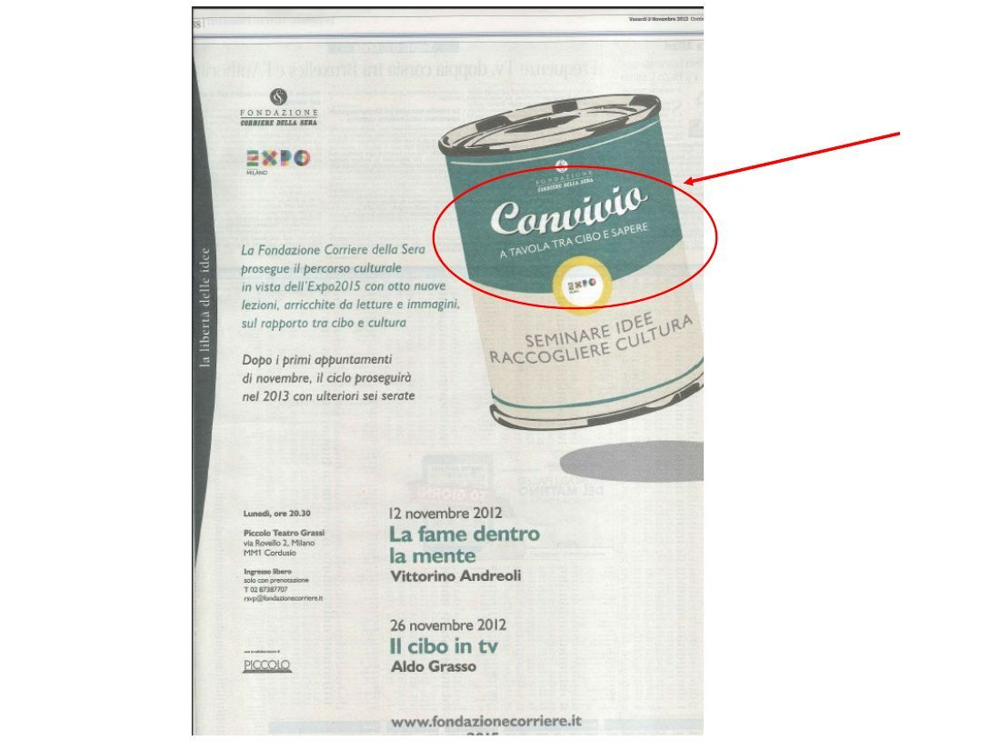{ loading=lazy style="width:49%" }

0:08:09

Il cibo è sempre stato un problema per l’uomo: o per la fame, o perché oggi magari mangiamo troppo. Non in tutto il mondo, però: l’ultimo indice globale della fame, presentato a Milano in ottobre, mostra vaste aree ancora colorate di rosso e di arancione.

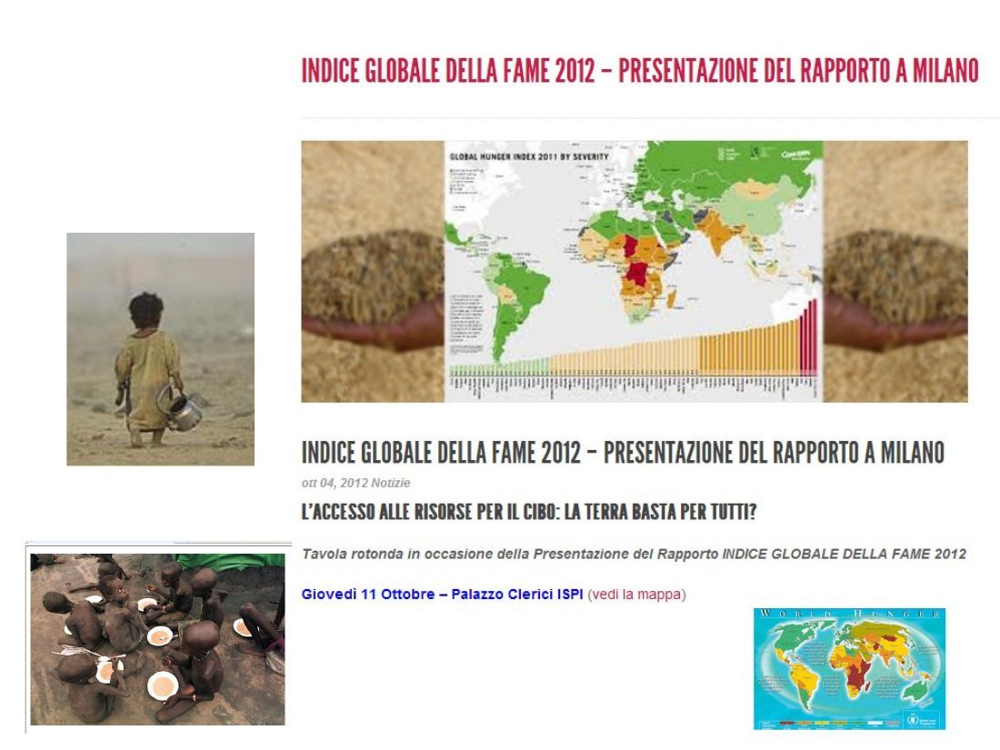{ loading=lazy style="width:59%" }

0:08:54

Il cibo ha avuto un effetto profondo sul nostro modo di agire e di pensare, in positivo e in negativo. Da qui il titolo della serata, *Il cibo e il contagio*. Contagio in senso cattivo: le malattie trasmesse attraverso il cibo – il morbo della mucca pazza, l’aviaria, il colera, la brucellosi, l’epatite A, l’AIDS nei paesi più poveri, dove il cibo viene premasticato. Ma c’è stato anche il contagio positivo, lo scambio con le altre persone e con le altre esperienze: i pomodori (dal Cile e dall’Ecuador), le patate (dal Centro America), il caffè (forse dall’Etiopia), senza i quali non avremmo molte delle nostre pietanze; e di conseguenza anche la produzione dell’arte e della cultura.

0:09:57

Affronteremo il tema da più angolazioni: quello che appare oggi nella vita quotidiana, il punto di vista filosofico – e qui abbiamo il nostro maestro – la simbologia cristiana del cibo, e nell’ultima parte illustreremo nove oggetti del British Museum attinenti al tema.

**AFFRONTEREMO QUINDI IL TEMA DA DIVERSE ANGOLAZIONI**

Si dice che siamo ciò che si mangia…

Ludwig Feuerbach, a una sua famosa opera del 1862, aveva dato il titolo *Il mistero del sacrificio o l’uomo è ciò che mangia*. L’uomo è ciò che mangia: in tedesco, «*Der Mensch ist, was er isst*».

L’obiettivo manifesto che Feuerbach si pone è, naturalmente, quello di sostenere un materialismo radicale e anti-idealistico, a tal punto da portarlo a sostenere che noi coincidiamo precisamente con ciò che ingeriamo… (forse un po’ eccessivo; c’è però il fatto che, se siamo, è perché mangiamo. Da vedere poi se siamo davvero ciò che mangiamo.)

Un antico adagio dice che non si può pensare con la pancia vuota: Aristotele ci ricorda, nella *Metafisica* (982 b 21), che la filosofia nasce quando l’uomo ha risolto i suoi bisogni primari.

0:10:21

Il cibo ormai è dappertutto: ho messo Benedetta Parodi, i cuochi più famosi, Gualtiero Marchesi e l’emergente Carlo Cracco. Se ne parla in televisione e alla radio, nelle riviste, nei libri; i grandi chef sono delle stelle e le guide come la Michelin sono vendute come non mai: il cibo è uno dei discorsi più ricorrenti nella nostra vita. Anche noi, nelle nostre serate, il cibo lo facciamo – il catering di stasera è esattamente questo. E ci sono i cuochi che vengono a cucinare a casa.

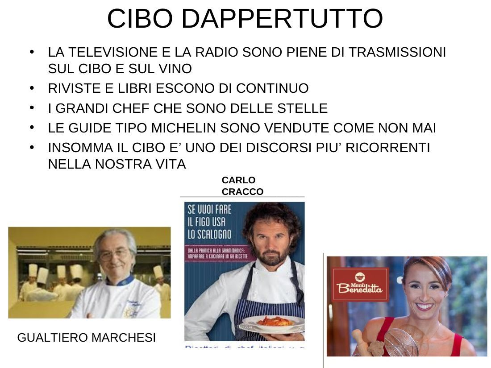{ loading=lazy style="width:59%" }

0:11:09

Mi ricordo la rubrica di Beniamino Placido su la Repubblica, vent’anni fa. Quando ci fu l’arrivo degli albanesi, riportava l’intervista a un albanese sbarcato in Italia: guardando la tv italiana era rimasto colpito dalle pubblicità per cani e gatti. Se hanno da mangiare i cani e i gatti – pensava – ne avranno anche per noi. E quella sera si imbarcò.

0:11:29

Pensiamo alla globalizzazione delle cucine: la cucina kosher, la cucina araba, il kebab (tipico cibo di strada), i negozi e i ristoranti cinesi e indiani. La globalizzazione ha portato anche a un accentramento del potere sulla dinamica dei prezzi: dodici società multinazionali controllano oltre 1.000 miliardi di materie prime, quasi tutto il mercato dei generi alimentari di grosso taglio – il grano, il riso – e controllano l’acqua, le foreste, il legname. È quanto emerge dall’ultimo rapporto di Symbola, citato da Aldo Bonomi sul *Sole 24 Ore* del 28 ottobre 2012.

0:12:21

Un altro aspetto: il cibo nelle società ricche come le nostre. Il tema ebbe uno spunto nuovo a metà degli anni Settanta, quando andava di moda il cibo macrobiotico. Perché? Perché l’Italia era ormai un paese ricco e poteva permettersi di non preoccuparsi della fame e di pensare invece alla qualità. Poi è arrivato anche il digiuno dell’anoressia, che si distingue dal digiuno ascetico dei santi.

0:13:05

Qualche anno dopo, nel 1982, nacque *Arcigola*, una rivista molto d’élite che parlava di cibo e si ispirava alle ricerche storiche di Carlo Petrini nelle Langhe e di Nuto Revelli. Da lì nascerà Slow Food; e poi il Salone del Gusto di Torino, i GAS, i gruppi d’acquisto, la filiera corta. A casa mia, e penso anche da voi, mio padre aveva l’orto: non sapevo che fosse filiera corta. C’è però il rovescio della medaglia, perché filiera corta significa importare meno dai paesi poveri, che invece hanno bisogno di esportare. Non è un mondo facile. Il cibo è anche quello delle mense scolastiche: i genitori vogliono sapere che cosa mangiano i loro figli, e ci sono le mense scolastiche a chilometro zero – a Montelupo, naturalmente, le abbiamo da diversi anni.

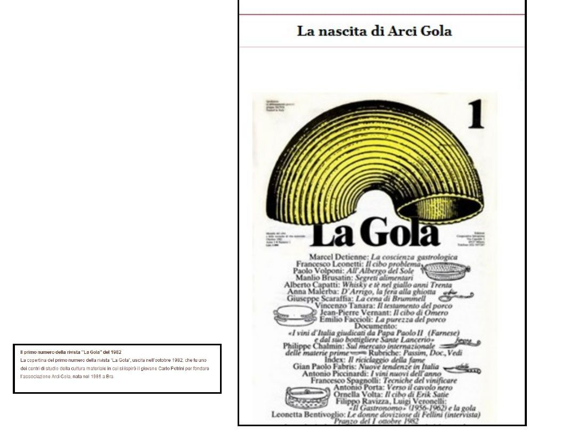{ loading=lazy style="width:47%" }

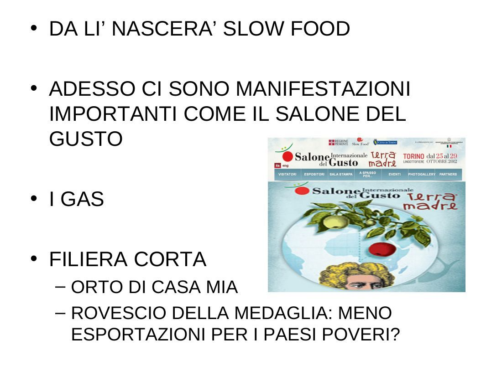{ loading=lazy style="width:47%" }

0:14:31

Parliamo di dieta perché mangiamo troppo, ma non è stato sempre così. Pensiamo al Medioevo, dove la fame atavica inseguiva tutti; ma anche solo a cinquant’anni fa, a *Pane, amore e fantasia* di Comencini con Vittorio De Sica e alla battuta famosa: “Che te mangi? Pane. E che ci metti dentro? Fantasia, maresciallo”.

0:15:08

Abbiamo studiato la dieta a zona, quella di Barry Sears. L’eccesso di cibo ha fatto sì anche che i prezzi si abbassassero: è stato calcolato che dal 1870 il prezzo medio del cibo è diminuito di tredici volte in termini di costo effettivo.

**ABBIAMO STUDIATO ADDIRITTURA LA DIETA A ZONA**

Dieta a zona a blocchi (Barry Sears): secondo questa teoria, 150.000 anni fa gli uomini erano arrivati alla soglia dell’estinzione, e fu per caso che scoprirono di potersi cibare di molluschi (che avevano mangiato alghe).

Da qui l’evoluzione che ha permesso la migrazione, 100.000 anni fa, dall’Africa a tutto il mondo.

La salvezza fu nel cibo, dice, e in particolare nei grassi omega 3 dell’olio di pesce (noi conoscevamo l’olio di fegato di merluzzo).

Il cibo quindi in primo piano: forse perché non è più un problema, e non dobbiamo dedicarci energie. Il cibo è diventato abbondante, e forse eccessivo; però dal 1870 il prezzo è diminuito di 13 volte in termini di costo effettivo.

Ma non è stato sempre così: basta vedere qualche dato e qualche grafico.

0:15:30

Dal punto di vista economico: oggi il PIL dell’agricoltura in Italia è pari al 2%, mentre gli occupati sono il 3-4% del totale. Se guardiamo questo grafico dell’ISTAT, che parte dal 1861, la linea blu degli occupati in agricoltura parte dal 70% e arriva oggi al 2%. Per millenni – per diecimila, ventimila anni – la nostra attività principale è stata procurarci il cibo; solo dal 1860 la curva comincia a scendere. Questo ci fa intuire quanto sia profondo il nostro rapporto con il cibo, e quanta evoluzione industriale e di produttività vi sia stata applicata: ora con il 2% si riesce a sfamare in eccesso tutta la popolazione.

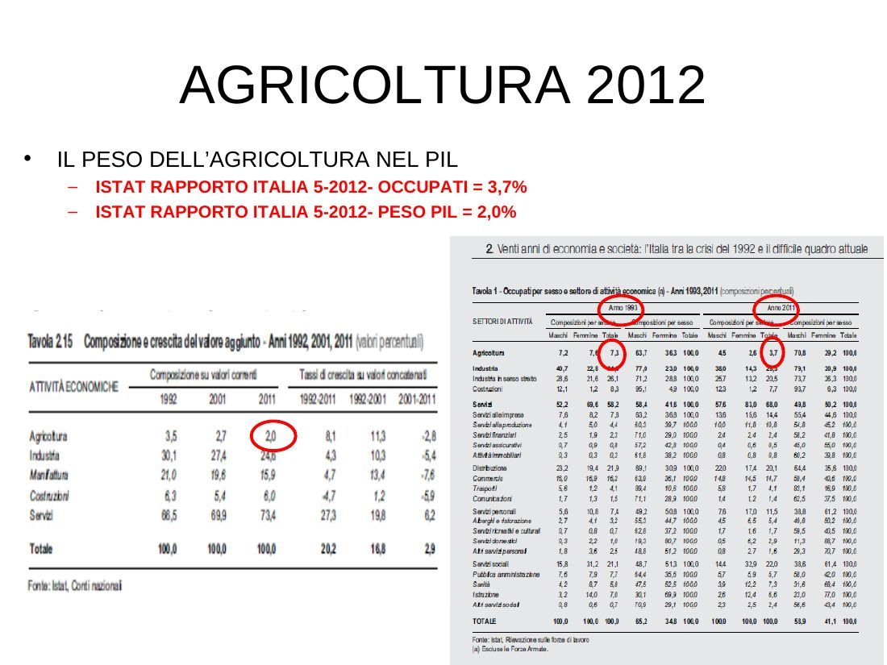{ loading=lazy style="width:47%" }

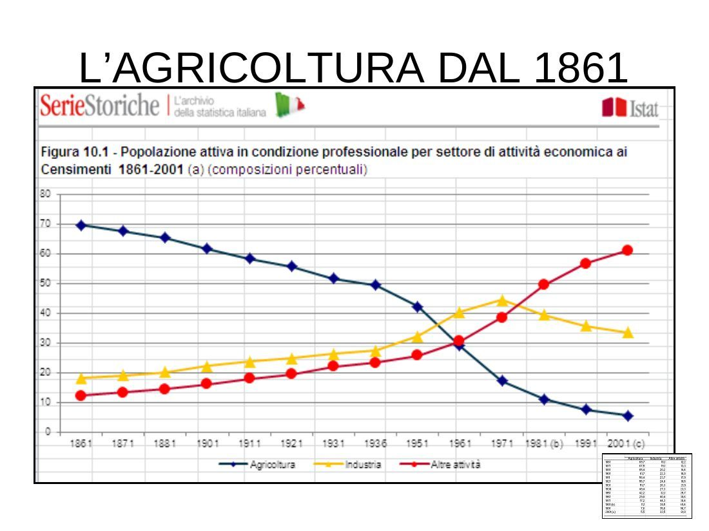{ loading=lazy style="width:47%" }

0:16:45

La storia dell’alimentazione è intrinsecamente connessa con la storia dell’umanità, e non poteva che intrecciarsi con la vita quotidiana, con la letteratura e con l’arte. Pensiamo a che cosa abbia significato il rito dell’uccisione del maiale nelle nostre campagne – non secoli fa, ma fino a pochi anni fa – o la trebbiatura del grano, o la vendemmia.

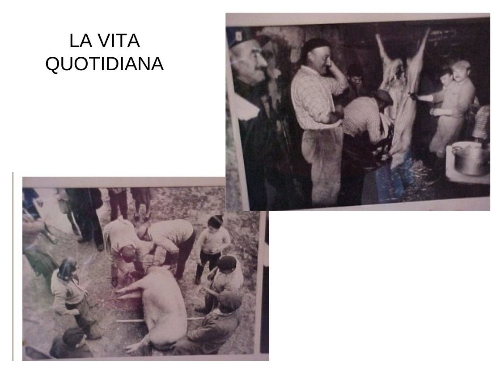{ loading=lazy style="width:47%" }

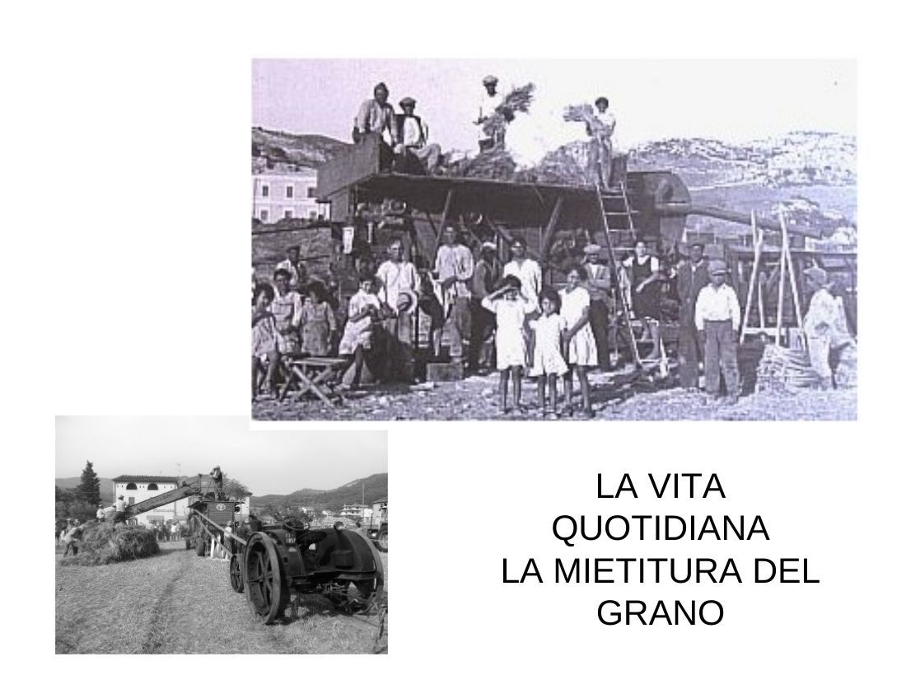{ loading=lazy style="width:47%" }

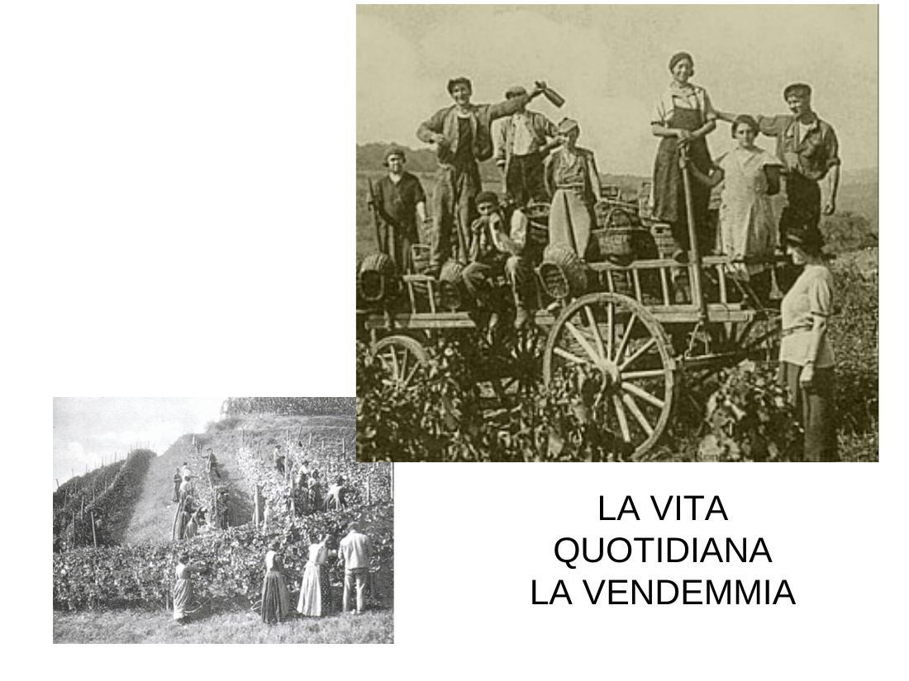{ loading=lazy style="width:59%" }

0:17:20

Il cibo, a riprova della sua titanica importanza nella vita, è stato celebrato da molte forme d’arte, dalla pittura alla cinematografia alla letteratura; nella pittura spicca per notorietà il contributo di Giuseppe Arcimboldo, ma si va da Caravaggio a Velázquez, da Carracci a Guttuso, da Vermeer a Gauguin. Questo è un disegno di Pieter Bruegel, *La cucina magra*, del 1563. Sono tutti magrissimi, secchi; non c’è niente da mangiare. C’è un grasso sulla porta che sta tentando di scappare, mentre gli altri tentano di richiamarlo – è un’allegoria, e lui scappa perché ha paura di essere mangiato a sua volta. Guardate il caminetto: povero, piccolo, vuoto. Mi ha ricordato il caminetto dipinto sul muro di Pinocchio.

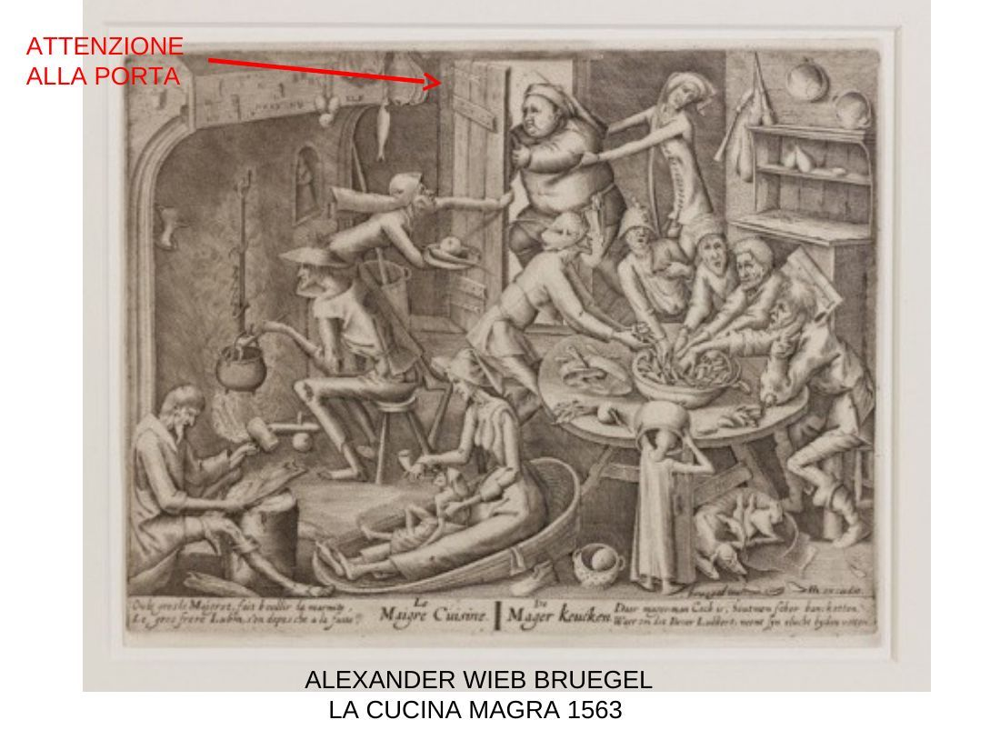{ loading=lazy style="width:47%" }

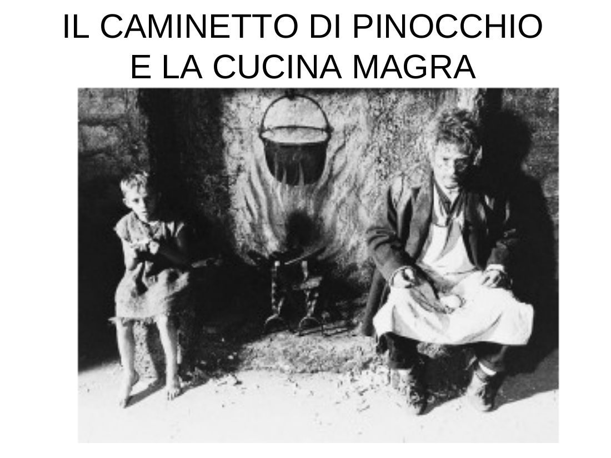{ loading=lazy style="width:47%" }

0:18:11

L’altra faccia della medaglia è *La cucina grassa*: qui il magro, invece di essere richiamato dentro, viene spinto fuori a calci.

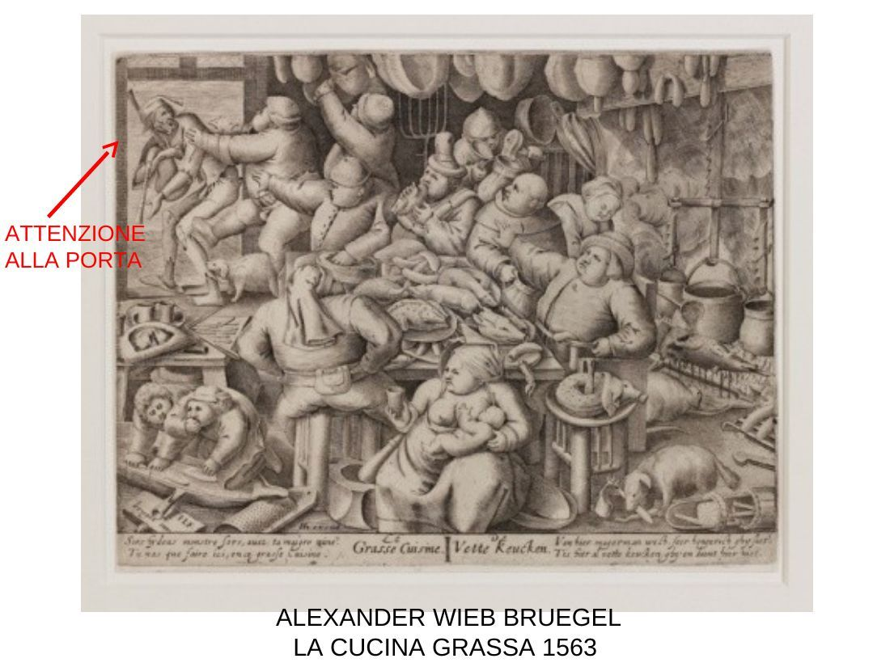{ loading=lazy style="width:59%" }

0:18:34

Pensate a Renzo che porta i polli a don Abbondio come pagamento; oppure a quest’altro dipinto, di Bruegel il Giovane, sul pagamento delle decime, dove i contadini portano polli e uova. Il cibo non solo come mezzo di sostentamento, ma come mezzo di pagamento della gente umile: basti pensare, ancora oggi, ai regali al dottore.

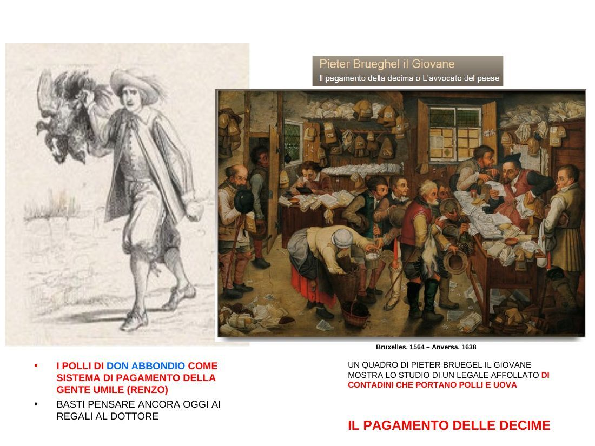{ loading=lazy style="width:59%" }

0:19:03

Una piccola carrellata: *Il mangiafagioli* di Annibale Carracci, e poi l’*Arcimboldo*. Notate come il mangiafagioli guarda davanti a sé, sorvegliando l’ambiente – perché quando si mangia non si sa mai – e come tiene la mano sinistra sopra il pane già cominciato, per metterlo al sicuro.

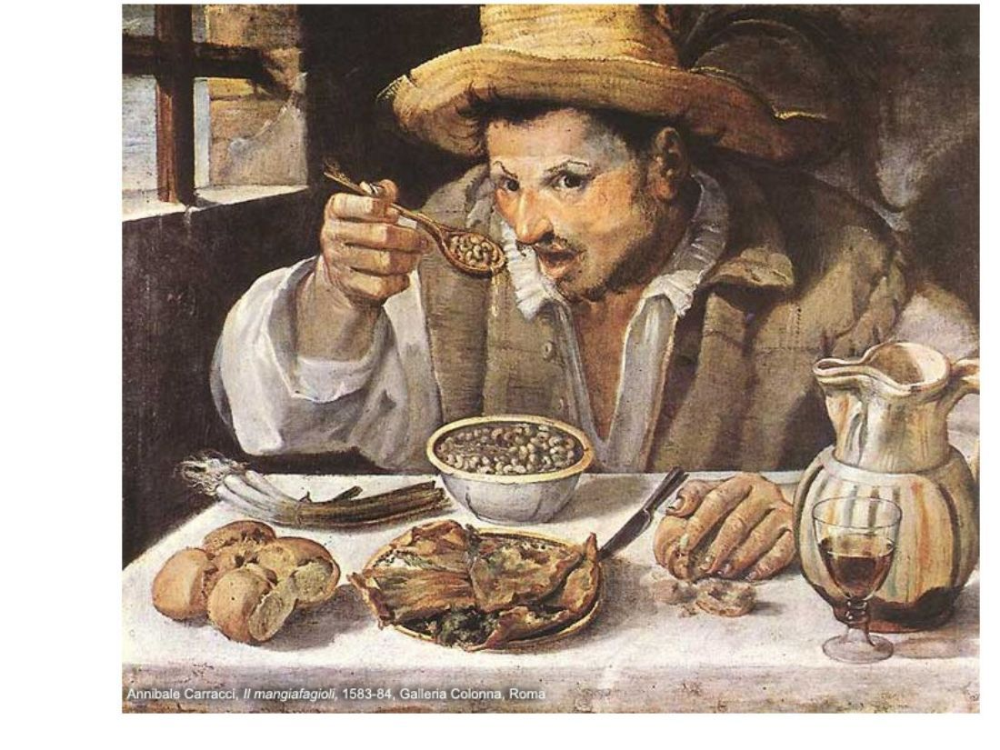{ loading=lazy style="width:47%" }

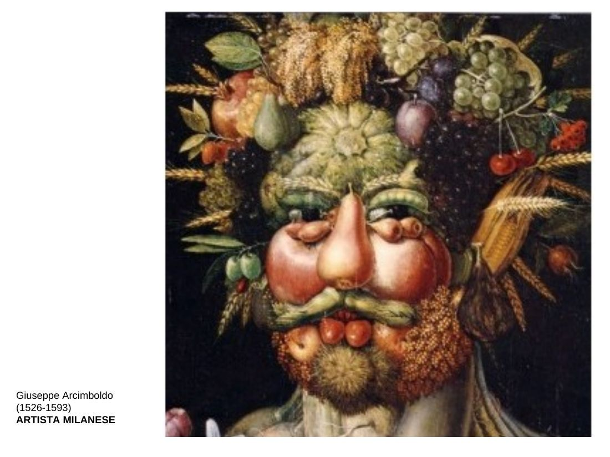{ loading=lazy style="width:47%" }

0:19:39

E poi, come diceva Lorenzo: se c’è una mano che regge il mondo, questa mano impugna una forchetta. Vermeer, *La lattaia*, bellissima. Guttuso, *Il mercato della Vucciria a Palermo*, con questa esplosione del cibo in tutti i suoi colori.

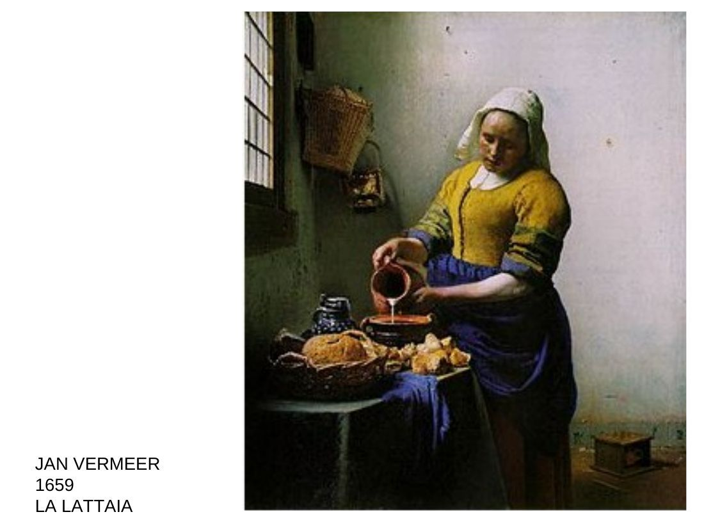{ loading=lazy style="width:47%" }

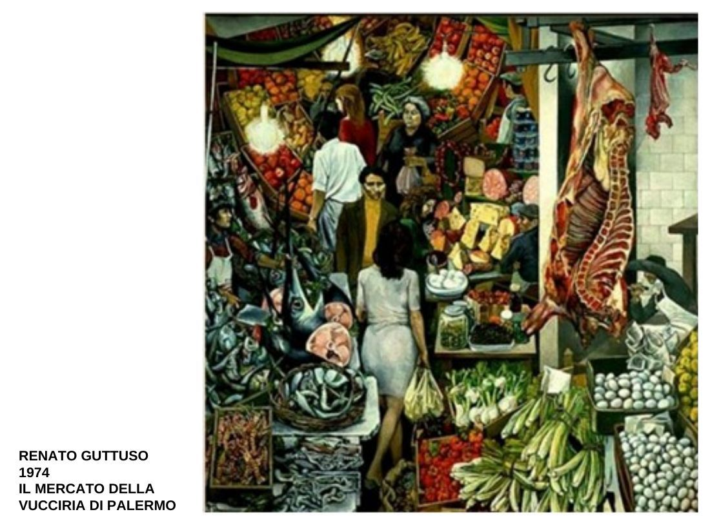{ loading=lazy style="width:47%" }

0:20:04

Cibo e letteratura, velocissimamente: Proust, Joyce. Quello che volevo presentarvi però è Marinetti, che nel 1930 pubblicò il *Manifesto della cucina futurista*, dove professava l’abolizione della pastasciutta: «assurda religione gastronomica italiana». Un’eresia terribile, da futuristi. Ci fu anche un cuoco francese che aderì al manifesto e aveva inventato le cotolette cotte al fuoco della battaglia; poi scoppiò la guerra e quel cuoco morì in trincea. Aveva fatto le cotolette d’attacco e le cotolette di ritirata. Marinetti, peraltro, lo beccarono poi mentre mangiava un bel piatto di pasta.

**CIBO E LETTERATURA**

Ma naturalmente il genere che domina l’intersezione tra pagina e palato è da sempre quello dei libri di cucina veri e propri, i ricettari, che hanno il capostipite nei 10 libri del *De re coquinaria* di Apicio, vissuto ai tempi dell’imperatore Tiberio, nel I secolo d.C. Da allora gli scaffali delle biblioteche, ma soprattutto le cucine, si sono riempiti di manuali e ricettari, che si sono via via differenziati e specializzati.

Marcel Proust e la sua infanzia: *Alla ricerca del tempo perduto*, un romanzo dove le pagine legate al cibo sono assai numerose e intense. Basti pensare al ruolo centrale di Françoise, la cuoca della zia Léonie, alla passione per il gelato dell’amata Albertine (e a quella di Odette de Crécy per il cioccolato).

Novecento letterario, l’*Ulisse* di Joyce: i gusti di Leopold Bloom sono certo assai meno raffinati di quelli di Proust: «Mr Leopold Bloom mangiava con gran gusto le interiora di animali e di volatili. Gli piaceva la spessa minestra di rigaglie, gozzi piccanti, un cuore ripieno arrosto, fette di fegato impanate e fritte, uova di merluzzo fritte. Più di tutto gli piacevano i rognoni di castrato alla griglia che gli lasciavano nel palato un fine gusto d’urina leggermente aromatica».

Ma alla confluenza tra parola e gusto si possono inseguire percorsi più curiosi, anche senza arrivare agli estremismi del *Manifesto della cucina futurista* (1930), in cui Filippo Tommaso Marinetti chiedeva «l’abolizione della pastasciutta, assurda religione gastronomica italiana», a favore di un’alimentazione più attenta alla chimica.

Fonte: BABILONIA Letteratura, http://www.parodos.it
{: .didascalia }

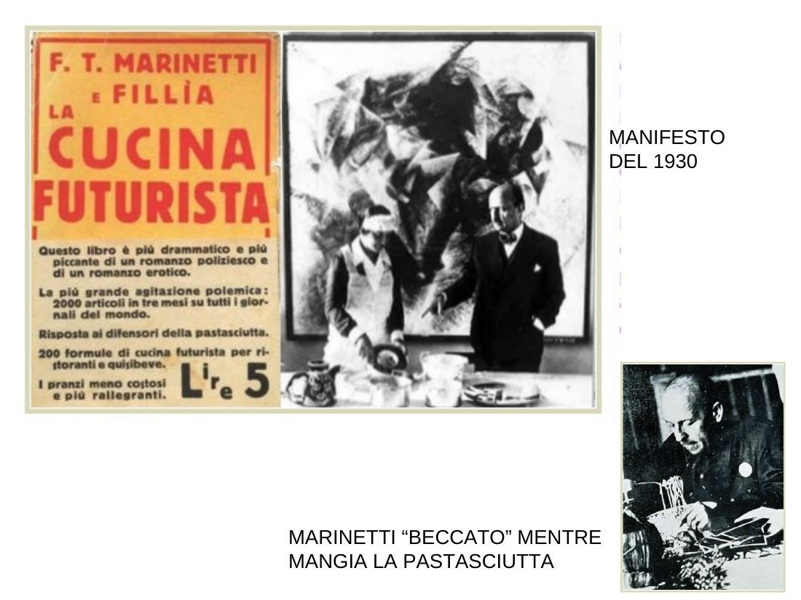{ loading=lazy style="width:51%" }

0:22:01

Lorenzo Poggi La pasta è un’eresia, dice Marinetti. Ma gli spaghetti e il pomodoro sono esattamente il simbolo della trasformazione e dello sviluppo dell’umanità. Perché? Lo spaghetto è un’invenzione araba: il tentativo di fare una pasta secca che regga all’umidità e si possa conservare. È disidratata: quando la si cuoce le si restituisce l’acqua. Ed è rotondo perché così si disidrata bene – anche la forma è importante.

0:22:48

Il pomodoro viene dalle Americhe e si afferma fra Cinquecento e Seicento; l’aglio è antichissimo, l’olio pure; il peperoncino di nuovo dalle Americhe. E il basilico ha anche una funzione sacra, perché fiorì sulla croce. Sant’Elena, la madre di Costantino, andò a cercare la croce di Cristo e ne trovò tre, perché c’erano anche quelle dei due ladroni: su quella di Cristo spuntò una pianta di basilico. *Basilikós*, la pianta sacra. Nelle chiese ortodosse il basilico c’è sempre.

0:23:55

Quindi lo spaghetto al pomodoro, che sembra la cosa più nostra del mondo, è il frutto della contaminazione. Ecco la contaminazione come elemento che regge la storia: si mettono insieme cose di provenienze diversissime, e proprio quelle costituiscono l’elemento di sviluppo e di innovazione, e costruiscono quello che noi sentiamo come la nostra identità profonda. Non mangiamo soltanto il cibo: noi *siamo* il cibo. L’uomo è ciò che mangia, da sempre.

0:25:05

Quando andiamo a cercare le nostre radici, ci accorgiamo che le nostre radici sono fatte di contaminazione, di accoglimento di elementi diversissimi; e che la nostra crescita, la nostra identità, è consistita nel saperli mettere insieme e nel farne un’occasione di sviluppo.

0:25:45

Che cosa c’è, nella cucina, che cresce e sviluppa? Il lievito. Tutta la storia dell’origine della cultura è legata al lievito come simbolo, come metafora e come oggetto.

0:26:12

Paolo Marcucci Tornando alla letteratura: Maigret, Pepe Carvalho, il commissario Montalbano, Shakespeare, il conte Ugolino, Hannibal. Volevo però fermarmi sul Marchese de Sade, *Le 120 giornate di Sodoma*, dove ai libertini è fatto divieto assoluto di molestare le tre cuoche: per la sacralità del cibo.

**CIBO E LETTERATURA**

Poi, passando per le travolgenti abbuffate del gigante Gargantua, nato dalla fantasia di Rabelais…

Tra assassini e dissoluti i buongustai sono dunque molti. Ma non sono da meno i loro eterni avversari: risultano infatti sorprendentemente numerosi i detective patiti della buona cucina:

– Maigret di Simenon;

– Nero Wolfe di Rex Stout;

– Pepe Carvalho di Manuel Vázquez Montalbán;

– il commissario Montalbano di Andrea Camilleri.

Le loro indagini vengono spesso inframmezzate da gustosi manicaretti (di cui a volte si può leggere – e dunque preparare – anche la ricetta, assaporando così le stesse sensazioni dell’eroe).

**IMMAGINI FORTI DAL CANNIBALISMO:**

– nel *Tieste* di Seneca Atreo uccide i tre figli del fratello Tieste e nel corso di un banchetto gli offre le loro carni;

– nel *Tito Andronico* di Shakespeare si narra un’altra storia di vendetta, dove il protagonista dà in pasto Chirone e Demetrio alla loro madre Tamora;

– il conte Ugolino della *Commedia* dantesca, che per fame divora i propri figli;

– il famoso Hannibal «the cannibal» Lecter, il serial killer antropofago protagonista dei best seller di Thomas Harris.

Sul fronte delle perversioni, non si può dimenticare che nelle *120 giornate di Sodoma il marchese de Sade*, consapevole delle proprietà afrodisiache di certi alimenti, prevede la presenza di «tre famose cuoche»: per la delicatezza del loro compito, né loro né le loro tre aiutanti potranno essere molestate dai crudeli libertini.

Pasolini affronterà questo tema dal punto di vista del potere, facendo mangiare la merda (*Salò* o *Le 120 giornate di Sodoma*, 1975).

Fonte: BABILONIA Letteratura, http://www.parodos.it
{: .didascalia }

0:27:07

Lo stesso tema, visto con gli occhi del potere, lo ribalterà Pasolini con *Salò o le 120 giornate di Sodoma*, del 1975: lì il potere assoluto è far mangiare la merda. Queste sono alcune immagini tratte dal film.

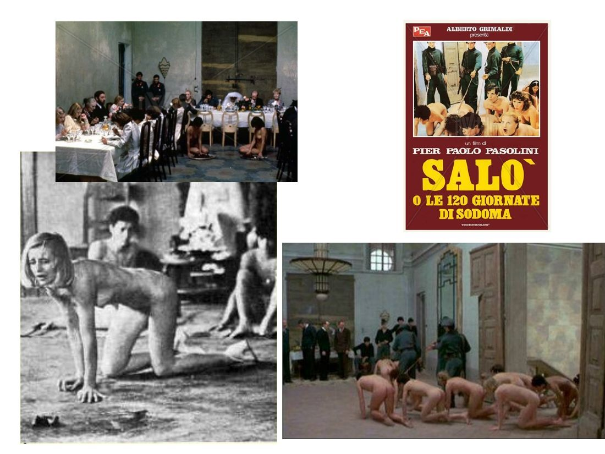{ loading=lazy style="width:52%" }

0:27:57

Possiamo anche parlare degli oggetti – ne parleremo più in dettaglio nell’ultima parte – per esempio la forchetta. Lorenzo parlava della forchetta. È interessantissima: l’anno scorso, a una festa del Rinascimento in Francia, allo Château de Blois, ne hanno parlato. Presente a Costantinopoli fin dall’anno Mille e diffusa fra il XV e il XVI secolo nel resto d’Europa, fu a lungo guardata con sospetto, perché la forma simile al forcone ricordava il diavolo: un arnese da trattare con cautela. Guelfi e ghibellini la disponevano diversamente attorno al piatto: i guelfi alla destra, come noi; i ghibellini dove oggi mettiamo le posate da frutta.

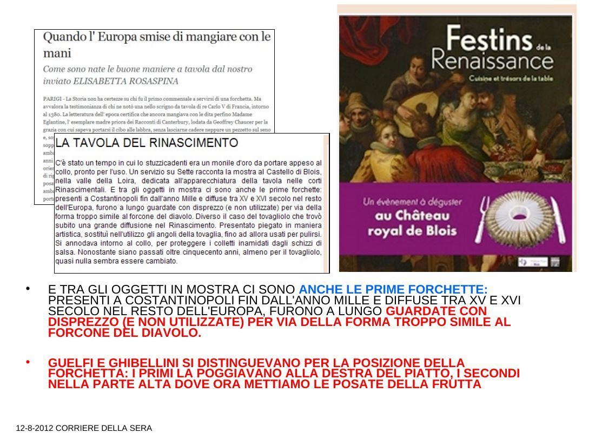{ loading=lazy style="width:59%" }

0:28:50

Thomas Coryate (1577-1617), un inglese che viaggiava in Italia e poi raccontava – il suo *Coryat’s Crudities*, del 1611, fu il primo libro di viaggio per gli inglesi in Europa – nel 1608 rimase stupito. Fino al Seicento e al Settecento l’Italia era considerata la meta di tutti gli intellettuali e dei raffinati, mentre in Inghilterra erano ancora piuttosto barbari. Lui si stupiva che in Italia i ricchi, mentre con una mano tenevano il coltello per tagliare la carne, con l’altra impugnassero la forchetta: e si domandava perché usare un simile oggetto, quando Dio ci ha dato le mani.

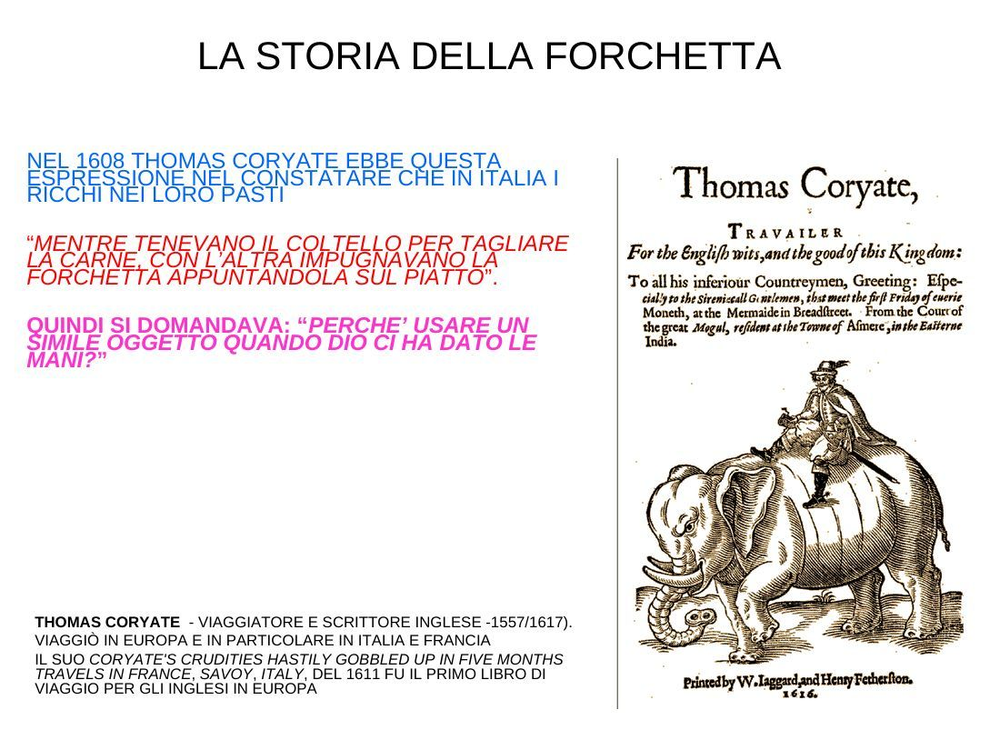{ loading=lazy style="width:59%" }

0:29:41

La tavola rotonda ci riporta un po’ a queste nostre serate di Pensieri a tavola: comunanza, scambio di idee. Questo è un dipinto del XV secolo.

**TAVOLA ROTONDA**

Oppure, per arrivare alla *Tavola dei pensieri*, la tavola rotonda.

La tavola, simbolo di uguaglianza, parità di onore e comunanza di ideali.

Appunto la tavola rotonda (XII-XIII secolo), a cui sedevano i leggendari cavalieri (Lancillotto, Tristano…) in riunione con re Artù, eroe delle lotte dei bretoni contro gli anglosassoni.

Wace: *Roman de Brut* del 1155; Chrétien de Troyes: *Lancelot*, *Perceval*; trilogia: *Lancelot*, Q*ueste del Saint Graal*, *Mort Artu* (1220-1235).

Fonte: *Garzantina Medioevo*, p. 1515
{: .didascalia }

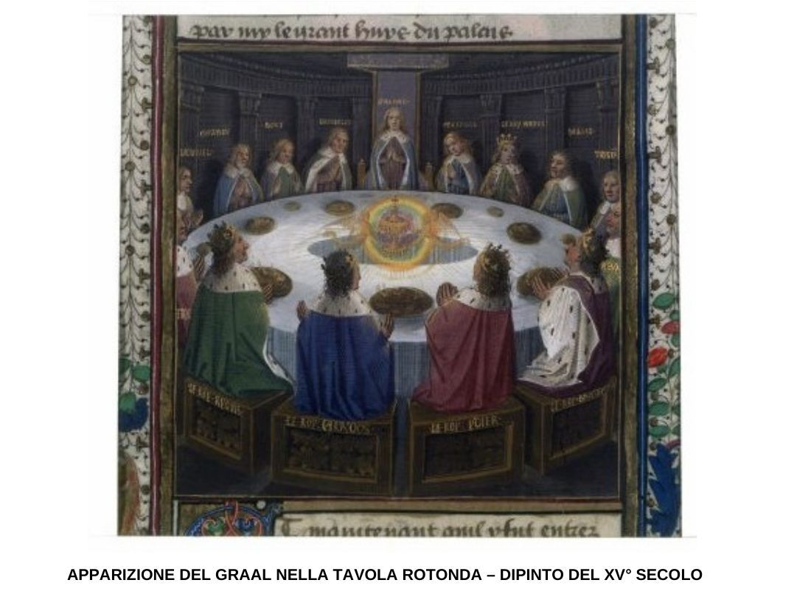{ loading=lazy style="width:59%" }

0:30:00

Per finire, due battute sul cibo di strada, che è anche la prima esperienza che ha legato il cibo al guadagno – forse i primi ristoranti. Questa è una fotografia di un venditore di lampredotto e trippa a Firenze di fronte al Cibreo. Il cibo di strada nasce probabilmente insieme al concetto di mercato e di città: quando nacquero i primi mercati e le prime borse, la gente si riuniva, e qualcosa bisognava pur mangiare. Altre due immagini: le caldarroste, e di nuovo i banchi di trippa e salumi.

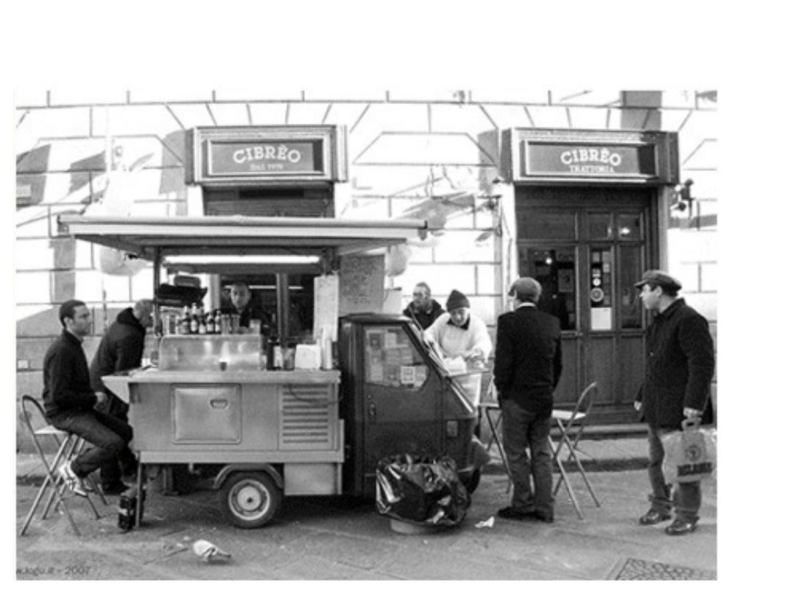{ loading=lazy style="width:48%" }

**IL CIBO DI STRADA**

La ristorazione del cibo di strada merita molta attenzione di per sé: è la più antica.

È nata insieme ai concetti di mercato e di città: ovunque vi siano raccolte persone per scambiarsi merci, infatti, si è creata la necessità di punti di ristoro per chi veniva da lontano a barattare, a comprare o a vendere.

Il cibo di strada è un concentrato di sapori semplici, netti e antichi; principalmente si consuma con le mani.

I cibi di strada raccontano quasi sempre una storia, la storia del cibo, anche perché sono sempre legati al territorio dove sono nati.

C’è chi ha comparato il fast food e il cibo di strada: sono accomunati dalla stessa modalità di fruizione, rapida.

Ma sono mondi diversi, legittimi tutti e due, ma due mondi diversi: da una parte c’è la manualità, l’artigiano, dall’altra il franchising e l’industria.

**UN PO’ DI LETTERATURA SUI CIBI DI STRADA:**

– Porzio: *Cibi di strada;*

– Valli: G*li antichi sapori dei mangiatori di strada;*

– Cambi: S*treet food;*

– Amabile: *Mangiare per strada.*

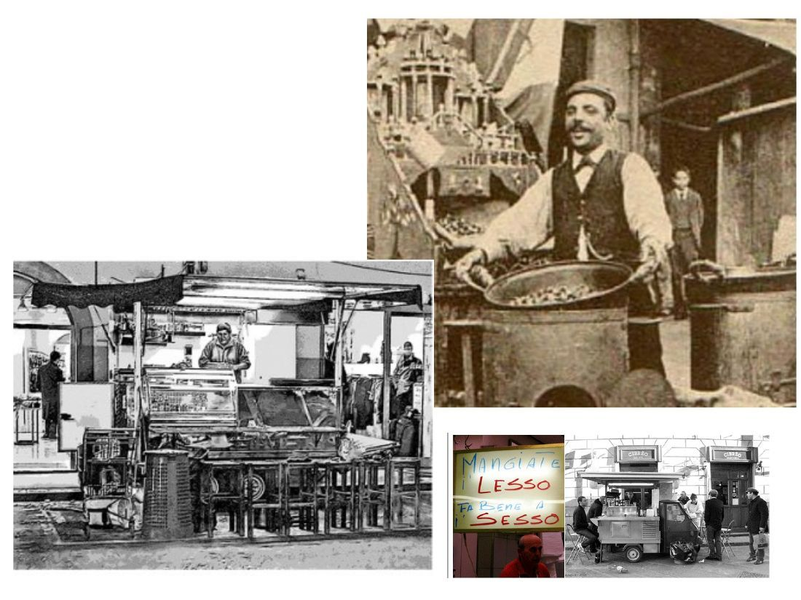{ loading=lazy style="width:54%" }

0:31:17

Lorenzo Poggi Il cibo come simbolo, come segno, come emblema del rapporto con l’esterno. È il rapporto strettissimo dell’uomo con la natura: il mondo esterno passa attraverso il cibo. Ma è anche relazione con gli altri – lo diciamo anche noi: *compagno*, da *cum panis*. E quando con una persona vogliamo tenere le distanze: non ci ho mica mangiato la pappa insieme.

0:32:12

Il mondo si sta dividendo fra quelli che vorrebbero mangiare e quelli che vorrebbero mangiare di meno; fra chi ha fame e chi vorrebbe essere più magro. E chi è magro, chi riesce ad avere con il cibo una relazione molto raffinata, sentita come equilibrata, si sente in qualche modo superiore agli altri – e questo richiede sacrificio. Il nostro mondo ha cambiato i termini della questione, ma resta l’idea del cibo come relazione. Ed è un rapporto con l’altro, con il diverso. Dicevamo il lievito: il lievito fa crescere, ed è qualcosa di estraneo all’acqua e alla farina. È una pallina che ha in sé qualcosa della vita, della natura. L’uomo, quando comincia a elaborare il cibo, sente nel lievito qualcosa che lo mette in contatto con forze della natura che riesce a utilizzare senza conoscerle né controllarle del tutto.

0:34:14

Il lievito arriva fino a noi in storie che hanno la forma del dono. Chi lo porta agli uomini? La madre. C’è una leggenda sarda, diffusa anche in altre versioni, che parla della Madonna bambina che va a scuola dalla Sibilla: la Sibilla aveva tutte le conoscenze e faceva anche la maestra. La Madonna si accorge che la Sibilla fa un pane buonissimo, lievitato, leggero, mentre sua madre Sant’Anna fa un panaccio azzimo, duro, che è un supplizio da mangiare. Vede che la Sibilla mescola nella pasta una pallina di una certa sostanza; e allora, non vista, la prende e se la mette sotto l’ascella. La porta alla mamma, e Sant’Anna da quel momento farà un pane lievitatissimo, e darà il lievito a tutte le altre donne. È per questo che abbiamo l’incavo sotto l’ascella.

0:35:45

Sono i segni che il nostro corpo porta: altre volte abbiamo parlato di segni legati alla religione. Anche il solco del sedere – e anche quello è legato al cibo, perché abbiamo mangiato la mela proibita nel paradiso terrestre e ci hanno cacciati e l’Angelo ha dato un calcio ad Adamo.

0:36:26

Guardate la parola *lievito* e la parola *allievo*: hanno la stessa radice. L’allievo è colui che si sviluppa, che cresce. Il lievito è qualcosa di estraneo che fa crescere la pasta: l’estraneo, il rapporto con l’altro, che diventa sviluppo.

0:37:14

E poi il cibo va cotto: la cottura è il primo passo. Gli animali mangiano per vivere; l’uomo mangia per vivere, ma vive anche per mangiare – cioè fa del mangiare un’operazione di cultura, un intervento sulla natura, un controllo di quelle forze. Il fuoco è il primo strumento di trasformazione della natura. Noi non mangiamo la natura: mangiamo una natura elaborata, simbolizzata. Ciò che non è cotto, che non è culturalmente lavorato, non ci piace: è nudo e crudo.

0:38:53

«Sì, ma ora c’è chi mangia il sushi.» Prima chi mangiava il pesce crudo era il gatto, quando qualcuno puliva il pesce; oggi il gatto il pesce crudo non lo vede più, perché nessuno lo pulisce più. Ma il sushi non è crudo: è una natura cruda che è però elaborata, tagliata, con tutta la cultura del condimento, degli aromi, della preparazione, della forma. È raffinatissima.

0:39:53

Il fuoco lo ha donato agli uomini Prometeo. E con quello ha donato anche la speranza vana di poter sfuggire al male, di controllare il mondo. Giove glielo rimprovera proprio: gli hai dato il fuoco, ma gli hai dato anche delle vane speranze; e per questo lo incatena e gli manda l’aquila a mangiargli il fegato. Il cibo è questo primo tentativo di controllo. Anche Sant’Antonio abate è uno che ha donato il fuoco agli uomini – strano, è un Prometeo anche lui. È un grande santo: tutti i contadini una volta lo avevano nelle stalle, perché protegge gli animali, e si presenta sempre con un maialino. Ed è un santo legato al fuoco: cura il «fuoco di Sant’Antonio», che oggi è l’herpes zoster ma che una volta era anche altro, l’avvelenamento da segale cornuta, che restringeva i vasi e dava il «mal degli ardenti». Nel Medioevo era sempre il segno che stava per scoppiare una carestia, perché la segale si coltiva in zone poco adatte e si riempie di quel parassita quando la popolazione è superiore al cibo che si riesce a produrre.

0:42:07

Come fa Sant’Antonio a donare il fuoco? La leggenda dice che era nato da un peccato: due pellegrini che andavano a Santiago fecero l’amore durante il pellegrinaggio, ed è nato lui. Per fargli scontare il peccato, da bambino lo mandarono all’inferno a fare il portiere. Naturalmente fece amicizia con i dannati e li faceva uscire, così cacciarono anche lui. Uscendo, infilò in un tizzone del fuoco infernale la sua ferula di finocchio vuota – come quella di Prometeo, vedete la finezza – e il maialino ci intinse la punta della coda; una volta all’aperto, scosse la ferula, il maialino scosse la coda, e le scintille furono donate a tutti gli uomini.

0:43:44

L’altro lievito, l’altro rapporto con la natura, è il vino. Anche il vino fermenta, anche nel vino c’è il mistero dell’utilizzo del mondo esterno, e insieme quel senso misterioso della natura che non può essere controllato fino in fondo: si simbolizza nell’avvento del dio del vino, Dioniso, Bacco, il dio straniero, che arriva sulla nave all’improvviso – come gli albanesi che ricordava Paolo, come i migranti – ma che porta qualcosa che fa fermentare, che fa crescere.

\[PAUSA\]
{: .nota }

1:09:18

Paolo Marcucci In questa parte tratteremo il rapporto dell’uomo con il cibo nel mito e nella fede, in particolare nella simbologia cristiana. L’importanza della Chiesa e della sua simbologia è fondamentale per la nostra storia: l’importanza del cibo per l’uomo, nella nostra società, non può non passare attraverso le icone e i simboli del mito prima, e i simboli della fede cristiana poi.

1:09:53

Iniziamo dal mito, dalla divorazione: il simbolo rappresenta letteralmente il timore di essere mangiati, divorati, o anche di essere avviluppati, di sprofondare nella melma. Jung cita il passo biblico di Giona nel ventre della balena. Anche Pinocchio, di cui abbiamo parlato stasera, ci dice qualcosa sull’essere mangiati. La divorazione è anche il simbolo della paura dell’incesto – la paura di essere divorati dalla propria madre, che a sua volta si nasconde dietro diverse forme dell’immaginazione: la strega, il lupo, l’orco, il drago che mangiano i bambini. Questa, per esempio, è una xilografia del 1473, dal Libro di Belial, che simboleggia questa paura ancestrale.

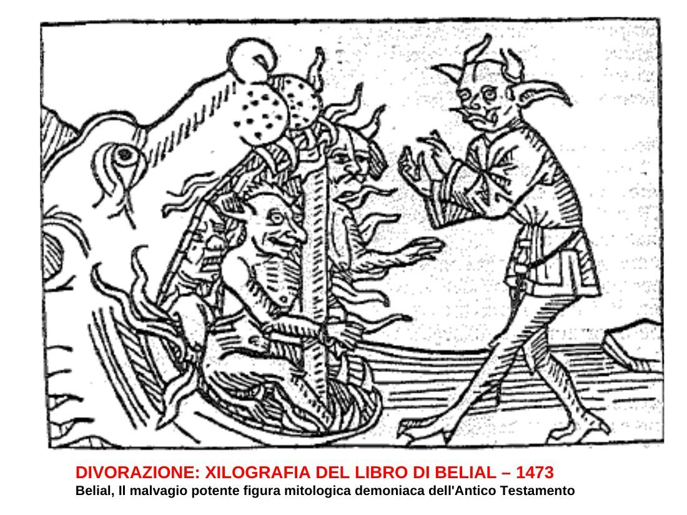{ loading=lazy style="width:51%" }

1:10:38

C’è poi il cibo come continuazione del rapporto con i morti: da qui la tradizione di offrire banchetti ai defunti in certe giornate. Nei culti ctoni greci si offrivano verdure cotte, uova, galli e a volte pesci, e da bere una mistura di miele, acqua, latte e vino. James Hillman, nel saggio *Il sogno e il mondo infero*, affronta l’argomento: il mondo infero è l’opposto dell’emisfero dei vivi, chi sta al di sotto cammina con i piedi sul soffitto, e perciò la digestione procede in maniera inversa e gli escrementi arrivano alla bocca. È un mondo invertito, pervertito. E così, al contrario del mondo diurno, i funghi che noi mangiamo sono in realtà le anime dei morti che spuntano nella terra dei vivi, perché provengono dal di sotto: i funghi di mezzanotte de *La tempesta* di Shakespeare, dove Prospero si rivolge ai folletti «il cui divertimento fa crescere i funghi di mezzanotte».

**IL CIBO E L’INCONSCIO**

Da *Il sogno e il mondo infero* di James Hillman

Il cibo nel mondo infero, che è sotto i nostri piedi (l’emisfero superiore è il regno dei vivi e degli dèi superi, l’emisfero inferiore è quello dei morti e degli dèi inferi):

Le persone laggiù camminano coi piedi sul soffitto; questo comporta la spiacevole conseguenza che, poiché la digestione procede in direzione opposta, gli escrementi arrivano alla bocca.

Il mondo infero è l’inverso del mondo diurno, e dunque il suo comportamento sarà invertito, pervertito: ciò che dalla prospettiva del giorno è solo escrementi (i residui diurni di Freud) diventa cibo per l’anima quando è capovolto.

E al contrario, nel mondo diurno, ad esempio, i funghi sono le anime dei morti che spuntano nella terra dei vivi (le vesce umide, spontanee, i «funghi di mezzanotte»: *La tempesta, V, 1, 39*).

Nella tradizione popolare italiana il punto del terreno dove spunta un fungo segnala il giacimento sotterraneo di uno specifico corpo metallico, cioè le figure planetarie o i corpi archetipici del mondo infero.

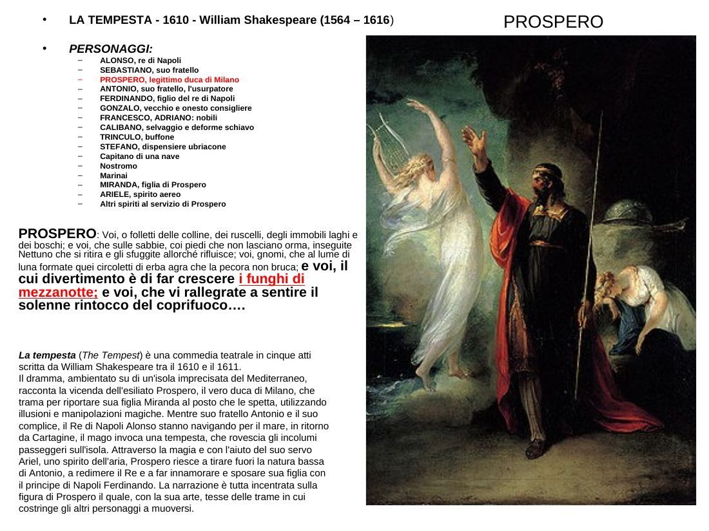{ loading=lazy style="width:59%" }

1:12:18

Ma i simboli più potenti, quelli che ci hanno condizionato, sono probabilmente quelli cristiani: il pane, la comunione di cui parlava Lorenzo, la cena, la moltiplicazione dei pani e dei pesci, l’ultima cena.

1:12:48

Nelle rappresentazioni dell’ultima cena non c’è sempre stata la costanza dei dodici discepoli: sono stati due, tre, cinque, sei. Le raffigurazioni più antiche sono del pane con i pesci. Perché i pesci? Perché il nome greco del pesce, *ichthys*, è l’acrostico di Gesù Cristo Figlio di Dio Salvatore.

**IL PANE E LA SIMBOLOGIA CRISTIANA**

Pane (dal *dizionario dei simboli cristiani*)

La *moltiplicazione dei pani* e l’*ultima cena* sono i principali episodi biblici che hanno dato agli artisti cristiani l’occasione di raffigurare il pane e il cibo.

Fra le due scene gli esegeti (interpreti critici dei testi) hanno fatto degli accostamenti, chiedendosi se le moltiplicazioni dei pani non fossero in origine rituali eucaristici celebrati da Gesù, che gli evangelisti, trent’anni dopo, nel sistemare i propri ricordi avrebbero trasformato in miracoli.

A favore di questa tesi sarebbero anche i disegni simbolici dei discepoli attorno a Gesù nelle rappresentazioni più antiche, in cui si vedono 7, 6, 5, 3 o anche 2 discepoli (nell’ultima cena di Leonardo sono 12).

Le raffigurazioni più antiche del pane, sparso in briciole o in pezzetti su una tavola o dentro dei canestrelli, sono accompagnate da pesci.

Questi, di primo acchito, sono vivi: si tratta in questo caso di apparizioni di Gesù, sia a Gerusalemme nel sinedrio\* (Luca 24,42), sia più spesso sulle rive del lago di Genezareth (Giovanni 21,9).

Quando poi il pesce è cucinato, evoca il pasto comune che si faceva originariamente prima della celebrazione della Santa Cena.

Quando invece il pesce è isolato e compare in un angolo qualsiasi della rappresentazione, è il vocabolo greco *ichthys* (pesce) a essere raffigurato: essendo l’acrostico di Gesù, simboleggia, oltre e attraverso il pane, la presenza reale del Cristo.

Il pesce in greco si dice ιχθυς (*ichthys*). Disposte verticalmente, le lettere di questa parola formano un acrostico: *Iesùs Christòs Theù Hyiòs Sotèr* = Gesù Cristo Figlio di Dio Salvatore.

Acrostico è una parola greca che indica un componimento in cui le prime lettere di ogni riga formano una parola; il pesce è un simbolo diffuso di Cristo, emblema e compendio della fede cristiana.

\* Il Sinedrio di Gerusalemme era l’organo (formato tradizionalmente da 71 membri) preposto all’emanazione delle leggi e alla gestione della giustizia.

1:13:38

Queste raffigurazioni hanno pervaso i cimiteri e le catacombe: con esse si voleva ricordare che il pane della Santa Cena è il pane della vita che Gesù dà ai suoi, la vita eterna. Il pane è in questo caso una forte affermazione della resurrezione, iscritta come sublime risarcimento sulle tombe dei cristiani perseguitati. Ecco un’immagine dalla catacomba di San Callisto a Roma, del III secolo: i pani e i pesci. Questo invece è un sarcofago cristiano del VI secolo, a Vienna, con le spighe e i grani.

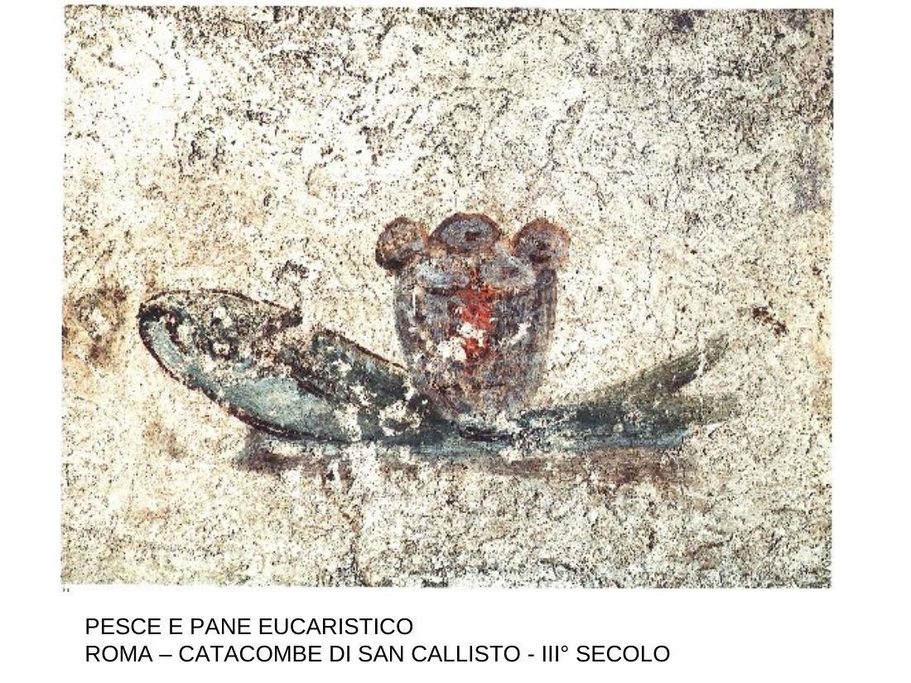{ loading=lazy style="width:47%" }

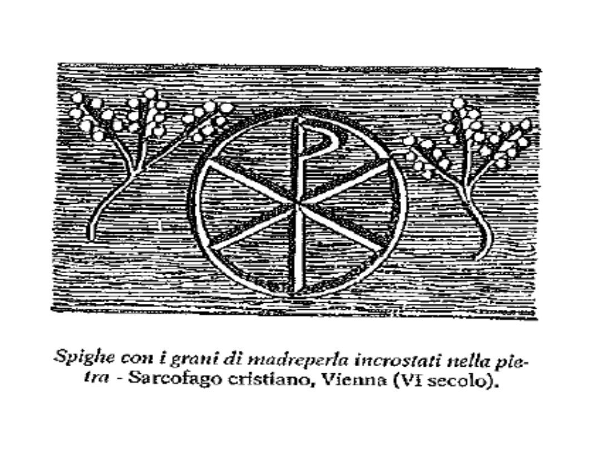{ loading=lazy style="width:47%" }

1:14:14

Diverse fasi del cristianesimo hanno privilegiato momenti diversi. A partire dal IV secolo l’atmosfera religiosa cambiò completamente: il cristianesimo si pose a stupire il mondo che aveva appena conquistato, e si trascurò l’ultima cena per rappresentare soprattutto la moltiplicazione dei pani e dei pesci, segno della potenza di Gesù Cristo e prova della sua divinità. Questa è una porta lignea della chiesa di Santa Sabina a Roma; questo un mosaico in una chiesa in Israele; questo Lambert Lombard (1505-1566), il miracolo dei pani e dei pesci; questo Benvenuto Tisi detto il Garofalo; questo Leandro Bassano, fra fine Cinquecento e inizio Seicento.

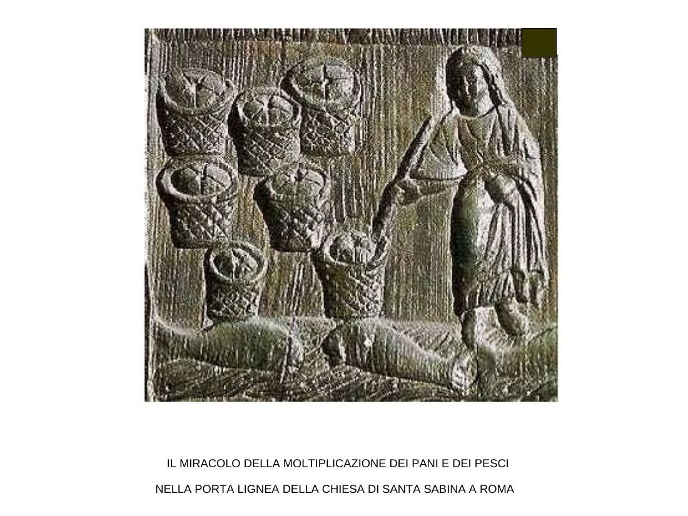{ loading=lazy style="width:47%" }

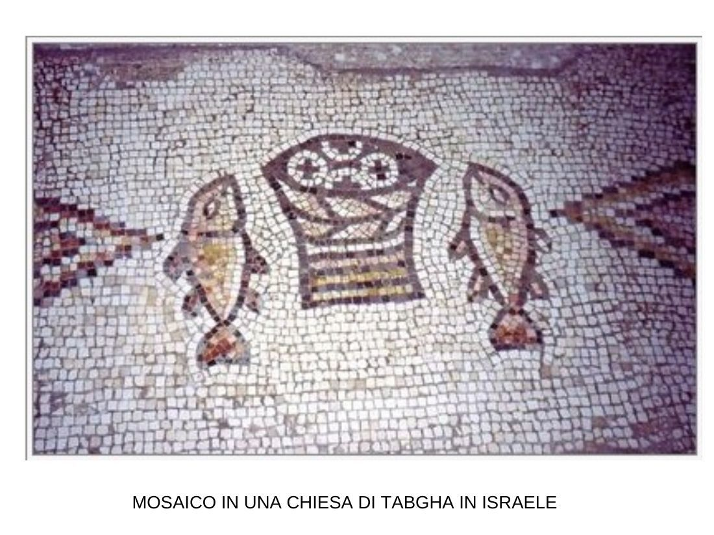{ loading=lazy style="width:47%" }

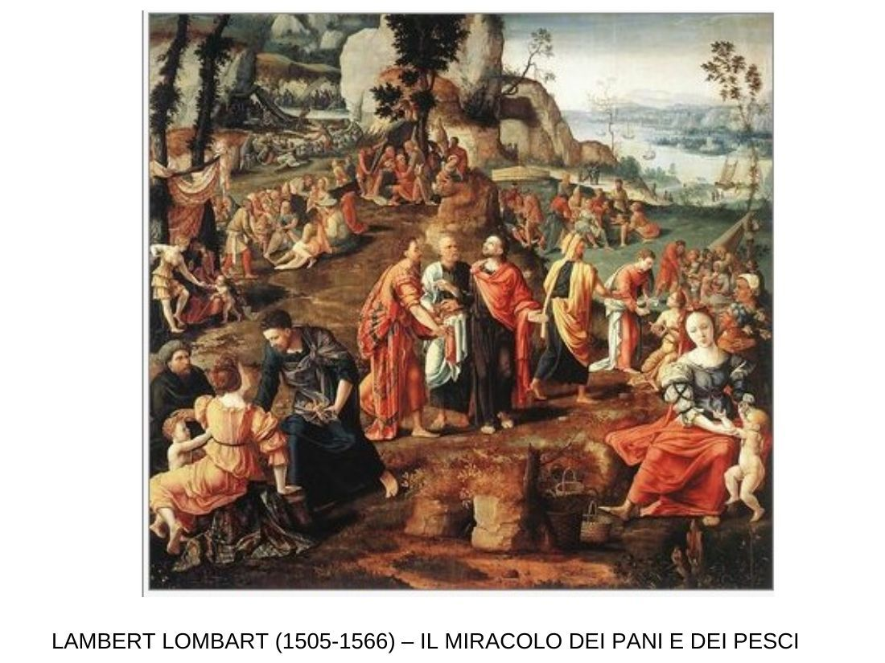{ loading=lazy style="width:47%" }

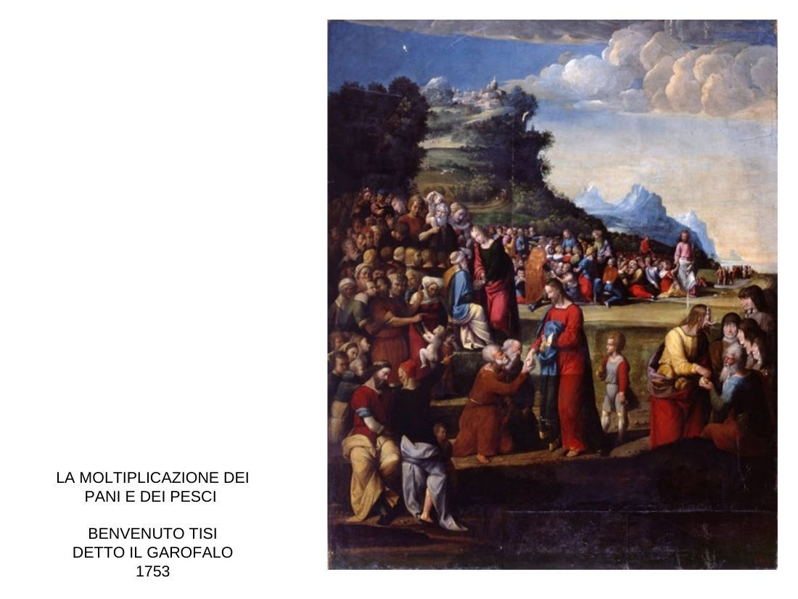{ loading=lazy style="width:47%" }

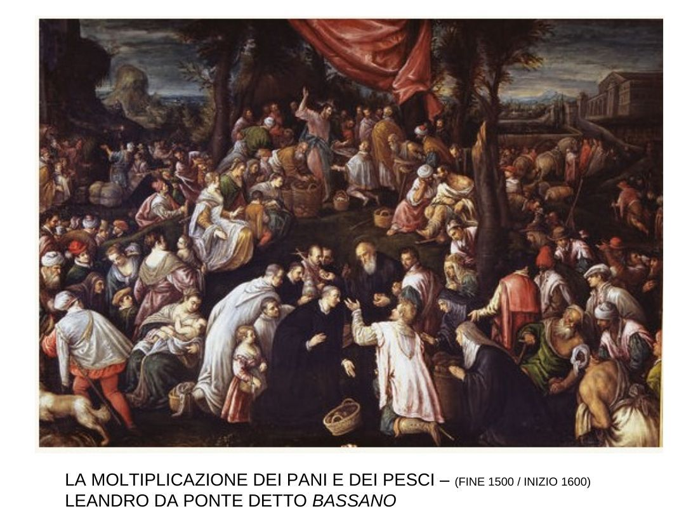{ loading=lazy style="width:59%" }

1:15:29

Dopo alcune generazioni la Chiesa cominciò a valorizzare il nuovo sacramento dell’Eucaristia, fissando a questo scopo delle forme di culto: la liturgia prese il posto della religiosità. Il pane divenne importantissimo: fino ad allora si usava il pane ordinario, quello che si mangiava ogni giorno, e per nutrirsene occorre spezzarlo, e questo simboleggiava meravigliosamente il corpo di Cristo spezzato per noi. Questa è la *Fractio panis* del II secolo, nel cimitero di Priscilla a Roma: in questo caso gli apostoli non sono dodici, ma cinque.

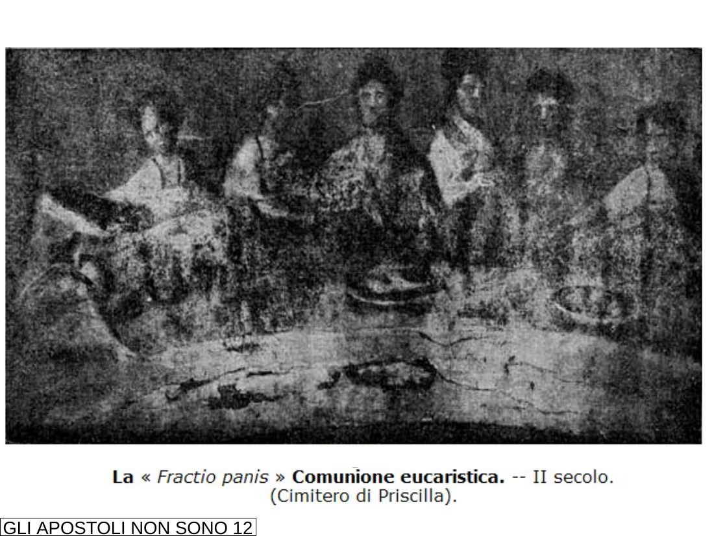{ loading=lazy style="width:59%" }

1:16:22

A partire dal IV secolo il pane diventa il ricettacolo di Cristo, secondo la dottrina della transustanziazione, cioè la conversione della sostanza del pane in quella del corpo di Gesù, che avviene durante la celebrazione eucaristica, dopo la pronuncia delle parole della consacrazione.

1:16:47

Assunto quel valore, cominciano le dispute teologiche. Non si poteva più usare il pane comune: nel VI secolo si discusse a lungo se si dovesse usare pane con o senza lievito, e in Occidente prevalse il pane azzimo, in Oriente quello comune. La farina doveva essere pura – e chi doveva sceglierla, i chicchi di grano dei bambini innocenti o dei preti che avessero recitato prima le lodi? E il mugnaio non doveva forse rivestirsi di un camice speciale per preparare la farina del pane consacrato? Quanta segale era lecito mescolare al frumento? E non sarebbe stato più prezioso il pane fatto con il latte invece che con l’acqua, con un po’ di burro e di miele? Tutte queste questioni furono lungamente dibattute fra il IX e il XIV secolo: a noi sembrano cose da poco, ma allora erano importantissime.

**DAL PANE ALLE OSTIE**

Tutte questioni lungamente dibattute tra il IX e il XIV secolo. Una parrocchia, un’abbazia o anche una provincia adottavano una soluzione, altre ne sceglievano un’altra.

Siccome in ecclesiologia le abitudini fanno presto a farsi tradizione, si faceva risalire agli stessi apostoli questo o quel costume, sostenendolo con tale convinzione che i teologi, i sinodi e i concili dovettero penare non poco per orientare i fedeli in materia.

Finì che il pane venne sostituito da quelle che comunemente si chiamano «ostie», di pasta fatta semplicemente di acqua e farina, pressata tra le due valve del «ferro per cuocere le ostie», i cui primi esemplari risalgono al IX secolo: questo dimostra che l’uso delle ostie non può essere anteriore.

1:18:04

Questo è il ferro da ostie più antico che abbiamo in Italia, conservato al Museo del Vino di Torgiano, in provincia di Perugia. Questa è un’ostia del rito copto etiopico, dove la croce centrale simboleggia il cuore e le quattro croci accanto sono le piaghe delle mani e dei piedi; quelle più ai lati sono la flagellazione.

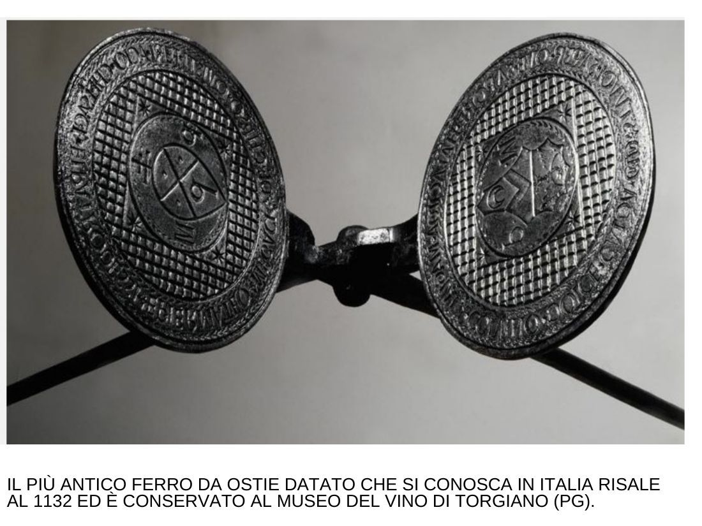{ loading=lazy style="width:45%" }

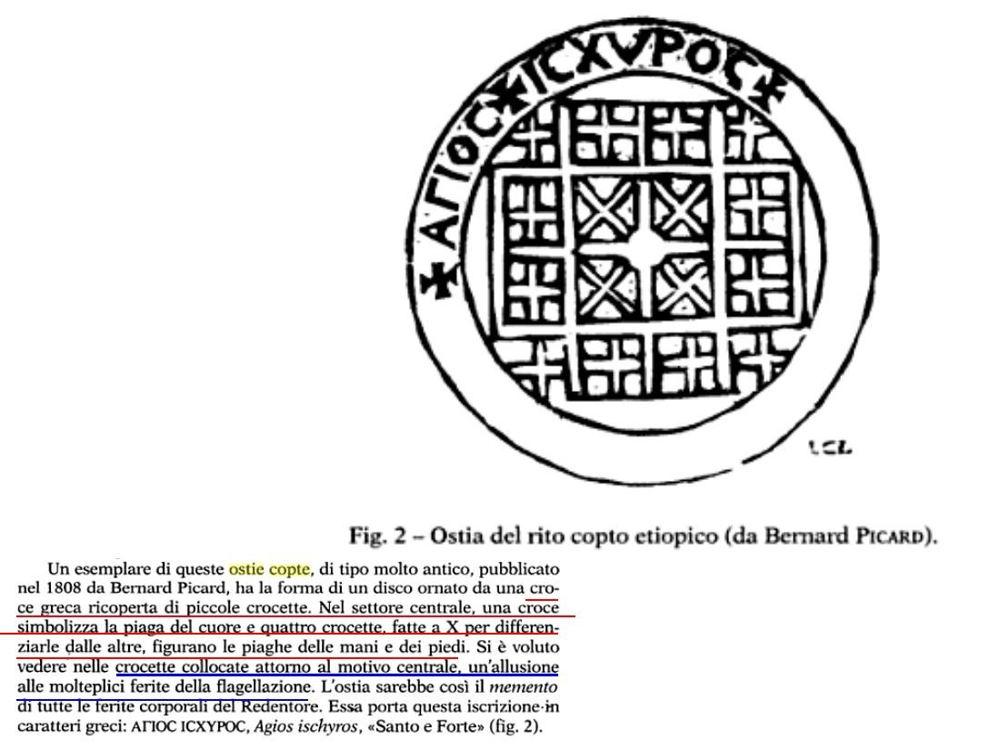{ loading=lazy style="width:44%" }

1:18:58

Lorenzo Poggi Una precisazione sulla parola *ostia*: ostia è la vittima sacrificale, il cui sacrificio ci mette in rapporto con la divinità. Ma *hostia* ha la stessa radice di *hostis*, che è il nemico, e insieme di *hospes*, l’ospite. La parola è la stessa: chi ospita e chi è ospitato sono comunque *hospes*. Vedete: nelle storie delle parole ci siamo noi – non siamo noi a parlare il linguaggio, è il linguaggio che ci parla. E di nuovo torna il rapporto con l’esterno, con il rischio dell’assunzione dell’esterno, ma insieme la salvezza: tutto nella stessa parola.

1:20:14

Paolo Marcucci Il più antico stampo di pietra fu trovato a Cartagine: prima dei ferri da ostia si facevano stampi in pietra a forma di ostia. Le ostie venivano distribuite anche durante i pellegrinaggi e i giubilei, perché i pellegrini si sostenessero fino all’ora dei pasti.

**LE OSTIE**

La forma schiacciata del pane consacrato cominciò ad apparire in Oriente alla fine del IV secolo. Sant’Epifanio, morto nel 403 d.C., fu il primo a fare cenno a questo tipo di pane rotondo: «*hoc est enim rotundae formae*».

Anche in Occidente le ostie, dopo il V secolo, assunsero la forma arrotondata, ma con un diametro superiore e uno spessore notevolmente maggiore di quelle odierne.

Il più antico stampo di pietra fu trovato a Cartagine e risale al VI secolo. A partire dall’XI secolo si utilizzò d’abitudine un’ostia più grande, destinata al sacerdote, e una più piccola per i fedeli; la produzione avveniva nei monasteri ed era riservata agli uomini.

Verso l’inizio del XII secolo diminuì la dimensione dei pani e si formarono simultaneamente più ostie, sovente grandi e piccole.

La decorazione degli stampi per ostie aveva come temi principali l’agnello pasquale, la flagellazione, la crocifissione e i monogrammi IHS e IHC, completati a volte da XPS.

Le ostie non consacrate venivano offerte durante i pellegrinaggi o nei giubilei; distribuite alle porte delle chiese, permettevano ai fedeli di sostentarsi fino all’ora dei pasti. Il loro consumo non violava i precetti della Chiesa perché non venivano considerate un alimento, ed erano un risparmio per il pellegrino che le riceveva gratuitamente. A partire dal XV secolo la produzione passò anche in mano ai laici e con il tempo le immagini incise sui ferri assunsero, oltre al simbolo della sacralità, la funzione profana di contraddistinguere un casato o una proprietà.

Il Rinascimento fu il periodo della «cialda personalizzata»: i ferri portavano incisi gli stemmi araldici, i nomi dei proprietari e talvolta quelli dell’incisore. Da questo momento iniziò la produzione di ferri di grande pregio artistico, usati per la realizzazione di dolci da consumarsi in occasioni speciali. In Umbria i nobili e i vescovi facevano decorare i loro ferri dagli orafi, in Spagna questi strumenti entravano nei beni inventariati delle diocesi, mentre in Francia non mancavano nelle liste di nozze delle famiglie borghesi facoltose.

Dalla fine del Settecento i ferri iniziarono a cambiare nel materiale (dal ferro dolce si passò alla ghisa), nello spessore e nella tecnica di realizzazione del decoro (dal bulino allo stampo). Diventarono sempre più rari i simboli e i motivi geometrici, e man mano i decori vennero ad assomigliare sempre di più a dei quadretti.

È ancora presente nella nostra gastronomia la tradizione di cuocere tra due piastre un composto fatto, nelle ricette più semplici, a base di farina e acqua, e arricchito nelle preparazioni più elaborate con uova, zucchero, aromi naturali, panna e birra.

1:20:58

Che cosa facevano i mugnai per il pane? Lo incidevano in un certo modo, e in certi luoghi si fa ancora, per consentire una spezzatura che facesse meno briciole possibile, per non disperdere il corpo di Cristo. Le due incisioni erano la croce latina – la nostra – e la croce greca, dove l’intersezione avviene al centro. Nelle chiese ortodosse si usava invece quest’altro stampo, che significa «Gesù Cristo vince».

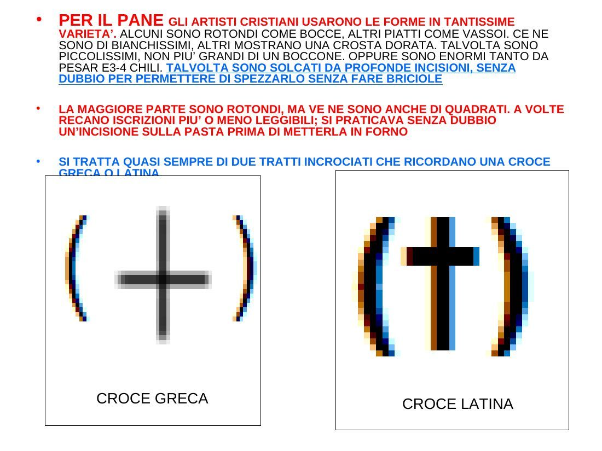{ loading=lazy style="width:59%" }

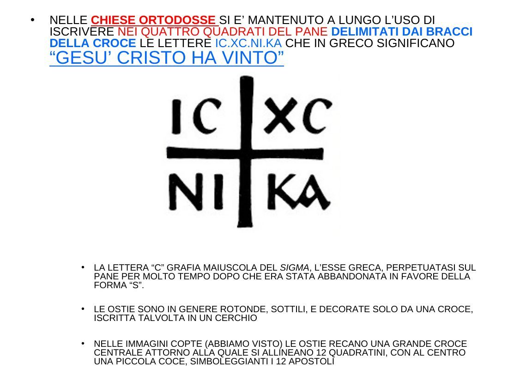{ loading=lazy style="width:50%" }

1:21:54

Fin dai tempi più remoti è stato uso generale nutrirsi, specie in viaggio, di pane e vino, o di pane e acqua. Il pane è il simbolo per antonomasia del nutrimento: sudarsi il pane, mangiare pane e fiele, mangiare pane nero, lungo come un giorno senza pane, *panem et circenses*, non farsi mancare il pane, buono come il pane, levarsi il pane di bocca.

1:22:17

Lorenzo rammentava Sant’Antonio: San Paolo eremita e Sant’Antonio sono nutriti nel deserto dal pane portato da un corvo. Questo è il dipinto di Velázquez che raffigura il momento.

**IL PANE PORTATO DAGLI UCCELLI AI SANTI ANTONIO, BENEDETTO E PAOLO EREMITA**

San Paolo e Sant’Antonio Abate, nutriti nel deserto dal pane portato da un corvo: un uccello che salva da morte sicura anche San Benedetto.

Sant’Antonio Abate è stato uno dei più famosi eremiti nella storia della Chiesa. Nato in Egitto, a vent’anni consegnò i propri beni ai poveri e si ritirò a vita solitaria nel deserto. In seguito si spostò in una zona del monte Pispir (oggi la località è conosciuta con il nome di Wadi El-Arab) e vi rimase per vent’anni, nutrendosi con il pane che gli veniva portato due volte l’anno. Morì alla veneranda età di 105 anni. Nell’iconografia classica è spesso raffigurato con degli animali, soprattutto maiali e cinghiali. Nel mondo contadino il 17 gennaio, giorno dedicato al santo, è usanza benedire le stalle e gli animali domestici. Sant’Antonio Abate è anche il patrono di quanti lavorano con il fuoco, come i pompieri, perché guariva dal fuoco dell’herpes zoster (fuoco di sant’Antonio).

Anche San Paolo eremita visse tutta la sua vita nel deserto in completa solitudine, secondo la narrazione agiografica nutrito solo dal pane che un corvo regolarmente gli portava. All’avvicinarsi della sua morte fu visitato da Sant’Antonio Abate, che lo seppellì avvolto in un mantello in una fossa scavata, secondo la leggenda, da due leoni. Nell’iconografia tradizionale è spesso ritratto assieme ad Antonio, con il corvo, i due leoni e la sua tunica fatta di foglie di palma intrecciate.

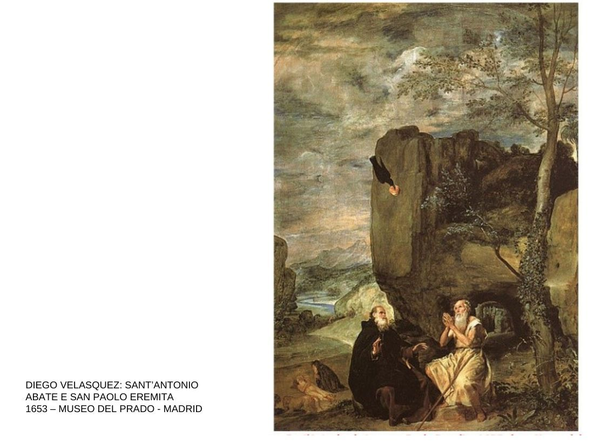{ loading=lazy style="width:53%" }

1:22:51

Un’altra simbologia è la manna. Nel XV secolo la *Bibbia dei poveri* (la *Biblia pauperum*, una raccolta di immagini medievali sulla vita di Gesù legate alle vicende dell’antica storia di Israele che la prefigurano) accomuna il dono del pane e del vino fatto da Melchisedec ad Abramo (Gen 14,18), il miracolo della manna e l’istituzione dell’Eucaristia, considerandoli la prefigurazione del sacramento della comunione. Questo è Melchisedec che offre il pane ad Abramo, mosaico del VI secolo. La manna è una melata prodotta da una cocciniglia sulle tamerici del deserto: è importante, ma non è sufficiente come alimento spirituale – serve solo perché gli israeliti non muoiano nel deserto, non li salva. La simbologia cristiana crea invece il rapporto fra la manna e l’ostia come prefigurazione dell’ultima cena. Anche il miracolo della manna fu rappresentato a lungo, soprattutto dal XIV al XVII secolo – Raffaello, Poussin, Tintoretto, Veronese: questo è il Tintoretto del 1577; anche il Vasari si cimentò sul tema; questo è Scipione Compagno, 1624; e questa *La caduta della manna* di Nicolas Poussin, del 1637-1639.

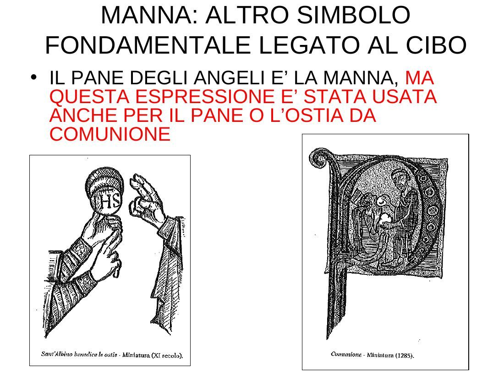{ loading=lazy style="width:47%" }

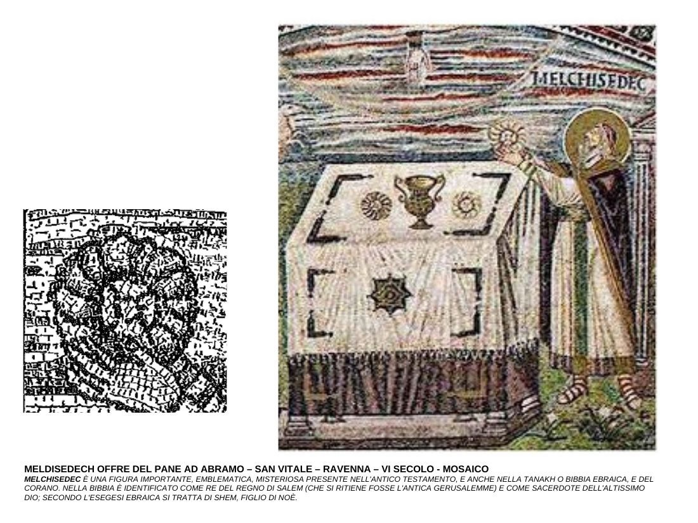{ loading=lazy style="width:47%" }

**MANNA**

La manna è una melata secreta da una cocciniglia che sta sulle tamerici.

Treccani: nome di varie secrezioni vegetali zuccherine, in particolare quella di un frassino (noto appunto come frassino da manna), da cui si ricava per incisione trasversale del tronco; si presenta come una massa bianca o giallastra di sapore dolciastro e leggermente acidulo, messa in commercio in varie forme (*m. in lacrime*, *m. cannellata*, cioè in cannelli allungati, *m. in pani*, ecc.), e principalmente usata per l’estrazione del mannitolo. Vanno inoltre ricordate: la *m. del Sinai* o *degli ebrei*, escrezione provocata dalla puntura di insetti sui giovani rami di alcune piante (tra cui *Tamarix mannifera*), usata in passato come alimento dalle popolazioni nomadi della penisola arabica; la *m. del deserto*, costituita dai talli di alcuni licheni che, in masserelle rotondeggianti, gialline, mangerecce, vengono sollevati dal vento e trasportati anche a grande distanza, dando luogo al fenomeno detto *pioggia di manna*; la *m. di alhagi* o *di Persia*, costituita da una resina prodotta da due arbusti spinosi della penisola anatolica (Alhagi maurorum e Alhagi pseudalhagi); la *m. di larice* (o *di Briançon*), escrezione spontanea dei rametti e delle foglie del larice, usata soprattutto in passato come lassativo.

Gli israeliti se ne cibarono nel deserto.

Gesù ne parla semplicemente come di un cibo dato da Dio agli ebrei nel passato, mentre il suo messaggio era il cibo per l’anima e per l’eternità: la manna è sì un dono di Dio, ma insufficiente come alimento spirituale; infatti gli israeliti che se ne sono cibati non sono riusciti a non morire.

La manna e il messaggio di Cristo sono messi fianco a fianco per accentuare la preminenza del secondo, ma senza stabilire un rapporto tra loro (Gv 6,35-41. 47-51).

Al contrario la teologia cristiana crea questo rapporto, presentando la manna come una prefigurazione del pane dell’ultima cena.

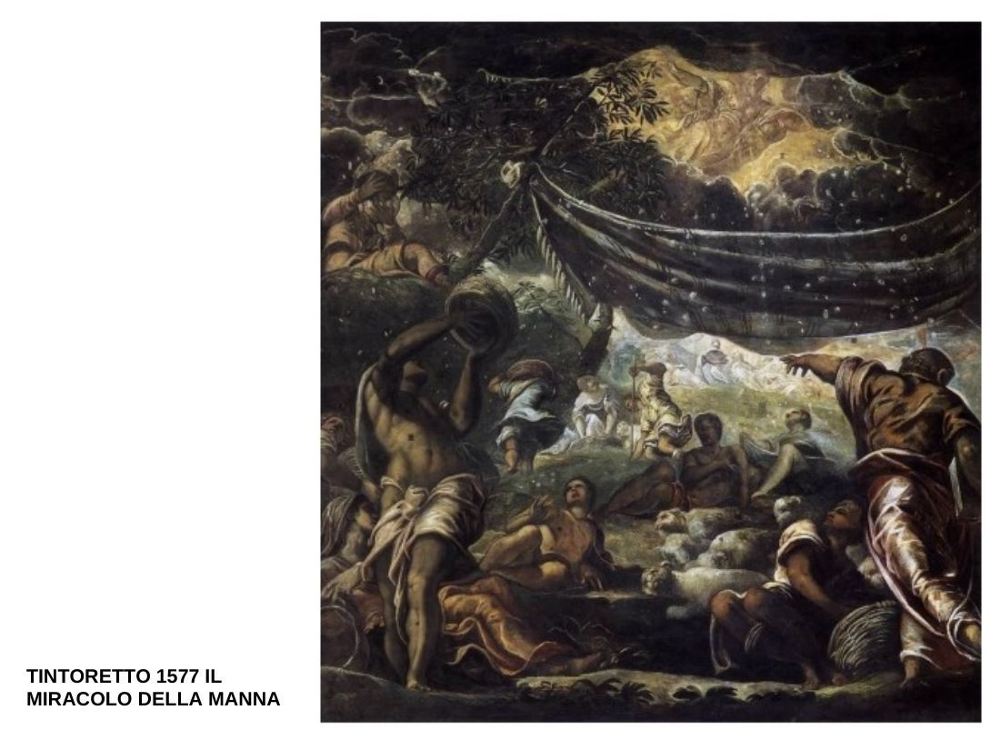{ loading=lazy style="width:47%" }

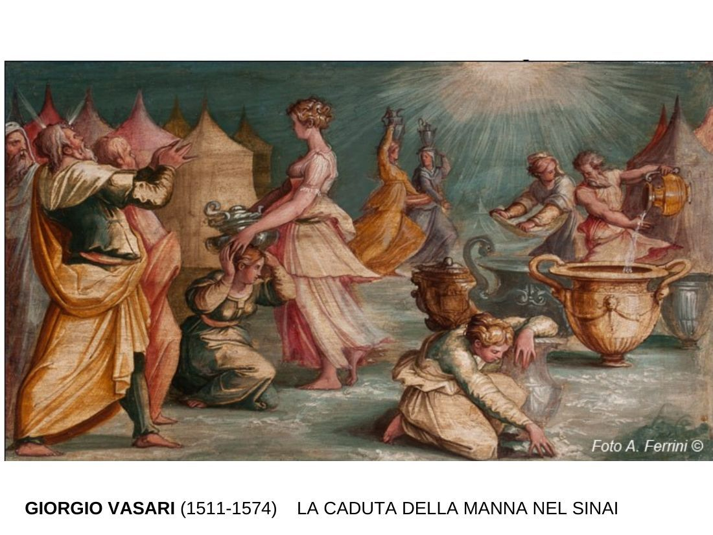{ loading=lazy style="width:47%" }

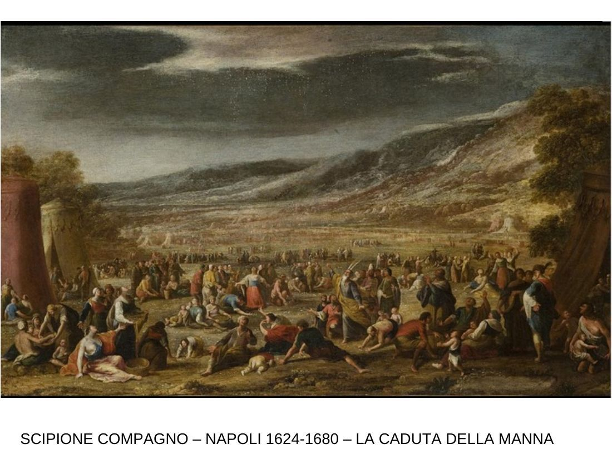{ loading=lazy style="width:47%" }

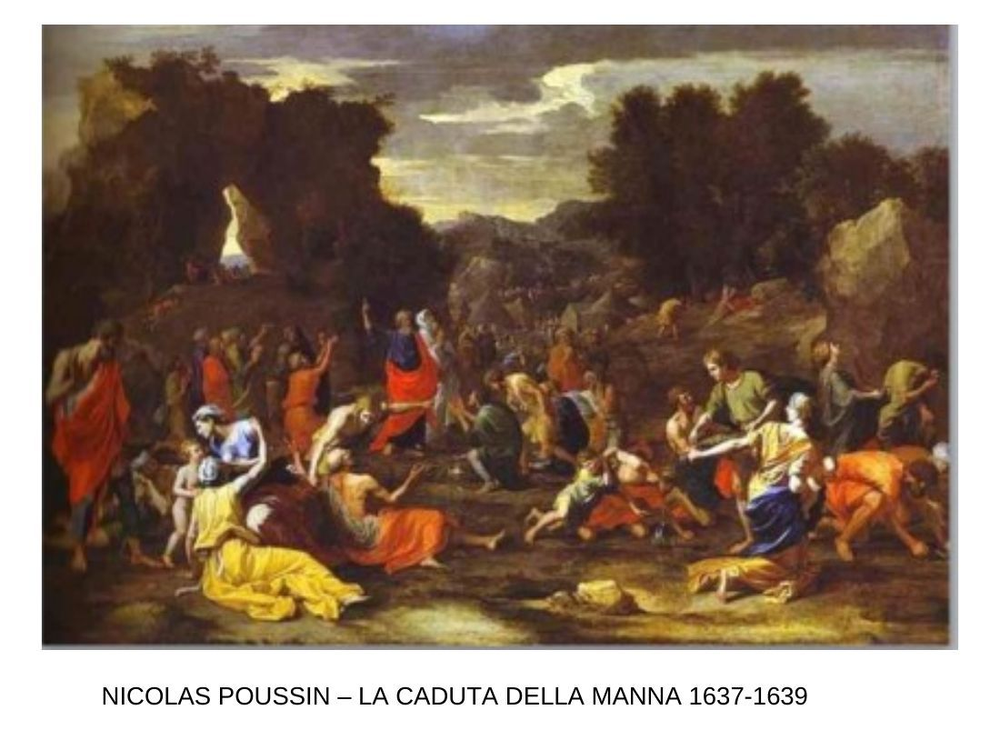{ loading=lazy style="width:47%" }

1:25:04

Si arriva così alla Santa Cena. Nelle chiese protestanti non si dà solo l’ostia ma anche il vino – i due elementi di cui diceva Lorenzo. Questa è l’ultima cena nel mosaico di Sant’Apollinare Nuovo a Ravenna, del 520: qui gli apostoli sono dodici. Questa è un’illustrazione dalla *Bibbia dei poveri* del XV secolo: al centro l’istituzione della Santa Cena, a destra il passato – la manna – e a sinistra il presente, l’ostia. È la storia che lega l’ultima cena, la manna nel deserto e la comunione.

**MANNA**

La dottrina del pane, e quindi l’adorazione da parte dei fedeli della Chiesa cattolica dell’ostia, che per effetto della transustanziazione era divenuta il «vero pane del cielo».

Si sa che questa dottrina è stata promulgata già alla metà dell’XI secolo.

Tuttavia è soprattutto da quando i preriformatori\*\* e i riformatori\* l’hanno contestata vigorosamente che la Chiesa cattolica si mise a celebrarla molto di più, e domandò agli artisti di celebrarla nelle loro opere: si doveva celebrare non tanto il miracolo del passato, ma l’ammirazione per l’ostia e la santa cena.

In tale modo il miracolo della manna divenne una sfida al pensiero e alla fede dei riformati.

\* Sono i seguaci di Lutero, denominati con nomi diversi a seconda della prospettiva con cui li si guarda: luterani, protestanti, evangelici… Leone IX, Gregorio VII, Innocenzo III sono invece i papi riformatori di una Chiesa che nel Medioevo lottò in un primo tempo per emanciparsi dalla tutela dell’Impero (l’altro potere universale), e poi per affermare la propria superiorità spirituale e politica su di esso e su tutte le altre forme di società organizzate del mondo allora conosciuto. Il delinearsi di questo nuovo profilo «politico» della Chiesa romana intercettò anche le richieste di una riforma «religiosa» che provenivano dal basso, dai laici sempre più scandalizzati da un clero simoniaco e ammogliato (o quanto meno concubinario), spesso non all’altezza del proprio ministero neanche dal punto di vista culturale. È da questa ansia, sentita sempre più impellente, che si generarono quei movimenti presto divenuti o dichiarati ereticali. La percezione dell’impossibilità di una vera riforma della Chiesa *in capite et membris* («nella testa» – il papato – «e nelle membra») avrebbe poi portato, con la rivoluzione di Lutero, Calvino e degli altri riformatori del XVI secolo, alla spaccatura della cristianità occidentale.

\*\* Se già a causa del diffondersi dell’Islam (VII secolo) e del progressivo deteriorarsi dei rapporti fra le Chiese d’Oriente e d’Occidente, che avrebbe condotto allo scisma del 1054, il cristianesimo aveva ormai perduto la sua universalità e unità, l’opera dei preriformatori (Pietro Valdo, John Wycliffe e Jan Hus) gettò le basi per quel movimento teologico che avrebbe trovato in Martin Lutero e Giovanni Calvino i suoi teorici più influenti.

**LA SANTA CENA**

La Santa Cena è uno dei due sacramenti, accanto al battesimo, riconosciuti dalle chiese protestanti (luterani, calvinisti, evangelicali ecc.). Si tratta dello stesso rito chiamato generalmente eucaristia da cattolici e ortodossi.

Nelle chiese protestanti i fedeli prendono entrambi gli elementi della Santa Cena, il pane e il vino, e generalmente sono ammessi al sacramento tutti i battezzati, indipendentemente dalla denominazione cristiana a cui appartengono.

Per i cristiani l’Eucaristia è il sacramento istituito da Gesù durante l’ultima cena, alla vigilia della sua passione e morte. Il termine deriva dal greco εὐχαριστῶ (*eucharistò*: «rendo grazie»). Il Nuovo Testamento narra l’istituzione dell’eucaristia in quattro fonti: Matteo 26,26-28; Marco 14,22-24; Luca 22,19-20; 1 Corinzi 11,23-25.

Nell’ultima cena, secondo l’interpretazione cattolica del racconto dei vangeli, Gesù distribuì ai suoi discepoli il pane e il vino come suo corpo e suo sangue, offerti come sacrificio per la salvezza degli uomini, incaricandoli di fare lo stesso in sua «memoria».

La Chiesa cattolica, dunque, fin dalla sua origine, celebra l’atto sacramentale dell’eucaristia come uno degli impegni lasciatile da Gesù stesso, suo Dio salvatore e fondatore.

L’Eucaristia è l’azione sacrificale durante la quale il sacerdote offre il pane e il vino a Dio, che, per opera dello Spirito Santo, diventano realmente il corpo e il sangue di Cristo, lo stesso corpo e lo stesso sangue offerti da Gesù sulla croce.

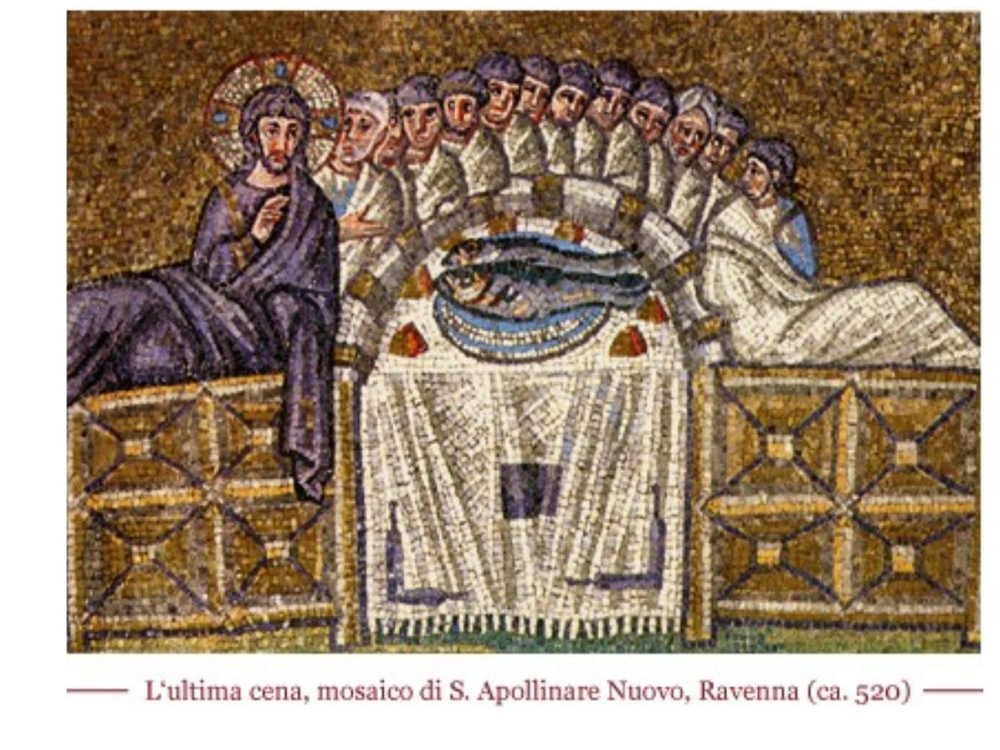{ loading=lazy style="width:47%" }

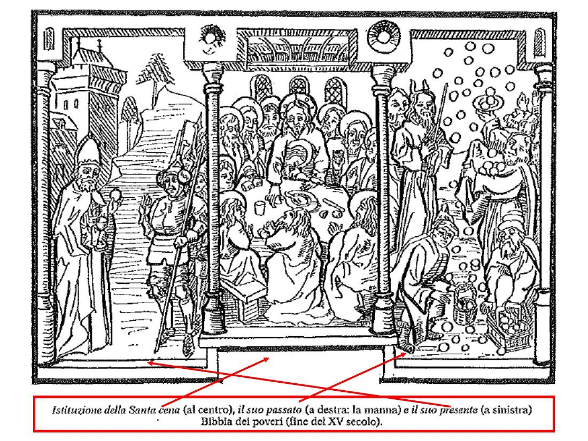{ loading=lazy style="width:47%" }

1:26:38

L’ultima immagine di questa parte non poteva che essere uno dei capolavori: *L’ultima cena* di Leonardo da Vinci, a Milano.

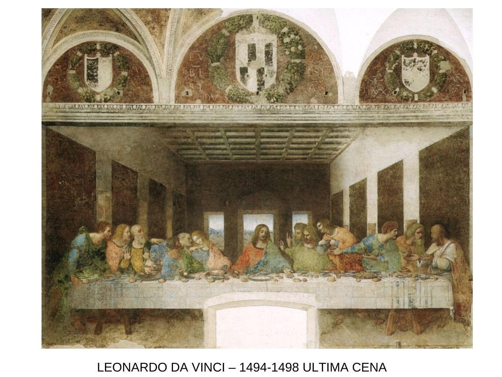{ loading=lazy style="width:59%" }

1:26:55

Lorenzo Poggi Riprendiamo dalla prima parte: il morto. Che c’entra il morto con il cibo? C’è il cibo dei morti – il pan dei santi, i cibi che si mangiano in certe ricorrenze dell’anno. Perché? Perché anche la morte è una trasformazione. Se il cibo è trasformazione, controllo della trasformazione della natura, anche il morto viene affidato alla terra e subisce una trasformazione che l’uomo non conosce, ma che simbolizza, e che è simile a quella del cibo.

1:27:46

L’altra trasformazione simile è quella del vino. Ecco perché vino e pane sono le offerte per i defunti, e ci sono le libagioni fatte sulle tombe: perché il vino è sangue, e l’aggiunta di sangue porta vita, la sottrazione porta morte.

1:28:19

Nel cibo e nel vino c’è la conferma dell’utilizzo di forze della natura non completamente conosciute, delle quali l’uomo approfitta: la sua fortuna consiste nel poterle utilizzare, nel poterle lavorare. Chi sono gli uomini? Sono quelli che cuociono i cibi, quelli che accendono il fuoco e quelli che seppelliscono i morti. Quando gli archeologi trovano questi segni in un giacimento, sanno con certezza che è stata sede di una comunità umana.

1:29:19

I greci chiamavano *ananke* la necessità nei confronti della quale non si può avere mutamento; il compito dell’uomo è mettersi in ordine con questa necessità, e il cibo è un modo per farlo.

1:29:57

Vicino al pane, il vino. Il dio del vino è Dioniso, Bacco: un dio straniero – di nuovo l’estraneo che serve a far crescere, a trasformare in qualcosa di diverso e di migliore. E Bacco viene dal mare, straniero, e quando giunge a terra suscita timore. Perché danza, perché è invasato come le Baccanti, perché ha in sé *hybris*. I greci chiamavano *epidemía* questo diffondersi: per noi la parola indica una malattia che si propaga, per loro era la comunicazione di questa forza, di questo elemento estraneo che il dio trasmette agli altri.

1:31:46

Le stesse forze della natura, sfruttate ma non completamente conosciute, sono in gioco nel rapporto sessuale fra uomo e donna: anche lì c’è qualcosa che non si conosce interamente ma che costituisce la forza dell’uomo, perché è un rapporto con l’esterno, con l’estraneo, che in quell’unione riesce a riprodurre la vita. La dea si chiama Venere, e l’atteggiamento che suscita lo chiamano *pandemia* – anche noi abbiamo le malattie veneree, che sono un’altra cosa, ma il modo di rapportarsi al mondo è quello.

1:32:55

Lo ritroviamo al fondamento della religione cristiana, lo ritroviamo nella Bibbia. Perché il male? Perché gli uomini hanno tentato di controllare la natura – come? Mangiando Dio. Nel paradiso terrestre il serpente tenta Eva: mangiate, *eritis sicut dii*, sarete come Dio. Perché mangerete che cosa? Dio, e diverrete Dio. E loro ci provano, perché se saranno Dio sconfiggeranno il male, la morte, la sofferenza. Non ce la fanno, e li cacciano fuori. Poi viene il cristianesimo, che dice addirittura che mangiamo Dio e siamo Dio – figli di Dio, e della stessa natura. Ecco il mangiare sacro: il rapporto con l’esterno, con il mondo sacralizzato.

1:34:52

Anche oggi le religioni hanno proibizioni alimentari. Gli ebrei mangiano solo ciò che il macellaio rabbinico ha preparato: gli animali non possono essere uccisi in un certo modo, non possono essere soffocati, altrimenti sono impuri. Devono mangiare kasher. I musulmani hanno proibizioni precise: devono mangiare *halal*. E ormai anche nei supermercati troviamo un reparto dedicato.

1:35:57

Una ricerca dice che negli Stati Uniti i cibi *halal* e *kasher* consumati sono in quantità enormemente superiore a quella dei musulmani e degli ebrei presenti. Vuol dire che anche persone comuni, che non appartengono a quelle religioni, li mangiano. Perché? Perché nella ricerca del biologico, del chilometro zero, del cibo sano, non ci si fida più della scienza, dell’ufficialità, delle sigle – e si riscopre il valore della religione. Guardate dove siamo andati a riscoprirla: si ha più fiducia nel rabbino che nell’etichetta che dovrebbe ricostruire l’origine di un prodotto.

1:37:14

Il nostro rapporto con il cibo è cambiato. Era il rapporto con la relazione: la cena era il momento in cui la famiglia si riuniva; c’erano le ricette, che erano tradizione; il cibo era identità familiare e rapporto con gli altri. La società di oggi ha frammentato tutto questo: il pranzo sta scomparendo, il pasto più importante diventa la cena, come nella tradizione anglosassone. Manca quasi sempre quel rapporto. Cucinare pare una fatica inutile: bisogna comprarlo già pronto, rapidissimo. È cibo di strada – non nel senso di cui parlava Paolo, ma nel senso che si mangia per strada, mentre ci si sposta da un punto all’altro.

1:38:41

Il fatto che ci siano lo Slow Food e i ristoranti che riscoprono la tradizione come fosse una riscoperta storica vuol dire che la tradizione non c’è più: che l’attualità è un’altra cosa, e che quella la si deve riscoprire come un oggetto da museo.

1:39:05

Ma la cosa fondamentale rimane: il pane e il vino hanno in sé una profondità simbolica che ritroviamo nella religione e nel nostro modo di concepire il mondo. A proposito di Bacco: Nietzsche diceva che l’arte sorge da due dèi, Dioniso e Apollo – Apollo è il dio della forma e della razionalità, Dioniso quello dell’immediatezza, dell’istinto, della pulsione.

\[PAUSA\]
{: .nota }

2:13:32

Paolo Marcucci Prima di chiudere, permettetemi un ringraziamento al Caffè Centofiori, che stasera ci ha allietato con la cena.

2:13:51

Una comunicazione di servizio: il 24 e 25 novembre qui a Montelupo c’è il festival delle cose invisibili, e il professor Lorenzo terrà un dialogo a due sul tema del genio – al palazzo del Podestà, dove c’era prima il vecchio museo.

2:14:33

Lorenzo Poggi «Il genio e il gentiluomo». Parleremo di relatività, della matematizzazione; io non sono così bravo, quindi dialogherò con un professore di fisica, e proverò a mettere in evidenza quali siano i caratteri della teoria della relatività rispetto alla nostra cultura e al nostro modo di concepire il mondo. Il 24 novembre, che è anche il mio compleanno.

2:15:34

Paolo Marcucci Per quest’ultima parte guarderemo nove pezzi esposti al British Museum, attinenti al tema di questa sera, con spunti tratti dal libro di Neil MacGregor, direttore del museo, *La storia del mondo in 100 oggetti*.

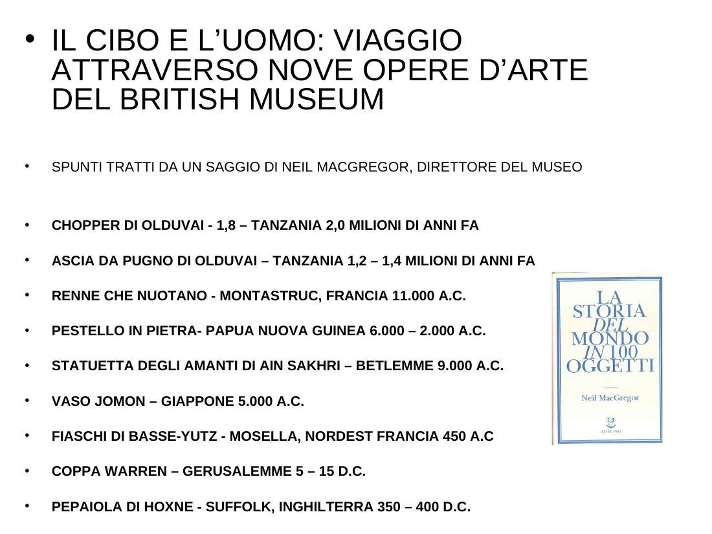{ loading=lazy style="width:59%" }

2:16:07

Il chopper di Olduvai risale a circa due milioni di anni fa: un manufatto in pietra rinvenuto in Tanzania, che serviva alla macellazione degli animali, a rompere le ossa, e anche a staccare le cortecce dagli alberi. L’uomo è sempre stato un opportunista nella competizione con gli altri animali per il cibo – un opportunista di talento, però: non avendo armi proprie, né artigli né forza fisica, ha dovuto adattarsi, e molte volte mangiava i resti di quello che i predatori lasciavano. Questo è stato il primo strumento che ci ha permesso un’evoluzione.

{ loading=lazy style="width:51%" }

**CHOPPER\* DI OLDUVAI**

Utensile rinvenuto nella gola di Olduvai in Tanzania – 1,8-2,0 milioni di anni fa

Fino a poco prima del 1800 si riteneva che il mondo fosse iniziato 4.000-6.000 anni prima.

Il ritrovamento e lo studio di ciottoli-strumenti come questo sconvolse la scienza e l’archeologia: questo, infatti, risale a circa 2.000.000 di anni fa.

Queste pietre erano vicino ad alcune ossa, ed era evidente che fossero state lavorate come strumenti di macellazione e per rompere le ossa di animali uccisi nella savana.

Tenendo in mano questo strumento si capisce cosa poteva essere la vita nella savana.

Il chopper è anche uno strumento che serve a staccare la corteccia dagli alberi o a pelare radici commestibili: insomma, è un attrezzo da cucina versatile.

Molti animali usano oggetti, in primis i gorilla, ma quello che ci contraddistingue è il fatto che noi costruiamo strumenti prima di averne bisogno, e una volta che li abbiamo usati li conserviamo per usarli ancora.

I nostri antenati, più che cacciatori, erano opportunisti di talento: aspettavano che i leoni e le bestie feroci uccidessero la preda, poi subentravano con le loro pietre per procurarsi la carne e il midollo, cioè l’intera gamma proteica.

Il cervello dell’uomo è un meccanismo che divora il 20% dell’energia pur pesando solo il 2% del corpo.

Il cibo dunque ha permesso l’evoluzione del cervello, in un processo continuo di autotrasformazione, di aumento del volume e di astuzia.

Il cervello umano ha due emisferi che regolano funzioni differenti: logica, linguaggio, movimento coordinato, immaginazione, pensiero creativo. Il gorilla non è riuscito in questa operazione, e il suo cervello non è quindi cresciuto ed è rimasto simmetrico.

Le scheggiature non indispensabili sul chopper ci dicono che, a differenza degli altri animali, abbiamo sentito il desiderio di fare cose più sofisticate del necessario.

Gli oggetti quindi dicono molto su chi li ha fabbricati: dal momento in cui i nostri antenati hanno cominciato a creare oggetti come questo, non siamo più stati capaci di sopravvivere senza oggetti, e si può dire che sono gli oggetti che costruiamo a renderci umani.

Il fuoco fu scoperto 500.000 anni fa.

\* Treccani: In paletnologia, strumento litico con margine reso tagliente mediante scheggiature monofacciali. Frequente, come il *chopping-tool*, nelle industrie del Paleolitico inferiore e medio in Asia e Africa, non è raro nelle culture coeve europee. In Africa se ne rinvengono in contesti culturali piuttosto recenti.

2:17:35

L’altro è un’ascia da pugno, la prima invenzione tecnologica di questo genere: risale a un milione e duecento-un milione e quattrocentomila anni fa, sempre dalla zona di Olduvai, in Tanzania. Ha una forma molto più sofisticata del chopper: poteva tagliare, squartare, tagliare le pelli – e con le pelli ci si poteva rivestire. Per un milione di anni ha rappresentato l’intero armamentario tecnologico dell’uomo. Ed è stato importantissimo anche perché, rendendo più facile uccidere gli animali e procurarsi il cibo, ha lasciato più tempo – tempo per scambiarsi le idee. Soprattutto, è stato un biglietto per l’estero: con quello strumento l’uomo poteva spostarsi, ed è ciò che ha permesso le prime migrazioni dall’Africa.

{ loading=lazy style="width:67%" }

**ASCIA DA PUGNO DI OLDUVAI**

Utensile rinvenuto nella gola di Olduvai in Tanzania – 1,2-1,4 milioni di anni fa

Per gran parte della storia umana questo è stato l’oggetto che l’uomo aveva sempre con sé.

L’estremità appuntita poteva essere usata come un trapano, oppure le lame esterne potevano tagliare carni, pelli, alberi, cortecce: insomma, tutta la lavorazione del cibo.

Per più di un milione di anni ha rappresentato quella che oggi chiameremmo tecnologia d’avanguardia.

Guardando l’oggetto si nota che i segni di scheggiatura della pietra rivelano anche un’intenzione estetica.

Questo strumento, rispetto al chopper, rappresenta un balzo tecnologico enorme.

Le aree del cervello che presiedono alla costruzione sono quasi le stesse che lavorano quando si parla.

Si calcola che l’uomo dell’ascia possa avere le capacità linguistiche di un bambino di sette anni.

Ed è per questo che lo strumento è stato così importante: ci ha permesso di procurarci cibo migliore, di scuoiare gli animali per coprirci con la pelliccia, di staccare rami con cui accendere il fuoco\* e costruire capanne.

Adesso gli uomini potevano mettersi a sedere e condividere idee, progettare il lavoro e trasmettere alla generazione successiva le complesse conoscenze tecniche: insomma, «pensieri a tavola»…

Ma questo strumento ha avuto un’altra fondamentale conseguenza per il mondo: con uno strumento come questo ci si poteva allontanare dall’Africa, spostarsi dalle calde savane anche in territori più freddi.

L’ascia era diventata il biglietto per il resto del mondo.

\* Il fuoco fu scoperto 500.000 anni fa, ma la datazione è molto incerta.

2:19:52

Questo è forse il pezzo che personalmente mi è piaciuto di più: le renne che nuotano, un capolavoro di circa undicimila anni fa, ritrovato in Francia, scolpito su un osso di mammut. Un maschio dietro e una femmina di renna che stanno attraversando il fiume. Ci fa vedere che l’uomo di allora aveva già capacità di osservazione – in fondo era il cibo che attraversava il fiume – e che aveva passato molto tempo a guardare quegli animali, perché le corna sono ripiegate all’indietro, come fanno le renne quando nuotano. È una vera opera d’arte, molto commovente.

{ loading=lazy style="width:48%" }

**RENNE CHE NUOTANO**

Scultura intagliata in zanna di mammut, Montastruc, Francia – 11.000 a.C.

Circa 50.000 anni fa accadde qualcosa di sconvolgente, alle varie latitudini, nelle etnie umane: gli uomini cominciarono a creare motivi per decorare, a fabbricare gioielli per ornare il corpo e a rappresentare gli animali che vivevano accanto a loro.

L’oggetto è una lavorazione di zanna di mammut.

È un capolavoro dell’era glaciale e allo stesso tempo la prova degli enormi cambiamenti che stavano interessando il cervello umano.

Le due renne nuotano vicine, una dietro l’altra, la femmina più piccola davanti e il maschio dietro.

Entrambe sono rappresentate con il muso rivolto verso l’alto e le corna ripiegate all’indietro: cioè nell’esatta posizione che assumerebbero nuotando.

Il pezzo rivela una superba capacità di osservazione.

Può averlo creato solo qualcuno che abbia trascorso molto tempo a osservare le renne che attraversavano a nuoto i fiumi: è l’osservazione del cibo che si trasforma in arte.

Per i cacciatori-raccoglitori le renne erano uno dei principali mezzi di sussistenza: cibo, pelle, ossa, corna…

Dare la caccia alle renne significava sopravvivere, e sopravvivere senza difficoltà, anche nelle condizioni dell’era glaciale, che erano dure, con inverni lunghi e rigidi.

Ma l’esplosione nel cervello umano di questa creatività e immaginazione ha permesso questo, e di conoscere a fondo il mondo naturale, con la conseguente voglia di celebrarlo e il bisogno di legami sociali, di rituali e di religiosità.

Questa immagine di renne non aveva una funzione pratica, era pura forma: la rappresentazione di un mondo che l’uomo era in grado di sperimentare, ma anche di immaginare.

2:21:17

Questo è un pestello in pietra di circa seimila anni fa, dalla Nuova Guinea. Undicimila anni fa, quando c’erano le renne, era il periodo dell’ultima glaciazione; seimila anni fa la glaciazione si era ritirata, erano cresciute le erbe, erano venuti fuori il frumento e gli altri cereali, i mari si erano alzati, era cambiata la morfologia della terra. Non più solo carne cotta sul fuoco, dunque: con questo pestello si sminuzzavano erbe e cereali. In Medio Oriente il frumento e il grano, in Cina il riso, in Africa il sorgo.

{ loading=lazy style="width:42%" }

**PESTELLO IN PIETRA**

Rinvenuto presso il fiume Aikora, provincia di Oro, Papua Nuova Guinea – 6.000-2.000 a.C.

Il pestello si lega al cibo e all’agricoltura.

Circa 10.000 anni fa per l’uomo si aprì un’epoca di nuove domesticazioni, di divinità potenti, di climi pericolosi, di ottimo sesso e di cibo ancora migliore.

Alla fine dell’ultima glaciazione il ghiaccio iniziò a ritirarsi e, con l’innalzamento delle temperature, si alzò il livello dei mari, crebbero le erbe e iniziò l’agricoltura.

Per lungo tempo gli uomini avevano cotto la carne sul fuoco, ma l’uso delle erbe e dei cereali mutò il paesaggio, e l’alimentazione divenne qualcosa di vicino al concetto di cucinare.

L’agricoltura crea un surplus di cibo che consente a gruppi più numerosi di vivere insieme, cambiando non solo stile di vita, ma anche modo di pensare. Si introducono nuovi dèi per spiegare il comportamento degli animali e il ciclo stagionale dei raccolti.

Gli uomini vivevano adesso in villaggi di 200-300 persone, una densità abitativa che il mondo fino ad allora non aveva mai conosciuto.

Questo cambiamento avvenne in varie parti del mondo, e il ritrovamento di questo pestello a forma di uccello (sembra un Concorde) lo prova: proviene dalla Papua Nuova Guinea e ha circa 8.000 anni.

Questi ritrovamenti hanno capovolto quella che ritenevamo essere l’origine dell’agricoltura, cioè la Mesopotamia, da dove si sarebbe sparsa per il mondo: si è trattato invece, con modi diversi, di un cambiamento avvenuto contemporaneamente in luoghi diversi del pianeta.

La sua funzione era quella di sminuzzare il cibo per renderlo commestibile e cucinarlo.

Il pestello quindi racconta l’inizio della cucina e il momento della tavola come riunione sociale, familiare, e con i banchetti della comunità.

I primi agricoltori cominciarono concentrandosi su un numero ristretto di piante: in Medio Oriente il frumento, in Cina il riso selvatico, in Africa il sorgo e in Papua Nuova Guinea il taro (tubero amidaceo).

2:22:55

Quando prima Lorenzo diceva che l’uomo non mangia solo per vivere ma vive anche per mangiare, il pestello dimostra chiaramente il passaggio. Essendo noi svantaggiati rispetto agli altri animali, abbiamo dovuto usare il cervello, che in un processo di autoalimentazione si è evoluto: il frumento e il riso in natura sono quasi immangiabili, hanno bisogno di essere sminuzzati, bolliti – una sequenza di passaggi che gli animali non possono nemmeno concepire. È la differenza fondamentale.

**PESTELLO IN PIETRA**

Rinvenuto presso il fiume Aikora, provincia di Oro, Papua Nuova Guinea – 6.000-2.000 a.C.

Queste piante allo stato naturale sono immangiabili e anche disgustose; e allora ci possiamo domandare perché i nostri antenati si siano concentrati su un cibo che diventa commestibile solo dopo essere stato messo a bagno nell’acqua, bollito o macinato.

Martin Jones (scienze archeologiche, Cambridge) sostiene che l’uomo ha sempre dovuto competere con gli animali per il cibo, e quando non era possibile si doveva accontentare del cibo difficile.

Sfruttando l’intelligenza abbiamo così avuto un vantaggio competitivo, perché gli altri animali non potevano concepire tutti questi passi in sequenza.

I piccoli semi dei cereali, se mangiati crudi, sono indigesti, se non addirittura velenosi, e devono quindi essere spappolati e impastati con altri ingredienti, o trasformati in pane.

Il taro (il tubero) addirittura deve prima essere spurgato, poi triturato e poi cotto.

Lo studio del cibo e dei siti archeologici (in Medio Oriente) ci mostra anche uno spaccato sociale, che dimostra come fossero prevalentemente le donne a occuparsi della cucina e del cibo.

Lo studio delle ossa dimostra che le anche, le caviglie e le ginocchia delle donne mature sono in genere gravemente usurate. Si presume che ciò sia dovuto al fatto che la macinatura del grano avvenisse in ginocchio, dondolandosi avanti e indietro per schiacciare i chicchi tra due pietre pesanti.

Molti di questi nuovi cibi erano piuttosto insipidi, ma il pestello, triturando e rompendo il cibo, faceva assumere gusti diversi: ad esempio la senape, se triturata, diventa pungente e amara (vedremo poi la pepaiola).

Si ritiene che questo pestello, vera opera d’arte, per la sua forma e nonostante l’usura, non sia stato usato quotidianamente, ma in occasione di rituali, feste, riunioni e celebrazioni di momenti chiave della vita.

2:24:13

Questa è la statuetta degli amanti di Ain Sakhri, rinvenuta nei pressi di Betlemme, di circa novemila anni fa. È legata al cibo per un motivo: finita la glaciazione c’era più cibo a disposizione, e forse più tempo per cominciare a pensare a noi stessi. Gli amanti sono seduti, intrecciati con le gambe e le braccia. Gli animali non dovevano più migrare, quindi non dovevamo più seguire il cibo, e ci si poteva fermare in certi luoghi. Quello che sorprende è che, vista da angolazioni diverse, la statuetta può sembrare un pene, una vagina, un paio di seni; ed è piccolissima, dieci centimetri.

{ loading=lazy style="width:59%" }

**STATUETTA DEGLI AMANTI DI AIN SAKHRI**

Scultura in pietra, Wadi Khareitoun, Giudea, nei pressi di Betlemme – 9.000 a.C.

Abbiamo visto come l’agricoltura abbia cambiato il modo di vivere degli uomini: e se le dispense erano piene di cibo, c’era tempo per riflettere e intessere relazioni sociali, e quindi per rappresentarle nell’arte.

La statuetta degli amanti simboleggia proprio questo passaggio: un nuovo modo di pensare a se stessi.

Si tratta di uno degli oggetti più commoventi esposti al British Museum (ha le dimensioni di un pugno).

Gli amanti sono seduti, con le braccia e le gambe avviluppate nel più intimo degli abbracci; si stanno guardando negli occhi.

La fine della glaciazione porta con sé un dono: l’erba nelle savane cresce tutto l’anno e gli animali tendono a non migrare; da questa stanzialità è poi sorta la sperimentazione dei cereali: non si era più costretti a inseguire il cibo.

Lo stile di vita più stanziale permetteva quindi di avere più tempo per creare e riflettere.

Gli uomini producevano gli elementi chiave del loro universo in divenire: cibo e potere, sesso e amore.

La cosa sorprendente di questa statuetta è il fatto che, vista da angolazioni diverse, può sembrare un pene, una vagina o un paio di seni: come se, oltre a rappresentare l’atto sessuale, lo stesse mimando.

La statuetta è stata ritrovata nel deserto di Giudea in una grotta, insieme ad altri oggetti che dimostrano che la grotta era un’abitazione e non una tomba: la statuetta doveva quindi avere un ruolo nella quotidianità domestica.

L’interpretazione più recente dell’accoppiamento e della sessualità è passata da una visione legata alla figura della dea madre a una più neutra (anche grazie ad alcuni ritrovamenti che, all’opposto, simboleggiano la visione fallocentrica).

Ian Hodder (Stanford University) ha definito questo nuovo modo di pensare la «domesticazione della mente»: c’è dunque una maggiore attenzione ai rapporti interpersonali, mentre le relazioni tra uomo e animale, o fra animale e animale, passano in secondo piano.

Gli uomini cominciano a formare famiglie più stabili, ad avere più cibo e quindi più figli.

È possibile che, forse per la prima volta nella storia, un compagno possa diventare un marito o una moglie.

2:26:23

Pensate: in quel momento tutti gli abitanti del globo, da calcoli fatti, erano forse cinque milioni e mezzo o sei – l’attuale popolazione di Londra. Allora il rapporto con l’ambiente poteva essere aggressivo, perché l’ambiente lo consentiva; i miliardi che siamo adesso non ce lo consentono più. Forse la prossima apocalisse, come si dice, sarà per il possesso dell’acqua; e forse, come dicono alcuni, dovremmo rivedere la nostra dieta, diminuendo la percentuale di proteine animali a favore di quelle vegetali, che consumano meno acqua.

2:27:36

Questo è un vaso Jōmon, del Giappone, di circa cinquemila anni fa. Vasi di questa tipologia sono però nati fra i sedici e i diciassettemila anni fa, molto prima che dalle nostre parti fosse scoperta la ceramica – in genere si riteneva che la ceramica fosse nata alla fine della glaciazione. È importante per il cibo, perché un vaso in ceramica permette la conservazione: non si deteriora, è stabile. E si può cuocere: in Giappone, in quel periodo, si viveva ancora di caccia ma si mangiavano soprattutto noci e prodotti selvatici, tutto cibo che doveva essere cotto. Sostanzialmente la zuppa è nata in Giappone, e il vaso lo dimostra. Quella foglia d’oro che si vede all’interno è posticcia: questi vasi furono ricercati dagli imperatori degli ultimi due o tre secoli e venivano ulteriormente valorizzati così.

{ loading=lazy style="width:45%" }

**VASO JŌMON**

Recipiente in argilla, Giappone – 5.000-7.000 a.C.

A lungo si è ritenuto che la ceramica fosse nata con la fine della glaciazione e l’inizio dell’agricoltura, 10.000 anni fa, come abbiamo visto in precedenza: questo perché gli spostamenti dei nomadi non avrebbero permesso di portarsi dietro troppi oggetti, e perché il surplus alimentare dovuto all’agricoltura risale a 10.000 anni fa.

La datazione risale invece ad almeno 16.000-17.000 anni fa, nel paleolitico, al tempo in cui l’uomo viveva ancora di caccia ad animali di grossa taglia.

I vasi sono il cuore di ogni collezione perché, più di ogni altro oggetto, raccontano la storia umana. Robert Browning: «la ruota del tempo corre all’indietro o si ferma: il vasaio e la creta resistono».

I vasi più antichi furono prodotti in Giappone a partire da 17.000 anni fa; il vaso di cui parliamo risale a 7.000 anni fa, ed è delle terre dell’attuale Giappone.

Ed è interessante perché le popolazioni del Giappone non praticavano l’agricoltura, e il cibo era basato sulla pesca, sulle noci e su altri prodotti selvatici, sugli animali selvatici: tutti cibi che avevano bisogno di essere cotti, da cui la necessità di inventare i vasi per la cottura del cibo.

Infatti l’agricoltura in Giappone risale solo a 2.500 anni fa, ma nella produzione di vasi i giapponesi erano all’avanguardia.

Prima dei vasi si usavano delle buche nel terreno, oppure dei cesti, nessuno dei quali però offriva una protezione sufficiente dagli insetti e dagli altri predatori.

I cesti si usuravano, invece il cibo e gli alimenti protetti dalla ceramica si conservavano al fresco e non erano attaccabili dai topi: una grande innovazione tecnologica.

Il vasellame cambia la nostra dieta: i nuovi cibi diventano commestibili solo dopo essere stati bolliti.

Nei vasi Jōmon, come rivela l’analisi dei residui organici nelle incrostazioni, si cuocevano verdure, noci, molluschi (ostriche, telline e altri frutti di mare), carne.

Il Giappone è stato quindi il luogo di origine della zuppa di verdure e di pesce, e la patria dello stufato.

La storia di questo vaso ha poi un’altra vita, perché il pezzo in questione (ma ce ne sono molti altri) è rivestito all’interno di una foglia d’oro, applicata tra il 1700 e il 1800.

I vasi così riscoperti dagli antiquari in quel periodo ebbero una nuova vita in veste di *mizusashi*, una brocca per il più giapponese dei rituali: la cerimonia del tè.

2:30:04

Questi sono i fiaschi di Basse-Yutz, ritrovati in Francia, del 450 a.C. circa. Ciò che sorprende è che – come diceva Lorenzo – in quel periodo dalla Russia al Portogallo non c’era quasi nulla nel mezzo: qualche villaggio, ma non moneta, non cultura. Eppure questi vasi non sono d’importazione, sono prodotti di quella zona; sono stati ritrovati in tombe insieme ad altri oggetti provenienti soprattutto dall’Italia, che era il centro del mondo culturale di quel periodo insieme alla Grecia. Ricordano molto l’arte etrusca. Sulla sommità di uno dei fiaschi ci sono tre cani che si guardano: è lì che doveva posarsi l’occhio del commensale sulla tavola imbandita. Pezzi di estrema raffinatezza.

{ loading=lazy style="width:59%" }

**FIASCHI DI BASSE-YUTZ**

Fiaschi in bronzo rinvenuti nel dipartimento della Mosella, nord-est della Francia – 450 a.C.

I fiaschi venivano fatti 2.500 anni fa, nel momento in cui veniva edificato il Partenone, l’impero persiano era al culmine e Confucio insegnava in Cina.

Quello che è straordinario è che nel 450 a.C. nell’Europa settentrionale non c’erano città, né stati, né imperi; non c’erano la scrittura o la moneta.

Dalle steppe della Russia fino all’Atlantico si trovavano solo piccole comunità di agricoltori-guerrieri, collegate a migliaia di chilometri di distanza dal commercio, dal baratto e anche dalla guerra.

Però per le classi alte della Renania dell’età del ferro la vita poteva essere interessante. Dalle tombe più belle della regione sono emersi carri, tende di seta, cappelli, scarpe, abiti e tutto l’occorrente per le feste, provenienti da paesi lontani, in particolare dall’Italia e dalla Grecia: i vasi, dalle zone etrusche.

Lo straordinario è che questi vasi sono stati classificati come prodotti locali: forse ricordano l’arte etrusca.

L’idea del fiasco viene dall’Italia del nord.

Su ciascun fiasco ci sono 120 frammenti di corallo, e la lavorazione è raffinata.

Straordinaria la decorazione della parte superiore, affollata di animali e uccelli: è proprio lì che dovevano posarsi gli occhi incantati dei commensali durante i banchetti.

Gli animali ci dicono molto su chi ha creato i fiaschi: tre cani da caccia che fissano un’anatra. La caccia e il cibo erano naturalmente importanti nella tradizione.

Se pensiamo al percorso e al rapporto con il cibo che ha fatto l’uomo, partendo dal chopper iniziale, rimaniamo stupiti: dalla rozza pietra alla raffinatezza di questi fiaschi.

Ma per finire sulla raffinatezza e sull’evoluzione della cucina e del cibo, ci sono gli ultimi due oggetti che andiamo a vedere: la coppa Warren e la pepaiola di Hoxne.

2:32:30

Un altro oggetto è la coppa Warren, che prende il nome dal proprietario che l’acquistò; è stata ritrovata a Gerusalemme e risale a un periodo fra il 5 e il 15 d.C. Serviva per bere nei banchetti romani. Le figure sono scene di omosessualità: a sinistra un giovane a cavalcioni di uno più anziano – si vede dalla barba – a destra due giovinetti; in basso un bambino che spia dalla porta. La cosa interessante è che la scena è ambientata idealmente in Grecia, non a Roma: non è la fotografia dell’ambiente romano, ma una collocazione ideale, perché l’omosessualità, piuttosto diffusa in un certo livello della società romana, veniva pensata in quel contesto.

{ loading=lazy style="width:59%" }

**COPPA WARREN**

Recipiente probabilmente rinvenuto a Battir, nei pressi di Gerusalemme – 5-15 d.C.

Solo alcuni cenni per fare vedere la raffinatezza della coppa e il livello sociale che esprime.

La coppa Warren (dal nome del proprietario prima del British Museum) mostra scene di accoppiamento tra uomini adulti e adolescenti. Risale a 2.000 anni fa.

L’uso era riservato ai banchetti della società romana, che erano importanti per la socialità, per esibire ricchezze e per «ungere le ruote» (anni dopo anche Fiorito volle imitare…).

La coppa raffigura due varianti di un atto omosessuale:

1\. Un bellissimo giovinetto siede a cavalcioni di un uomo più vecchio (lo sappiamo dalla barba). L’immagine trasmette una robusta virilità ed è priva di richiami a una visione idealizzata dell’omosessualità.

2\. Sul lato opposto della coppa viene rappresentata una scena più comune: ci sono due giovani – lo si capisce dai riccioli che scendono sulla nuca –, assai piacenti, l’uno adagiato su un fianco e l’altro, forse meno giovane, che guarda altrove. È una visione molto più lirica, e in effetti più idealizzata, di ciò che era l’omosessualità.

La cosa interessante è che la scena è ambientata nella Grecia classica, nei miti della cultura greca: questo forniva un alibi e, strappandola alla pornografia, la trasformava in arte.

2:34:42

L’ultimo oggetto è la pepaiola di Hoxne, ritrovata in Inghilterra e databile fra il 350 e il 400 d.C., alla fine dell’impero romano. Serviva a macinare il pepe, ed è la prova che il pepe era arrivato nelle classi alte della provincia romana d’Inghilterra. Il pepe aveva un valore inestimabile: pensate che i Visigoti, quando attaccarono Roma nel 408, per convincersi ad andarsene vollero, oltre a oro, argento e vesti, una tonnellata di pepe.

{ loading=lazy style="width:47%" }

**PEPAIOLA DI HOXNE**

Pepaiola d’argento, Hoxne, Suffolk, Inghilterra – 350-400 d.C.

L’ultimo pezzo ci riporta a uno dei temi che più hanno affascinato l’Occidente: le spezie dell’Oriente.

L’India fu definita terra delle spezie.

Il loro commercio e il suo controllo accompagnarono la nascita degli imperi portoghese e olandese.

Quando i Visigoti attaccarono Roma, nel 408 d.C., furono indotti ad andarsene solo dietro il pagamento di un enorme riscatto che comprendeva oro, argento, seta e un bene molto particolare: una tonnellata di pepe.

I romani avevano portato la loro cultura del cibo: il vino, l’olio e anche il pepe.

I romani erano esigenti in fatto di cibo, e le cucine erano affidate a schiavi-chef.

Un menu di alto livello poteva includere ghiri spruzzati di miele e semi di papavero, torte a forma di cinghiale con i piccoli attaccati alle mammelle e ripiene di tordi, e per finire mele e maiali mascherati da volatili e pesci.

Ma nessuna di queste invenzioni culinarie sarebbe stata possibile senza abbondanza di condimenti: e la spezia numero uno era il pepe.

In cucina nessun’altra spezia era così efficace nell’esaltare il sapore di tanti cibi diversi, sia dolci sia salati.

Il pepe contiene un alcaloide, la piperina, responsabile del sapore piccante. Inoltre favorisce la sudorazione, che rinfresca il corpo ed è quindi essenziale per stare bene nei climi caldi; aiuta la digestione, stimola le papille gustative e attiva la salivazione.

Il produttore più vicino a Roma era l’India, e così i romani dovettero escogitare un modo per inviare le navi nell’Oceano Indiano e poi trasportare il carico via mare e via terra fino al Mediterraneo, attraverso il Mar Rosso, il deserto e il Nilo.

Il pepe aveva un costo enorme, e quindi se lo potevano permettere solo le famiglie più ricche: riempire con regolarità una pepaiola d’argento come questa impegnava molte risorse.

La figura rappresentata dalla statuetta – ad esempio l’elaborata acconciatura di trecce e ciocche attorcigliate – ci fa capire che si trattava di una gran dama, e alla moda.

La statuina è alta circa 10 centimetri.

Nella parte inferiore un ingegnoso meccanismo permette di regolare la quantità del pepe.

È chiaro che l’oggetto apparteneva a persone estremamente ricche ed era stato progettato per stupire.

Non si sa a chi sia appartenuto: probabilmente, alla caduta dell’impero, questa famiglia ha dovuto abbandonare parte delle proprietà (infatti, oltre alla pepaiola, sono stati ritrovati molti oggetti di valore), tra cui un braccialetto d’oro con la scritta *Utere felix domina Iuliane* («usalo con gioia, signora Giuliana»).

Giuliana non tornò più a riprendere il tesoro, che è rimasto lì sepolto per 1.600 anni, finché fu ritrovato nel 1992 dal contadino Eric Lawes.

2:35:53

Sul pepe consiglio un saggio di Carlo Maria Cipolla, *Allegro ma non troppo*, dove tratta della teoria del pepe e ricostruisce come Pietro l’Eremita, che predicava la crociata, in realtà andasse a prendere ben altro, e non solo per motivi di fede; o di come la guerra dei Cent’anni sia scoppiata per il controllo delle zone viticole francesi, essendo il vino inglese notoriamente pessimo. Il pepe e le spezie sono rammentati più volte nel *Cantico dei Cantici*.

{ loading=lazy style="width:58%" }

**LE SPEZIE E IL CANTICO DEI CANTICI**

Nel poema biblico *Cantico dei cantici* il narratore compara la sua amata con diverse spezie: ciò è indicativo della grande importanza assunta da questi prodotti sin dai tempi più antichi.

Il *Cantico dei cantici* è un testo contenuto nella Bibbia ebraica e nella Bibbia cristiana, risalente al X secolo a.C. È composto da 8 capitoli contenenti poemi d’amore tra un uomo («Salomone») e una donna («Sulammita»).

**CANTICO DEI CANTICI – CAPITOLO 4 – LO SPOSO**

*I tuoi germogli sono un giardino di melagrane, con i frutti più squisiti, alberi di cipro con nardo, nardo\* e zafferano, cannella e cinnamomo\*\* con ogni specie d’alberi da incenso; mirra e aloe con tutti i migliori aromi.*

\*, \*\* Piante aromatiche.

2:37:03

All’inizio del V secolo, dunque, questa spezia si era già fatta strada per tutto l’impero romano, dall’India all’East Anglia, dove la pepaiola è stata ritrovata; la Gran Bretagna era diventata parte dell’impero nel 43 d.C., trecento anni prima. Per arrivare fino in Inghilterra il pepe doveva fare un percorso lunghissimo: con la nave, attraverso l’Africa, il Mediterraneo, fino a Roma e da lì su. Voleva dire molti soldi: se lo potevano permettere solo le famiglie più ricche. La pepaiola apparteneva a una famiglia nobile che, alla caduta dell’impero, dovette abbandonare tutti i beni in Inghilterra: furono sepolti, probabilmente nella terra della villa, e sono rimasti lì fino al 1992, quando li ha ritrovati un contadino. Si è capito chi fosse il proprietario perché insieme alla pepaiola sono stati ritrovati altri oggetti di valore, fra cui un braccialetto con un’incisione che nominava Giuliana. Da qui l’importanza del pepe in tutta la storia economica di quel periodo: basti pensare alla Compagnia delle Indie, nata qualche secolo dopo per andare a prendere le spezie in Oriente e in India.

2:39:16

Lorenzo Poggi Abbiamo già visto il cibo come rapporto con la natura, e il pane come elemento tipicamente umano. Quando Omero vuole dirci che i ciclopi sono simili agli uomini, giganteschi ma non umani, dice che Polifemo appare non come un uomo che mangia pane, ma come un picco selvoso. Se è uomo mangia pane, altrimenti è un picco selvoso: la distinzione è proprio nel cibo.

2:40:08

Nell’età dell’oro, dice Esiodo, si mangiano solo frutta e verdura, perché siamo in pace con la natura e nessuno uccide gli animali, che sono nostri compagni e abitano la natura con noi, e non oggetti di sfruttamento.

2:40:39

Finché la città, dice Platone nella *Repubblica*, si mantiene una città fondata e pensa alla propria sopravvivenza, è una città che mangia vegetariano: solo cibi vegetali e frutta. Quando invece si espande e diventa una città che conquista, allora entrano nella dieta le carni. C’è una relazione strettissima fra il cibo, l’atteggiamento nei confronti del mondo e la posizione sociale.

2:41:16

Alessandro Magno – lo dice il nome – mangia da imperatore. Quanto mangia? Mangia molte carni. Così narrano i biografi: un divoratore enorme e temuto. Enrico VIII, basta vedere le sue effigi. Sono nobili soprattutto del nord, imperatori e re, e devono far capire quanto siano potenti e aggressivi, sia verso gli altri sia verso il mondo: proprio perché sono mangiatori di carne.

2:42:57

Quando invece si fonda la città e la si vuole in accordo con la natura – Platone, *Repubblica* – che cosa si mangia? Legumi, miele, formaggio. Ma non carne. E di nuovo: Pitagora. Pitagora ci ha lasciato la dieta: quella che una volta chiamavamo dieta pitagorica.

2:43:44

A lui, nonostante tutte le verdure, non piacevano le fave. E ci muore, per questo. I crotoniati si accorsero che i pitagorici, usciti dalla scuola di Pitagora, stavano occupando tutti i posti dirigenziali nella città di Crotone: stavano tentando un golpe, mettevano i loro uomini nei posti, avevano fatto una legge elettorale particolare, li nominavano direttamente. Allora decisero di defenestrarli – e non per modo di dire: li fecero proprio passare dalla finestra. Era tutta gente seria, competentissima, sussiegosa, che non rideva mai perché il riso scompone, e che non mangiava carne e soprattutto non mangiava fave.

2:45:01

Defenestrati quelli, i crotoniati andarono al covo della scuola e vi dettero fuoco; molti perirono nell’incendio, altri fuggirono. Anche Pitagora, ormai vecchio, scappò di notte in mutande e si trovò davanti un campo di fave. E pur di non sdraiarsi in mezzo all’odiato baccello, per non essere visto, rimase in piedi: così lo videro, e fecero anche di lui quello che avevano fatto agli altri.

2:45:47

Tutta la nostra storia medievale, dove la differenza fra le classi si capisce da ciò che si mangia, la ritroviamo in queste cose.

2:46:07

Il cristianesimo non ha una dieta alimentare particolare. San Paolo dice semplicemente che bisogna essere moderati – è aggiornatissimo, San Paolo: bisogna mangiare poco, variato, ma di tutto. È la verità della fede: una verità perfetta, molto equilibrata. Il santo invece accentua il distacco dal mondo anche come distacco dal cibo.

2:46:58

Nel Medioevo, per i poveri, c’è il famoso pentolone di Altopascio: vicino all’ospedale del Tau, dove arrivano i pellegrini, arde sempre il fuoco sotto una caldaia immensa dove viene cotta la zuppa per i pellegrini e per i poveri. Quando cresce il numero dei pellegrini si aggiunge acqua – brodi lunghi –, e tutto quello che viene donato finisce lì dentro. L’immagine del pentolone di Altopascio è rimasta nella nostra storia.

2:47:42

Succede lo stesso nelle case: sul fuoco c’è il paiolo, e dentro si bolle tutto quello che c’è; se c’è del pane vecchio lo si mette e ci si butta sopra un po’ di quella brodaglia, che rimane a bollire. Se non viene finita rimane, e si aggiunge. Non è che tutte le sere si metta la pentola in lavastoviglie. C’è un momento in cui viene lavata: per la Quaresima. Perché prima delle Ceneri, per essere sicuri che non ci sia rimasto qualche brincello di carne, si pulisce il paiolo, si consuma quello che c’è, e poi si rimette l’acqua e tutte le verdure.

2:49:44

San Paolo dunque non ha dato ai cristiani una dieta religiosa; però la moderazione. Il santo invece fa un cammino ascetico di separazione dal cibo: Santa Fina, Santa Caterina da Siena. Caterina, donna esemplare, santa del Medioevo, patteggia con Dio la mortificazione del proprio corpo. Il suo biografo ne è entusiasta: lei è analfabeta, è lui che scrive per lei, che scrive tutte le lettere – e Caterina ne manda in giro ai papi, perché pensa di parlare per Dio. Fa della mortificazione del corpo attraverso il cibo uno strumento di patteggiamento con Dio per ottenere qualcosa: il ritorno del papa da Avignone a Roma; e per la madre, monna Lapa, vuole che muoia dopo di lei. Vuole restare vergine, e lo dice subito, a dodici-sedici anni. È la ventiduesima figlia di monna Lapa, gemella: la sorella gemella muore subito e a lei tocca tutto il latte della mamma – sennò erano guai per tutte e due. E non è nemmeno l’ultima, perché dopo Caterina monna Lapa avrà ancora figli.

2:52:37

Monna Lapa, per dissuaderla, la porta a Bagno Vignoni, alle terme, per farle vedere gli uomini nudi: «quando li avrai visti, poi deciderai». Ma Caterina naturalmente va a bagno la sera, vestita di un lungo camice, e va a mettersi allo sbocco dell’acqua calda, e si prende anche delle ustioni.

2:53:32

Arriva fino al punto di non mangiare più niente, tanto da essere in punto di morte; e il suo biografo, che la assiste fino in fondo, le fa avere un pezzetto di pane con sopra un po’ di miele. Caterina lo mette in bocca e dice che è troppo, che la vogliono avvelenare, che non può mangiare tutta quella roba.

2:53:51

Quindi il cibo – rapporto con il mondo, strumento di salvezza, di rapporto con Dio – nell’uomo del Medioevo diventa, proprio per questa importanza simbolica fondamentale, un elemento trascinante. Ci lasciamo qui per ora, ma è solo un aspetto. Grazie.

2:54:36

Grazie a voi, e arrivederci alla prossima volta.

