# La profezia della fine

Il mondo viene dal nulla e al nulla ritorna quando esaurisce il progetto divino

**Data:** 13 dicembre 2012 
**Luogo:** Museo della Ceramica, Montelupo 
**Incontro con:** Lorenzo Poggi e Paolo Marcucci

**Interventi:** Paolo Marcucci Lorenzo Poggi Pubblico

0:01:25

Paolo Marcucci Buonasera, buonasera a tutti. Si sente? Sì? Allora, buonasera e grazie di essere venuti. Questa è la seconda serata di questa stagione 2012-2013. Stasera parleremo della profezia della fine.

0:01:53

Prima però di parlare dell’argomento di stasera, una comunicazione di servizio. Qualcuno forse ha già ricevuto una mail. L’altra volta avevamo detto che stavamo organizzando una visita a Milano, al Museo del Novecento. Abbiamo individuato la domenica 13 gennaio 2013. Chi fosse interessato può lasciare subito anche il nominativo qui al museo. Dobbiamo ancora decidere se andare in treno o in pullman, perché il treno costa un po’. Sarebbe forse più comodo per Milano, perché si arriva effettivamente abbastanza velocemente, però vediamo un po’ anche in base al numero delle iscrizioni. Chi volesse partecipare si può già segnare ora, almeno decidiamo e pianifichiamo con più calma.

0:02:58

Come sapete tutti, questa è l’ultima serata che trascorriamo insieme. Come sappiamo, il 21 dicembre 2012 moriremo tutti… C’è questa benedetta profezia dei Maya che ci colpirà; quindi c’è un male oscuro che gioca a dadi con noi. Stasera la profezia di questa fine ci dà lo spunto per parlare concettualmente di questo tema, che è un po’ lo scopo di queste nostre serate.

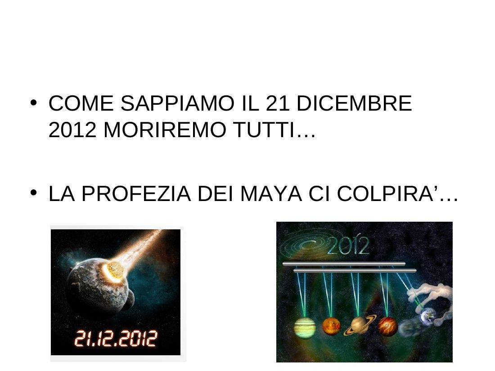{ loading=lazy style="width:59%" }

0:03:47

Questo è il cielo alle ore zero del 21 dicembre. C’è questo allineamento dei pianeti che, si dice, è colpevole di questa fine del mondo. Vedremo se sarà così. Sono stati creati migliaia di siti, e su tutte le televisioni, sui giornali ci sono un sacco di programmi, articoli ecc. sulla fine del mondo. Ho preso un’immagine a caso tra le migliaia, ma migliaia davvero, che ci sono.

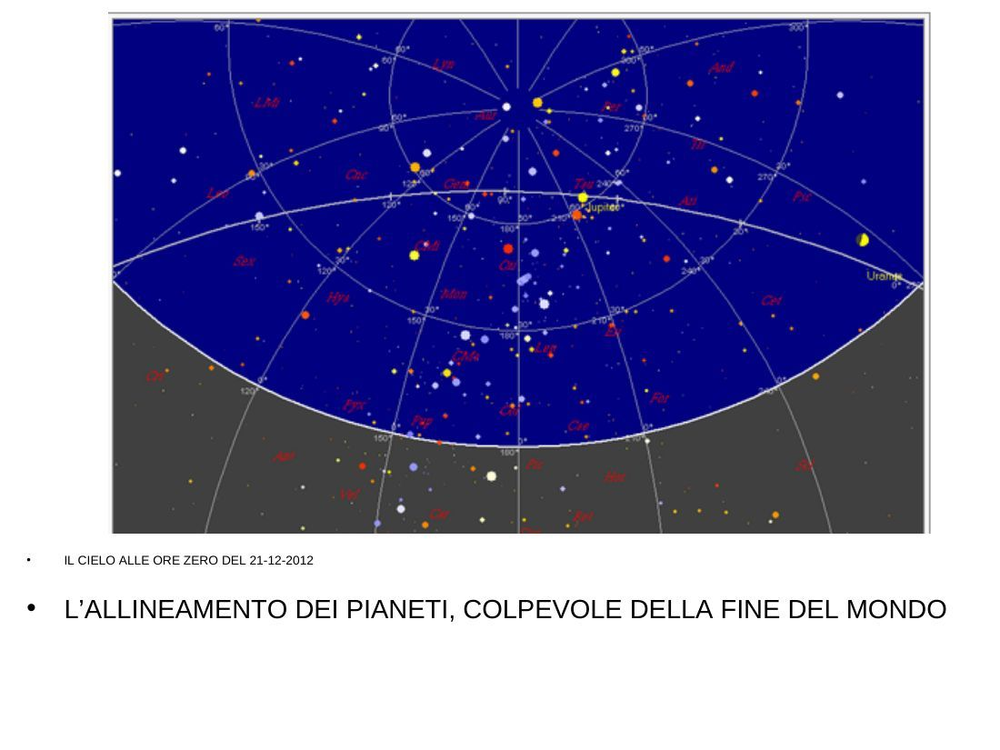{ loading=lazy style="width:47%" }

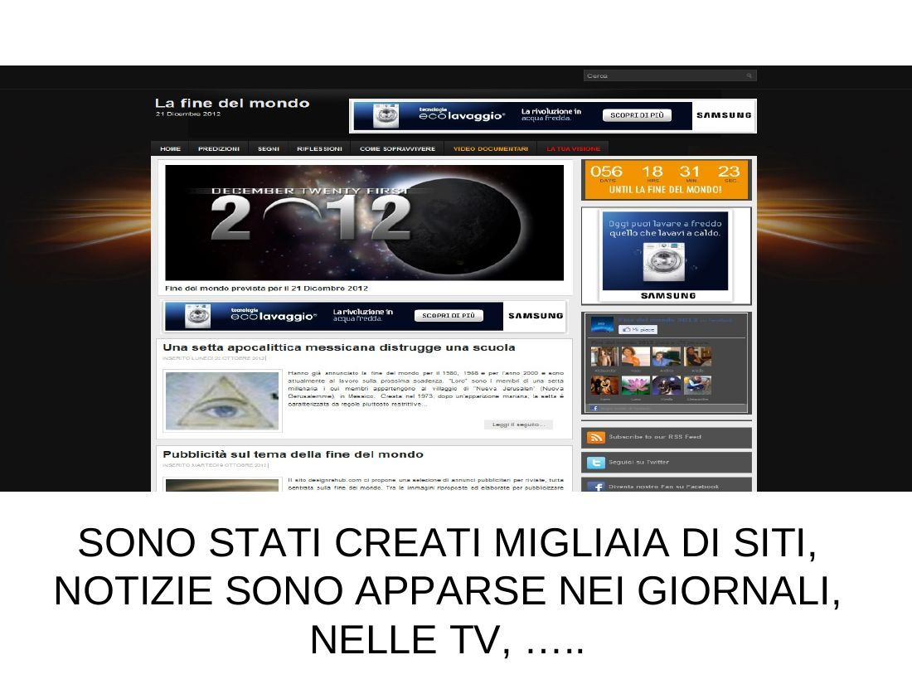{ loading=lazy style="width:47%" }

0:04:22

Di sicuro i pubblicitari se ne sono serviti per vendere la loro merce sul catastrofismo della fine del mondo. Questo è il Banco Financiero, negli Stati Uniti: di questi tempi mi pare un abbinamento un po’ pericoloso, questo della fine del mondo, il catastrofismo, con le banche. Arena, perché ci sarà una mareggiata e quindi servirà un costume ben fatto. Oppure la Nike, per correre sulle strade desolate dopo la fine del mondo.

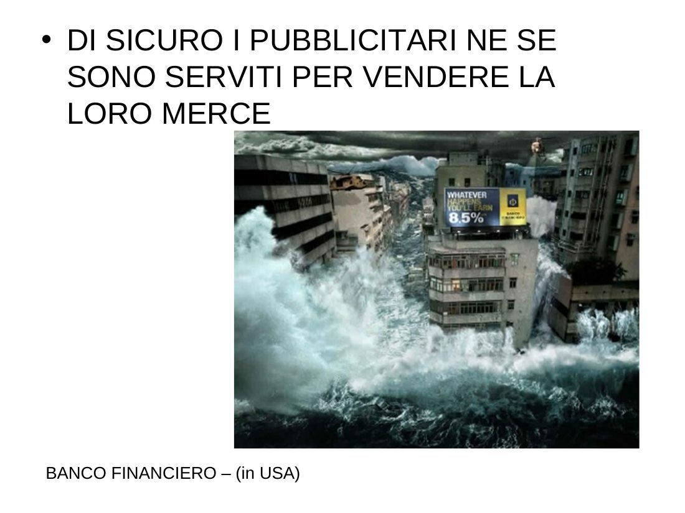{ loading=lazy style="width:41%" }

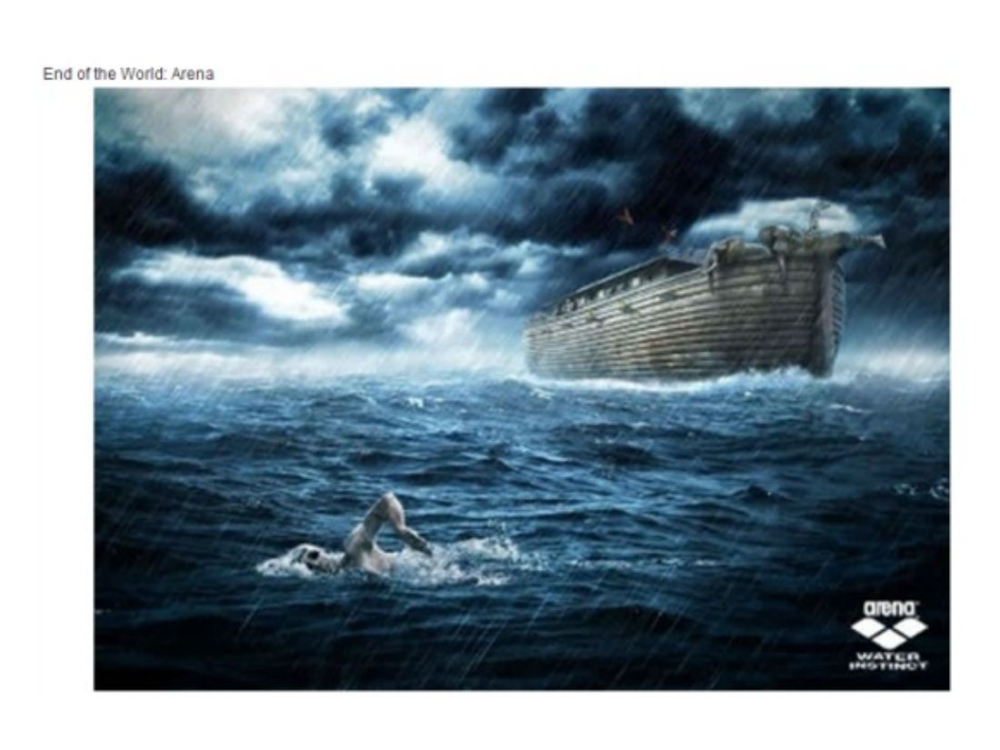{ loading=lazy style="width:41%" }

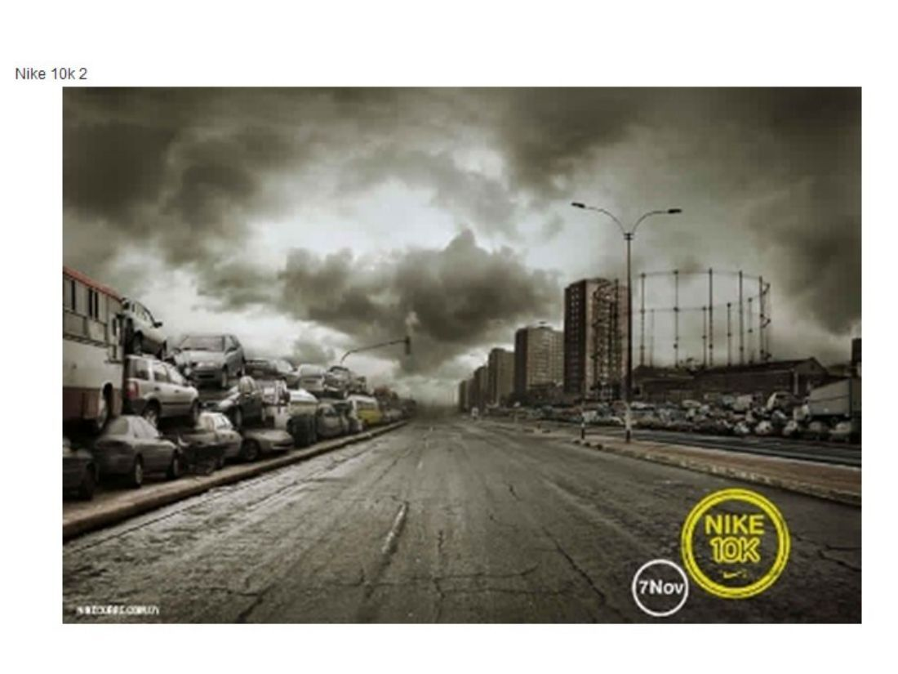{ loading=lazy style="width:47%" }

0:05:02

La fine del mondo ricorre spesso, come vedremo, nella storia, ma per rimanere nell’attualità un po’ più recente, anche il cinema la anticipa spesso, o provoca questi passaggi nel sentire comune. Qualche tempo fa è uscito *2012*, vi ricorderete: appartiene al genere popolare, catastrofistico ecc. E quindi c’è nel sentire comune questo messaggio della fine del mondo.

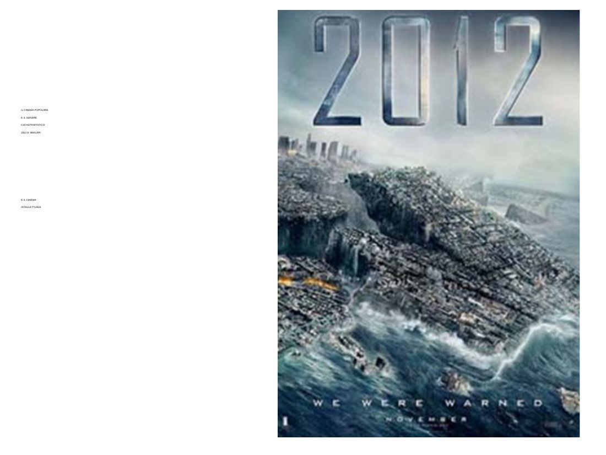{ loading=lazy style="width:44%" }

0:05:31

Però non c’è solo il cinema popolare di questo genere, ma anche il cinema intellettuale. Qualche tempo fa, uscì nel ’91, un po’ di anni fa, *Fino alla fine del mondo* di Wim Wenders, quindi un autore per i cinefili, che narrava appunto della fine del mondo. È un tema che ricorre spesso. Un satellite artificiale fuori rotta minaccia la Terra, e la storia d’amore che fa da filo conduttore attraversa vari paesi del mondo – Berlino, Lisbona, Tokyo, Mosca – fino all’Australia: qui alla fine, quando tutto sembra perduto, termina un viaggio che parte dall’Europa e finisce in Australia. Forse non a caso in Australia, perché è una terra appunto molto vuota, desertica, che dà l’idea della fine del mondo davvero. Sentono con una radio a galena che tutto il mondo non è morto, e quindi si può ricominciare a sperare nell’avvenire.

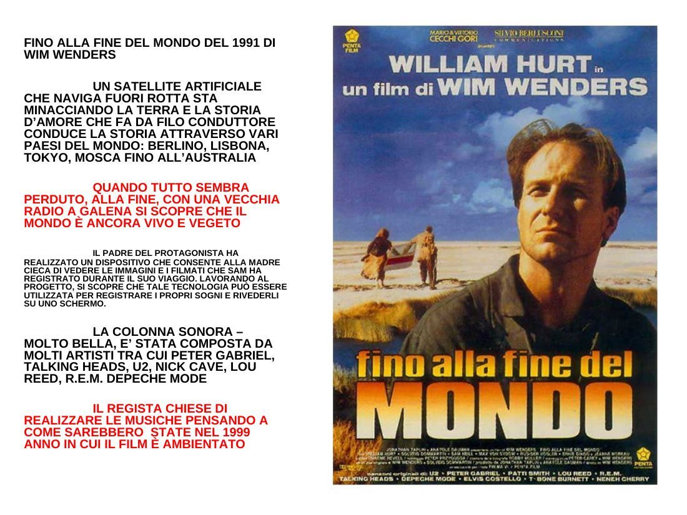{ loading=lazy style="width:59%" }

0:06:28

C’era una bella colonna sonora in questo film, per esempio Peter Gabriel, Talking Heads, U2, Nick Cave, Lou Reed, R.E.M., Depeche Mode ecc. La cosa particolare (volevamo farvela sentire, ma poi non abbiamo trovato il CD disponibile) è che il regista chiese di realizzare queste musiche pensando al 1999, quando doveva finire il mondo. Quindi concettualmente gli artisti lavorarono su questo aspetto.

0:07:02

Anche nella letteratura moderna la fine del mondo ricorre. È iniziata all’inizio dell’Ottocento, diciamo. Il primo in assoluto forse è Mary Shelley, quella di *Frankenstein*, che scrisse *L’ultimo uomo*, del 1826, su un’apocalisse dell’umanità nel XXI secolo. Poi ci sono stati Camille Flammarion nel 1894 con *La fine del mondo*, M. P. Shiel nel 1901 con *La nube purpurea*, dove la fuga di un gas letale uccide gli abitanti della Terra, e Jack London nel 1912 con *Il morbo scarlatto*, un contagio che spazza via l’umanità. Quello più celebre forse è *La guerra dei mondi* di H. G. Wells, del 1897, e celebre è quell’episodio che andò in onda sulla radio americana nel 1938, dove l’invasione, la fine del mondo come la conosciamo noi con l’invasione dei marziani, fu talmente realistica da parte dell’autore, cioè Orson Welles, che molti credettero che fosse davvero la fine del mondo, e si scatenò un panico non da poco.

0:08:15

Molte volte è stata annunciata la fine del mondo: i profeti ogni volta ci hanno detto che questa volta è sicuro, e mai si è avverata, per fortuna. A parte naturalmente il 21 dicembre di quest’anno. Qualcuno ha calcolato, ha numerato (ma io credo siano molte di più) oltre 250 profezie della fine.

0:08:37

Nel 130 Papia di Ierapoli scrisse la prima, con la sua esegesi dei Vangeli, un libro che influenzò molti altri millenaristi. Poi anche Sant’Ambrogio, vescovo di Milano: «Siamo arrivati alla fine del mondo; certe malattie ne sono i segni; la malattia del mondo è la fame; la malattia del mondo è la peste; la malattia del mondo è la persecuzione». Quindi apocalittici davvero. San Girolamo: «Voi continuate a vivere e a divertirvi e non pensate che l’Anticristo si avvicina». Lo stesso papa san Gregorio Magno diceva: «*Rex superbiae prope est*!» (Il re della superbia è vicino). Alla fine del VII secolo il monaco Marculfo tuonava: «*Mundi terminum ruinis crescentibus appropinquantem indicia certa manifestant!*» (Sicuri indizi annunciano con devastazioni crescenti l’avvicinarsi della fine del mondo).

0:09:13

Verso la metà del X secolo Bernardo di Turingia, un eremita, sosteneva che fosse vicino il serpente, ossia l’Anticristo, quindi la fine del mondo. È narrato nel *Dizionario di erudizione storico-ecclesiastica* di Gaetano Moroni. Lui diceva (qui entriamo un po’ nei numeri) che la fine del mondo sarebbe stata nel 992, perché in quell’anno il giorno in cui era avvenuto il concepimento di Gesù, cioè il 25 marzo, coincideva a sua volta con la ricorrenza della sua morte, ossia il Venerdì santo. In quel giorno, inoltre, si sarebbe verificata un’eclissi di sole: la coincidenza di questi elementi, secondo Bernardo, avrebbe determinato la fine del mondo. Quindi, in base a questi calcoli, sarebbe avvenuta la fine nel 992.

0:10:01

Alcune altre date, tanto per entrare in argomento. «Mille, non più di mille»: cita l’Apocalisse, che poi vedremo dopo. Il 1260 è quella tratteggiata nel 1182 da Gioacchino da Fiore, basandosi anche lui sui 1260 giorni descritti appunto dall’Apocalisse. Il 1836 del reverendo John Wesley, con dei calcoli complessi basati anche lui sull’Apocalisse: la data prevista era il 18 giugno 1836. Il 1999, e qui entriamo in Nostradamus: una delle tante che aveva ipotizzato, quando nella quartina X.72 prediceva l’arrivo di un «re del terrore» che sarebbe disceso dal cielo. Altre profezie di Nostradamus: il culminare di una lunga e selvaggia persecuzione religiosa per il 1792 (che non c’è mai stata), o la distruzione totale della specie umana per il 1732.

0:10:43

Curioso è anche Newton, Isacco Newton, quindi uno scienziato. Fu Keynes, l’economista, che curò la sua biografia, a scoprire una miriade di calcoli che Newton aveva fatto su questa fine del mondo. Anche lui, basandosi sull’Apocalisse, considerava i 1260 giorni dell’Apocalisse, e quindi il 1260 era l’anno in cui sarebbe dovuta essere la fine del mondo. Ma siccome era mancata, faceva iniziare il conteggio dall’incoronazione di Carlo Magno come imperatore, quindi dall’anno 800: 800 più 1260 fa 2060. Vedete quante elucubrazioni mentali possono fare anche scienziati come Newton.

0:11:42

In questa carrellata va aggiunta l’ultima profezia di Nostradamus (1503-1566): scrive al figlio Cesare e gli dice che le sue profezie arrivano fino in fondo, ma non potranno passare l’anno 3797. L’anno però potrebbe essere fittizio e riconducibile invece al 2240: sottraendo 1557 si arriva infatti al 2240 d.C., che corrisponde all’anno ebraico 6000. Abbiamo insomma ancora un po’ di tempo davanti a noi.

0:12:02

Quindi la paura della fine ci accompagna un po’ da sempre nel nostro immaginario collettivo. Questo ha fatto nascere anche la filosofia della fine, e in questo caso la filosofia della fine è legata prevalentemente, credo, al concetto di Occidente. Però dell’Occidente ne parleremo nella prossima puntata: quello che ci interessa oggi approfondire è la fine in se stessa. Solo alcuni testi per accennare a questa fine legata all’Occidente.

0:12:44

Questo è Žižek, un filosofo che gioca molto con la psicologia, la letteratura e il cinema, e che nel suo *Vivere alla fine dei tempi*, del 2011, introduce nei concetti della fine i quattro cavalieri dell’Apocalisse – la crisi ecologica mondiale, le folli disparità economiche, la rivoluzione biogenetica, gli esplosivi conflitti sociali – che poi ritroveremo più avanti. Oppure questo bel libro di Andrea Tagliapietra, *Icone della fine*, che insegna storia della filosofia all’Università San Raffaele di Milano, e va oltre le parole, perché tira fuori le icone della fine, quindi le immagini, e introduce il concetto di apocalisse non solo collettiva ma anche individuale, quella nostra personale: dove si ferma il pensiero e sorgono le immagini, in questo senso.

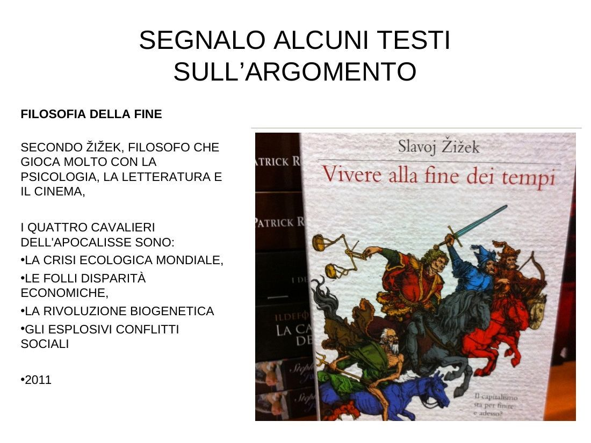{ loading=lazy style="width:30%" }

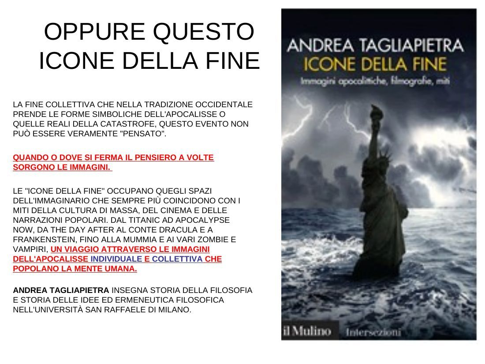{ loading=lazy style="width:30%" }

0:13:28

O Peter Sloterdijk (1947), filosofo tedesco, professore all’Università di Karlsruhe, neo-apocalittico spengleriano, come lo ha definito la Repubblica del 4 dicembre 2012 (Spengler ha scritto *Il tramonto dell’Occidente*, che magari affronteremo la prossima volta). Lui dice che la globalizzazione si identifica con la modernità, cioè con l’epoca in cui la follia di espansione globale diventa ragione di profitto. Vedete questi toni apocalittici, appunto.

0:13:59

È interessante che, davanti ai neocon che lo ascoltavano, citi le parole di Edward Gibbon al capitolo 52 della sua Caduta dell’Impero romano, quando scrive che se i Mori non fossero stati sconfitti a Poitiers nel 732, forse oggi l’interpretazione del Corano sarebbe insegnata nelle aule di Oxford e i nostri pulpiti sarebbero calcati da chi predica la santa verità della rivelazione di Maometto. Cioè, la storia a volte è fatta di punti: se la storia prende una direzione o un’altra, anche la nostra storia sarebbe stata molto diversa.

0:14:38

Oppure l’inquinamento, quindi la paura della fine del mondo per gli effetti dell’inquinamento, l gas serra, il surriscaldamento ecc. Dunque l’uomo, come dicevo, ha sempre vissuto con la paura della fine, e nel prosieguo della serata affronteremo i temi dell’Apocalisse, per vedere come si è formato il nostro sentire culturale da questo punto di vista, e daremo un’occhiata anche al prossimo futuro con gli algoritmi informatici della fine: cioè per vedere come si calcola e si predice il futuro con l’informatica applicata al concetto della fine. Con questo però darei la parola a Lorenzo per la sua introduzione.

0:15:29

Lorenzo Poggi Sì, grazie. Intanto, che tutte le profezie della fine siano andate a vuoto non c’è bisogno di mostrarlo: stiamo qui a parlarne, quindi probabilmente non si sono avverate. Bisogna fare una distinzione interessante. Quella dei Maya non è una profezia della fine in senso vero e proprio: è la profezia di un cambio di ciclo. Cioè non ci sarebbe la fine del mondo, ma un cambiamento profondo nella storia: si passerebbe da un ciclo a un altro ciclo. Quindi il discorso Maya si inserisce in quella visione circolare della natura e della storia che è tipica dei popoli antichi, delle culture antiche. Quando invece parliamo di fine del mondo, intesa come fine del mondo esistente, che una volta per tutte si chiude, allora dobbiamo rifarci a un altro modo di pensare, che è introdotto nella nostra cultura dalla visione del mondo giudaico-cristiana. Perché ci sia una fine del mondo bisogna che la natura e il mondo abbiano avuto un inizio. E questo inizio, nella visione giudaico-cristiana, è dal nulla: Dio crea il mondo dal nulla, *ex nihilo*, e va verso il nulla, *ad nihilum*. Quindi in questa ottica, in questa cultura, è comprensibile una fine del mondo.

0:17:23

Nelle culture precedenti, quella classica, quella della filosofia classica, si parla dell’età dell’oro, delle varie età, ma poi si ricomincia. Così è per gli stoici, così è per tutte le filosofie antiche. Nella visione giudaico-cristiana invece si introduce questa idea del nulla. Il mondo è nulla, perché si mette in evidenza l’estrema potenza di Dio; e per mettere in evidenza l’estrema potenza di Dio, il mondo viene annullato. Tutto va nella storia, nel mondo, come Dio comanda, e quindi la storia, il mondo, la natura sono semplicemente creazioni volute da Dio.

0:18:19

E la fine del mondo non si pone quindi come fine vera e propria, ma anche qui si pone come fine del mondo secolare e inizio del vero mondo, della vera esistenza, del vero destino dell’uomo. La religione ebraica, quella islamica e quella cristiana predicano che cosa? Predicano che non è qui il valore, non è qui quello che conta, ma è nell’aldilà. Che è poi un aldilà per tutti, quando finirà il mondo e di nuovo tornerà nella gloria a giudicare i vivi e i morti ecc. Quindi la fine del mondo, come fine vera e propria, è all’interno di questo modo di pensare.

0:19:19

E all’interno di questo modo di pensare c’è anche un altro aspetto, che è parte integrante della nostra cultura: il pensare che ciò che facciamo nel presente sia strettamente collegato a ciò che avviene nel futuro, e che quindi ci sia questo legame strettissimo di causa-effetto, un presente che condiziona e determina il futuro, per cui il nostro comportamento presente deve preparare ciò che verrà.

0:19:56

Ecco che il cristiano non si deve preoccupare tanto dei beni sulla terra, quanto di comportarsi in un certo modo in vista del futuro. Questo lo si ritrova completamente quando nell’età moderna (è inutile rifare tutta la storia) si afferma la mentalità scientifica, che prende questo modo di pensare il tempo, ci leva Dio, perché non sa che farsene di Dio (per questo Galileo, insomma, tutto quello che sappiamo), però mantiene lo stesso impianto. Per cui agiamo nel presente per sconfiggere il male, che è la non conoscenza, ma che in un tempo lungo sarà sconfitto nel progresso della conoscenza e nel futuro. Il presente prepara il futuro: abbiamo questa visione del tempo, ne abbiamo parlato una sera quando facemmo le filosofie della storia.

0:20:59

Quand’è che finisce? Quand’è che si sentono i segni? Il primo testo che parla di queste cose è l’Apocalisse di Giovanni, l’avete tutti presente. Giovanni parla dell’Apocalisse perché vive in tempi bui, bui per il cristianesimo, bui per lui che è cristiano; e c’è questa idea che ci siano segni del mutamento, che questo mutamento sia vicino e che il Figlio dell’uomo sia lì per tornare. San Paolo dice che quelli di questa generazione non saranno disfatti quando queste cose avverranno, cioè quando tornerà. Quindi noi cristiani soffriamo adesso, siamo perseguitati, ma ha da venì Baffone: ora mi è sfuggita, «ha da venì Baffone».

0:21:51

Anche nelle ideologie politiche che impegnano il presente per il futuro e vedono il mutamento c’è il medesimo spirito, la medesima cultura del tempo, che è di origine ebraico-cristiana. Su questo poi tutti si sono affrettati. Paolo ricordava Gioacchino da Fiore: tutte le volte che ci sono state delle crisi profonde si è detto «Ci siamo, sono i segni del mutamento, sono i segni dell’avvento del regno della giustizia. Questi politici che ora governano sono così inetti, così incapaci, e il mondo va così male, che è la fine. Ci sarà un rinnovamento globale e cambierà tutto».

0:23:00

Alarico saccheggia Roma, la distrugge; i pochi monumenti rimasti vengono in parte distrutti da una tempesta. Cioè, oltre alla disgrazia del saccheggio di Alarico, hanno poi anche una tempesta terribile, fulmini ecc., e parte degli edifici rimasti vengono distrutti dalla tempesta. E si dice: «Dio mostra chiaramente come sia finito il regno sulla terra: ha distrutto di sua mano, con i fulmini e l’incendio, ciò che i barbari per suo volere avevano lasciato», cioè ha distrutto il potere temporale di Roma per far capire a tutti che non a questo dobbiamo mirare, ma alla città di Dio.

0:24:04

Ed è su questo modo di pensare che Agostino imposta in fondo il *De civitate Dei*. Non la città degli uomini, caduta sotto i colpi dei barbari, ma la vera città, la Gerusalemme celeste, alla quale tutti tendiamo: quella rimane, e a quella dovremo tendere tutti nelle nostre scelte terrene, preparando questo avvento. Quindi siamo in questo tipo di idea.

0:24:43

Poi c’è chi ci specula sopra. Paolo faceva vedere prima le varie marche che speculavano sulla fine del mondo: la speculazione sulla fine del mondo c’è sempre stata. Sapete che, secondo la profezia rivista nel nostro tempo (il nostro tempo è un po’ diverso, ora vi dico anche perché), c’è un paese che sfuggirà alla fine: Bugarach. Bugarach non dice nulla, ma è nei pressi della Montagna Nera ed è vicino a Carcassonne. Carcassonne la conosciamo tutti: sud-ovest della Francia, posti terribili, perché lì da sempre ci sono stati gli eretici, i catari. C’è Albi.

C’è un momento in cui c’è il senso del realizzarsi della profezia di Gioacchino e si passa dall’età del Figlio all’età dello Spirito, perché gli albigesi dicono che ormai non c’è più bisogno della Chiesa, perché lo Spirito Santo ispira dall’interno ciascun uomo, e quindi tutti sono in grado di leggere il Vangelo, di conoscere la verità, di salvarsi. Queste cose le ripeterà poi Lutero, in un altro modo, capite?

0:26:07

Simone di Montfort, quando espugna Albi, fa un po’ di prigionieri, e alcuni sono cattolici, non albigesi, e dicevano: «Liberate noi», perché non erano scappati dalla città ed erano presi tutti insieme. E quando i luogotenenti gli dicono: «Abbiamo un mucchio di gente che dice di non essere albigese, che dobbiamo fare? Chi può vedere l’interno delle loro coscienze?», Simone di Montfort risponde: «Noi uomini non possiamo vedere la coscienza dei nostri simili: ammazzateli tutti, Dio farà le sue scelte dopo». E quindi vedete che tipo era il nostro amico Simone di Montfort.

0:26:50

Comunque, qui c’è il paese di Bugarach; Bugarach è vicino alla Montagna Nera. Chi va lì sopravvive alla fine del mondo. Perché? Perché nella montagna di Bugarach c’è una base di alieni che il 21, quando finisce il mondo, apriranno la montagna, verranno fuori (non si capisce bene se con un disco o un missile, una supposta cosmica, non si sa bene con che cosa) e salveranno i presenti.

0:27:27

Sarà difficile, perché l’autorità del posto... esauriti da tempo tutti i posti disponibili nei due alberghi ecc., finti dicendo sì, non sanno come fare. Che hanno fatto? Intanto è stato interessantissimo il padrone dell’albergo, che ha fatto un’offerta speciale, ha fatto «compri tre, paghi due», insomma; ha detto: «Se restate anche per l’ultimo dell’anno vi faccio lo sconto», non si sa mai: per l’ultimo dell’anno ha fatto un’offerta. Comunque, capite che quando ci sono queste cose c’è chi ne approfitta.

0:28:03

Comunque hanno proibito di avventurarsi sulla montagna, perché, immaginate, tutta questa gente andata sulla montagna il 21 di notte: ne finivano metà nei crepacci. Per cui hanno detto no, sulla montagna non si va; quindi anche se gli alieni provassero a salvarli, non troverebbero nessuno. Però è interessante questo: guardate, ne hanno approfittato tutti della fine del mondo, soprattutto dell’avvento del mutamento. Abbiamo detto che si pone come mutamento, come passaggio, e del passaggio ne hanno approfittato tutti.

0:28:44

L’ultima cosa: un profittatore terribile, qui dalle nostre parti. Sono i di Soscan, non è lontana la Montagna Nera: hanno un piatto particolare, il cassoulet, famoso, fatto al forno con il coccio di Carcassonne, cotto nel forno con la legna della Montagna Nera. Deve essere una cosa molto buona: io, quando l’ho mangiato qualche anno fa, era buonissimo. Però questo è il piatto della fine del mondo.

0:29:21

E dicevo, c’è chi ne ha approfittato: dalle nostre parti ci sarà uno che approfitterà del fatto che si cambia, che deve venire l’età dello Spirito, sempre secondo la profezia di Gioacchino da Fiore rivista e corretta. E venne processato. Si chiamava Don Giuliano Lucchetti, parroco di Seravezza, che aveva diffuso tra le sue parrocchiane (gli interessavano le parrocchiane in modo particolare, a Don Lucchetti) l’idea che dopo l’incarnazione del Figlio ci sarebbe stata la fine dei tempi e doveva esserci l’incarnazione dello Spirito. Perché le persone sono tre: il Padre è quello che fa le cose, ma poi c’è il Figlio e lo Spirito Santo; allora si doveva incarnare lo Spirito Santo, e guarda caso lui aveva saputo per rivelazione che il veicolo dell’incarnazione sarebbe stato lui, Don Giuliano Lucchetti.

0:30:35

Guardate che non è una storiella: è stato processato. Insomma, che cosa fece Don Giuliano Lucchetti? Ebbe rapporti con molte ragazze e spose del paese, ansiose di diventare la mamma dello Spirito Santo, ed ebbe molti bambini. E addirittura una ragazza denunciò la madre perché l’aveva picchiata: la madre era piuttosto anziana, e la figlia le diceva «Vai da Don Lucchetti, dai, perché così io divento la nonna dello Spirito Santo».

0:31:20

Comunque Don Lucchetti fu processato nel 1700 a Santa Croce dalla Santa Inquisizione, fu condannato naturalmente, e gli bruciarono i polpastrelli delle dita consacrate. Finì male, Don Lucchetti, però era uno che sulla fine del mondo e sull’incarnazione ci aveva giocato. Va bene: quindi c’è questa idea che è soprattutto non fine, ma raggiungimento del vero destino dell’uomo. Continuiamo dopo, perché il discorso è interessantissimo.

\[PAUSA\]
{: .nota }

0:33:47

Intervento dal pubblico Vi disturbo un po’. Di solito una carissima amica dice che non si deve mai chiedere l’elemosina, però sono qui a chiedere. Chiaramente se è possibile, magari ci pensate un attimo: io volevo dire due parole su Mario Paoli e sulla sua azione di solidarietà, e sul fatto che sono un po’ in difficoltà. Se c’era la possibilità di dire due parole sui libri che lui ha scritto, magari se qualcuno vuole fare un pensiero per Natale, si può fare, magari nella prossima pausa.

0:34:26

Paolo Marcucci Sì, magari la facciamo alla fine della seconda pausa.

0:56:29

Paolo Marcucci Dopo la prima pausa riprendiamo il nostro discorso. Abbiamo accennato prima all’Apocalisse; dobbiamo dire però che non c’è solo l’Apocalisse, ma c’è anche tutta la cultura apocalittica che viene prima dell’Apocalisse. «Apocalisse» deriva dal greco: *apo*, separazione, e *kalýptein*, nascondere; quindi vuol dire togliere il velo, scoprire, rivelare: la rivelazione che Dio fa a un suo profeta scelto. Da qui il nome. Quindi bisogna fare un cenno agli scritti dell’apocalittica, che non sono quelli dell’Apocalisse di San Giovanni, ma che poi vediamo.

0:57:29

L’apocalittica nasce dal popolo di Israele. Gli anni dal 200 a.C. al 100 d.C. sono tra i più tragici della storia dell’antico Israele: l’epoca inizia con la reazione alla profanazione del Tempio e alla persecuzione del giudaismo, una persecuzione, la prima forse del popolo israelita, che generò appunto questo genere di libri, di profezia apocalittica e di sentire apocalittico. Si conclude in questo periodo con la distruzione del Tempio di Gerusalemme a opera di Tito. Questa distruzione del Tempio ha pervaso poi tutta la mitologia occidentale e ha ispirato molti.

0:58:23

Questo è Francesco Hayez, appunto, *La distruzione del Tempio di Gerusalemme*, del 1867. Vedete? È terribile, no? I fumi, le persone che cadono. Questo è Poussin, *La Distruzione del Tempio di Gerusalemme*, del 1637. Dura sempre questo passaggio. Questo è Tommaso Minardi, un’opera del 1803-1810: vedete le rovine e sullo sfondo i guerrieri. Gustave Doré (1832-1883) ha fatto questa litografia dove si vede Neemia che ispeziona di notte le rovine del Tempio di Gerusalemme: Neemia, personaggio della Bibbia e autore del libro che porta il suo nome, quando seppe delle condizioni disperate di Gerusalemme digiunò e pregò, e ottenne dal re il permesso di recarvisi.

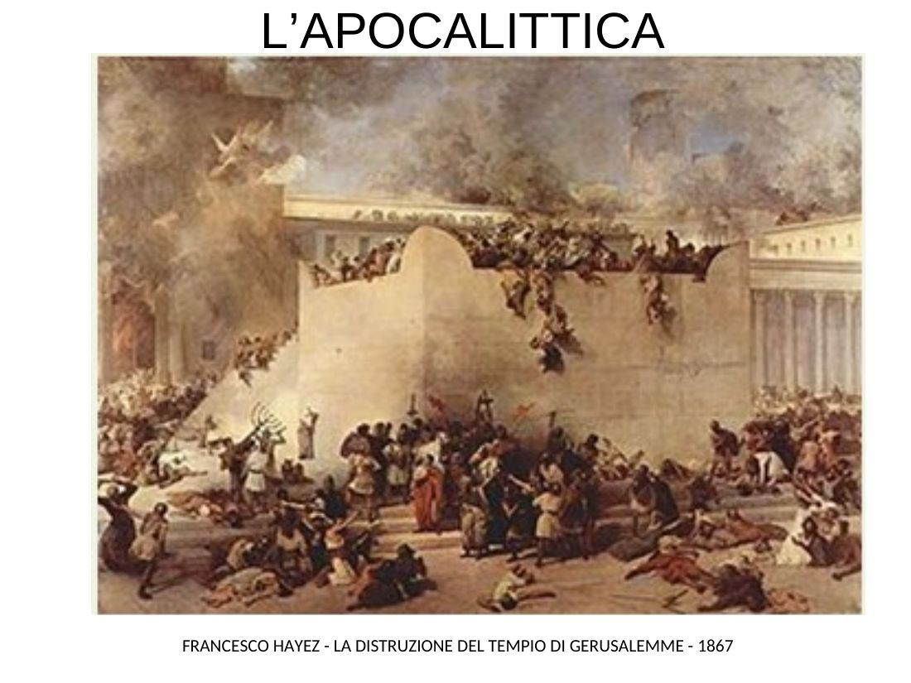{ loading=lazy style="width:47%" }

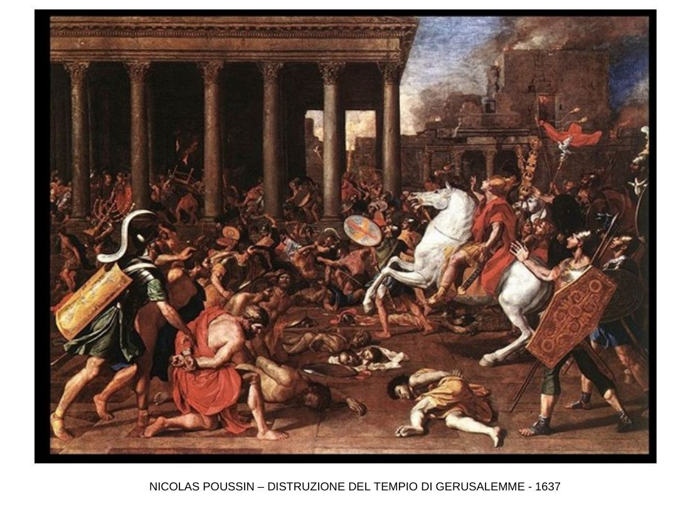{ loading=lazy style="width:47%" }

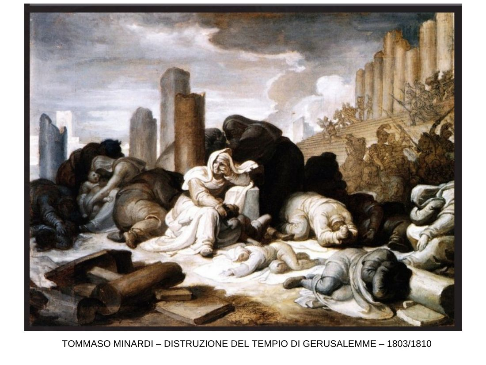{ loading=lazy style="width:47%" }

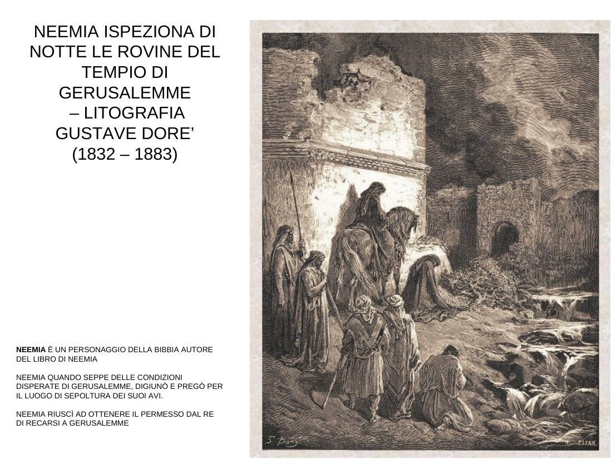{ loading=lazy style="width:47%" }

0:59:09

Quindi, l’apocalittica. Ricordiamoci quello che dicevo prima: c’è una bella definizione che le ha dato Paul Beauchamp (1924-2001), un gesuita francese, uno dei biblisti più apprezzati del secolo scorso, professore di esegesi biblica al Centre Sèvres di Parigi. Dice che la letteratura apocalittica nasce per aiutare a sopportare l’insopportabile. Cioè, in un periodo di profonda distruzione, quando tutto sembra finire, la letteratura apocalittica fa intravedere alla fine un percorso di speranza, un’uscita, che è quello che ci interessa.

0:59:51

Infatti la visione israelita da questo punto di vista va proprio in questa direzione. Dicono, per esempio: «Israele sarà liberato, vendicato e guidato da Jahvè; dal suo Messia si satollerà nella pace e nell’abbondanza. Le dodici tribù torneranno a imperare sulle genti domate e calpestate». Quindi c’è lo spirito di vendetta e di dominio, lo spirito di un futuro che ritornerà dopo la catastrofe del momento. Questi scritti fomentano la passione di rivalsa, di dominio, del popolo israelita.

**IL RISCATTO E LA VENDETTA DELL’APOCALITTICA**

L’Apocalittica si serve dei profeti canonici dell’Antico Testamento e li arricchisce di predizioni immaginifiche che descrivono il trionfo di Israele *sui pagani*, o non ebrei (*Gojim*).

«Israele sarà liberato e vendicato e, guidato da Jahweh e dal suo Messia, si satollerà nella pace e nell’abbondanza; le 12 tribù torneranno per imperare sulle genti domate e calpestate».

Monsignor Antonino Romeo scrive che l’apocalittica tratta «della finale rivincita divina sulle forze del male trionfanti attualmente; della vendetta sulle genti e della restaurazione gloriosa di Israele. \[…\] il regno di Dio riveste generalmente l’aspetto nazionalistico-terreno: schiacciante rivincita di Israele, colmo per sempre di prosperità e di dominio».

«Il regno di Israele o del Messia, che s’identifica con la nazione giudaica, sarà *di questo mondo* \[…\] e riporterà l’Eden quaggiù. In tale concezione giudaica la persona umana conta ben poco: Israele diventa realtà assoluta e trascendente, la redenzione è collettiva anziché individuale, anzi cosmica più che antropologica.

Questi scritti fomentano la passione di rivincita e di dominio mondiale. \[…\] verso le genti gli apocalittici sono implacabili: ogni compassione per loro passerebbe per debolezza di fede. \[…\]

I “veggenti” dell’Apocalittica infieriscono con voluttà feroce, con odio insaziabile. Le “apocalissi” assumono un posto decisivo nell’astiosa propaganda contro le genti; sono ordigni di guerra \[…\].

Al contrario del Vangelo (*Mt* 6,34), la religione apocalittica ha un solo cruccio e un’ansia: l’avvenire \[…\]. Gli imperi delle genti si annienteranno a vicenda finché il dominio universale non passerà a Israele».

Questo forse ci dice qualcosa anche sul conflitto con la Palestina…

1:00:34

Facciamo un cenno ora all’Apocalisse di San Giovanni, che abbiamo citato prima: è l’ultimo (il ventisettesimo) dei testi del Nuovo Testamento, e sono le visioni profetiche che Giovanni ha nell’isola greca di Patmos. Anche questo è stato rappresentato molte volte nella pittura. Questo è Velázquez, San Giovanni Evangelista a Patmos, del 1618: vedete appunto Giovanni che è ispirato dalla luce.

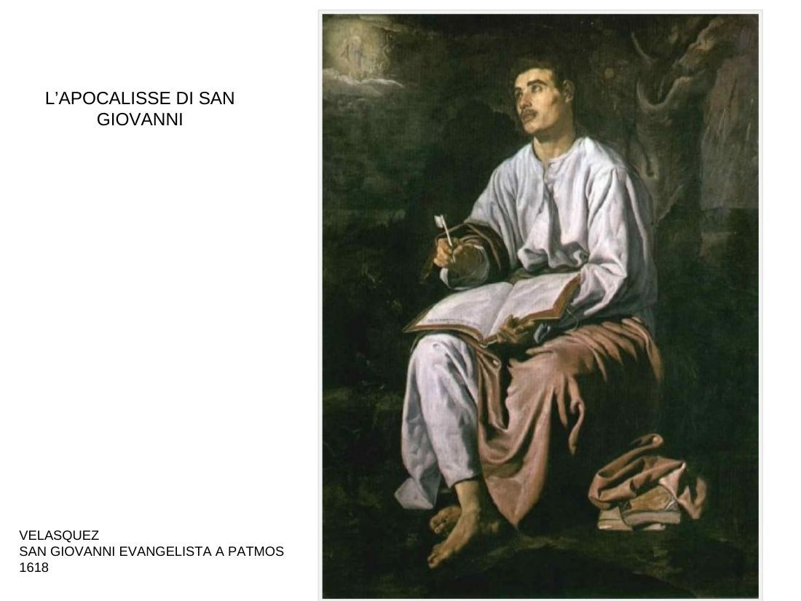{ loading=lazy style="width:50%" }

1:01:08

Lorenzo Poggi Volevo dire una cosa. L’Apocalisse di Giovanni si diffonde soprattutto in Occidente. Nell’Impero romano d’Oriente l’Apocalisse di Giovanni ha poca fortuna, perché c’è una maggiore stabilità politica, e quindi la predicazione dell’avvento degli ultimi tempi, che porterà finalmente la giustizia, veniva a incrinare la stabilità politica dell’Impero bizantino. Per cui l’Apocalisse di Giovanni ha successo, è accettata e diffusa in Occidente, dove invece il potere politico sta crollando e manifesta la sua inadeguatezza ai tempi: l’impero sta soccombendo sotto i colpi dei barbari. Mentre non ha successo, non si diffonde ed è osteggiata dalle autorità in Oriente, dove invece si vuole rafforzare l’idea della stabilità politica dell’impero. Come vedete, come si diceva prima, queste profezie apocalittiche sono in diretto contatto con il clima da cui sorgono e al quale tentano di dare una risposta.

1:02:42

Paolo Marcucci Le visioni di San Giovanni riguardano il giorno di Dio, quindi il trionfo dell’Agnello e il castigo di Babilonia, simbolo di Roma in quel momento. Se ora ne leggiamo qualcuna, sono parole di fuoco, terribili: «Quia tempus amplius non erit», non ci sarà più tempo (10,6). Terribile, se ci pensate. Oppure: «Il primo suonò la tromba: grandine e fuoco mescolati a sangue scrosciarono sulla terra. Un terzo della terra fu arso, un terzo degli alberi andò bruciato e ogni erba verde si seccò». «Il secondo angelo suonò la tromba: come una gran montagna di fuoco fu scagliata nel mare; un terzo del mare divenne sangue» (terribile, no?) «un terzo delle creature che vivono nel mare morì e un terzo delle navi andò distrutto». È una visione del mondo tremenda.

**L’APOCALISSE DI SAN GIOVANNI**

Queste visioni riguardano il grande giorno di Dio (trionfo dell’agnello), il castigo di Babilonia (simbolo di Roma), lo sterminio delle nazioni pagane e la nuova Gerusalemme, che discende dal cielo per essere la sposa dell’agnello.

Il termine «rivelazione» è usato solo per descrivere i contenuti del libro stesso, e non come designazione letteraria.

Dal II secolo il nome Apocalisse venne usato per diversi libri, sia cristiani sia ebraici, che mostrano gli stessi tratti caratteristici: il Frammento muratoriano, Clemente di Alessandria e altri menzionano un’Apocalisse di Pietro; Epifanio e Girolamo ricordano le apocalissi di Adamo, di Abramo e di Elia.

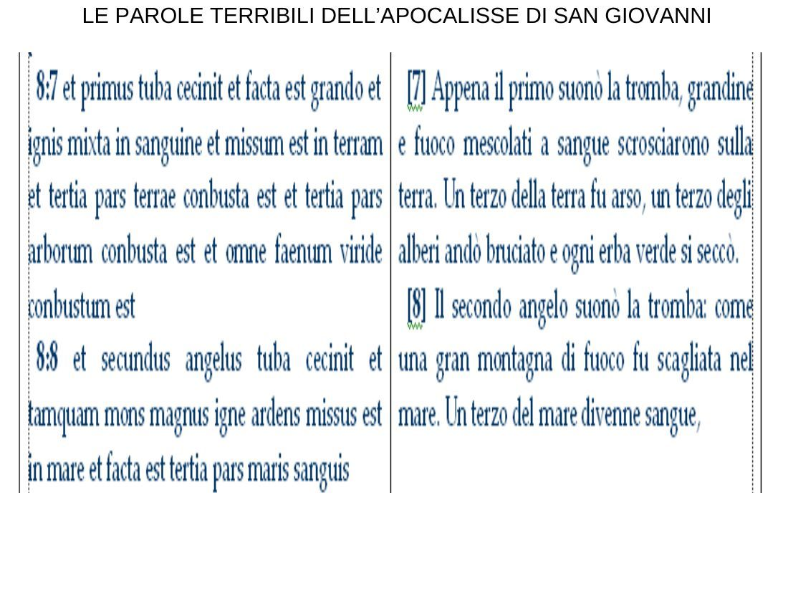{ loading=lazy style="width:47%" }

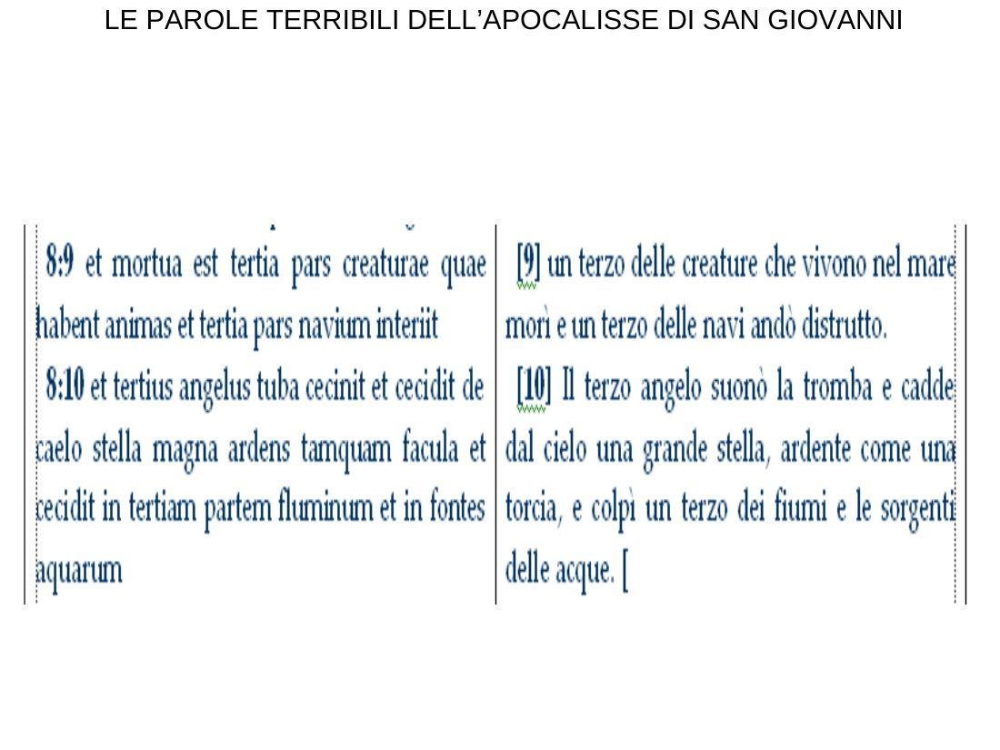{ loading=lazy style="width:47%" }

1:03:47

Quindi la potenza delle immagini dell’Apocalisse ha ispirato, lo si può comprendere anche in questo caso, molte opere d’arte, non solo dall’età classica, ma anche ora. C’è stata quest’estate a Milano, per esempio, una mostra basata proprio sull’Apocalisse: *Apokalips*, al Grattacielo Pirelli, a cura di Giacomo Maria Prati. Questa era la locandina della mostra: erano 36 artisti moderni, che esponevano tutti la loro interpretazione dell’Apocalisse. Ve ne faccio vedere uno: è Maurizio Carriero, *L’era aurea*, del 2011-2012. Questo era esposto a Milano. Questo per dire che il tema dell’Apocalisse arriva fino a noi.

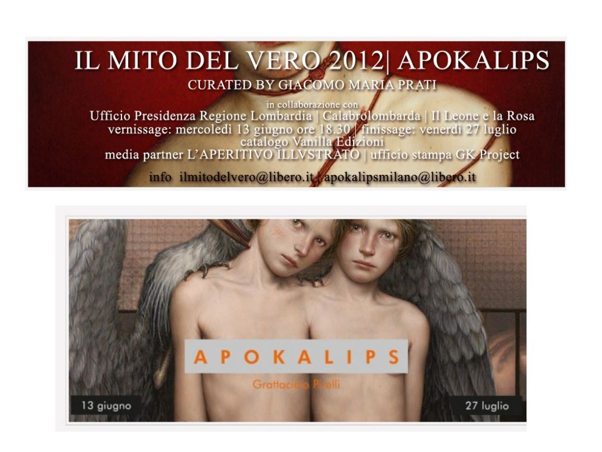{ loading=lazy style="width:47%" }

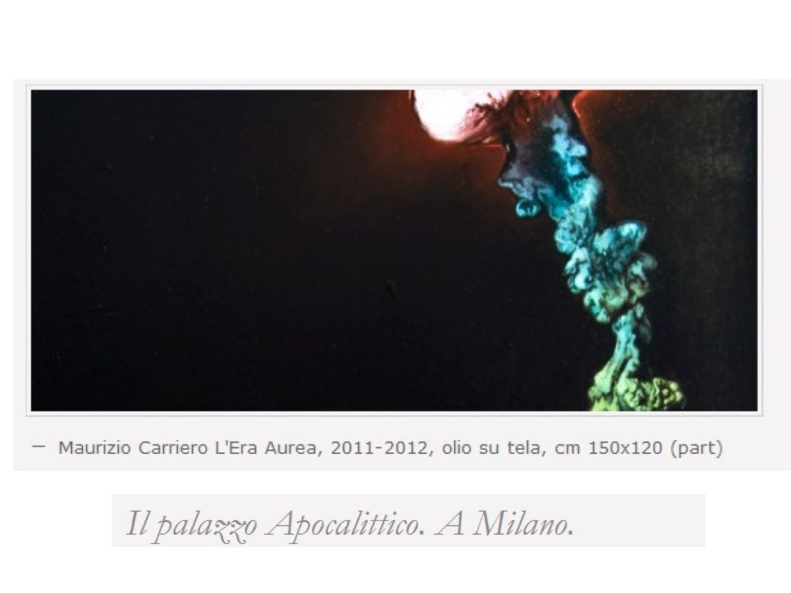{ loading=lazy style="width:47%" }

1:04:30

Tornando un passo indietro, invece, per una rappresentazione storica e ancestrale, forse, di quello che ha significato l’Apocalisse nell’immaginario, vorrei far vedere la facciata (ora non so se si vede dal video) di una chiesa nel Molise: Santa Maria della Strada, a Matrice, appunto nel Molise. Mi sembra si veda abbastanza bene. Ecco, vedete: c’è un cadavere, nudo, che sta tra le zampe di un leone che ha la coda tra le gambe, e quindi ha perso la sua forza e la sua potenza. Qui c’è invece un cane dalla testa mostruosa che sta aggredendo un agnello, e da sopra, vedete, c’è un altro cane che lo azzanna al collo: è la catena mostruosa che porta alla morte. E poi sopra c’è un cavaliere che brandisce una spada, mentre un leone sta aggredendo al collo il cavallo. Quindi sono tutte immagini che scaturiscono da questa visione apocalittica del mondo.

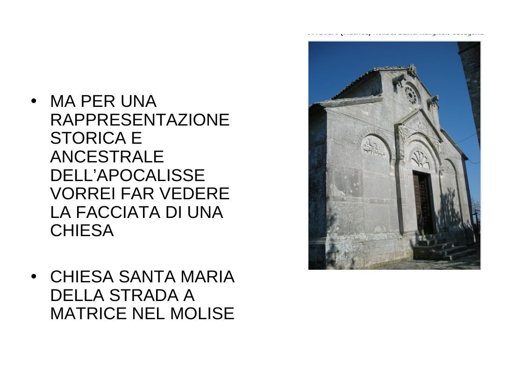{ loading=lazy style="width:47%" }

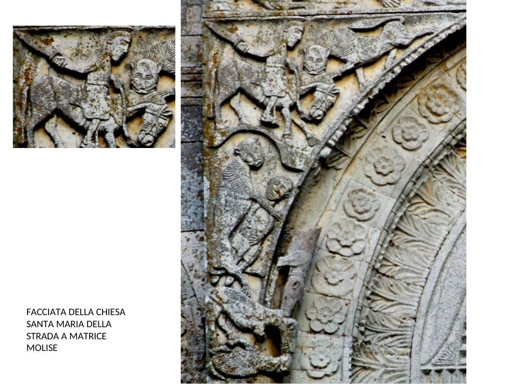{ loading=lazy style="width:47%" }

1:06:11

I cavalieri dell’Apocalisse, li abbiamo citati prima: sono figure simboliche presenti nell’Apocalisse di Giovanni. Questa è un’immagine di Albrecht Dürer, *I quattro cavalieri*, una xilografia. Hanno attraversato l’età classica e sono arrivati attraverso il Medioevo fino a noi. Yu-Gi-Oh!: era di mio figlio, aveva le carte; c’era questa, «Carestia, cavaliere dell’Apocalisse». Quindi è un mito che ricorre sempre. *Apocalypse Now* di Francis Ford Coppola, appunto, sugli orrori del Vietnam, ispirato da *Cuore di tenebra* di Joseph Conrad.

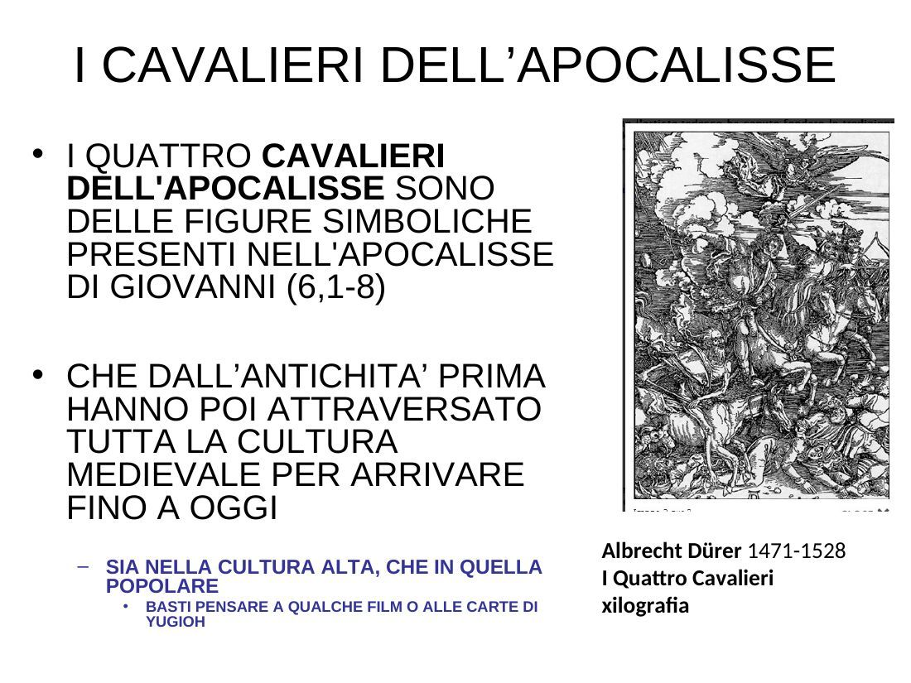{ loading=lazy style="width:30%" }

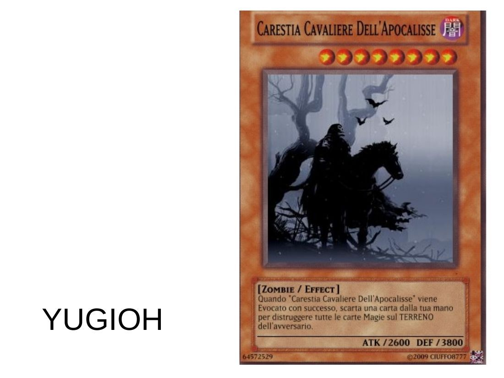{ loading=lazy style="width:30%" }

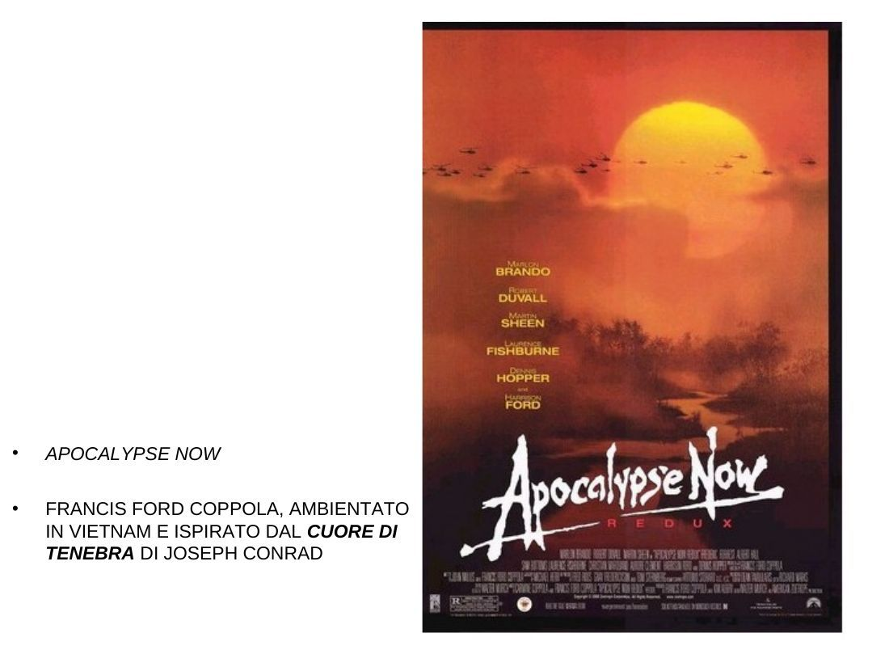{ loading=lazy style="width:32%" }

1:07:00

Questa è appunto l’illustrazione di Dürer. Sono 15 xilografie, un’edizione illustrata dell’Apocalisse di Giovanni che Dürer cominciò a preparare verso il 1496 e che uscì nel 1498, in latino e in tedesco, perché il tema era particolarmente sentito: eravamo alla fine del secolo. Quando arriviamo alla fine del secolo, del millennio, questi temi risorgono, e quindi Dürer le fece, per guadagnare naturalmente: fece questa serie di xilografie. Qui sono raffigurati i quattro cavalieri dell’Apocalisse, in una visione abbastanza popolare ma interessante. Loro cavalcano sulla terra il giorno dell’Apocalisse, dando inizio così alla fine del mondo.

**I QUATTRO CAVALIERI DELL’APOCALISSE**

Secondo un’interpretazione più dotta sono simboli per interpretare il flusso della storia.

– I cavalieri appaiono subito dopo l’apertura di quattro dei sette sigilli da parte dell’agnello (Gesù).

– I sigilli indicano i sette misteri del giudizio di Dio sulla storia umana, che vengono aperti, cioè svelati, dal Cristo stesso.

Una lettura più popolare e semplificata individua invece in ognuno di loro il legame con un male che tormenta l’umanità: essi cavalcherebbero sulla terra il giorno dell’apocalisse, dando inizio alla fine del mondo.

A parte l’ultimo, chiamato morte, i veri nomi dei cavalieri sono sconosciuti; essendo associati a tre mali dell’uomo, sono stati loro dati gli appellativi di pestilenza, guerra e carestia:

– il cavaliere bianco simboleggia la morte o pestilenza;

– il cavaliere rosso simboleggia la guerra;

– il cavaliere nero simboleggia la carestia;

– il quarto cavaliere è la morte (l’unico con un nome).

1:07:54

E qui si ritorna alla simbologia dei colori, perché i cavalieri dell’Apocalisse sono quattro: il cavaliere bianco simboleggia la morte e la pestilenza, il rosso invece la guerra, il cavaliere nero la carestia e il quarto cavaliere la morte, l’unico che ha un nome nell’Apocalisse di Giovanni. Queste sono altre immagini dei quattro cavalieri: sono tutte immagini, vedete, che fanno la distinzione dei colori così come l’abbiamo illustrata prima.

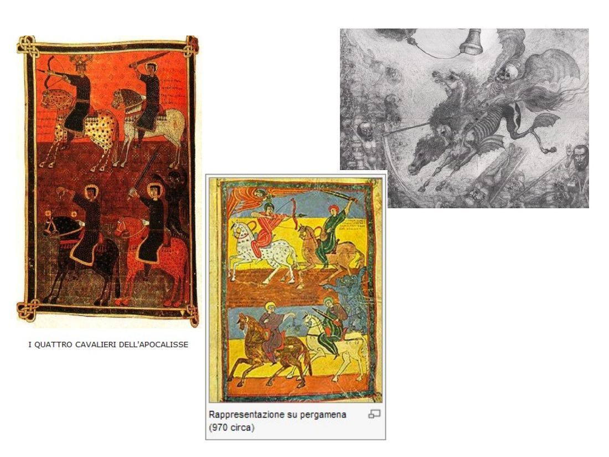{ loading=lazy style="width:59%" }

1:08:33

Quindi l’uomo oscilla nel suo pensiero tra la fine e l’infinito. Come diceva Schopenhauer (non voglio rubare il mestiere a Lorenzo), di per sé la natura non possiede il concetto di fine, e quindi la fine si lega in qualche modo anche all’infinito, perché l’uomo non sa, come dicevamo prima, quando sarà la sua fine: è solo Dio che conosce la fine, se ci sarà una fine, perché Dio è l’assoluto, e quindi l’infinito. L’uomo, segnato dal suo limite, cerca sempre l’aldilà, ciò che non ha limiti: l’assoluto, l’infinito, Dio. La religione cattolica, per esempio, con le parole di Gesù nel Vangelo di Matteo, dice che nessuno conosce l’ora e il giorno eccetto il Padre; e anche nell’Islam il tempo della fine è ignoto, e solo Allah, il Misericordioso, lo conosce. Non era nota la fine nemmeno al profeta Maometto.

1:09:35

Questa è la distinzione. Una citazione: avevo preparato un video, ma il computer con questa versione non lo fa partire. È *L’infinito di Leopardi* letto da Gazzolo, che è forse una delle più belle poesie, che sappiamo tutti, l’abbiamo studiata a scuola: il concetto di fine e di infinito mirabilmente raccontati. Riporta un po’ al nulla che aveva introdotto prima Lorenzo nel progetto divino.

**POTEVAMO NON CITARE LA DOLCEZZA DELL’*INFINITO*?**

Nell’*Infinito* c’è la propria fine (dell’uomo) e l’infinito del mondo.

La terra, dopo le scoperte astronomiche del XVI secolo, non è più al centro dell’universo, tanto meno l’uomo: egli è una piccolissima parte del tutto, come il più grande degli animali o il più piccolo degli insetti; ha le capacità di progredire, ma è allo stesso tempo ostacolato dai suoi mille e più limiti, fisici e morali… qual è, allora, il ruolo dell’uomo nell’universo?

È a partire dal 1823 che Leopardi comincia a sviluppare questa nuova visione della vita: il modo di percepire l’infinito, l’assoluto (o il divino, o in qualunque altro modo lo si voglia chiamare) non coincide più con il piacere (come l’infelicità non è più l’assenza di piacere), ma con il rendersi conto, da parte dell’essere umano, della sua piccolezza di fronte all’infinito dell’universo.

…il mondo viene dal nulla e al nulla ritorna quando esaurisce il progetto divino.

**GIACOMO LEOPARDI – *L’INFINITO**

*Sempre caro mi fu quest’ermo colle,*

*e questa siepe, che da tanta parte*

*dell’ultimo orizzonte il guardo esclude.*

*Ma sedendo e mirando, interminati*

*spazi di là da quella, e sovrumani*

*silenzi, e profondissima quïete*

*io nel pensier mi fingo; ove per poco*

*il cor non si spaura. E come il vento*

*odo stormir tra queste piante, io quello*

*infinito silenzio a questa voce*

*vo comparando: e mi sovvien l’eterno,*

*e le morte stagioni, e la presente*

*e viva, e il suon di lei. Così tra questa*

*immensità s’annega il pensier mio:*

*e il naufragar m’è dolce in questo mare.*

*L’infinito* è una delle liriche fondamentali dei *Canti* di Giacomo Leopardi. Il poeta la scrisse negli anni della gioventù a Recanati, sua cittadina natale, nelle Marche. Le stesure definitive risalgono agli anni fra il 1818 e il 1821, in particolare al periodo tra la primavera e l’autunno del 1819.

1:10:17

Anche la letteratura ci aiuta a sopportare questo insopportabile, come diceva Beauchamp, e a volte ci dobbiamo affidare anche ad altri per questa pena che ci dà questa idea. Per esempio, gli sciamani antichi cosa facevano, sostanzialmente? Ci aiutavano nel momento della difficoltà della fine, cercando nelle loro visioni di predire il futuro e consolandoci che forse non era così, che ancora non era arrivata l’ora, molte volte con l’ipnotismo della musica sciamanica. Questi sono sciamani di cui abbiamo qualche fotografia recente, come questo sciamano gitksan con il sonaglio. Questo invece è uno sciamano del Nepal. Sono tutti legati a questa visione di aiuto all’uomo. La parola sciamano sembra derivi dal tunguso šaman, e questo a sua volta dal pali samana e dal sanscrito sramana, «monaco»: lo sciamano è un ponte tra il mondo terreno e quello ultraterreno.

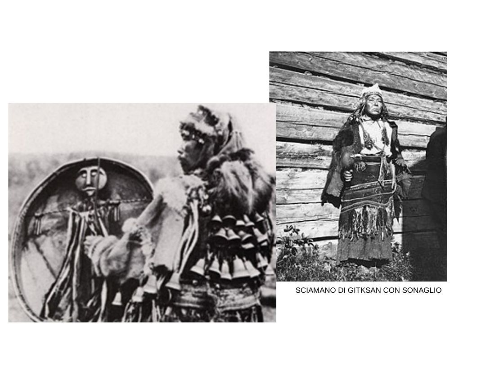{ loading=lazy style="width:47%" }

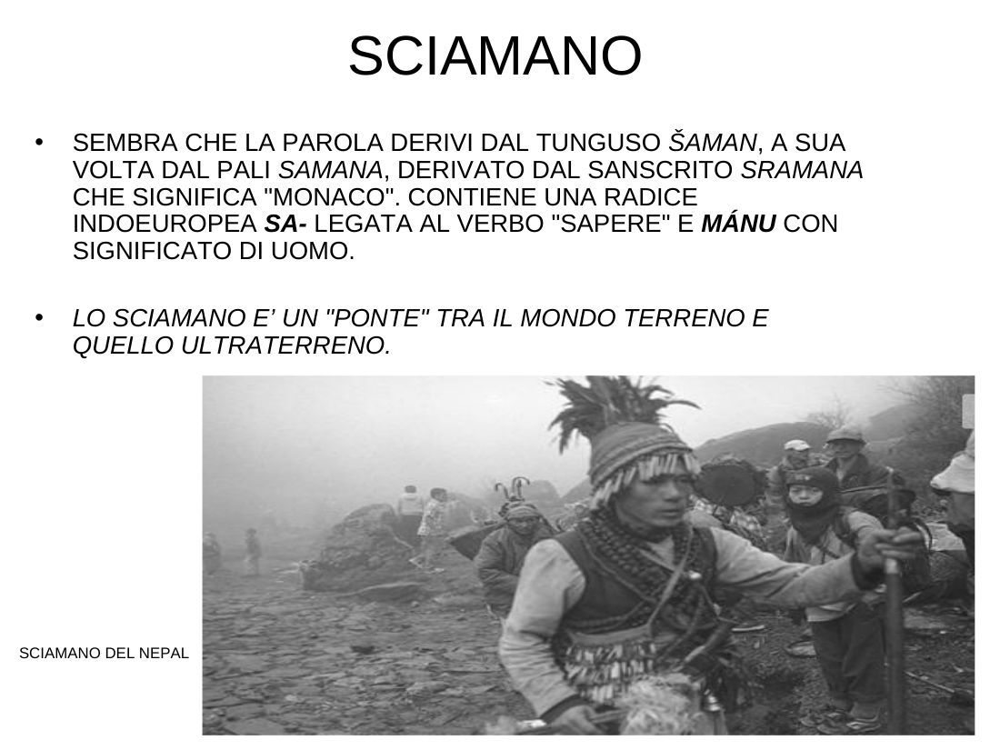{ loading=lazy style="width:47%" }

1:11:10

In questo caso naturalmente lo sciamano ci porta anche a introdurre quello che è stato poi per noi occidentali il ruolo della Chiesa. La Chiesa, con la religione, si è introdotta in questo passaggio, con un’organizzazione perfetta della gestione della fine dell’uomo: tu morirai, ma dopo ci sarà l’infinito, nella vita eterna. Si rifà il concetto al discorso degli addii, cioè al Giovedì santo, preso dal Vangelo di Giovanni, in cui Gesù si congeda dagli amici perché va verso la propria fine: sa che dopo sarà arrestato, e quindi vuole ripercorrere tutto quello che aveva fatto insieme ai suoi discepoli. C’è un manuale, sono 15 pagine precise di regole che la Chiesa distribuisce ai parroci per celebrare appunto la fine, quindi il funerale, quando un uomo muore. Quindi è un’organizzazione estremamente complessa, che deriva da una struttura che affonda le radici in tutto quello che abbiamo visto fino a ora.

**UNA TRADIZIONE DOMENICANA: IL «DISCORSO DEGLI ADDII»**

Il giovedì santo – dopo aver celebrato la messa con la solennità propria di questo giorno e ricordato il momento dell’istituzione dell’eucaristia, dopo aver fatto una cena molto buona, servita dal priore e dal sottopriore della comunità a imitazione della lavanda dei piedi evocata dal Vangelo e del servizio a tavola fatto dal Cristo in persona – cominciava la lunga lettura del «discorso degli addii», preso dal Vangelo di Giovanni, fino al racconto della passione. Così cominciava, con una lunga veglia, la liturgia del venerdì santo.

Perché la nostra tradizione ci invita a rileggere *in extenso* il «discorso degli addii»? Perché questo discorso è l’ultimo pronunciato dal Cristo. Dopo qualche ora egli sarà arrestato, giudicato, condannato e giustiziato. Egli sapeva tutto ciò, ma prima di lasciare i suoi ha voluto lanciare un ultimo sguardo su quello che aveva detto e fatto in mezzo a loro: i suoi *acta et passa*, avrebbe detto San Tommaso.

Fonte: http://www.unigre.it/lagregoriana/articoli/43\_44\_missione\_comune.pdf
{: .didascalia }

1:12:30

Sostanzialmente potremmo dire che navighiamo sempre tra l’Apocalisse e la resurrezione: in questo mare tempestoso ci imbarchiamo e andiamo alla ricerca di una possibile soluzione.

1:12:45

C’è un capolavoro che si associa alla fine individuale, in questo caso, dove l’uomo cerca disperatamente di rimandare la propria fine e ferma in qualche modo le pallottole che poi lo uccideranno davvero. È un racconto breve di Borges, tratto mi pare da *Finzioni*. Tra l’altro Borges si era ammalato, come tutta la sua famiglia, dove la cecità era ereditaria da sei generazioni, ed era diventato cieco dalla fine degli anni Cinquanta; era quello che, ricorderete, ha ispirato Umberto Eco nel *Nome della rosa* per il bibliotecario: Jorge da Burgos sostanzialmente era Borges.

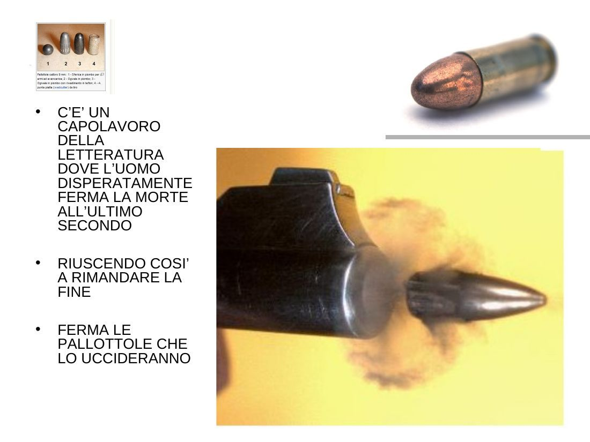{ loading=lazy style="width:47%" }

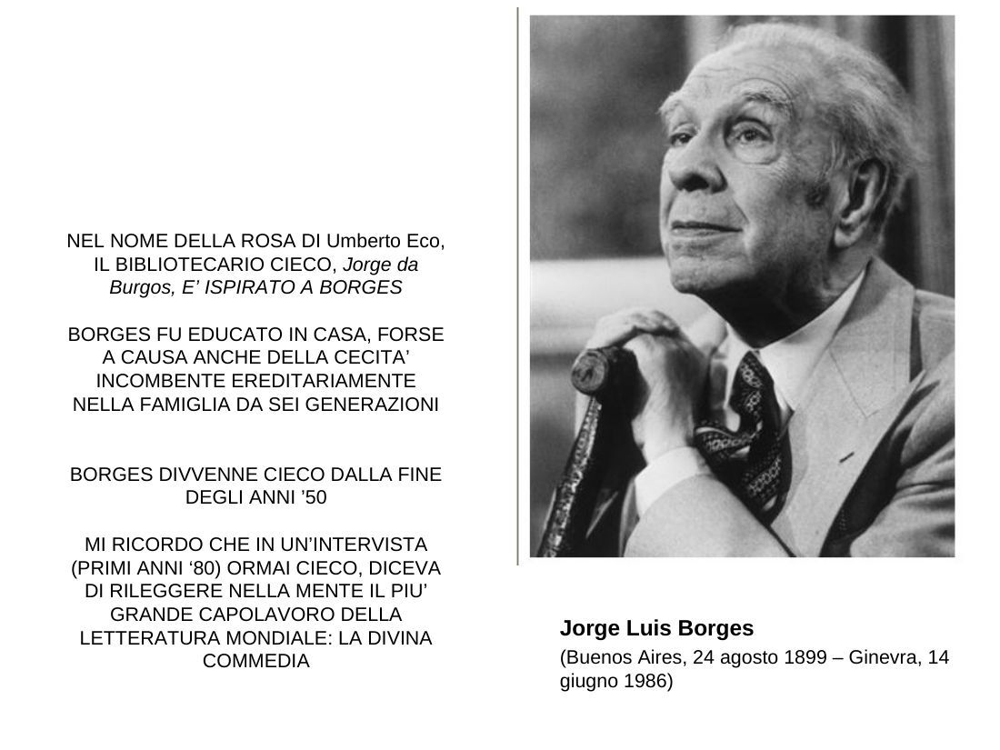{ loading=lazy style="width:47%" }

1:13:38

C’è *Il miracolo segreto* di Borges, dove c’è un condannato a morte (se non l’avete letto, leggetelo, perché è stupefacente da questo punto di vista): nell’ultimo istante, prima che il plotone di esecuzione prema il grilletto, il tempo si ferma per un attimo, e lui in quell’attimo rivive un anno intero e completa il lavoro: stava scrivendo il suo capolavoro, era uno scrittore. E completa questa magia di fermare il tempo, di fermare la propria fine. Per esempio: «L’universo fisico si fermò. Le armi convergevano su Hladík, ma gli uomini che stavano per ucciderlo restavano immobili. Il braccio del sergente eternizzava un gesto inconcluso. Su un mattone del cortile un’ape proiettava un’ombra fissa. Il vento si era arrestato, come in un quadro. Hladík tentò un grido, una sillaba, la torsione di una mano. Comprese che era paralizzato. Nemmeno il più tenue rumore gli giungeva dal mondo impedito». Le parole del racconto fermano proprio il tempo: sembra di essere lì con lui. È un capolavoro abbinato a questo concetto della fine, in questo caso individuale.

**IL MIRACOLO SEGRETO* – BORGES**

Il 19 marzo 1939 Jaromir Hladík, un intellettuale ebreo, viene arrestato dalla Gestapo e condannato a morte; l’esecuzione è fissata per il 29 marzo. Il giorno stabilito il condannato viene condotto davanti al plotone di esecuzione e, quando il sergente dà l’ordine e i soldati fanno fuoco, il tempo si ferma: in quell’istante lui ha un altro anno di vita, per completare il lavoro.

«L’universo fisico si fermò. Le armi convergevano su Hladík, ma gli uomini che stavano per ucciderlo restavano immobili. Il braccio del sergente eternizzava un gesto inconcluso. Su un mattone del cortile un’ape proiettava un’ombra fissa. Il vento s’era arrestato come in un quadro. Hladík tentò un grido, una sillaba, la torsione di una mano. Comprese che era paralizzato. Nemmeno il più tenue rumore gli giungeva dal mondo impedito.»

Poi rifletté che in questo caso anche il suo pensiero si sarebbe fermato. Volle metterlo alla prova: ripeté (senza muovere le labbra) la misteriosa quarta ecloga di Virgilio.

Fra l’ordine dato dal sergente e la sua esecuzione l’universo fisico si è fermato: per il condannato, Jaromir Hladík, è già trascorso un anno. La goccia di sudore che gli imperla la fronte può ora scivolargli lungo il viso, e lui può morire.

1:15:08

A me però, dopo tutto questo parlare di Apocalisse ecc., mi viene sempre in mente questo spezzone del film di Troisi e Benigni, *Non ci resta che piangere*, del 1985, dove c’è Troisi affacciato alla finestra e passa Savonarola: «Ricordati che devi morire!» «Sì, sì, va bene.» «Ricordati che devi morire!» «Sì, sì… mo’ me lo segno». Insomma, dopo tutto questo terrore che questa tradizione ci ha trasmesso, un po’ di sberleffo napoletano e toscano insieme mi pareva giusto introdurlo. Con questo lascio la parola.

1:15:56

Lorenzo Poggi Riprendiamo un attimo il nostro discorso e vediamo come ci si dispone a questo sentimento della fine. Abbiamo detto che l’Apocalisse di Giovanni non è accettata in Oriente, perché il potere politico è ancora saldo, si identifica con il cristianesimo, e quindi non c’è l’attesa spasmodica di un mutamento che risolva i problemi che appaiono così gravi e insolubili nel presente. Quindi tutte le volte che si presentano problemi gravi, che fanno soffrire gran parte dell’umanità di quel periodo, allora ricompaiono queste idee, queste profezie della fine: che ormai il mondo si stia per concludere e stiamo per entrare in un altro tempo.

1:16:57

Vi dicevo, appaiono tra il quarto e il quinto secolo, con le invasioni barbariche. In Occidente Agostino scrive il *De civitate Dei* nel momento in cui Roma è caduta, circa nei primi decenni, il 415, del V secolo: Roma cade sotto l’assedio di Alarico il Goto nel 410. Quindi siamo in questo momento di crisi profonda, e allora si dice che non è questo che conta.

1:17:48

Si possono vedere le immagini: vi faccio vedere due immagini estremamente interessanti da questo punto di vista. Una è l’arco trionfale di Santa Maria Maggiore a Roma. Ecco: purtroppo le immagini sono quello che sono, ma non ho trovato di meglio. Questo è l’arco trionfale di Santa Maria Maggiore a Roma; siamo più o meno in questo periodo di tempo. E vedete, ci sono gli agnelli in fondo, ma quello che conta è vedere al centro dell’arco San Paolo e San Pietro, e nel cerchio... Ah, sì: vedete lassù? Poi ci sarà un particolare che si vede meglio.

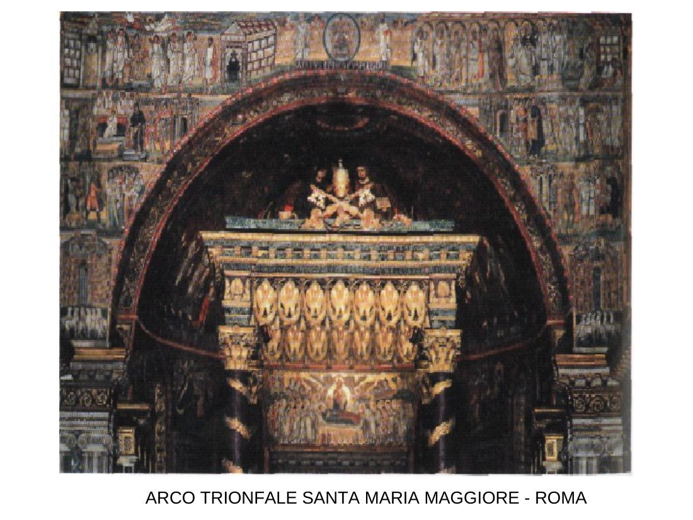{ loading=lazy style="width:44%" }

1:18:47

C’è San Paolo sulla destra di chi guarda, San Pietro sulla sinistra, e preparano che cosa? Il trono: sul trono, dove c’è la croce splendente di gemme, si siederà Cristo, che è tornato, che dominerà il mondo e stabilirà finalmente un’età di giustizia. E lì c’è la corona sul sedile del seggio del trono, e il mantello. Se si vede la seconda, forse c’è il particolare. Ecco, guarda: presentano l’avvento finalmente della vera giustizia, che non è di questo mondo, ma ci sarà di lì a poco, quando finalmente Cristo tornerà. È la speranza che tutto cambi, che si riesca a sfuggire alle difficoltà enormi del presente, lo sfascio dell’impero.

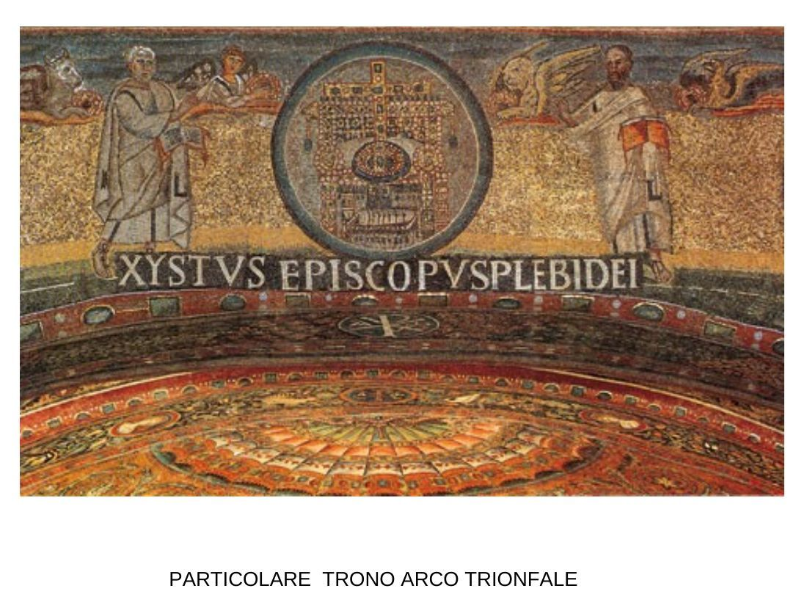{ loading=lazy style="width:41%" }

1:20:01

L’altro: questo è un mosaico, siamo più o meno nello stesso periodo, mi sembra sia il 395, quindi un pochino prima. Pensate: il 410, teniamolo presente, il sacco di Roma. La città eterna, la città che ha conquistato il mondo, che cade sotto i colpi dei barbari: è qualcosa di impensabile, è veramente la fine del mondo, è qualcosa che determina il mutamento di un’epoca.

1:20:42

Qui è il 395, quindi l’impero è profondamente in crisi. Che cosa si rappresenta? Si rappresenta la città ideale: c’è un porticato molto bello, vedete, che è la città ideale romana; al centro gli apostoli; nel mezzo, in trono, seduto, instaurato, Cristo, la croce, il libro; i quattro segni degli evangelisti, vedete, nel cielo, il tetramorfo: l’angelo, il leone, il san Marco, Matteo, il Giovanni. E finalmente Cristo che regna e che istituisce un mondo di pace e di giustizia. La città è bellissima, tutto è retto in modo meraviglioso, tutto è perfetto. Santa Pudenziana, 395: nel momento in cui i barbari dilagano nell’impero, tutto crolla, non si riesce più a mantenere l’autorità centrale dello Stato. L’idea, no? Superare le difficoltà del presente.

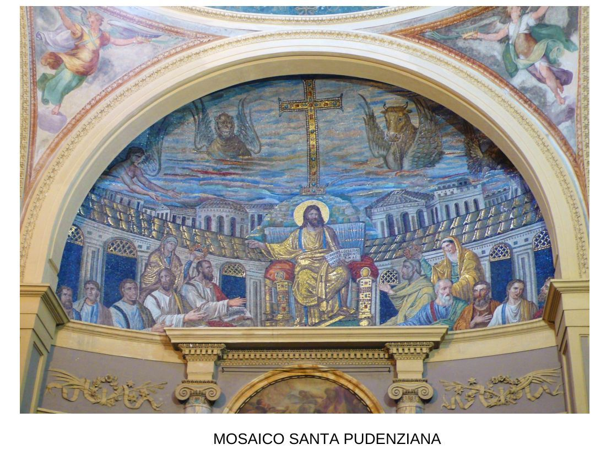{ loading=lazy style="width:37%" }

1:22:24

Gioacchino da Fiore, dicevamo; prima ancora, l’anno Mille. Adalberone, il vescovo di Laon: siamo nel 980, momento in cui in Europa sta declinando il vecchio sistema feudale e cominciano ad affacciarsi le novità, le città, le realtà borghesi urbane. Quindi il vecchio mondo, le vecchie strutture politiche mostrano i propri cedimenti; si comincia a vedere un nuovo modo di pensare la realtà, nuove classi sociali. Adalberone dice: sta finendo il mondo.

1:23:07

E alla fine del Quattrocento (l’avevamo visto insieme quando andammo a vedere la mostra a Palazzo Strozzi sul Denaro e la bellezza) Botticelli segue la predicazione di Savonarola. Savonarola predica la fine: ricordate la *Natività mistica*, dove i diavoli spuntano dalla terra e vengono ricacciati dagli angeli che circondano la capanna dove nasce Cristo. Nuova età: Savonarola annuncia un nuovo tempo. Che cos’è successo? La prima crisi della borghesia mercantile. Di nuovo rispuntano le profezie sulla fine del mondo.

1:24:09

Quindi sembra che la nostra cultura occidentale abbia elaborato questa idea che il mondo è nulla, che deve rispondere a certi principi, e quando non risponde vuol dire che sta finendo, sta per finire. E vengono fuori le varie profezie della crisi, che si trasformano in profezie della fine.

1:24:44

Questo vale anche per la vita umana. Il racconto di Borges che stava citando prima Paolo è estremamente interessante. Il condannato a morte vede sospeso il tempo un attimo prima che le pallottole lo raggiungano, per fare che cosa? Per completare l’opera intrapresa. Perché? Perché Borges, come fanno tutti i letterati, sta denunciando, sta esprimendo la condizione profonda del mutamento del nostro tempo riguardo alla vita.

1:25:27

Che cosa? Nell’antichità classica la vita, legata alla natura e al ciclo della natura, la vita dell’individuo ha un ritmo che è circolare. Durante la vita, a seconda dell’età e del tempo, si fanno certe cose; i compiti sono precisi, sono specificati. È un ciclo, è come quello delle piante, della natura: c’è un momento in cui spuntano, c’è un momento in cui fioriscono, c’è un momento in cui danno i semi e c’è un momento in cui appassiscono e ritornano alla terra. E quando uno è consapevole di avere compiuto il ciclo, ha realizzato la propria vita, e all’interno di questo è contemplata anche la morte, che non è ingiustizia, che non è oppressione, che non è un troncare anzitempo, ma è nel ciclo.

1:26:32

Il nostro tempo è invece occupato da una mentalità e da una cultura che non è quella della ciclicità, ma, derivata da questo, è quella della progressività infinita. Noi non diciamo «Oggi si è concluso un ciclo, abbiamo terminato»; diciamo «Chissà domani che cosa succederà», visto che la prospettiva è quella del progresso indefinito, infinito e continuo. Per cui ognuno, come soggetto, si sente all’interno del processo inadeguato, e finire in qualsiasi momento è un finire prematuro, anche se ci sono 140 anni. Ci scontriamo in qualche modo con quella che è la cultura del nostro tempo, e non c’è più una designazione, un figlio.

1:27:41

Allora, è un discorso che ritroviamo in tanti. Pensate a Socrate (ora vi faccio un discorso di deformazione professionale). Tutti si ricordano, nel dialogo del *Fedone*, la morte di Socrate, no? Socrate ha 70 anni (a quel tempo i 70 anni erano un’età stratosferica), è lì con i propri discepoli, nella prigione; è stato condannato a morte, lo sa. Si è rifiutato di scappare: poteva scappare, ma si è rifiutato. Insomma: «Ho 70 anni, ho fatto quello che nella vita dovevo fare, ho insegnato a voi, siete ancora qui che mi circondate: perfetto. Sono giunto in fondo, ho compiuto la mia opera. Perché mi dovrei mettere a scappare, uscire di qui, fuggire? Datemi la cicuta e facciamola finita». Capite? Si conclude, è una conclusione.

1:28:50

Questo modo, che è della filosofia classica, della visione classica, non è più nella visione cristiana. La conclusione non avviene più in questo modo: la conclusione avviene quando questo finisce e ce n’è un altro, e l’altro è dopo, quello che verrà dopo la fine di questo. Quindi non esiste più la fine, non c’è più fine. Abbiamo conquistato l’infinito, perché abbiamo conquistato l’immortalità, perché siamo diventati Dio, da quando abbiamo cominciato a mangiare Dio. Tant’altre volte abbiamo fatto la cena sul cibo. Cambiamo di condizione.

1:29:44

Quindi non c’è più fine del mondo: c’è un cambiamento, e tutte le profezie riguardano quanto sia più o meno vicino questo cambiamento. Per cui i Testimoni di Geova hanno detto che c’è il secondo ritorno, e siamo lì ad aspettare, perché Cristo è tornato una volta, e poi dal 1914 in poi ormai siamo agli sgoccioli. Se trovate qualche testimone per la strada, lo vedete e gli dite: «Ma a che punto siamo?». È così, insomma. Così vale anche per i mormoni.

1:30:27

Ci sono varie tendenze. C’è una tendenza anche all’interno della Chiesa cattolica che va in questa direzione. Sapete come si esprime? Il millenarismo è quando cominciano a piangere le Madonne. Perché? Il primo così dici: la Madonna che piange. Perché piange? Sulle disgrazie dell’umanità, perché siamo in fondo. Poi non si capisce mai perché deve piangere: se è un miracolo, potrebbe anche ridere. Sarebbe un miracolo lo stesso, ma sarebbe tutta un’altra cosa.

1:31:16

Esistono quindi nella nostra condizione questi discorsi sulla fine; questo concetto di fine, capite, non si concilia con il nostro mondo attuale, con il tempo presente. E allora assistiamo a varie versioni di quello che dovrebbe essere la fine, tutte estemporanee come quelle che abbiamo visto. Di queste però ne parliamo dopo, eh? Delle visioni estemporanee del presente. Me ne risparmio una: poi mangiamo qualcosa e con il vino possiamo fare anche molte considerazioni sul presente.

\[PAUSA\]
{: .nota }

2:06:05

Paolo Marcucci Cinque minuti, e poi andiamo con l’ultima parte.

2:12:05

Paolo Marcucci Andiamo per l’ultima parte. Prima vorrei fare un ringraziamento agli amici della Zaffera, che ci hanno onorato stasera del cibo. Un applauso. Per concludere c’è una nostra ascoltatrice, uditrice, non so come definirla, storica, che voleva fare un appello: quindi ti passo il microfono.

2:12:48

Intervento dal pubblico Grazie. Buonasera. Prima di tutto mi scuso perché sono arrivata in ritardo, e spero di non avervi disturbato troppo. Grazie a Marcucci e al professor Poggi, che mi lasciano la parola un paio di minuti, non di più. Non vi chiedo niente, nel senso: solo due parole per invitarvi a una riflessione. Più tardi, magari, se c’è la possibilità, vi faccio vedere dei libri di un amico carissimo; li ha scritti lui, sono tre libri. Questa persona nel 2004, all’indomani dello tsunami, è partita e ha portato quello che poteva portare: un gesto di solidarietà, e questo gesto continua tuttora. A oggi ha costruito una scuola per i bambini, sostiene i bambini, manda dei soldi in questi villaggi. Insomma, la storia in sintesi è che loro non hanno niente e noi abbiamo più che più. Non vi chiedo di comprare libri per voi, ma se dovete fare un regalo, se avete voglia di pensare a un amico, un compleanno, qualsiasi cosa… Io poi vi lascio magari i riferimenti dell’autore: si chiama Mario Paoli. E così ci aiutate ad aiutare. Tutto qui, solo questo. Grazie e buonasera.

2:14:21

Paolo Marcucci Andiamo per la parte finale, appunto. Nell’ultima parte parleremo un po’ più dell’attualità, della fine applicata all’attualità. Gli algoritmi della fine sono nati nel mondo dell’economia e della finanza e sono andati in parallelo con l’evoluzione dei dati privati che ogni giorno ognuno di noi fornisce al meccanismo sociale del mercato. Lo scopo di questi algoritmi è mettere ordine nel caos di quello che noi siamo, della nostra vita, e dare un senso a tutto il percorso che un uomo fa. Proviamo a identificarlo un po’ meglio.

2:15:22

Allora, il concetto di fine, in una visione più moderna, non è solo la fine, ma si trasforma: la fine può diventare al fine, e poi può diventare il fine. Il fine, che può essere il voto o anche l’acquisto di qualsiasi oggetto: fine, appunto, che nel marketing sociale ed economico significa il momento fatale della scelta. Quando vado in un negozio scelgo il fine di quell’oggetto; oppure, per buttarla in politica, visto il momento, il voto finale che io do.

2:16:16

Gli algoritmi matematici, si potrebbe dire, prendono anche il posto di Dio: sostituiscono in qualche modo anche il progetto divino (da qui ci ricolleghiamo al titolo di questa serata), creano addirittura il progetto divino, perché in qualche modo determinano il comportamento che al tempo stesso leggono, della vita e quindi del fine stesso dell’uomo.

2:16:46

Allora, due o tre esempi per introdurre questo concetto: i Kindle e i MOOC degli studenti; un intervento, con una battuta, di de Kerckhove su Google e tutto quello che comporta; e la campagna elettorale di Obama e le primarie del Partito Democratico, che si sono appena concluse.

2:17:10

Allora, ci sono degli strumenti nuovi, che sono questi MOOC (massive open online course). Sono strumenti digitali: possono essere testi, video, contenuti ecc.; possono essere libri, lezioni universitarie, scolastiche ecc. Si applicano molto al mondo della scuola. Questo è uno dei guru di questo sistema, Dave Cormier. Questa è la pagina Wikipedia dei MOOC. In questa pagina di Wikipedia si parla, per esempio, di Ivan Illich: qualcuno ricorderà un testo famoso di Illich, *Descolarizzare la società*, dove parlava della scuola e di tutto quello che ne conseguiva da questo punto di vista. Quindi c’è una filosofia di fondo che attraversa questo sistema dei MOOC.

Ma cosa fanno questi MOOC, questi strumenti? Hanno la capacità, per esempio, di monitorare la quantità di tempo che ogni studente passa su ogni pagina del libro, quali capitoli tende a saltare, quali passaggi invece gli creano delle difficoltà. Mettendo insieme tutte queste informazioni, il MOOC dà anche un voto all’impegno che lo studente mette nel suo lavoro, e lo comunica magari anche al docente. Quindi lo studente non è più solo con se stesso nella stanza, ma tutte queste informazioni passano automaticamente anche al docente. Questo può essere positivo per certi punti di vista, perché i testi possono essere rivisti nelle parti più problematiche, ma è anche una gabbia che si costruisce intorno all’individuo e monitora ogni suo comportamento. Questo ci dà già un’idea del fine dell’elaborazione dei dati che questa strumentazione ci può dare.

**I MOOC**

Questi libri-strumenti hanno la capacità di monitorare la quantità di tempo che ogni studente passa su ogni pagina del libro, quali capitoli tende a saltare e quali passaggi gli creano difficoltà.

Mettendo insieme queste informazioni, il sistema dà un voto all’impegno, che viene comunicato al docente.

Il lato buono della cosa è che permette di identificare e riorganizzare le parti del testo-lezione che presentano più difficoltà.

Il lato meno buono è un controllo inquietante sull’individuo.

Ma non solo: che influenza avranno questi nuovi strumenti sulle capacità critiche degli studenti? Magari essere critici significa imparare da fonti diverse da quelle proposte, nuotare contro le correnti intellettuali dominanti in quel momento, e magari rifiutarsi di leggere i testi assegnati…

2:19:19

Ora affrontiamo un attimo Google: è una possibile interpretazione. Derrick de Kerckhove (Wanze, 1944) è un filosofo, un sociologo belga naturalizzato canadese, professore all’Università di Toronto e anche alla Federico II di Napoli, nonché direttore del Programma McLuhan in cultura e tecnologia. Cosa ci dice su Google? Cosa fa Google? Raccoglie miliardi di informazioni su di noi, basate sulle nostre ricerche, sugli argomenti che ci interessano, sulle persone che cerchiamo, per non parlare delle mail ecc., per poi rivenderle a chi ne è interessato. Si crea così, senza dirci nulla, una seconda identità, parallela a quella che noi siamo davvero: la persona digitale (Affari & Finanza, 3 dicembre 2012).

2:20:00

Questa per esempio è la ricerca che ho fatto io su Google per trovare la foto di de Kerckhove, e vedete subito le persone come mi hanno cercato anche tutti questi altri personaggi: quindi mi hanno già identificato attraverso il mio indirizzo IP, che sarebbe la forma tecnica con cui il proprio computer viene identificato nella rete; hanno già capito più o meno chi sono e cosa sto cercando. Come diceva de Kerckhove citando McLuhan, più si sa di te e meno tu esisti come persona. Quindi, se un partito per misurare i suoi consensi si basasse, anziché sul vostro voto esplicito, su algoritmi informatici che dicono o predicono cosa io voterò… E in parte è proprio quello che è accaduto.

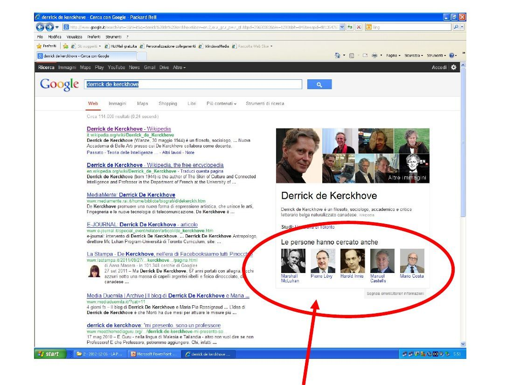{ loading=lazy style="width:52%" }

2:21:00

Questa è l’immagine della campagna elettorale americana, alla fine, quando ha vinto Obama, che festeggia con Harper Reed. Vedete questo giovane così fuori dagli schemi: non è un giovane in giacca e cravatta, tanto per capirsi, è l’alternativo di turno. Questa invece è la struttura, il team che Obama ha utilizzato per la sua campagna elettorale: Harper Reed, Dylan Richard e Mark Trammell. Vedete, hanno un aspetto piuttosto alternativo, da guru, un incrocio tra i nerd, gli hippie e quant’altro.

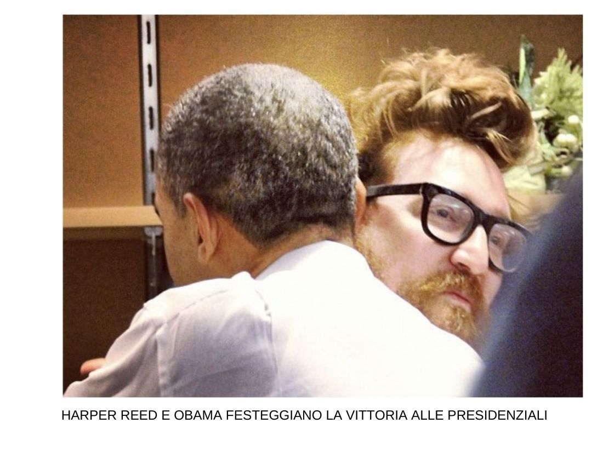{ loading=lazy style="width:47%" }

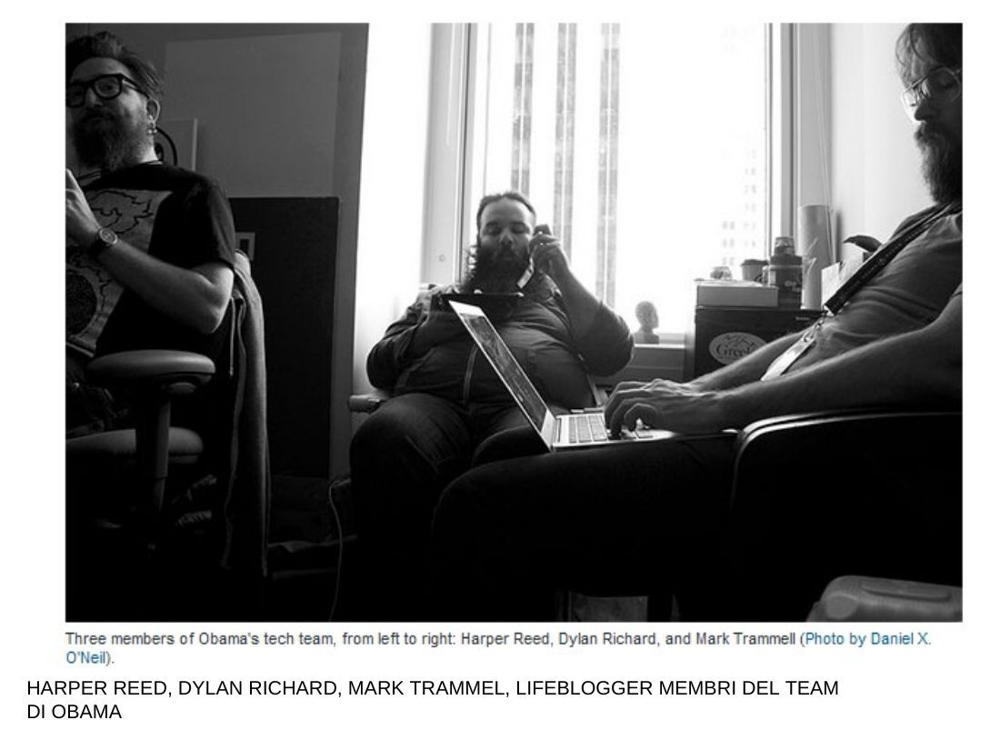{ loading=lazy style="width:47%" }

2:21:49

Allora, cosa hanno fatto con la campagna elettorale di Obama? Hanno fatto un salto di qualità rispetto alla campagna elettorale del 2008, che si era basata molto sui social network, quindi invio di mail ecc. Questa volta hanno studiato a fondo chi erano i possibili elettori. Con la macchina del microtargeting, divisa in tre settori (tecnologia, digitale, analisi dei dati), hanno diviso la popolazione in molti gruppi e hanno analizzato i siti, i comportamenti delle persone, i social network che frequentavano, le mail che facevano e a chi le mandavano, le telefonate. Attraverso il porta a porta sono andati quasi persona per persona, e infatti hanno spedito delle mail non tutte uguali, ma a ciascun gruppo in un certo modo. Questo ha fatto sì che la campagna elettorale di Obama fosse basata sul singolo individuo. Quindi il fine di utilizzare i dati allo scopo di vendere, in quel caso, il prodotto, cioè il voto: dal data mining ci si è avvicinati forse al cyber-stalking.

2:23:02

Analizziamo un attimo le primarie del Partito Democratico: ci interessano da un punto di vista speculativo, più che per il risultato. Ci sono stati alcuni errori che, secondo gli esperti di comunicazione, Matteo Renzi ha fatto. Prima di tutto, era troppo incentrato, ossessivamente, sulla rottamazione. Poi hanno individuato troppe battute, troppi slogan, tanto da sembrare un linguaggio già confezionato in anticipo: una sensazione vaga, a volte effettivamente, di essere eterodiretto. Non entro qui nel merito del contenuto della campagna elettorale, mi limito solo alla parte tecnica.

2:23:47

Però l’errore più grande che gli esperti di comunicazione, del tipo di quelli che abbiamo visto prima per Obama, rimproverano a Renzi, forse l’errore più grave di Matteo Renzi (e forse il più importante di Giorgio Gori), è stato quello di considerare gli elettori del centrosinistra come una massa indistinta. E questa è la differenza sostanziale che c’è stata tra la campagna elettorale di Obama e quella di Matteo Renzi. È un errore importante: gli elettori del centrosinistra probabilmente non vogliono sentirsi trattati come una massa indistinta, ma sono qualcosa di un po’ diverso. Invece il messaggio che lui ha mandato, scambiando forse, per ricordare la celebre battuta di McLuhan, il mezzo con il messaggio, con il fine, è stato quello di considerarli una massa indistinta. E questo non viene amato dal gruppo che in linea di massima vota per il centrosinistra.

2:24:53

Ma veniamo per esempio agli algoritmi della finanza, che possono essere i moderni sciamani. Il tempo è finito nell’economia e nella finanza. Questa non si vede, ma serviva solo per discuterne un po’: è la rappresentazione dell’attivo e del passivo di una banca, di tutto quello che sta dentro il bilancio di una banca, ordinato secondo la scansione temporale delle scadenze. Cioè in questa tabella sono raffigurati tutti i sottostanti che ci sono in una banca: per esempio tutti i nostri mutui, tutti i nostri conti correnti, tutti i nostri libretti di deposito a risparmio ecc., messi nell’attivo e nel passivo. Si parte da quello che è a vista e si arriva fino a oltre vent’anni. Cioè è una rappresentazione schematica di un sottostante che vuol dire la vita di tutti noi, quindi i nostri risparmi o i nostri debiti.

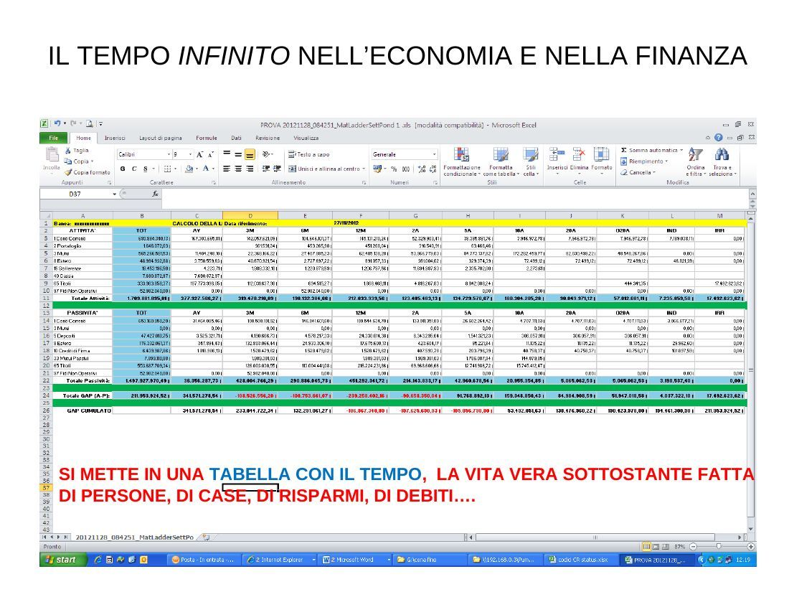{ loading=lazy style="width:52%" }

2:26:07

Allora, nell’ultima parte, in fondo, ci sono due colonne. Ci sono anche delle scadenze cosiddette indeterminate: indeterminato, cioè che non è stato ancora precisato, non è definito con certezza. Quindi anche nel bilancio di una banca ci sono delle poste, dei valori, che non si sa quando arriveranno a fine, perché sono indeterminate per natura. Oppure c’è un’altra colonna, che vuol dire «irredimibile», cioè che non si può riscattare. Quindi anche nel bilancio di una società finanziaria ci sono queste due poste che non si riesce a collocare da un punto di vista formale, perché è la natura stessa della vita dell’uomo che ci porta a non avere una fine precisa. È il caos della nostra vita, che non si riesce in qualche modo a trasmettere.

**SCADENZA INDETERMINATA**

VOCABOLARIO TRECCANI

*Indeterminato* agg. \[dal lat. tardo *indeterminatus*\]. – 1. Non determinato: a. di cosa che non sia stata precisata, definita con esattezza: *la riunione si terrà in luogo ancora indeterminato; rinviare* (o *affidare un incarico, chiudere un esercizio*, ecc.) *a tempo indeterminato*. b. Di quantità di cui non è certo e noto il valore: *un numero indeterminato di anni*. c. Di cosa astratta i cui caratteri non siano ben definiti e precisi: *una proposta troppo indeterminata; parole di senso indeterminato; idee indeterminate*, vaghe, incerte.

**SCADENZA IRREDIMIBILE**

VOCABOLARIO TRECCANI

*Irredimìbile* agg. \[comp. di *in-*² e *redimibile*\]. – Che non si può redimere, riscattare; più esattamente, di un prestito di cui non si può avere il rimborso. È termine usato quasi esclusivamente in finanza, per indicare il debito pubblico consolidato (*prestito i.*) per il quale lo stato non assume l’obbligo del rimborso, impegnandosi soltanto al pagamento di un interesse annuo.

2:27:10

In questo caso invece le banche ricercano la fine, lo scopo a cui accennavamo prima. Allora, quando andiamo a chiedere un prestito, il sistema bancario (faccio una generalizzazione, ma più o meno accade da tutte le parti) ci calcola un rating, cioè ci dà un voto, un giudizio. Il rating che cosa significa? Significa una probabilità di default, cioè entro quanto tempo io morirò, sostanzialmente, perché non riuscirò a ripagare il mio debito.

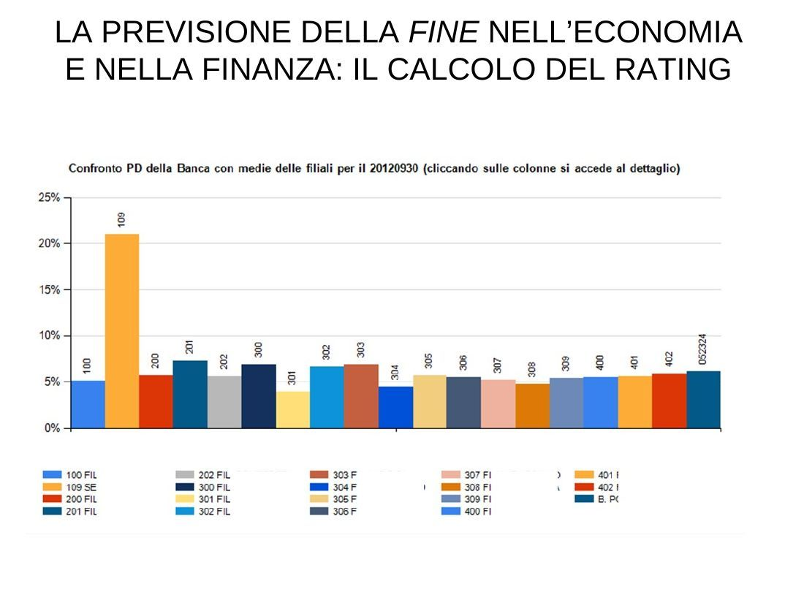{ loading=lazy style="width:59%" }

2:27:54

Questa è una scala di rating: sono 15 classi, e per ogni classe c’è la percentuale precisa di quante di queste persone, di queste aziende andranno a morire perché non riusciranno a ripagare i loro debiti. Si parte dalla classe più bassa, che va dallo 0,1 allo 0,65%, fino all’ultima classe, che parte dal 25% in su. Vuol dire che 25 individui su 100 che rientrano nella classe 15 non riusciranno a sopravvivere e moriranno. Il fine è quello di capire quando la persona o l’azienda morirà, in anticipo: questo in anticipo, non posto.

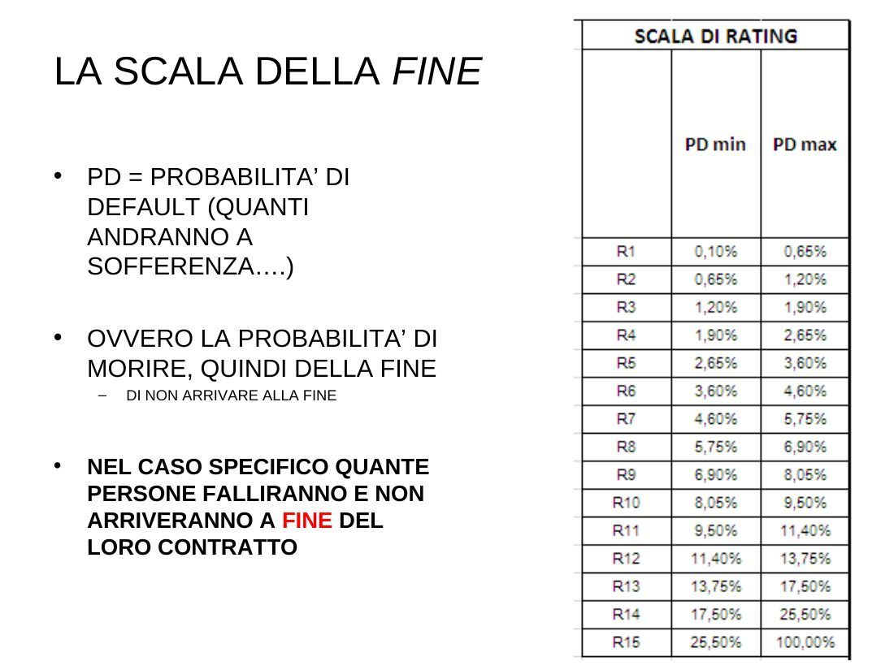{ loading=lazy style="width:59%" }

2:28:41

Eppure è lo stesso obiettivo che dicevamo prima: scegliere, predire la fine o il fine di un individuo è la stessa cosa, perché sono tutti figli dello stesso modello di analisi e di pensiero, che costruisce l’obiettivo leggendo il comportamento. Se mangi male morirai presto (la fine); se non onori i tuoi debiti andrai in fallimento; se leggi o ti comporti in un certo modo voterai per Obama, Renzi, Berlusconi o Bersani (il fine). Lo scopo, alla fine, è quello di leggere tutte le informazioni di una persona per capire quale sarà la sua fine, o al fine di vendergli qualcosa. In questo caso è applicato alla finanza: il fine è capire di queste 100 persone quante moriranno, e sarà quella la percentuale di soldi che io ci rimetterò come istituzione finanziaria. Questa è la previsione di questi algoritmi, quella che vi dicevo prima: per esempio nella classe 9 si varierà tra un 6,90 e un 8,05, vuol dire che 6, 7, 8 persone moriranno in anticipo rispetto alla loro vita naturale.

2:29:54

Questa è la realtà. Allora, la linea blu indica quello che è successo nella realtà, e la linea rossa quello che il modello aveva previsto in anticipo sulla fine. Vedete, le due curve sono estremamente simili, c’è una leggerissima distanza; quindi vuol dire che in qualche modo noi siamo prevedibili, insomma, perché i nostri comportamenti indicano chiaramente la fine che faremo.

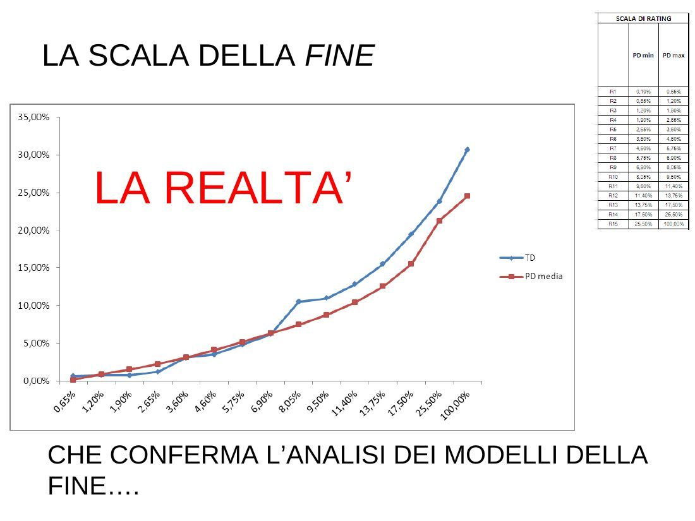{ loading=lazy style="width:48%" }

2:30:28

Lorenzo Poggi In fondo possiamo anche partire da qui per provare a interpretare il nostro tempo e vedere perché tante profezie sulla fine sorgono nel nostro tempo. Intanto un fatto estremamente interessante: abbiamo a disposizione una quantità di informazioni e di materiali quale mai l’umanità ha avuto nelle epoche passate. Ma come mai è successo nelle epoche passate? Questa enorme quantità di informazioni non ha nessun criterio ordinativo, nessun ordine: le informazioni si presentano senza che sia possibile vederle sotto una struttura significante e renderle quindi parte di un tutto.

2:31:44

Allora ci consentono qualsiasi operazione: ognuno di noi può trovare, nell’enorme quantità di dati a disposizione sul web, tutto quello che vuole. Se vuol far apparire gli alieni dalla Montagna Nera vicino a Carcassonne, troverà sicuramente del materiale per dire che lì potrebbero essere, anche perché ci sono delle profezie. Non c’è più un ordine nelle cose, né è possibile trovarlo in questo modo. Non solo: tutto ciò che prevediamo è previsto perché è quantificabile, perché è riducibile a quantità matematizzabili, riducibili quindi a un calcolo, ad algoritmi, come ci faceva vedere prima Paolo.

2:32:37

Questo che cosa ha comportato? Ha comportato un disorientamento dell’individuo nei confronti del mondo contemporaneo. Noi abbiamo ancora una mentalità, un modo di ragionare legato a un certo mondo, a una certa realtà, e ci troviamo invece di fronte a una realtà tecnico-scientifica che supera ampiamente il nostro modo di comprendere.

2:33:16

Pensate a un concetto semplice, visto che parlavamo di elezioni, di primarie: il concetto di democrazia. La democrazia si dovrebbe fondare sulla responsabilità: ciascuno, in modo consapevole e informato, decide, sceglie quale parte politica, quale progetto politico appoggiare. Ma se la tecnica e la scienza sono così distaccate e così avanzate rispetto a noi, come faremo a scegliere in modo consapevole e informato? Come faccio a scegliere in modo consapevole e informato sul mantenimento o meno degli embrioni? Come faccio a scegliere in modo consapevole e informato se l’energia atomica è benefica o malefica? Come faccio a capirlo, se non sono uno scienziato o un biologo, se non ho conoscenze?

2:34:29

Allora dovrò scegliere secondo che cosa? L’apparenza, l’informazione, la simpatia. E l’apparenza, l’informazione e la simpatia si misurano con le statistiche, si misurano su questo aspetto. Quando il mondo era ancora controllabile, quando l’accesso era ancora possibile, si poteva parlare di informazione e di reale esercizio della democrazia, che andava al di là dell’immediatezza.

2:35:08

Così come l’elaborazione culturale: le emozioni sono di tutti, ma si trasformano in sentimenti quando sono elaborate culturalmente. Per elaborare culturalmente le emozioni occorre una trasmissione che non è solo trasmissione di informazioni, ma è trasmissione a sua volta di una visione condivisa del mondo. Nei paesi avanzati ci si sta battendo sempre di più per una scuola che trasmetta sempre più informazioni, sempre più competenze, sempre meno formazione. Di formazione non ne parla più nessuno, e si misura la riuscita sulle competenze acquisite.

2:36:04

Quindi sarà difficile avere poi uomini adulti che riescano a controllare la propria esistenza, perché riescono a trasformare le emozioni immediate che vengono dall’esistenza (cioè il dolore, il fallimento, il non riuscire, tutte quelle cose che capitano nella vita) da emozioni immediate in sentimenti che fanno parte del nostro essere, ma che ci consentono anche di affrontarle. Se non riusciamo a fare questa operazione, non la potremo risolvere in altro modo, perché non possiamo più ricorrere a un’immagine finalistica del mondo, come era quella quando c’erano Dio e la religione, che legavano tutto a un valore naturale esistente.

2:36:59

Infatti quelli che vogliono prendere le decisioni se sia lecito o no interrompere la vita, l’esistenza, quando questa non… a che cosa si rifanno? A un valore eterno: la natura. Quelli che dicono «Ma è lecito il matrimonio fra due dello stesso sesso?» «Non è lecito, perché va contro…». Allora esiste un valore assoluto, vedete: o ci rifacciamo ai valori assoluti, ma abbiamo detto che sono passati di moda, e giustamente sono passati di moda (Nietzsche diceva che Dio era morto, no?), e allora che cosa è rimasto? È rimasta la necessità di disegnare di nuovo il nostro schema, la nostra visione della vita, che non può essere semplicemente quella della constatazione quantitativa di quanti e per quanto tempo hanno letto quella pagina del libro. Ci vuole qualche cosa di più.

2:38:09

In fondo questa è la nostra condizione, dobbiamo riflettere in fondo su questo. Questo è il punto, no? Che ci mette di fronte a questi problemi. Questi pensavano alla fine del mondo e pensavano che finalmente si sarebbe risolto tutto.

2:38:33

Abbiamo indicazioni. Il nostro amico filosofo contemporaneo ha detto che la nostra condizione è simile a quella del trapezista. I trapezisti al circo, no? Vanno con il trapezio a una certa altezza, poi lasciano il trapezio che li ha portati, si girano e afferrano l’altro trapezio, che gli è stato lanciato da un compagno dall’altra parte. E c’è un attimo, no? Nel momento in cui si girano, hanno lasciato il vecchio trapezio e non hanno ancora afferrato il nuovo. Loro hanno la rete; noi la rete non ce l’abbiamo: siamo in questo punto di passaggio. Chissà quale trapezio afferreremo.

2:39:19

Quindi le profezie sulla fine, e ce ne sono moltissime, vengono fuori da questo, da questa esigenza di dare un fine e una fine di fronte a un mondo che ci dice: siamo diventati noi i possessori dell’evoluzione. Perché di fini del mondo ce ne sono state tante: i dinosauri hanno visto la fine del mondo, e l’evoluzione è andata avanti. Sembra però che l’uomo abbia preso in mano l’evoluzione, e quindi siamo responsabili del futuro del pianeta. Ma non abbiamo dei principi, dei valori. Perché la tecnica e la ricerca scientifica sono avaloriali, da questo punto di vista. È un discorso che faremo nei prossimi 25 anni.

2:40:12

Però il punto è questo: ecco perché sorgono, più che in altri tempi, nel nostro tempo queste profezie della fine, che tentano in qualche modo di rimettere a posto le cose. Ma sono tutte profezie della fine destinate in fondo a lasciare il tempo che trovano, perché non si agganciano più a una visione globale della cultura che le possa giustificare. Ormai anche la fine del mondo è finita. Abbiamo finito anche qui.

2:40:49

Giuseppe Gioachino Belli diceva che fra tutte le reliquie quella importante è il pezzetto di vita eterna. Perché da una parte c’è un boccione con un pezzetto. E tra tutte le reliquie c’era il latte munto alla Madonna, che è sempre fresco in un boccione di vetro; ci sono du’ parmi de mezzo de le crisse der Carvario; e c’è un po’ de vita eterna pe’ fa’ er lievito, in caso che finisse. Non è che possa finire: siamo in questa condizione.

2:41:22

E mi piacerebbe finire questo discorso sulla fine del mondo: necessario, perché così daremmo un fine al mondo e uno scopo riconosciuto all’esistenza, secondo il vecchio tipo di ragionamento. Cosa che non riusciamo a fare: ci dobbiamo accontentare di queste fini estemporanee, che nascono da un po’ e poi ricordo. Però mi piacerebbe finire con un sonetto (se me lo avete sentito) di un grande poeta, Giuseppe Gioachino Belli, che ci fa la più bella ripresa della fine del mondo:

*«Quattro angioloni co’ le trombe in bocca*

*se metteranno uno pe’ cantone*

*a sonà; poi co’ tanto de vocione*

*cominceranno a dì: “Sotto a chi tocca”.*

*Allora verrà su una filastrocca*

*de schertri da la terra a pecorone,*

*pe’ ripijà figura de persone,*

*come purcini intorno de la biocca.*

*E sta biocca sarà Dio benedetto,*

*che ne farà du’ parte, bianca e nera:*

*una pe’ annà in cantina, una sur tetto.*

*All’urtimo uscirà ’na sonajera*

*d’angeli, e come si s’annassi a letto,*

*smorzeranno li lumi, e bona sera.»*

2:43:00

Paolo Marcucci Bene, abbiamo concluso: l’occasione per farvi gli auguri. Grazie di essere intervenuti. Alla prossima volta. Grazie.

