# L’Occidente

Identità dell’Occidente. L’ombra, il tramonto sono nel nome,  sono anche il carattere della nostra cultura

**Data:** 31 gennaio 2013 
**Luogo:** Museo della Ceramica, Montelupo 
**Incontro con:** Lorenzo Poggi e Paolo Marcucci

**Interventi:** Paolo Marcucci Lorenzo Poggi Pubblico

0:01:30

Paolo Marcucci Buonasera a tutti, grazie di essere venuti. Iniziamo questa nostra serata. Stasera parliamo dell’Occidente, quindi il tema è piuttosto vasto. Possiamo dire, iniziando, che l’Occidente si è imposto prevalentemente a livello mondiale negli ultimi paio di secoli.

0:02:28

Per tornare all’attualità, direi che la globalizzazione, che è nata all’interno dell’Occidente, rischia già di minare questa egemonia che si è creata negli ultimi due o tre secoli. Abbiamo visto l’altra volta, nella serata sulla fine, che non sempre è stato così, e che le cose non sarebbero potute andare sempre come sono andate. Abbiamo citato l’altra volta Edward Gibbon, uno storico inglese, che citava la battaglia di Poitiers, nel 732, dicendo che, se fosse andata diversamente, probabilmente al posto dell’economia all’Università di Oxford sarebbe stato insegnato il Corano.

**LA CIVILTÀ DELL’OCCIDENTE**

Edward Gibbon a proposito degli scenari dopo la caduta dell’Impero romano: «se i mori non fossero stati sconfitti a Poitiers nel 732, forse oggi l’interpretazione del Corano sarebbe insegnata nelle aule di Oxford, e i nostri pulpiti sarebbero calcati da chi predica la santa verità della rivelazione di Maometto».

Edward Gibbon (1737-1794), storico inglese, fu anche membro del parlamento. Famosa la sua *The History of the Decline and Fall of the Roman Empire*.

0:03:22

I macroargomenti di stasera sono questi: un’introduzione, dove tratteremo la religione e la nascita dello spirito occidentale; poi la prima parte, con la pittura, la scoperta medievale, con l’introduzione dei principali principi economici occidentali; e la seconda parte, l’interpretazione protestante dell’Occidente. Naturalmente tutto questo sarà attraversato trasversalmente da una visione della filosofia che narra l’Occidente, dal nostro maestro Lorenzo, che è con noi stasera. Vi racconto che gli avevo detto che stasera l’avrei chiamato maestro, ma non voleva.

0:04:16

Lorenzo Poggi E da tanto il sostegno: non sono maestro, sono uno studente di filosofia. Lui mi chiama maestro, facciamo un passo dai guru, e non mi va bene.

0:04:31

Paolo Marcucci Allora, dicevo, l’argomento è vastissimo. Personalmente, quando ho iniziato a pensare a questa serata, mi sono trovato un po’ in difficoltà, perché la selezione è già difficile. Quindi ho fatto lo schema di questa serata con un approccio del cuore. Per questo vorrei iniziare con una canzone, se riesco a farvela sentire, perché non abbiamo un grande impianto stereofonico. Provo a farvela sentire. La canzone si chiama *Hallelujah*; l’interprete è Jeff Buckley, che è un figlio d’arte, perché suo padre era un musicista rock piuttosto famoso negli anni Sessanta e Settanta, Tim Buckley. Si chiama *Hallelujah*, questa canzone: due minuti e ve la faccio sentire. Si sente?

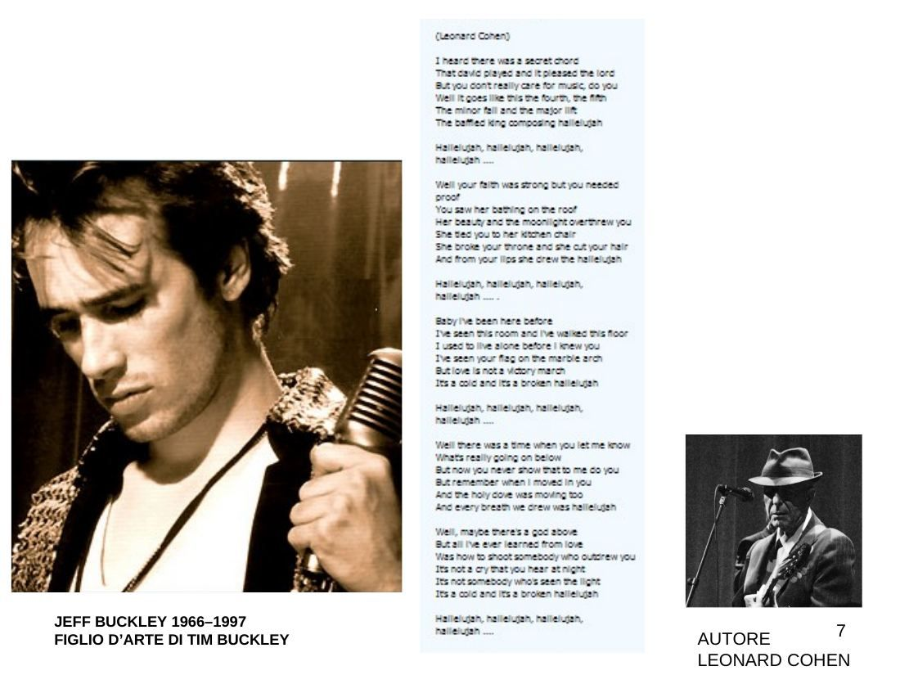{ loading=lazy style="width:59%" }

0:06:05

\[Ascolto della canzone *Hallelujah* nell’interpretazione di Jeff Buckley.\]
{: .nota }

**HALLELUJAH**

Artista: Jeff Buckley (1966-1997), figlio d’arte di Tim Buckley – autore: Leonard Cohen

La canzone contiene molti riferimenti ai testi biblici dell’Antico Testamento.

Buckley modifica alcune piccole parti rispetto alla versione originaria di Cohen, quelle legate alla redenzione; per il resto reinterpreta l’esecuzione.

Il rock si ispira a suo modo al tema, ma ne dà come sempre una sua particolare interpretazione: struggente, in questo caso.

Durante un’intervista Buckley dichiarò che «chiunque ascolti chiaramente *Hallelujah* scoprirà che è una canzone che parla di sesso, di amore, della vita sulla terra. L’Alleluia non è un omaggio a una persona adorata, a un idolo o a Dio, ma è l’Alleluia dell’orgasmo. È un’ode alla vita e all’amore».

0:10:20

La canzone, che prende il nome da *alleluia*, si rifà a un tema che viene da questa parola, che deriva dall’ebraico e vuol dire «lodate Yah», dove Yah è la forma abbreviata di Yahweh, Dio. La parola fu usata nella Bibbia ebraica e anche nel libro dell’Apocalisse. È interessante notare che qui parliamo sostanzialmente di oltre 3000 anni fa, ed è arrivata fino a noi attraverso il rock; e il rock ne dà un’interpretazione sua, particolare, in questo caso secondo me struggente, che ci fa navigare in qualche modo con questa canzone, però ci fa capire anche qual è il peso di certi miti e di certi simboli, e ci porta al ceppo ebraico e cristiano che è un po’ all’origine della nostra civiltà occidentale.

**HALLELUJAH**

Alleluia è composto da *hallelu* e *Yah*: dall’ebraico «lodate Yah!», dove Yah è la forma abbreviata di Yahweh, Dio.

La parola fu usata sia nella Bibbia ebraica sia nel libro dell’Apocalisse.

Alleluia è forse la parola più felice e gioiosa per esprimere la lode e l’acclamazione di Dio.

Quindi, dall’abisso del tempo, è arrivata a noi in una versione rock (la musica occidentale moderna per eccellenza…).

Questo ci fa capire il peso e l’influenza di certa simbologia.

0:11:27

Per aiutare in questo vorrei farvi vedere tre mappe tratte da questo libro, *Cartografie del tempo*, di Daniel Rosenberg e Anthony Grafton (Einaudi), che riprende l’*Historical Atlas* di Edward Quin del 1828, e che ci fa vedere la sequenza di come il mondo occidentale si è piano piano conosciuto. Qui siamo nel 1491 a.C., l’esodo del popolo di Israele: vedete, il nero di questa immagine rappresenta il mondo per intero, e quello che vedete un po’ sfocato è il mondo che si conosceva al tempo, nel 1491 a.C. Qui siamo al 323 a.C., morte di Alessandro Magno: vedete che la macchia bianca si è allargata, e quindi il mondo occidentale comincia ad allargarsi. Qua siamo nel 337 d.C., alla morte di Costantino, e vedete che c’è già una bella fetta di territorio, molta Europa e anche tutto il sud-est asiatico. Questo per dire che noi proveniamo da quel ceppo lì, da quel mondo lì, e *Hallelujah* appunto proviene da quei territori lì.

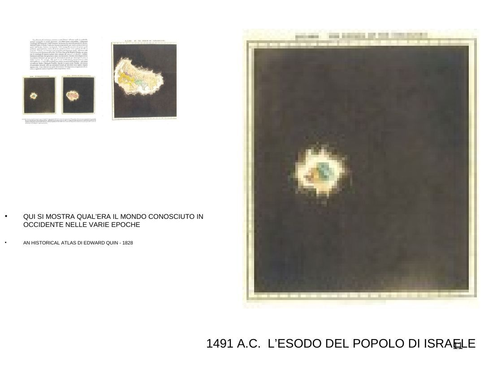{ loading=lazy style="width:30%" }

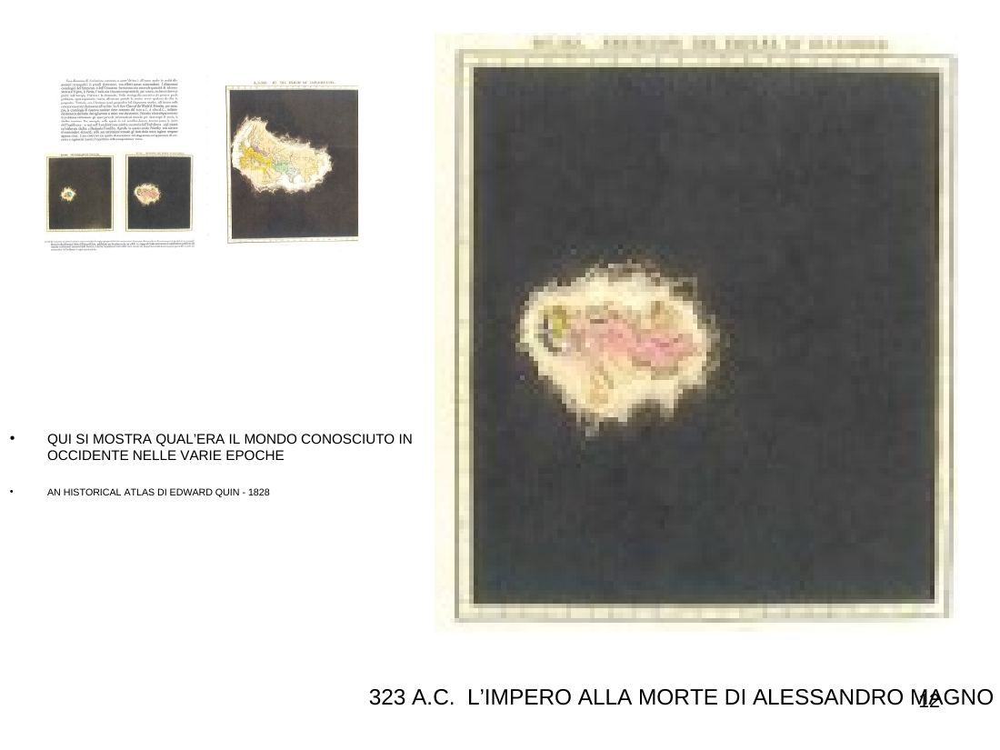{ loading=lazy style="width:30%" }

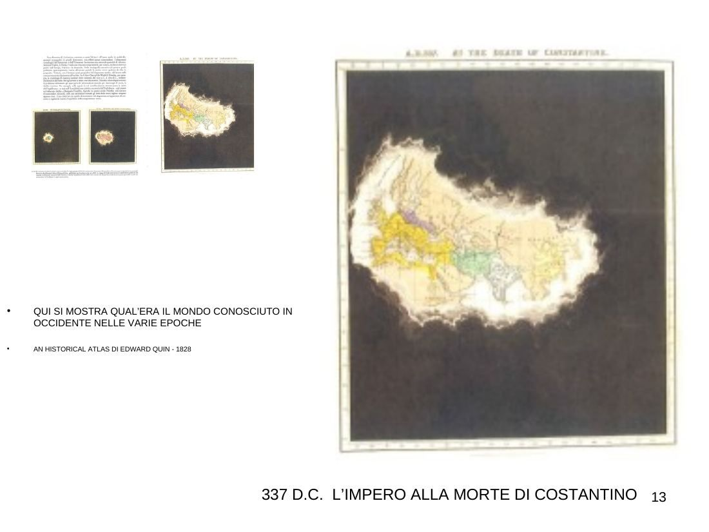{ loading=lazy style="width:30%" }

0:12:46

*Hallelujah* ci porta al mondo ebraico. È il popolo eterno: loro si ritengono il popolo eterno perché, nonostante tutto quello che è successo nel mondo, loro ci sono sempre; e considerano gli altri popoli, per esempio, una specie di Assiria o di Babilonia: Roma è crollata, anche l’America è considerata in questo modo; loro invece si ritengono eterni. Se vediamo una mappa degli imperi che si sono succeduti (in questo caso questa mappa parte dal 500 a.C. e arriva al 2000 d.C.), vediamo, dall’impero persiano all’impero britannico, e poi ci sono stati gli spagnoli, i portoghesi ecc.: vuol dire che gli imperi cadono.

**IL POPOLO ETERNO**

Sinteticamente si può dire che Israele si considera il popolo eterno.

E l’America, con tutto il rispetto, è una specie di Assiria o di Babilonia, di Grecia o di Roma dei giorni nostri, che prima o poi scomparirà.

Israele si considera invece destinato a rimanere, mentre gli altri, nonostante il potere, sono momentanei, transitori.

L’agonia delle varie civiltà, fisiologica nello scorrere del tempo storico, non viene presa in considerazione da Israele.

Anche se c’è chi ha detto che, se sei stato un impero, non finisci mai di esserlo: basta guardare a volte al comportamento della Francia o dell’Inghilterra («Corriere della Sera», 5 agosto 2012).

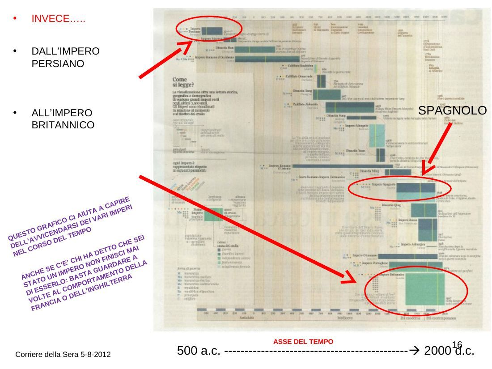{ loading=lazy style="width:59%" }

0:13:47

Invece il popolo eterno, gli ebrei, di cui noi siamo parte (sostanzialmente è il nostro ceppo, lo stesso ceppo), sanno sopravvivere in questo mondo difficile. L’altra sera, per esempio, nel discorso sulla fine, abbiamo visto l’apocalittica, i discorsi sull’apocalittica, che sono alla base della distruzione del Tempio di Gerusalemme: quindi sono abituati a sopravvivere a questa crudeltà del mondo e alla barbarie del mondo. Questo ci fa capire un po’ quale sia il nostro bagaglio culturale e religioso, che è un po’ quello che abbiamo ereditato e che ci portiamo dietro.

**IL POPOLO ETERNO**

Gli altri popoli sono motivati da considerazioni politiche ed economiche limitate e immediate (prezzo del petrolio, elezioni…).

Gli altri credono che i nemici ragionino in maniera razionale, mentre Israele pensa che il popolo di Israele già da 4.000 anni affronta le forze più cruente e gli istinti umani più incontrollati e oscuri della storia.

«E sappiamo bene come comportarci per sopravvivere in queste zone d’ombra» (David Grossman, *«la Repubblica»*, 3 agosto 2012).

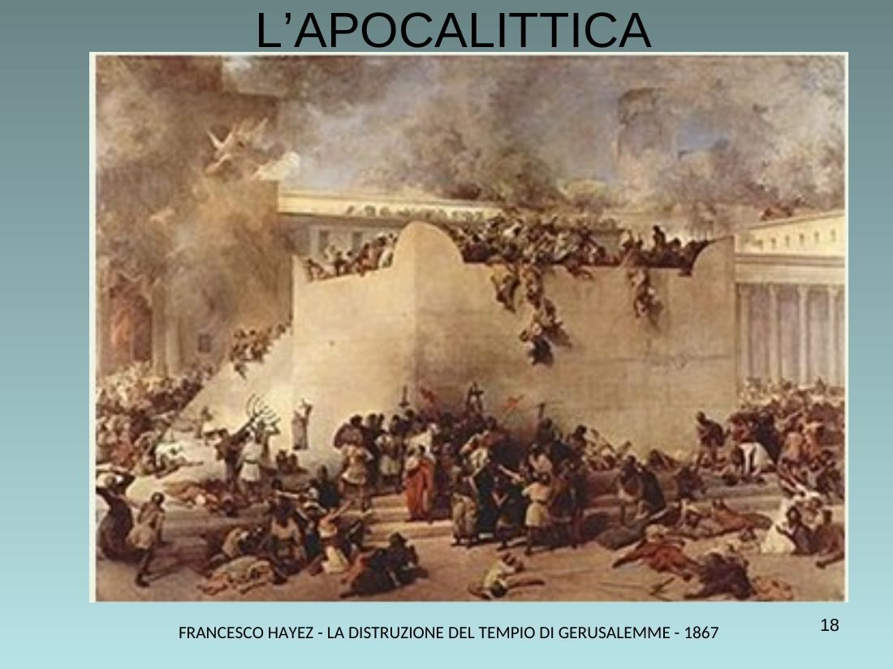{ loading=lazy style="width:59%" }

0:14:47

Abbiamo visto la canzone rock, ma questo si abbina bene, per esempio, anche alla simbologia delle monete. Voi sapete che c’è stata negli ultimi 4-5 anni una grande polemica, soprattutto da parte italiana, sulla Carta costituzionale europea, che ha stabilito quali sono le radici dell’Europa. Secondo me forse anche giustamente, per non andare incontro a problemi moderni, religiosi (sappiamo quanto sia difficile la convivenza religiosa all’interno delle comunità), abbiamo stabilito in Europa una Carta laicista.

Questo però non significa che non si possa anche pensare o riflettere diversamente. Per esempio la rivista cattolica *Zetesis* interviene su questa querelle europea e dice: l’identità culturale europea è definita da elementi che non sono quelli delle radici cristiane; cioè le radici cristiane, l’eredità greco-romana, la definizione di democrazia tratta da Tucidide sono state eliminate dal preambolo; e l’immagine, sostiene la rivista cattolica, è quella di un’Europa senza passione culturale, o di un’Europa giacobina che ritiene di trovare la linfa dei suoi valori solo nell’Illuminismo e nelle parole d’ordine della Rivoluzione francese. «Certo è un’Europa con un respiro culturale assai modesto, è un’Europa di mercanti e banchieri»; e un po’ d’accordo si può anche essere.

**LA POLEMICA SULLA CARTA EUROPEA**

Forse giustamente, per non andare incontro a problemi moderni religiosi, si è scelta una versione più laicista della carta costituzionale.

*Zetesis*, rivista cattolica: *La querelle della costituzione europea* (www.rivistazetesis.it/costituzione\_europea.htm).

«La nuova costituzione europea ha dimenticato gli elementi più preziosi e prestigiosi dell’identità culturale europea, gli elementi che definiscono l’Europa come tale: le radici cristiane e l’eredità greco-romana (la definizione di democrazia tratta da Tucidide è stata eliminata dal preambolo)… non vogliamo commentare questa decisione: è difficile dire se quella che emerge da questo lungo travaglio, frutto di compromessi tra spinte contrastanti, è l’immagine di un’Europa senza passione culturale o di un’Europa giacobina che ritiene di trovare la linfa dei suoi valori solo nell’Illuminismo e nelle parole d’ordine della Rivoluzione francese. Certo è un’Europa con un respiro culturale assai modesto, è un’Europa di mercanti e di banchieri, e (con tutto il rispetto per queste categorie, che pure hanno avuto delle benemerenze di fronte alla storia) questo non ci basta. Torneremo sulla questione in modo più ponderato nei prossimi numeri di *Zetesis*».

0:16:38

Mi pareva interessante a questo fine anche il ragionamento che fa Paolo Mieli, ex direttore del Corriere della Sera, rispondendo alla lettera di un suo lettore su questo argomento. Lui cita una studiosa, Marta Sordi, che ha spiegato che l’Europa, quando respinge le radici cristiane, non rifiuta una fede, ma Roma stessa, ossia l’humanitas, la ragione, la natura. «L’esercito romano», dice la studiosa citata poi da Mieli, «non fu mai l’orda di Gengis Khan, non fu la mera violenza, ma la sentinella armata dello spazio giuridico che creava». Questo è importantissimo per lo spirito occidentale.

**LA POLEMICA SULLA CARTA EUROPEA**

«In occasione della firma a Roma del trattato costituzionale europeo, lei, caro Mieli, ha scritto che l’Europa ha un grande problema con la propria storia. Tra le righe mi è parso che lei si riferisse alla questione del mancato inserimento in quella carta delle radici giudaico-cristiane». (Francesco Mengoni, Ascoli Piceno)

«Caro signor Mengoni, perché quell’omaggio – ma sarebbe più giusto definirlo riconoscimento – è a Roma più che alla Chiesa. In un’intervista di qualche giorno fa ad *Avvenire*, la grande studiosa dell’antichità greca e romana Marta Sordi ha spiegato che l’Europa, quando respinge le radici cristiane, non rifiuta una fede, ma Roma, ossia l’*humanitas*, la ragione, la natura. Ricordava poi la stessa Marta Sordi che l’esercito romano non fu mai l’orda di Gengis Khan, la mera violenza, ma la sentinella armata dello spazio giuridico che creava. E vi chiamava tutti i popoli, con un’enorme apertura politica e culturale che è passata alla Chiesa» (…). Paolo Mieli (ex direttore del «Corriere della Sera»)

0:17:34

Allora, veniamo alle monete. Per esempio, qualche tempo fa la Slovacchia, che fa parte della zona euro, per celebrare il 1150° anniversario della missione di Cirillo e Metodio in quei paesi, aveva coniato questa moneta che vedete sulla destra, con il lato destro e il lato sinistro, dove ci sono le effigi di questi due santi. Sono i santi che, insieme al cristianesimo, portarono agli slavi in quelle zone gli alfabeti e l’idea del diritto romano: sostanzialmente la cultura occidentale. La Commissione europea ha detto no perché, rifacendosi alla Carta europea che abbiamo citato prima, non tollera i simboli religiosi nelle immagini delle monete; e quindi, citando l’articolo 22 del trattato, ha detto no a questa moneta.

C’è stata una grande battaglia a livello europeo; alla fine Bratislava, la Slovacchia, ha vinto e potrà coniare le monete con l’effigie dei due santi: è l’unico caso in Europa in cui ci sono dei santi effigiati su una moneta dell’euro.

**LA POLEMICA SULLA CARTA EUROPEA**

Bruxelles e qualche Stato membro dell’UE con manie laiciste hanno bocciato la moneta da 2 euro che la Slovacchia era pronta a coniare nel 2013.

A Bratislava, in occasione del 1150° anniversario della missione di Cirillo e Metodio, che insieme al cristianesimo portarono agli slavi gli alfabeti, l’idea del diritto romano, insomma la cultura occidentale.

La bozza iniziale prevedeva l’effigie dei monaci, simbolo dell’Europa slava cristiana, con le aureole e l’abito talare ricoperto da grandi croci: una copia dell’immagine che viene tramandata da secoli.

La puntigliosa Commissione europea ha detto «Niet», chiedendo alla Slovacchia «di rimuovere i simboli religiosi» dalle monete, più precisamente «le aureole e le croci dai loro abiti».

Un cambiamento indispensabile, per Bruxelles e qualche Stato membro non ben identificato, per riportare i 2 euro slovacchi «al principio del rispetto della diversità religiosa, come prescrive l’articolo 22 della Carta dei diritti fondamentali dell’UE».

Alla fine ha vinto Bratislava, che potrà coniare le monete con l’effigie dei due santi (17 dicembre 2012).

0:19:11

Vediamo il significato della parola «Occidente», che è un po’ alla base del sottotitolo di questa sera: l’ombra e il tramonto sono nel nome, e anche nel carattere della nostra cultura. È un argomento che in qualche modo abbiamo già brevemente introdotto nella scorsa serata: per esempio abbiamo visto i cavalieri dell’Apocalisse, citati da questo filosofo sulla sinistra, Slavoj Žižek, oppure le *Icone della fine* di Andrea Tagliapietra. Quindi la fine è un po’ insita nel nome: infatti la parola *Occidente* viene da *occidentem*, da *occidere* (= *ob-cidere*), che vuol dire tramontare, cadere.

0:20:00

Tramontare, cadere: la decadenza stessa è il concetto stesso di Occidente. Però, siccome il sottotitolo è opera del nostro maestro Lorenzo, credo sia interessante sentire la sua introduzione.

0:20:16

Lorenzo Poggi Grazie. Vi ringrazio di nuovo di essere qui stasera a parlare di queste cose. Qual è l’elemento conduttore comune che lega insieme questi argomenti che Paolo stava esponendo? In che cosa consiste lo spirito dell’Occidente, se c’è, l’identità occidentale? Se guardiamo bene, fin dal primo avvio della filosofia, quando si esce dal mito, troviamo un’attenzione particolare che hanno i nostri filosofi per la razionalità, intesa come stabilire ciò che non muta: cercare alle istanze dell’esistenza, al dolore dell’esistere, una risposta che non sia una risposta mitica. Il mito già c’era, ma il mito non basta perché la risposta sia convincente: cercano una risposta certa, razionale.

0:21:32

E per essere una risposta certa e razionale, questa risposta deve essere una risposta che non cambia, che non muta, che rimane, che sta di per sé. E perché rimanga, non muti, stia di per sé, sia certa, bisogna che questa risposta non tenga conto di tutti quegli elementi che invece sono mutabili, che si trasformano nel tempo, che sono soggetti a mutamento. Per farla corta e ricordare le cose, Platone dice che la verità è nell’astrazione della matematica e della geometria: non entri nell’Accademia, nella scuola di Platone, nessuno che non sappia di geometria e di matematica.

0:22:26

Che cosa sono la geometria e la matematica? Sono un astrarre dalla percezione degli oggetti, dal corpo, dalla nostra umanità concreta, e un rapportarsi al mondo simbolicamente attraverso l’astrazione, la perfezione della forma che non muta. Fare astrazione dal corpo: ciò che è legato al corpo è legato alla crescita, al mutare, al deperimento, alla morte. Bisogna invece fondare la certezza, perché ci assicuri contro i mali dell’esistenza, su ciò che non diviene, su ciò che non muta; e ciò che non muta sono le idee e i simboli astratti delle matematiche.

0:23:29

Quindi è un concetto che passa oltre la cosa che non c’è, non voglio fare: è fondamentale, rimane, è un carattere profondo dell’Occidente. Mentre l’Oriente, anche nei suoi poeti e nei suoi uomini di cultura, parla ancora del mondo citando gli oggetti con l’aggettivo che li caratterizza: l’albero della luce, l’albero dei fiori rosa, l’albero… Noi in Occidente abbiamo solo l’albero, che vale per tutti, che astrae dal singolo pino, dal singolo susino, ma certamente è all’albe. Così si astrae dal singolo oggetto e rimane la forma, il triangolo. Il triangolo non esiste, nessuno ha mai visto un triangolo: il triangolo è un’idea, ma è un’idea che permette di rapportarsi al mondo e di dare ordine a tutto ciò che in qualche modo è triangolare. Serve a rendere certa anche la bellezza.

0:25:10

Quando Zeus è giovane, che cosa fa? Affronta il padre Crono, che uccideva i figli. Crono uccide i figli perché è il tempo che distrugge le cose che divengono. Come arrestare il tempo che distrugge le cose? Come uccidere Crono? Giove lo uccide, lo evira, e ha con sé Apollo, che è il Dio dell’armonia, della proporzione, della relazione armonica fra le note, della musica, anche di ciò che non muta.

0:25:57

Allora, per farla breve, sennò potrebbe essere troppo lungo e stancante: dicevo, questo è il carattere dell’Occidente, questo passare oltre la percezione, oltre l’immediatezza del mondo percepito, per andare a cogliere ciò che non muta, ciò che non diviene. E questo che non muta e non diviene, che deve assicurarci contro il dolore, contro la morte, contro tutti gli aspetti spiacevoli dell’esistenza, deve essere qualcosa che attingiamo in qualche modo attraverso la razionalità, che deve essere certo per tutti. Dobbiamo togliere il nostro soggetto: non è un’opinione quello che diciamo, perché se fosse opinione sarebbe legata ai nostri gusti, alle nostre emozioni, al momento in cui lo diciamo; è qualche cosa che deve essere razionalità, idee.

0:27:01

Tutto questo va avanti e caratterizza l’Occidente. Abbiamo già visto la distinzione rispetto all’Oriente, che invece mantiene una parte della concretezza dell’oggetto, dell’impossibilità di riassumerlo sotto un unico segno simbolico. Questo va avanti e arriva fino alla profondità del nostro tempo. Facciamo un salto così, diciamo, mortale, mi capite. Parlava prima Paolo dell’economia. Ma l’economia, quando sorge, sorge come capacità di dare valore agli oggetti relazionandoli tutti a un unico valore, che è quello del denaro. Gli oggetti con la loro concretezza, con il loro valore legato alla nostra umanità (cibo, oggetti che creano in noi emozioni, che hanno un valore legato alla vita, oggetti d’uso) diventano semplicemente valori di mercato, diventano semplicemente monetizzabili. Ciò che è mondo concreto e vita è riassunto nell’astrazione del valore economico.

0:28:39

A fondamento dell’economia c’è lo stesso principio che è a fondamento della conoscenza platonica; e a fondamento della forma dell’economia contemporanea, del capitalismo moderno, c’è la medesima forma. Marx (ho citato Marx, è una cosa terribile, tremenda) dice: giro per Londra e vedo che nelle vetrine ci sono i frutti della terra, gli oggetti d’uso domestico, i revolver americani (già nel 1848, revolver eccezionali), e tutte queste cose diversissime, di valore diversissimo, hanno tutte un’anima che le fa uguali: il cartellino del prezzo.

0:29:50

La loro anima, il loro valore: non c’è più bisogno di passare attraverso gli uomini, perché gli uomini non sono più da considerare nella loro individualità. Gli uomini esistono in quanto portatori di un rapporto economico, portatori di un contratto. E il capitalismo è la generalizzazione dell’economia sotto forma di contratti. Scompaiono i valori d’uso e i valori degli uomini, e sono ridotti tutti alla forma del rapporto economico. Ed è una razionalizzazione: è applicare alla vita come distribuzione di beni, all’economia, lo stesso principio che abbiamo visto essere a fondamento della filosofia. Il prescindere dalla concretezza, dall’immediatezza dell’oggetto, per assumerlo in modo da poterlo simbolizzare, adoperare e renderlo atto a strutturare la nostra conoscenza è invariabile: è questo, nello stesso modo.

0:31:30

Quindi che cos’è che caratterizza l’Occidente? Ormai è questa forma di intendere il rapporto e l’economia. Il capitalismo moderno, l’economia moderna, globalizzata, è quella che domina il mondo, che si impone nel mondo, e spesso suscita anche delle obiezioni, perché porta costumi, modi di rapportarsi, relazioni che i popoli sottoposti a questa modernizzazione, a questa globalizzazione, non sempre tollerano, perché la sentono come un’invasione, come la distruzione di quelle che erano le loro relazioni.

0:32:25

Un’ultima cosa. Pensate al mutamento: Paolo accennava al passaggio tra il pensiero antico e quello moderno. In questo interverrà anche la religione, il cristianesimo, che introdurrà un altro elemento fondamentale, di cui parleremo dopo, sennò non si mangia. Però pensate, questo è già estremamente interessante: c’è questo passaggio. Oggi in effetti questo modo di intendere è diffuso: questo fare astrazione, questo simbolizzare sotto un unico segno. Si sono così eliminate le guerre di religione: quando le guerre di religione diventano guerre economiche, hanno questo elemento matematico che le controlla. Quando fare la guerra diventa più oneroso, fa spendere di più di quanto la guerra vinta renderebbe, l’economia si ferma; le guerre di religione invece no, arrivano alla distruzione totale.

0:33:53

La razionalizzazione da questo punto di vista è stata anche un vantaggio per l’umanità. L’Europa esce dalle guerre di religione perché a un certo punto ci si rende conto che, andando avanti di quel passo, l’Europa sarebbe stata completamente distrutta: ormai la guerra, con i cannoni, con i mezzi necessari, non si fa se non alle dipendenze dell’economia, e l’economia a un certo punto dice basta. Se fate una guerra di religione, invece no, non c’è fine. Da un certo punto di vista la razionalizzazione è stata un vantaggio, se lo vogliamo dire così; ma è stata di nuovo quello che dicevamo prima: un togliere quello che era umano, partecipato, parte del mondo della vita, come è anche una fede religiosa, e ridurlo a calcolo economico. Il capitalismo non è *ethos*, è sistema, è un’altra cosa. Arrestiamoci un minuto, poi vediamo come si modifica la cosa.

\[PAUSA\]
{: .nota }

0:57:30

Paolo Marcucci Bene, ripartiamo con la prima parte, dopo l’introduzione.

0:58:00

Prima di affrontare l’idea di Occidente venuta fuori dalla Carta costituzionale europea, che un po’ ci guida ora, in questo momento, e prima di affrontare un po’ la rivendicazione della proprietà intellettuale, culturale, del capitalismo occidentale, a cui ha brevemente accennato prima Lorenzo, vorrei provare a definire ancora un po’ meglio il concetto di Occidente. È uscito l’anno scorso un libro di Flavio Caroli, *Il volto dell’Occidente*. Sono andato a vederlo perché mi interessava, visto l’argomento di stasera. È abbastanza interessante, forse un po’ furbo come libro, però è interessante la sintesi che ha fatto. Presenta troppo l’ultima parte della cultura occidentale: infatti parte da Van Gogh, del 1889, e arriva ad Andy Warhol, nel 1963; nel mezzo ci sono Kandinsky, Carrà, Balla, che abbiamo visto a Milano, per chi è venuto al Museo del Novecento un paio di settimane fa.

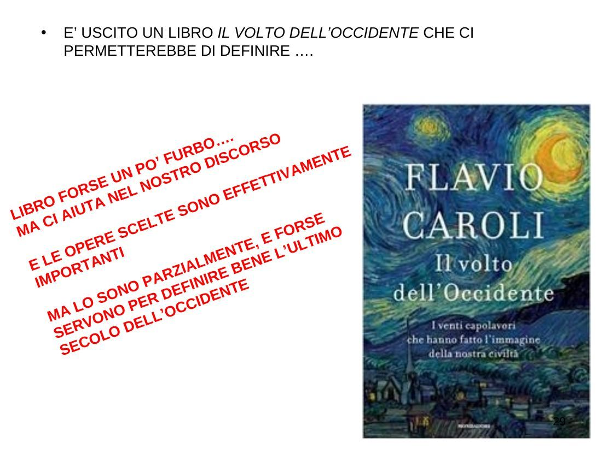{ loading=lazy style="width:47%" }

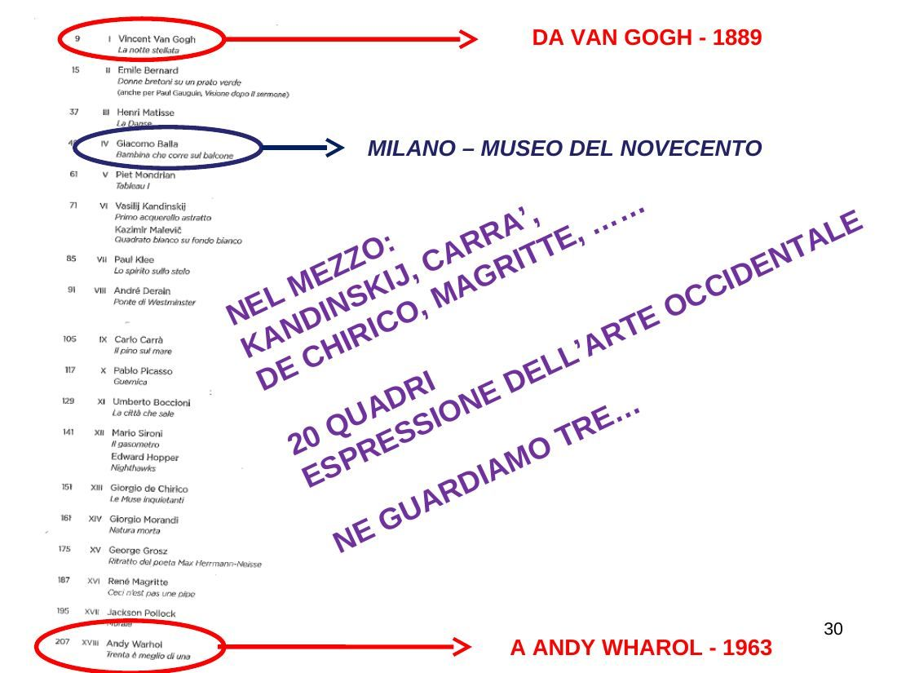{ loading=lazy style="width:47%" }

0:59:24

Inizia con Van Gogh, la *Notte stellata* del 1889: questo è l’inizio del volto dell’Occidente secondo l’autore. *Le Muse inquietanti* di De Chirico, del 1917, la metafisica. E Andy Warhol: *la Gioconda* è l’emblema della cultura occidentale, sostanzialmente; «Trenta sono meglio di una», infatti, con questo spirito critico. Il libro di Caroli è abbastanza interessante, ma non basta.

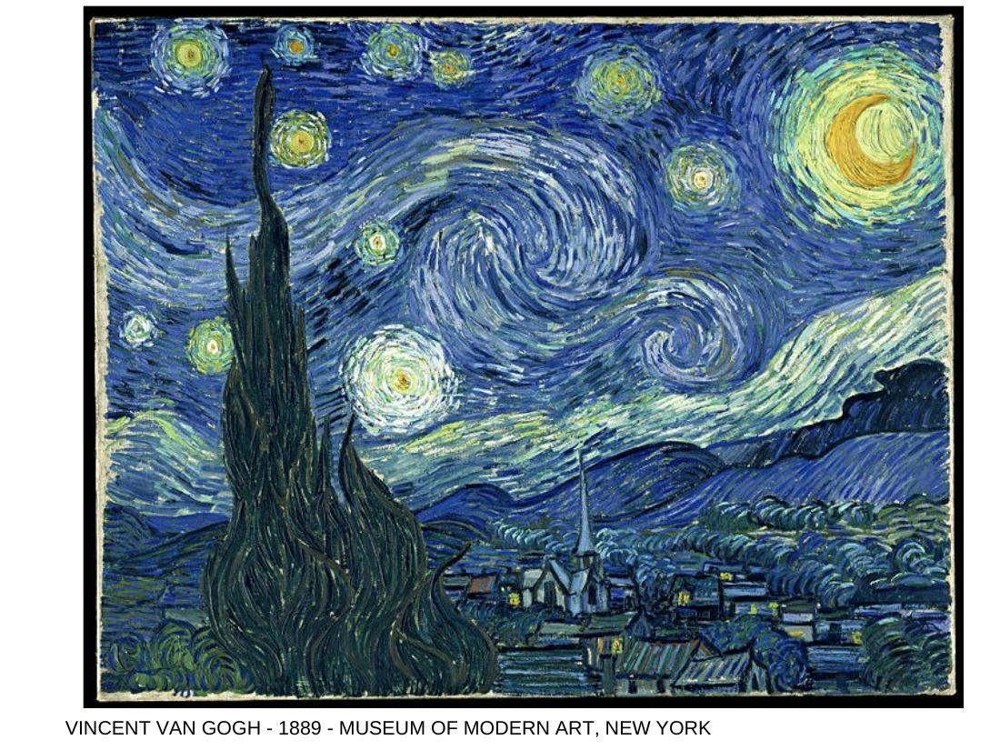{ loading=lazy style="width:59%" }

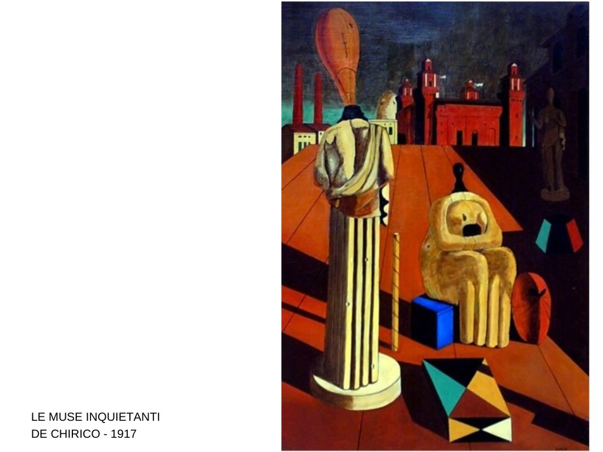{ loading=lazy style="width:47%" }

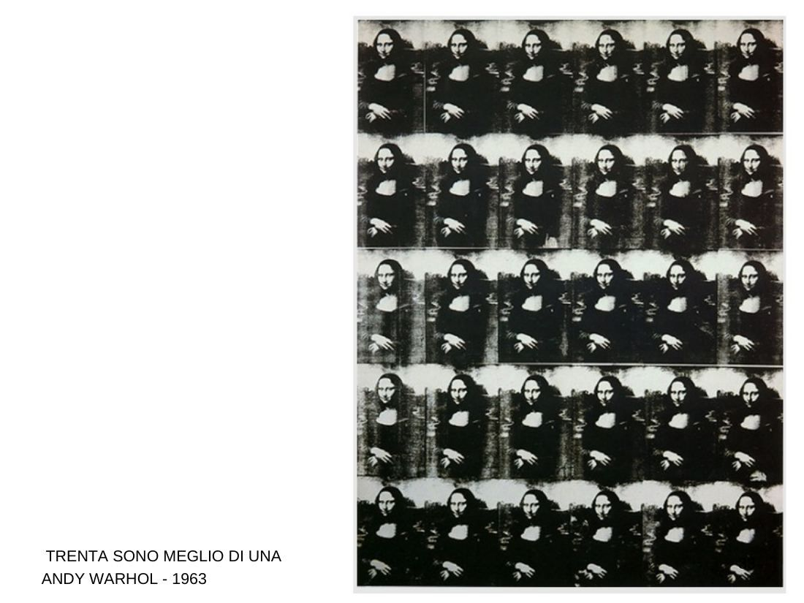{ loading=lazy style="width:47%" }

1:00:07

C’è un altro libro, che invece secondo me è un vero capolavoro, di un professore, François Bœspflug, professore di storia delle religioni all’Università Marc Bloch di Strasburgo, frutto di trent’anni di ricerche, che si chiama Le immagini di Dio. Ci sono delle immagini stupende, ora ne vedremo qualcuna, che ci dicono l’importanza del volto di Dio e l’influenza che ha avuto sul pensiero occidentale. Un nostro filosofo, uno dei maggiori italiani, Croce, diceva, in un saggio del 1942: «Perché non possiamo non dirci cristiani». Bisogna tenerne conto, sicuramente. Già questo professore, di per sé, essendo francese, mostra quanto sia importante per l’Europa stessa il concetto che è venuto fuori dalla profondità religiosa di tutto il continente.

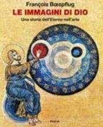{ loading=lazy style="width:30%" }

1:01:05

Ritorniamo a quella cartina iniziale che abbiamo visto prima, perché tutto parte da quel momento lì. In origine, nel mondo ebraico (siamo qui, per esempio, nel 1491 a.C.), eredità poi fatta propria anche dal mondo arabo, Dio non poteva essere oggetto di immagine. E così anche la Chiesa, i primi Padri della Chiesa, mettevano in guardia i fedeli contro l’uso dell’immagine di Dio, per il rischio che c’era dell’idolatria. L’unica vera immagine che aveva valore era l’uomo, perché fatto a sua immagine e somiglianza. La comparsa delle prime immagini di Dio avviene nel IV secolo d.C., e quindi ne vediamo qualcuna. Questo è Cristo docente tra gli apostoli, nelle catacombe di Domitilla, che risale agli anni 330-340. Questo è Cristo in trono tra Pietro e Paolo, fine del IV secolo, catacombe dei Santi Marcellino e Pietro a Roma.

**LE IMMAGINI DI DIO**

In origine, nel mondo ebraico – eredità poi adottata anche dal mondo arabo – Dio non poteva essere oggetto di immagine.

Così anche i primi Padri della Chiesa furono unanimi nel mettere in guardia i fedeli contro l’uso delle immagini di Dio, contro il rischio costante dell’idolatria: l’unica immagine di Dio che veramente abbia valore è l’uomo.

La comparsa delle prime immagini del Dio cristiano avviene intorno alla metà del IV secolo, in diverse forme, ma in particolare nei mosaici delle absidi delle basiliche.

Sono soprattutto immagini di figure cristomorfe di Dio:

– la figura del Padre appare una volta sola;

– assenti, o quasi, le immagini trinitarie di Dio e della Trinità.

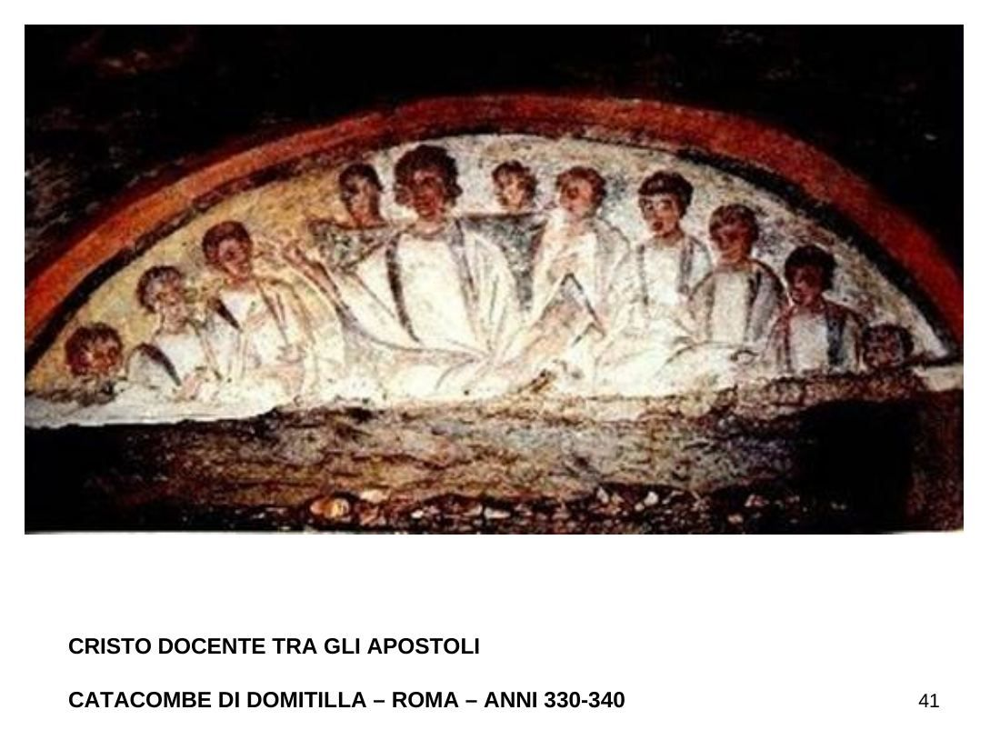{ loading=lazy style="width:47%" }

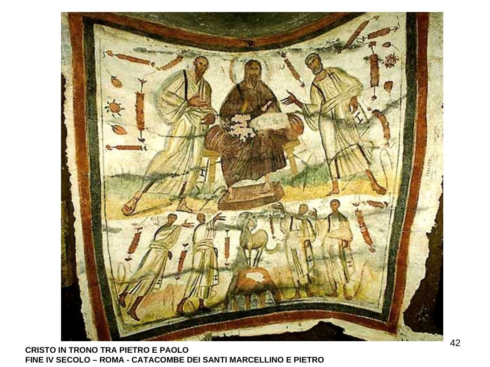{ loading=lazy style="width:47%" }

1:02:29

Questo libro passa in rassegna i secoli (fate uno sforzo di immaginazione per vedere questa trasversalità all’interno del tempo), tutta la storia iconica di Dio, e quindi attraversa tutta l’Europa. Per esempio, vediamo ora, facendo un salto dal IX al XII secolo, dove si afferma la figura della *Maiestas Domini*: questa per esempio è Tolosa, dove c’è questa figura, un bassorilievo nella Basilica di Saint-Sernin; questa invece è Moissac, Saint-Pierre, il timpano scolpito, dove c’è sempre questa rappresentazione. Quindi questo libro attraversa tutta la cultura europea facendo vedere le immagini di Dio che nel corso del tempo si sono succedute.

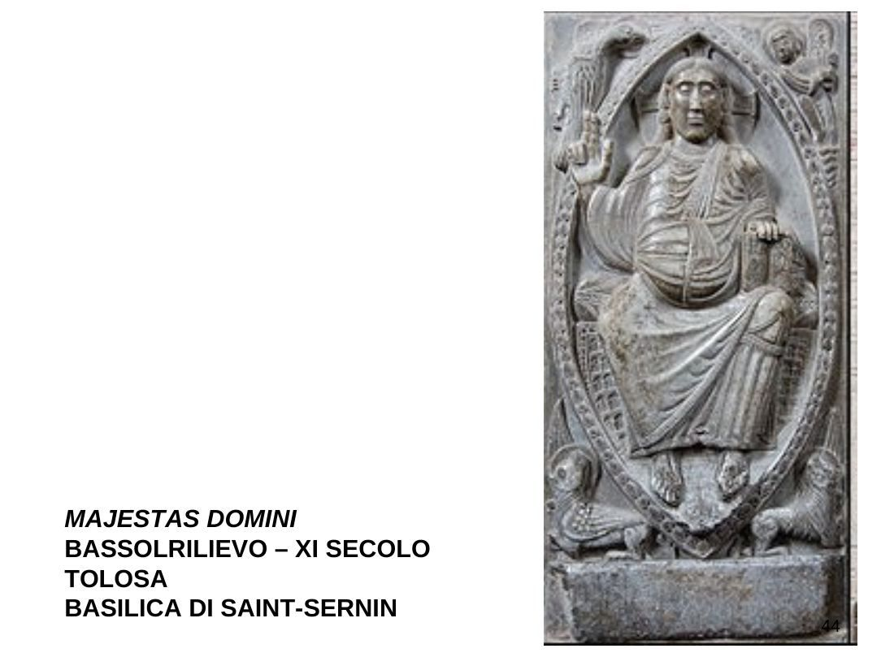{ loading=lazy style="width:47%" }

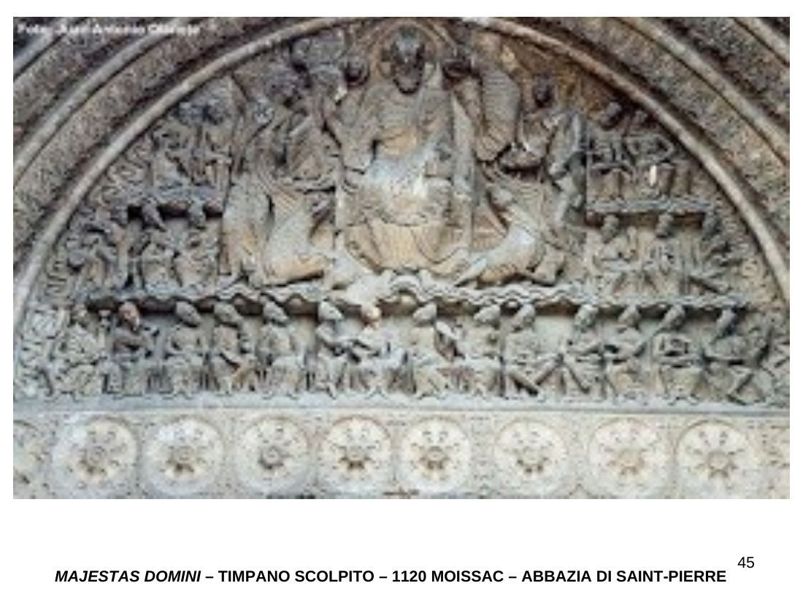{ loading=lazy style="width:47%" }

1:03:25

Si salta, per esempio, il periodo del 1200-1400, dove c’è la scoperta della morte (non è questa la serata per parlarne); il Dio in discussione: si comincia a mettere Dio in discussione intorno al 1500-1600, fino al secolo dell’Illuminismo, dove c’è proprio la decadenza di questo concetto. Però volevo finire l’apporto di questo libro con due opere. La prima è di Félicien Rops, 1878, *La tentazione di Sant’Antonio*. Vedete, è interessante: sulla croce, al posto del Cristo, c’è una donna che tenta appunto Sant’Antonio; vedete che ha delle parole sopra la testa, c’è la parola «Eros», ci sono degli angioletti che sono teschi danzanti, c’è il maiale: quindi è una rappresentazione piuttosto beffarda della religione.

1:04:43

Per finire con Max Ernst, del 1926: questa è la Vergine che castiga Gesù Bambino davanti a tre testimoni, che vedete nella finestrella sopra; i tre testimoni sono André Breton, Paul Éluard e l’artista stesso. Questo per dire che la cultura occidentale, anche quando parla di religione, come in questo caso, prendendola in giro, riesce a far sopravvivere questi concetti religiosi a se stessi, perché si riesce ancora a ridere in qualche modo della nostra cultura; mentre forse da altre culture si riesce meno a sopportare questa cosa, questa ironia distruttiva, a volte però interessante da questo punto di vista.

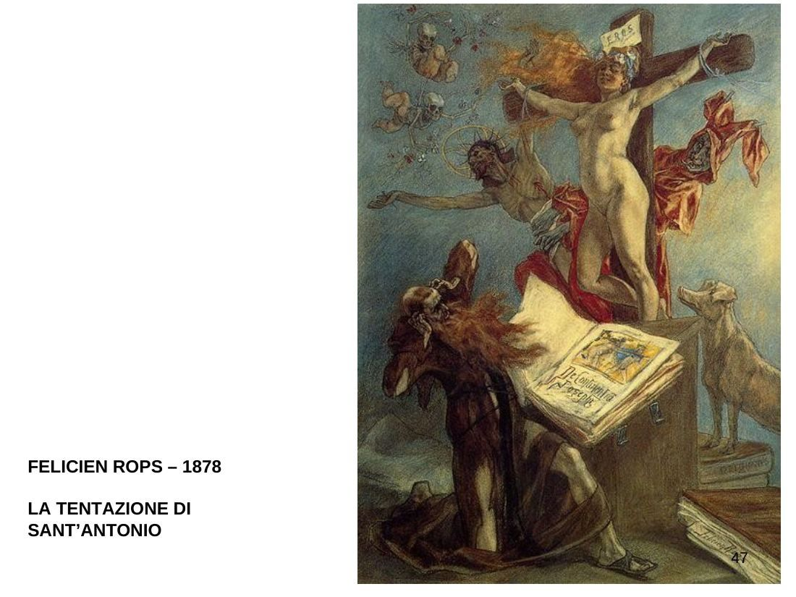{ loading=lazy style="width:43%" }

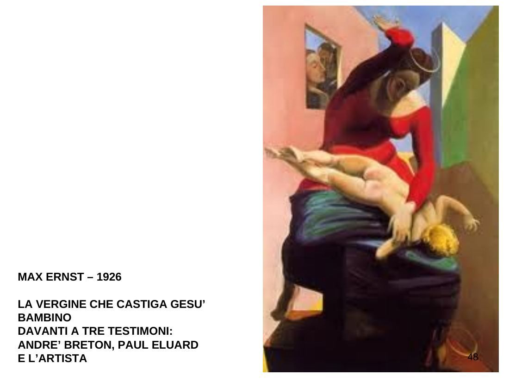{ loading=lazy style="width:42%" }

1:05:45

Però c’è un punto fondamentale che ha gettato le basi di quello che noi siamo adesso nella nostra cultura occidentale: parlo del periodo dal XIII al XVI secolo. È il periodo in cui si creano le basi del nostro capitalismo. Altre volte l’abbiamo accennato, non sto a ripeterlo, però l’invenzione del purgatorio è il salvacondotto contro il peccato di usura: quindi l’economia è possibile farla, è possibile guadagnare, perché non c’è più solo l’inferno, ma c’è appunto la via di salvezza del purgatorio.

1:06:36

Però in questo periodo ci sono altri studi interessantissimi da un punto di vista economico, che poi hanno gettato le basi di tutta l’economia occidentale. Parlo per esempio di recenti studi che hanno riportato alla luce Gasparo Scaruffi, un italiano che visse nel Cinquecento (1519-1584) e propose una riforma monetaria volta ad avere un’unica moneta, perché intravedeva da economista i pericoli della guerra tra monete. Tra l’altro, proprio in questi giorni c’è in corso una guerra valutaria tra tutte le monete del mondo, perché ora tutti hanno cominciato a svalutare la propria moneta: la Cina, l’America; l’euro ancora no, però c’è una guerra. Quindi è una cosa che risale da sempre nell’economia occidentale.

**DAL XIII AL XVI SECOLO**

Questa cultura è alla base del capitalismo, con l’invenzione del purgatorio (la versione dello spirito protestante del capitalismo è una variante successiva…) e l’apertura quindi alla finanza, ai prestiti e al profitto, che sono stati il motore della società occidentale (usura non voleva più dire inferno).

Recenti studi\* hanno attribuito a Gasparo Scaruffi (1519-1584), figlio di queste impostazioni, l’idea stessa dell’unione monetaria: economista, elaborò e analizzò le difficoltà economiche dovute alla pluralità delle monete con diverso contenuto in oro, inoltre propose una riforma monetaria volta ad avere un’unica moneta: le monete esistenti si sarebbero rapportate a essa come multipli o sottomultipli.

Opera: *L’Alitinonfo* (dal greco, «vero lume»), Reggio Emilia, 1582, editore Ercoliano Bartoli.

\* Fabrizio Saccomanni, direttore generale della Banca d’Italia, 10 gennaio 2013.

1:07:28

Questi secoli hanno gettato le basi della prospettiva nella pittura e dell’ordine dei conti nell’economia. Vediamo qualche esempio. Dove nasce? Nasce prevalentemente nel Rinascimento, da queste scoperte filosofiche. Se pensate alla Firenze del 1300: 100.000 abitanti, cinque volte Roma; era qui il fulcro della cultura occidentale. La bellezza occidentale si manifesta anche nei capolavori dell’arte. E c’è un altro concetto importante, che è quello del male: il diavolo, sappiamo, è parte di noi, fa parte anche del nostro essere; non c’è solo il bene, ma c’è anche il male.

**IL RINASCIMENTO: COME SPECCHIO DEL NUOVO MONDO**

Questi secoli (XII-XVI), in Italia, hanno prodotto la prospettiva nella pittura e la prospettiva e l’ordine nei conti dell’economia, gettando la base di tutta la disciplina economica occidentale, con la partita doppia e il bilancio.

Il Rinascimento nasce da queste innovazioni e da queste «scoperte» filosofiche.

«… la Firenze del 1300, faro nel mondo, con centomila abitanti, cinque volte quelli di Roma, due volte quelli di Londra, gli stessi di Parigi e Milano. È l’epoca d’oro della signoria, che batte il fiorino d’oro, attrae talenti e maestranze da tutta Europa, è punto di riferimento per ogni operazione finanziaria».

La Firenze del periodo rinascimentale «produsse» una concentrazione altissima di geni come Leonardo, Michelangelo, Brunelleschi, Botticelli, Machiavelli, Poliziano… con le loro immense opere d’arte.

1:08:29

Vi faccio vedere un’opera d’arte di Michael Pacher, che è vissuto tra il 1435 e il 1498, austriaco, considerato il ponte tra l’arte nordica e la visione prospettica rinascimentale italiana: qui c’è Sant’Agostino che viene tentato dal diavolo. In questo quadro c’è già tutto l’assorbimento della cultura italiana: vedete, c’è la prospettiva, si vede in fondo alla strada, si vede già la prospettiva, bella. È un bellissimo quadro. In questo caso si rappresenta Sant’Agostino che passeggia; il diavolo va lì per tentarlo, e in realtà poi è il santo che lo obbliga a reggere il breviario, con cui il santo poi legge e impartisce la messa, la lezione, la liturgia.

1:09:31

Qui però c’è una rottura con il passato molto importante: l’immagine non serve più solo a narrare, oppure come promemoria, ma trasmette un’emozione. È questa la parte importante, fondamentale, di questo passaggio: da qui in avanti anche la pittura, anche l’opera d’arte, trasmette qualcosa. Soprattutto, come dicevo prima, il bello non è più solo il bene, ma il bello è anche il male: vedete, questo diavolo è bellissimo da un punto di vista pittorico, è un capolavoro da questo punto di vista.

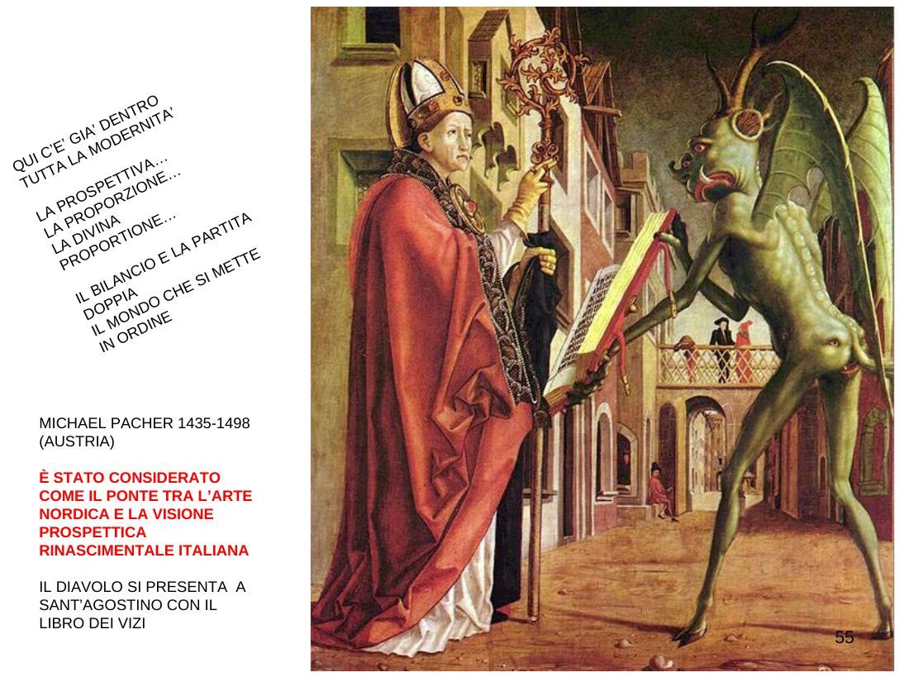{ loading=lazy style="width:31%" }

**MICHAEL PACHER (1435-1498, AUSTRIA)**

È stato considerato il ponte tra l’arte nordica e la visione prospettica rinascimentale italiana.

Il vescovo (Sant’Agostino) passeggia avvolto in un ricco manto, con la mitra e il pastorale. Il diavolo incontra il santo vescovo a un angolo di strada e gli presenta il libro dei vizi; ma il vescovo sgrida il diavolo per la sua vita e per castigo lo obbliga a reggere il breviario per la lettura.

Con l’influenza del gusto umanistico italiano, l’immagine acquisisce potenza retorica. Qui c’è già dentro tutta la modernità: la prospettiva, la proporzione, la *Divina proportione*; il bilancio e la partita doppia; il mondo che si mette in ordine.

Qui c’è la rottura con il passato, che non è solo pittorica: si inaugura una fase nuova (bilancio, partita doppia ecc.).

L’immagine non serve più solo a narrare e come promemoria, ma deve trasmettere emozione (qui c’è tutta la nostra modernità occidentale).

E soprattutto il bello non è più espressione solo del bene (cambiamento «filosofico» importante… se Lorenzo me lo passa).

1:10:11

In questo periodo nasce un’altra cosa importante, che sarà il cardine su cui si muoverà sostanzialmente tutta l’economia occidentale. Abbiamo ricordato prima la nascita del purgatorio, con la salvezza dell’anima per il peccato di usura; però c’è un’altra innovazione importantissima, che avviene qualche secolo dopo, non tra il 1200 e il 1300, ma intorno al 1500: l’invenzione dell’anonimato. Questo è uno dei concetti fondamentali su cui si baserà tutto lo sviluppo occidentale successivo.

1:10:59

Brevemente, per farlo capire un po’ meglio, bisogna andare nella Milano del cardinale Borromeo, perché è da lì che parte questa storia. Il cardinale Borromeo vive a Milano tra il 1538 e il 1584. Queste per esempio erano le istruzioni sull’edilizia ecclesiastica che il cardinale fece adottare da tutta la Chiesa. Il confessionale è importantissimo da questo punto di vista. Fino a quel periodo non esistevano i confessionali: le confessioni avvenivano così, come in una sala come questa, dove c’era il prete e c’era chi andava a confessarsi. Lui invece istituisce il confessionale, con una struttura propria. Infatti queste sono le regole: deve essere diviso in due ambiti, uno per il sacerdote e uno per il penitente ecc.; «il tramezzo tra i due ambiti deve essere aperto da uno sportello che verso il confessore avrà una tendina e verso il penitente una grata piuttosto fitta, con fori della grandezza di un cece». Se ci ricordiamo, chi è andato a confessarsi in chiesa, più o meno la cosa è questa, e nasce in questo periodo.

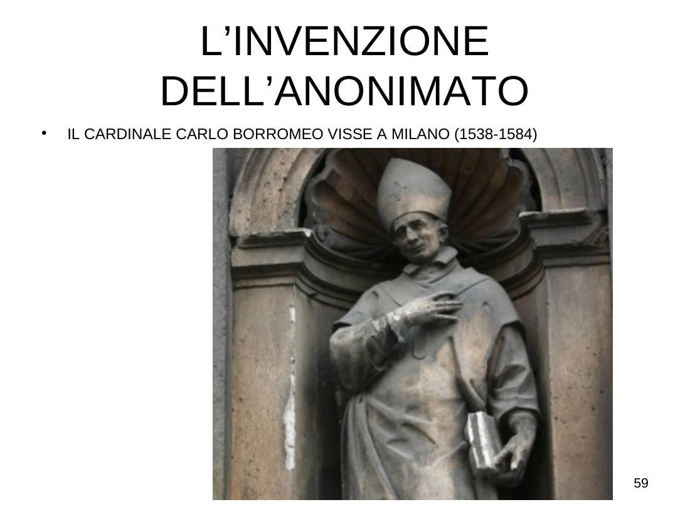{ loading=lazy style="width:47%" }

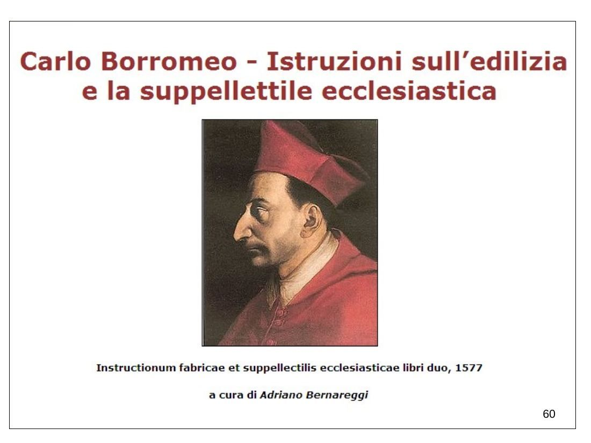{ loading=lazy style="width:47%" }

**L’INVENZIONE DELL’ANONIMATO**

Per capirla occorre abbinarla alla confessione, e quindi all’indulgenza e soprattutto all’assoluzione: bisogna partire da Milano e dal Cardinale Carlo Borromeo (1538-1584), nel periodo della controriforma.

Carlo Borromeo, *Istruzioni sull’edilizia e la suppellettile ecclesiastica* (*Instructionum fabricae et supellectilis ecclesiasticae libri duo*, 1577), a cura di Adriano Bernareggi.

**Cap. XXIII: il confessionale**

Anche nella chiesa più modesta ve ne devono essere almeno due, per tener distinti gli uomini dalle donne. Se gli officianti sono molti, come nelle cattedrali e nelle collegiate, ve ne sarà uno per ciascuno, sempre distinti fra quelli riservati all’uno e all’altro sesso. Dev’essere in legno, chiuso su cinque lati ma aperto sul davanti, con la possibilità però di chiuderlo a chiave con un cancello o un graticcio, perché «quando non c’è il confessore, laici, vagabondi o persone sudicie non vi si possano sedere e dormire oziosamente, con irriverenza del ministero che ivi si esercita» (pag. 124).

Dev’essere diviso verticalmente in due ambiti, uno per il sacerdote e uno per il penitente, e dev’essere collocato in modo che il sacerdote si trovi sempre verso l’altare maggiore e il penitente verso la porta. Il tramezzo fra i due ambiti dev’essere aperto da uno sportello che verso il confessore avrà una tendina e verso il penitente una grata piuttosto fitta (con fori «della grandezza di un cece»). Da entrambe le parti vi saranno cartelli promemoria per le rispettive funzioni.

1:12:28

C’è chi ha detto che l’anonimato nella confessione nasce perché in realtà c’erano dei preti che si approfittavano di giovani e donne che andavano a confessarsi, e quindi il cardinale Borromeo ideò questo confessionale, con la separazione tra il sacerdote e il penitente. Però è importante questo punto. Se ci pensate, facendo un salto, ora l’anonimato della confessione quasi scompare. Negli anni Ottanta ci fu un talk show francese che divenne famoso in tutto il mondo: una certa Vivienne, davanti a milioni di telespettatori, confidò di non avere mai avuto un orgasmo nel suo matrimonio, perché il marito aveva l’eiaculazione precoce. Zygmunt Bauman, sociologo, aveva parlato in quel periodo di una società che stava andando verso un modello che avrebbe messo i microfoni, pensate, nei confessionali, e li avrebbe messi poi nelle piazze pubbliche, per sentire quello che si diceva nei confessionali. La realtà, come sempre, ha superato di molto la fantasia, se pensate alle confessioni del Grande Fratello o a trasmissioni di questo genere, dove ci si confessa di tutto davanti a milioni, davvero, di spettatori: si è inaugurato tutto un altro filone.

**L’INVENZIONE DELL’ANONIMATO**

Quanto al concetto e alla confessione, essa ha generato opere letterarie immense: le *Confessioni* di Sant’Agostino, le *Confessioni* di Rousseau ecc., fino ai giorni nostri, in cui le confessioni si articolano nei social network e nei media, e attraverso di essi, erodendo il confine tra la sfera pubblica e quella privata.

In epoca moderna l’anonimato della confessione scompare.

Famoso è un talk show francese (anni Ottanta) in cui una certa Vivienne, davanti a milioni di telespettatori, confidò di non avere mai avuto un orgasmo nel suo matrimonio, poiché il marito era afflitto da eiaculazione precoce.

Bauman aveva parlato di una società che stava andando, provocando, verso un modello che avrebbe messo i microfoni dentro i confessionali, collegati poi a degli altoparlanti nelle piazze pubbliche. Non si teneva conto che nelle chiese il numero dei penitenti andava quasi a sparire, ma il concetto rimane, con tutta la sua potenza e verità.

La realtà, come sempre, ha superato la fantasia…: altro che piazze con poche decine di persone; piazze sì, ma televisive, con milioni di persone.

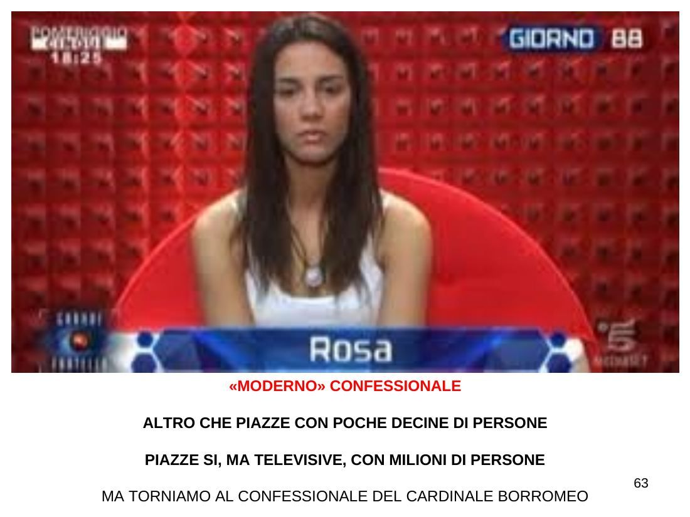{ loading=lazy style="width:51%" }

1:14:13

Ma ritorniamo al cardinale Borromeo: questo è il tradizionale confessionale del cardinale. Questo cosa consentiva? Consentiva soprattutto la nascita dell’anonimato del peccato, cioè ci permetteva, dopo esserci confessati, di ripartire per un nuovo ciclo di vita senza essere gravati sulla coscienza da quello che avevamo fatto. Il principio fondamentale è questo, l’introduzione dell’anonimato: siccome il prete non vedeva più chi era lì a confessarsi, si separava in maniera magistrale la persona fisica dal peccato. Questa è la grande innovazione, perché, se ci pensate, è questa la base della nostra economia, come ora vediamo.

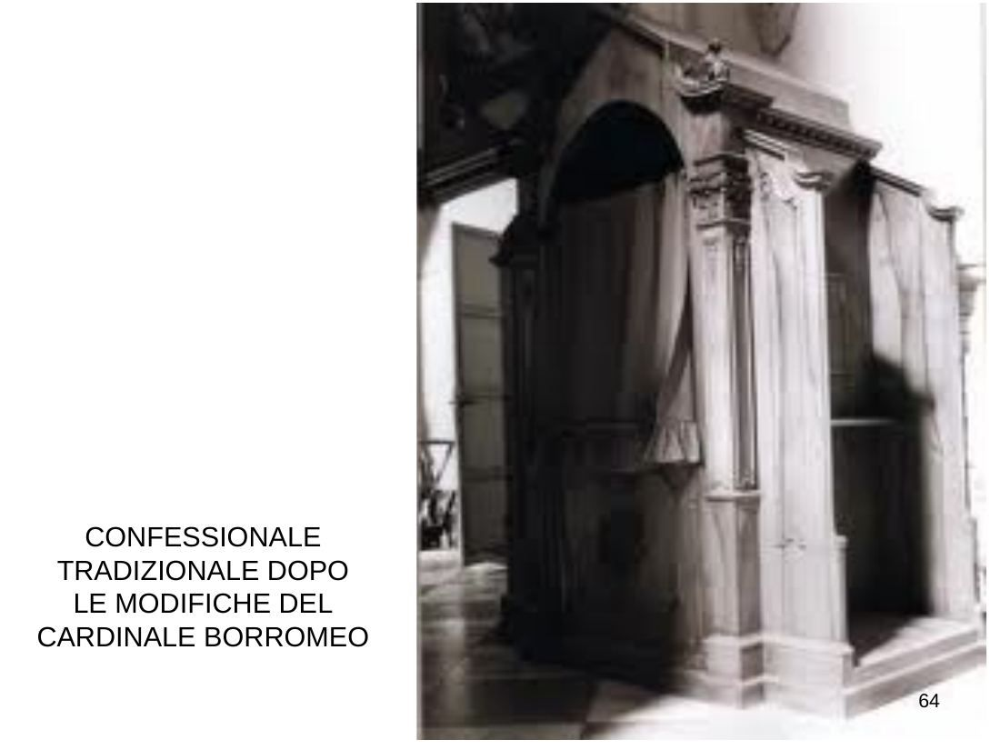{ loading=lazy style="width:52%" }

**L’INVENZIONE DELL’ANONIMATO**

Il Cardinale Borromeo fece piazzare nei confessionali cancellate di ferro nella penombra (diventate poi nel tempo le lastre di metallo forate che noi tutti conosciamo), che consentivano di dire cose terribili senza essere visti, con la garanzia appunto dell’anonimato.

Era nato anche per contrastare gli abusi sessuali dei preti: la diffusione di questo oggetto nelle chiese italiane si deve al Cardinale Carlo Borromeo, che voleva tenere separati e ben visibili al pubblico il confessore e la sua possibile preda, e cercare così di porre un freno agli abusi e agli scandali sessuali dei «padri confessori».

Il confessionale cominciò a comparire nelle chiese di Milano nella seconda metà del Cinquecento e rapidamente si diffuse ovunque. Il confessionale concepito da Borromeo era stato studiato per separare «confessore» e «confessato».

Un anonimato che permetteva di ripartire nella vita dopo essersi liberati la coscienza.

La nascita dell’anonimato nella società si era così introdotta, e l’avrebbe fecondata successivamente.

1:15:09

La strada infatti era aperta, e naturalmente, visto che era aperta, il percorso è stato poi sfruttato. Infatti in questo periodo nascono le società in accomandita semplice, cioè la limitazione della responsabilità dei soci. Per tutto il Medioevo le società che esistevano erano società collettive, dove il socio rispondeva illimitatamente con il proprio patrimonio dei danni che eventualmente la società faceva (quelle che oggi sarebbero, sostanzialmente, le SAS, le SNC). Invece si inventano le società in accomandita, perché non si poteva chiedere al socio di rimetterci tutto il patrimonio per un singolo investimento, un singolo rischio. Nascono soprattutto in Inghilterra e in Olanda: la Compagnia delle Indie orientali nasce nel 1600. L’interessante è che in quel momento queste società, per essere legali, dovevano avere l’approvazione del sovrano.

1:16:33

Solo la Francia, nel 1867 (quindi questi processi, seppur interessanti, hanno bisogno di un po’ di tempo per evolversi), abolisce questa autorizzazione dello Stato, e da lì esplode letteralmente la nascita delle società anonime, che poi ora sono diventate società per azioni. Nel diritto italiano, fino al 1942, si chiamavano società anonime, perché voleva dire che non c’era nessuno dietro: bastava solo il possesso dell’azione, erano spersonalizzate; non erano il signor Rossi, il signor Marcucci, il signor Poggi, erano persone che non volevano dire nulla: l’importante era che mettessero il capitale all’interno della società.

**LE SOCIETÀ ANONIME**

Poco dopo quel periodo nascono le società in accomandita semplice (limitazione della responsabilità dei soci).

Fino a quel momento c’erano solo le società collettive (quelle che oggi sono le SAS e le SNC…), dove i soci rispondevano interamente con il loro patrimonio.

Con la *Commenda* si affidava a un mercante una parte di una somma di denaro per un’operazione commerciale in mare e si partecipava in quota parte agli utili.

Il rischio era enorme e non si poteva chiedere di partecipare all’operazione con l’intero patrimonio personale: serviva quindi ad attrarre capitali che altrimenti non sarebbero arrivati.

Tra l’altro il prestito non era considerato propriamente un mutuo, ma capitale di rischio, e quindi consentiva di avere un utile senza dichiararlo come interesse, aggirando così il divieto di usura.

Nascono così (soprattutto in Inghilterra e in Olanda) le società per azioni, che all’inizio, per essere legittime, avevano bisogno dell’approvazione dei sovrani.

La Compagnia delle Indie orientali (East India Company) nasce nel 1600.

Queste approvazioni dapprima furono sporadiche e valutate caso per caso, per poi diffondersi nella pratica economica e finanziaria.

La Francia diede la completa liberalizzazione nel 1867; da lì fu estesa a tutti gli Stati occidentali, e fu il via libera all’esplosione del numero di queste società in tutto l’Occidente.

Queste società prendono il nome di società anonime perché spersonalizzate: non importa chi sia la persona, l’importante è il capitale e il titolo che ne dimostri il possesso.

Altro vantaggio: il fatto che così le quote potevano essere vendute e comprate continuamente, creando il mercato borsistico.

In Italia, per esempio, la dizione «società anonima» è stata prevista dal codice civile fino al 1942; dopo si è trasformata in «società per azioni».

Su questo campo occorre ricordare gli scritti magistrali di un liberale d’altri tempi come Bruno Visentini (1914-1995).

1:17:27

Questo per esempio, a destra, è l’atto di costituzione della Società anonima per la vendita dei beni del Regno d’Italia, dell’11 dicembre 1864: da questa società dello Stato Lucca riacquistò le proprie mura, e queste sono le obbligazioni emesse a fronte di queste operazioni. Anche lo Stato utilizzerà questi veicoli, questi strumenti, per svolgere la propria attività. Poi c’è l’anonimato anche oggi, di gruppi di persone: ho messo qui un’immagine di Anonymous. Però, per difendersi dall’invadenza del Grande Fratello che tutto sa di noi, questo concetto dell’anonimato è estremamente importante. Questa era un po’ la storia di questa seconda parte: con questo lascio la parola a Lorenzo.

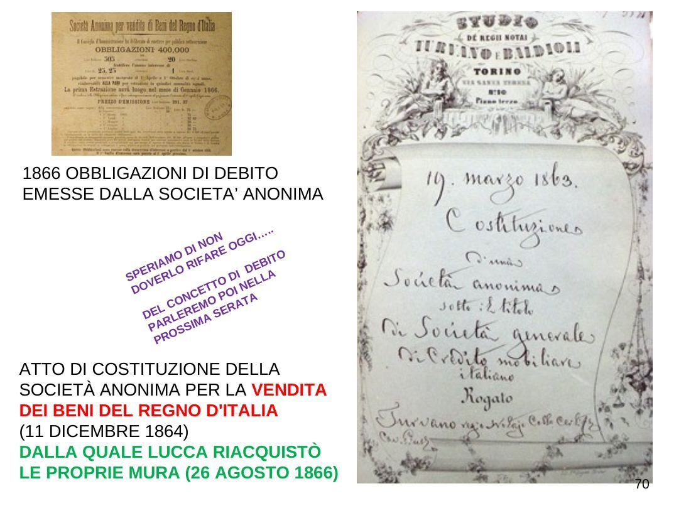{ loading=lazy style="width:30%" }

Atto di costituzione della società anonima per la vendita dei beni del Regno d’Italia (11 dicembre 1864), dalla quale Lucca riacquistò le proprie mura (26 agosto 1866). Obbligazioni di debito emesse dalla società anonima nel 1866.

**L’INVENZIONE DELL’ANONIMATO**

Le multinazionali di oggi (moderne Compagnie delle Indie) cosa sono se non società di fatto anonime, che non rispondono direttamente (difficile sapere chi ci sia dietro) del loro operato, in nome del concetto di utile?

Il concetto di anonimato è rivendicato anche nella sfera privata, come libertà individuale di espressione, che rivendica il diritto all’anonimato contro l’oppressione del Grande Fratello che tutto sa di noi…

1:18:31

Lorenzo Poggi Come procede questo processo di astrazione che caratterizza l’Occidente? Anche poco fa Paolo diceva: il peccato separato dal peccatore. È la stessa operazione; l’anonimato è la medesima operazione: bisogna togliere ciò che è personale, individuale, caratterizzato da qualcuno, e renderlo invece catalogabile sotto un unico segno. Questo caratterizza l’Occidente e il suo atteggiamento nei confronti del mondo: questa razionalizzazione, questa forza della ragione che diventa in grado di comandare.

1:19:27

Prima attraverso la religione: la religione ebraica e la religione cristiana introducono nella filosofia greca, di cui abbiamo già visto l’origine, no?, l’astrazione. Si confrontano con una natura che per l’uomo della Grecia classica è una natura che ha un ciclo mutabile, nei confronti del quale non è possibile intervenire: non resta che accettarlo. La morte non si può sconfiggere: i Greci l’uomo lo chiamano mortale. È mortale. Il dolore non si può evitare, è parte del ciclo dell’esistenza. Chi si ribella a questo non ha capito: commette qualche cosa che va oltre i limiti umani, commette, diremmo in termini cristiani (ma non si chiamava così), peccato, cioè *hybris*. La giustizia sta nel mantenere questo, nel riconoscere il proprio posto, nello stare al proprio posto, non pretendere di uscirne.

1:21:21

Con la religione ebraica si può sconfiggere la morte alleandosi con Dio, si può sconfiggere il male alleandosi: trattere fondate occidenti. Il cristianesimo addirittura farà di Dio non un alleato: identificherà l’uomo come alleato di Dio. Siamo Dio, perché siamo figli di Dio, e quindi siamo Dio; e Dio è il Figlio e Dio è il Padre. E se siamo figli di Dio, e Dio è l’ente che esiste sopra tutti gli enti, tutto dipende da lui, e quindi comandiamo.

1:22:10

E a un certo punto questo comincia a fondersi anche con quello che è questo periodo dell’economia, come diceva Giorgio Stato: in prima forma comincia a fondersi con questo. Si spersonalizza il rapporto dell’uomo con le cose. Lo vediamo, per esempio, nel passaggio dalla società feudale alla società moderna. Comincia per il meno antica feudale, quando il rapporto di dipendenza non è più un rapporto fra persone (il marchese, il conte, il grande feudatario, il vescovo, e i servi della gleba, i contadini): ci sono degli uomini liberi che prestano liberamente (sempre tra parentesi, naturalmente) la loro opera; e la loro opera, il loro agire, il loro operare è valutabile, diventa moneta.

1:23:28

Quella politica che abbiamo visto, che è la concretizzazione della razionalità che astrae dalle cose. Quindi non abbiamo più l’operaio, non abbiamo più il servo; non è più un rapporto con quel signore, con quel marchese, che deve essere leale nei confronti dei propri servi, che deve avere nei loro confronti, dicono gli uomini di Chiesa del tempo, quelli conservatori, lo stesso atteggiamento del padre nei confronti dei figli. Non ci sono più né padri né figli: c’è il pagamento in contanti. C’è una relazione, sì, ma è una relazione di valore immediata e razionalizzata dalla moneta.

1:24:35

Prima c’era il rapporto fra le persone. Pensate, ora mi veniva in mente questo: il dono. Se io regalo qualcosa a qualcuno, faccio un dono, non è uno scambio. Magari glielo faccio perché mi aspetto da lui un atteggiamento di benevolenza nei miei confronti per qualcosa. Il dono è diverso: ci si aspetta qualcosa, ma è un confronto fra persone. Se uno fa un regalo a un altro, lo fa in un certo modo, bisogna stare attenti, perché se gli fa un dono troppo grande, troppo impegnativo, magari quell’altro si sente in obbligo: «Mi ha fatto un regalo così, e io lo devo ricambiare».

1:25:44

C’è il discorso del potlatch nei popoli primitivi, di come si mostra la potenza del capotribù. Un capotribù fa vedere all’altro capotribù avversario quanto lui è forte: piglia tre schiavi e li ammazza. Il fatto è che è forte, perché può permettersi questo. Se l’altro è altrettanto forte e vuole rispondere, deve prenderne di più, quattro schiavi, e così via, no? Cioè, qua ammazzano tutti. L’economia no: astrae da tutte queste personalizzazioni, dal nuovo mare, e il dono si trasforma in qualcosa di differente, di astratto. Siamo tutti ugualmente liberi, perché tutti in fondo prestiamo un’opera. Siamo tutti uguali di fronte a Dio, così come siamo tutti uguali di fronte al denaro. E al suo posto appare il denaro: cambia, ma la dipendenza è la stessa, e l’astrazione razionale è la medesima.

1:27:16

Il cristianesimo, vi dicevo, introduce un altro elemento che caratterizza l’Occidente e ne ha fatto la forza che ha globalizzato il mondo: introduce l’elemento del controllo sul mondo. Non è più qualcosa di estraneo a noi, perché non è fatto da mente, ma siamo noi stessi, e quindi il controllo sul mondo avviene direttamente. Noi accediamo a Dio perché questo ci permette di controllare i fenomeni, ci permette di controllare il mondo.

1:28:09

Prima o poi parleremo dei santi patroni. Il santo patrono è… Avete visto, quando visitate qualche santuario, che ci sono gli ex voto? Si potrebbero chiamare voto di scambio. Voto di scambio, ora che siamo in campagna elettorale, si può dire: però è voto di scambio. Il santo patrono non questo, è il santo padrone. È sbocco fiscano. Quindi il rapporto è un rapporto di controllo, di dominio sul mondo.

1:28:51

Quando sorge la scienza moderna, sorge come controllo sul mondo: prende dalla religione l’idea che si debba controllare il mondo, che lo si possa fare. Francis Bacon: la scienza rimette l’uomo sul trono da cui era stato sbalzato dal peccato originale. L’uomo era padrone del paradiso terrestre, era padrone della natura; ha commesso il peccato e la natura gli si è ribellata, non la può più controllare, non comanda più. Ora invece può tornare a comandare sulla natura. Come? Con la scienza. E la scienza come opera? Opera applicando a tutti i fenomeni quel principio che è il principio di astrazione che abbiamo visto. Non ci sono più i fenomeni con le loro qualità.

1:29:53

Va bene? Il nostro amico Galileo Galilei dice che cos’è scienza, che cos’è vero: vero è tutto ciò che è riconducibile a elementi quantitativi relazionati fra loro secondo il paradigma logico delle matematiche. Molto semplicemente: nelle nostre esperienze leviamo tutto quello che è esperienza. Quando freddo, verde pisello. Ci siamo? Uno va a comprare una vernice per verniciare il cancello di casa: avete comprato una vernice verde pisello, arrivate a metà ed è finita la vernice. Andate in mesticheria, portate il barattolo, e quello vi dà un altro barattolo di verde pisello, e finite di verniciare il cancello. Ma come ha fatto la ditta a fare, a distanza di cinque anni, lo stesso verde pisello di prima? C’è uno che se lo ricorda? Guarda il codice così vuole a quella. Il verde pisello è uno spettro: uno spettrografo ha misurato una certa lunghezza d’onda di quel colore, e la ditta chiama verde pisello tutto quello che ha quella lunghezza d’onda.

1:31:36

Non è più una qualità, è una quantità: è diventata qualcosa che fa a meno di noi. Lo potrebbe benissimo misurare qualsiasi computer. La cosa grave è che anche noi, nella concezione contemporanea dell’avanzamento della scienza, stiamo diventando qualcosa di simile. In medicina, una serie di malattie che si curano con lo stesso farmaco sono unite sotto lo stesso nome: la tecnica del curare ha creato il tipo di malattia.

1:32:41

Ecco il carattere dell’Occidente: il carattere dell’Occidente è il dominio, per dominare attraverso la scienza, la parte più elevata, importante, distintiva della nostra razionalità occidentale. Guardate, non siamo qui per dare un giudizio di valore: è la cosa più elevata che abbiamo costruito, e, legata alla scienza, la tecnica che permette di rendere operative queste tecnologie, applicate alla contemporaneità, hanno costruito quello che è il nostro atteggiamento.

1:33:50

Diciamo: una volta c’erano i peccati, va bene? Cioè c’era della gente che aveva rimorsi di coscienza; alcuni disturbi mentali derivavano dal fatto che la gente si colpevolizzava, aveva disturbi di coscienza perché aveva commesso delle azioni riprovevoli, perché aveva commesso dei peccati; non erano le regole, queste le abbiamo diffrati. Oggi una parte delle sofferenze della gente, anche mentali, deriva non dal fatto di aver commesso dei peccati (perché non c’è più questa divisione tra lecito e illecito), ma dal fatto di non sentirsi adeguati alla funzione che è richiesta loro dall’apparato in cui si trovano, da questa struttura tecnica. La depressione, l’insonnia, l’essere in continua tensione derivano non dall’essere in contrasto con un elemento morale, un elemento etico, un valore, ma dal sentirsi inadeguati al compito che mi assegna l’apparato in cui mi trovo, e nel quale soltanto io mi sento individuo, nel quale soltanto mi riconosco.

1:35:28

Sono solo un portatore di contratto. Infatti sul biglietto da visita, subito dopo il nome, metto il grado, la condizione, la mia collocazione nell’apparato, in modo che chi legge sappia se sono studente o professore, se sono direttore o no. Perché così, manifestando la mia appartenenza astratta all’interno dell’apparato economico e tecnologico creato, io sono qualcuno. Altrimenti, come persona, anzi, come persona posso anche rompere le scatole, perché se non funziono come la macchina… Ci sono degli esseri che per natura non possono funzionare; tutti noi non possiamo funzionare come una macchina. Quando siamo bravi nell’apparato? Quando siamo simili alla macchina.

1:36:29

Infatti chi è che, da noi, nell’economia, ostacola il funzionamento dell’apparato? Le donne, per esempio. Sì, perché ogni tanto diventano anche incinte, come si fa? Non rispondono più, no? Hanno una verità, una roba all’attata, ma scherziamo? Tanto più che ora c’è il permesso di allattamento anche per il papà, no? Io avevo un collega che sostituivo spesso perché andava ad allattare. Questa è parte integrante del nostro essere o dell’occasione. La capacità di astrazione, questa capacità di controllo tecnologico, questa tecnologia, la scienza intesa in questo senso, in questa astrazione, caratterizza l’Occidente, ma ormai è diventata l’elemento globalizzante.

\[PAUSA\]
{: .nota }

2:07:12

Paolo Marcucci Bene, allora, prima di andare a concludere questa serata, facciamo un applauso agli amici del Retrovino, che ci hanno cucinato la cena.

2:07:42

Allora, vediamo in quest’ultima parte come nasce la concezione dello spirito occidentale, soprattutto in chiave protestante. Dobbiamo un po’ tutto a un’interpretazione di Max Weber, che ci porta un po’ indietro nel tempo, cioè al «*cuius regio, eius religio*»: cerchiamo di spiegarla un po’ ora. Di chi è il potere, di lui sia la religione. Siamo alla metà del XVI secolo: vedete nei diversi colori i luterani, i calvinisti e in Inghilterra gli anglicani, mentre in blu sono i cattolici latini. Risale al trattato di pace di Augusta del 1555: voleva dire che i principi e le città libere potevano introdurre la fede luterana nelle loro terre, continuando però a godere degli stessi diritti degli Stati cattolici; sostanzialmente si concedeva allo stesso tempo la facoltà di emigrare a chi non voleva accettare la religione.

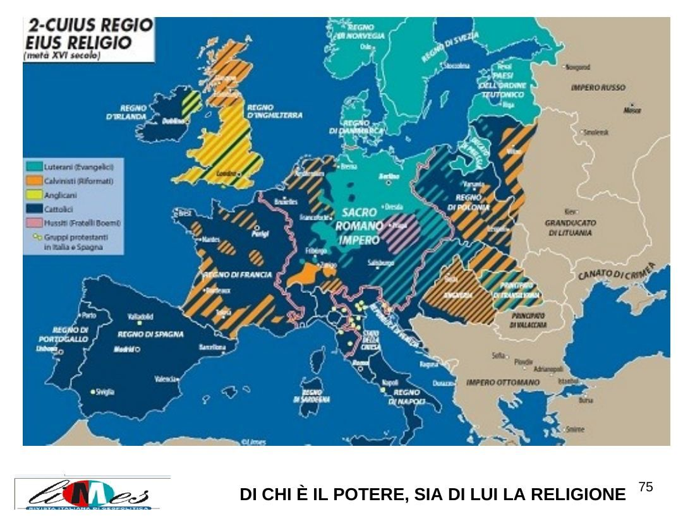{ loading=lazy style="width:48%" }

**CUIUS REGIO, EIUS RELIGIO**

Risale al trattato della Pace di Augusta del 1555.

Voleva dire che i prìncipi e le città libere potevano introdurre la fede luterana (lo *Ius reformandi*) nelle loro terre, continuando a godere di tutti gli stessi diritti degli Stati cattolici facenti parte dell’impero.

La popolazione di conseguenza doveva adottare la religione del principe; in caso contrario veniva concesso il diritto di emigrare.

Max Weber attribuisce ai paesi che dopo la Pace di Augusta caddero sotto il protestantesimo la partenza dello spirito capitalistico occidentale, al contrario dei paesi che rimasero nell’ambito cattolico e ortodosso.

2:09:08

Max Weber attribuisce ai paesi che hanno aderito al protestantesimo la partenza dello spirito occidentale, al contrario di quelli rimasti nell’alveo cattolico, che invece sono rimasti un po’ indietro. Se pensiamo per esempio che fino al Novecento c’erano ancora dei sovrani per diritto ereditario, e la matrice protestante si era evoluta in questo senso. Però bisogna anche dire che l’etica protestante in realtà era iniziata qualche tempo prima. Per questo ci facciamo aiutare da un quadro, bellissimo tra l’altro, di Van Eyck: i *Coniugi Arnolfini*. Vediamo un po’ di scoprirlo.

**L’ETICA PROTESTANTE**

Nello stesso tempo (ultimi due secoli) si ha l’ascesa della scienza economica (di matrice protestante), che soppianta la classica tripartizione indoeuropea studiata da Dumézil (indiani, persiani, greci, romani, germani, celti) per la gestione della società (a parte il re):

– guerrieri;

– sacerdoti (tutori della legge, in senso moderno);

– agricoltori (ora non ci sono più, e l’abbiamo visto nella serata sul cibo).

Se ci pensiamo, all’inizio del Novecento c’erano ancora dei sovrani per diritto ereditario, e gli economisti erano ancora semplici consiglieri; e dove non c’erano sovrani c’erano (e ci sono stati) dei militari.

Ora gli economisti sono a capo dei governi e degli Stati: hanno preso il posto del diritto e della giurisprudenza.

2:10:13

Questo è il quadro: è del 1434, conservato a Londra alla National Gallery. È uno dei non molti quadri nella pittura che osa la «messa in abisso», la *mise en abyme*, come dicono i francesi. Viene dall’araldica medievale, dove sullo scudo del soldato si disegnava uno scudo che a sua volta conteneva uno scudo, che a sua volta ecc.: quindi un abisso nella prospettiva. In chiave moderna viene poi ripescata da André Gide, nel 1893. Questa è la prima immagine che vediamo sulla sinistra: è lo specchio in fondo al quadro, dove si vede che ci sono dei testimoni che, guardando il quadro, non si notano subito. È appunto l’abisso, che appare sapendolo vedere e ritorna a noi. Questo è il contratto di matrimonio dei coniugi Arnolfini.

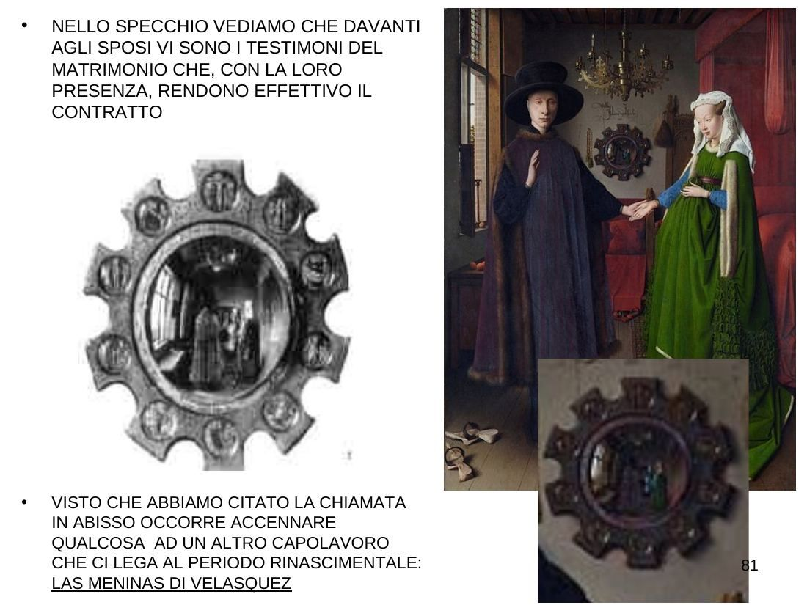{ loading=lazy style="width:47%" }

**I *CONIUGI ARNOLFINI* – JAN VAN EYCK, 1434 – LONDRA, NATIONAL GALLERY**

È uno dei (non molti) quadri che osano la chiamata in abisso: sullo sfondo c’è uno specchio che rispecchia la coppia, che a sua volta rispecchia, e così via.

La *mise en abyme*\*, la chiamano i francesi: la chiamata in abisso (*abyssus abyssum invocat*).

Viene dall’araldica medievale, dove il centro dello scudo si chiamava appunto *abyme*: il cavaliere faceva dipingere nel mezzo una riproduzione dello scudo medesimo, che a sua volta…

Nello specchio vediamo che davanti agli sposi vi sono i testimoni del matrimonio, che con la loro presenza rendono effettivo il contratto.

\* in chiave moderna la riprende André Gide, che la utilizza per la prima volta nel suo *Diario* nel 1893.

2:11:36

Un altro quadro, visto che abbiamo citato la *mise en abyme*, è *Las Meninas* di Velázquez, uno dei quadri più studiati al mondo, sostanzialmente. È questo. Se ci estraniamo un po’ dai protagonisti che vengono in evidenza nella parte anteriore del quadro, vediamo che nella parte in fondo ci sono due Velázquez: uno è questo, il pittore, intento a dipingere; l’altro è un maresciallo di palazzo, che è nel vano della porta sullo sfondo del quadro. In mezzo ai due c’è uno specchio, con una coppia illustre: Filippo IV di Spagna con sua moglie, la regina Marianna d’Austria. A sinistra c’è la tela a cui Velázquez lavora. A destra ci sono dei personaggi minori, in questo caso due nani, una femmina e un maschio, e sullo sfondo due servitori. Poi nell’oscurità, quassù, ci sono due grandi tele: Atena che punisce Aracne, di Rubens, e una copia della contesa di Apollo e Pan, di Jordaens. Questo è un quadro che richiama la *mise en abyme*, come si dice.

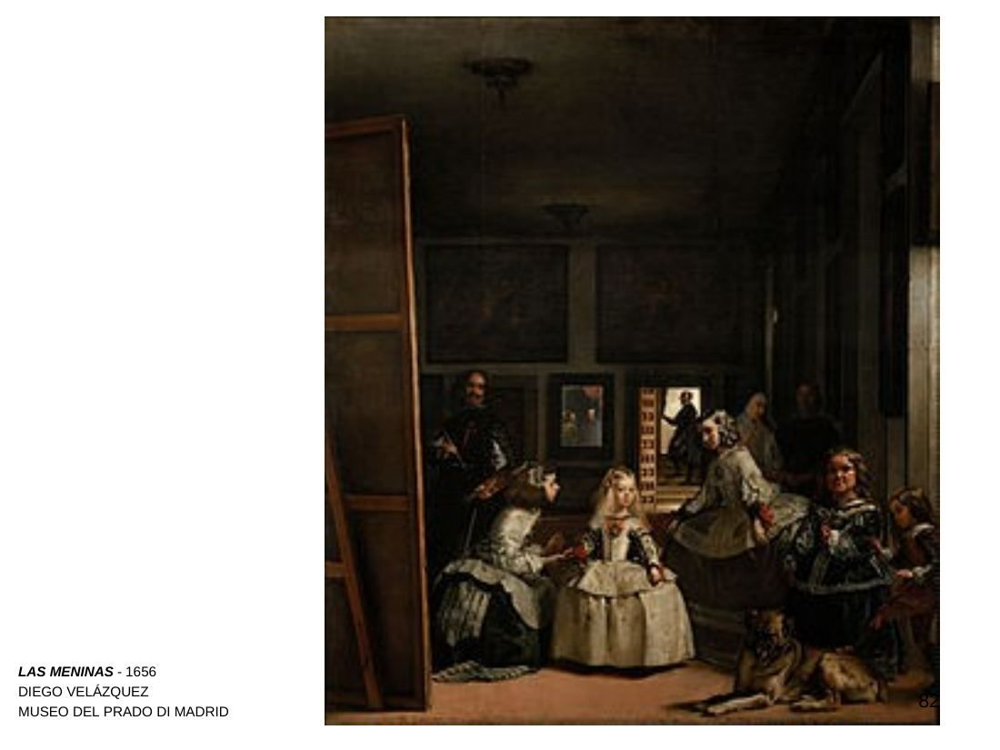{ loading=lazy style="width:59%" }

**LAS MENINAS* (LE DAMIGELLE DI CORTE) – DIEGO VELÁZQUEZ, 1656 – MADRID, MUSEO DEL PRADO**

In primo luogo il ritratto di una bambina di cinque anni, Margherita, l’infanta di Spagna: andrà in sposa a Leopoldo I d’Austria e morirà giovanissima, lasciando di sé soprattutto quest’immagine.

Però il quadro non si ferma a questa rappresentazione. La bambina ha chiesto dell’acqua, che le viene portata in un bucchero rosso da María Agustina Sarmiento, una giovane aristocratica, cui fa da contrappunto la figura di un’altra giovane, Isabel de Velasco, figlia del Conte di Colmenares.

Ma il quadro si complica se guardiamo oltre la figura in primo piano. Si vedono allora le figure dei due Velázquez: l’uno, il pittore, intento a dipingere una grande tela che si nega al nostro sguardo; l’altro, un maresciallo di palazzo che in comune con il pittore ha solo il cognome e che, prima di abbandonare la scena del dipinto, si volge verso di noi, disponendo la sua persona nella cornice della porta.

In mezzo ai due, uno specchio riflette una coppia illustre: Filippo IV di Spagna con sua moglie, la regina Marianna d’Austria.

A sinistra il dipinto è occupato dalla grande tela cui Diego Velázquez lavora. A destra compaiono altri personaggi minori: in primo piano vi sono due nani, l’una con le mani giunte, l’altro intento a stuzzicare un grosso e pacifico cane, mentre sullo sfondo vi sono due servitori che conversano tra loro, anche se uno si è proprio ora rivolto verso di noi.

Immerse nell’oscurità, sulla parete che chiude la stanza, vi sono infine alcune grandi tele di soggetto mitologico: *Atena che punisce Aracne* di Rubens e una copia della *Contesa di Apollo e Pan* di Jordaens.

Su questo dipinto c’è un saggio intitolato *Le damigelle d’onore*, raccolto in *Le parole e le cose* (1966), dove Foucault analizza il capolavoro di Velázquez e parla di un concetto centrale nella filosofia moderna, cioè del concetto filosofico di rappresentazione (di cui Lorenzo ci ha parlato tante volte, ma che in fondo non abbiamo capito bene…).

Il quadro è stato studiato a fondo: per esempio in un saggio del 1980 di Snyder e Cohen (*Riflessioni su Las Meninas: il paradosso perduto. Risposta critica*), con la restituzione prospettica.

2:13:28

Su questo dipinto c’è stato un saggio importantissimo di Foucault, a cui si sono rifatti tanti filosofi; si chiamava *Le damigelle d’onore*, raccolto in *Le parole e le cose* (1966), e strutturalmente smontava il concetto filosofico di rappresentazione. Lorenzo ce ne ha parlato tante volte, l’ultima quando siamo andati a Milano al Museo del Novecento: noi forse non l’abbiamo ancora ben capito, ma è il nostro maestro, ce lo ridirà probabilmente un’altra volta. Quello che è importante è che questo quadro è stato smontato: ci sono state comitive di studiosi che, dietro a questi saggi, sono andate a vederlo dal vivo, a Madrid. Uno dei più famosi studi è questo di Joel Snyder e Ted Cohen, del 1980: vedete che ricostruisce prospetticamente il quadro. Questo è il quadro dal vero; sulla sinistra invece c’è la ricostruzione prospettica della stanza in cui si svolge la scena.

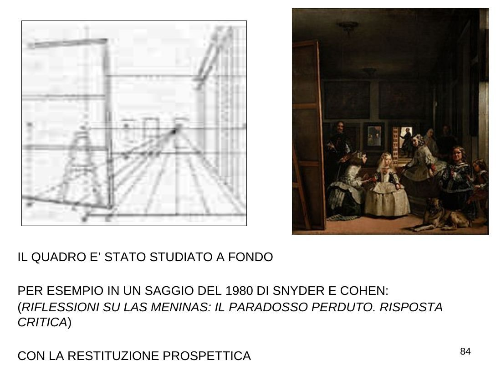{ loading=lazy style="width:59%" }

2:14:40

Però tutto questo è interessante, dal punto di vista del nostro concetto di Occidente di stasera, per un motivo particolare: sia il quadro degli Arnolfini sia il quadro di Velázquez non avrebbero potuto esistere se non ci fosse stato il Rinascimento italiano, che aveva scoperto la prospettiva e l’ordine. Qui c’è la famosa *Città ideale* di Urbino, attribuita tra gli altri a Leon Battista Alberti, con la piazza e la prospettiva fondamentale. Il primo forse a usarla in pittura fu Masaccio, nella Trinità che è a Santa Maria Novella a Firenze. Questi sono i pilastri su cui poggia da questo momento in avanti l’Occidente: è la prospettiva che ha reso poi possibili questi due quadri, questi due capolavori.

Questi due quadri sulla chiamata in abisso, con i loro significati, non sarebbero esistiti se non ci fosse stata la nascita, nella Toscana del Rinascimento, del concetto di prospettiva e proporzione.

– *Città ideale*, Urbino, Galleria Nazionale delle Marche (attribuita tra gli altri a Leon Battista Alberti, 1404-1472);

– Masaccio, *Trinità* (1425-1427), Firenze, Santa Maria Novella.

Tutto parte dagli studi del Brunelleschi, che con ordine scientifico arrivò alla rappresentazione degli edifici in prospettiva: concetti che sono stati i pilastri su cui si è costruita tutta la cultura occidentale da quel momento in avanti.

L’ordine dei calcoli nell’urbanistica (e, l’abbiamo visto, nella pittura) si affianca alla nascita dell’ordine nei bilanci e nella tenuta dei conti.

2:15:40

E si fondavano su due personaggi importanti, Luca Pacioli e Leonardo, che fecero insieme la *Divina proporzione*, dove mettevano insieme la proporzione dando senso al mondo: la proporzione nell’architettura, nelle strade, nell’urbanistica, e la proporzione nell’economia, nel dare senso, forma e ordine all’economia, che fino a quel momento non lo aveva. In questo periodo si introduce per esempio la partita doppia, e la si deve a fra’ Luca Pacioli.

**DE DIVINA PROPORTIONE**

Ritratto di Luca Pacioli, attribuito a Jacopo de’ Barbari, 1495 (attribuzione controversa).

L’introduzione della partita doppia nell’economia e della prospettiva nella pittura consentono:

– la collocazione di una molteplicità di fenomeni in uno spazio matematicamente strutturato;

– la comprensione immediata delle cose e delle loro relazioni.

La partita doppia in economia e la prospettiva nella pittura ricercano la bellezza nella comprensione di ciò che ci sta davanti, per quanto complesso.

2:16:27

Ma ritorniamo un attimo al quadro da cui siamo partiti e ai suoi significati occidentali. Gli Arnolfini in realtà erano di Lucca, ma vivevano nelle Fiandre, perché erano mercanti, erano banchieri che erano andati a lavorare là. È lì che si comincia a costruire l’Europa, in quel momento lì. Per esempio, è da quella scuola toscana, da quel periodo italiano, che nasce la base dell’economia; e in quel momento si inventa il «salterello», come lo chiamavano loro, che non è altro che il moltiplicatore che poi Keynes avrebbe teorizzato: cioè una certa cifra, 10, messa nel ciclo economico, alla fine si trasforma in 30, perché il ciclo economico di sviluppo e produzione era stato inventato in quel momento.

**MA TORNIAMO AL NOSTRO QUADRO E AI SUOI SIGNIFICATI OCCIDENTALI**

Gli Arnolfini erano di Lucca, erano i nuovi borghesi europei e vivevano nelle Fiandre. Facevano i finanzieri e i mercanti, insieme a tanti altri toscani: tutti prestavano soldi a principi e sovrani.

Erano uomini che provenivano da quella scuola che aveva gettato le basi dell’economia moderna:

– «il salterello», ad esempio, cinque secoli prima di Keynes: il moltiplicatore, lo stratagemma per cui, immettendo nel circolo economico 10, ne ricavi dopo 30.

2:17:24

Gli Arnolfini, abbiamo detto, erano di Lucca, e Lucca ci porta a un altro tema, che è quello della Riforma protestante. I protestanti a noi italiani, cattolici, hanno sempre un po’ imputato il carattere dell’obbedienza e non quello della responsabilità. C’è stato recentemente, una settimana fa, mi pare, il giuramento di Obama, e lui giura sulla Bibbia che fu di Abramo Lincoln: questo è fondamentale per capire la distinzione che c’è tra il mondo cattolico, di tipo italiano, e quello invece di matrice protestante. Lui giura sulla Bibbia, e questo ci riporta alla Riforma protestante di quel periodo.

2:18:12

Lucca è importante da questo punto di vista, perché è una delle poche città in Italia dove circolavano effettivamente l’informazione e la cultura protestante. A Lucca, per esempio, nascondevano i libri nei bauli, nelle merci che esportavano all’estero, e facevano circolare i testi protestanti. Questo è stato ricostruito magistralmente in un saggio che si chiama *Una città infetta* (Olschki, 1994), di Simonetta Adorni-Braccesi, una storica che ha ricostruito dalle lettere, dai documenti del tempo, tutta questa vicenda. Per dire che Lucca fu l’unico posto in Italia dove un tribunale emise delle sentenze capitali, ma nessuna fu mai eseguita: è l’unico posto in Italia dove la Controriforma non ebbe questo effetto.

2:19:15

Un’altra innovazione bellissima dal punto di vista civico: altrove i registri dell’Inquisizione, per esempio, si conservavano per sempre; a Lucca fu imposta la distruzione dopo cinque anni, quindi si perdeva la memoria di quello che uno eventualmente aveva fatto nei cinque anni precedenti. E questo è un grande senso di civiltà, introdotto in quel periodo. Se pensate alla centrale rischi di oggi: non è molto che è stata introdotta la norma per cui, se uno non paga, viene cancellato dopo un certo periodo di tempo. Prima esisteva per sempre: «Lorenzo Poggi» era la gogna, così come a quel tempo di chi era stato accusato di eresia veniva conservata la memoria. A Lucca invece questo non succede: gli archivi vengono bruciati dopo cinque anni. Questa è una grande conquista di civiltà.

**LUCCA E LA RIFORMA**

A proposito di Lucca, è interessante ricordare che la città giocò un ruolo importante nel confronto tra la visione di Roma e quella della Riforma protestante, e quindi nell’azione dell’Inquisizione.

La Lucca del Cinquecento, nella sua natura «protestante», contro l’ideologia di Roma, pubblicava e nascondeva nelle attività commerciali i libri e le pubblicazioni protestanti: *Una città infetta. La Repubblica di Lucca nella crisi religiosa del Cinquecento*, Simonetta Adorni-Braccesi (Olschki, Firenze, 1994).

La Repubblica di Lucca, per evitare ingerenze da Roma, aveva creato nel maggio del 1545 un suo «officio sopra la religione», guidato da un gonfaloniere di giustizia e da tre cittadini eletti dal consiglio generale della città: idea che però non piacque all’Inquisizione.

Lucca fu l’unico territorio italiano ad avere un tribunale secolare per i crimini contro la fede. Furono sì emesse sentenze capitali, ma nessun eretico fu mai giustiziato.

A Lucca venne adottata una norma assai importante contro l’accanimento della memoria: quella che imponeva ogni cinque anni la distruzione dei registri dell’Inquisizione (oggi: gli archivi CRIF/CR).

Quindi l’esempio della storia degli Arnolfini ci racconta il legame profondo tra l’Italia del Cinquecento e la nascita dell’etica protestante: anche se l’anatema «protestanti» non si abbatté solo sulla città, ma anche su Francesco Arnolfini (probabile discendente di Giovanni), che abiurò.

2:20:21

L’etica protestante nasce dal Rinascimento italiano e da uomini come i coniugi Arnolfini, che erano andati nelle Fiandre: il mondo occidentale nasce da quel momento. È la cultura protestante che si è appropriata di quelle innovazioni italiane, innovandole, facendole rendere diversamente, ma che in realtà affondavano le radici, come abbiamo visto, in quello che era nato in quel periodo fondamentale di due o tre secoli che abbiamo accennato prima.

2:21:03

Ci sono quattro testi fondamentali che hanno tradotto tutta questa cultura in un’etica protestante. Adam Smith, lo conosciamo tutti: il macellaio non ci dà la carne perché è buono, ma ce la dà perché ne trae un guadagno; e così noi soddisfiamo la nostra fame, perché mangiamo quella carne che lui ci vende. Max Weber, che abbiamo citato prima, *L’etica protestante e lo spirito del capitalismo*: lui fa risalire lo spirito del capitalismo all’etica protestante, dicendo che il lavoro non è una punizione o una colpa, bensì una vocazione; quindi è da questa che lo spirito capitalistico trae la sua linfa. Schumpeter, *Teoria dello sviluppo economico*, teorizza il processo di distruzione creatrice, e qui si introduce un altro elemento, quello della fine che però si rinnova: a un certo punto il capitalismo distrugge costantemente una parte di se stesso per rinascere più forte di prima.

**L’ETICA PROTESTANTE**

Da questo punto l’etica protestante si è manifestata nel mondo, ergendosi ad attore supremo (e migliore…) della scena mondiale, riprendendo e reinterpretando le innovazioni medievali e rinascimentali italiane (basti pensare al capitale sociale dei comuni italiani).

E quale potenza culturale abbia prodotto questa interpretazione protestante…: la «propaganda» segue il potere… il modello occidentale di democrazia è il punto di riferimento per tutto il mondo.

Un’etica protestante che si è edificata basandosi prevalentemente sul terreno italiano, della filosofia cattolica, come abbiamo visto prima, reinterpretandolo e rendendolo più in linea con le mutazioni che l’Occidente stava creando, che la Chiesa forse non era più in grado di capire.

Cito a questo proposito, ad esempio, 4 autori e testi fondamentali:

– Adam Smith, 1776, *La ricchezza delle nazioni* (la mano invisibile e il macellaio…);

– Max Weber, 1904-1905, *L’etica protestante e lo spirito del capitalismo* (il lavoro non costituisce una punizione o una colpa, bensì una vocazione);

– Schumpeter, 1912, *Teoria dello sviluppo economico* (teorizza il processo di distruzione creatrice);

– Spengler, 1918-1922, *Il tramonto dell’Occidente*.

**ADAM SMITH: LA MANO INVISIBILE DELL’ECONOMIA**

La separazione tra peccato e peccatore non si fermerà, una volta aperta la strada, a questo aspetto, ma sfocerà più avanti anche nella separazione tra società civile e Stato.

Nasce così la *Mano invisibile* di Adam Smith (il famoso macellaio), e le dinamiche del mercato, come diversa impostazione di autorganizzazione economica e sociale.

«Non è dalla benevolenza del macellaio, del birraio o del fornaio che noi ci aspettiamo la nostra cena, ma dal loro rispetto nei confronti del loro stesso interesse. Noi ci rivolgiamo non alla loro umanità ma al loro amor proprio, e non parliamo loro delle nostre necessità ma della loro convenienza» (Adam Smith, *La ricchezza delle nazioni*, 1776).

**MAX WEBER: L’ETICA PROTESTANTE DEL CAPITALISMO**

Eccessiva considerazione di Max Weber sull’idea delle origini protestanti del capitalismo: troppo mitizzata la sua tesi sull’etica protestante del capitalismo.

La sua opera più famosa è il saggio *L’etica protestante e lo spirito del capitalismo*.

Per il calvinista il lavoro non costituisce una punizione o una colpa, bensì una vocazione.

Invece in realtà diverse da quella occidentale, come per esempio la Cina, l’India, l’Islam, tramite le religioni ivi professate, il lavoro non è contemplato come strumento di accumulazione indefinita di ricchezza nell’adempimento di un dovere terreno:

– il dovere sociale del lavoro e del guadagno, oltre che l’arricchimento personale, è la parola chiave.

– il lavoro diventa allora un semplice mezzo per conseguire un equilibrio o uno stato di felicità.

**SCHUMPETER: LA DISTRUZIONE CREATRICE**

Dalla fine rinasce la spinta alla rinascita economica: ogni tanto occorre spazzare via tutte le incrostazioni per ripartire daccapo.

In forme più soft, Galbraith diceva che per fortuna ogni tanto il capitalismo toglie i soldi agli idioti e li ridistribuisce a chi è più capace. John K. Galbraith: «Il bello del capitalismo è che ogni tanto vi succede qualcosa per cui il denaro viene separato dagli imbecilli».

Teorizza il processo di distruzione creatrice: *Teoria dello sviluppo economico* (1912).

La caratterizzazione data, ad esempio, dall’economia borghese, che sostituisce i vecchi modi di produrre e pensare, promuovendo lo sviluppo, ma distrugge anche i valori tipici dell’*ancien régime*.

L’imprenditore, nato da questa parte della società, intraprende tutte quelle azioni come aprire nuovi mercati di clientela, introdurre nuovi prodotti, mettere in campo le innovazioni tecnologiche, e cambia l’organizzazione dei meccanismi produttivi.

Il credito (e il relativo debito, che vedremo nella prossima serata), cioè i capitali che la società occidentale gli mette a disposizione attraverso le istituzioni finanziarie, gli permette di investire e di guadagnare.

Con una parte dei guadagni-profitti (ormai liberi dal pericolo di usura) ripaga gli interessi e il capitale dei prestiti per la sua attività.

Quando questo non funziona più, ci saranno altri che con innovazioni più incisive ne prenderanno il posto, e il ciclo ripartirà.

2:22:24

Fino a Spengler, *Il tramonto dell’Occidente*, dove teorizza che l’Occidente, come abbiamo detto prima, ha dentro di sé i germi della decadenza, che prima o poi verranno fuori. Spengler in fondo raccoglie questo filo profondo che passa attraverso tutti i secoli, e traccia il filo conduttore di tutto l’Occidente. Se ci pensiamo, anche noi abbiamo avuto recentemente l’immane tragedia dell’Olocausto, nata all’interno di questo nostro mondo. In temi un po’ più leggeri, pensiamo al decadentismo: il decadentismo di per sé è simbolo di fine. Questo è il *Giovane decadente* (*Jove decadent*, 1899) di Ramon Casas, di Barcellona: una giovane abbandonata su un divano. O il capolavoro di Thomas Mann, *La montagna magica*: la decadenza occidentale, le slitte di Davos con sopra i cadaveri che scendevano a valle. A Davos ora c’è il meeting economico che disegna i destini di tutti i paesi del mondo: quindi è una località che è proprio nel cuore dell’Europa, dell’Europa protestante.

**SPENGLER: IL PESSIMISMO ECONOMICO INTELLETTUALE**

LA CADUTA DEGLI DEI…

*Il tramonto dell’Occidente* (1918-1922), Oswald Spengler (1880-1936):

«Una cultura nasce nell’attimo in cui una grande anima si desta dallo stato psichico originario dell’eternità eternamente fanciulla e se ne distacca, come una forma da ciò che è privo di forma, come qualcosa di limitato e di perituro dall’illimitato e dal permanente. Essa fiorisce sulla base di un territorio delimitabile in modo preciso, al quale rimane vincolata come una pianta. Una cultura perisce quando quest’anima ha realizzato l’intera somma delle sue possibilità sotto forma di popoli, di lingue, di dottrine religiose, di arti, di stati e di scienze, ritornando quindi nel grembo della spiritualità originaria».

La filosofia della fine (che abbiamo visto la volta scorsa…).

Spengler, in fondo, raccoglie il filo profondo dell’Occidente che periodicamente si riaffaccia, della distruzione e della fine autodistruttiva: mantiene dentro di sé i segni del declino e della fine, quasi come un talismano, un esorcismo…

Basti pensare al male assoluto dell’Olocausto; ma anche, con conseguenze molto meno gravi, al decadentismo o a certi romanzi europei.

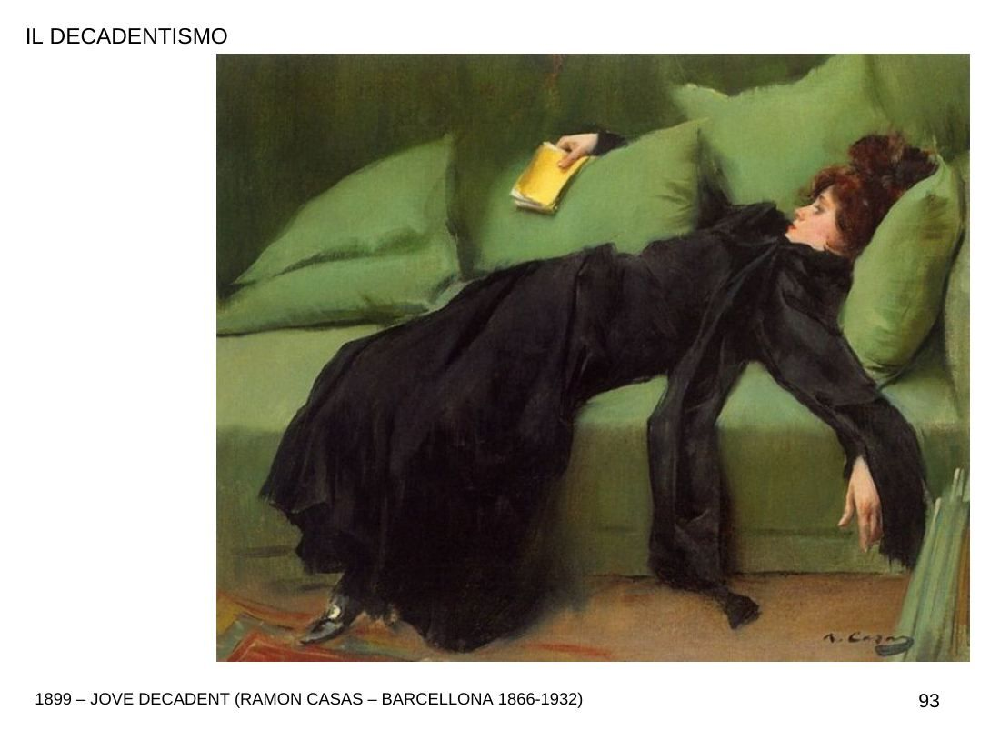{ loading=lazy style="width:45%" }

**IL DECADENTISMO**

Ramon Casas (Barcellona, 1866-1932), *Jove decadent* (1899).

Il decadentismo è quel movimento artistico e letterario che si sviluppò in Europa nella seconda metà dell’Ottocento e arrivò fino agli inizi del Novecento.

Il movimento si contrappone alla razionalità e al positivismo della scienza.

Il termine decadentismo ripropone proprio l’idea del crollo interno, insito, della civiltà: naturalmente si parla della civiltà occidentale e della sua razionalità.

**LA DECADENZA OCCIDENTALE**

*La montagna magica* (1924) di Thomas Mann (il sanatorio e le slitte di Davos con sopra i cadaveri…): simbolo della decadenza occidentale.

Nel prologo a *La montagna magica* (traduzione di Renata Colorni), ovvero nella premessa a *La montagna incantata* (traduzione di Ervino Pocar), Thomas Mann si prepara a raccontare la storia di Hans Castorp, «un giovane uomo come tanti» \[Colorni\] («un semplice giovanotto» \[Pocar\]), «in modo preciso e minuzioso» \[Colorni\] («con esattezza e a fondo» \[Pocar\]), poiché ritiene che «sia davvero avvincente solo ciò che viene approfondito in ogni dettaglio» \[Colorni\] («soltanto ciò che va in profondità riesce a divertire» \[Pocar\]). Al momento dell’addio, nel crogiolo della «voluttà smaniosa e maligna» \[Colorni\] («febbre maligna» \[Pocar\]) della guerra, constateremo che è stato di parola: nessun dettaglio ci è stato risparmiato.

2:23:58

Allora, proviamo a vedere qualche previsione sul futuro, per orientarci un po’ su quello che può darsi che ci accada: l’Occidente, che è stato il motore e il protagonista del mondo negli ultimi tre, quattro secoli, può darsi che nei prossimi anni non lo sia più del tutto. Prendendo le previsioni di Angus Maddison, il PIL del 2003 dei paesi ricchi, cioè quelli occidentali, equivaleva sostanzialmente più o meno al 50% di tutto il PIL mondiale; nel 2030 sarà più o meno intorno al 36%, quindi avremo perso una bella fetta dell’egemonia di cui parlavamo all’inizio. Ma se guardiamo la popolazione, il dato è ancora più drammatico: dal 2003 al 2030 nel mondo cresceremo di quasi 2 miliardi di persone, un miliardo e 8, di cui solo il 4,2% sarà nei paesi ricchi; tutto il resto sarà nel resto del mondo. Quindi anche la popolazione, la forza, la massa delle persone, non sarà più nella parte ricca, cioè in noi, nel mondo occidentale, ma nel resto del mondo.

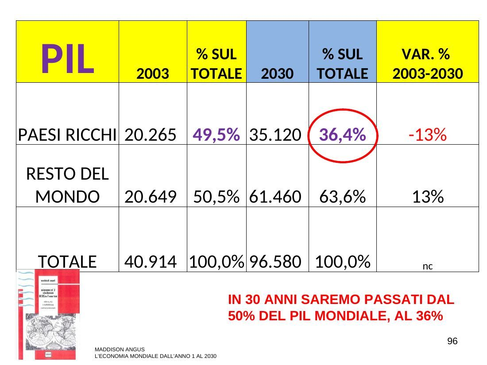{ loading=lazy style="width:47%" }

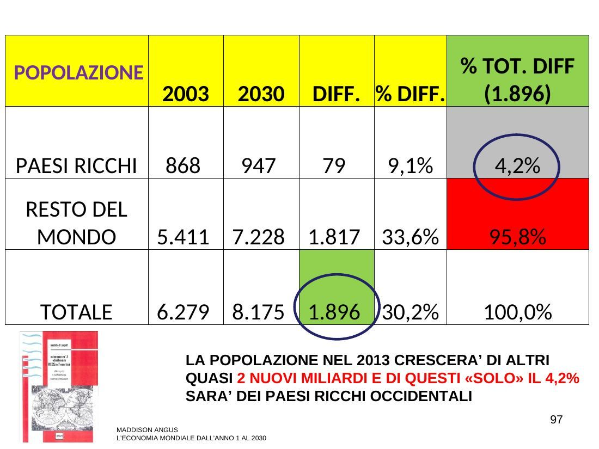{ loading=lazy style="width:47%" }

2:25:38

Allora, per tirare qualche conclusione di quello che abbiamo detto: credo che nessuno sappia esattamente, al di là di quei numeri, che possono essere considerati interessanti, quello che succederà; la realtà può darsi che ci si avvicini, ma può darsi anche che sia in qualche modo diversa. Di sicuro in questo momento nel mondo occidentale ci sono all’incirca due visioni del mondo, un po’ figlie di quel trattato di Augusta del 1555 che abbiamo citato prima. Sintetizzando, ci sono due visioni. La visione germanocentrica, luterana: Lutero diceva che l’uomo è immerso nel peccato e non ha quasi nessuna possibilità di redimersi, e solo la fede, solo Dio lo può salvare. Questa è la concezione della Germania, sostanzialmente, dello sviluppo del mondo occidentale: prima il rigore, dopo lo sviluppo. La Merkel, lo stesso Monti, si muovono in questa direzione, che si rifà a quei concetti dell’etica protestante che abbiamo detto prima, a quella particolare corrente dell’etica protestante: il paradiso verrà, ma solo dopo che avremo espiato tutti i nostri peccati.

2:27:21

La seconda visione del mondo (per fortuna ce n’è anche un’altra, perché in questo momento l’etica protestante è quella che ha preso il sopravvento nella concezione del mondo rispetto a quella cattolica) è quella un po’ calvinista. Il calvinista invece sostiene che Dio ci ha dato la responsabilità di quello che facciamo, e l’etica calvinista è quella che ha sposato sostanzialmente, per esempio, Obama. Allora non è più prima il rigore e dopo lo sviluppo, ma il contrario: prima lo sviluppo e poi il rigore. Le due concezioni sono diametralmente opposte e del tutto diverse l’una dall’altra, anche se provengono dalla stessa radice che, abbiamo visto, risale al 1555. Quale prevarrà? Non lo so; spero la seconda, personalmente, però non lo so. Per questo lascio la parola a Lorenzo per le sue conclusioni.

Credo che nessuno sappia esattamente dove si stia andando.

In questo momento si stanno confrontando due visioni del mondo, per quanto riguarda lo sviluppo economico occidentale, e sono figlie in qualche modo del trattato di Augusta del 1555:

– la visione germanocentrica, luterana\*, dell’economia: prima il rigore e solo dopo lo sviluppo (Merkel, Monti…); il paradiso verrà dopo l’espiazione dei peccati; peccato = debito (ma questo l’affronteremo nella prossima serata);

– la visione calvinista\*\* dei padri pellegrini fondatori, meno rigorista (Obama…): prima lo sviluppo e dopo il rigore (nel caso contrario saremo tutti morti quando ci sarà nuovamente lo sviluppo…).

\* LUTERO (1483-1546): L’uomo è completamente immerso nel peccato e non ha alcuna possibilità di redimersi con le sue sole forze. Solo la fede lo può salvare. Dio ordina tutto, l’essere e l’agire umano compresi: non vi è posto per il libero arbitrio, che comprometterebbe la meritorietà del credente (rendendo così inconciliabile la predestinazione dell’uomo con la bontà di Dio).

\*\* CALVINO (1509-1564): È Dio che rende la creatura umana veramente responsabile. Per questo le ha affidato la responsabilità di agire, anche se tende ad abusare delle sue abilità per arricchirsi e distruggere gli altri uomini. Il cristiano, proprio per la sua responsabilità di fronte a Dio, trova il suo dovere nello sviluppo suo e della società.

**RIGORE DELLE ISTITUZIONI INTERNAZIONALI (FMI, BCE, UE): L’AUTOCRITICA**

I modelli matematici si sono rivelati clamorosamente sbagliati, e per fortuna sembra esserci una consapevolezza: un punto in più di pressione fiscale non genera un punto di recessione, come si stimava, bensì 2,5 punti. Da quando è iniziata la recessione, per ogni euro di austerità il PIL ha perso un valore compreso tra 0,9 e 1,7 euro.

L’*OUTING* DEL FMI RIPORTATO DA PANERAI – *MF*, 19 GENNAIO 2013.

2:28:27

Lorenzo Poggi Allora, proseguiamo un attimo il nostro tentativo di individuare quali sono i caratteri che ancora individuano gli occidentali. Paolo ne ha espressi chiaramente alcuni, legati strettamente anche alla concezione religiosa: non c’è nessuna concezione civile che non abbia il suo precedente nella religione, questo va da sé. E anche per quanto riguarda il discorso sull’arte, mi sembra chiarissimo: la rappresentazione simbolica del mondo non è stata solo nei fatti dell’economia, ma anche nell’arte; l’arte l’ha simbolizzata molto bene. La prospettiva non è solo mettere in ordine le cose all’interno dello spazio del quadro: è dare un ordine proporzionale e prospettico che riguarda anche il modo di concepire la storia, e riguarda anche il punto di vista dell’uomo sul mondo. La prospettiva è scegliere un punto di vista, che è il punto di vista dello spettatore umano sulle cose, e dire che quello è il punto di vista che è la verità, è il punto di vista sul mondo. È Lorenzo Valla, antiche degli capi nuovi: cioè è questo che spetta a noi.

2:30:09

C’è un punto fondamentale. Avevamo parlato prima della scienza come strumento astratto di dominio sul mondo: è un carattere essenziale, direi il punto di arrivo più importante dell’Occidente, è la sua caratteristica. L’Occidente si è affermato proprio per lo sviluppo della sua industria, che è derivata dalla scienza moderna. Ma c’è qualcosa di più. Controllare il mondo: perché? Perché la scienza e la tecnica sono degli strumenti efficacissimi, che funzionano per controllare la realtà. E la realtà la si può controllare perché? Perché in qualche modo dipende da noi. Non è più il pensiero greco: non possiamo più controllare il mondo perché il mondo comunque ha un limite, il controllo ha un limite, oltre un certo limite non si può andare. Con il pensiero giudaico-cristiano, abbiamo detto, questo limite è valicato: si può controllare il mondo, lo si può controllare fino in fondo, e il modo per controllarlo è la scienza.

2:31:30

Quando nasce la scienza moderna finisce in qualche modo la visione religiosa tradizionale, ma la scienza moderna mantiene della visione religiosa questo principio di controllo del mondo, per fini umani: ecco l’umanesimo. Quindi la scienza è lo strumento più valido, più razionale, più importante per controllare, per cercare gli strumenti più adatti al raggiungimento dei fini. C’è però a un certo momento un salto qualitativo, che comincia ad avvenire alla fine del Settecento. Alla fine del Settecento ci si rende ben conto del fatto che la conoscenza non è più conoscenza del mondo, non ci rivela più la natura, non comandiamo più alla natura: il mondo stesso è costruito a seconda della nostra conoscenza.

2:32:51

Immanuel Kant, nella prefazione alla Critica della ragion pura: nei confronti della natura non siamo come un bambino che ascolta tutto ciò che gli dice il maestro, ma come un giudice che fa confessare chi si è macchiato di un delitto; non ascolta tutto ciò che gli dice il testimone, ma gli fa le domande giuste per avere le risposte che gli consentono di arrivare alla verità. La scienza si struttura in modo tale che la natura deve rispondere: fa delle ipotesi, le ipotesi sono verificate dall’esperimento, e se l’esperimento le conferma le ipotesi diventano delle leggi di natura. Non c’è una natura prima: la natura viene dopo, è quella che risponde alle domande del giudice.

2:33:47

Questo regge finché non è tutto, e finché l’uomo ha una sua indipendenza: finché c’è ancora Dio che regge il mondo, l’uomo è figlio di Dio, è simile a lui, ed è in qualche modo dominatore del mondo, ma non è il mondo, per capirci. Che cosa succede? Succede però che a un certo momento si perde anche la soggettività: l’uomo stesso, come soggetto, diventa anche lui oggetto di conoscenza, diventa anche lui parte di questo stesso mondo, e quindi il modo di strutturare tutto il resto diventa anche il modo di strutturare l’uomo.

2:34:42

La crisi dell’Occidente non è nella grande razionalità, nella potenza della tecnologia e della scienza: quello è il grande vantaggio, è ciò che ha fatto della mentalità occidentale quella che ha dominato il mondo, rispetto all’Oriente, ancora fermo, abbiamo visto, alle caratteristiche individuali delle cose. Il punto debole è che questo pensiero tecnologico (alcuni filosofi l’hanno definito calcolante, quello della tecnologia) è diventato l’unico pensiero ammesso, l’unico presente.

2:35:33

Pensate a una cosa molto semplice, tipica: il linguaggio. Il linguaggio più diffuso, quello che è a fondamento dei nostri strumenti di calcolo, di tutti i computer, è un linguaggio fondato su una matematica duale: cioè, se lo vogliamo tradurre in parole, «sì», «no», al massimo «non so». E così si fanno anche i sondaggi. Non ci sono più delle persone che hanno delle opinioni: ci sono i «sondazzi»… no, «sondazzo» fa rima, non va bene. Ci sono i sondaggi. I sondaggi come sono? Sì, no, non so. L’ammissione all’università; una volta c’era l’esame di maturità, ora la maturità riguarda soltanto la frutta al supermercato: è un esame di Stato, ma è fatto come? Sì, no, non so. Il quiz è oggettivo; non lo so se è oggettivo: sì, no, non so. È una logica, un linguaggio duale.

2:37:07

Intervento dal pubblico Binario.

2:37:08

Lorenzo Poggi Binario, duale. E regge tutto. Non c’è l’umanità del termine. Pensate, questo è l’unico linguaggio con il quale si pensa di definire il mondo. Va benissimo finché si tratta di operare, di agire e di ottenere dei fini, ma non serve a stabilire la direzione e non serve a stabilire i fini, perché non è autoreferenziale. Quindi la crisi che c’è è crisi, è tramonto dell’umanità, che non riesce più a riscoprirsi all’interno di questo linguaggio che sta diventando l’unico linguaggio ammesso e dominante.

2:38:05

È razionale ciò che fai? Può essere approvato se risponde o no alla logica duale. È giusto ciò che fai? È giusto se risponde alle esigenze di un mercato. È giusto fare ricerca per trovare un farmaco che curi, che so, la malaria, uno dei mali più diffusi? No. Perché? Perché non conviene, perché chi ha la malaria non può pagare la ricerca. Dobbiamo chiederci se è giusto o no? Che ragionamenti fai, se è giusto o no? Ragionamenti se fare una ricerca sulla malaria sia o no in ordine con quella che è la logica e la consequenzialità. Questo è il linguaggio.

2:39:06

Pensate se questo stesso criterio lo applicassimo a quelle che ancora noi chiamiamo relazioni umane, alle relazioni e al linguaggio. Il linguaggio uguale al computer, binario, lo potremmo adoperare; pensate invece a un altro tipo di linguaggio. Se io sono innamorato di una donna, le posso dire semplicemente «Ti voglio bene?». D’accordo: sì, no, non so. Il linguaggio della vita, del mondo della vita, ha una ricchezza, un’ampiezza, uno spreco, un’abbondanza: lo sanno tutti quelli che hanno il figlio innamorato e gli pagano le bollette del telefono. Abbondanza anche per la bolletta: «Ma quanto ci stai? Ma non gliel’hai detto al compagno?» «Gliel’ho detto al compagno». No, è il mondo dell’emozione, il mondo della vita: è ancora quello che rimane in un linguaggio che non è più l’intelligenza che ha per fine l’astrazione.

2:40:27

Non è il dominio… vi ripeto, non è questo, vorrei essere molto chiaro, lo ridico: la scienza è il punto più elevato al quale è arrivata l’umanità, è lo strumento razionale più elevato che abbiamo mai avuto a disposizione; quindi quello della scienza e della tecnica è un punto di arrivo innegabilmente eccezionale. Il tramonto, il pericolo, è che divenga l’unico, che sopraffaccia tutti gli altri, e che tutti gli altri linguaggi non abbiano più diritto di cittadinanza. È troppo poca la libertà di parola all’interno dell’unico linguaggio: sarebbe più bella una libertà che consentisse anche la scelta in una pluralità di linguaggi.

2:41:30

Non abbiamo per il momento alternative, ma ci sono espressioni che tentano ancora di proporre linguaggi differenti nell’approccio alla realtà. L’arte, per esempio, è uno di questi. E anche nell’arte bisogna distinguere, perché spesso diventa strumento di mercato, è l’artista che è successo; ma è prima di tutto, finché rimane tale, anche espressione di emozione, di modo di sentire, di personalità irriducibile a qualsiasi elemento, che ha ancora tutta la sovrabbondanza, la vita, la complessità dell’esistente, di quell’umanesimo che va piano piano assottigliandosi e che invece era la premessa, la condizione che aveva giustificato anche l’esistenza, la potenza della scienza. Io ovvio spesso la mia opinione: il tema era difficilissimo, vi ringrazio di aver avuto la pazienza di ascoltare.

2:42:46

Paolo Marcucci Grazie, buonanotte a tutti, arrivederci alla prossima volta.

