# Debito e colpa

Quando tutto è monetizzabile, il debito è peccato  e il paradiso pareggio di bilancio nel libro contabile di Dio

**Data:** 28 febbraio 2013 
**Incontro con:** Lorenzo Poggi e Paolo Marcucci

**Interventi:** Paolo Marcucci Lorenzo Poggi Pubblico

0:01:55

Paolo Marcucci Buonasera a tutti. Allora, stasera parliamo di debito, e il sottotitolo era: *Quando tutto è monetizzabile, il debito è peccato e il paradiso pareggio di bilancio nel libro contabile di Dio*. Lorenzo è sempre perspicace nel trovare i titoli di queste nostre serate. Cercheremo appunto di parlare di questo argomento, che è un argomento, abbiamo visto, piuttosto vasto e profondo: cercheremo di approfondire certe parti un po’ più compiutamente, mentre altre le tralasceremo un po’, perché effettivamente l’argomento è molto ampio, davvero.

0:02:48

Allora, per iniziare vorrei riprendere dalla scorsa serata, quando abbiamo parlato dell’Occidente, e quindi dalla pace di Augusta del 1555. La pace di Augusta del 1555 fa da spartiacque tra l’Europa che c’era prima di quel periodo e quella che è venuta dopo, con la Riforma protestante, sostanzialmente, dove vengono in evidenza due correnti di pensiero: quella luterana e quella calvinista. Quella calvinista, semplificando, è quella che ha dato poi il via ai Padri Pellegrini, fondatori degli Stati Uniti d’America, sostanzialmente; mentre la parte luterana è quella che è rimasta nell’Europa centrale, in Germania.

0:04:01

La visione luterana è in un certo senso cattiva, da questo punto di vista: infatti dice che il paradiso viene dopo l’espiazione dei peccati e delle colpe; mentre quella calvinista è un po’ più liberale da questo punto di vista. Il debito come si introduce? Perché il debito, per la visione luterana, è una colpa. Infatti, se andiamo a vedere il vocabolario della lingua tedesca, il debito in tedesco si dice *Schuld*, che vuol dire anche colpo, fallo, colpa, colpevolezza. Questo è fondamentale, e nasce da questa idea del debito di questo mondo.

**CALVINO (1509–1564):**

È Dio che rende la creatura umana veramente responsabile. Per questo le ha affidato la responsabilità di agire anche se tende ad abusare delle sue abilità per arricchirsi e distruggere gli altri uomini.

Il cristiano, proprio per la sua responsabilità di fronte a Dio, trova il suo dovere nello sviluppo suo e della società.

**LUTERO (1483–1546):**

L’uomo è completamente immerso nel peccato e non ha alcuna possibilità di redimersi con le sue sole forze. Solo la fede lo può salvare.

Dio ordina tutto, l’essere e l’agire umano compresi, non vi è posto per il libero arbitrio che comprometterebbe la meritorietà del credente (rendendo così inconciliabile la predestinazione dell’uomo con la bontà di Dio).

RIGORE DELLE ISTITUZIONI INTERNAZIONALI: FMI, BCE, UE – AUTOCRITICA

I modelli matematici si sono rivelati sbagliati clamorosamente, e per fortuna sembra esserci una consapevolezza: un punto in più di pressione fiscale non genera un punto di recessione come si stimava, bensì 2,5 punti. Da quando è iniziata la recessione per ogni euro di austerità il PIL ha perso un valore compreso tra 0,9 e 1,7 euro.

0:04:44

Questo ci fa anche capire, per esempio, i debiti della Germania tra le due guerre, tra la prima e la seconda guerra mondiale, quando la Germania aveva un debito enorme presso gli altri paesi per i danni di guerra: come deve essere stato vissuto il debito dai tedeschi, da questo punto di vista? Infatti Hitler, appena salito al potere, sospende i pagamenti del debito, perché in questa loro visione la colpa che c’è nella concezione del debito doveva pesare molto, e non solo dal punto di vista economico.

**I DEBITI DELLA GERMANIA TRA LE DUE GUERRE**

I debiti di guerra della Germania della prima guerra mondiale ammontavano a 226 miliardi di marchi secondo il trattato di pace di Versailles.

Keynes il 7 giugno 1919 si dimise come rappresentante dell’Inghilterra dalla conferenza di Versailles, sostenendo il pericolo di queste politiche.

La Repubblica di Weimar va dal 1919 al 1933 e collassa per la crisi economica e le politiche di «pareggio di bilancio».

Una volta preso il potere, Adolf Hitler dichiara che la Germania sospende i pagamenti perché non più in grado di fare fronte alla restante cifra. Il paese è economicamente troppo stremato.

Al termine della seconda guerra mondiale, la Germania federale riprende a pagare il debito. Al 1952, erano stati versati un miliardo e mezzo di marchi. Nel 1953 i pagamenti vengono di nuovo sospesi in attesa della riunificazione, avvenuta nel 1990.

0:05:25

Abbiamo visto anche l’altra sera il debito e la partita doppia, perché la partita doppia, abbiamo visto, è un’invenzione della Toscana del Rinascimento, con Leonardo per la prospettiva e le intuizioni di Luca Pacioli per quanto riguarda la partita doppia. Allora, perché si chiama partita doppia? Vediamo qui un articolo in partita doppia, per chi non è un ragioniere o un economista. Sostanzialmente, quando si fa una registrazione di amministrazione, si chiama partita doppia perché ci sono sempre due articoli. Per esempio, se c’è un credito del signor Bianchi verso il signor Rossi, il signor Bianchi farà la scrittura «crediti» in dare e «cassa» in uscita, in avere, perché presta i soldi al signor Rossi. Dall’altra parte il signor Rossi farà «cassa» in dare e, in avere, il debito che sta contraendo. Questa è la partita doppia: crea sempre un legame tra il bilancio della persona e la relazione con l’altra persona con cui si entra in contatto. Debitore e creditore, in questo caso, sono sempre legati l’uno all’altro.

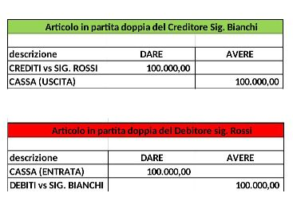{ loading=lazy style="width:46%" }

0:06:50

Questa per esempio è la rappresentazione dei debiti nel bilancio del sistema bancario italiano, che, sapete bene, vive sostanzialmente sui debiti, sia delle persone, ma anche propri. Naturalmente le banche i debiti li trasformano in crediti, perché prestano i soldi; però sostanzialmente, per prestare questi soldi, si indebitano. E sono, al di là delle cifre, che tanto non ci dicono niente, queste due strisce gialle che vedete. Questi sono i debiti che le banche fanno quando voi prestate i soldi alla banca, cioè quando fate i libretti o il conto corrente: è un debito che la banca accende presso di voi.

0:07:39

Sostanzialmente, però, anche il capitale che gli azionisti hanno dato alla banca o alla società è un debito che la società ha verso i propri azionisti. Perché è un debito? Perché gli azionisti poi vogliono essere pagati, vogliono essere remunerati. Questo è stato un problema negli ultimi anni del sistema bancario. Per esempio il Monte dei Paschi di Siena, per entrare nell’attualità: perché ha avuto tutti questi problemi? Ha avuto molti problemi perché la proprietà era la fondazione, che viveva di erogazioni sul territorio (anche qui a Montelupo ne abbiamo usufruito, per esempio c’è stata la ristrutturazione di un edificio, all’inizio, al museo del contemporaneo, dove abbiamo fatto un paio di serate); e per fare erogazioni bisognava che la banca guadagnasse, sennò non poteva sovvenzionare la fondazione.

0:08:45

Oppure tutte le banche tedesche: molte casse di risparmio tedesche hanno questa caratteristica, cioè sono banche che vivono a contatto con il territorio, e per essere a contatto con il territorio hanno bisogno di introiti. Da dove provengono gli introiti? Provengono dalle speculazioni finanziarie, che sono ad alto rischio e ad alto rendimento: quando vanno bene c’è il rendimento; quando le cose cominciano ad andare male, naturalmente la banca in questo caso ha dei problemi, come appunto le banche tedesche.

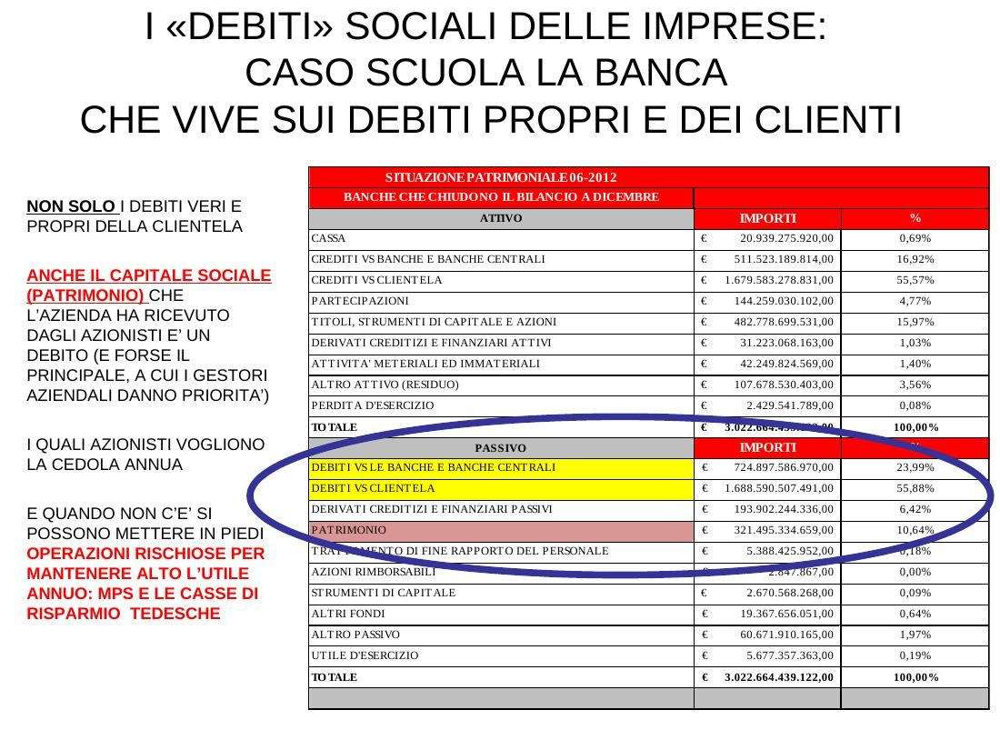{ loading=lazy style="width:59%" }

0:09:29

Lorenzo Poggi Prego… Facciamo, come vedete, proviamo a interloquire, non facciamo proprio uno per volta come sempre. Volevo dire una cosa: in quello che ha detto Paolo è evidente un fatto che volevo chiarire. L’economia sostituisce le relazioni sociali, i rapporti fra gli uomini, e si mette come principio, potremmo dire, astratto, metafisico, che li riassume. Il debito o il credito, la fiducia, sono prima di tutto rapporti sociali, sono rapporti umani. L’economia li monetizza, li fa diventare qualcosa di astratto, qualcosa di costitutivo dell’economia stessa. Se una fondazione redistribuisce in qualche modo gli utili impiegandoli in opere pubbliche o per richieste che le vengono dagli enti locali e così via, non fa altro che sostituirsi a quella che era la politica, a un compito che era dovuto alla società.

0:10:51

L’economia è molto simile a quello che abbiamo visto nella filosofia, come ricerca di un principio astratto per definire la realtà, dalla filosofia di Platone in poi. L’economia svolge lo stesso compito: rende astratti tutti quelli che sono i rapporti, e questo da quel momento fino a oggi. Se molti abitanti del Nord Africa o dei paesi sottosviluppati attraversano o tentano di attraversare il Mediterraneo, o in altri modi si spostano verso l’Europa, e passano gran parte della loro esistenza a lavorare per ripagare il viaggio, o sono costretti a un certo tipo di lavoro, lo fanno perché la disposizione economica e il debito sovrano dei loro Stati impongono una dipendenza che è quasi una schiavitù personale, ma che è diventata impersonale e inavvertibile come schiavitù personale, perché è sotto la copertura dell’economia del debito.

0:12:16

Non c’è più una responsabilità personale: c’è una condizione economica globale che costringe alcuni in una condizione di dipendenza e altri in una condizione migliore. Ma comunque è evidentissimo questo aspetto, l’aspetto dell’economia come elemento metafisico, riassuntivo, sintetico; e il debito è un aspetto veramente importante di questa funzione. Bene, passo la parola a Paolo, così lui continua.

0:13:02

Paolo Marcucci Il patrimonio, il capitale sociale di un’azienda, è il debito che l’azienda ha verso i propri soci. Schumpeter, che abbiamo citato altre volte nelle nostre serate, scrisse che le azioni e le obbligazioni, cioè i debiti che l’azienda emette, sono sostanzialmente proprietà evaporate. Lui diceva che, in questa forma, con i nuovi proprietari, cioè gli azionisti, si perde la volontà dell’imprenditore e del fondatore di lottare per la propria azienda, anche a costo di morire alle porte dell’azienda. Perché abbiamo visto l’altra volta la nascita dell’anonimato nel Seicento, che, ricollegandosi a quello che ha detto ora Lorenzo, spossessa la proprietà dall’essere fisico; e quindi le azioni diventano merce scambiabile come tutto il resto: non c’è più un legame tra la persona fisica e l’azione.

0:14:17

Questo cosa comporta? Comporta che questi debiti, che vengono scambiati nei mercati finanziari, provocano dei benefici, ma l’eccesso in un certo modo provoca anche dei danni. In questo caso parliamo della lotta tra il breve e il lungo periodo. C’è uno storico inglese, Colin Mayer, che dice che in questi anni è prevalsa la logica del breve periodo contro il lungo periodo: cioè è come se un azionista che detiene le azioni per un giorno, due giorni, un minuto (anzi, le transazioni finanziarie oggi si giocano nell’ordine dei millesimi di secondo) avesse gli stessi diritti dell’azionariato di lungo periodo, che investe su quell’azienda per un lungo tempo. Quindi non si possono considerare allo stesso modo, come invece ora li considera il diritto.

**LA LOTTA TRA IL BREVE E IL LUNGO PERIODO**

La logica del mercato dovuta all’anonimato e al possesso momentaneo dell’azione (logica di breve periodo) produce danni enormi (l’inglese prof. Colin Mayer).

Un azionista che acquisti per qualche giorno delle azioni ha gli stessi diritti di un investitore di lungo periodo.

Paradossalmente (ma non troppo) l’Italia e la Germania da questo punto di vista sono avvantaggiate essendo la proprietà familiare delle imprese molto più estesa.

È come se si concedesse il diritto di voto a cittadini che il giorno dopo rinunciassero e emigrassero all’estero.

Agli azionisti di lungo periodo vanno sommati poi anche i dipendenti, l’ambiente (caso Ilva…) dove si opera, i clienti, ecc.

Il concetto di fondo nuovo è: l’interesse di lungo periodo.

0:15:25

Però il debito è fondamentale per la nostra civiltà, per la nostra società. Proviamo a formulare qualche ipotesi di tutti i giorni: se tutti dovessero aspettare di avere i soldi per comprarsi qualcosa, una casa (penso che tutti noi l’abbiamo fatto, o lo faremo forse), senza il debito non ci riusciremmo mai. E poi pensate anche alla partita doppia che vi ho detto prima: il mio debito vuol dire sempre che è il credito di qualcun altro; quindi la società non è più povera quando ha i debiti, perché vuol dire che c’è anche un credito di qualcuno verso di me.

0:16:14

Naturalmente, quando questo eccede una certa soglia, diventa un problema, perché i problemi si avvitano; e se anche il ciclo economico volge verso il basso, allora tutti vogliono vendere gli immobili, come è successo in America (lo avete sentito tutti sui giornali e alla televisione): i prezzi degli immobili cadono, perché non c’è nessuno che li compra, e quello ha da ripagare il debito. Quindi il debito come motore principale dell’economia; però questo si basa sulla fiducia. Perché quando voi andate in banca, per esempio, e vi fate prestare dei soldi, tecnicamente la banca vi fa un «fido», e fido deriva da fiducia. La banca ha fiducia che un giorno tu possa restituire questi soldi. È un legame, come dicevamo all’inizio, indissolubile tra il creditore e il debitore.

0:17:19

In questo momento, per esempio, si dibatte molto sul debito pubblico europeo, e di conseguenza è la reputazione che è alla base della fiducia di questo istituto sociale. In questi giorni c’è stato, per esempio (non so se qualcuno di voi l’ha visto), *Lincoln*, il film, quello sulla nascita dell’America. Subito dopo Lincoln c’erano tutti gli Stati federali, che avevano grossi debiti, ognuno per conto suo. Hamilton riuscì a far cumulare i debiti, volgendoli in un unico debito, invece di quelli dei singoli Stati, che nessuno riusciva più a ripagare; e questo ha creato lo sviluppo immenso dell’America, che ha portato all’America di oggi. Pensate invece a tutte le discussioni che ci sono oggi in Europa con la Germania, memore della pace di Augusta che dicevamo prima.

0:18:22

Lorenzo Poggi Invece di questa visione, anche lo Stato italiano, quando si costituì, prese e garantì i debiti che i vari Stati regionali avevano fatto, anche il Regno delle Due Sicilie, dei Borboni. Ed è strano che uno Stato che vince si assuma il debito dello sconfitto, debito che i Borboni avevano fatto per combattere il Regno di Sardegna. La risposta è molto semplice: quello che contava era l’unificazione dell’Italia, anche ai fini dell’unificazione del mercato. Si doveva dare l’idea agli investitori, a coloro che avevano prestato i soldi ai Borboni e che ora appoggiavano il Regno d’Italia, che tutto andava secondo le regole, che loro i soldi non ce li avrebbero mai rimessi. E quindi lo Stato sovrano assunse il debito fatto dai suoi nemici per combatterlo. Sembra assurdo, ma questo chiarisce quello che stavamo dicendo prima: l’astrattezza razionale dell’economia, che governa al di là di quelle insolite.

0:19:54

Tutti a scuola abbiamo studiato che la Destra storica tenta di colmare il debito, di arrivare al pareggio; e finalmente, quando arriva al pareggio, poi va giù, e va al potere la Sinistra. Però arrivare al pareggio non ci vuole.

**DEBITO, FIDUCIA E SPERANZA**

Il debito è fiducia nel futuro: so che ripagherò i miei debiti, lavorerò, le cose andranno bene, ecc.

Il debito è sviluppo: se uno aspetta di avere tutti i soldi di cui necessita farà sempre poco.

Il debito è sviluppo: il cittadino si compra la casa, l’imprenditore compra i macchinari, il commerciante i prodotti… e il ciclo economico riparte.

0:20:15

Paolo Marcucci Il debito, abbiamo detto, e poi quello che diceva Lorenzo: tra un po’ dovrebbe esserci un dato che ce lo fa vedere proprio dal vero. Il debito è fiducia, se ci pensate: perché quando io faccio un mutuo, un debito, vuol dire che ho fiducia nel futuro, sennò non lo farei mai; vuol dire che penso di poter sopperire alle esigenze che ho; è un investimento verso il mio futuro, quindi è positivo da questo punto di vista. *Debito* deriva appunto da «essere obbligato», «dovere»: questo nella filologia della parola.

**TRECCANI**

*Debito* in diritto ed economia: obbligo del debitore di adempiere una determinata prestazione a vantaggio del creditore, consistente di solito nel dare o restituire qualcosa, soprattutto denaro.

Rapporto obbligatorio.

Tradizionalmente, il termine d. designava l’aspetto passivo del rapporto obbligatorio e cioè il dovere del soggetto (debitore) di eseguire la prestazione. Sulla traccia della dottrina tedesca, con il d. si è venuto a indicare uno dei due elementi nei quali si scompone il lato passivo del rapporto obbligatorio, contrapponendolo all’altro chiamato responsabilità: mentre il d. ha per oggetto la specifica prestazione da adempiere, la responsabilità investe di regola l’intero patrimonio del debitore, che risponde dell’adempimento della prestazione con tutti i suoi beni presenti o futuri (art. 2740 c.c.).

0:21:03

Allora vediamo un po’ ora il rapporto tra il debito dello Stato e gli italiani, quello che diceva Lorenzo. Se vedete questo grafico, questo è il debito pubblico italiano dal 1861 a oggi. Il 120% è questa linea: quindi, all’inizio, quando parte, siamo già con un debito altissimo, quello che diceva Lorenzo. Quindi noi siamo avvezzi ad avere il 120%; ora andiamo quasi verso il 130, in questo momento. Quello che è interessante forse è che la linea amaranto è il debito estero, cioè quello detenuto all’estero: tra il 1921 e il 1931, con la nascita del fascismo, è molto all’estero. Questo è un dato molto interessante, secondo me. Perché il debito schizza in alto, vedete, saliva al 160% in quel periodo, però siamo riusciti a venderlo all’estero; cosa che invece ora non riusciamo a fare: vedete quanto è piccola la linea amaranto. Non riusciamo a venderlo perché non abbiamo reputazione, quello che dicevo prima: non abbiamo fiducia sui mercati internazionali. Quando si parla di fiducia nel debito, la sostanza è questa.

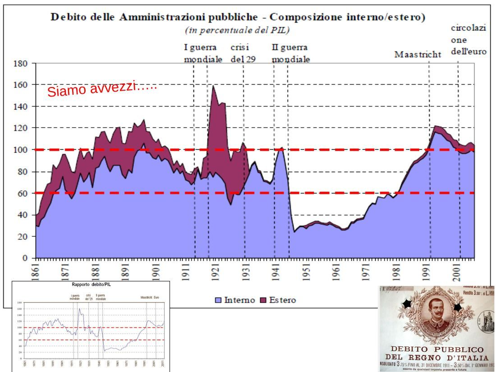{ loading=lazy style="width:57%" }

0:22:54

Qui invece vediamo un altro grafico, della ricchezza e dei debiti delle famiglie italiane: qui ci siamo tutti noi. La parte alta è la ricchezza delle famiglie italiane (qui si parla di famiglie ricche, povere, tutte: è la somma); quella parte quaggiù sono i debiti. Vedete che differenza abissale c’è in Italia, nelle famiglie, tra i debiti e la ricchezza. Spero che nessuno se ne accorga, sennò ce li prendono tutti. Questo invece è lo spaccato di questa lineetta quaggiù sotto, e ci fa vedere come è divisa: la maggior parte sono mutui, vedete, per le abitazioni, per comprare la casa; poi il credito al consumo, le macchine, la lavatrice, i debiti commerciali ecc.

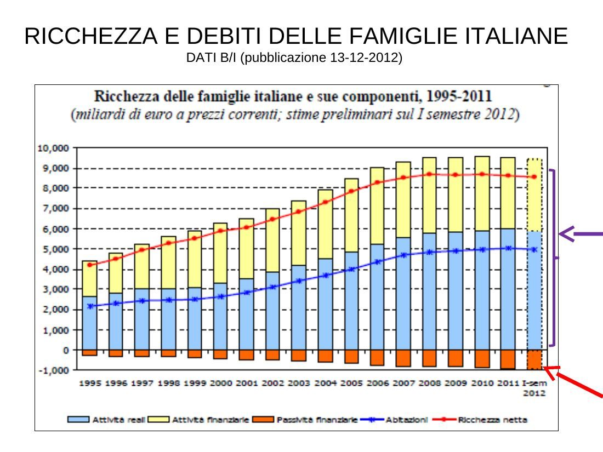{ loading=lazy style="width:42%" }

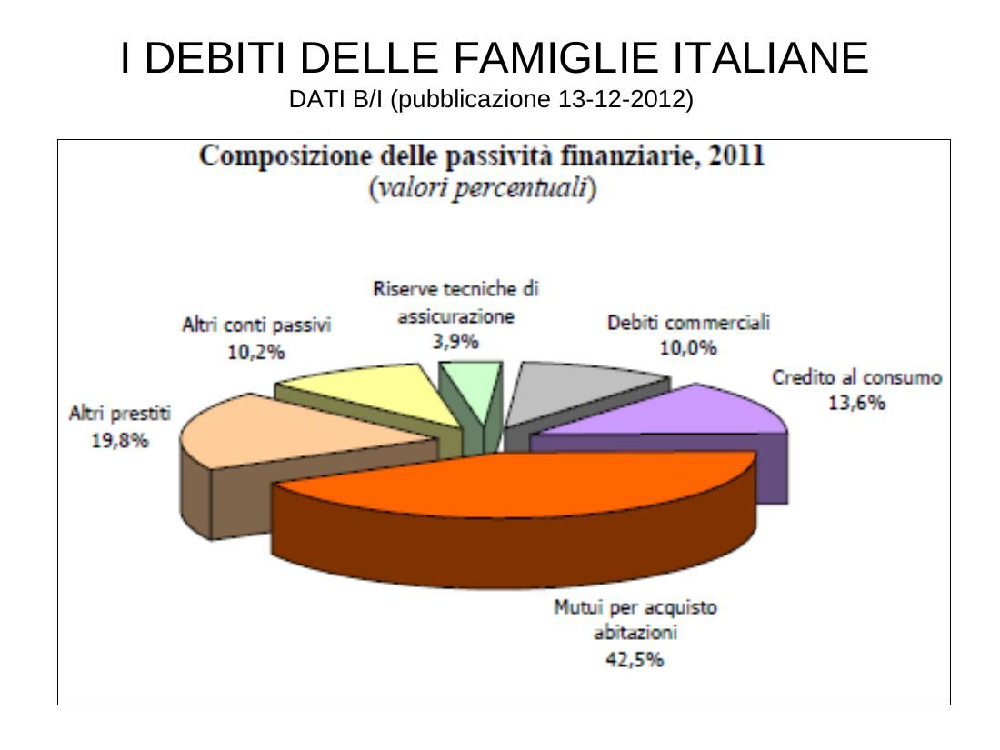{ loading=lazy style="width:51%" }

0:24:10

Quello che è interessante dei debiti delle famiglie italiane è che, come Stato, abbiamo visto che siamo parecchio indebitati, però come famiglie non lo siamo molto, e quel grafico di prima ce l’ha fatto vedere. Se ci confrontiamo con gli altri paesi europei, vedete che l’Italia è il paese meno indebitato di tutti: questa è l’Italia, siamo intorno a 60; gli altri paesi sono tutti sopra di noi: la Francia, la Germania; la Spagna è quasi al doppio; l’area euro, la media europea, è molto più di noi; il Regno Unito è quasi a tre volte; l’America è il doppio. Quindi vuol dire che le famiglie italiane sono state molto accorte da questo punto di vista, parsimoniose. Ricapitolando, c’è molto debito per lo Stato, poco per le persone e le famiglie.

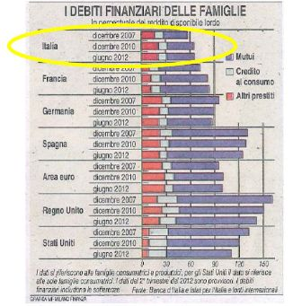{ loading=lazy style="width:36%" }

0:25:05

Questo invece è interessante, perché ci fa vedere, in quel grafico del debito italiano, quando nasce effettivamente il debito. Questo parte dal 1970 a oggi. Fino al 1982 era al 60%; con il governo Cossiga–Forlani, è qui che si impenna: sono gli anni dei primi governi, da Cossiga, Forlani, a quelli di Spadolini, Craxi ecc; vedete, si arriva al 120%. Poi c’è la stagione in cui si alterna prevalentemente il centrosinistra, dove si abbassa; e poi c’è la crisi: naturalmente il debito esplode in tutto il mondo, compresa l’Italia, e al di là di chi ci fosse al governo, secondo me, Berlusconi, Monti ecc, si impenna nuovamente. Questo invece è un grafico degli ultimi tre anni, che ci ridice un po’ quello che abbiamo detto adesso.

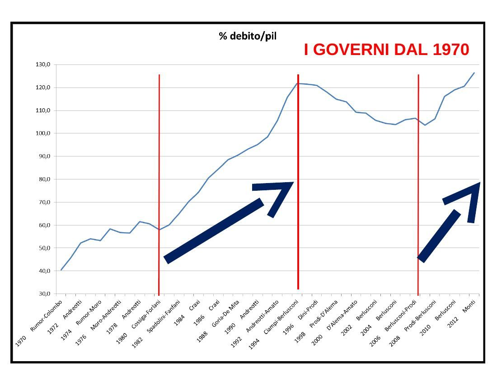{ loading=lazy style="width:48%" }

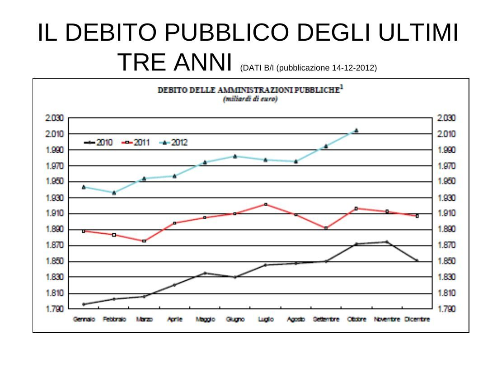{ loading=lazy style="width:46%" }

0:26:26

Allora, detto questo, cerchiamo di definire un po’ meglio il concetto di debito nella storia dell’uomo alzando lo sguardo su come si è evoluto ed è nato il debito nella storia. Facendo un passo indietro, molto indietro, lo storico Gary Anderson ha fatto questa battuta: dice che nella Bibbia la tradizione giudaico-cristiana ha sempre visto Dio come un banchiere. Questo perché? Perché nella versione greca, che è poi quella che è arrivata sostanzialmente a noi, la parola peccato viene considerata un debito che deve essere pagato o rimesso, come abbiamo visto; invece nella versione della Bibbia ebraica il peccato è più un peso che ogni individuo deve portare. Infatti la preghiera del Padre Nostro deriva da questa impostazione: «Padre nostro, che sei nei cieli, sia santificato il tuo nome, venga il tuo regno, sia fatta la tua volontà, come in cielo così in terra. Dacci oggi il nostro pane quotidiano, *rimetti* a noi i nostri debiti come noi li rimettiamo ai nostri debitori». Deriva da questa impostazione.

**TRECCANI**

*Rimettere*: l’azione e il fatto di rimettere, cioè di condonare e di rinunciare a punire o comunque a perseguire, colpe, peccati, mancanze.

0:27:41

Ma perché questo? Perché i debiti (come diceva Lorenzo prima, lo Stato nascente si accolla i debiti) sono sempre stati un problema nella storia dell’uomo. Qualcuno dice che governare questo fenomeno è quasi impossibile: ogni tanto, nel ciclo del mondo, succede che c’è questa «esuberanza irrazionale», come la chiamano alcuni analisti. Per esempio nel 1345 i banchieri fiorentini Bardi e Peruzzi andarono in bancarotta perché non gli furono restituiti i soldi da Edoardo III d’Inghilterra. Oppure il debito enorme che fece Filippo IV di Francia per le guerre che doveva fare, e non restituì questi soldi a chi era il creditore: in questo caso era l’ordine dei Templari, che aveva addirittura finanziato il regno. Naturalmente questi banchieri si facevano pagare, perché il tasso di interesse era intorno al 30–40%: quindi considerate che non era pochissimo.

**DEBITO E PACE SOCIALE**

Nella storia i governanti avevano sempre attenzione al ciclo del debito affinché non si accumulassero posizioni debitorie troppo squilibrate a danno della pace sociale e quando succedeva si proclamavano periodici anni giubilari nei quali tutto il debito veniva azzerato, per ricominciare daccapo.

Regolare saggiamente il debito è arte difficile, alcuni dicono impossibile.

La sua abbondanza alimenta quell’«esuberanza irrazionale» che si trasforma in un altrettanto irrazionale eccesso di prudenza che produce la rarefazione del credito e lo stallo del commercio e dell’industria.

È una sequenza che non cessa di prenderci alla sprovvista benché ne avesse già parlato Cicerone nell’orazione *Pro lege Manilia* del 66 a.C. e si sia poi ripetuta in varie mutazioni per i successivi duemila anni.

Il primo grande debito pubblico è forse quello di Dionigi, tiranno di Siracusa tra il 405 e il 367 a.C.

Non riuscendo a rendere ai propri cittadini quanto gli avevano prestato in buona moneta, Dionigi provvide a un nuovo conio a basso contenuto d’argento con il quale rimborsare il debito.

Fu il primo di una lunga serie di sovrani che ricorsero all’inflazione per «monetizzare», come oggi si dice, il rimborso del debito pubblico.

Altri re andarono ancora più per le spicce, semplicemente rifiutandosi di restituire quanto era stato loro prestato. Così fece Edoardo III d’Inghilterra nel 1345 mandando a gambe all’aria i banchieri fiorentini Bardi e Peruzzi e con loro un gran numero di toscani che si erano fidati della prudenza di quei banchieri, noti come «colonne della cristianità».

Una quarantina d’anni prima, l’enorme debito di Filippo IV di Francia era stato risolto in modo ben più crudele. Non bastandogli i frutti delle espropriazioni fatte agli ebrei espulsi dalla Francia, ai banchieri lombardi e a numerose abbazie, il re distrusse l’ordine dei Templari, al quale doveva enormi somme, mandandone al rogo il gran maestro.

Il rischio del prestito sovrano non sfuggiva, ovviamente, ai banchieri, i quali chiedevano a principi e re interessi adeguati: attorno al 40% l’anno.

0:29:12

Sia nella tradizione greca sia in quella ebraica, la virtù umana assume il ruolo di un credito. Nel *Libro di Tobia* fare l’elemosina procura un «tesoro nel cielo»; nei periodi di crisi tale tesoro potrebbe essere usato per pagare i debiti dei propri peccati.

D’altra parte, se il debito è un peccato, allora anche la virtù umana è l’opposto: si ritorna al discorso della partita doppia, e quindi la virtù assume il ruolo di un credito. Se io mi comporto bene, mi costituisco un tesoretto che potrò spendere nei momenti in cui le cose invece vanno male. Questa è un po’ la filosofia di fondo anche del popolo ebraico, degli ebrei: i meriti dei padri ricadono poi sui figli, che possono spendere questi meriti.

0:29:51

Alcuni proverbi: questa concezione del debito non poteva non entrare nei proverbi. «Chi non ha debiti è ricco»: questa è la versione più negativa; «Il debito viene ridendo e parte piangendo»; «Il debito è un ladro in casa». Però ce ne sono anche di positivi: «Senza debito non si fa la roba»; «Chi ha debito ha credito», perché vuol dire che ha fiducia. E quelli neutri: «Se dorme il debitore non dorme il creditore, e se non dorme il debitore dorme il creditore»: sempre questo legame che c’è tra i due.

0:30:31

Nel 1735 Tom Rakewell, in Inghilterra, nella *Carriera di un libertino*, viene arrestato per debiti mentre è sulla portantina. Il padre di Dickens soggiornò nella Marshalsea Prison perché era in prigione per debiti: forse questo ci dice anche perché ci sono gli scritti di Dickens sulla povertà e sul debito. Egli infatti fu costretto a lasciare la scuola a 12 anni per lavorare.

0:31:09

Poi ci sono altre visioni della società e del mondo, che criticano l’essere sociale che è venuto fuori dal debito. Finora ne abbiamo parlato, direi, bene; però in queste nostre divagazioni filosofiche non possiamo non parlare delle critiche al debito, che criticano l’essere sociale prodotto dalla condizione di debitore. Ne cito un paio. Il filosofo Roberto Esposito dice che la figura centrale del capitalismo contemporaneo è quella dell’indebitamento, resa palese dalla crisi in corso; e non è solo confinata al mero piano economico, «anzi» (usa questa parola), «al contrario, assume oggi con sempre maggiore forza una connotazione addirittura teologica. L’indebitamento universale che ci tiene soggiogati si rivela per ciò che è: l’esito ultimo della macchina teologico-politica dell’Occidente, per sconfiggere la quale c’è bisogno, più che di consenso per intersezione fra presupposti laici e religiosi, di genuino conflitto politico». Qui ci ricolleghiamo anche al tema che abbiamo affrontato la volta scorsa.

0:32:15

Toni Negri e Michael Hardt, filosofi che hanno scritto diversi libri sul potere, sulla società contemporanea, parlano di una nuova figura di povero: il salariato stabile che si è impoverito, che non è più classe media. E questa povertà è caratterizzata in primo luogo dalla catena del debito. «L’egemonia della finanza e delle banche ha prodotto la figura sociale dell’indebitato. Essere indebitati oggi sta diventando la condizione generale della vita. La nostra soggettività è configurata alla creazione del debito. Sopravviviamo facendo debiti e viviamo sotto il peso della responsabilità per onorarli. Il debito ci controlla, ma detta anche il nostro ritmo di lavoro e le nostre scelte». Quando acquistiamo un appartamento, come abbiamo detto, con un debito, dobbiamo fare molta attenzione a quello che facciamo nella nostra vita, perché non possiamo permetterci di perdere il lavoro, dobbiamo stare attenti alle spese, alle vacanze, agli studi, a qualsiasi cosa.

0:33:33

«L’indebitato diventa quasi la coscienza infelice, che rende la colpa una forma di vita» (ritorniamo ai discorsi dell’inizio, dell’introduzione). «Il debito può solo incrementare l’impoverimento della nostra vita e il depotenziamento della nostra soggettività; contribuisce unicamente a svilirci, a isolarci nella colpa e nella miseria». Per questo filosofeggiano di rovesciare il debito. E non solo Toni Negri e Hardt, ma anche altri economisti parlano di rimettere il debito e di non pagare il debito. Io non so se sono d’accordo, però è un punto di vista filosofico, una speculazione che non si può tralasciare. «Io non pagherò», dice; «noi non pagheremo il vostro debito, rifiutiamo di essere sfrattati dalle nostre abitazioni, non ci sottoporremo a misure di austerità». E questa è una visione del mondo filosofica legata appunto alla condizione sociale del debito che si è creata negli ultimi 30–40 anni.

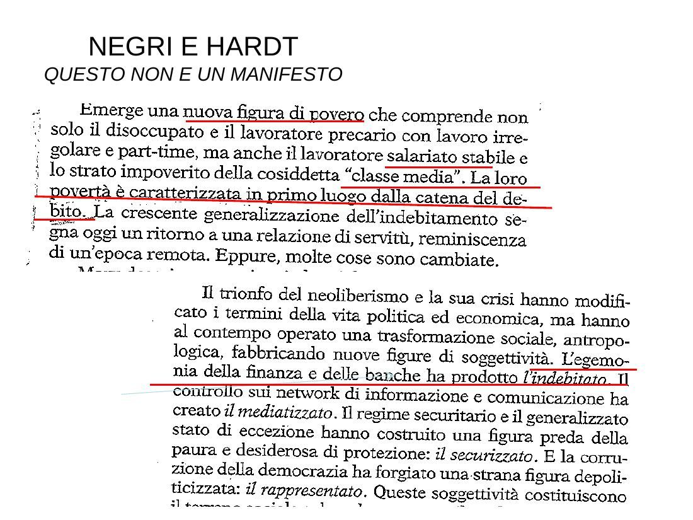{ loading=lazy style="width:43%" }

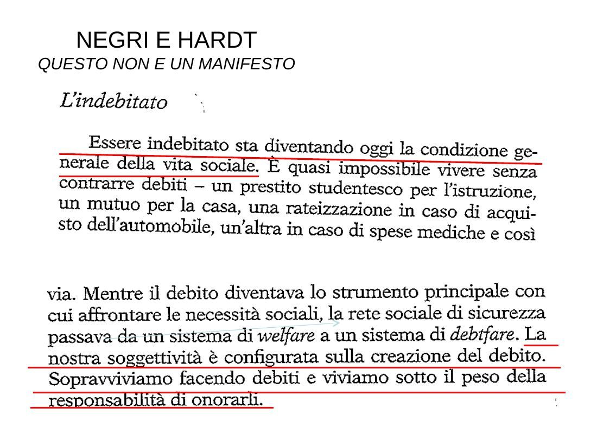{ loading=lazy style="width:51%" }

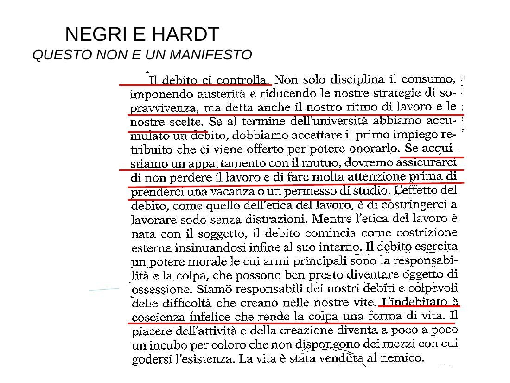{ loading=lazy style="width:46%" }

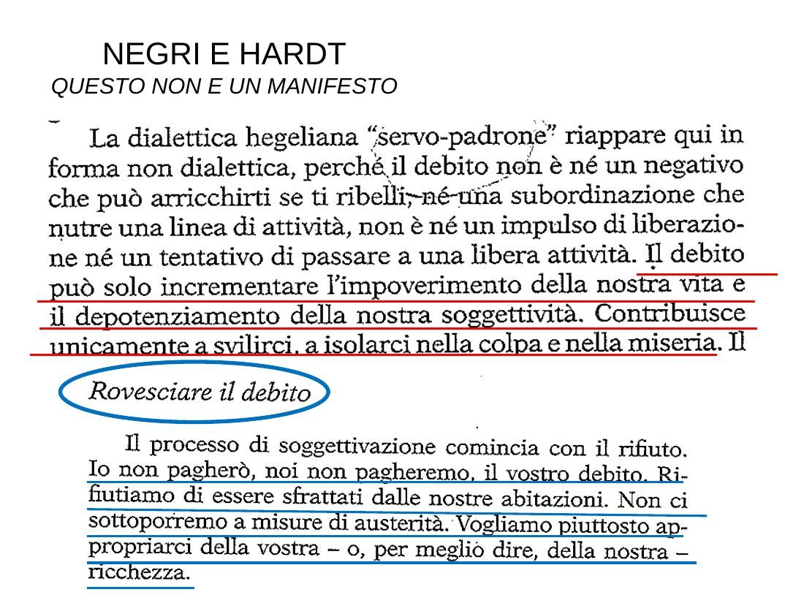{ loading=lazy style="width:48%" }

0:34:42

Allora, non pagare il debito: a proposito di non pagare il debito, Baudelaire era un grande debitore, e aveva sempre questo problema di non riuscire a pagare i debiti. È uscito di recente questo libretto, molto bellino, *Sulle tribolazioni finanziarie* del grande poeta, con le lettere in cui si ingegnava in tutti i trucchi possibili e immaginabili per non pagare i propri debiti. E con questo ti lascio la parola.

0:35:14

Lorenzo Poggi Partiamo da una parola che è venuta fuori spesso: debito sovrano. Chi ha detto che debito sovrano è il debito degli Stati, degli Stati sovrani? Qualcuno, facendo una battuta, ha detto: no, si chiama sovrano perché è lui che comanda, non più gli Stati, non più la politica. Quindi il debito apparirebbe, nella condizione economica di oggi, come la vera forza, la vera realtà, l’unico elemento incontrovertibile, l’unico elemento sul quale non possiamo agire, e che sarebbe la volontà che controlla tutto. Come vedete, ha raggiunto una dimensione teologica, perché, se fosse così (e credo che in gran parte lo sia), è veramente simile alla volontà divina che, si diceva una volta, governava il mondo.

0:36:17

Adam Smith diceva che c’era una mano che reggeva il mondo; nella nostra prima conversazione abbiamo detto che probabilmente questa mano regge una forchetta, perché mangiare è un elemento fondamentale. Insieme a questo, diciamo che questa mano, la mano dell’economia, la mano del debito, la mano che controlla tutto, oggi ha sostituito la mano divina, il *digitus Dei* dell’uomo del Medioevo. Quindi il debito inteso come che cosa? Da dove viene il debito? Viene dal poter realizzare un desiderio che magari va molto al di là del bisogno. I paesi più sviluppati sono anche quelli più indebitati.

0:37:15

Comporta una trasformazione, e implica un nostro atteggiamento globale nella società, perché abbiamo detto che l’economia ha un valore sintetico, metafisico: riassume il nostro essere sociale. Quando la società è impostata economicamente, è chiaro che i rapporti sociali diventano rapporti economici. Vi ricordate il vecchio Marx, che ha scritto nei Manoscritti economico-filosofici del ’44 che il lavoro, che era la funzione umana per eccellenza per modificare il mondo, nelle condizioni create dalla società borghese capitalista si trasformava in alienazione. Perché? Perché costringeva l’uomo a vendere la parte più umana di sé, la capacità di agire sul mondo e di trasformarlo, per far campare la parte più bestiale del suo essere, cioè il mangiare, il bere, il dormire, e fare l’amore qualche volta, perché altrimenti non ci sarebbero state braccia proletarie per lo sviluppo successivo del capitalismo.

0:38:47

E quindi la stessa possibilità che i proletari avessero del tempo libero e non fossero massacrati dal lavoro, per poter anche riprodursi, diventava un calcolo economico all’interno dell’economia capitalista, perché altrimenti si rimaneva senza manodopera. Quindi tutte le funzioni umane diventavano funzioni considerate dal punto di vista dell’economia, avevano una loro dimensione, diventavano parti del profitto, elementi da considerare per il profitto. Non è sempre stato così. Citavamo il vecchio Marx: siamo alla metà dell’Ottocento. Prima no: prima c’era questo sviluppo del capitalismo, ma c’era ancora l’idea che non fosse quella la misura.

0:40:00

Per tutte le azioni umane c’era ancora l’idea che i rapporti fra gli uomini fossero regolati da altro, e che semmai l’economia fosse uno strumento. Dov’è il salto qualitativo? Il salto qualitativo avviene nel momento in cui l’economia, da strumento per realizzare dei fini umani, strumento utile per realizzare scopi sociali, scopi che gli uomini si propongono (quindi uno strumento razionale, funzionante, che ottimizza i loro sforzi e le loro possibilità), diventa l’unico strumento attraverso il quale si possono acquistare e avere tutti gli altri beni. C’è un momento di passaggio, quando le strutture economiche, l’astrazione sintetica dell’economia, che abbiamo visto ha dei caratteri metafisici, fanno questo passaggio dall’essere uno strumento al diventare l’unico strumento possibile per avere tutte le altre cose. Anzi, tutte le altre cose diventano possibili se sono possibili da un punto di vista economico.

0:41:49

Ora faccio mezzo minuto il professore, mezzo minuto soltanto. Il vecchio Hegel aveva scoperto il segreto della cosa. Aveva detto: quando una cosa diventa talmente ampia, supera una certa grandezza, cambia di significato e di natura. A lui questo discorso serviva perché aveva bisogno di spiegare come dal contrasto si arrivasse a un superamento del contrasto e al progresso successivo, come la fase di progresso successiva fosse già contenuta nella fase precedente: il cosiddetto processo dialettico, su cui tutti gli studenti si sono arrovellati. Come avveniva? Facciamo un esempio, vediamo di capirci, perché il discorso è molto semplice. Quando qualche cosa si sviluppa, a un certo punto, se lo sviluppo è molto grande, cambia. Se io mi tolgo due capelli, sono sempre uno che ha i capelli: non si nota nemmeno. Se me ne tolgo dieci, anche. Se me li tolgo tutti, sono calvo: cambia completamente.

0:43:31

Così è per l’economia: a un certo momento, da strumento, diventa l’unico strumento con il quale è possibile acquisire qualsiasi altro bene, e quindi diventa non più strumento, ma l’unico scopo, l’unico fine da perseguire, perché è quello buono per tutti gli altri. E in questo passaggio sta, diciamo, il punto dolente dell’economia, del debito, dell’economia contemporanea. Si cerca di trovare il punto, la leva, su cui intervenire politicamente per poter in qualche modo gestire l’economia. Se pensate, i problemi politici che si pongono ancora oggi sono: come può la politica, intesa come modo collettivo di intervenire per modificare il mondo e renderlo adatto a soddisfare i bisogni collettivi recepiti, come può intervenire sull’economia? Come può? E le discussioni avvengono fra quelli che dicono che può fare tutto e quelli che dicono: guardate che, prima di dire quello che si può fare, bisogna sottomettersi all’economia.

0:45:10

Allora, dov’è il punto? Quando comincia? Nella società moderna, nella società antica, fino a un certo punto quello che crea il valore, quello che permette di decidere che rapporto c’è fra desideri, bisogni e capacità di gestire la politica, è il lavoro. Il valore: Smith, Ricardo (ma non facciamo citazioni degli economisti) dicono che il lavoro è quello che permette di incidere sul mondo, ed è quello che dà l’equilibrio, è quello che deve comandare l’economia e la politica. Quando si fa politica, quando si fanno delle scelte, si deve scegliere secondo il valore che ha il lavoro. E il lavoro lo si misura a seconda del tempo: David Ricardo, il tempo di lavoro.

0:46:23

Tutto questo regge fino a un certo punto. Perché fino a un certo punto? Perché a questo punto dobbiamo chiederci come si modifica la questione, quando comincia a cambiare di nuovo, quando ci si rende conto che non c’è una misura stabile alla quale possiamo aggrapparci per comandare l’economia. E comincia quando ci si accorge che le azioni umane sono dettate non tanto dalla razionalità del bisogno, ma da una volontà che sfugge spesso a qualsiasi ordinamento. E allora cominciano le trasformazioni uguali. Comunque, il punto da cui passare è questo: a un certo momento ci si rende conto che c’è qualcosa che comanda il mondo, che non si può lasciare tutto totalmente nelle mani dell’economia, dell’automatismo economico. E ci si domanda quale compito avrà allora la politica, a che cosa la politica dovrà ispirarsi, quali saranno i principi, fino a che punto di nuovo dovremo dare retta ad altre istanze, e come queste dovranno intervenire sull’economia. Questo lo vediamo dopo.

\[PAUSA\]
{: .nota }

1:03:22

Paolo Marcucci Bene. Iniziamo con la prima parte, dopo l’introduzione. C’è uno storico, David Graeber, che l’anno scorso ha fatto un saggio che ha chiamato Debito. I primi 5000 anni, perché ha ricostruito tutto il debito degli ultimi 5000 anni: sostanzialmente il debito ha una storia lunga 5000 anni. Brevemente, ora poi lo passeremo un po’ in rassegna. Il concetto principale, che è importante e che vorrei dire, è questo: in questi 5000 anni (perché sostanzialmente il debito nasce 3000 anni prima di Cristo) ci sono state delle fasi nella storia dell’uomo in cui il debito a volte era pagato con carta commerciale, e a volte invece ci voleva il metallo prezioso, l’oro, l’argento ecc. Queste fasi alternate nella storia dell’uomo erano scandite da periodi di guerra o di pace.

1:04:42

Si capisce bene che quando prevale la moneta, quando prevale il metallo, sono periodi di guerra, perché è il metallo quello che rende vera la ricchezza, e quindi l’appropriarsi di queste cose; allo stesso modo anche il debito deve essere ripagato in moneta. Nei periodi di pace invece è il contrario: ci si fida di più, c’è più relazione sociale, c’è fiducia, c’è reputazione, e quindi prevale la carta commerciale. E Graeber individua proprio questo andamento ciclico di queste fasi nella storia dell’uomo.

**IL DEBITO È DIBATTUTO DA ALMENO CINQUEMILA ANNI**

Per gran parte della storia – almeno la storia degli stati e degli imperi – gli esseri umani si sono sentiti dire che devono considerarsi debitori.

Da migliaia di anni, la lotta tra ricchi e poveri prende la forma del conflitto tra debitore e creditore:

Contese tra i pro e i contro del pagamento degli interessi

Schiavitù da debito

Cancellazione del debito

Restituzione, ripresa di possesso, confisca dei greggi

Sequestro dei vigneti

Riduzione in schiavitù e vendita dei figli del debitore…

Infatti il banchiere (usuraio, o qualsiasi altro nome dato a chi presta soldi) non è mai mai mai stato visto bene, e tanto meno rappresentato bene, anche se le immagini che ora vedremo risentono della visione medievale del debito e dell’interesse.

1:05:32

Alcuni quadri di rappresentazione, anche se scontano un po’ l’interpretazione medievale di questo ciclo che vi dicevo: nel Medioevo il pendolo oscilla dalla parte della non fiducia, e quindi c’è un’avversione al debito, e di conseguenza al credito dall’altro lato. E quindi chi presta denaro è raffigurato sempre in maniera maligna: vedete l’espressione, sempre in un certo modo. Questo è Gli usurai, del 1540, di Reymerswaele; questo per esempio è Metsys, anche questo gli usurai: vedete la faccia, sono dipinti proprio in questo modo. Questo invece è Il cambiavalute e sua moglie, numero uno, perché c’è una seconda versione, che è interessante. Anche in questo c’è una visione di molto attaccamento al denaro, che traspare soprattutto dalla faccia di lui.

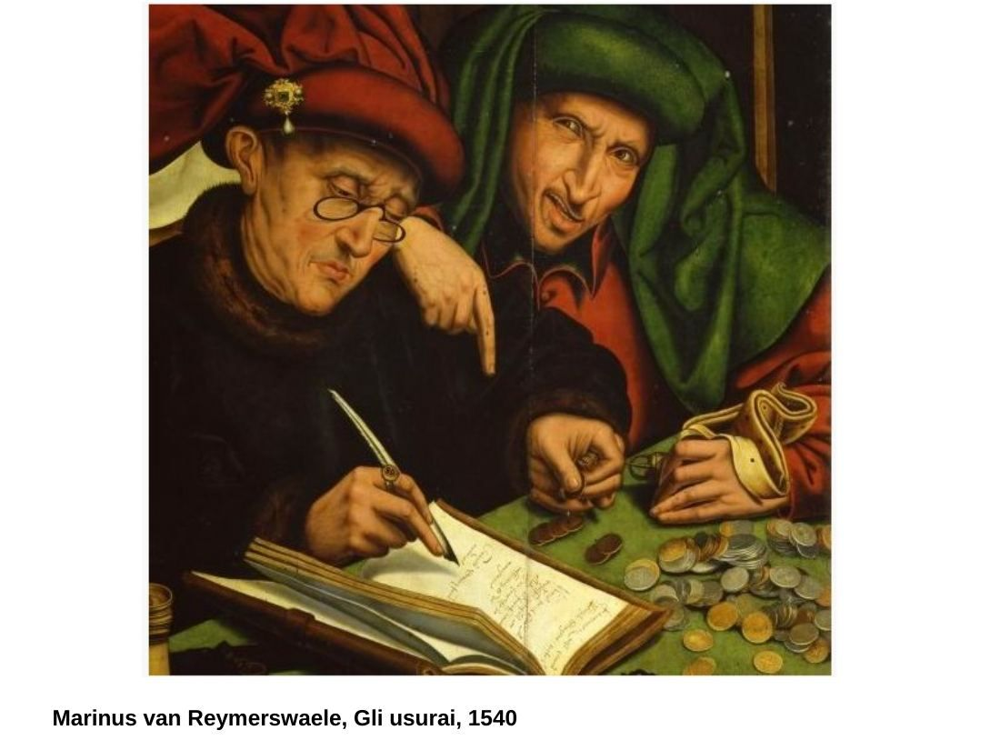{ loading=lazy style="width:40%" }

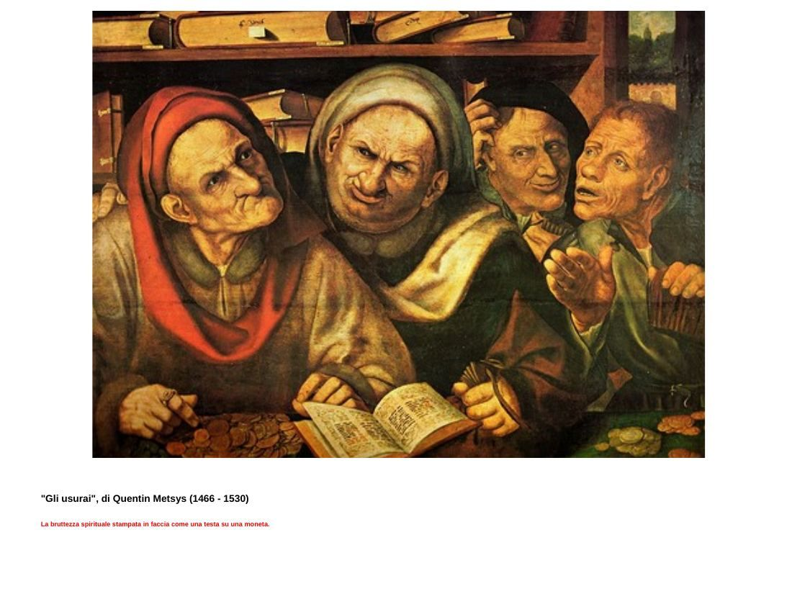{ loading=lazy style="width:38%" }

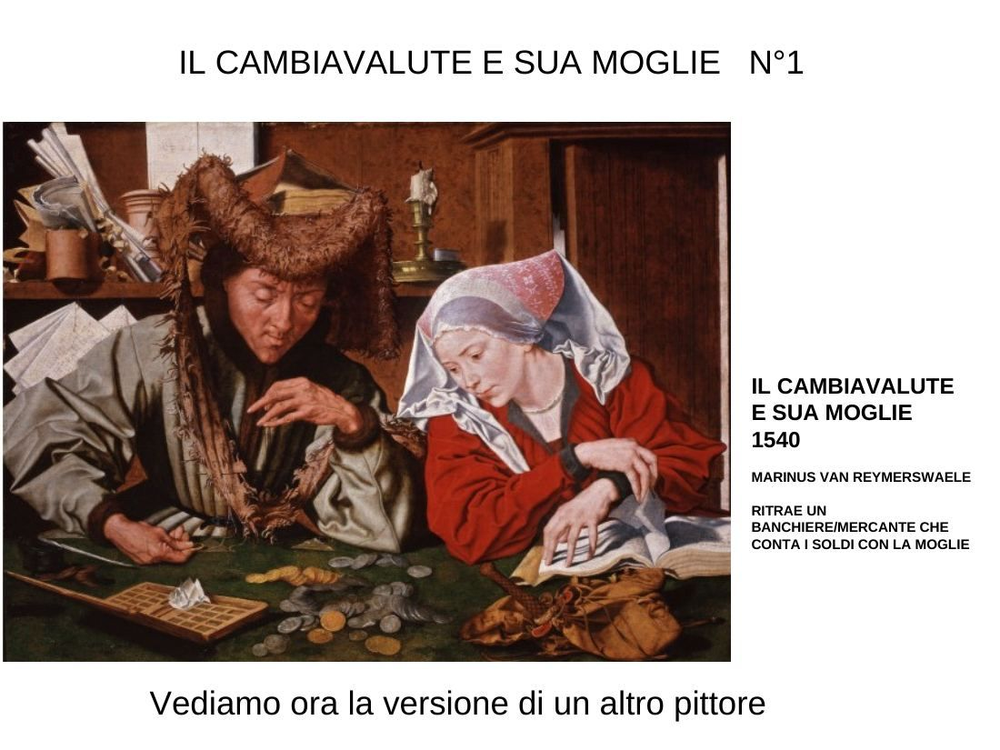{ loading=lazy style="width:46%" }

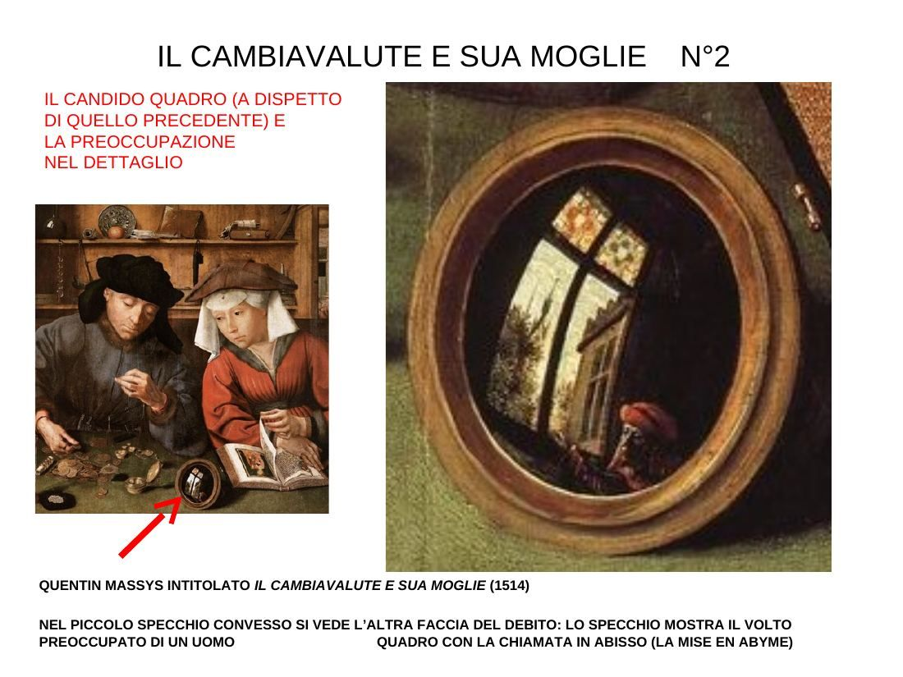{ loading=lazy style="width:44%" }

1:06:43

Questo invece è interessante, perché è *Il cambiavalute e sua moglie* numero due: il primo era di un pittore, questo è di un altro, questo è Quentin Metsys. Allora qui rientra in gioco quel procedimento che abbiamo visto anche nella serata precedente, la mise en abyme. È interessante perché, vedete, a differenza di questo, ed è sostanzialmente lo stesso soggetto, il quadro è molto più candido: non c’è nelle figure quella grettezza dell’avaro, di chi presta, dell’usuraio sostanzialmente. Ed è interessante perché c’è questo specchio in fondo, che ci fa vedere l’altra parte, chi c’è di là: e lì si vede, molto preoccupato, ma davvero preoccupato, chi è in debito e deve pagare. È interessante da questo punto di vista. Nell’opera precedente notate le mani, più ancora del volto: sono dei veri artigli, hanno qualcosa di ferino nel maneggiare il denaro, nel tenere il libro dei conti, il libro contabile.

1:08:09

Quindi sostanzialmente questo per far vedere un po’ il momento in cui il pendolo va dalla parte della non accettazione dell’usura, e quindi del debito; perché, come dicevo, ci sono altre epoche in cui invece è comunemente accettato. Noi siamo abituati a pensare il nostro mondo come il mondo degli ultimi 2000 anni, ma in realtà non è stato sempre così, da questo punto di vista. E qui dovremmo analizzare un po’ punto per punto, però non è il caso. C’è per esempio il Codice di Hammurabi, 1772 a.c., a Babilonia, che regola minutamente gli obblighi dei debitori e dei creditori: anche in questo caso lega queste due figure in maniera indissolubile. I creditori devono attendere che ci sia stato il raccolto prima di esigere il frutto, l’interesse, che anche in questo caso veniva pagato intorno al 25%, insomma non poco, sulla terra data in prestito a chi l’aveva presa a debito.

**STORIA DEL DEBITO (I)**

Il debito con pagamento di interessi, ha dimostrato Graeber nella sua ricostruzione storica, non sempre è stato osteggiato e frutto del demonio.

Noi siamo abituati a pensare alla cosa in termini di religione cristiana, e quindi prendiamo di solito in considerazione gli ultimi 2000 anni.

In realtà in certe epoche era normalmente accettato e in altre represso dalle autorità e dalle religioni.

Il codice di Hammurabi (circa 1772 a.C.), nell’evoluta Babilonia del tempo, regola minutamente gli obblighi non solo dei debitori ma anche dei creditori.

Questi devono attendere il raccolto prima di esigere il «frutto» (l’interesse del 25–35%) di una terra data a prestito; se poi tempesta o siccità distruggono le messi, il pagamento dell’interesse per quell’anno va sospeso.

Nel Medioevo invece quando il pendolo oscilla sul lato dell’usura, anche la Chiesa cattolica a volte interpreta la condanna di questa pratica:

Un libro uscito ora in Francia pubblica il *Trattato dei contratti* del 1293 di Pierre Olivi (Pietro di Giovanni Olivi in italiano e Peire de Joan-Oliu in occitano), nel condannare l’usura che viene definita come morsura (dal serpente), apre nello stesso istante al commercio del tempo distinguendo tra tempo attivo (operazioni commerciali di investimento) e tempo passivo (tipico dell’usura). Noi oggi la chiameremmo rendita.

Negli ultimi cinquemila anni le insurrezioni popolari sono cominciate regolarmente nella stessa maniera: con la distruzione rituale dei registri del debito.

Tavolette, papiri o libri mastri, a seconda del periodo storico (dopodiché, di solito, i ribelli hanno dato la caccia ai registri di proprietà della terra e delle tasse).

Come piaceva dire al grande classicista Moses Finley, tutti i movimenti rivoluzionari del mondo antico avevano un unico programma: «cancellare il debito e redistribuire la terra».

Analizzare la storia con questa prospettiva ci pone in posizione privilegiata perché ci permette di considerare quanto del nostro linguaggio morale e religioso sia originariamente emerso proprio da questi conflitti.

Termini come «pagare il fio» o «redenzione» sono i primi che vengono in mente, presi direttamente dal linguaggio dell’antica finanza.

In senso più ampio, si possono trovare origini simili per espressioni come «colpevolezza», «libertà», «remissione» e addirittura «peccato» (come abbiamo visto).

Le ragioni del debito hanno giocato un ruolo centrale nel dare forma al nostro vocabolario elementare di ciò che è giusto e ciò che è sbagliato e di come gran parte di questo linguaggio sia stato plasmato da discussioni sul debito.

La filosofia del «debito primordiale», nata forse nella valle del Gange durante l’età del ferro ma a più riprese rinnovata in varie forme, sostiene che «un uomo, per il solo fatto di nascere, è in debito», non solo con gli dei ma anche con chi ha creato le condizioni materiali e spirituali delle quali gode.

Di qui l’obbligo che ciascuno ha di ripagare alla società i benefici ricevuti.

In quest’ottica, chiunque abbia messo al mondo dei figli è allo stesso tempo debitore e creditore: si comprende così, secondo Graeber, la ragione che fa del debito il coagulo imprescindibile della vita sociale.

Se si guarda allora alla storia del debito, quel che si scopre innanzitutto è una profonda confusione morale.

Il primo elemento che balza agli occhi è che quasi ovunque la maggior parte delle persone sostiene nello stesso tempo che:

(I) restituire il denaro che si è preso a prestito è una questione di semplice moralità;

(II) chiunque abbia l’abitudine di prestare denaro è empio.

D’altra parte guardando alla letteratura mondiale, è quasi impossibile trovare una sola rappresentazione empatica di un prestatore di denaro, o almeno di un prestatore professionista, ovvero per definizione qualcuno che si fa pagare gli interessi. Non esiste un’altra professione con un’immagine pubblica tanto negativa.

**STORIA DEL DEBITO (II)**

Da un punto di vista storico, ci sono solo due maniere efficaci con cui un prestatore possa cercare di sfuggire al pubblico disprezzo:

- Scaricare la colpa su una terza parte;

- sostenere che il debitore è anche peggio.

A ogni modo, periodicamente i signori se la prendevano con gli ebrei e tenevano tutti i loro soldi per sé.

La seconda ipotesi è più comune, ma porta a concludere che entrambe le parti contraenti un prestito siano egualmente colpevoli: l’intera faccenda è un business meschino e probabilmente entrambe sono destinate alla dannazione.

Altre tradizioni religiose hanno prospettive diverse. I codici legali del Medioevo indù ammettevano i prestiti a interesse a condizione che l’interesse non superasse il capitale prestato e mettevano in rilievo che se un debitore non pagava, alla successiva reincarnazione sarebbe rinato come schiavo del suo creditore (o, secondo i codici posteriori, come il suo cavallo o bue).

Nell’Europa medievale, per esempio, i signori sceglievano spesso la prima ipotesi, impiegando gli ebrei come propri delegati.

Li chiamavano addirittura «i nostri» ebrei, a indicare che si trovavano sotto la loro personale protezione, sebbene di fatto questo volesse dire soltanto che avevano previamente tolto agli ebrei ogni altro modo per sopravvivere che non fosse la pratica dell’usura (con la garanzia di essere disprezzati da tutti).

In molte correnti buddiste riappare lo stesso atteggiamento tollerante verso i prestatori di denaro, con conseguente avviso di karmica vendetta contro i debitori ma quando gli usurai si spingono troppo in avanti, appaiono le stesse storie che circolavano in Europa, con punizioni annesse.

Ma allora come si risolve la faccenda? Le grandi tradizioni religiose si trovano in un modo o nell’altro in imbarazzo su questo problema.

Da un lato, nella misura in cui tutte le relazioni umane implicano un debito, gli attori coinvolti sono moralmente compromessi, entrambi colpevoli per il fatto stesso di essere entrati in relazione (come minimo corrono il rischio di diventare colpevoli se c’è ritardo nel saldo del debito).

D’altro canto, quando diciamo che qualcuno agisce «come se non dovesse niente a nessuno», difficilmente ci riferiamo a un esempio di virtù.

Nel mondo secolarizzato, moralità significa adempiere ai propri doveri verso gli altri, e noi abbiamo sviluppato una cocciuta tendenza a immaginarci questi obblighi come debiti.

Nelle storie tramandate dalle tradizioni ci sono forme di giustizia poetica, in cui il creditore è obbligato a provare le stesse sensazioni che i debitori provano sempre, come la degradazione e la disgrazia. Si tratta di una maniera più viscerale e vivace di porre la solita domanda: «chi deve cosa e a chi?».

1:09:33

Negli ultimi 5000 anni le insurrezioni popolari sono cominciate regolarmente sempre nello stesso modo: la distruzione rituale dei registri del debito è sempre la parte fondamentale. Durante la Rivoluzione francese buttavano dalla finestra gli atti di proprietà, i contratti, i registri del debito; e poi buttavano anche il signore, è chiaro. Quindi c’è un concetto di debito primordiale: cioè un uomo, dal fatto stesso di essere nato, è in debito, e da qui l’obbligo sociale di pagare alla società i benefici ricevuti perché lui potesse nascere. In quest’ottica, quindi, quando si mettono al mondo dei figli si è al tempo stesso debitori e creditori.

1:10:46

E quindi sostanzialmente questo del debito e del credito è un argomento difficile, per questo legame che c’è; perché si dice spesso che restituire il denaro che si è preso è una questione di moralità: noi ci impegniamo a restituire ciò per cui ci siamo indebitati; però dall’altra parte consideriamo chi ci ha prestato i soldi in più. È difficile trovare l’equilibrio tra queste due figure, e questo attraversa tutta la storia dell’uomo. E quindi la soluzione è quella di scaricare la colpa su una terza parte, come hanno sempre fatto un po’ tutti da millenni: sugli ebrei, sostanzialmente, che venivano sfruttati da questo punto di vista.

1:11:40

Lorenzo Poggi Gli ebrei… lo sapete, il Vangelo dice: *Mutuum date, nihil inde sperantes*, prestate senza pretendere da questo dare di avere nessun tornaconto. Se dovete dare è per carità, perché dovete amare il prossimo come voi stessi; e quindi come si fa? Non prendo un interesse, io. Quindi non ci può essere un rapporto fra gli uomini mediato dal denaro. E abbiamo già visto la condanna, va be’, è inutile tornarci sopra. Gli ebrei perché? Perché gli ebrei avevano già commesso il più grave dei peccati, dei crimini: avevano ammazzato Dio. Uno più, uno meno, potevano fare di tutto, e quindi potevano anche prestare a usura, non c’era problema. Va bene: è come quando uno fa una strage e gli date anche la multa perché ha insozzato il suolo pubblico.

1:12:51

Paolo Marcucci E quindi questa seconda ipotesi, cioè quella di dare sempre la colpa a qualcuno… però è difficile discernere tra chi ha la colpa e chi no tra queste due parti. Infatti, per esempio, nel Medioevo indù chi non ripagava il debito, si diceva, sarebbe rinato come schiavo del suo creditore, o, secondo i codici successivi, come il suo cavallo o il suo bue. Quindi lavorare sodo e ripagare il debito non era una cosa da poco. E quindi tutte le religioni su questo punto sono un po’ ambigue, perché non riescono proprio a distinguere le due facce del debito e del credito. Quindi moralità significa adempiere ai propri doveri, come dicevamo prima; e chi invece dice che non deve niente a nessuno, per noi non è un uomo virtuoso, perché qualcosa dobbiamo un po’ tutti a qualcun altro.

In questa storia del debito lo storico, Graeber, individua queste fasi: i primi imperi agrari, dal 3500 a.C. fino all’800 a.C.; poi l’età assiale, dall’800 a.C. al 600 d.C.; poi il Medioevo, fino al 1450; e poi quest’ultima fase, la nostra sostanzialmente. Allora, brevemente: in Mesopotamia, nel 3500 a.C., c’era la cancellazione di tutti i debiti; ogni tanto veniva fatta, per far ripartire la società, perché sennò succedevano rivolte ecc. Perché c’è un ciclo: come diceva Lorenzo, quando uno si toglie due capelli non succede niente; quando questi capelli diventano tanti, allora i re dovevano fare il giubileo, e quindi azzerare tutto e ripartire da capo.

**STORIA DEL DEBITO (III)**

Graeber individua queste fasi:

- primi imperi agrari (3500–800 a.C.) dominati prevalentemente da monete creditizie virtuali;

- età assiale (800 a.C. – 600 d.C.) dove nasce la coniazione delle monete e il passaggio alla tesaurizzazione;

- Medioevo (600 – 1450 d.C.) con il ritorno anche alla moneta creditizia e virtuale (nasce la base del «capitalismo»… i coniugi Arnolfini …ndr)

- età dei grandi imperi capitalistici (1450-oggi) con il grande ritorno all’oro e all’argento in tutto il mondo. Terminato solo nel 1971, Nixon annunciò che il dollaro non era più convertibile in oro (fine degli accordi di Bretton Woods del 1944 sulla stabilità delle monete e l’aggancio al dollaro).

**PRIMI IMPERI AGRARI (3500–800 A.C.)**

MESOPOTAMIA 3500–800 A.C.

Il re Entemena, nel 2402 a.C., dopo una guerra con il re di Umma, per non avere problemi di ordine sociale interno, fu costretto a fare un editto: la cancellazione di tutti i debiti all’interno dei confini del regno, compresi gli interessi dovuti. Così si vantò in seguito di «avere istituito la libertà (*amargi*), e di avere restituito il figlio alla madre e la madre al figlio».

Il successore di Entemena, Uruinimgina, nella celebrazione del capodanno del 2350 a.C., dichiarò un’amnistia generale:

- cancellazione di tutti i debiti;

- cancellazione di tutte le servitù per debiti;

- cancellazione di tutte le multe.

EGITTO 2650 A.C. – 716 D.C.

L’Egitto rappresenta invece un interessante contrasto, poiché per molta parte della sua storia riuscì a evitare completamente lo sviluppo del prestito a interesse.

I prestiti non onorati erano meno «pericolosi» per l’assenza di interessi e l’incidenza della perdita della terra o di un familiare era minore.

Per migliaia di anni nel mondo egizio il debito è veramente una questione di «colpa» e considerato quindi come una faccenda criminale; quando un debitore non riesce a ripagare il suo debito, il suo creditore lo può portare in tribunale, dove al debitore è richiesto di promettere il pagamento dell’intera somma dovuta entro una data specifica.

Come parte della promessa – fatta sotto giuramento – il debitore si impegna anche a ricevere 100 colpi e/o ripagare una somma doppia al debito originale se manca la restituzione alla nuova scadenza fissata dal tribunale.

La scelta e/o è molto indicativa: non c’era alcuna distinzione formale tra multa e punizione corporale.

CINA 2200 – 771 A.C.

Anche in Cina ci sono tracce di crisi debitorie simili a quelle della Mesopotamia.

Uno dei primi testi Han riporta:

“Nei tempi antichi, durante le alluvioni di Yu e le secche di Tang, le persone comuni erano così stremate da essere costrette a chiedere prestiti per ottenere cibo e indumenti. L’imperatore Yu coniò monete per la sua gente dall’oro del monte Li e l’imperatore Tang fece lo stesso con il rame del monte Yan. Per questo il mondo li chiama benevolenti.”

Il Guanzi (pubblicazione dell’alba della Cina imperiale, di economia politica) spiega che gli stessi governanti istituirono l’abitudine di trattenere il 30% del raccolto nei granai pubblici, per essere usato nelle emergenze.

Si era creata così l’annona burocratica (dalla dea Annona. I magazzini pubblici dove venivano stoccati i frumenti vennero consacrati alla dea. Termine rimasto poi per questo tipo di politiche sociali).

La stessa pratica che in Mesopotamia fu la base della creazione della moneta come unità di conto.

1:15:24

Questo succede in Mesopotamia, in Egitto, seppure in misura minore, in Cina. Per esempio, per far sì che questi cicli fossero regolati, i governanti istituirono (e poi è arrivata anche da noi) l’abitudine di trattenere il 30% dei raccolti, e fu chiamata *l’annona burocratica*. L’annona, come si dice anche da noi, deriva da questa pratica della Cina di 2000 anni fa, anzi del 2200 a.C. addirittura. Per dire che queste storie del debito hanno attraversato tutta la civiltà e sono arrivate fino a noi, oggi.

1:16:15

L’età assiale è interessante: fu chiamata così dal filosofo tedesco Jaspers, perché nello stesso periodo nascono Pitagora, nel 570, Buddha, nel 563 a.C., e Confucio, nel 551. Quindi l’età assiale vuol dire questo: è sorprendente che questi tre massimi filosofi, che hanno influenzato tutta la cultura mondiale, nascano proprio in quello stesso periodo, e da qui nasce la definizione di età assiale. È l’età della violenza, in cui prevale la moneta; la violenza è in tutte le forme: gli imperi con la violenza fanno le conquiste, si espandono. Achille, in questo affresco del IV secolo a.C., sacrifica i prigionieri troiani: sono in fila e vengono passati a fil di spada. Così come qui: è un rilievo della Colonna Aureliana, del 180 d.C.; anche qui sono tutti in fila, aspettando la propria sorte. Comunque è l’età della violenza; però è anche un fiorire di queste idee filosofiche che sono alla base della nostra civiltà. E qualcuno si è chiesto (non spiegandolo, perché forse una spiegazione non c’è; forse il nostro maestro ce lo potrà dire) se c’è un legame tra la violenza di questo periodo e lo sbocciare di questi temi e di queste filosofie che, come dicevo, sono state così importanti.

**ETÀ ASSIALE (800 A.C. – 600 D.C.) DOVE NASCE LA CONIAZIONE DELLE MONETE E IL PASSAGGIO ALLA TESAURIZZAZIONE**

Il termine «età assiale» fu coniato dal filosofo tedesco Karl Jaspers, che rimase affascinato dal fatto che Pitagora (570–495 a.C.), Buddha (563–483 a.C.) e Confucio (551–479 a.C.) fossero contemporanei e che in Grecia, India e Cina in quello stesso periodo fiorissero improvvisamente scuole di pensiero contrapposte. Il legame era che fu il primo periodo della storia in cui gli esseri umani applicarono i principi della speculazione razionale alle grandi questioni dell’esistenza umana.

L’età assiale si contraddistingue per la violenza straordinaria, dove vinsero le potenze militari aggressive: Persia, Atene, Roma.

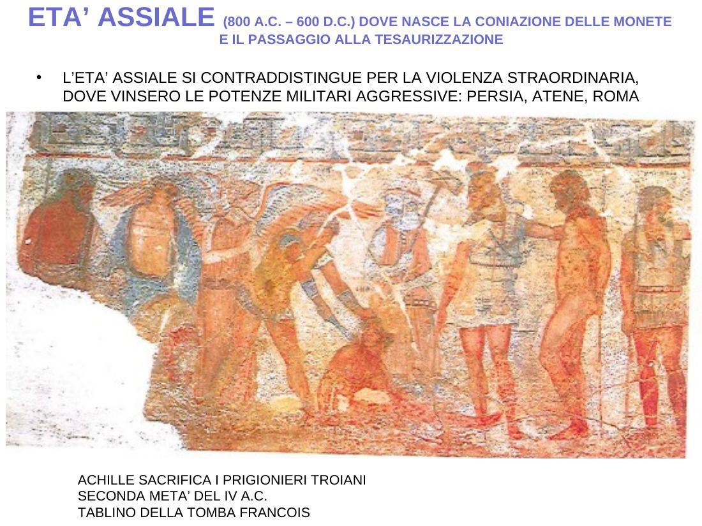{ loading=lazy style="width:54%" }

ACHILLE SACRIFICA I PRIGIONIERI TROIANI

SECONDA METÀ DEL IV A.C.

TABLINO DELLA TOMBA FRANÇOIS

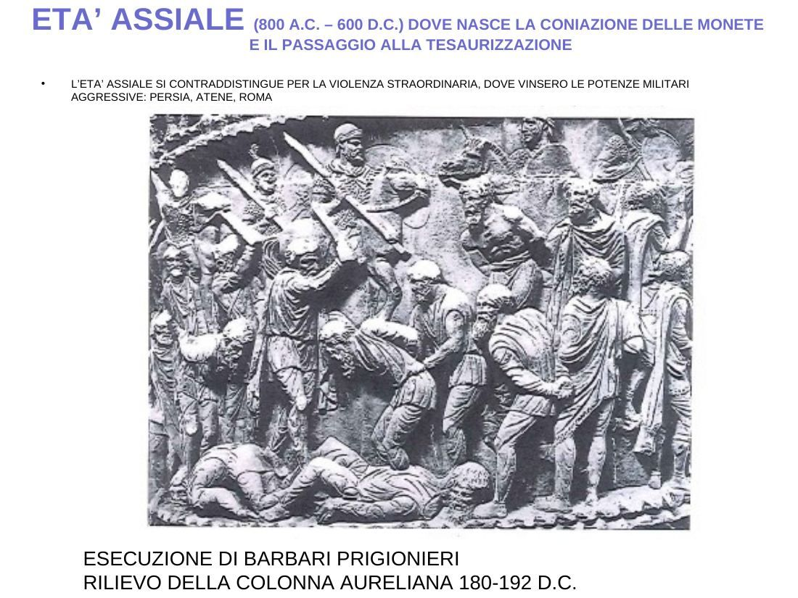{ loading=lazy style="width:44%" }

ESECUZIONE DI BARBARI PRIGIONIERI

RILIEVO DELLA COLONNA AURELIANA 180–192 D.C.

1:18:11

Le città che invece erano più votate ai commerci furono distrutte completamente: Sidone, Tiro, Cartagine. Queste sono le rovine di Sidone: oggi ci sono i mezzi dell’ONU per quelle strade, ha continuato su quella strada. Tiro: questo è un arazzo dove si vede, a sinistra, la conquista di Tiro da parte di Alessandro Magno. Cartagine: fu rasa al suolo, e sul luogo fu passato l’aratro e fu sparso il sale. Quindi una violenza inaudita, da questo punto di vista.

**LE CITTÀ-NAZIONE COMMERCIALI INVECE PERSERO FEROCEMENTE LA CONTESA:**

Sidone (Libano) fu distrutta dall’imperatore Artaserse nel 351 a.C.: 40.000 abitanti preferirono il suicidio alla resa;

Tiro (Libano) fu distrutta da Alessandro nel 332 a.C.: 10.000 morirono in battaglia e i 30.000 sopravvissuti furono venduti come schiavi;

Cartagine (vicino a Tunisi) fu distrutta dai romani nel 146 a.C., dove migliaia furono stuprati e uccisi e 50.000 venduti come schiavi.

Questi esempi ci danno l’idea della violenza in mezzo alla quale si sviluppò il pensiero dell’età assiale: molti storici ed economisti si sono posti la domanda: c’è una relazione tra conio, potenza militare e la fioritura di idee senza precedenti?

Credo che una risposta esatta (anche perché sarebbe impossibile) non sia stata ancora data.

Confrontando Atene con Roma si colgono somiglianze impressionanti: in entrambe la storia inizia con una serie di crisi debitorie.

Le crisi debitorie sono antecedenti al conio, che fu piuttosto invece una soluzione con esiti diversi: la vittoria degli aristocratici, con la maggior parte delle persone che faceva parte della «casa» del ricco patrono (questi modelli non furono però efficaci in campo militare).

La vittoria di una concezione più popolare con la distribuzione delle terre contro la schiavitù per debiti. Contadini liberi i cui figli avrebbero passato gran parte del loro tempo addestrandosi alla guerra (questi modelli invece furono efficaci in campo militare).

Qui il conio giocò un ruolo fondamentale perché usando la finanza pubblica si distribuivano monete, che lo Stato poi riaccettava come pagamenti.

Interessante notare che le zecche erano ubicate nei templi (luoghi tradizionali per depositare le spoglie di guerra).

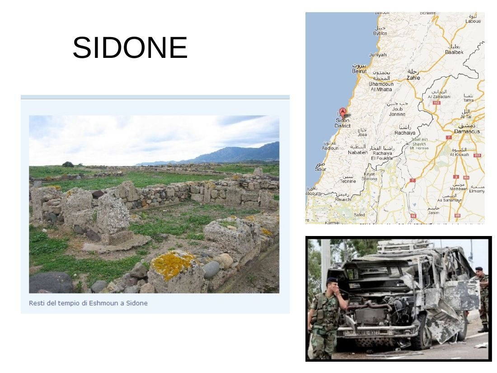{ loading=lazy style="width:47%" }

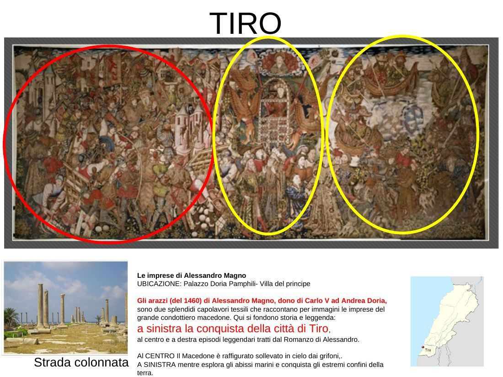{ loading=lazy style="width:47%" }

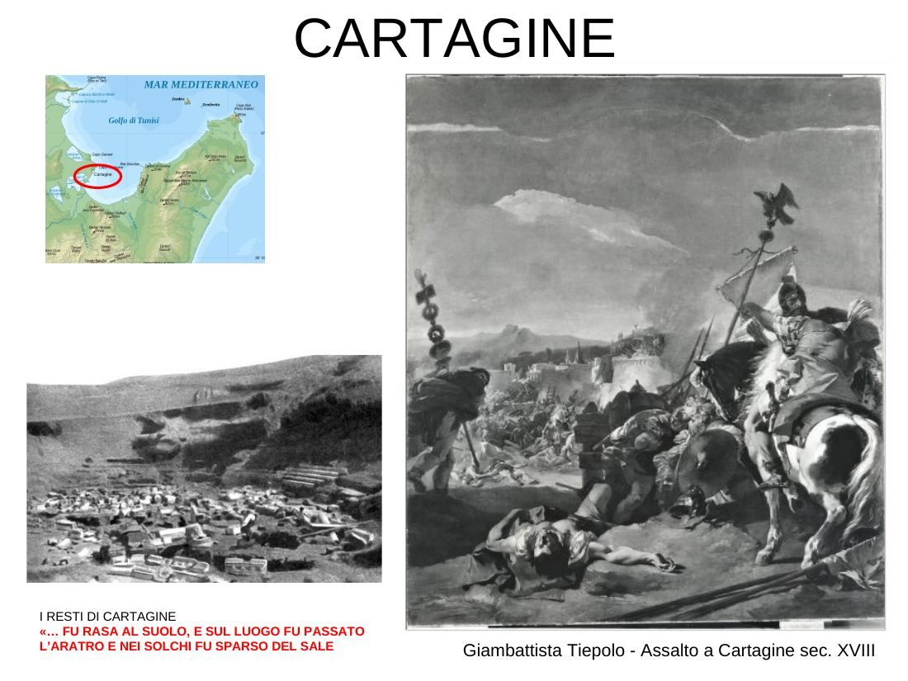{ loading=lazy style="width:59%" }

1:19:01

E partono tutte anche da crisi dovute al debito. E la soluzione quale fu? O una visione della società più aristocratica, in cui i debiti venivano accorpati nella casa del padrone, sostanzialmente; oppure quella che invece prevalse a Roma, che era più popolare, della distribuzione della terra, in modo che i figli dei contadini potessero fare i guerrieri per conquistare altre terre: un circolo virtuoso, sostanzialmente. Poi si arriva al Medioevo, con la disgregazione degli imperi, e nascono invece le religioni mondiali, universali.

1:20:00

Infatti il pendolo, come dicevamo quando abbiamo visto quei quadri all’inizio, cade sulla concezione non del commercio, ma della chiusura, e quindi della regolazione della vita economica, e quindi della condanna del tasso di interesse come motore di sviluppo. Infatti si ritorna all’oro, all’argento; poi, verso la fine del Medioevo, c’è invece la nuova fioritura dei commerci internazionali e della moneta creditizia, sostanzialmente.

**IL MEDIOEVO (600 – 1450 D.C.) CON IL RITORNO ANCHE ALLA MONETA CREDITIZIA E VIRTUALE**

Se l’età assiale fu il periodo storico in cui videro la luce i due ideali complementari di mercati per le merci e di religioni mondiali universali, nel Medioevo queste due istituzioni iniziarono a fondersi.

Qui si ha la disgregazione degli imperi e il nesso tra guerra, oro e schiavitù si rompe: la conquista e l’accumulazione non erano più il fine ultimo della vita politica.

La vita economica, i mercati locali e il commercio internazionale vengono regolati sempre di più dalle autorità religiose.

La prima conseguenza di questa regolazione fu la campagna per controllare e vietare il prestito (e quindi il debito) a interesse.

La seconda fu il ritorno a varie forme di moneta creditizia e virtuale (in tutta l’Eurasia, compresi l’Islam, Cina, India…).

Per raccontare la storia del debito di questo periodo focalizziamoci su un debitore famoso: il margravio Casimiro di Brandeburgo-Ansbach (1481–1527) della famosa dinastia Hohenzollern.

Casimiro era il figlio di Federico il Vecchio di Brandeburgo, passato alla storia come uno dei «principi folli» del Rinascimento tedesco, caratterizzato da scatti d’ira, feste e baccanali orgiastici…

Federico fu costretto da suo figlio Casimiro ad abdicare (il 26 febbraio del 1515, distratto anche dal Carnevale…) a causa dei debiti (200.000 fiorini) di cui non riusciva a pagare nemmeno gli interessi.

I creditori erano in gran parte nobili. La motivazione fu di infermità mentale.

Casimiro, nel tentativo di riordinare le finanze della casata, abbracciò anche la Riforma luterana, mosso, probabilmente, più che dalla fede, dalla possibilità di mettere le mani sulle terre e sugli averi dei monasteri della Chiesa.

La situazione si aggravò ulteriormente con altri debiti di gioco (50.000 fiorini).

Il passo successivo fu di mettere i creditori nell’amministrazione civile, i quali misero così tante e tali tasse che provocarono una rivolta popolare e contadina. Rivolta popolare che si inserì anche nella scia delle idee della Riforma protestante.

Casimiro si mostrò quasi vicino a questi sentimenti in attesa che si esaurisse la spinta; una volta esaurita la rivolta, l’intervento fu di una crudeltà vendicativa spaventosa.

I boia tenevano una contabilità analitica anche perché venivano pagati in base alla «produttività».

A un certo punto, nella città di Kitzingen, Casimiro ordinò che fossero cavati gli occhi a 58 cittadini che si erano rifiutati di guardarlo come se fosse il loro signore.

Questo fu il conto presentato dal boia Augustin (chiamato *Mastro dolore*):

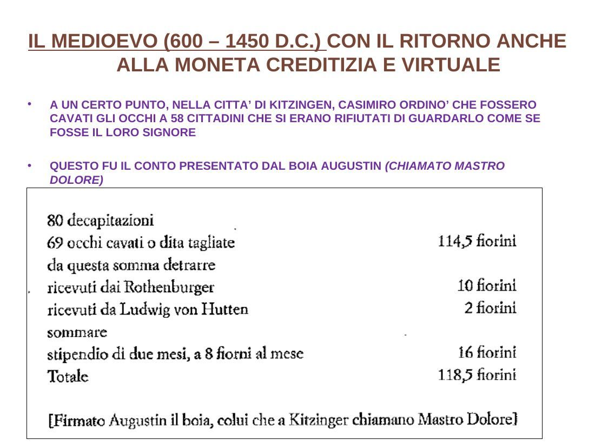{ loading=lazy style="width:59%" }

1:20:39

Per narrare questa parte, c’è un episodio interessante legato al debito. Il margravio Casimiro di Brandeburgo, figlio di Federico il Vecchio di Brandeburgo, che era come Federico uno dei principi folli del Rinascimento tedesco… il padre aveva contratto un sacco di debiti, e il figlio ereditò tutti questi debiti e non riuscì a ripagarli. Poi era un giocatore, e fece altri debiti per pagare i debiti. Allora riuscì in qualche modo a far entrare nel suo regno i suoi creditori, i quali, per rientrare dei propri denari prestati, misero diverse tasse. Siamo nel periodo della Riforma: ci fu una rivolta popolare, contadina, e lui sembrò anche accompagnare questa rivolta; senonché aspettò che si esaurisse, e poi ci fu una vendetta crudelissima, crudelissima davvero.

1:22:10

C’erano i boia che tenevano una contabilità analitica di tutto quello che veniva fatto. A un certo punto, nella città di Kitzingen, Casimiro ordinò che fossero cavati gli occhi a 58 cittadini che si erano rifiutati di guardarlo mentre lui passava. E questo è il conto del boia, uno dei boia, che si chiamava Mastro Augustin, che presentò il conto dei lavori fatti: 80 decapitazioni, 69 occhi cavati o dita tagliate, stipendio di due mesi a 8 fiorini al mese; in totale 118 fiorini. Quindi preciso. È derivato tutto da questa storia del debito del padre, che si era indebitato, e del figlio, che non riusciva poi a ripagare i propri debiti.

1:23:08

Lorenzo Poggi Come tutto divenga economicamente compreso: quindi non c’è più differenza di valore di lavoro. Ora, questo è un esempio medievale, siamo all’inizio; ma il fatto di avere sublimato i rapporti umani, di averli eliminati e tradotti in rapporto economico, ha fatto sì che la società divenisse sempre più sorda a quelli che sono i valori umani. L’altra volta parlavamo del linguaggio, ricordate, il linguaggio che era sempre più lontano, quello dell’Atene, lontano da quello della vita, da quello del mondo. Così vale anche per questa astrazione.

1:24:04

Pensate a questo: il comandante delle SS che comandava il campo di sterminio di Terezín. Non si rendevano conto di come avesse potuto uno comandare un campo dove venivano eliminati 2500 ragazzi al giorno, giovani. Allora gli chiedevano: «Ma come ha fatto?». Insistevano, i giornalisti, a chiedergli per capire come una persona potesse aver fatto delle cose del genere, e lui non capiva: «Ma che cosa volete sapere?». Non riusciva a capire o mai mai insistire soltanto per capire che cosa. Alla fine rispose: «Ma io andavo al campo, la mattina mi arrivava un treno con 2500 persone, e io dovevo sistemarle perché la mattina dopo me ne arrivava un altro». Era questo, la risposta. È questo, se il fattore astratto economico è quello che regola i rapporti fra gli uomini, è quello che sostituisce i rapporti della società.

1:25:42

Lì si tratta di rapporto politico, ma lì il rapporto politico è il teatrino dello zio Wolf, Hitler, che diceva appunto che il dovere e il rapporto sociale stanno nel compiere il proprio dovere, cioè nell’eseguire il proprio compito, nel rispettare il mansionario, la funzionalità. Tu sei a capo di un campo di sterminio: vediamo se sei funzionale, se ci riesci. Hai rispettato il mansionario: è la stessa logica dell’astrazione economica. Non contano le emozioni degli uomini, non conta il valore delle merci in quanto in grado di soddisfare bisogni umani: conta il loro valore di mercato. Bisogna astrarre da ciò che è umano, da ciò che è legato… Fino a che punto?

1:26:55

\[Paolo\]*:* Allora, invece, dal 1450 a oggi, dalla fine del Quattrocento–Cinquecento, parte la nuova era dei grandi imperi capitalistici, e quindi c’è il ritorno all’oro e all’argento come moneta di scambio nei rapporti commerciali. E appunto, negli ultimi due secoli, se ci pensate, la guerra è sempre stata la principale causa del debito sovrano: abbiamo visto la Germania, con gli effetti collaterali della guerra. Per sconfiggere Napoleone la corona d’Inghilterra accumulò un debito pari al 250% del prodotto interno lordo. Noi oggi siamo sotto il tiro di tutto il mondo con il 120: considerate che enormità di debito avessero. Però l’ultimo secolo è anche un periodo di grandi innovazioni sociali, perché si trasformano i debiti dei sovrani in debito sovrano, cioè quello dello Stato, sostanzialmente, come abbiamo ricordato prima: l’America, ma anche l’Italia, tutta l’Europa, sostanzialmente.

**DAL 1450 – A OGGI: L’ETÀ DEI GRANDI IMPERI CAPITALISTICI CON IL GRANDE RITORNO ALL’ORO E ALL’ARGENTO IN TUTTO IL MONDO**

Negli ultimi due secoli, la guerra è restata la principale causa del debito sovrano.

Per sconfiggere Napoleone, la corona d’Inghilterra accumulò un debito pari al 250% del prodotto interno lordo. È il periodo in cui i moderni Stati democratici trasformano il debito del sovrano in «debito sovrano», dove la sovranità è del popolo. È anche il periodo in cui il «debito» morale e sociale delle classi sociali più avvantaggiate viene ripagato con quello che chiamiamo Stato sociale: un trasferimento di risorse dai più ai meno economicamente favoriti.

Un programma enorme che ha ridisegnato i rapporti sociali come mai era successo prima nella storia dell’umanità.

Per questa epoca, vorrei raccontare:

- Il caso dei debiti pubblici, che sono a cavallo tra il Medioevo e la modernità;

- il caso della Chiesa e dei debiti papali tra il Cinquecento e il Seicento.

Tralasceremo un po’ gli ultimi due secoli, di cui abbiamo già parlato nell’introduzione.

1:28:32

E quindi c’è la nascita del grande Stato sociale, perché in contropartita ci sono state tutte quelle riforme che chiamiamo oggi Stato sociale: l’assistenza, la scuola, la sanità ecc. Quindi da un lato c’è stata questa evoluzione, c’è stato sì il debito sovrano, ma dall’altra parte, dal lato dei cittadini, c’è stata anche un’evoluzione dello Stato sociale. Allora, poi, dal 1450 a oggi c’è un caso particolare, che magari vediamo nell’ultima parte (ve lo accenno solo): è il caso dei debiti pubblici, di quando nascono i debiti pubblici, a cavallo tra il Medioevo e la modernità. E come sempre in questo caso il motore principale di questa innovazione è la Chiesa: è interessante, per i debiti, il caso della Chiesa tra il Cinquecento e il Seicento, ma lo vediamo dopo.

1:30:03

Lorenzo Poggi Allora, riprendiamo un attimo. Allora, dicevamo: l’economia diventa l’elemento che costruisce i rapporti sociali. Ma questo non è ancora un processo completo agli inizi dell’Ottocento. Rimangono ancora degli elementi umani, potremmo dire, che sfuggono almeno in parte alla presa dell’economia: rimangono gli uomini con i loro bisogni, con le loro pulsioni, che sono ancora intercettabili dalla politica, e ancora divengono gli elementi che possono in qualche modo incidere, modificare il sistema. C’è ancora un residuo forte, un fondo forte di umanità nello sviluppo dell’economia, e quindi di quella parte che costruisce il debito, cioè del posticipare i consumi, dell’accumulare, che serve poi al capitale, che regge il capitale. C’è ancora un margine. Marx stesso dice che il lavoratore lavora perché? Perché deve far sopravvivere la parte, diciamo, bestiale di sé, non umana; e quella parte, per quanto sia in comune con gli animali, è comunque un bisogno, è comunque una parte umana, e quindi c’è questo aspetto su cui può ancora fondarsi la politica.

1:31:58

Questo aspetto però viene sempre più assottigliandosi man mano che andiamo avanti. Man mano che si sviluppa la società, i rapporti degli uomini si risolvono in rapporti economici. Anzi, prevale sempre più l’idea che, meno si ha coinvolgimento personale nella società, più uno si fa i fatti suoi e non si lascia coinvolgere da ciò che gli succede accanto, meglio vanno le cose. Questo è un modo di rapportarsi nella società che l’economia ha portato come ideale al suo livello di astrazione più elevato.

1:33:04

Facciamo un esempio. In Spagna la Reconquista finisce con la cacciata dei moriscos e dei marranos, o con la loro conversione. E diventano marranos e moriscos; però, se vuoi accedere al potere, essere spagnolo a pieno titolo, devi dimostrare di essere cristiano viejo: nel tuo albero genealogico non ci devono essere né marranos né moriscos, perché questi si sono convertiti perché, se no, gli tagliavano la testa. Si sono convertiti: hanno capito dov’era la verità, di fronte al boia. In Puglia, a Otranto, no: a Otranto è un’altra cosa, lì sono i martiri della fede. Il primo decapitato, il martire Primaldo, raccatta la testa e si mette lì ad aspettare che il boia abbia finito. Dicono che il boia da quel punto si rifiutò di andare avanti, ma è successo solo a Otranto. Poi Caedino fece impalare il boia; ma lasciamo stare, torniamo a noi.

1:34:57

Allora, quando le guerre avvengono per motivi religiosi, e vediamo il coinvolgimento personale, sono tremende e non si fermano che con l’uccisione. Se avvengono per motivi economici, a un certo punto ci si ferma: a un certo punto si fa un calcolo e si dice: «Un momento, ma quanto ci costa? Forse ci costa molto di più di quanto si potrebbe guadagnare controllando il petrolio» ecc. Allora fermiamoci un minuto; e quelli che ci combattono a un certo punto possono anche dire: «Ma se facessimo un po’ di pace, magari io posso gestire quello…»; ci si può mettere anche d’accordo. Quindi, da un certo punto di vista, l’economia e l’introduzione di questo elemento hanno fatto sì che certi caratteri bestiali, più ferini, dell’umanità venissero meno nei rapporti fra gli Stati. Però questo fattore, ingrandendosi, ha deformato il comportamento e incide fortemente sul comportamento.

1:36:21

Quand’è che è diventato totalizzante? È diventato totalizzante nel momento in cui l’economia è diventata veramente ciò che comanda tutta l’esistenza. Si pensa a una società, oggi utopica, in cui non c’è bisogno di rapportarsi agli altri personalmente, se non attraverso il prestito e il debito, il pagamento in contanti. Tutti i rapporti si risolvono in questo modo, e quindi non c’è bisogno di rapporti sociali veri, perché il rapporto personale è anzi troppo coinvolgente, troppo ravvicinato. Si convive, è possibile convivere, vivere insieme senza amarsi, perché tanto i nostri rapporti sono già regolati dall’economia. Ed è il tema che affronteremo la prossima volta: infatti la prossima volta parliamo di sentimenti ed emozioni, come questo.

1:37:40

In questo caso la comunicazione diventa solo trasmissione di informazione. Veniamo da un passato recentissimo in cui il successo politico di alcuni si è basato sul negare questo, e sul tornare invece a sollecitare le emozioni e i sentimenti. Va bene, stiamo parlando di qualche cosa che ci riguarda da vicino, ora. Quindi, quale tipo di debito? Perché il debito? Da dove viene? Torniamo al nostro discorso su quello che gli uomini in Occidente, e poi in genere nel mondo, hanno inventato per gestire la loro esistenza: l’economia, che è uno di questi elementi, e che poi si è impadronita della loro esistenza.

1:38:48

Che cos’è il debito? Da dove viene fuori? Siamo prima di tutto un insieme di bisogni; ma, oltre che un insieme di bisogni, come esseri umani siamo anche un insieme di desideri. Gli oggetti, le cose, servono a soddisfare i bisogni, e sono utili: è il loro valore d’uso, vi dicevo una volta. Ma servono anche a dare realizzazione ai nostri desideri. C’è un rapporto tra bisogni e desideri: l’oggetto che riesce a soddisfarli ha un valore a seconda di come si colloca in questo rapporto tra bisogno e desiderio. All’inizio del nostro discorso sull’economia il valore era dato dal lavoro. Marx pensava che il valore stesse nelle ore di lavoro concretizzate nell’oggetto; non aveva inventato nulla, l’aveva preso da David Ricardo.

1:40:11

E quindi c’era un elemento sicuro su cui agire, su cui si regolava l’assetto economico del suo tempo, che era questa idea del valore-lavoro. Nel lavoro è concretizzato il rapporto fra gli uomini, in una bellissima astrazione che ha anche del mistico; c’è concretizzato il loro rapporto sociale. La nostra Costituzione mette il lavoro a fondamento della nostra politica, del nostro essere insieme politicamente: «La Repubblica è fondata sul lavoro». Quindi è questo l’elemento: il lavoro come elemento riassuntivo, concretizzante, dei rapporti sociali. A un certo momento, però, il lavoro non serve più soltanto a questo equilibrio tra bisogni e desideri.

1:41:18

C’è uno spostamento. Siccome si deve rispondere a un incremento sempre maggiore della produzione, della produttività, e c’è sempre più disponibilità, ci si sposta sempre più dal bisogno verso il desiderio; per cui diventa più difficile governare i desideri rispetto a catalogare e governare i bisogni. Ecco, la modernità della nostra società, e il debito, si giocano tutti su che cosa? Sulla funzione simbolica dell’oggetto di esaudire il desiderio, di andare al di là del bisogno, al di là di quello che c’è, e di giocare moltissimo sull’identificazione con il desiderio; di lasciare il bisogno come qualcosa di troppo legato alla materialità, già soddisfatto; ed è tipico dei paesi sviluppati andare verso il desiderio. L’oggetto non ha più valore in quanto ha una sostanza, in quanto soddisfa un bisogno, ma in quanto viene incontro a un desiderio. E questo è l’elemento che caratterizza la società contemporanea, l’economia contemporanea: un incremento continuo dei desideri. Un’economia che, per una parte dell’umanità, incrementa i desideri fino allo spasimo del debito (30.000 euro per ogni bambino che nasce), e lascia l’altra gran parte dell’umanità nemmeno nella possibilità di soddisfare i bisogni più elementari. Ma questo è un discorso sulla giustizia, che riguarderebbe discorsi etici che non vogliamo fare. Parliamo delle condizioni che si sono create per questo gioco sul desiderio continuamente incrementato, e dei caratteri che ne derivano per la nostra società. Questo però dopo: ora ci fermiamo a questo punto, perché è troppo stretto. Grazie.

\[PAUSA\]
{: .nota }

2:11:30

Intervento dal pubblico Un attimo: volevo farvi un po’ di pubblicità, e faccio una cosa che abbiamo già fatto qua. Giovedì 7 marzo, alla galleria d’arte *Syncresis* a Empoli, che è in Santa Maria, di fronte alla Coop di Santa Maria, in via della Repubblica, c’è una mostra d’arte, e nell’ambito della mostra facciamo questa cena a tema, con una piccola performance gustativa: giovedì 7 marzo alle ore 20, da Syncresis, con Alessandra Scappini. Se qualcuno ha perso la nostra prima serata, potrebbe essere un’altra occasione di incontro. Grazie.

2:13:18

Paolo Marcucci Bene, prima di concludere permettetemi di ringraziare gli amici della Zaffera, che ci hanno offerto la cena questa sera. Andiamo a concludere la serata di questo debito con l’ultima parte. Come vi ho detto, affrontiamo un po’ il periodo dal 1500 a oggi, che è quello del ritorno dell’oro e dell’argento come moneta di scambio. Ricordiamo un dato, che ci fa capire come sia stato visto questo periodo della storia: questo periodo finisce solo nel 1971, con la fine degli accordi cosiddetti di Bretton Woods, quando la convertibilità del dollaro si sgancia dall’oro. Fino a quel momento la moneta di scambio internazionale per antonomasia, che è il dollaro, è legata alle riserve auree; da quel momento viene sganciata, e non c’è più una relazione di dipendenza tra questi due valori. Quindi finisce questo ciclo, che era durato sostanzialmente tre–quattro secoli: in questo momento non ci sono monete agganciate ai metalli preziosi.

2:15:00

C’è da dire che in questo momento, tanto per ritornare un po’ all’attualità, la Germania sta facendo rientrare in Germania l’oro che era depositato in diverse parti del mondo. Non so come si possa interpretare, però la realtà è questa: di tutto l’oro che hanno (e ne hanno molto; tra l’altro l’Italia come riserve auree ne ha poco meno della Germania), l’avevano depositato in America, in Svizzera e in Francia, mi pare; la maggior parte, il 60%, in America; e lo stanno facendo ritornare in Germania. Quindi non so come interpretarlo, però non mi parrebbe un grandissimo segno, da questo punto di vista.

2:15:51

Domanda dal pubblico: Perché le riserve auree non vengono usate per pagare il debito pubblico, dal momento che dovrebbero servire nei momenti di bisogno? Infatti la domanda è interessante. È vero, infatti ci sono diversi economisti e statisti (tra l’altro anche Prodi aveva fatto una mezza proposta all’Unione europea) che propongono non tanto di ripagare i debiti pubblici, come diceva lei, quanto di finanziare… con le riserve auree delle banche centrali. Perché ricordiamoci che in Europa le banche centrali non ci sono più, ora c’è la BCE: quindi la Banca d’Italia non fa più azione di regolazione della moneta, ma fa solo la vigilanza sul sistema bancario, e così tutte le altre. Queste banche centrali hanno molto oro nelle loro casseforti, perché l’avevano accumulato in 150 anni di storia. C’era una proposta fatta da Prodi, ma anche da altri economisti in tutta Europa, non tanto di ripagare con questo oro i debiti pubblici (cosa che per i tedeschi non sarebbe mai passata, perché dal loro punto di vista è immorale), quanto di finanziare un debito pubblico europeo per gli investimenti, cioè infrastrutture, quello che poi genera economia: tutte le infrastrutture di cui avrebbe bisogno l’Europa per rilanciare lo sviluppo. Quindi non ripagare il debito, ma finanziare lo sviluppo. E qui c’è stato il no totale dei tedeschi, che in questo momento hanno il pallino in mano sulla governance europea.

2:18:03

Allora, ritorniamo al nostro discorso del debito: è interessante vedere quello che è successo in un determinato momento della storia, tra il Cinquecento e il Seicento, che aveva un inizio nell’Italia del XII–XIII secolo, quando nascono le città comunali (le abbiamo affrontate anche nelle nostre serate, da diversi punti di vista). Le città cominciano a fare debito perché vogliono svilupparsi, e quindi cominciano a emettere debito pubblico: dapprima in maniera volontaria, e successivamente in maniera forzosa, perché lo sviluppo richiedeva un pagamento dei debiti e degli interessi tale che con le entrate normali non ce la facevano più a finanziare questo debito. L’ho un po’ già detto prima: questi debiti venivano ripagati con tassi anche piuttosto alti; quando non ci si riusciva, si facevano delle politiche di prestiti forzosi. Anche in questo momento, dall’anno scorso, ci sono stati diversi economisti, anche in Italia, Auletta e Savona, che dicevano che c’era bisogno di un debito forzoso, una cosa che risale al XII–XIII secolo.

**DEBITO PUBBLICO E MERCATI FINANZIARI IN ITALIA – SECOLI XIII–XX (A CURA DI DE LUCA E MOIOLI)**

Per questa parte ci facciamo aiutare dalle tabelle storiche ricostruite in un altro saggio interessante sul debito.

*Il caso della Chiesa e dei debiti papali tra il Cinquecento e il Seicento c*ontenuto in *Debito pubblico e mercati finanziari in Italia – Secoli XIII-XX* (a cura di De Luca e Moioli).

Il debito, abbiamo visto, è connaturato con la vita dell’uomo. Ha attraversato tutte le epoche degli ultimi 5000 anni, ma in questo discorso è interessante anche raccontare quando sono sorti i primi debiti pubblici.

Il fenomeno prevalentemente inizia a partire dal XII secolo.

Ci facciamo aiutare da alcune tavole tratte da questo libro. Da una prima immagine di fondo si vede che i debiti venivano fatti:

- dalle città comunali e dalle repubbliche, tramite prestiti volontari  dal XII secolo in concomitanza con la piena sovranità dei diritti fiscali, precedentemente in capo ai tradizionali detentori: vescovi e signori feudali;

- dai principi e signori con i servizi dei banchieri e dei mercanti.

Per i casi n°1 ai volontari si affiancarono i prestiti forzosi, man mano che crescevano le necessità finanziarie (a titolo di esempio si rammentano Siena nel 1287 con la *presta generalis*, e Lucca nel 1371);

Per i casi n°2 occorre dire che non esisteva un debito pubblico analogo a quello delle città stato, i sovrani si rivolgevano ai mercanti e banchieri (ad esempio il banco Strozzi lo troviamo impegnato nella finanza aragonese a Napoli, e i Medici nel prestito al duca di Milano).

Quello che è interessante sono i tassi di interesse:

I tassi di interesse a Firenze sul debito pubblico (prevalentemente a breve) erano intorno al 12–14%

Quelli della Corona aragonese a Napoli anche il 40% per l’alto rischio dovuto alla possibilità di ripudiare, non essendoci norme, gli impegni nei confronti dei prestatori (i fallimenti dei Bardi, i Peruzzi…).

L’evoluzione dell’ammontare dei debiti fu piuttosto importante; ciò portò diverse volte anche al consolidamento del debito quando le spese erano più alte delle entrate.

Il consolidamento del debito portò molte volte anche alla decurtazione del capitale dei creditori.

In tempi di oggi vale ricordare i titoli argentini.

Oppure oggi si parla pragmaticamente, visto il debito pubblico nelle banche centrali, di azzerare questo debito con una partita di giro (alcuni contro, altri a favore…).

Ad esempio quando nel 1316 il governo veneziano decise di estinguere una parte del debito, i creditori con quote sotto a 10 lire si videro restituire il 70% del capitale, mentre per le quote tra 10 e 15 la percentuale salì all’80%.

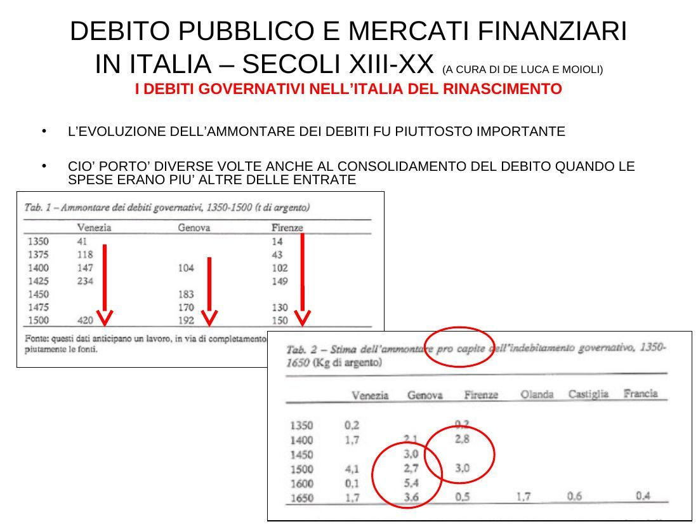{ loading=lazy style="width:59%" }

2:20:00

Per esempio, quando queste città non ce la facevano più, facevano questi prestiti forzosi: Siena lo fece nel 1287, con la *prestanza generalis*, oppure Lucca nel 1371. Quindi non è assolutamente una novità: è già successo nella storia. Naturalmente i debiti poi li facevano anche, come abbiamo visto prima, i principi, che si affiancavano alle città democratiche, che chiamavano comunali, e si finanziavano presso i mercanti, i banchieri fiorentini o lombardi. I tassi andavano dal 30 al 40%; è interessante notare che i debiti pubblici invece venivano pagati intorno al 12–14%. Quindi c’era una bella differenza tra il debito del principe, del sovrano, e il debito della città comunale: voleva dire che la città comunale era ritenuta più solvibile del principe; ed era anche vero, effettivamente era così.

2:21:08

Solo due dati, tanto per farvi capire l’importanza e lo sviluppo di questi debiti: a Venezia si passa da 41 tonnellate di argento nel 1351 a 420 tonnellate nel 1500; a Genova da 104 a 192; a Firenze da 14 tonnellate a 150 tonnellate. Quindi c’è uno sviluppo importantissimo del debito, da questo punto di vista. Ogni tanto succedeva che veniva decurtato, quindi non si pagava più: in epoca recente è successo in Argentina, e chi aveva i bond argentini si è trovato con una quota del debito nominale che aveva sottoscritto. E succedeva sostanzialmente anche in quei tempi lì.

2:22:01

Ecco, quello che è interessante e che volevo raccontarvi è invece lo sviluppo dei mercati finanziari, che prendono il via da quello che abbiamo detto fin qui sulle città comunali e si sviluppano nella Roma tra il Cinquecento e il Seicento. Ricordiamo (l’abbiamo detto un sacco di volte) che la Chiesa condannava l’usura, perché non si doveva prestare a usura: era immorale, era contro Dio, il tempo è di Dio ecc. Ecco, con grande pragmatismo la Chiesa, tra il Cinquecento e il Seicento, abbandona questa fede e si butta nei mercati finanziari, con un successo incredibile. Tra l’altro aveva iniziato qualche anno prima, alla fine del Quattrocento, con la vendita delle cariche: aveva fatto le prove generali per il debito vero.

2:23:07

Si inventarono di vendere delle cariche a persone che non potevano avere i titoli a cui aspiravano (il desiderio, che diceva prima Lorenzo), e li pagavano molto: per esempio il titolo di scudiero, o di collettore, o di giannizzero, o di funzionario. Insomma, li pagavano una certa cifra, e la Chiesa con queste cariche riusciva a incamerare soldi. Tra l’altro questi titoli dapprima si esaurivano al momento della morte di chi li aveva sottoscritti; poi, dopo proteste, divennero anche titoli ereditari, che si tramandavano di padre in figlio.

**L’INVENZIONE DELLA VENDITA DELLE CARICHE**

Colpo di genio del papato, che si affiancò al ruolo di banchieri per i prestiti emessi dalla Chiesa, fu quello della vendita delle cariche, dette uffici di terza categoria.

Nel 1486 fu venduta la prima carica, e non richiedeva alcuna funzione: l’acquirente versava una somma (il capitale) e il governo pagava un «salario» (interesse) vitalizio.

In seguito venne permesso anche il carattere ereditario del titolo.

Nel 1514 venne costituita la prima *societas officiorum*, vale a dire una compagnia che riuniva persone che volevano investire ma che non erano in grado singolarmente di acquisire una carica.

La diffusione di questi prestiti ebbe un successo enorme: al 1520 queste vendite avevano assicurato alle casse pontificie un capitale pari a 2.500.000 ducati.

Il successo si può vedere dal crescente valore che si registrò lungo il Cinquecento, secolo che vide l’evoluzione di questa intuizione in un mercato sempre più importante e solido.

2:24:06

E si arriva appunto al XVI secolo, quando i mercati finanziari in tutta Europa cominciano ad assumere un’importanza notevole, e la Chiesa si inserisce, forse anche per prima, in modo professionale, a un livello che poi servì da esempio anche agli altri. Nel XVI secolo, per esempio, le piazze più importanti erano Anversa, Lione, Genova, Besançon e Piacenza. Si inserì Roma, che divenne la piazza più importante a livello europeo per questa compravendita sui mercati finanziari. Perché? Perché, a differenza delle altre piazze, pur importanti, aveva due cose alle spalle: la Chiesa e la storia di Roma. Questa era la reputazione, che abbiamo accennato anche all’inizio, e la fiducia, perché c’era dietro tutta la storia di Roma e della Chiesa di Roma, con tutto quello che voleva dire.

**IL SISTEMA DEI MONTI NELLO STATO PONTIFICIO (SECOLI XVI–XVII)**

A partire dal XVI secolo i mercati finanziari cominciarono ad assumere un ruolo centrale per lo sviluppo dei sistemi economici europei, infatti era presente un ampio e multiforme reticolo di negoziazioni di strumenti di credito originati da privati e da organismi pubblici.

L’ammissibilità del tasso di interesse e le crescenti garanzie giuridiche ai crediti (vs debiti) e ai contratti avevano allargato enormemente l’importanza dei mercati.

Nel XVI secolo piazze come Anversa, Lione, Genova, Besançon e Piacenza erano le principali borse europee; ben presto però Roma divenne una delle più rilevanti piazze per la movimentazione dei capitali, un centro sui generis, perché, a differenza di altri, non aveva alle spalle un articolato sistema mercantile e produttivo. Roma però aveva alle spalle la storia di Roma e la storia della Chiesa.

Seguendo la scia dei debiti pubblici nati nei comuni italiani e nelle Fiandre, nel 1526 fu creato il primo «monte», e fu un successo enorme dovuto anche alla scrupolosa amministrazione, puntualità e regolarità del pagamento degli interessi, dovuta all’efficienza e alla perizia dei funzionari della Camera apostolica nella gestione amministrativa.

Questo era l’elenco a sostegno della sottoscrizione:

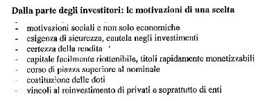{ loading=lazy style="width:48%" }

2:25:16

Infatti le scelte, secondo quanto lo storico ha ricostruito, erano queste: motivazioni sociali e non solo economiche, esigenze di sicurezza, cautela negli investimenti, certezza della rendita, capitale facilmente riottenibile, titoli rapidamente monetizzabili (cioè li potevano rivendere subito e rientravano subito in possesso dei loro soldi), corso di piazza superiore al nominale: voleva dire che questi titoli, una volta comprati, valevano più della cifra a cui sarebbero stati rimborsati, perché c’era un grande mercato. E chi li comprava, questi titoli? Innanzitutto, tra il 26 e il 27% venivano sottoscritti da donne: questo è un dato molto interessante. E poi l’80% dai privati e il 20% da enti o Stati. Questo è interessantissimo, perché fa vedere come si sviluppano i mercati finanziari europei: pensiamo all’Europa che c’era in quel periodo, e all’Italia, che era divisa in Stati, staterelli ecc.

**GLI INVESTITORI NEI TITOLI DI DEBITO PUBBLICO PONTIFICIO (XVII SECOLO)**

Ma chi erano gli investitori in questi titoli di debito dello Stato della Chiesa?

Molte erano anche le donne, infatti mediamente si raggiungevano soglie intorno al 26/27% del numero dei sottoscrittori (il resto erano naturalmente uomini), che scendeva al 12% in rapporto al capitale sottoscritto.

In ogni caso si trattava di cifre non indifferenti.

I sottoscrittori privati raggiungevano l’80% del totale, mentre il restante 20% era appannaggio degli enti (religiosi e caritatevoli ma non solo) e altri Stati.

Interessante è anche vedere la distribuzione geografica che ci aiuta a vedere la diffusione di questi strumenti finanziari pontifici.

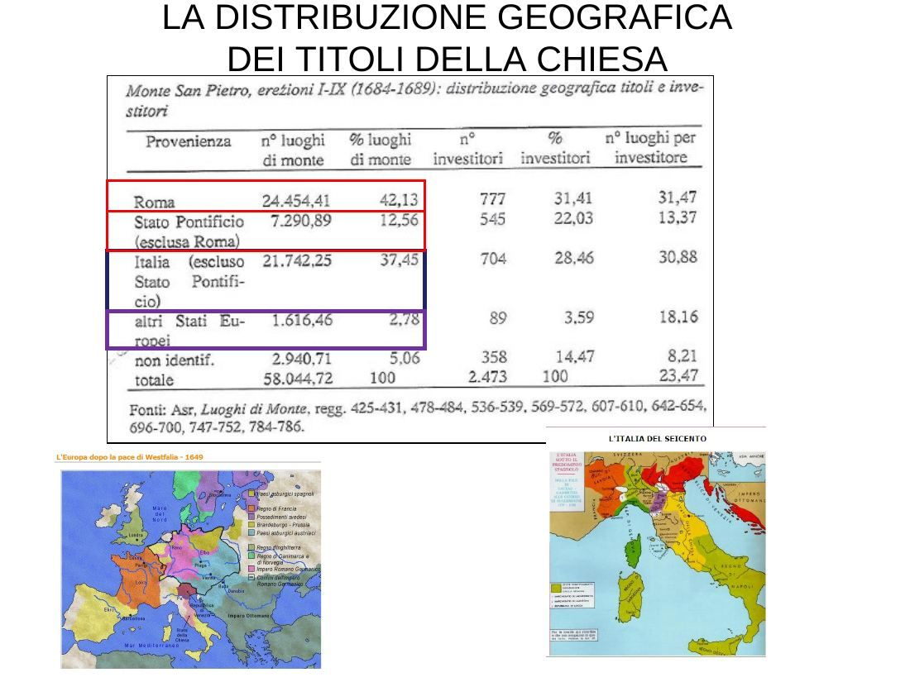{ loading=lazy style="width:59%" }

2:26:32

Allora, questi titoli vengono venduti per il 42% nella sola città di Roma; nello Stato pontificio se ne vendeva il 12%; mentre il 37% (cifre enormi, per l’epoca) veniva venduto in tutta l’Italia, in tutti gli Stati italiani, e una parte, il 3% più un 5%, in tutta Europa. Quindi nessuno riusciva ad avere una distribuzione così dei propri sottoscrittori. Questo fu un successo enorme da parte della Chiesa, e ci fa vedere come, da una condanna dell’usura, sia stata forse la prima a fare i mercati finanziari moderni del debito, quelli a cui assistiamo oggi tutti i giorni quando apriamo il telegiornale o leggiamo i giornali. Non so che conclusioni possa trarne il nostro maestro, ma sentiamo.

2:27:44

Lorenzo Poggi Nessuna meraviglia che Roma abbia precorso anche in questo, perché Roma e la Curia pontificia hanno precorso molto spesso i tempi. Pensate, per esempio, alla grande funzione di ascesa sociale che ha avuto la Chiesa: le classi meno abbienti, le classi contadine dell’Italia dell’Ottocento, del Settecento, se potevano avere una speranza di ascesa sociale, l’avevano attraverso la Chiesa. Era spesso il parroco che, se trovava qualche figlio di contadini in grado di studiare, un pochino intelligente, lo aiutava, lo metteva in seminario, e di lì andava avanti... lui stesso magari come parroco di campagna veniva da una storia simile. La Chiesa è servita come motore, e Roma in particolare.

2:28:45

La Roma papalina è una Roma che vende di tutto: ha una fortissima presenza di stranieri, le corti europee hanno lì i loro ambasciatori, e ha una fortissima presenza anche di affaristi e di donne. Di donne perché sono presenti moltissimi uomini scapoli per vocazione; e allora Roma è piena anche di donne di malaffare, per esempio: ce ne sono moltissime. Diciamo che c’è un Papa che a un certo punto pensa di allontanare tutte le prostitute da Roma, perché gli sembrava indegno che a Roma ci fosse una così grande presenza di prostitute, e dice: «Le cacciamo tutte, le mandiamo a…». E poi il segretario di Stato gli fa presente: «Facendo così, fra loro e l’indotto, dovrebbero andarsene da Roma 25.000 persone». Praticamente, dice, spopoliamo la città: ci rimangono solo i pecorai, e le pecore che vengono da Frosinone. E non se ne fece nulla. Però Roma, da questo punto di vista, è una città che ha anni di anticipo.

2:30:40

Una cosa: il passaggio è un problema di acquisizione di mentalità. Quand’è che avviene il passaggio per cui l’usura, il prestare a usura, non è più peccato? Avviene nel momento in cui si affermano la mentalità della Riforma luterana e poi quella della Controriforma, insieme. La Riforma luterana perché? Perché, per Lutero, chi è salvato lo dimostra con il fatto che nella vita riesce ad avere un comportamento retto, un comportamento onesto, riesce a pagare i suoi debiti; e il fatto che tu ci riesca vuol dire che Dio ti ha prescelto. E per i calvinisti lo stesso: per Calvino chi ha successo negli affari, chi riesce bene nel compito, nel lavoro che Dio gli ha affidato, dimostra che Dio lo ha prescelto e che si salverà. Però questo Dio rimane nascosto, non si è mai sicuri della salvezza, e quindi si introduce questo momento di dubbio.

2:32:03

Nella mentalità della Controriforma, invece, la grazia la si vede nella santità di vita, nella capacità di riuscire in quello che si fa: lì c’è una manifestazione della grazia. Addirittura la grazia interviene anche sulla bellezza del corpo: il santo è anche più bello. Questo è un discorso sul corpo che varrebbe la pena di fare, lo faremo prima o poi: infatti il corpo del santo non si corrompe neppure, e quando la grazia ti coglie c’è un miglioramento anche estetico. Comunque, c’è questo aspetto: qualche cosa che era legato ai rapporti sociali, legato semmai al raggiungimento di uno scopo terreno, diventa indice del rapporto con Dio, diventa uno degli indicatori del fatto che il rapporto con Dio è impostato nel modo giusto. E da quel momento in poi l’usura, il prestare, non è più solo degli ebrei: è diventato una cosa legittima. L’economia, anche fondata sull’interesse e sul prestito, diventa qualcosa che può impegnare benissimo anche il cristiano.

2:33:49

Anzi, ciò che lui guadagna come capitalista dalla propria impresa non lo può spendere in beni voluttuari: non ci può fare la villa, i bei vestiti, le collane d’oro; deve reinvestirlo nell’industria, perché il successo che avrà nell’industria sarà indice della prescelta divina. Quindi dal Seicento vediamo i capitani d’industria, i banchieri olandesi, vestiti tutti di nero, piuttosto semplicemente, rispetto alla nobiltà spagnola, alla grande nobiltà francese, piena di abiti di lusso, di colori ecc; perché il capitano d’impresa olandese impiega tutto ciò che già… Ginevra, sotto Calvino, è in grado di assorbire tutti gli immigrati che arrivano, perché il concistoro di Ginevra impiega tutti i soldi a disposizione per sviluppare le manifatture di Ginevra.

2:35:25

Paolo Marcucci Forse è interessante dire questo, a questo proposito: le imprese italiane, e anche un po’ quelle spagnole, sono molto meno capitalizzate, cioè non hanno un capitale sociale alto quanto quelle tedesche o olandesi, o comunque del centro Europa, proprio perché in Italia, nei paesi latini, si tende a far sì che l’azienda sia povera e il proprietario ricco. E deriva da quello che diceva Lorenzo prima: cioè non si reinveste nell’industria, e l’utile non è reinvestito ma serve ad arricchire il proprietario. Cioè il convento è povero e i frati sono ricchi, sostanzialmente.

2:36:21

Lorenzo Poggi E quindi è un atteggiamento, ma è anche un mantenere nell’elemento economico un elemento, potremmo dire, non economico, gestibile dalla politica: quello di cui parlavamo prima, e che mi piacerebbe portare a compimento nel mio discorso. Di fronte a noi si pone un mondo in cui l’economia sembra essere l’elemento che domina tutto il resto. La politica non ha una vera e propria autonomia, se non facendo i conti con l’economia: ciò che il politico propone è razionale o irrazionale, fattibile o non fattibile, a seconda che sia compatibile o no con le condizioni economiche. Quindi di fronte a questo dobbiamo chiederci quale spazio abbia oggi il fattore economico, e come abbia trasformato le nostre vite, e come ci si ponga di fronte a questo. Che cos’è che governa oggi la vita?

2:37:36

Evidentemente nelle nostre società c’è stata una trasformazione profonda. La globalizzazione ha portato (diceva prima Paolo) scambi che avvengono in poche frazioni di secondo: vuol dire che non c’è nessun controllo possibile su questo tipo di scala. Ci sono cifre enormi pronte a essere investite, di minuto in minuto, sulle occasioni di investimento che si prospettano più proficue. Ed è enorme questa quantità di denaro, molto più di quella a disposizione degli Stati, del loro prodotto interno lordo. Ed è questa enorme quantità di denaro che fluttua, diciamo che vola nel web, che si posa di secondo in secondo sui rami più favorevoli, che condiziona profondamente ogni andamento economico.

2:39:02

Ma da questo risultano anche altri effetti sulla società, quelli che vedevamo prima. Intanto un effetto palese: dicevamo che il debito è dovuto al fatto che il desiderio supera il bisogno, al momento in cui la soddisfazione non viene dall’aver soddisfatto i bisogni e basta, ma dal poter seguire o no i desideri. E siccome lo sviluppo economico si basa su un incremento continuo dei consumi, bisogna prima di tutto non produrre oggetti, ma produrre bisogni, produrre desideri. Quindi quello che conta di più è la capacità di incrementare, attraverso gli oggetti, la soddisfazione simbolica dei desideri. L’imprenditore in gamba è quello che applica le tecnologie più moderne per intercettare, e riesce a intercettare, che cosa? Quelli che sono i desideri condivisi; e riesce su questi a costruire un oggetto simbolico che li soddisfa.

2:40:41

È un’operazione estremamente complessa, però è l’operazione che si fa. Non siamo più in un periodo keynesiano, in cui si passa attraverso l’innovazione tecnologica per massimizzare il profitto attraverso l’incremento della produttività. Una volta si diceva che, quando ci si basava sul lavoro, per guadagnare di più bisognava far sì che il lavoro rendesse di più in minor tempo, facesse più prodotti. Ma il lavoro oggi non è più l’elemento che conta. Il lavoro è ancora un elemento umano e sociale: quello non conta più. Quello che conta adesso è che cosa? La capacità di remunerare un capitale che va in questo senso, che è svincolato dall’economia reale, e che fonda un oggetto che ha valore non perché soddisfa bisogni, ma perché viene incontro ad aspettative, a desideri, e soddisfa in modo simbolico questi desideri.

2:42:02

E l’individuo si trova, in questa società, a rapportarsi agli altri. Quale sarebbe la società ideale fondata su questo ideale, fortunatamente ancora non realizzata? (Parliamo di tendenze, ma la tendenza è quella.) Quella di avere un rapporto che è solo mediato dal rapporto economico. Il rapporto che ho io con la mia salute, per esempio, che è una cosa personale, che mi riguarda come persona, è un rapporto tecnico. Io non devo avere un rapporto personale con il medico: guai se avessi un rapporto personale, se il medico che mi deve curare si commuovesse della mia condizione, fosse emotivamente coinvolto. Deve essere un tecnico, mi deve dare una risposta tecnica; guai: si corromperebbe, commetterebbe degli errori. Il fattore umano deve essere del tutto eliminato.

2:43:27

Esatto: questi sono i rapporti che nella società devono essere il più possibile non coinvolgenti, legati a rapporti di dare e avere, a rapporti economici. Una volta risolto il rapporto economico, ho risolto il rapporto con le altre persone: non ho più bisogno di rapporti umani. Se esistono ancora rapporti umani, come i rapporti di volontariato (pensate che sviluppo ha avuto), tendono a diventare rapporti legati all’economia, perché sono rapporti di tempo libero, tempo in surplus del valore, in surplus di umanità. Non sono i rapporti normali all’interno della società: devono essere previsti come qualcosa di diverso e di marginale.

2:44:35

Stiamo cacciando l’umano dalla composizione sociale, e nelle ultime propagande politiche abbiamo visto chi ha giocato su questo: ha rispolverato a livello molto basso questo aspetto dell’umano, però si è fermato a una certa altezza, perché a questo punto è molto difficile la mediazione, è molto difficile la traduzione nell’economico. L’economia governa la nostra vita, non c’è nulla da fare, è così; ma bisogna anche trovare un limite a questo, perché non possiamo pensare che l’aspetto del mondo della vita, l’aspetto umano, sia interamente governato da noi. Certo, questa è la mano più forte. Il debito è ormai qualcosa di sacro e di indispensabile: non possiamo fare a meno del debito perché non possiamo fare a meno della soddisfazione dei nostri desideri, almeno in parte. E la società non può fare a meno di suscitare sempre nuovi desideri, per suscitare sempre nuovi prodotti e sempre nuovi consumi, che garantiscono lo sviluppo.

2:46:22

Quindi è un gioco al quale non possiamo sottrarci. Dobbiamo però riscoprire la nostra essenza umana, ed è molto difficile in una società come questa. Quando siamo individui, lo siamo in modo pubblico. Quand’è che l’individuo compare in modo pubblico? L’abbiamo visto nei giorni passati: compare nei sondaggi. Nel sondaggio l’individuo compare pubblicamente per dare il proprio parere. Finalmente, no? C’è qualcosa di pubblico in cui, in quella società, io posso esprimermi: mi chiedono quali sono i miei gusti, fanno le indagini di mercato, mi chiedono se preferisco le prugne secche con il nocciolo o senza nocciolo (facciamo un «sondazzo» neutro, non facciamolo politico). Vogliono sapere. Allora si dice che è una società che, attraverso l’economia, privilegia e sviluppa quella che sarebbe la libertà di scelta, l’unica libertà possibile, la libertà, non so come dire, di fruitore del singolo.

2:47:48

Benissimo: allora come singolo compaio nel sondaggio. Ma nel sondaggio, unico momento in cui compare la singolarità, io, come persona singola, con i miei gusti, con la mia individuazione, non valgo, non conto. Non conto come singolo in rapporto agli altri: conto nel mio isolamento, non come persona relazionata agli altri. Poi si mettono insieme tanti di questi pareri isolati per creare dei flussi di tendenza che condizionano la produzione. Ma non perché ci siamo relazionati insieme, abbiamo interessi comuni, costituiamo in qualche modo una comunità e una società, come c’era una volta, quando gli operai costituivano un sindacato perché avevano gli stessi interessi, si sviluppavano come persone fruendo delle medesime opportunità e sentivano di avere diritto ad altre opportunità comuni. Era un discorso interpersonale: non è più così.

2:49:02

Uno è isolato nella percezione immediata di ciò che desidera, ma ciò che desidera non ha possibilità di diventare proposta di un desiderio comune, simbolizzabile e proponibile come obiettivo politico comune. Siamo solo tanti, messi insieme da un parere individuale che il sondaggio poi proclama; e siccome il sondaggio lo rende pubblico, molti altri su questo si regolano. Quindi il pubblico non c’è: lo si crea nel sondaggio, e il sondaggio lo fa ridondare di nuovo. Dobbiamo trovare una soluzione a questo tipo di logica, e questo è il compito del futuro, perché abbiamo bisogno di ridare forza a quella che è la funzione che può contrastare il debito e la forza del debito: questo Dio che non è il Dio della religione, perché è un Dio molto simile al Dio calvinista, che non si rivela, non dice chi è salvato; e ormai non c’è nemmeno più la salvezza di coloro che credono.

2:50:40

Ci sono soltanto delle vittime, che non possono aspirare alla salvezza e al paradiso. Bisogna spezzare in qualche modo questa logica e riproporre quello che è il fondamento dell’essere uomini: tali come individui, ma perché ci relazioniamo agli altri. Il mondo della vita, con le sue relazioni, deve tornare ad avere valenza simbolica e a incidere sulla politica e sull’economia, che deve governare la vita degli uomini. Non so se è chiaro il passaggio: il passaggio è stranissimo, ma è questo.

2:51:38

L’economia è una delle più grandi conquiste del pensiero occidentale, perché ha in sé la stessa capacità di astrazione e di governo della scienza e della matematica: una capacità di astrazione che permette di governare l’esistente e di governare il mondo, ma che in questa astrazione deve essere sempre collegata a quella che è l’esigenza umana, alle esigenze umane della vita. Perché, se non è strumento e diventa invece l’unico scopo perseguibile (quel discorso che facevamo prima con Hegel), finché è strumentale va benissimo, ma diventa qualche cosa di estremamente deformante e pericoloso quando da strumento diventa l’unico scopo perseguibile, perché è l’unico strumento (se vogliamo ancora usare la parola) con il quale avere tutte le altre cose. E allora non è più strumento, ma scopo fondamentale. Dobbiamo attrezzarci per rompere questo cerchio, per valorizzare invece quello che è più profondamente umano. Non perché quello vada male, ma perché non può essere l’unico: nell’isolamento diviene una minaccia, diviene una deformazione. Grazie.

2:53:12

Paolo Marcucci Grazie a tutti, buonanotte, e alla prossima volta, se volete. Arrivederci, grazie.

