# Emozioni e passioni

Quando la comunicazione prevale sull’espressione

**Data:** 28 marzo 2013 
**Luogo:** Museo della Ceramica, Montelupo 
**Incontro con:** Lorenzo Poggi e Paolo Marcucci

**Interventi:** Paolo Marcucci Lorenzo Poggi

0:00:36

Paolo Marcucci Si sente, sì? Va bene. Buonasera, grazie a tutti di essere venuti. L’argomento di stasera, come avete visto da questa prima immagine, sono emozioni e passioni. Questa era la copertina: sono due immagini. Una è *Pianto d’amore (Ettore e Andromaca)*, un’opera di De Chirico del 1974; l’altra invece è forse una delle più belle foto che siano mai state fatte sul tema dell’amore. Vedete, è del 1955, è stata realizzata in California; è una foto piuttosto famosa di un fotografo altrettanto famoso, Elliott Erwitt.

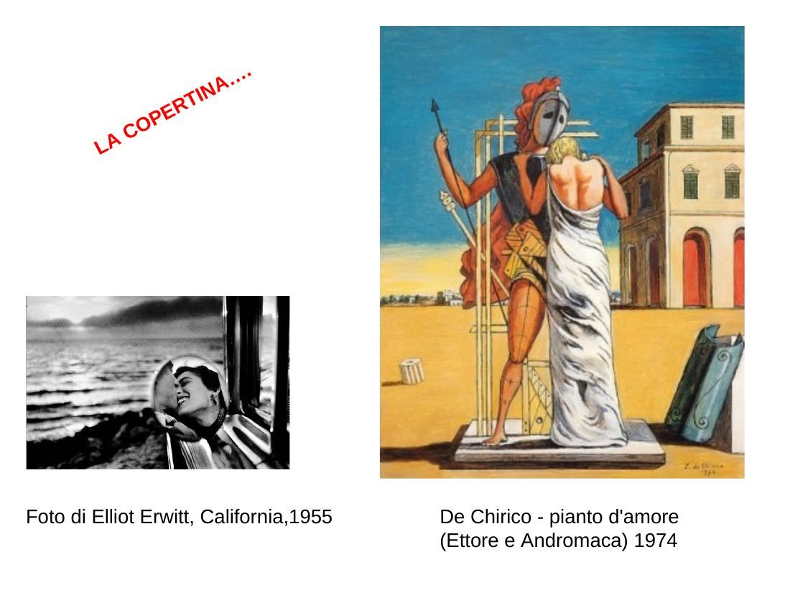{ loading=lazy style="width:33%" }

{ loading=lazy style="width:32%" }

0:01:31

Allora, qualche giorno fa è arrivata questa notizia, quando ormai avevamo un po’ già deciso la scaletta di cosa parlare; però era effettivamente molto interessante. È stata pubblicata su *Le Scienze*, e anche su altri giornali e riviste: c’è un ricercatore italiano, Alberto Acerbi, che ha fatto una ricerca sul sentimento attraverso i libri, e ha sfruttato un algoritmo di Google con cui sono stati digitalizzati 5 milioni di libri pubblicati tra il 1900 e il 2000: sono circa 500 miliardi di parole, prevalentemente in inglese, ma poi ci sono anche l’italiano e le altre lingue, francese e tedesco.

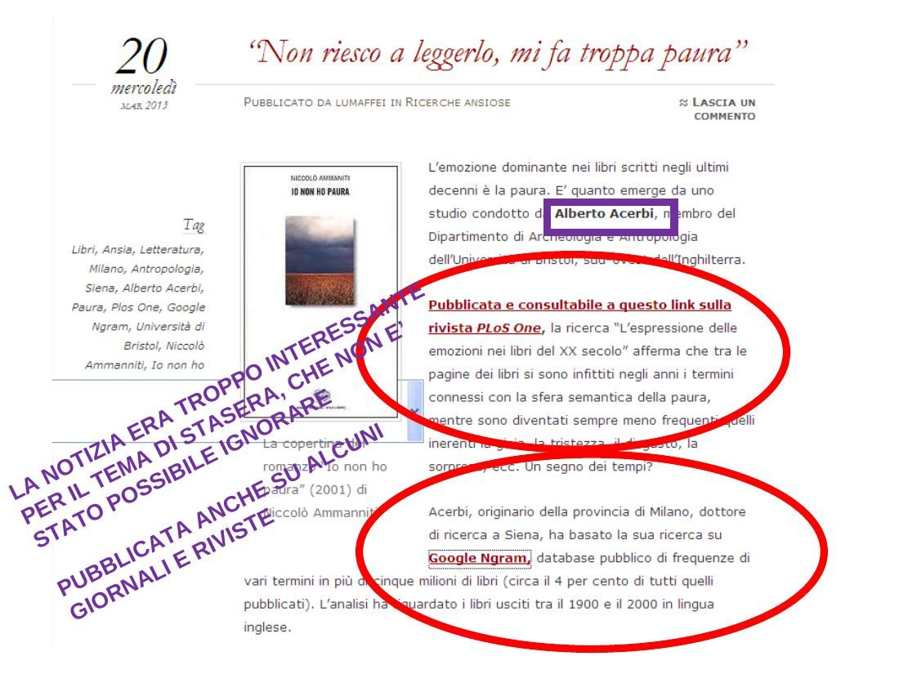{ loading=lazy style="width:47%" }

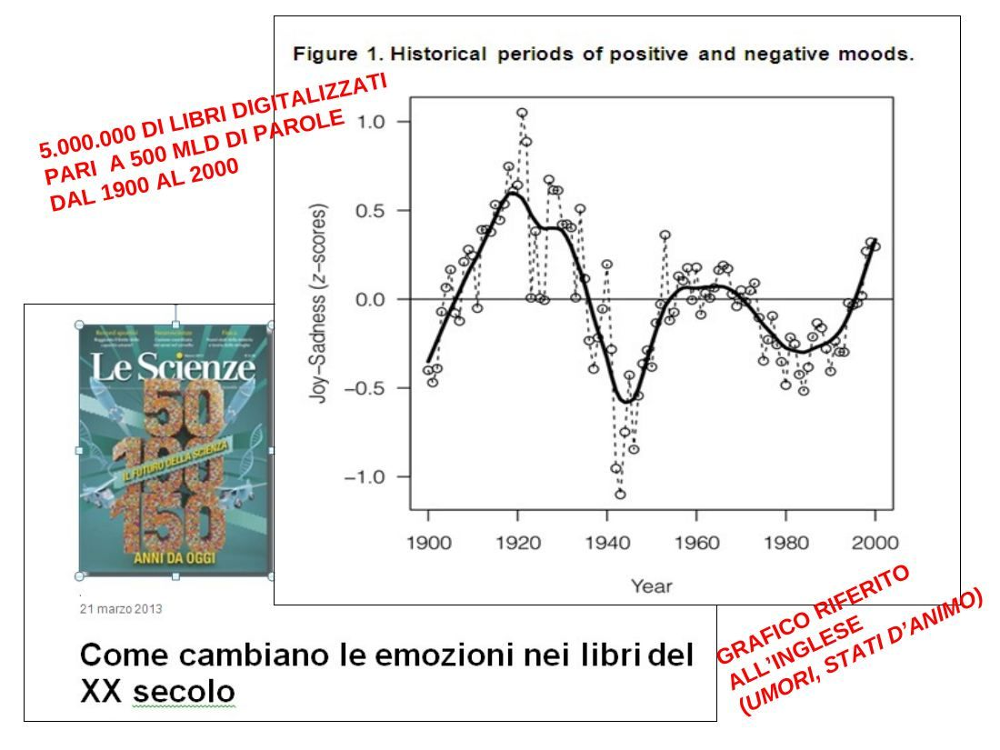{ loading=lazy style="width:47%" }

0:02:22

Se vedete questo grafico, questi sono gli stati d’animo, gli umori, che cambiano molto: dall’inizio del Novecento, dove parte il grafico, hanno un picco verso il basso durante il periodo della seconda guerra mondiale, poi un picco, fino ad arrivare in basso fino al 1980, e poi ripartono. Quindi questo segnala anche l’umore che nei libri passa attraverso queste parole testate dal programma. Queste invece sono sei parole in tutto: rabbia, disgusto, paura, felicità, tristezza e sorpresa. Vedete che anche queste, da un picco del Novecento, scendono sempre verso il basso: vuol dire che nei libri queste parole scendono come percentuale di utilizzo. Ci sono alcuni grafici che poi risalgono un po’, ma comunque la tendenza fondamentale è la discesa: quindi vuol dire che sono usate molto di meno rispetto all’inizio del Novecento.

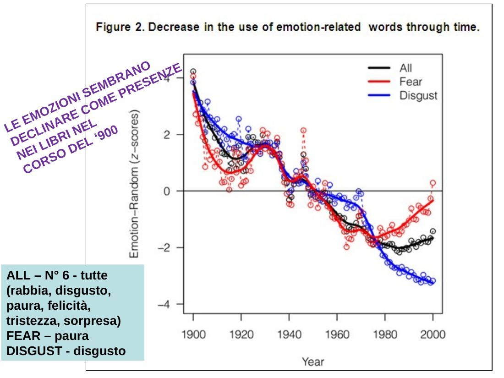{ loading=lazy style="width:59%" }

0:03:35

Questo motore che ha messo a disposizione Google permette anche di fare degli incroci tra le diverse lingue. Mi alzo un attimo, forse non si vede bene. Questa è la parola tristezza in inglese, e questa è la parola tristezza in italiano. Vedete, hanno andamenti diversi. Nei grafici qui c’è il 1900 e qua c’è il 2000. Il picco massimo per quanto riguarda l’Italia della parola tristezza è tra il 1920 e il 1945, periodo forse un po’ più buio; il picco minimo è il 1980, per poi iniziare leggermente a risalire. Mentre quest’altro è l’opposto: è la felicità. Quello che è interessante è che, per la felicità, questa è la riga che fa vedere lo stesso livello tra l’inglese e l’italiano: quello inglese, che è quello sotto, è leggermente inferiore; quindi vuol dire che sostanzialmente in Italia usiamo più quella parola rispetto all’inglese. Non so cosa voglia dire rispetto agli umori dei libri pubblicati in inglese, però è un dato che mi pareva molto interessante, visto l’argomento di questa sera.

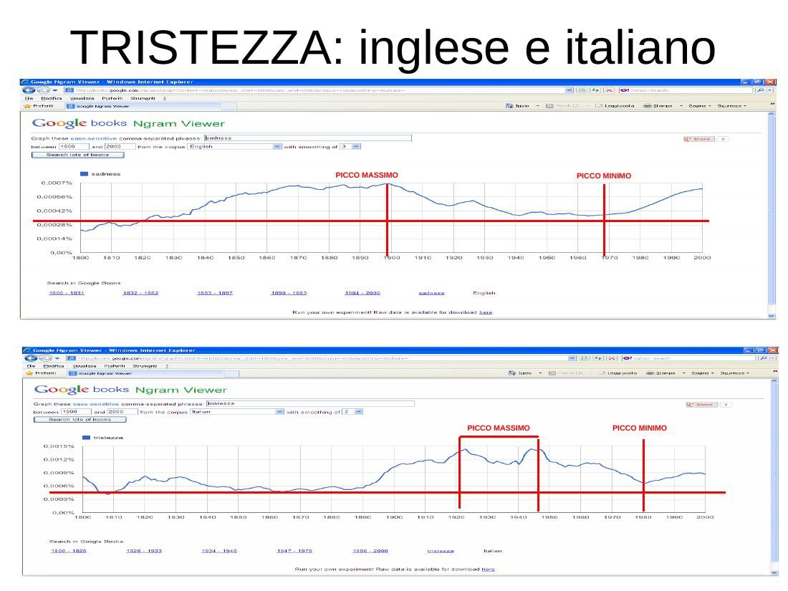{ loading=lazy style="width:47%" }

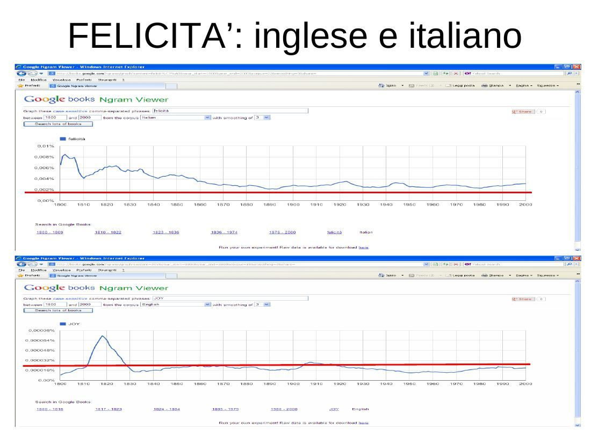{ loading=lazy style="width:47%" }

0:05:13

Allora, non so se qualcuno di voi si ricorda questa battuta dell’avvocato Agnelli: «Solo le cameriere si innamorano». Fu una celebre battuta che fece in un’intervista. La domanda potrebbe essere questa: il sentimento è la paga dei poveri e della gente normale, la loro *consolatio*, diciamo di chi non è al livello sociale di Agnelli? Però il corpo magari è sempre lo stesso, sia per noi, sia per Agnelli, sia per chiunque altro. Il corpo è lo stesso per un operaio e per un ricco borghese, ma i sentimenti, per alcuni, non possono essere soddisfatti? E quindi la questione che ci siamo posti è se sia cambiato, in questa nostra epoca di mutamento sociale e di rivoluzione tecnologica, il modo di rappresentare queste emozioni, le passioni e i sentimenti, ed eventualmente come sia cambiato.

0:06:03

C’era una bella battuta sulla filosofia, che diceva che nella filosofia non bisogna guardare ai maestri (anche se noi stasera siamo molto onorati di avere qui con noi Lorenzo), ma a quello che in realtà hanno cercato i filosofi: cioè non a quello che sono stati, ma a quello che hanno cercato, perché è quella la strada interessante da seguire. E quindi anche nei sentimenti la domanda potrebbe essere la stessa: non bisogna attaccarsi troppo alla persona che rappresenta quel sentimento, ma all’intuizione, a quello che quella persona invece rappresenta.

0:06:50

Noi siamo uomini, quindi con tutte le nostre debolezze. C’era una bella definizione di Pascal, dove diceva appunto che l’uomo è «depositario del vero, cloaca d’incertezza e d’errore, gloria e rifiuto dell’universo». Quindi siamo un po’ tutto questo, con tutte le nostre contraddizioni: siamo fatti di carne, pelle, ossa ecc., però allo stesso tempo siamo anche dipendenti, per esempio, dalla nostra casa, dal nostro stipendio, a cui teniamo ecc. Nello stesso tempo siamo anche esseri sognanti: Shakespeare, la famosa battuta di Shakespeare, «siamo fatti della stessa materia di cui sono fatti i sogni», no? E quindi siamo in questa contraddizione, e in questa contraddizione navighiamo in mezzo ad acque tempestose, per cercare di arrivare in porto e salvarci.

**…COSÌ NEI SENTIMENTI**

Così, nei sentimenti, nelle emozioni e nelle passioni, vista la limitatezza, la piccolezza dell’essere, l’imperfezione dell’uomo in sé, non bisogna cercare solo l’altro.

Probabilmente bisogna cercare, e non smettere di cercare, la rappresentazione, la simbologia, l’intuizione di quella passione, di quel sentimento, di quella emozione.

**BLAISE PASCAL:**

*Che chimera è dunque l’uomo, che novità, che mostro, che caos, che soggetto di contraddizione, che prodigio! Giudice di tutto, vermiciattolo della terra, depositario del vero, cloaca d’incertezza e di errore, gloria e rifiuto dell’universo!*

0:07:47

Allora, l’idea di stasera da dove è venuta? È venuta durante l’estate: mettendo a posto un po’ di libri è saltato fuori un libro di Calvino, un libro di racconti al cui interno c’è *L’avventura di due sposi*. Non so se lo conoscete: narra di un uomo e una donna che vivono a Torino e non si vedono mai, perché lei lavora di giorno e lui lavora di notte, e quindi si incrociano solo per qualche minuto durante il giorno, perché non c’è mai tempo per stare insieme. È giocato tutto su questo filo, perché è la difficoltà del vivere, ambientata negli anni Cinquanta, quando c’era bisogno di lavorare e quindi non si poteva nemmeno dire di no a determinati tipi di lavoro: quindi c’è la difficoltà di comunicare in questo rapporto, in questo matrimonio.

**CALVINO: *L’AVVENTURA DI DUE SPOSI**

**TRAMA**

Questo racconto, intitolato *L’avventura di due sposi*, ci parla di come possa essere assurdo che una giovane coppia, entrambi impiegati in una fabbrica – il marito col turno di notte e la moglie col turno di giorno – possa essere felice, perché hanno pochissime ore per vedersi, anche se vivono sotto lo stesso tetto.

**SINTESI**

L’operaio Arturo Massolari faceva il turno di notte, quello che finiva alle sei di mattina; dopo un lungo tragitto rincasava in bicicletta nella bella stagione, mentre nei mesi freddi prendeva il tram. Arrivava a casa verso le sette, prima che suonasse la sveglia della moglie Elide. Quando il marito suonava il campanello spesso lei dormiva; sentendolo, si svegliava, si infilava in fretta la vestaglia e, ancora mezza addormentata, arrivava in cucina, dove il marito stava preparando il caffè. Elide si vergognava spesso di farsi trovare così in disordine, ma non era colpa sua.

Mentre facevano colazione, il marito le raccontava tutti gli inconvenienti e i contrattempi che aveva avuto ritornando. Dopo un po’ Elide si accorgeva del tempo che passava e allora in fretta si vestiva, si pettinava e prendeva il tram per andare al lavoro. Il marito, invece, restava solo e ascoltava il rumore dei passi della moglie finché non li sentiva più; poi chiudeva la casa al buio e andava a dormire.

Quando la moglie ritornava, Arturo aveva già acceso la stufa, aveva cominciato a cucinare qualcosa e fatto alcune faccende domestiche, anche se non ci riusciva bene. I due si salutavano, parlavano, cenavano. Intanto Elide si dava da fare a sbrigare le faccende che il marito non aveva fatto e gli preparava lo spuntino da consumare durante il turno di notte.

Quelle pochissime ore insieme passavano in fretta, e già il marito era pronto per andare al lavoro: per entrambi era un momento di dolore, perché avrebbero voluto stare insieme ancora un po’, ma non era possibile. Infine Elide lavava i piatti, puliva le ultime cose e, stanca del lavoro, spegneva la luce e andava a dormire.

0:08:58

Tra l’altro da questo racconto fu tratto anche un episodio di un film, *Boccaccio ’70*, un po’ sulla falsariga di quegli anni: erano quattro parti, una delle quali era firmata da Mario Monicelli, e raccontava appunto questa vicenda. Questi erano gli attori di quel film, Germano Gilioli e Marisa Solinas, che credo poi non abbiano avuto molta fortuna dal punto di vista cinematografico. Lo scorso ottobre è uscito anche un film che in qualche modo coglieva questa idea, quello di Virzì, *Tutti i santi giorni*, che diceva di voler indagare il rapporto di coppia in questo momento di difficoltà economiche. E noi, quando ci vediamo con Lorenzo, ci vediamo sempre all’inizio di settembre: ormai il programma era fatto indipendentemente dal film di Virzì, che tra l’altro io non ho visto, quindi non so nemmeno in che direzione abbia indagato questo tema.

**BOCCACCIO ’70**

*Boccaccio ’70* è un film del 1962 in quattro episodi diretti da Vittorio De Sica, Federico Fellini, Mario Monicelli e Luchino Visconti.

Concettualmente ispirato alle novelle di Boccaccio, ogni episodio si incentra sul sesso nell’Italia degli anni Sessanta, periodo di boom economico e di grandi cambiamenti culturali.

**I ATTO: *RENZO E LUCIANA* (DI MARIO MONICELLI)**

Una coppia di operai (Germano Gilioli e Marisa Solinas), dopo una serie di peripezie, riesce a trovare casa, ma viene inesorabilmente separata dai rispettivi turni di lavoro: lui rientra a casa dal lavoro proprio quando lei deve uscire per recarvisi.

**II ATTO: *LE TENTAZIONI DEL DOTTOR ANTONIO* (DI FEDERICO FELLINI)**

Antonio Mazzuolo (Peppino De Filippo) è un moralista intransigente e si dà un gran da fare per far togliere un grosso cartellone pubblicitario, posto proprio davanti alle finestre di casa sua, sul quale campeggia l’immagine gigante di Anita Ekberg, sdraiata su un divano e vestita con un abito provocante, che reclamizza le qualità nutrizionali del latte. Ossessionato, Antonio vive negli incubi, attratto sessualmente dalla stessa immagine che vorrebbe censurare.

**III ATTO: *IL LAVORO* (DI LUCHINO VISCONTI)**

Pupe (Romy Schneider), moglie di un impenitente sottaniere (Tomas Milian) che lei scopre coinvolto in un giro di ragazze squillo, decide per punizione di esigere dal marito il pagamento delle prestazioni sessuali che, come moglie, gli sarebbero dovute gratis.

**IV ATTO: *LA RIFFA* (DI VITTORIO DE SICA)**

La maggiorata Zoe (Sophia Loren), in società con una coppia titolare di un baraccone di tiro a segno, per incrementare i miseri guadagni si offre come premio in una lotteria clandestina. Il biglietto vincente va a un sagrestano, il quale si rifiuta, nonostante le pressioni, di rivenderlo e pretende la «riscossione» del premio.

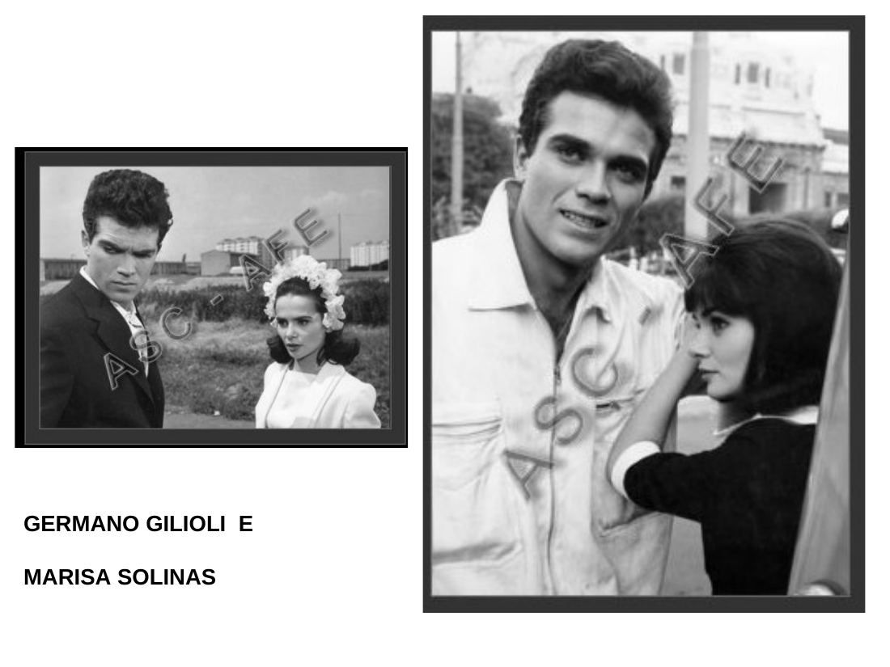{ loading=lazy style="width:47%" }

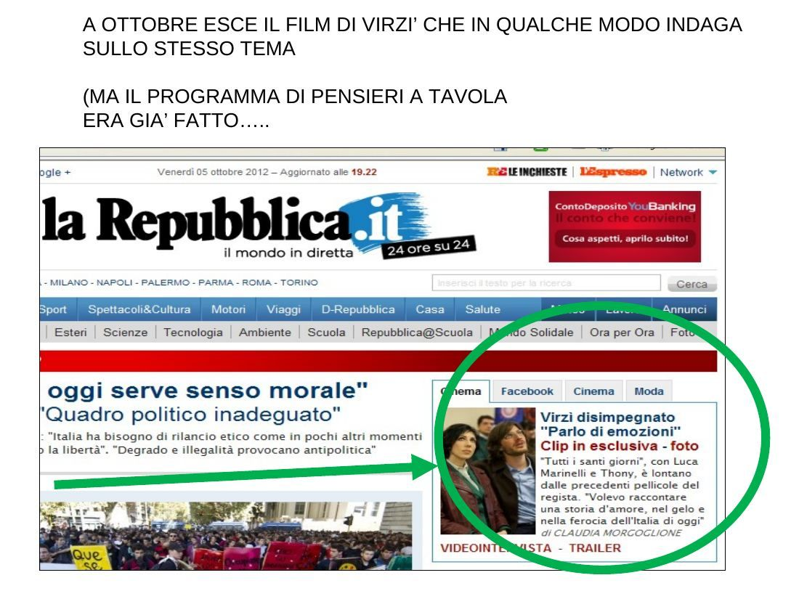{ loading=lazy style="width:47%" }

0:10:08

Sembra strano che al mare ci si abbronzi a pensare tutte queste cose; comunque si fa anche quello, perché durante l’estate si mettono a posto un po’ di idee, e poi ci ritroviamo e diciamo: «Questo si potrebbe fare, questo no, questo sì, questo no». Nascono un po’ così i programmi.

0:10:38

Abbiamo parlato del boom economico, che nasce alla fine degli anni Cinquanta; ma subito prima com’era la vita? C’è stato un capolavoro da questo punto di vista, un saggio del 1977 di Nuto Revelli (1919-2004), *Il mondo dei vinti*: sono 270 interviste raccolte nelle valli cuneesi. È lo stesso mondo, la stessa cultura da cui nasce poi Slow Food, sostanzialmente, quella di Petrini. È tutta una raccolta di storie orali, raccolte da questo storico, che poi le ha pubblicate. Ne ho scelta una, quella di una donna che si chiama Margherita, che racconta il matrimonio. Quindi parla di gente povera, sostanzialmente: immaginate il profondo Piemonte, siamo nel Cuneese, un posto dove ci sono montagne, quindi difficoltà anche di vivere.

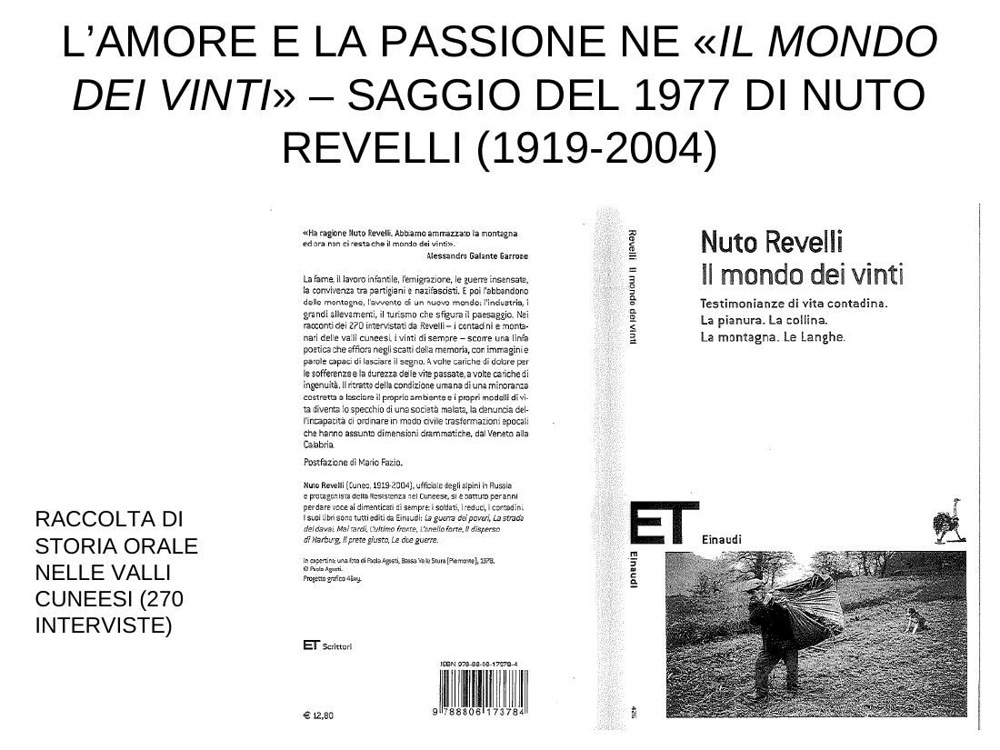{ loading=lazy style="width:59%" }

0:11:50

Da questo racconto emerge proprio la difficoltà. Per esempio questa ragazzetta, quando racconta del suo matrimonio, dice che è dovuta scappare perché il babbo non le dava l’autorizzazione a sposarsi, e lei scappa insieme al moroso e al testimone. Non consumano il matrimonio, però scappano fuori; e poi c’è questo moroso che la mattina dopo deve andare dal babbo a chiedere finalmente la mano di questa figlia. E poi dice che va tutto bene, però: «Ci siamo sposati a Demonte, abbiamo fatto il pranzo in 7-8, pioveva, io avevo l’abito bianco, avevo paura di sporcarlo. 29 lire ha speso il mio sposo nel pranzo di nozze. Alla sera siamo tornati a Trinità» (il luogo dove abitavano), «per cena mia madre aveva preparato la minestra di fagioli. Poi siamo partiti per Ruffia» (un posto lì vicino) «e io mi vergognavo: la gente diceva “Arriva la sposa, arriva la sposa”. Mi sono nascosta sotto la coperta del carro perché non mi vedessero. Non c’era nemmeno un letto: abbiamo accostato due panche, un po’ di paglia, e abbiamo dormito nella stalla». Questa era la prima notte di nozze di queste persone. Questo per raccontare da dove provenivamo prima di arrivare al boom economico.

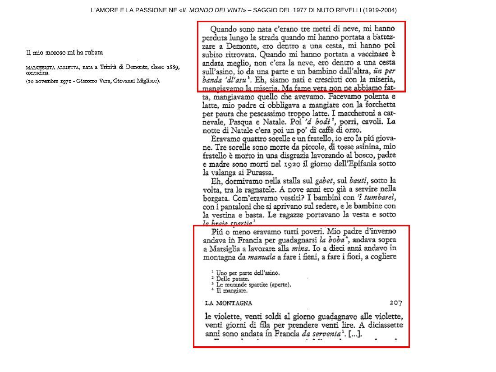{ loading=lazy style="width:47%" }

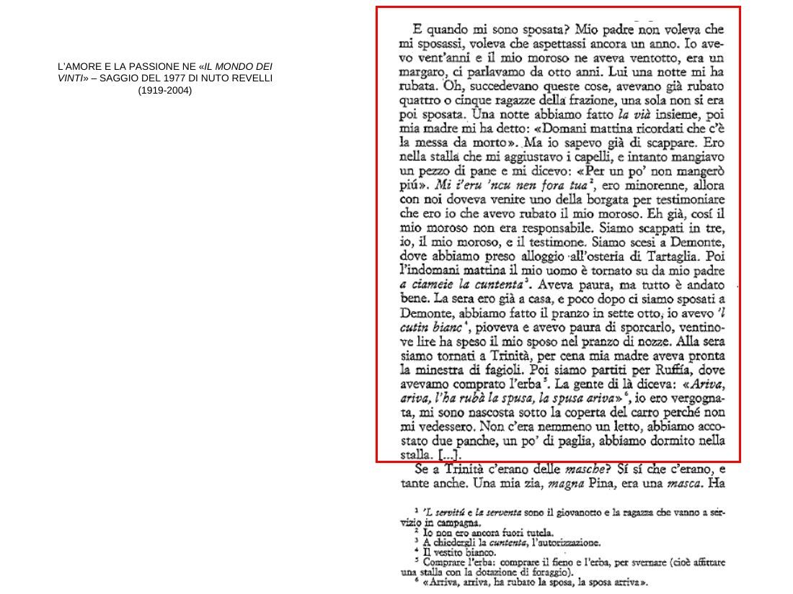{ loading=lazy style="width:47%" }

0:13:23

Nel febbraio 2009, cinque anni dopo la morte di Nuto Revelli, fu fatta una bella mostra su questa sua inchiesta: queste sono alcune foto che testimoniano da dove era partita, negli anni Settanta, questa inchiesta storica nel Cuneese.

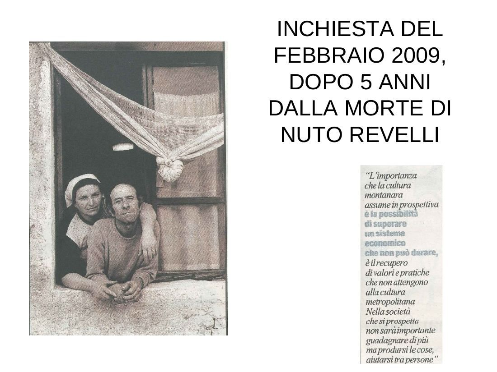{ loading=lazy style="width:47%" }

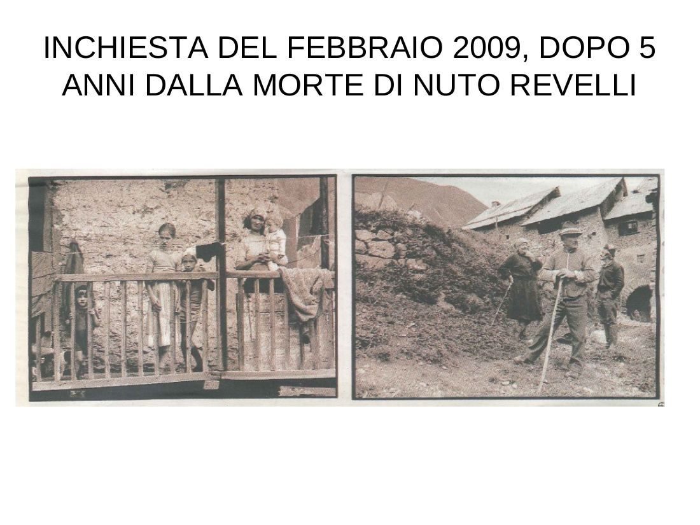{ loading=lazy style="width:47%" }

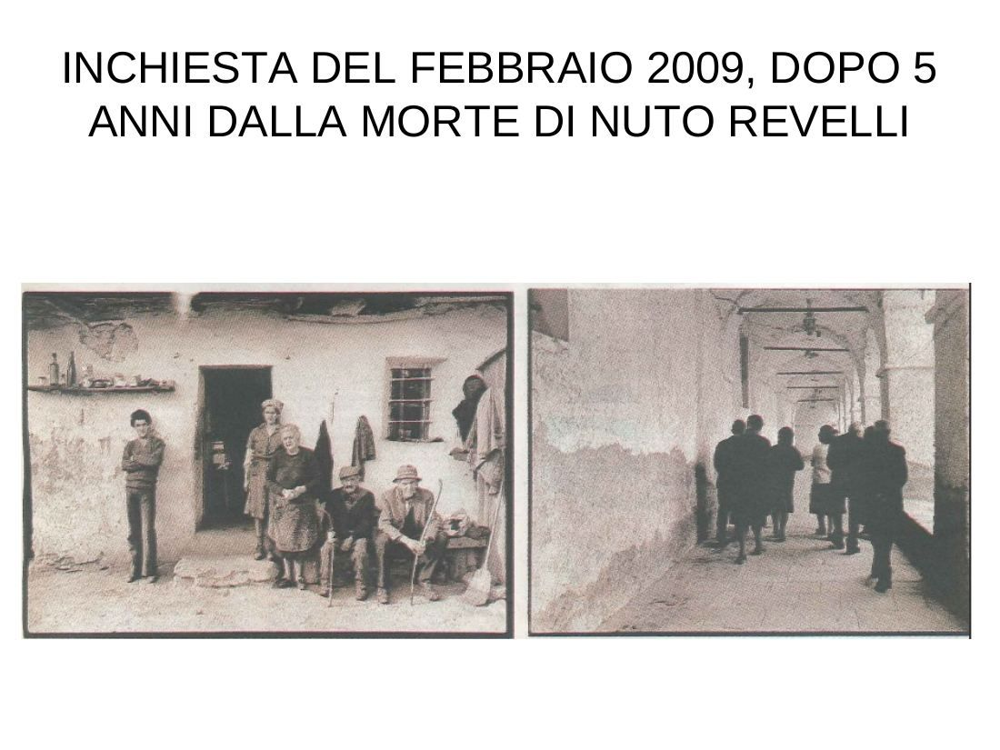{ loading=lazy style="width:59%" }

0:13:45

Lorenzo Poggi Cominciamo a notare una cosa, una cosa estremamente significativa: è la donna che racconta. Nel gioco delle emozioni e dei sentimenti, soprattutto nel gioco del sentimento direi più universale e potente, quello dell’amore, la donna ha un ruolo fondamentale. Perché anche nella cultura classica, nella cultura antica, la donna è più vicina dell’uomo a quella parte irrazionale dell’anima, eros; è una mediazione eros. Ma la donna ha in sé non solo eros, ha in sé anche l’altra parte dell’anima, quella più profonda, quella legata alla primordialità del mondo, quella che la lega anche alle passioni. Quindi la donna ha un accesso privilegiato alle cose dell’amore. E qui la vediamo protagonista, anche in questo racconto poverissimo, in fondo; però protagonista di questo fatto.

0:15:09

Dobbiamo tenerlo presente, perché nel sentimento e nell’espressione dei sentimenti (e quello dell’amore è fondamentale, ci torneremo sopra) il gioco è tutto fra quella che è la profondità dell’emozione, quello che è il sentimento, la sua elaborazione, e la possibilità di esprimerlo. Due che si amano stanno insieme non solo per ragioni sessuali, ma per ragioni più profonde, perché si instaura fra di loro una comprensione, una relazione profonda d’intesa. E in questa relazione profonda d’intesa, la donna, che ha questa parte dell’anima più profonda e irrazionale (ma guardate, no, che è in questa materia di città, nel senso che affronta il mondo e la visione delle cose con elementi diversi da quelli della scansione razionale della mente e del linguaggio), ha in questo un compito fondamentale.

0:16:37

Facciamo un esempio, così ci capiamo subito. Nella cultura classica c’è Eros. Eros è figlio di Poros e di Penia, è figlio di ricchezza e di povertà, perché porta con sé il mutamento: è qualcosa che non è mai stabilizzato, equilibrato, è sempre in divenire. È figlio di ricchezza e povertà, appunto, che erano insieme al banchetto degli dèi; poi si unirono, e da quest’unione nacque Eros. Quando c’è eros c’è la comunicazione: c’è un linguaggio che non è il linguaggio espresso, profondo; c’è una comunicazione, e la comunicazione è anche conoscenza, è conoscenza dell’altro, è sapere che cosa l’altro dice. Guardate, non c’è bisogno di riferirlo soltanto al rapporto uomo-donna: la madre capisce cosa vuole suo figlio anche quando è così piccolo che non parla, perché c’è un rapporto erotico, in termini generali.

0:18:04

Eros ha questa funzione, quindi anche una funzione conoscitiva. È una cosa positiva: ci si intende, se ci si ama, anche senza bisogno di parlare. Anzi, il linguaggio assume un carattere particolare; ma su questo torneremo, perché chi esprime o prova a esprimere che cos’è l’amore con il linguaggio troverà sempre insufficiente il linguaggio della comunicazione. Perché il linguaggio della comunicazione è fatto di segni che hanno un referente unico, e invece lui ha bisogno di definire qualche cosa che di per sé, per natura, è indefinibile. E allora, vi ricordate, l’ultima volta, un po’ scherzando, dicevo che chi vuol sapere quanto siano vaste le parole dell’amore lo può capire benissimo se paga il conto telefonico ai figli innamorati: si accorge subito di quanto questo linguaggio non sia riconducibile. «Mi ami?» «Sì», «no»: non ci sono solo queste alternative, ma si apre un mondo immenso.

0:19:27

Quindi, prima della razionalità del mondo, prima del nostro rapporto simbolico con la realtà che ci permette di avere l’orientamento sul mondo, prima ancora c’è il linguaggio del sentimento, dell’emozione, il linguaggio profondo, che ha un suo esempio fondamentale nel linguaggio dell’amore, inteso in senso vasto: perché anche nel rapporto con la cultura e con la conoscenza c’è un rapporto che è prima di tutto erotico.

0:20:00

Se non si ama ciò che si vuole conoscere, se non si ama quel tipo di sapere, non riusciamo nemmeno a seguirlo: è un rapporto d’amore. Eros fa da mediatore fra la conoscenza e questo istinto profondo, primordiale. Platone l’ha espresso in un mito, ma lo possiamo capire benissimo anche così. Fate un’interruzione: mi interrompo, ti passo la parola.

0:20:30

Paolo Marcucci No, no, fondamentale, infatti, grazie. Anche questa, per esempio, come il lenzuolo conservato nell’Archivio dei diari di Pieve Santo Stefano, è una lettera d’amore che una donna siciliana scrisse nel 1973 a suo marito, che era emigrato in Germania: non sapeva scrivere, e si esprime con i disegni. È stata ritrovata da Gesualdo Bufalino, ed è stata poi trattata in un saggio dello scrittore; ne ha raccontato la storia Ivan Carozzi, in un articolo del 31 ottobre 2012.

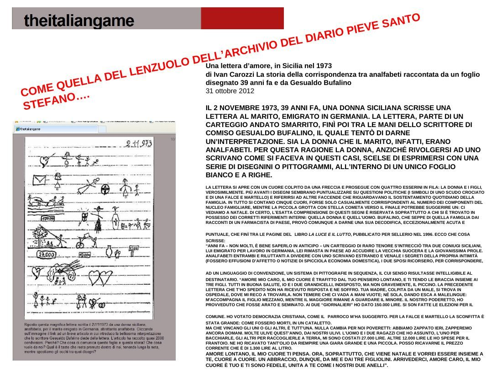{ loading=lazy style="width:70%" }

0:20:56

Quindi abbiamo già intuito che la condizione economica gioca un ruolo fondamentale, come espressione e definizione del campo, del perimetro, dove l’uomo può giocare. Ora vi farò vedere alcuni grafici sull’andamento economico e sociale degli ultimi anni, tratti da una pubblicazione della Banca d’Italia del febbraio 2013 sul risparmio e la ricchezza delle famiglie italiane (Bartiloro, Rampazzi, Bassanetti, Rondinelli), per introdurre questo argomento al giorno d’oggi. Questo è uno di quelli più importanti, e quelli dopo trattano un po’ la stessa cosa: questa è la propensione al risparmio, e la differenza tra i diversi paesi. Si parte dal 1995, quando l’Italia, diciamo, stava molto bene economicamente, e gli italiani avevano questa grande capacità di risparmio che ci invidiava tutto il mondo. L’Italia è la linea blu: vedete, eravamo nettamente superiori agli altri, in maniera consistente; il risparmio italiano è stato uno dei punti di forza dell’economia in Italia. Dal 1995, vedete, il grafico scende, e quindi ci ritroviamo anche molto sotto altri paesi come tasso di risparmio: superiori a noi sono l’area euro, la Francia, e anche la Germania; ma fino a un certo punto, nel 1995, noi eravamo molto avanti.

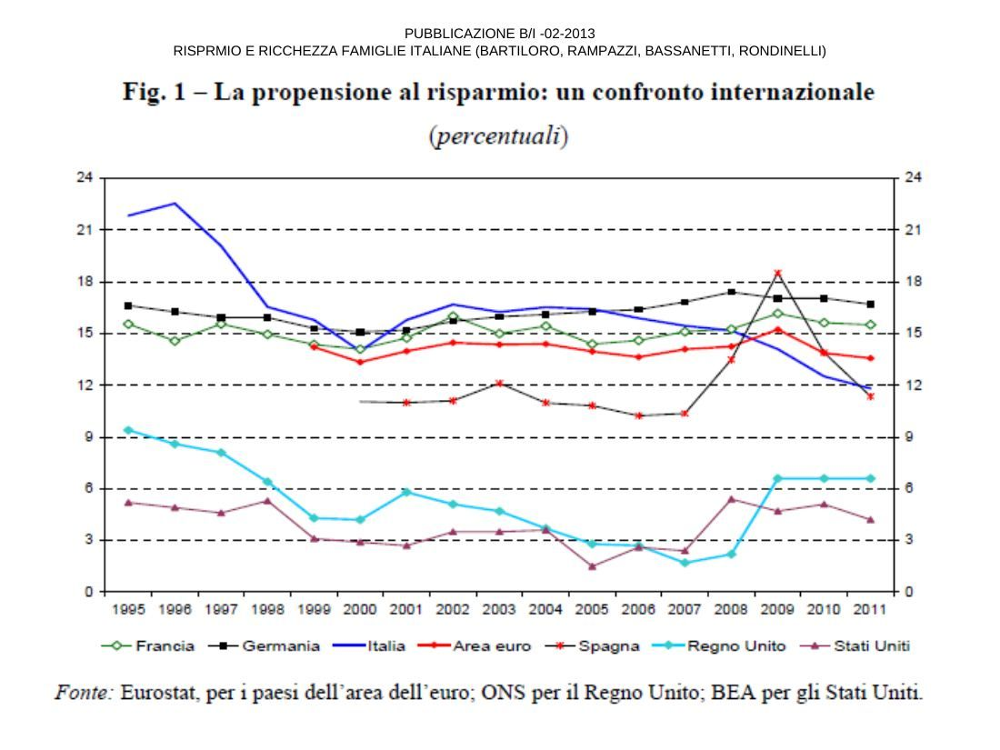{ loading=lazy style="width:59%" }

0:22:25

Poi questi sono altri grafici, ma quello più importante è questo: è la dinamica della ricchezza netta e del reddito disponibile equivalente. Vedete, i giovani, la linea blu, sono molto al di sotto: quindi vuol dire che anche chi si deve fare una famiglia, come abbiamo visto con i due giovani sposi di Calvino, poi non riesce a farlo. Anche questo è il reddito equivalente e la ricchezza netta; e questo è il reddito familiare mensile, effettivo e necessario: questo è quello effettivo, e questo è quello che le famiglie invece richiederebbero come minimo indispensabile per poter vivere. Vedete, danno già l’idea di come è cambiata la società negli ultimi dieci anni, solo fermandosi agli ultimi dieci anni.

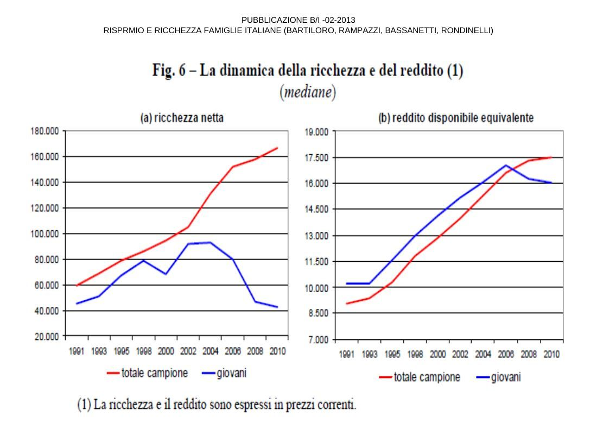{ loading=lazy style="width:47%" }

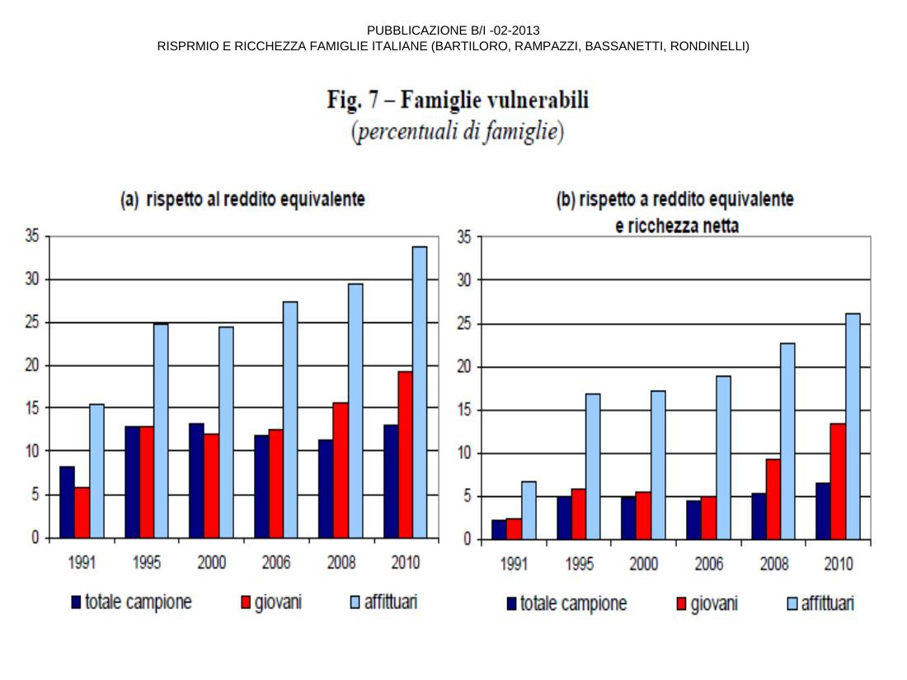{ loading=lazy style="width:47%" }

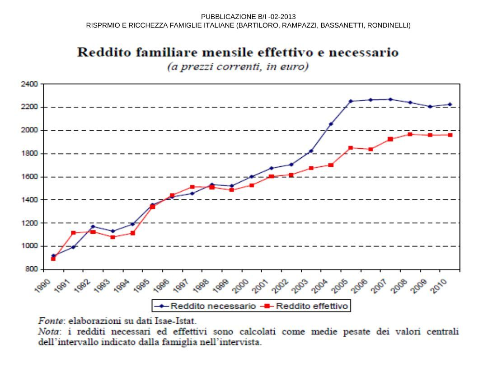{ loading=lazy style="width:47%" }

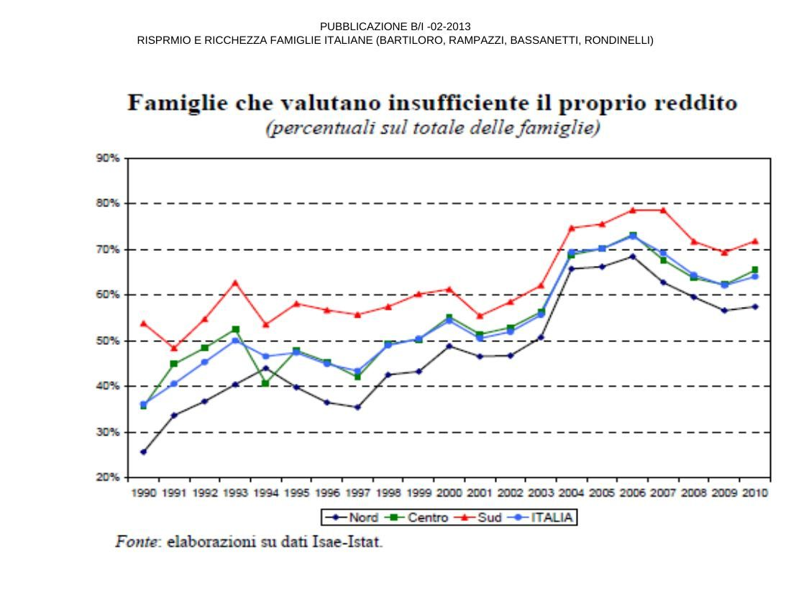{ loading=lazy style="width:47%" }

0:23:23

Queste invece sono delle immagini tratte da una passerella di moda. Quindi la domanda che ci possiamo e dobbiamo fare è questa (non voglio demonizzare nessuno, è solo uno spunto filosofico: a noi piace farci le domande, quindi prendiamo lo spunto da questo): l’amore, i sentimenti saranno gli stessi per chi guadagna 800 euro al mese e per chi si permette di partecipare a una sfilata di questo genere? La ricchezza e il successo condizionano anche i sentimenti e la percezione personale?

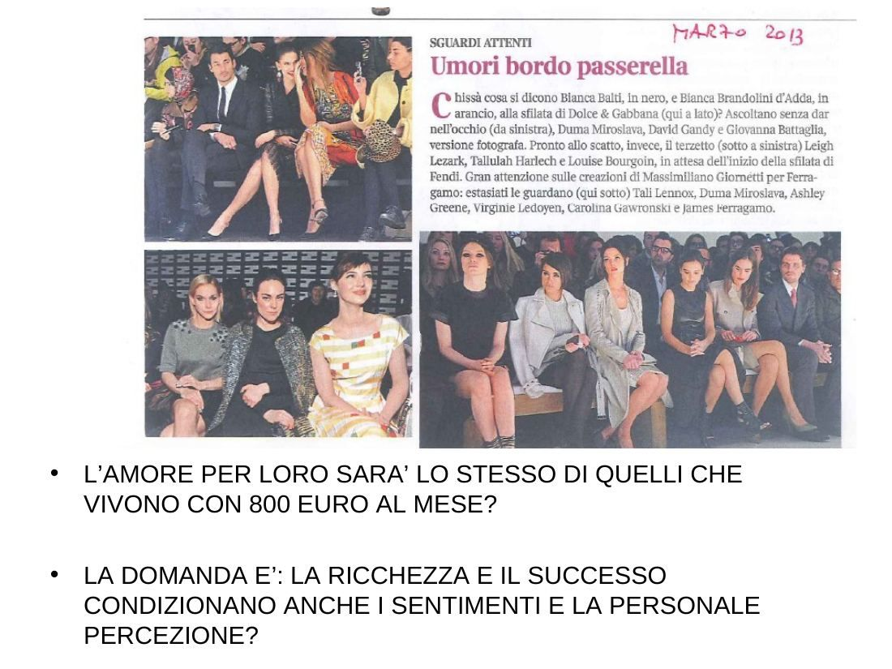{ loading=lazy style="width:59%" }

0:24:03

Oppure un’altra domanda che ci possiamo fare. La nostra generazione ha avuto la fortuna… per esempio, io ho amato molto i libri di Sándor Márai (se qualcuno di voi ha letto qualcosa): trattano i sentimenti con una ricchezza… Narrano della borghesia europea, sostanzialmente, ma con delle parole e degli atteggiamenti che la mia generazione, perlomeno, ha potuto rivivere, perché eravamo in una situazione economica in cui ci potevamo permettere anche di pensare a quei sentimenti in quei termini. La domanda che ci possiamo fare è questa: ci siamo resi conto che, rispetto alle generazioni degli anni Cinquanta, degli sposi di Calvino, per non parlare degli anni prima, di quella sposa del Cuneese di cui parlavamo prima, avevamo fatto un salto economico enorme, che ci permetteva di provare anche quelle sensazioni raccontate nei romanzi di Sándor Márai sull’alta borghesia europea, perché erano sostanzialmente le stesse? Mia madre e mio padre li avrebbero capiti? Mai era successo prima! E che cosa ne abbiamo fatto, di questa opportunità: l’abbiamo buttata via o l’abbiamo fatta nostra? Questa era una domanda, che come sempre giro volentieri al maestro.

0:25:31

Lorenzo Poggi Se ci pensiamo bene, i sentimenti sono gli stessi, si esprimono nelle diverse classi sociali; ci vuole un certo reddito per avere una certa espressione dei sentimenti. Che cos’è il sentimento? Come si distingue dall’emozione, e come si distingue dall’impulso? Voi capite che l’impulso viene dall’istinto, è immediato, è qualcosa che ha il suo esito nel gesto: c’è l’impulso e poi il gesto istintivo. Mentre l’emozione è già qualcosa di molto più elaborato rispetto all’impulso: è già qualcosa che ci rapporta con il mondo esterno, ma che ha già una sua elaborazione, ha bisogno di essere in qualche modo educata. Di solito è la madre che sta vicino al bambino e, nei primi anni, nei primi mesi di vita, lo educa all’emozione: lo educa al passaggio dall’impulso all’emozione, gli dice come si deve reagire di fronte a determinate cose, di fronte alla perdita di un oggetto, di fronte a questo o a quello («non c’è bisogno di fare tragedie perché ti è caduto»); gli dà la dimensione, l’orientamento emozionale, l’orientamento emotivo, gli dà l’importanza. Comunque l’emozione è questa. Il sentimento invece è qualcosa di molto più elaborato: è qualcosa a cui si arriva non solo attraverso l’elaborazione successiva dell’emozione, ma anche attraverso la condivisione, gli esempi, il pubblico, la socialità, la società e il mondo in cui viviamo.

0:27:50

E lì allora entra l’elaborazione culturale, entra la cultura, entra la trasmissione culturale, entrano i libri (parlava Paolo di quelli che si sono letti), entrano tutti quei fattori che ci permettono di elaborare le nostre emozioni e di trasformarle in qualcosa che ci distingue e connota la nostra individualità. E su questo noi costruiamo anche i nostri desideri, e quindi costruiamo ciò che desideriamo, gli impulsi che ci spingono verso l’orientamento della nostra vita e verso il futuro. È fondamentale il sentimento, ed è fondamentale che sia educato. Come lo si educa? Lo si educa attraverso la partecipazione alla cultura; altrimenti il sentimento non è educato, e ci si ferma alle passioni o alle emozioni, addirittura all’immediatezza dell’impulso. Quindi, se viene meno la trasmissione culturale convinta e profonda, viene meno l’elaborazione del sentimento.

0:29:05

E si avranno sempre più giovani (perché sono loro i destinatari dell’educazione) pronti all’impulso, all’agire d’impulso o all’agire emotivo, e sempre meno giovani in grado di organizzare le loro pulsioni emotive, la loro vita emotiva e sentimentale, anche in funzione di qualche cosa di più a lungo raggio, di finalizzato. E in una società come questa, che si fonda molto sui consumi, il consumo deve basarsi sul rinnovarsi continuo del desiderio; rinnovarsi continuo perché altrimenti non si riuscirebbe ad andare avanti. È fondamentale che di volta in volta si tenti di soddisfare, attraverso degli oggetti surrogati, l’impulso immediato a possedere o a desiderare; ma così facendo si uccide il vero motore della nostra vita, quello che ci fa sentire vivi: il sentimento, quello profondo, quello che dirige e influisce anche sulla nostra capacità di dare ordine al mondo che ci circonda, la nostra mappa emotiva.

0:30:32

Ecco, lo si fa attraverso le immagini: le immagini sono quelle su cui, per esempio, si fonda moltissimo la nostra società, la nostra visione del mondo. Oggi sappiamo che cos’è il mondo perché vediamo tante immagini del mondo; e tutto ciò che esiste, più che essere esperienza legata alla nostra percezione, ai nostri sensi, è legato solo al senso della vista, a quello che vediamo nei mezzi di informazione. Tutto ciò che esiste è ciò che è visibile. Non ci può essere nemmeno protesta politica se non diventa visibile: se non diventano visibili, le rivoluzioni dei paesi del Maghreb non hanno nessun successo; hanno successo quando diventano visibili, quando assumono la dimensione di cosa che esiste, perché è nell’immagine che si costituisce il mondo. Quindi sostituiamo con l’illusorietà della soddisfazione dell’oggetto-immagine quella che invece dovrebbe essere la soddisfazione del desiderio; e questo per poter andare avanti con un altro ulteriore desiderio, perché non si spenga definitivamente, per non farci pesare il nostro peso. L’idea è che siamo esseri non del tutto stabilizzati: come diceva Nietzsche, l’uomo è un animale non ancora stabilizzato. Questo vuol dire che non ha ancora raggiunto…

0:32:19

Paolo Marcucci Posso far vedere una cosa?

0:32:21

Lorenzo Poggi Sì, prego. Io non volevo annoiare, però il discorso è essenzialmente questo: quindi dobbiamo stare attenti quando distinguiamo; parlare delle emozioni e della loro espressione è estremamente importante.

0:32:35

Paolo Marcucci Una cosa sola, rispetto a quello che diceva Lorenzo (l’importanza delle immagini poi la vediamo nell’ultima parte), però questo è significativo. Questo disegno è di Gipi, uno dei disegnatori più interessanti degli ultimi tempi. Se vedete questo disegno, c’è un ragazzo su un divano con due ragazze: hanno fatto, o stanno per fare, del sesso su un divano; arriva nel vano della porta la mamma, e c’è l’espressione «Mamma!», che è ripetuta dal cavalletto della cinepresa: quindi voleva dire che si stavano riprendendo, anche con l’audio. E quello che diceva Lorenzo sostanzialmente è questo: non basta più farlo (che già era un privilegio, per un ragazzo, fare sesso con due ragazze), ma bisogna riprenderlo: è l’immagine che dà il valore profondo a questo sentimento. Questo disegno secondo me lo rappresenta molto bene.

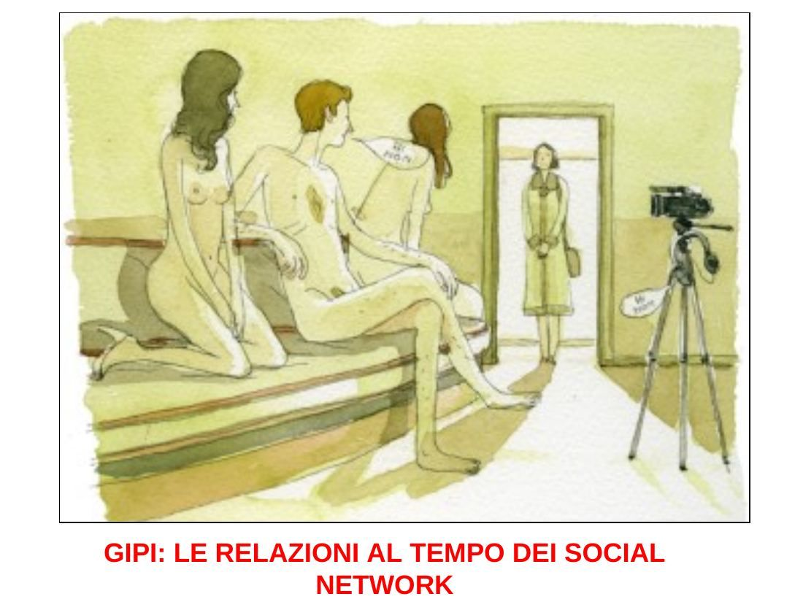{ loading=lazy style="width:59%" }

0:34:06

Lorenzo Poggi Ecco, ritornando a quel discorso che avevo iniziato: pensate, parlavamo del linguaggio che dovrebbe esprimere i sentimenti. Il linguaggio che esprime il sentimento è un linguaggio molto diverso dal linguaggio ordinario, quello della comunicazione. Si parlava prima delle parole che compaiono all’interno dei libri, quelli che dovrebbero elaborare le emozioni, mostrare i sentimenti e così via: ecco, le parole. Quando parliamo del linguaggio che dovrebbe esprimere queste cose siamo di fronte a un elemento estremamente interessante. Le parole che esprimono le emozioni sono parole differenti da quelle che si usano ordinariamente nella conoscenza.

0:35:18

Le parole dell’amore, le parole che si scambiano gli amanti, non sono parole che hanno per scopo la conoscenza o il trasmettere un’informazione; o perlomeno, quello che si vuole trasmettere è intrasmissibile con le parole. Ecco perché il conto del telefonino è così salato: perché non ci sono parole adeguate. Perché la parola con un significato può valere nell’ambito del mondo della conoscenza, ma non in quello in cui si deve trasmettere la sensazione di un viaggio. Si deve fare che cosa? Si deve dire qualche cosa che non si può dire, che è al limite del dicibile, che non può essere completamente assunto come significato di un segno.

E quindi può essere soltanto trasmesso, se non può essere detto, veicolato come significato di un segno. Noi di solito parliamo con delle parole che sono dei segni e danno un significato, no? Ma quelle che adoperiamo quando parliamo dell’amore sono parole che non esauriscono la loro funzione nel significato; non la esauriscono tanto che sono tutte insufficienti e si torna a ripeterle, perché quello che conta non è ciò che la parola significa, ma quel messaggio profondo che si vuole veicolare. Qual è il messaggio profondo che si vuole veicolare? Il messaggio dell’intesa, dell’affinità, della capacità di fare insieme un viaggio, quello che ci porta nel profondo del mondo, prima ancora che sia il mondo della razionalità, dell’ordine, delle conoscenze condivise.

0:38:01

E tocca invece la profondità dell’attimo prima che il mondo ordinato avvenga, il mondo che è simile a quello della follia, follia intesa appunto come cessazione dell’ordine razionale, quella di ciò che fa leva sulle emozioni senza che queste siano ordinate alla conoscenza. E fra gli amanti si deve stabilire questa relazione: io mi fido di te, perché con te posso rivelare e discendere in questa parte folle del mio io, questa parte di follia che è fuori dall’ordine costituito. E da questo ti farai poi riemergere, completamente diverso e trasformato, come Ulisse, che dopo il viaggio approda a Itaca trasformato, irriconoscibile per le esperienze fatte.

0:39:20

Questo fa il linguaggio, esprime il linguaggio delle emozioni; prendevamo per esempio quello dell’amore, per prendere un esempio. Ecco perché c’è bisogno di questa intesa che va al di là della parola. E questo apre per noi un problema interessantissimo, che (se avete un po’ di pazienza) riprendiamo dopo: il problema dei linguaggi, cioè dei vari linguaggi che adoperiamo.

0:40:01

E quindi anche il problema del significato che questi linguaggi hanno: perché non possiamo pensare che ci sia soltanto un linguaggio conoscitivo; ci sono anche gli altri, emozioni e passioni. C’è anche il linguaggio, per esempio, dell’arte e della poesia, che è legato a Eros. Per esempio: quando c’è amore c’è partecipazione. Gli antichi lo rappresentano con il bacio, l’*oscula*: il bacio è la partecipazione, è l’essere insieme; ma è una comunicazione che con questo è un’esistenza.

0:40:54

Lo strumento che serve a esprimere la razionalità: la *ratio* è il pensiero, il ragionamento. Quando il ragionamento esce dal nostro intimo, dalla nostra anima, dal nostro cervello, e viene fuori, passa attraverso la bocca, *os-oris*; e quindi da ratio diviene discorso, *oratio*: il significato stesso delle parole ci dice questo. E quindi la bocca non è solo lo strumento che fa *ratio* e *oratio*, ma è anche quello con cui gli amanti comunicano, hanno la prima unione; ed è anche quello che fa sì che ci sia *eros*, che soddisfa, abbatte il desiderio.

0:42:04

Desiderio. E cos’è? Chi erano i *desiderantes*? Erano, negli accampamenti romani, dopo le battaglie, le sentinelle che venivano messe di notte con le torce ai confini del campo, per vedere se qualche sopravvissuto alla battaglia, anche perché fosse noto e non si fosse trovato, riusciva in qualche modo a rientrare al campo, per accoglierlo. Quindi desiderare (questo latino ci scappa da tutte le parti): sotto le stelle, questi stanno di notte; desiderano perché di notte aspettano e sperano che i commilitoni tornino, anche se ormai c’è poca speranza. La comunicazione, la speranza di trovare un essere che compia con noi questo viaggio e ci faccia riemergere, la fa Eros, che per questo soddisfa e abbatte il desiderio, perché ci fa compiere questo viaggio quando si trova la persona giusta, con la quale occorre comunicare, ma non attraverso il linguaggio della ragione: attraverso l’altro linguaggio. Dopo ci occupiamo dei caratteri dell’altro linguaggio, se abbiamo un po’ di spazio.

\[PAUSA\]
{: .nota }

1:09:02

Paolo Marcucci Bene. Allora, riprendiamo con questa prima parte, dopo l’introduzione. Abbiamo parlato dell’uomo e dei sentimenti, di quello che sono; però c’è anche un altro aspetto, forse da approfondire, che è quello del nostro essere e del nostro passato biologico, se così si può dire, perché probabilmente ha avuto un’importanza notevole nel costruire questa nostra macchina. E ora vediamo di capire come questo è successo. La cosa di fondo è che la specie umana ha imparato a cooperare, perché cooperare ci ha fatto sopravvivere nella difficile vita sulla terra. Perché ci siamo organizzati in questo modo? C’erano milioni di possibilità di organizzazione sociale, ma l’uomo ha scelto questa strada, che poi si è rivelata anche vincente, se ci pensate, perché effettivamente siamo l’essere dominante su questa terra.

**L’UOMO E I SUOI SENTIMENTI**

L’uomo e i suoi sentimenti: è ciò che pensiamo comunemente?

Oppure la biologia e la storia tracciano la nostra strada, dandoci un percorso da fare?

E se l’amore e la passione fossero solo un «abbellimento» della pulsione fondamentale della sopravvivenza? Se servissero solo ad *abbellire* il nostro vivere?

Facciamoci aiutare da alcune riflessioni di Edward Osborne Wilson, biologo americano (vedere anche l’intervista su «La Repubblica» del 2-3-2013).

**LA STORIA SIAMO NOI. PERCHÉ COOPERARE FA BENE ALLA SPECIE**

Come è arrivata l’umanità a essere quello che è?

Le molte discipline di questa grande corrente del sapere, dalla filosofia al diritto, alla storia e alle arti creative, hanno descritto le particolarità della natura umana con genialità e straordinaria minuziosità, avanti e indietro in trasmutazioni infinite.

Ma non hanno spiegato perché abbiamo questa natura e non un’altra, fra una quantità sterminata di possibilità immaginabili. Sotto questo profilo, le scienze umanistiche non consentono una comprensione piena dell’esistenza della nostra specie.

Dunque, che cosa siamo noi? La risposta a questo grande enigma sta nelle circostanze e nel processo che hanno dato vita alla nostra specie.

1:10:36

Allora, c’è una mostra a Novara in questo periodo: dalla presentazione è stata tratta questa immagine, che fa vedere che circa 200.000 anni fa l’uomo è partito dall’Africa e poi ha colonizzato un po’ tutto il mondo. E questo è importante, perché l’evoluzione ha lasciato delle tracce che ci condizionano tuttora e ci hanno condizionato per molto tempo. Allora, è un comportamento sociale che deriva da una scelta che è rara nella vita terrestre, molto rara: è il tema dell’eusocialità. Eusocialità significa «buono» e «sociale», appunto: è una parola che deriva dal greco. Allora, vediamo un po’.

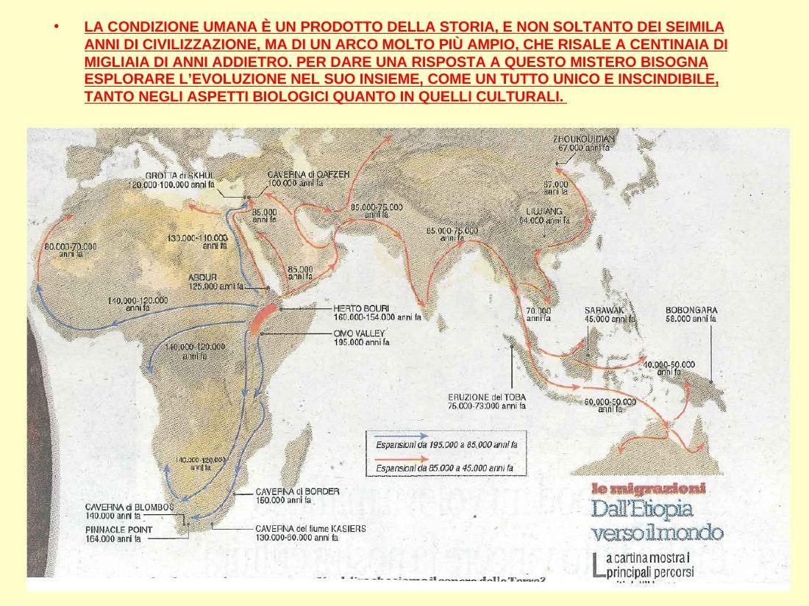{ loading=lazy style="width:59%" }

**L’EUSOCIALITÀ**

La condizione umana è un prodotto della storia, e non soltanto dei seimila anni di civilizzazione, ma di un arco molto più ampio, che risale a centinaia di migliaia di anni addietro. Per dare una risposta a questo mistero bisogna esplorare l’evoluzione nel suo insieme, come un tutto unico e inscindibile, tanto negli aspetti biologici quanto in quelli culturali.

E in questo modo la storia umana, vista in tutte le sue sfaccettature, diventa a sua volta la chiave per capire come e perché la nostra specie è sopravvissuta.

Per cominciare, i biologi hanno scoperto che l’origine biologica del comportamento sociale avanzato negli esseri umani è simile a quella riscontrata in altre parti del regno animale.

Usando studi comparati condotti su migliaia di specie animali, dagli insetti ai mammiferi, sono giunti alla conclusione che le società più complesse sono emerse attraverso l’eusocialità (la «vera» condizione sociale, parlando in senso generale).

I membri di un gruppo eusociale allevano collettivamente le giovani generazioni. Inoltre applicano un sistema di divisione del lavoro tramite la rinuncia – quantomeno parziale – alla riproduzione personale da parte di alcuni membri, allo scopo di incrementare il «successo riproduttivo» (riproduzione nel corso della vita) di altri membri.

L’eusocialità è un fenomeno particolare sotto due punti di vista.

1\. Innanzitutto va rimarcata la sua estrema rarità: su centinaia di migliaia di linee evolutive di specie animali terrestri nel corso degli ultimi 400 milioni di anni, un sistema del genere si è creato, per quello che siamo in grado di appurare, solo in due dozzine di casi.

2\. A questo aggiungiamo che le specie eusociali conosciute si sono affermate molto tardi nella storia della vita sulla terra.

Eusocialità (dal greco *eu*, «buono», e «sociale»): è il livello più alto di organizzazione sociale che si realizza in certi animali.

1:12:10

È stata adottata dalle formiche e dalle termiti, che, fra le 20.000 specie che si conoscono su un milione e più di insetti, rappresentano, queste due specie, la metà del peso corporeo di tutti gli insetti del pianeta. Quindi questa forma che hanno adottato è stata vincente, da questo punto di vista, e quindi anche l’uomo ha adottato questo metodo, che è comune a queste specie pur lontane, l’uomo e questi insetti. Qual è l’elemento principale? L’elemento principale è il nido, cioè il luogo dove una femmina, o una coppia di individui, o un gruppo, rimane, mentre gli altri vanno fuori. E quelli che vanno fuori si chiamano i foraggeri, inclini al rischio, perché chi va fuori può rischiare la vita; e invece ci sono i genitori e le nutrici, che sono un po’ più avversi al rischio.

**L’EUSOCIALITÀ (II)**

Una volta diventato prassi, il comportamento sociale avanzato di livello eusociale si è rivelato uno straordinario successo ecologico.

Soltanto due fra le due dozzine di linee evolutive indipendenti, cioè le formiche e le termiti, bastano a dominare il mondo degli invertebrati terrestri.

Nonostante contino meno di ventimila specie (sul milione di specie di insetti viventi conosciute), formiche e termiti rappresentano la metà del peso corporeo complessivo di tutti gli insetti del pianeta.

La storia dell’eusocialità solleva un interrogativo: dato l’enorme vantaggio che assicura, perché questa forma avanzata di comportamento sociale è così rara ed è comparsa così tardi?

La risposta sembra data dalla sequenza specifica di cambiamenti evolutivi preliminari, propedeutici al passaggio finale all’eusocialità. In tutte le specie eusociali analizzate fino a oggi, il passaggio finale è la costruzione di un nido protetto, da cui partono le spedizioni di foraggiamento e dove gli individui giovani vengono allevati fino al raggiungimento della maturità.

A costruire originariamente il nido può essere una femmina solitaria, una coppia di individui o un gruppo piccolo e scarsamente organizzato.

Una volta realizzato questo passaggio preliminare, per creare una colonia eusociale è sufficiente che i genitori e la prole rimangano nel nido e collaborino all’allevamento di altre generazioni di giovani.

Questi assemblaggi primitivi poi si suddividono facilmente in «foraggeri», inclini al rischio, e in genitori e nutrici, avversi al rischio.

1:13:25

È il nido l’elemento principale. Questo è successo anche perché l’uomo a un certo punto (l’abbiamo visto anche nella prima serata, quella sul cibo) ha cambiato alimentazione e si è spostato più sulla carne, rispetto invece ai vegetali raccolti andando qua e là. Perché si costruisce il nido? Si costruisce il nido perché è più sicuro. Perché una cosa è andare tutti, un gruppo come il nostro di stasera, tutti fuori a girare nella savana, correndo il rischio di essere sbranati, uccisi; un’altra è che vadano fuori solo mirati cacciatori, a procurarsi il cibo, e poi ritornino al nido. In cambio, chi resta deve provvedere a sorvegliare e a nutrire la prole di chi è andato fuori; e questo scambio sociale ha permesso all’uomo di evolversi in questo modo.

**L’EUSOCIALITÀ (III)**

Che cos’è che ha consentito a un’unica linea evolutiva di primati di raggiungere il livello raro dell’eusocialità?

Le circostanze sono state banali, stando alle scoperte dei paleontologi. In Africa, circa due milioni di anni fa, una specie del genere australopiteco, prevalentemente vegetariana, modificò la sua alimentazione incrementando il consumo di carne.

Per procurarsi questa fonte di cibo altamente energetica e dispersa sul territorio, non era molto conveniente andarsene in giro in branchi poco organizzati di individui adulti e giovani.

Era più efficiente occupare un accampamento (il nido, appunto) e da lì spedire in giro cacciatori in grado di riportare indietro (uccidendola o raccogliendola) carne da dividere con gli altri. In cambio, i cacciatori ricevevano la protezione dell’accampamento, dove la loro prole veniva tenuta al sicuro insieme agli altri.

Da studi condotti su esseri umani moderni, incluse popolazioni di cacciatori-raccoglitori, la cui vita ci dice molto sulle origini della specie umana, gli psicologi sociali hanno dedotto la crescita mentale innescata dalla caccia e dagli accampamenti.

1:14:30

Quindi cos’è successo da questo punto di vista? Perché è importante il legame con il tema di questa sera? È importante perché in questi gruppi è stato fondamentale conoscersi, riconoscersi, capire da pochi cenni e sguardi, battiti di ciglia, espressioni, che cosa l’altro voleva fare, se ci si poteva fidare. Come diceva Lorenzo prima: «Io mi fido di te», tra due innamorati. Questo è importante perché riguarda la convivenza all’interno di questo nido che ci si è costruiti, e quindi il prevedere le reazioni, o le aggressioni, o le condivisioni che gli altri del gruppo possono avere. Questa è stata la molla principale.

**L’EUSOCIALITÀ**

Le relazioni personali fra i membri del gruppo, calibrate al tempo stesso sulla competizione e sulla collaborazione, hanno acquisito un ruolo predominante (eccoci quindi anche al tema di stasera).

Il processo è stato incessantemente dinamico e difficoltoso, superando largamente in intensità qualunque esperienza analoga dei branchi itineranti e scarsamente organizzati prevalenti nella maggior parte delle società animali.

Serviva una memoria efficiente per valutare le intenzioni degli altri membri del gruppo e prevedere le loro reazioni di volta in volta: e il risultato è stato la capacità di inventare e simulare internamente scenari conflittuali di interazioni future.

1:15:28

Non dimentichiamo che noi proveniamo, da 200.000 anni fa ma anche solo fino a mille anni fa, da una società molto violenta. Questi sono dei grafici che lo dimostrano: queste sono le percentuali di morte violenta di 3000-4000 anni fa, e invece ora sono queste dell’era moderna: vedete come si sono ridotte, nonostante la seconda guerra mondiale ecc. Noi veniamo da società di una violenza estrema. Faccio quattro esempi, che sono ritrovamenti: sono stati ritrovati dei corpi perfettamente conservati. Uno è l’uomo delle Alpi, Ötzi, forse lo ricordate, di 5000 anni fa: aveva una punta di freccia conficcata nella spalla. Un altro è l’uomo di Kennewick, nello Stato di Washington, in America, trovato presso la riva del fiume Columbia, di 9400 anni fa: aveva un proiettile di pietra infisso nel bacino, ma era sopravvissuto con questo proiettile. Un altro è l’uomo di Lindow, in Inghilterra, di 2000 anni fa: cranio frantumato, collo spezzato da una corda, gola tagliata. Un altro è una famiglia in Germania, di 4600 anni fa: un uomo, una donna e due ragazzi, tutti uccisi in una scorreria. E sono stati ritrovati tutti perfettamente conservati: e questi corpi ritrovati sono tutti di persone morte violentemente, non ce n’è nemmeno uno morto di morte naturale.

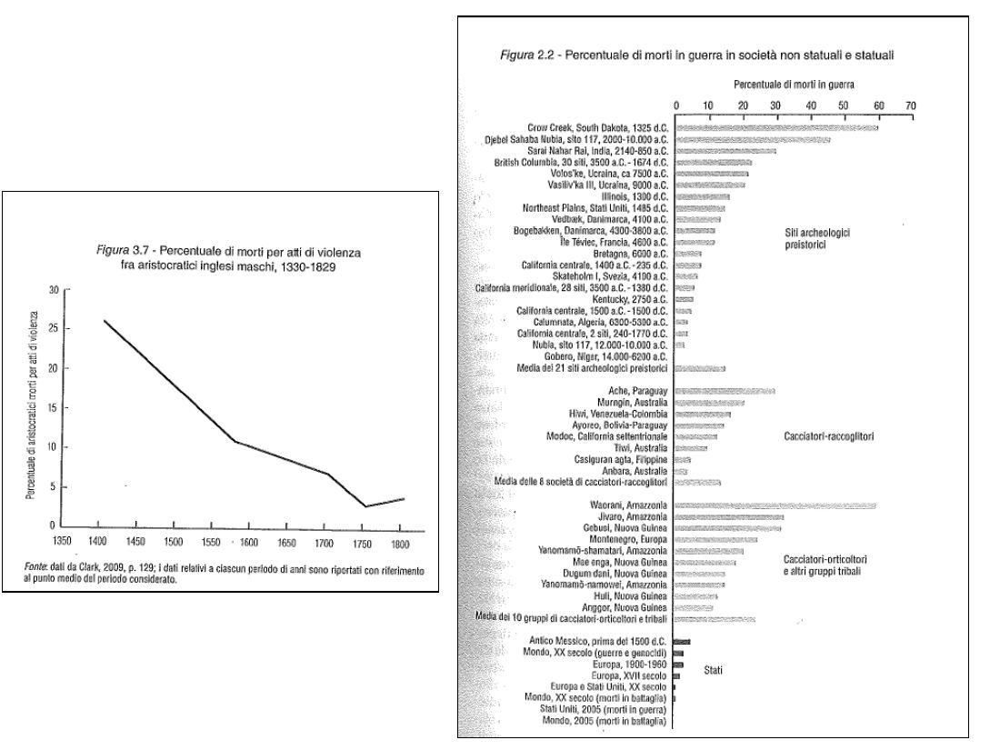{ loading=lazy style="width:59%" }

1:17:19

Effettivamente la vita era molto dura: quindi l’eusocialità ci ha permesso di evolverci e di conquistare. Questo cambiamento culturale che c’è stato ci ha permesso di costruire il nostro armamentario di arti creative, la letteratura, perché a noi piace sentirci raccontare le storie, e questo forma il gruppo, forma le passioni, forma le idee; perché, come diceva Lorenzo, è il raccontare, e l’ascoltare, che ci forma anche le idee. Quindi tutto questo è nato da questo concetto che si diceva prima.

**L’EUSOCIALITÀ**

L’intelligenza sociale dei preumani ancorati all’accampamento si è evoluta come una sorta di partita a scacchi senza fine.

Oggi, al capolinea di questo processo evolutivo, siamo in grado di attivare con scioltezza i nostri banchi di memoria su passato, presente e futuro.

Questi banchi di memoria ci consentono di valutare le prospettive e le conseguenze di alleanze, legami, contatti sessuali, rivalità, rapporti di predominio, raggiri, fedeltà e tradimenti.

Traiamo un piacere istintivo dal racconto di innumerevoli storie sugli altri, in quanto attori nel nostro palcoscenico interno.

Tutto questo trova espressione nelle arti creative, nella teoria politica e in altre attività di alto livello che definiamo scienze umanistiche.

Gli aspetti principali dell’origine biologica della nostra specie cominciano a essere messi a fuoco, e con essi le possibilità di un contatto più fruttuoso fra discipline scientifiche e umanistiche.

La convergenza fra queste due grandi branche del sapere assumerà un’importanza enorme quando un numero sufficiente di persone ci avrà ragionato su.

1:18:07

Facciamo un salto in avanti, per capire un po’ dove siamo adesso da questo punto di vista. C’è un bel saggio di Barbagli e Kertzer, due storici che hanno ricostruito la *Storia della famiglia in Europa* dall’Ottocento fino ai primi del Novecento, e che ci permette di arrivare al grande romanzo della letteratura ottocentesca. Questa per esempio è un’opera di un pittore francese, Bouguereau, che tratta di una donna dipinta un po’ come una Madonna: vedete lo sfondo, il contrasto tra la povertà di questi bambini scalzi e invece il palazzo di fronte. È prima che nasca lo Stato sociale: siamo intorno al 1865, qualche anno prima che nasca lo Stato sociale, quando iniziano le politiche sociali di aiuto ai più poveri.

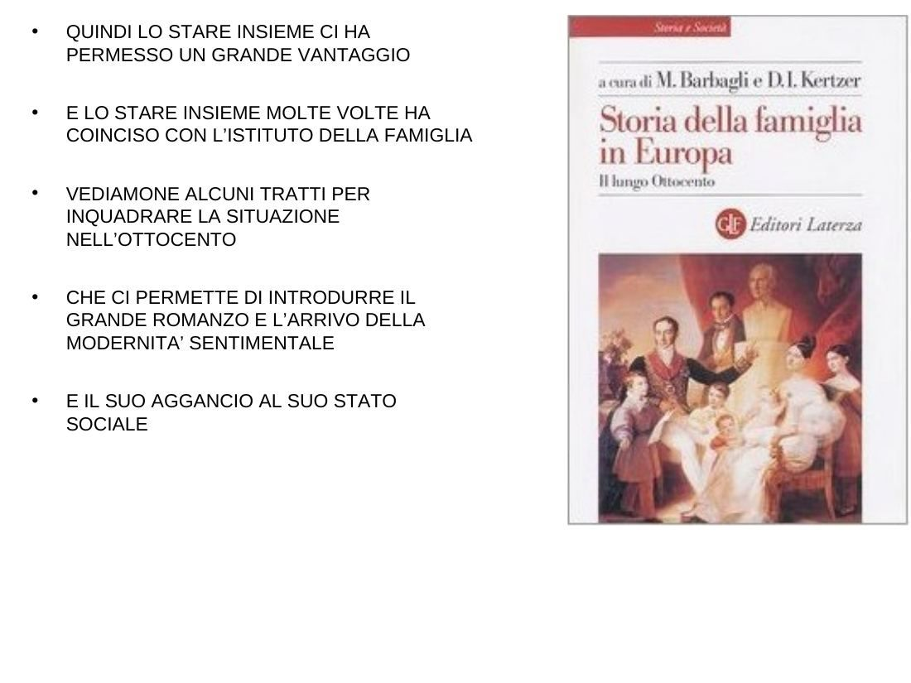{ loading=lazy style="width:30%" }

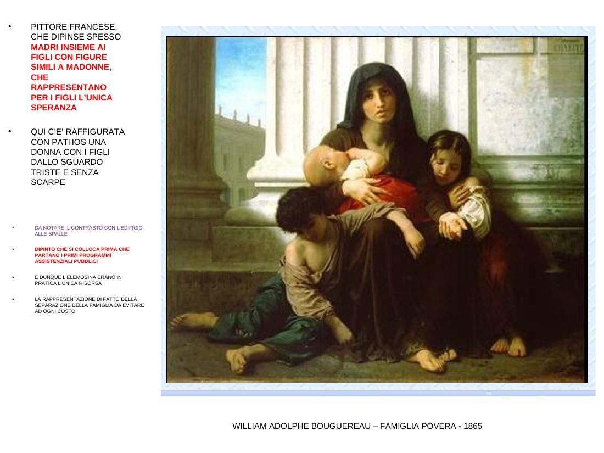{ loading=lazy style="width:39%" }

1:19:30

Questo libro ci racconta, per esempio, che in Italia per l’età media ai matrimoni c’erano tre modelli: al sud le donne avevano circa 20 anni e gli uomini 23-25; al nord invece le donne 22 e gli uomini 25-27. In Toscana e nel centro c’era invece un fenomeno del tutto diverso: l’età media era molto più alta, infatti le donne si sposavano a 26 anni e gli uomini anche a 30-35 anni. Quindi c’era tutto un fenomeno di celibato molto importante in tutta Italia: se vi ricordate, Mussolini fece anche la tassa sul celibato, per scoraggiare questo fenomeno e sostenere la famiglia.

**TRE MODELLI PER L’ETÀ MEDIA NEI MATRIMONI**

1\. Alla fine dell’Ottocento, nel Sud Italia, l’età media delle donne al matrimonio era di 20 anni e quella degli uomini tra i 23 e i 25 anni. Tasso di celibato basso.

2\. Alla fine dell’Ottocento, nel Nord Italia, l’età media delle donne era di 22 anni e quella degli uomini tra i 25 e i 27 anni. Tasso di celibato basso.

3\. Alla fine dell’Ottocento, in Toscana in particolare e nel centro Italia (e nelle città più grandi), l’età media delle donne era di 26 anni e quella degli uomini di 33-35 anni. Il celibato permanente arrivava al 18% delle donne e anche al 30% degli uomini.

**VI RICORDATE L’IMPOSTA SUL CELIBATO, INTRODOTTA DA MUSSOLINI NEL 1927?**

Colpiva i celibi di età compresa fra i 25 e i 65 anni ed era composta da:

– un contributo fisso, che variava in base all’età;

– un’aliquota aggiuntiva basata sul reddito.

L’importo era poi devoluto all’Opera nazionale maternità e infanzia.

1:20:24

In Europa c’era anche il lungo fidanzamento, perché soprattutto nei paesi di carattere dovuti un po’ all’idea della Riforma protestante, se non si aveva un lavoro non ci si poteva poi sposare: l’indipendenza economica e lavorativa era considerata una precondizione del matrimonio, e le coppie che si erano innamorate molto tempo prima potevano ritrovarsi condannate a un interminabile fidanzamento; quindi questo dava luogo al lungo fidanzamento. Infatti è stato ritratto anche in molte opere, come questa di Arthur Hughes, del 1859, che si chiama appunto *Il lungo fidanzamento*.

1:21:01

Quindi l’Ottocento è il momento dei grandi romanzi. Proviamo a smontare economicamente un paio di capolavori dell’Ottocento, come ha fatto Branko Milanović, economista della Banca Mondiale e professore all’Università del Maryland: *Orgoglio e pregiudizio* di Jane Austen e Anna Karenina di Tolstoj. *Orgoglio e pregiudizio* è del 1813: è un romanzo che tratta dell’amore, credo sia abbastanza conosciuto; però è anche un romanzo che parla del denaro, perché parla dei rapporti tra i singoli. Vediamo un po’. La protagonista si chiama Elizabeth, è una di cinque figlie; il reddito della famiglia è di circa 3000 sterline l’anno, che diviso per i sette componenti fa 430 sterline a testa. Secondo le stime del tempo, la famiglia in questione appartiene all’1% più ricco dell’Inghilterra. Arriva uno spasimante, che è mister Darcy, che, ci racconta il libro, ha un reddito annuo di 10.000 sterline, quindi molto di più della famiglia di Elizabeth: infatti lo colloca all’1% dell’1% dei più ricchi, rispetto alla famiglia di Elizabeth.

**ORGOGLIO E PREGIUDIZIO**

JANE AUSTEN – 1813

La protagonista è Elizabeth Bennet, seconda di cinque figlie, e la storia si colloca durante le guerre napoleoniche, tra il 1810 e il 1815.

Elizabeth e la sua famiglia conducono una vita da nobiltà di campagna inglese: balli, feste e pettegolezzi…

Il reddito della sua famiglia è di circa 3.000 sterline l’anno, che, diviso per i 7 componenti, fa 430 sterline annue pro capite (tralasciando la proprietà della tenuta, che si immagina considerevole).

Secondo le stime di Patrick Colquhoun, questo livello di reddito, nella società inglese dei primi dell’Ottocento, colloca la famiglia nell’1% più ricco dell’Inghilterra del tempo; anche se, calcolando la dote che necessariamente doveva essere costituita per ciascuna figlia, doveva tenere un comportamento piuttosto austero.

Elizabeth incontra un ricco spasimante, tale Mr Darcy, che, ci racconta il libro, ha un reddito annuo di 10.000 sterline: calcolando un tasso di rendimento del 4-5%, si può stimare un patrimonio di circa 200.000 sterline.

La madre di Elizabeth, donna pratica e attenta alla buona società, lo giudica subito uno scapolo estremamente desiderabile (oltre al suo amico, Mr Bingley, leggermente meno ricco).

L’alto reddito di Mr Darcy lo colloca, come minimo, nel decimo più ricco dell’1% più ricco d’Inghilterra.

Da notare la grande distanza, pur tra ricchi, tra il padre di Elizabeth e lo scapolo Mr Darcy: complessivamente il reddito di quest’ultimo è più di 3 volte superiore, ma in termini pro capite il rapporto sarebbe di 20 a 1 (Mr Bennet deve dividere il suo tra 7 persone).

Elizabeth non è convinta di Mr Darcy; rifiutarlo, però, la espone ai rischi delle leggi inglesi sull’eredità.

Se Mr Bennet muore senza un erede diretto maschio, la casa e la tenuta passano al suo sgradevole cugino, il reverendo Collins.

In questo caso Elizabeth dovrebbe vivere del proprio reddito, cioè della quota che le spetterebbe delle 5.000 sterline che sua madre portò in dote nel matrimonio.

La dote ha storicamente sempre regolato le scelte matrimoniali. E oggi, anche se non c’è più la dote in quella forma, esiste una dote culturale e di censo che limita, come prima, gli scambi liberi tra individui di gruppi economici diversi.

Il reverendo Collins (pretendente sfortunato di Elizabeth) calcola con poca delicatezza che in questo caso il patrimonio indipendente di Elizabeth sarebbe intorno alle 1.000 sterline.

Questa cifra, riflette il reverendo Collins, potrebbe garantire un rendimento del 4% annuo, cioè 40 sterline: una cifra *miserabile*.

Equivalente però (si notino le cifre) a circa il doppio del reddito medio inglese di quel periodo: la famiglia di un ispettore guadagnava l’equivalente.

Prendiamo in considerazione la faccenda dal punto di vista della madre di Elizabeth, preoccupata della felicità della figlia:

– caso 1: Elizabeth sposa Mr Darcy e gode così di un reddito di 5.000 sterline annue (considerando che lei non contribuisca direttamente: 10.000 diviso 2);

– caso 2: Elizabeth cade (agli occhi della madre) in un mondo di infinita povertà, costretta a vivere con meno di 50 sterline annue.

Il rapporto tra questi due scenari è sbalorditivo: oltre 100-125 a 1.

A questo prezzo, l’alternativa di non sposarsi, o di aspettare che l’amore ideale appaia all’orizzonte, non si pone: si dovrebbe davvero detestare Mr Darcy per rifiutare il piatto che egli offre.

Se rapportassimo questi rapporti ai giorni nostri (al 2004, ultimi dati disponibili in Inghilterra al momento dell’analisi), avremmo questa situazione:

– lo 0,1% più ricco (il Mr Darcy di oggi) avrebbe 400.000 sterline l’anno;

– l’1% più ricco (Elizabeth) avrebbe 81.000 sterline annue;

– il reddito medio britannico è di 11.600 sterline annue.

Quindi il rapporto tra Elizabeth e Mr Darcy sarebbe sempre notevole, ma meno pesante rispetto agli inizi dell’Ottocento.

Il romanzo di Jane Austen ci ha illustrato la relazione inversa (sempre esistita) tra amore romantico e ricchezza.

1:22:34

E quindi a questo punto sboccia l’amore, anche se in realtà Elizabeth ha molti dubbi su questo amore; però ci sono le leggi che in un certo modo la obbligano a far sbocciare l’amore, come dice Lorenzo. Perché questo? Perché, se il padre morisse, tutta l’eredità non andrebbe alle figlie, ma al cugino, il reverendo Collins, in quell’occasione. E quindi la madre sostanzialmente spinge Elizabeth ad accettare in matrimonio mister Darcy, che le permetterà una vita agiata: cioè in quel momento non poteva permettersi di rifiutare un matrimonio così, aspettando l’amore, che forse non sarebbe nemmeno mai arrivato.

1:23:34

Lorenzo Poggi Voi capite che dietro a questo c’è tutta la condizione della donna. E non posava, una cosa soltanto, visto che avevamo parlato di Eros: non c’è eros soltanto nel rapporto. La mitologia (parlavamo dell’origine di questo, dell’origine del nostro linguaggio, della nostra cultura), la mitologia è piena di violenza alle donne. Apollo e Dafne, avete tutti presente, bellissimo; però Dafne soffre nel diventare alloro nel momento in cui Apollo la raggiunge. E non è eros, non c’è il bacio: c’è lo stupro. Non c’è la parola stupro nell’antichità, non esiste. Perché non esiste? Perché non c’è l’idea della libertà, della volontà.

1:24:54

Ve lo racconto in un altro modo. All’origine del mondo greco, ma all’origine del mondo in generale, in tante culture, c’è sempre una coppia: la coppia all’origine è Giove, Zeus, ed Era, marito e moglie. Tutto bene; senonché a un certo punto, dopo 30 anni di matrimonio (gli dèi sono sempre giovani, non hanno problemi), Giove vede la sacerdotessa di Era, uguale alla moglie, uguale a Era. È strano questo: fa le corna alla moglie con una uguale; però, va be’, succede, è timido. Vede la sacerdotessa di Era, Io, vergine naturalmente, e la vede e non può fare a meno di, diremmo noi oggi, stuprarla, violentarla. Giove è il più grande stupratore della mitologia: addirittura si trasforma in pioggia d’oro, in cigno… Giove è terribile. Ma perché? Perché Giove è preso dalla forza irresistibile della necessità, l’*Ananke*, la necessità che su tutto e tutti comanda. Quindi né gli dèi né gli uomini possono niente contro la necessità, l’*Ananke*.

1:27:07

«*Vidit et incaluit*» (stasera ho preso il tono del latino): la vede, e come la vede è talmente preso… Perché il vedere, per noi, è un fatto legato ai bastoncelli, ai coni, alla retina ecc.; per gli antichi vedere è una specie di emissione di freccette luminose, per capirsi, che partono dagli occhi di chi vede e vanno a colpire l’oggetto; oppure, secondo l’altra teoria, partono dall’oggetto e vanno a colpire l’occhio di chi vede. Io, vista da Giove, lo prende, lo distrugge nella sua possibilità di decidere; l’istinto prevale, l’*Ananke*: «*vidit et incaluit*». Non è una responsabilità di Giove: è la natura. Voglio solo sottolineare una cosa: questi argomenti, che sembrano della mitologia, va bene, qualche volta sono rispuntati anche recentemente; questo vuol dire che non è del tutto passato, il «*vidit et incaluit*». C’è questo: teniamolo presente in questo discorso.

1:28:59

La donna, la sua capacità di decidere, di essere partecipe, attiva, anzi, dicevo prima, qualcosa in più, veramente non è una cosa recente. Pensate ad Artemisia Gentileschi: che caso… non esiste, non lo può nemmeno dire; la donna deve tacere, se subisce deve tacere. La dea che rappresenta la donna a Roma si chiama Tacita Muta: non può parlare, non lo può dire; se lo dice, già a parlarne… Bisognava anche mettere l’accento su questo, è un aspetto. Però Artemisia Gentileschi, quando fa Giuditta che sgozza Oloferne, ci sono gli schizzi di sangue che arrivano dappertutto, in qualche modo. L’eroina (avete presente, ora non abbiamo l’opera, però penso l’abbiate presente) l’ha preso e con la spada lo sgozza. O Giaele, che conficca il chiodo in testa a Sisara. Le è rimasta questa cosa, dopo essere stata violentata, e l’ha espressa, simbolizzata, nei quadri. Anche questo ci può permettere di continuare il nostro discorso sul linguaggio e le emozioni.

1:30:48

Paolo Marcucci Altro romanzo: Anna Karenina di Tolstoj, del 1877. Questa è di un film recente: c’è stata una nuova versione in questo momento, di Joe Wright. Allora, Anna Karenina: «Tutte le famiglie felici si somigliano; ogni famiglia infelice è infelice a modo suo». Ci si può chiedere: erano davvero unici Aleksej Aleksandrovič Karenin e Anna? È la storia di una donna sposata che si innamora di un uomo più giovane, affascinante e immensamente ricco, il conte Vronskij: uno spaccato dell’alta società che si risolverà drammaticamente per tutti e due. La storia è affascinante, è bellissima, finisce anche in tragedia, quindi più bella di così da questo punto di vista non si può. E vediamo un po’ di smontarla dal punto di vista dei rapporti economici che invece regolano i sentimenti all’interno di una classe sociale.

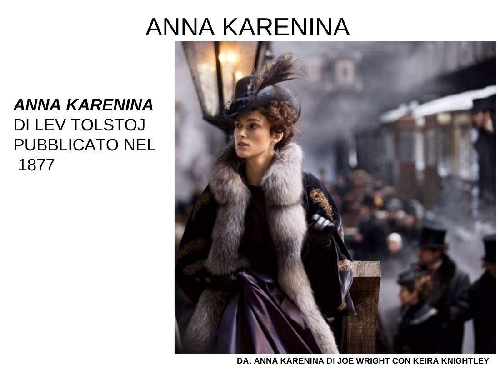{ loading=lazy style="width:59%" }

1:32:07

Tra l’altro il romanzo è interessante per questo (sentiamo anche i pareri di Lorenzo, perché è interessante): è stato preso anche come spunto per una querelle filosofica, che è questa. Si può parlare di Anna Karenina come se si trattasse di una persona vera, dicendo per esempio che era infelice, perché lei è infelice e per questo cerca l’amore fuori? Secondo gli eliminativisti no, perché i personaggi dei romanzi non esistono nella realtà, non ci sono; secondo un’altra corrente, i realisti, che riconoscono ai romanzi una certa realtà sui generis, invece sì, e quindi si può dire che Anna Karenina fosse effettivamente infelice. Allora il paradosso, la domanda che ci si può fare, è questa: com’è possibile provare emozioni, piangere, ridere ecc. per qualcosa che sappiamo non esistere? Perché Anna Karenina non c’è, non esiste. Si tratta di emozioni vere, quelle che noi proviamo, o nate da una finzione letteraria? Sono emozioni vere? C’è chi dice di sì, e c’è chi sostiene invece che nella lettura si finga soltanto di provare emozioni. Non so se Lorenzo ha qualche idea in proposito.

1:33:38

Lorenzo Poggi Non voglio interrompere; riprenderemo questo discorso poi, penso di poterlo sviluppare meglio. Ma è chiaro che questo è il nostro problema. Quando vi dicevo prima che l’uomo è un animale non stabilizzato, citando Nietzsche, traducendo una frase nietzscheana, «non stabilizzato» voleva dire questo: noi viviamo simbolizzando, in un mondo simbolico, simbolizzato. Quindi è fondamentale questa capacità di partecipazione: non c’è bisogno di chiedersi se è vero o no, perché noi siamo abituati, dicevo prima, a rappresentare il mondo attraverso le immagini. Semmai riguarda noi, il nostro oggi, fare un discorso sulle emozioni e sulle passioni in rapporto alla grandezza.

1:34:44

Oltre una certa grandezza, anche lo spettacolo delle emozioni più coinvolgenti, e anche più crude, non ci coinvolge più: perché l’emozione ci prenda, e l’immagine sia efficace, la rappresentazione simbolica deve rimanere entro una certa quantità; al di là non ci arriviamo. Quando ci dicono delle migliaia di bambini che muoiono di fame ogni ora, è un dato drammaticissimo, ma non ci coinvolge più di tanto; la distruzione progressiva del pianeta è un dato reale, ma non ci coinvolge più di tanto. Quando invece c’è l’immagine di una disgrazia magari minore, ma più immediatamente percepibile, come il bambino sporco e macilento, uno solo, che muore di fame, ma è una sola immagine, allora è comprensibile, e suscita in noi delle emozioni fortissime. Quindi c’è semmai una dimensione, nell’emozione, che ci condiziona. Però riprendiamo questo discorso sul valore simbolico delle immagini, perché credo che sia fondamentale.

1:36:21

Paolo Marcucci Allora, anche qui il marito di Anna, si capisce da alcuni passi del romanzo, si suppone guadagni intorno agli 8000-9000 rubli l’anno; invece il conte Vronskij, l’amante, guadagna circa 100.000 rubli l’anno. Quindi anche in questo caso la famiglia Karenin è agiata, ha servitori, è di una classe sociale elevata; ma il conte appartiene all’élite: siamo nella stratosfera, da questo punto di vista, 10 a 1. Quindi lei, andando con il conte, avrebbe fatto una vita da favola, e la faceva già a un livello altissimo rispetto alla media, perché il conte apparteneva a quello 0,1% più ricco della società del tempo, nella Russia in cui è ambientato il romanzo. Non dimentichiamo che Anna già con il matrimonio si era elevata socialmente, perché veniva da una famiglia povera; e quindi alla fine, se si fosse sposata con il conte Vronskij, avrebbe elevato il suo reddito, il suo tenore di vita, di circa 150 volte rispetto al punto di partenza. Questo è fondamentale per capire come si evolvono le cose: le scelte che si fanno a volte sono dettate anche da questo tipo di considerazioni.

**ANNA KARENINA* – TOLSTOJ, 1877**

Le protagoniste di *Orgoglio e pregiudizio* e di *Anna Karenina* vivono tutte e due in un mondo agiato; però il passo successivo di entrambe, il matrimonio per Elizabeth e l’amore per Anna, le renderebbe molto, molto più ricche.

Il reddito di Aleksej Karenin (da una serie di accenni: direttore di banca, conversazione con il fratello di Anna…) si suppone sia intorno agli 8.000-9.000 rubli (uno stipendio governativo di fascia alta è di circa 3.000 rubli).

Invece il conte Vronskij guadagna circa 100.000 rubli l’anno. Le cose però sono cambiate da quando ha lasciato metà della sua eredità al fratello minore: quando incontra Anna, quindi, il suo reddito è di «soli» 50.000 rubli; più tardi riprenderà la parte dell’eredità lasciata al fratello e tornerà ai 100.000 rubli annui.

Guardiamo il salto di ricchezza che Anna avrebbe fatto sposando il conte Vronskij:

– da un reddito di 3.000 rubli (ottenuto dividendo il reddito del marito per tre, compreso il figlio): una vita ricca e agiata, circondata da domestici, servitori e balie;

– a una vita, e a uno stile di vita, quasi principesco, che si calcola vada moltiplicato per dieci rispetto al suo.

Si è calcolato che il conte Vronskij appartenga allo 0,1% più ricco della società (come Mr Darcy) e che Karenin si collochi nell’1% (come Mr Bennet). Ancora una volta si vede la differenza, la distanza che passa tra essere ricchi ed essere ricchissimi.

Che scenario si poteva aprire, quindi, per Anna?

Non dimentichiamo che il romanzo ci dice anche del suo passato: proveniva da una famiglia modesta, che viveva con 200 rubli pro capite annui. Il matrimonio con Karenin era stato quindi un grande avanzamento sociale, pari a una moltiplicazione del tenore di vita di circa 15 volte.

Un secondo matrimonio, con il conte Vronskij, avrebbe moltiplicato il suo reddito di altre 10 volte.

In virtù di questi due matrimoni, che l’avrebbero portata all’estremo vertice della società, e quindi della distribuzione del reddito, il tenore di vita di Anna sarebbe cresciuto di circa 150 volte.

1:38:20

Nella Russia di oggi, per esempio, il reddito pro capite dell’1% più ricco della società, quello dell’amante di Anna, è di circa 340.000 rubli, che equivale a circa 6,5 volte il reddito medio complessivo. Nel 1875 questo rapporto era 15 a 1: quindi nel frattempo la società è riuscita a ridistribuire un po’ più equamente i redditi, da questo punto di vista. Dobbiamo dire anche che negli ultimi 20 anni (l’abbiamo un po’ accennato in quei grafici che facevo vedere nella prima parte) questa redistribuzione, che era iniziata dal 1950 in avanti, si è arrestata e sta tornando indietro, facendo sì che la parte più ricca sia sempre più ricca e la parte più povera sempre più povera, aumentando sempre di più la distanza. Quindi si sta un po’ regredendo da questo punto di vista.

***ANNA KARENINA*** **E** ***ORGOGLIO E PREGIUDIZIO***

La distribuzione del reddito che possiamo ricostruire partendo dai due romanzi ci dice molto.

Prima di tutto, che da quando lo Stato, e lo Stato sociale, si è fatto intermediario (dalla metà dell’Ottocento in poi) e ha assunto un ruolo redistributivo, la distanza nei paesi occidentali tra i più ricchi e i più poveri si è ridotta.

Però, con le politiche comparse nel mondo dal periodo di Reagan e della Thatcher, la spinta al ribasso si è invertita, e gli effetti sono stati attenuati in parte dal grande indebitamento privato.

Anche la statistica a livello di paesi ci dice la sua: nel 1820 la distanza tra i paesi più ricchi e quelli più poveri era di 3 a 1, oggi è di 100 a 1.

Per guadagnare quanto un privilegiato, un disagiato dovrebbe lavorare due secoli (Branko Milanović).

1:39:34

Ma se questo era il mondo fatato dell’Ottocento, nei grandi romanzi del tempo, quale mondo c’è oggi al di fuori dell’Occidente? E i sentimenti di quel mondo possono essere comparati ai nostri? Il nostro è sempre un mondo, quello occidentale, molto privilegiato: per esempio, per i sentimenti basta vedere qualche foto di appena oltre i confini del nostro mondo occidentale. Per esempio c’è tutto il fenomeno delle spose bambine (da un servizio di la Sette dell’ottobre 2012). Ora vi farò vedere qualche immagine; però la domanda che ci interessa da un punto di vista filosofico è questa: è il nostro sguardo di occidentali privilegiati che ci fa apparire quasi mostruose queste immagini, o, dal lato del mondo in cui sono state fatte, è una cosa comune, perché è la realtà con cui hanno sempre vissuto? E quindi il nostro è uno sguardo differente rispetto al loro.

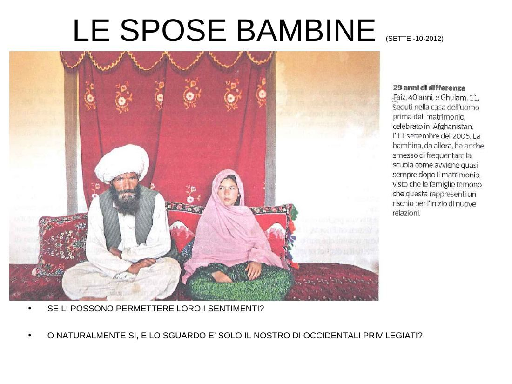{ loading=lazy style="width:44%" }

1:40:41

In questo caso lui ha 40 anni e lei ne ha 11: e quindi si possono immaginare i sentimenti, i rapporti tra queste due categorie di esseri umani. Questa per esempio ha 5 anni, è in braccio a uno zio, ma è già stata sposata, e aspettano solo che sia il tempo per darla effettivamente in sposa al marito. Questa invece è una ragazzina, mi sembra abbia 11 anni, che è riuscita a ottenere una sorta di separazione, nello Yemen: quindi vedete che la cosa esiste. Questa invece è in Etiopia: quindi si spazia dal sud-est asiatico all’Africa. Questa ha 14 anni, con il volto coperto: vedete il marito dietro che la sorregge, e che sta ridendo mentre tutti gli altri gli corrono attorno; è interessante anche questo, mentre lei a capo basso va verso il suo destino. Questa è una bambina di 10 anni con il marito di 31: vedete la disparità di espressione, la distanza di età che c’è in questa coppia.

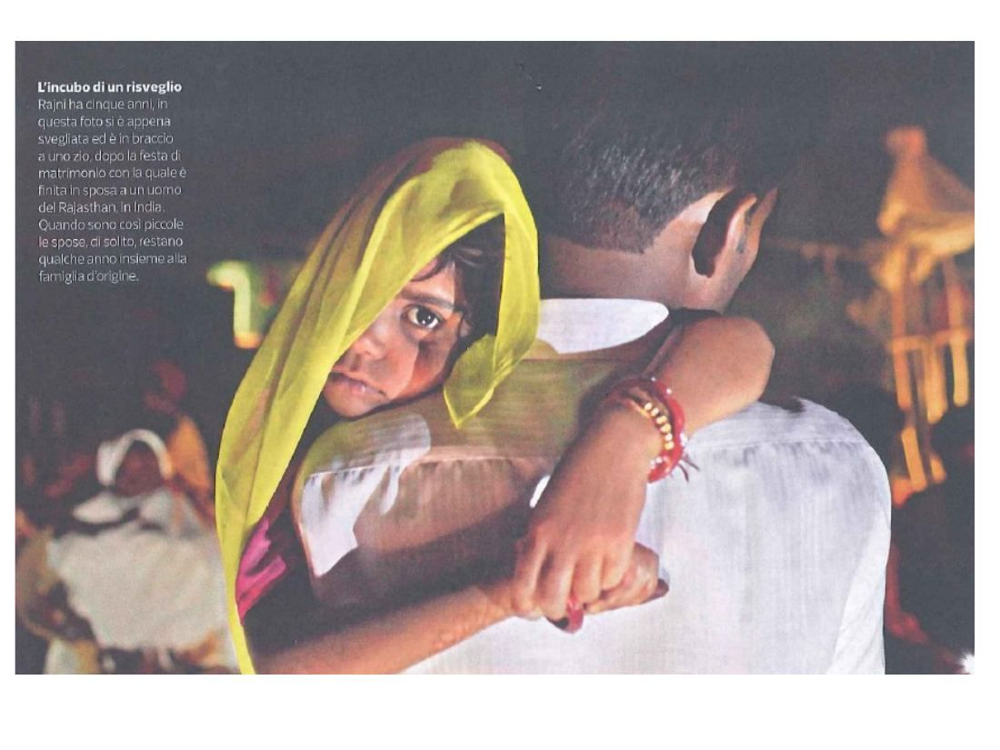{ loading=lazy style="width:47%" }

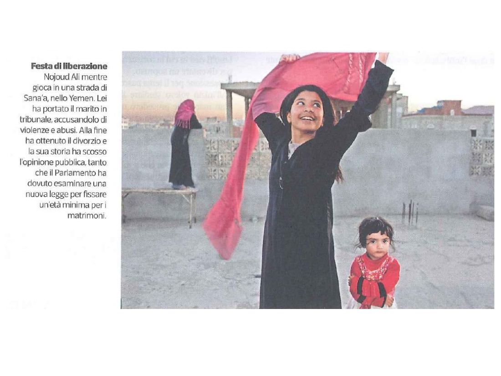{ loading=lazy style="width:47%" }

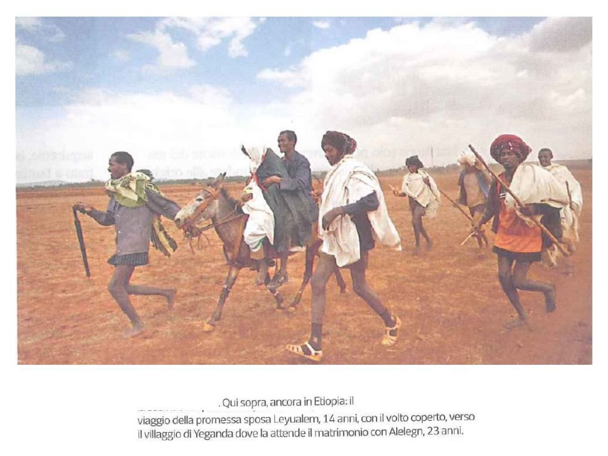{ loading=lazy style="width:47%" }

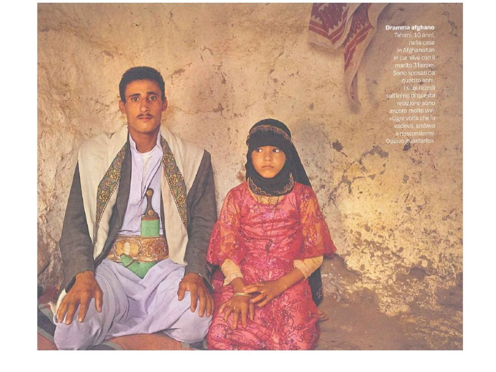{ loading=lazy style="width:47%" }

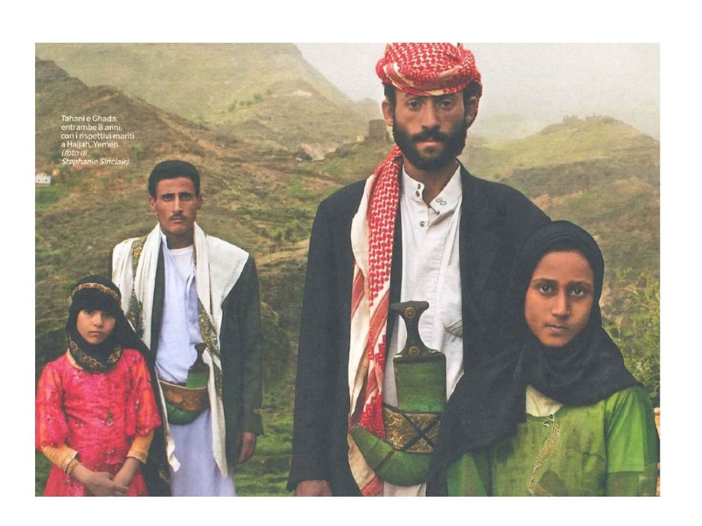{ loading=lazy style="width:59%" }

1:42:17

Questa è l’ultima immagine che vi faccio vedere. Quindi la domanda che ci possiamo fare è se i sentimenti, abbiamo visto, derivino da tradizioni culturali, da condizioni sociali; perché la condizione sociale detta le sue regole, e quindi il sentimento è un lusso che poche volte riusciamo a percepire com’è nella realtà. Queste erano un po’ le domande di fondo che volevamo porci da questo punto di vista: come il nostro mondo occidentale sia privilegiato, pur con tutta la violenza che sappiamo esserci e che continua a esserci, rispetto agli altri mondi.

1:43:17

Lorenzo Poggi Direi che possiamo benissimo riprendere da qui il nostro discorso. Evidentemente, perché ci sia questa comunicazione… noi l’abbiamo chiamata nella storia Eros, e abbiamo visto che ha anche una funzione conoscitiva. E questo mette un tratto d’unione tra quella che è la parte istintuale, immediata, profonda, e quella invece che è la parte razionale. Fra questi due mondi, fra questi due aspetti, c’è qualcosa che costituisce una relazione e un collegamento: questo è Eros. E la nostra cultura occidentale, a poco a poco, attraverso le condizioni che abbiamo visto e che si sono mutate, e quindi anche attraverso un’evoluzione e la rivalutazione della funzione della donna, è arrivata a questo, a dare importanza a questo fatto.

1:44:36

Eros esiste nell’antica Grecia, ma di eros parla Alcibiade rispetto a Socrate, e sono due uomini. Ma non è una questione di omosessualità, è proprio una questione di conoscenza: siccome è questo veicolo conoscitivo, questa forma di conoscenza, si instaura anche nel dialogo, anche tra uomini. Certo, la donna è il simbolo, è la portatrice per eccellenza di questo aspetto; e quindi dal posto e dalla rivalutazione del ruolo della donna deriva anche il posto, la rivalutazione e l’importanza di questo modo conoscitivo. Queste cose non sono molto distanti dal nostro Medioevo.

1:45:30

Prima ho citato… per esempio Santa Caterina da Siena deve andare sposa a 12 anni, quando ha la prima mestruazione. Sua madre, Monna Lapa, insiste perché vada sposa a 12 anni; suo marito ne avrebbe avuti 18-20. Siamo nel Trecento, non è che si sia nel Duemila. Lei è la ventiduesima figlia di Monna Lapa, e le è andata bene, perché aveva una sorella gemella che fortunatamente (fortunatamente per lei, per Caterina) è morta, e così ha potuto succhiare il latte, ed è toccato tutto a lei; sennò era il 50%. Mi spiego: è un modo di rapportarsi al mondo che è il nostro, occidentale, che deriva da questa storia; comunque quello che è fondamentale è questo. Caterina muore a 34 anni; prima di lei muore di parto la sua sorella maggiore, a 15 anni: la sua sorella maggiore muore di parto, ed è il terzo parto.

1:47:23

Cioè, non so, ecco: questo lo diciamo perché le donne non vengono fuori dalla storia; nemmeno le sante, è difficile trovarle. Ci sono le sante… Ora faremo anche un discorso sulle sante. Torniamo a noi: è fondamentale, dobbiamo capire questo. È difficile pensare a questo. La nostra cultura però ha sviluppato a poco a poco l’idea di eros, e l’idea che eros sia un elemento anche conoscitivo fondamentale, un tratto d’unione tra il pensiero evocativo, simbolico, e il pensiero calcolante, razionale. Questo tratto d’unione, questo fondamento, è quello che oggi è più messo in crisi dallo sviluppo delle nostre condizioni di conoscenza e di sviluppo; non solo nostro, occidentale: di tutto il mondo sviluppato.

1:48:59

E quindi su questo punto io penso che occorra insistere, perché questo è il punto fondamentale della nostra cultura: abbiamo a poco a poco rivalutato questo passaggio. In che cosa consiste? Parlavamo prima: consiste nell’aver visto con chiarezza che il linguaggio univoco, il linguaggio del calcolo, il linguaggio della previsione, è un linguaggio che ha, e deve avere, a proprio fondamento un altro linguaggio, che è quello del simbolo, dove una cosa non è solo quella cosa, non ha solo quel significato, ma ne significa anche altri: rimanda non solo a quel referente, ma anche ad altri referenti.

1:50:14

Quando parlavo prima del linguaggio dell’amore, in cui non ci si accontenta mai delle risposte: perché? Perché non c’è una risposta univoca, perché c’è una pluralità di rimandi e di risposte. «Che fai tu, luna, in ciel? dimmi, che fai, silenziosa luna?»: li ricordiamo tutti questi versi. Ma se uno li esamina dal punto di vista del linguaggio razionale, dice: «Ma si sa che cosa fa la luna in cielo». Allora che cos’è la luna? Che domanda è questa? Perché la luna non è solo la luna: è qualcosa di diverso, e nello stesso tempo è anche la luna. Allora il linguaggio della poesia non è un linguaggio univoco, che ha un significato soltanto, non è il linguaggio della previsione: è un linguaggio che lascia aperto il significato, e quindi lascia aperta la possibilità di influire anche sul linguaggio della razionalità, per determinare una nuova visione simbolica del mondo, quella più soddisfacente per il nostro desiderio.

1:51:57

Perché, abbiamo detto, è la distanza, la capacità di educare il desiderio che costruisce il nostro io e ci dà la soddisfazione di vivere; altrimenti, quando cala il desiderio, la vita perde significato, e non c’è più nessuna cosa che ci soddisfi, anche se ne possediamo moltissime. È questo il punto. Se nella nostra condizione attuale prevale il primo punto, prevale il soddisfare il desiderio prima che questo maturi, prima che abbia la capacità di educare il nostro spirito e di renderlo capace di programmare progressivamente il futuro e di avere soddisfazione di sé (perché lo soddisfa subito, illusoriamente, con l’immagine o con un oggetto sostitutivo, e non gli dà la capacità di crescere, di maturare, di educarsi), questo impedisce il mantenimento di eros, che è fondamentale per leggere la vita.

1:53:40

Eros è a metà, abbiamo detto: è quello che lancia il ponte. Ci sono dèi che invece interpretano la confusione, interpretano l’irrazionalità pura, non gettano il ponte. Il poe mitogrego si avvice subito, il dio che si diceva, il dio che è epidemico, come un’epidemia, è Bacco, il dio del vino. Bacco è straniero. Che vuol dire straniero? Che non abita il mondo della razionalità, non abita il mondo simbolizzato: viene da un altro mondo, viene dal mare. Il mare è il disordine, il mare è il mistero, il mare è il collegamento con l’aldilà. Ulisse si trasforma nel viaggio in mare. La sua aspirazione è giungere a che cosa? A eros, a Itaca; giungere di nuovo alla morte. Guardate, nell’*Odissea* c’è il mito occidentale della progressività verso la conoscenza…

\[PAUSA\]
{: .nota }

2:31:30

Paolo Marcucci Va bene. Affrontiamo l’ultima parte: visto che sono già le 23:10, vediamo di concludere e di trarre qualche conclusione. Prima di finire, consentitemi di fare un applauso agli amici del Caffè Centofiori. Grazie.

2:32:13

Allora, l’ultima parte l’abbiamo in qualche modo un po’ introdotta anche nelle parti precedenti. Volevamo affrontare questo argomento dal lato delle nuove tecnologie e degli strumenti che la tecnologia mette a disposizione delle persone per comporre, per stimolare, per far relazionare le persone tra di loro. Una volta c’erano i muri delle case, ora ci sono i muri virtuali del web, Facebook, YouTube ecc.: sono fogli bianchi dove si possono esprimere i sentimenti. Il muro, per esempio: questo è un addio, italiano: «Addio pupa, ti ho amato». È un sentimento scritto su un muro. Questa forse è più bella: «Dove non c’è amore il tempo è perso». Questa forse è ancora più bella, è in due fasi: la fase dell’innamoramento, «Cucciola ti amo»; la seconda, «Sei solo una troia». Questa è bellissima: è di Sharik, un artista di strada: un ragazzo che approfitta del muro disfatto, ci ha costruito un cuore, e il ragazzo lo disfa a martellate: le pene d’amore, prese a martellate, il cuore.

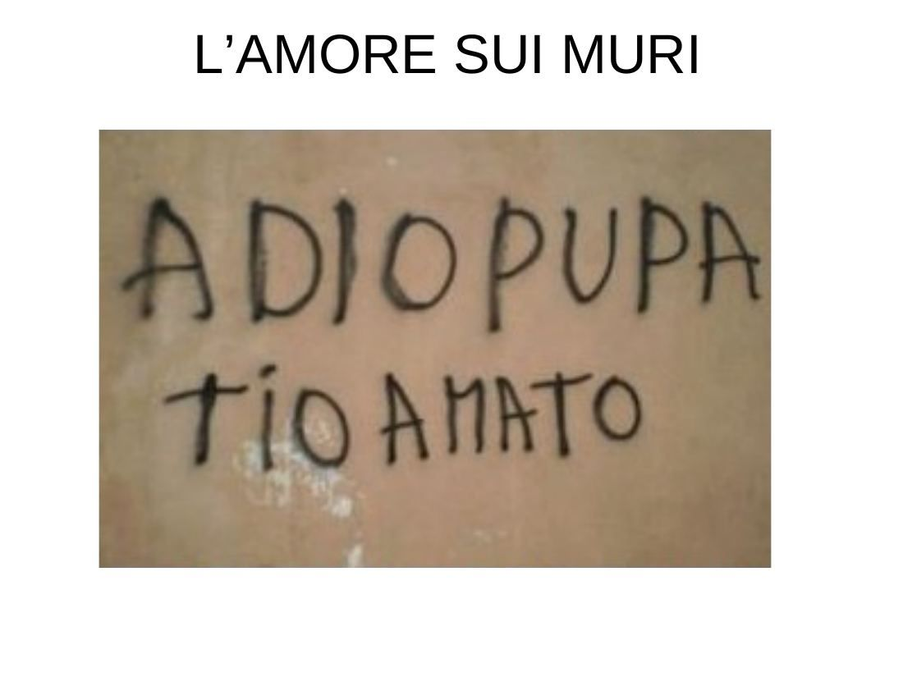{ loading=lazy style="width:47%" }

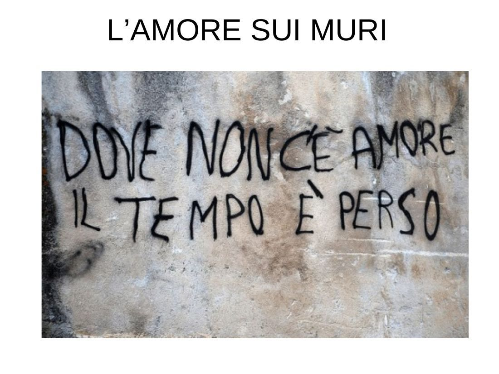{ loading=lazy style="width:47%" }

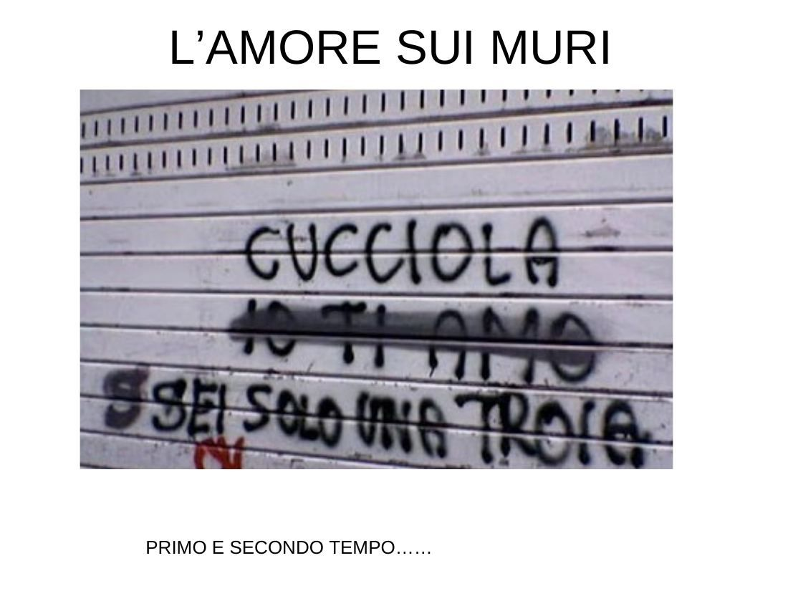{ loading=lazy style="width:47%" }

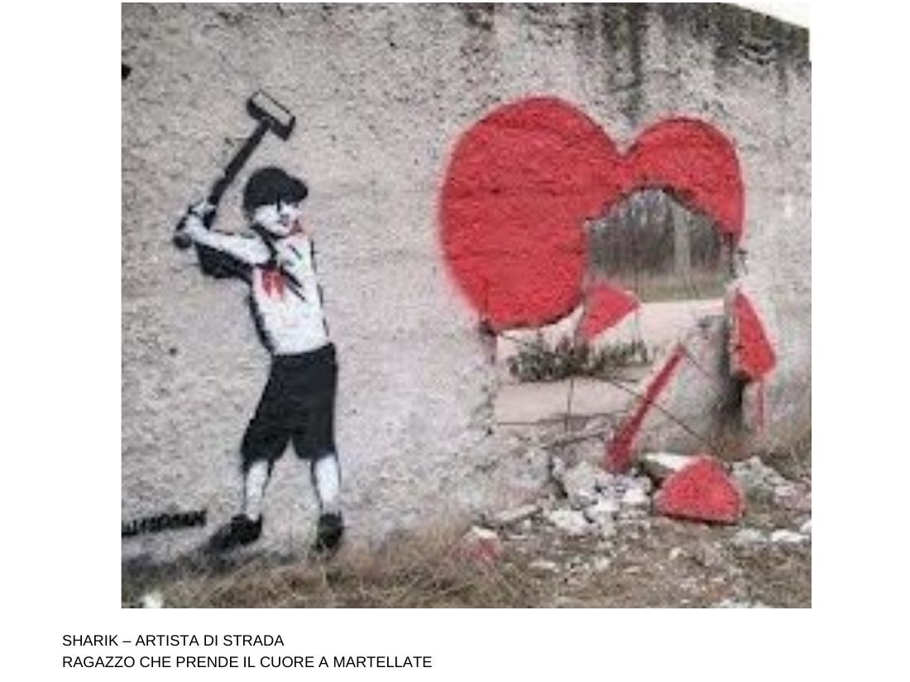{ loading=lazy style="width:47%" }

2:34:31

Questi erano i muri veri; però ci sono anche i muri virtuali, quelli della rete, del network, delle scoperte tecnologiche. Reggerà la famiglia, e reggeremo noi singoli individui, a quest’onda? La facilità forse amplia le conoscenze, ma ha effetti deleteri su monogamia e relazioni; magari c’è la paura di «sbagliare» piattaforma, ma c’è comunque «abbondanza». La domanda che ci dobbiamo fare, e a cui probabilmente non ci sono molte risposte, o ancora non siamo in grado di darle, è questa: la nuova tecnologia ci offre delle facilità di relazione, di conoscenza, di tutto quello che si porta dietro, a un livello impressionante, a cui forse non siamo ancora abituati (forse le generazioni che nascono adesso lo sono). Però questo è anche un fatto positivo, perché nella Toscana dell’Ottocento, abbiamo visto l’età media ai matrimoni, c’era il problema drammatico del celibato, di chi non riusciva a sposarsi, c’era una disperazione da questo punto di vista. Quindi da un lato c’è questa possibilità che questa tecnologia scardini un po’ i nostri modi di vivere, le nostre famiglie, le nostre relazioni; dall’altro c’è questo beneficio, di cui forse non dobbiamo avere così paura.

2:36:10

Abbiamo detto anche che negli anni Sessanta-Settanta (se vi ricordate *Scene da un matrimonio* di Bergman, un film famosissimo) la famiglia era il simbolo di tutto il male della società borghese: all’interno della famiglia non si sarebbe riusciti a esprimere i sentimenti, perché la famiglia stessa, costruita antropologicamente in un certo modo, non permetteva di esprimere i sentimenti veri; quindi la distruzione della famiglia. Insomma, siamo passati anche da questo, e naturalmente la famiglia è sopravvissuta anche a questa tipologia di idee. Però può darsi anche che il web, con tutta la tecnologia, riesca forse in quello che non è riuscito al ’68 o al ’77, nella distruzione della famiglia borghese.

2:37:10

Pensiamo un attimo alle possibilità che la rete offre (ora ne farò vedere qualcuna, non tutte, perché è già tardi). Pensate solo alle foto o ai filmati che ci facciamo continuamente tra le persone: si sono moltiplicati in ogni strumento, perché li abbiamo nei telefonini, nel computer di casa; c’è chi li archivia sul cloud, sulla nuvola, in internet; li archiviano le compagnie telefoniche. È un moltiplicarsi di immagini e filmati stratosferico, e prima non eravamo abituati: c’era forse una foto ogni tanto, qualche lettera. Però c’è anche il risvolto negativo: pensate per esempio al generale Petraeus, quello dell’anno scorso, che è stato rovinato da mail clandestine con questa amante, poi scaricata, perché nei computer rimangono tracce infinite di queste relazioni.

2:38:24

Ora da tutte le parti si twitta: chi è che non twitta? Forse tanti qui dentro; però comunque sappiamo tutti che cosa significhi. E siamo sempre in diversi posti: noi siamo in un posto, e contemporaneamente siamo anche in un altro. Questa è una foto che voleva trasmettere questa sensazione: io sono a una festa, però contemporaneamente sto riprendendo, scrivo qualcosa a qualcun altro e dico che sono presente a quella festa. Cioè è una contemporaneità diffusa, a cui non eravamo molto abituati fino a un po’ di tempo fa. E questo fa sì che forse quella distanza giusta che ci deve essere nelle relazioni sentimentali, amorose, ma non solo nell’amore tra uomo e donna, anche tra amici, tra conoscenti, si sia annullata. Noi siamo sempre rintracciabili, in qualsiasi momento, se ci pensate: quindi questo da una parte è una liberazione, ma dall’altra è anche una condanna. Non sto facendo discorsi di condanna o di assoluzione, non so che cosa voglia effettivamente dire; però è una dipendenza che abbiamo.

2:39:46

Finisco con una cosa che credo sia interessante, e che sia un po’ l’emblema del nostro tempo, di che cosa vogliono dire le relazioni in questo tipo di società che stiamo vivendo e costruendo. Sono immagini (ne faccio vedere una sola, perché sono un po’ troppe e non ce la facciamo) tratte da un servizio presentato da una rivista, *IL*, edita dal Sole 24 Ore, un mensile tra l’altro molto interessante, dove appaiono spesso articoli interessanti. Allora: l’amore a distanza. Che cosa permettono questi due aggeggi? Sono fatti uno per l’uomo e uno per la donna: manovrati a distanza attraverso il telefonino o il personal computer, uno è un attrezzo in cui il maschio può inserire il sesso, e l’altro è l’opposto; e, collegati al telefonino, si fanno i gesti sessuali collegati a distanza di chilometri. Questo offre la rete...

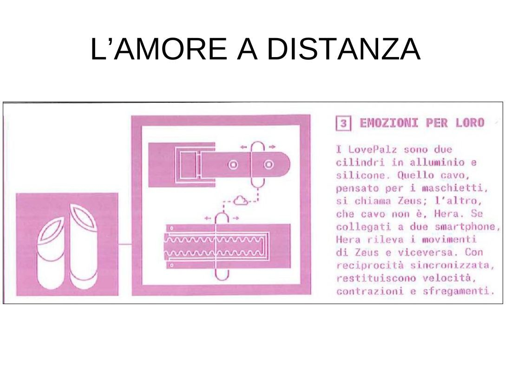{ loading=lazy style="width:59%" }

2:42:34

Non si può provare… Volevo far vedere, ce n’era un campionario, ma non ce l’abbiamo fatta. Comunque, per dire che le tecnologie oggi ci permettono di fare qualsiasi cosa, davvero. Non sappiamo se noi saremo in grado di capire; come dicevo prima, probabilmente le nuove generazioni sono un po’ più allenate di noi. Però effettivamente c’è una grandissima opportunità che la strumentazione tecnologica ci mette a disposizione. Per esempio ce n’era un altro che mi piaceva farvi vedere, dove ci sono delle coppie che si cercano all’interno di comunità particolari, perché ognuno di noi è profilato in un certo modo: tra i gay, per esempio, oppure anche tra le persone che vivono in campagna, perché è un mondo del tutto particolare, e non si possono far incontrare magari persone che vivono in campagna con quelle che vivono in città, perché hanno ritmi di vita diversi; e quindi la tecnologia le mette da sola in contatto. E quindi questo è un po’ il punto della situazione, da questo lato dei sentimenti e delle relazioni che la tecnologia ci permette di far evolvere in un certo modo. Se sia positivo o negativo, come sempre ne cerco la risposta in Lorenzo.

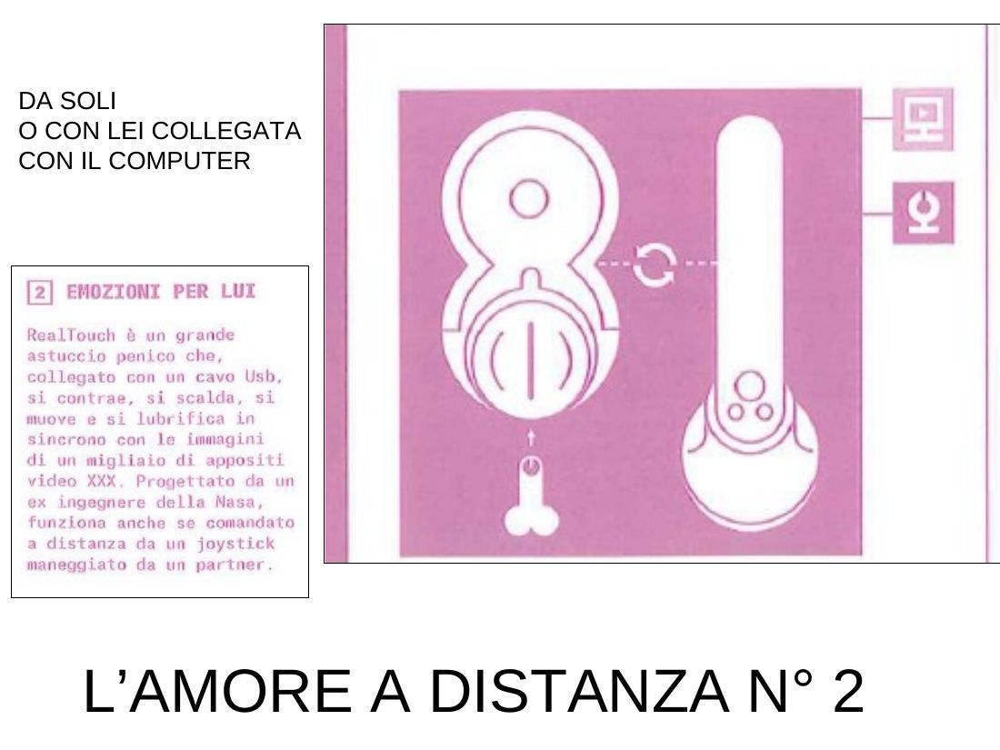{ loading=lazy style="width:47%" }

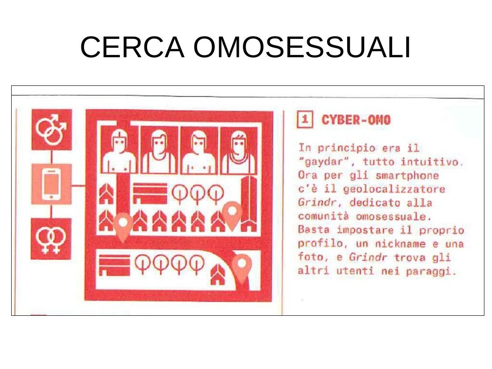{ loading=lazy style="width:47%" }

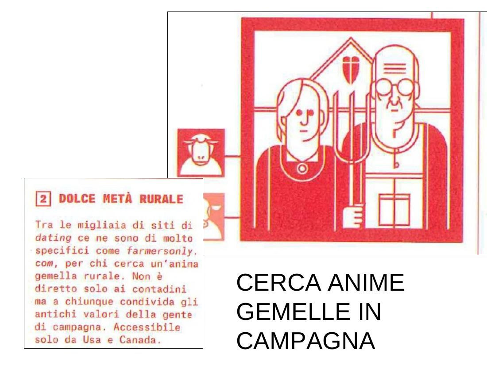{ loading=lazy style="width:47%" }

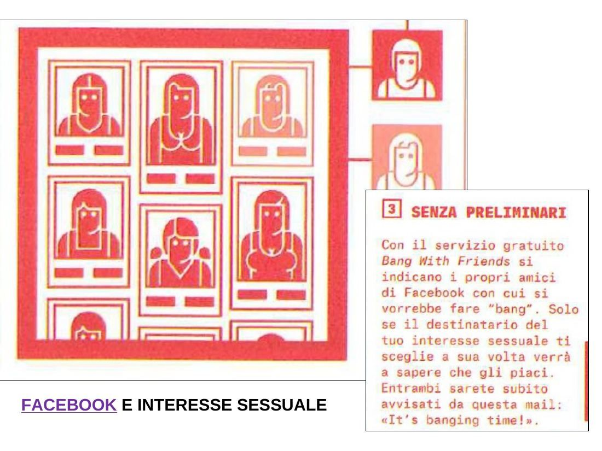{ loading=lazy style="width:47%" }

2:44:21

Lorenzo Poggi Siamo senza energia: mi sentite? L’evoluzione è notevole, se pensate che una volta gli affari, come si diceva, li faceva quello che andava a lavorare il maiale: era il maialaio, che si spostava da una famiglia all’altra, e trovava anche il marito alle ragazze: «Ho trovato la scarpa per il tuo piede». Almeno, quando ero ragazzo me lo raccontavano quelli più anziani di me. Quindi l’evoluzione dal maialaio al web è inimmaginabile, è enorme.

2:45:04

Tornando un attimo al nostro discorso: stiamo vivendo, e questo mi sembra oggettivo, un impoverimento del linguaggio, dovuto a un nuovo modo di esprimersi, basato sulla frettolosità. Le parole devono essere molto brevi, sono sempre quelle: con pochissime parole si possono esprimere tutti i sentimenti necessari alla vita di relazione, perché sono pochissimi. Viene sempre più a mancare lo spazio indicato all’origine della nostra civiltà da Eros, questo collegamento che era l’elemento vitale, costruttivo, innovativo, che è quello del linguaggio simbolico. Il linguaggio simbolico ormai ha pochissimi punti dove può rifugiarsi: il linguaggio dell’espressione, del simbolo, quello della poesia. Parlavamo prima di Leopardi, mi veniva in mente la descrizione: è il linguaggio che non designa la cosa, che è quella cosa, ma è contemporaneamente anche un’altra cosa, e contemporaneamente ancora un’altra cosa.

2:47:09

E rimanda, e non può essere spiegato: pensare di spiegare il simbolo, di decriptarlo, vuol dire non avere capito che cos’è il simbolo. Il simbolo è qualche cosa che è messo lì proprio perché fa da congiunzione e sollecita la nostra immaginazione laddove viene meno il linguaggio razionale, quello della comunicazione e non dell’espressione. Quello a cui stiamo assistendo è l’impoverimento di questo linguaggio simbolico, il suo venir sempre meno. Pensate quanto era ricco il linguaggio simbolico dell’uomo del Medioevo, che era in grado di partecipare alla complessa simbologia delle opere d’arte che vedeva. La Vergine Maria assimilata alla viola mammola, perché è il fiore dell’umiltà: l’uomo del Medioevo sa che è il fiore dell’umiltà, perché è piccola, profumatissima, ma è celata dalle altre erbe. E quindi l’associazione… Sono due cose completamente diverse, la viola mammola e la Vergine Maria; ma la Vergine Maria è anche la rosa, e la preghiera alla Vergine è anche il rosario. Perché? Perché la rosa è simbolo della vita umana: la nostra vita, la nostra sorte è la rosa, che al mattino è bella e fiorita e alla sera ha i suoi petali ai piedi.

2:49:15

Questa ricchezza di significati, che fa da congiunzione tra la conoscenza e l’immediatezza percettiva del mondo, che dà senso alle cose, questa ricchezza del linguaggio simbolico sta passando in secondo piano, si sta emarginando sempre di più, per una serie di ragioni. Prima di tutto perché ormai le nostre possibilità di comunicazione hanno globalizzato l’intero pianeta, e quindi non si può pensare a una cultura comune globalizzata se non in termini di cultura della razionalità e della tecnologia; mentre il simbolismo legato a questo è estremamente difficile. È estremamente interessante oggi vedere che cosa fanno gli artisti cinesi quando vengono a contatto con l’arte europea, come coniugano in qualche modo insieme le diverse sensibilità. Il linguaggio simbolico quindi assume adesso un’importanza fondamentale proprio in questo, perché a lui è affidato ancora il compito di fare da tramite, come Eros, e di portare l’innovazione all’interno dello stesso linguaggio razionale, conoscitivo; perché è quello il fondamento, è su quello che dovremmo fondarci, e di nuovo lo ritroviamo nella poesia.

2:51:20

Io stavo pensando alle immagini veicolate dalla poesia. Dice Carducci, parlando dell’amica che ha conosciuto, della ragazza che gli piaceva quando era giovane: «Come eri bella, o giovinetta, quando tra l’ondeggiar de’ lunghi solchi uscivi un tuo cesto di fiori in man recando, alta e pensosa, e sotto i cigli vivi di selvatico fuoco lampeggiante dal ridente occhio azzurro aprivi come il ciano sereno, tra il biondeggiante oro de le spiche… tra la chioma flava ridea quell’occhio azzurro, e a te davanti la grande estate, e intorno a te…». Ora, che cos’è il volto della ragazza? È insieme la campagna toscana nel momento della maturazione del grano? I suoi occhi sono come il ciano, il fiore azzurro? Sono l’una e l’altra cosa; ma l’una e l’altra cosa ci danno un’immagine del mondo che ci rimanda alla conoscenza. L’immaginazione è il fondamento che porta alla conoscenza: Kant, nella *Critica del giudizio*, mette l’immaginazione come tramite fra la percezione e l’intelletto, e la bellezza è l’equilibrio fra intelletto e immaginazione.

2:53:22

Ci siamo? Non possiamo rinunciare a questo. Il rischio è che la realtà, il nostro mondo, sia totalmente assunto e dichiarato dal solo linguaggio non simbolico, quello comunicativo, quello che non ha risonanza, che non ha che univocità di significato. Questo vale anche per la pittura, pensate a qualsiasi opera; questo vale di nuovo per la poesia. Quale senso possono avere i versi? Quanti sensi sono a noi presenti, e quanti invece ci sfuggono, che erano presenti a coloro che erano contemporanei a quel mondo e a quella scrittura? Manfredi, in Dante: «biondo era e bello e di gentile aspetto, ma l’un de’ cigli un colpo avea diviso. \[…\] mostrommi una piaga a sommo ’l petto. Poi sorridendo disse: “Io son Manfredi, nepote di Costanza imperadrice; ond’io ti priego che, quando tu riedi, vadi a mia bella figlia, genitrice de l’onor di Cicilia e d’Aragona, e dichi ’l vero a lei, s’altro si dice”».

2:54:49

Figura reale, immaginata: Dante partecipa a questo; è una costruzione viva, presente, ma significa insieme la misericordia divina che lo ha assolto, significa insieme la presenza della grazia divina e del purgatorio, significa insieme la regalità e la ragione, che vanno al di sopra dell’autorità pontificia. Significa tutto, e serve a gettare un ponte, un’immagine del mondo. Non possiamo perdere questo aspetto fondamentale; non può rimanere un aspetto soltanto marginale, perché è il fondamento dal quale anche l’altro, il pensiero razionale, l’operatività sul mondo, che è estremamente importante, prende senso e significato. Grazie, io finisco qui, perché poi il discorso si allunga ancora di più.

## Appendice

Le slide proiettate durante l’incontro.

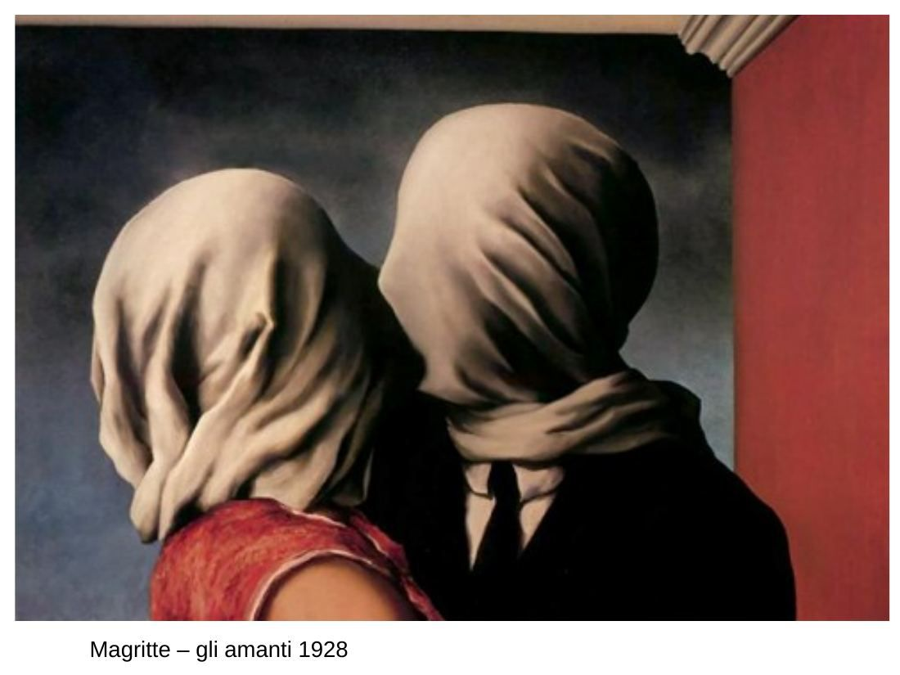{ loading=lazy style="width:47%" }

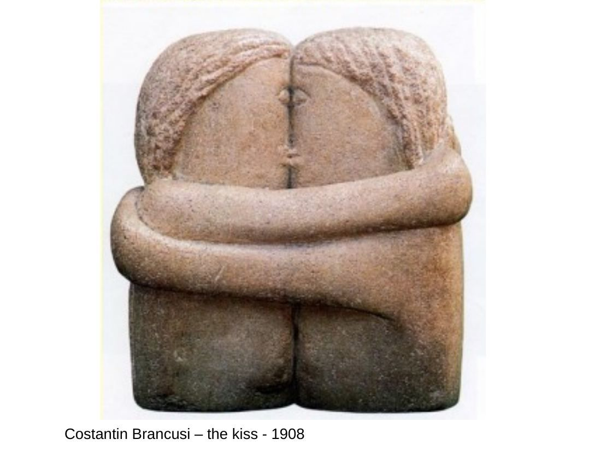{ loading=lazy style="width:47%" }

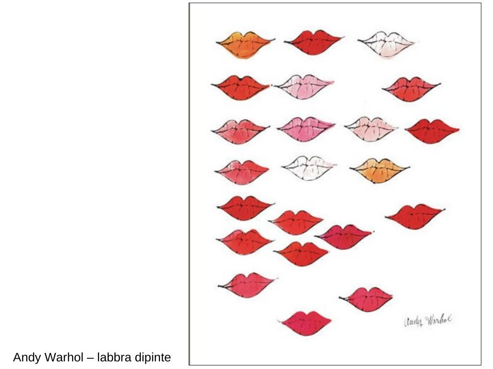{ loading=lazy style="width:47%" }

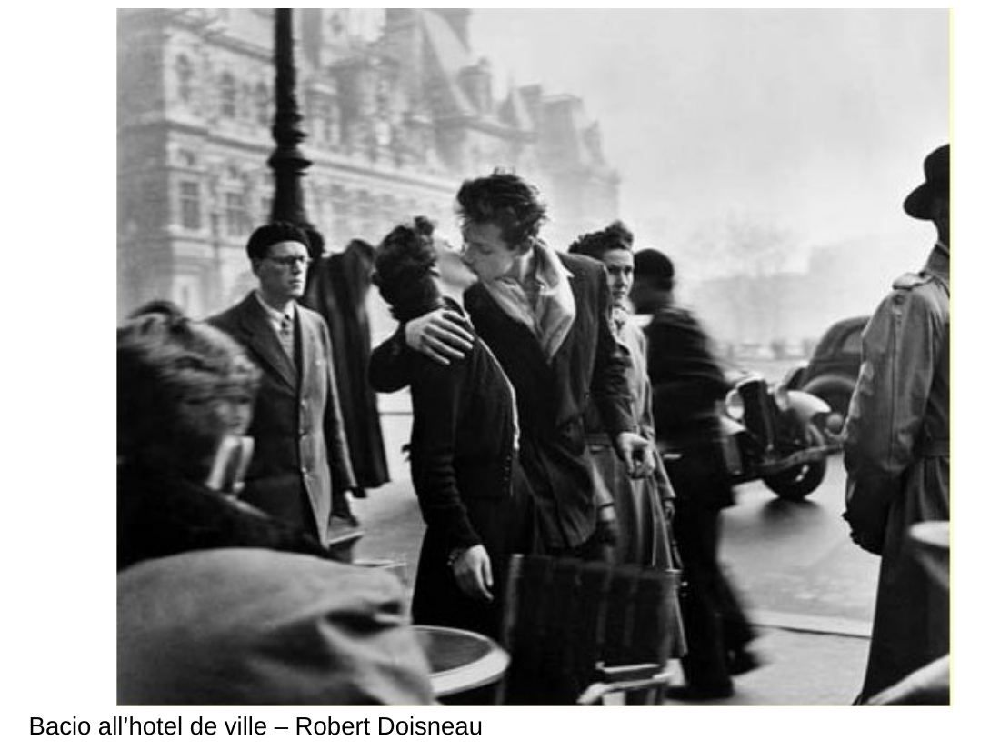{ loading=lazy style="width:47%" }

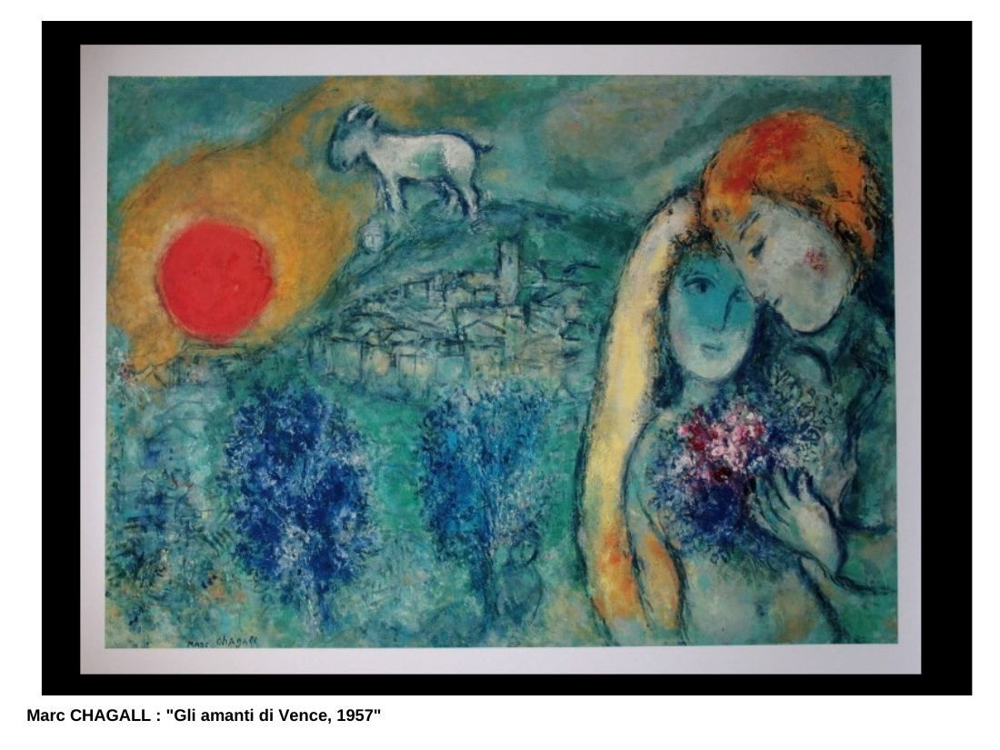{ loading=lazy style="width:47%" }

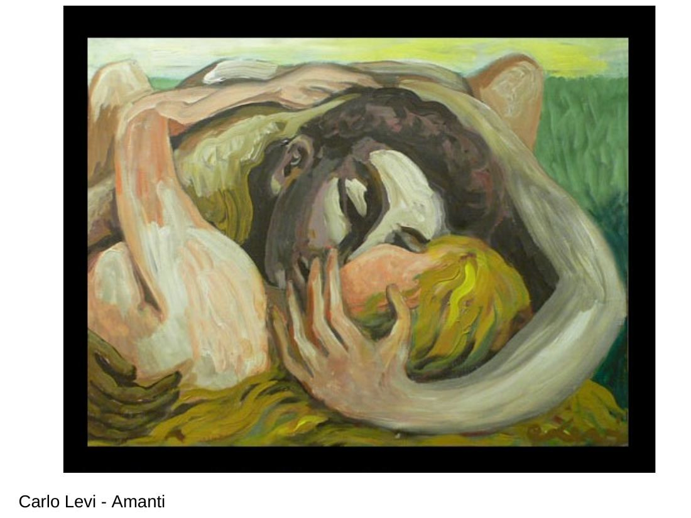{ loading=lazy style="width:47%" }
