# Il gioco degli scacchi

**Data:** 23 aprile 2013 
**Luogo:** Museo della Ceramica, Montelupo Fiorentino 
**Incontro con:** Lorenzo Poggi e Paolo Marcucci

**Interventi:** Paolo Marcucci Lorenzo Poggi Daniele

0:00:06

Paolo Marcucci L’anno scorso e negli anni passati ne abbiamo fatte un paio all’anno; quest’anno siamo andati una volta a Milano, e ora c’era qualche richiesta per andare a Roma, così come avevamo un po’ ipotizzato all’inizio della stagione. Per Roma è possibile farla, però bisogna essere un numero abbastanza adeguato, perché sennò non rientriamo con i costi del pullman. Questa sarebbe la prima opzione, e avremmo individuato domenica 9 giugno per andare a Roma. In alternativa, se non raggiungiamo il numero minimo di posti per fare la gita, l’opzione sarebbe sabato 8: facciamo molto più vicino, andiamo a Firenze. A Firenze ci sono due mostre molto interessanti a Palazzo Strozzi: una è *La primavera del Rinascimento*, che si ricollega a molti temi che abbiamo affrontato in questo periodo; e poi alla Strozzina c’è *Un’idea di bellezza*, anche questo un tema un po’ trasversale a tutto quello che abbiamo detto finora nelle nostre serate. Quindi chi di voi è interessato lasci magari il nominativo a Massimo; poi facciamo un po’ di conti, e nei prossimi quindici giorni vi faremo sapere quale delle due opzioni possiamo fare.

0:02:46

Detto questo, passiamo all’argomento di stasera. In queste settimane, in questa settimana specialmente, mentre stavo preparando un po’ il materiale per questa sera, mi veniva da pensare a tutto quello che sta succedendo in questo periodo a livello politico: quella è una partita a scacchi veramente dura e cruenta. Alcuni re sono stati fatti fuori: una bella partita a scacchi, effettivamente, e ancora non si è capito chi sia il vincitore; forse domattina lo sapremo un po’ meglio.

0:03:33

Allora, gli scacchi: anche nei pavimenti di casa nostra (noi non ce ne rendiamo conto, probabilmente qualcuno di noi ce l’ha anche a casa, il pavimento a scacchi). Ma questa idea degli scacchi ha una provenienza molto, molto ancestrale. Fin dall’antichità c’è la dualità delle cose: positivo e negativo, bianco e nero. I romani per esempio segnavano con una pallina nera i giorni infausti; da qui anche il detto «oggi è una giornata nera», che deriva proprio da questa usanza dei romani di contrassegnare con la pallina nera la giornata no. La scacchiera è quindi anche lo sforzo di dominare un po’ tutto quello che è irrazionale e che non riesce a collocarsi bene: in questo modo si cerca di dare un ordine alla vita, che magari tanto ordine non ha. Quindi c’è una contrapposizione tra l’ordine della scacchiera e il destino, lo spirito.

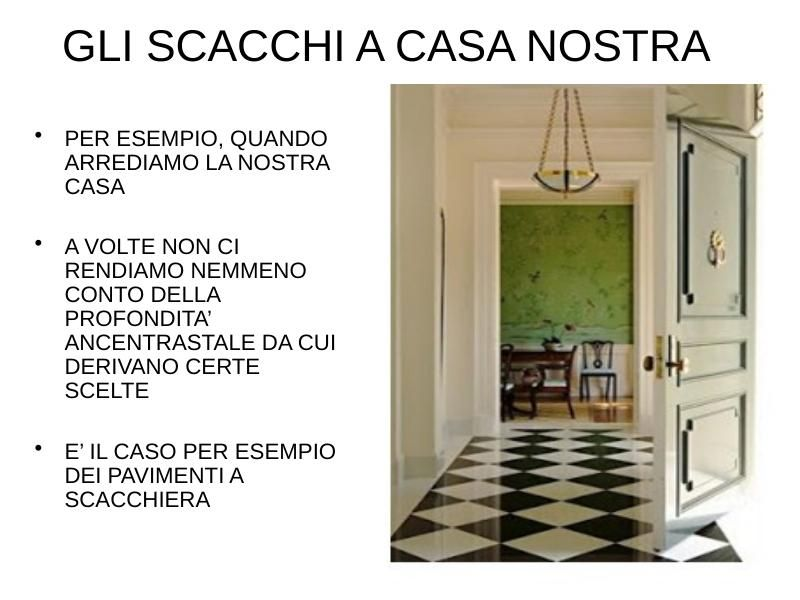{ loading=lazy style="width:59%" }

**LA SCACCHIERA\**

Fino dall’antichità la dualità delle cose (positivo-negativo; bianco e nero) ha un rapporto simbolico con il tempo e il destino:

I romani segnavano con una pietra bianca o nera i giorni fausti e quelli infausti; noi diciamo «giornata nera», oggi…

La scacchiera è quindi anche lo sforzo di dominare l’irrazionale in una determinata struttura:

Combinazione

Dimostrazione

Rischio

Possibilità

\* Dizionario dei simboli

In questo modo si cerca il mezzo della comprensione e dell’organizzazione.

La scacchiera diventa allora come la trama di una contrapposizione tra l’ordine e il destino e lo spirito: il perimetro di gioco e l’interno dove può succedere tutto. Infatti c’è un legame, per esempio, anche con l’Arlecchino.

0:04:53

Per esempio, in questa contrapposizione tra l’ordine precostituito della forma, della scacchiera, e quello che succede dentro, la guerra che succede dentro, c’è un legame anche con Arlecchino: il vestito di Arlecchino è fatto a scacchi e a losanghe, e quindi c’è un rapporto diretto con il destino, perché Arlecchino è folle, è legato alle divinità ctonie, e quindi sotterranee, vulcaniche ecc. Quindi c’è un legame stretto tra la scacchiera e anche il vestito di Arlecchino.

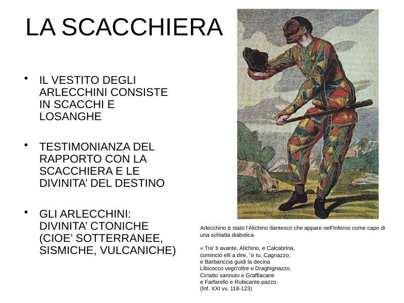{ loading=lazy style="width:59%" }

**LA SCACCHIERA**

Il vestito degli arlecchini consiste in scacchi e losanghe: testimonianza del rapporto con la scacchiera e le divinità del destino.

Gli arlecchini: divinità ctonie (cioè sotterranee, sismiche, vulcaniche).

Arlecchino è stato l’Alichino dantesco, che appare nell’*Inferno* come capo di una schiatta diabolica:

*«Tra’ti avante, Alichino, e Calcabrina»,*

*cominciò elli a dire, «e tu, Cagnazzo;*

*e Barbariccia guidi la decina.*

*Libicocco vegn’oltre e Draghignazzo,*

*Cirïatto sannuto e Graffiacane*

*e Farfarello e Rubicante pazzo».*

(*Inf.* XXI, vv. 118-123)

0:05:44

La scacchiera ha influenzato (vedremo ora qualche immagine) anche la Chiesa, anche le chiese. Questo per esempio è nei monasteri: questa è Milano, la basilica di Sant’Ambrogio; vedete, nel muro ci sono queste scacchiere, con la rappresentazione appunto del positivo e del negativo. Questa è una bellissima parete del Palazzo del Papa ad Anagni: è stupenda questa parete, è tutta fatta a scacchi. Questo per dire che anche nelle chiese c’è tuttora questo rapporto con questa forma di rappresentazione. Queste sono altre due immagini, conservate al monastero dell’Escorial, in Spagna: un monastero che ha una biblioteca interessantissima sugli scacchi, a testimonianza della conservazione della cultura degli scacchi non solo nelle chiese, ma anche nei monasteri.

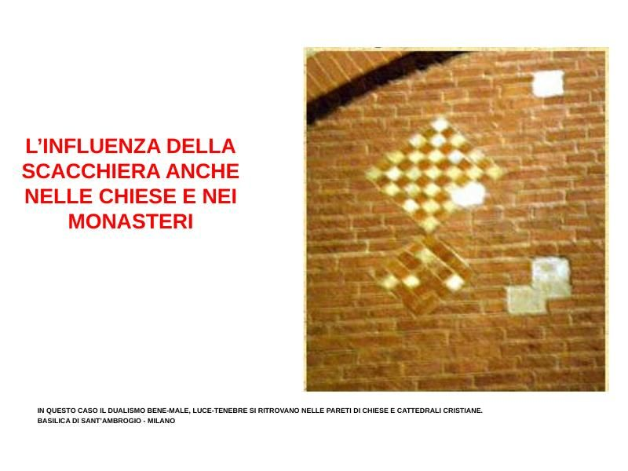{ loading=lazy style="width:47%" }

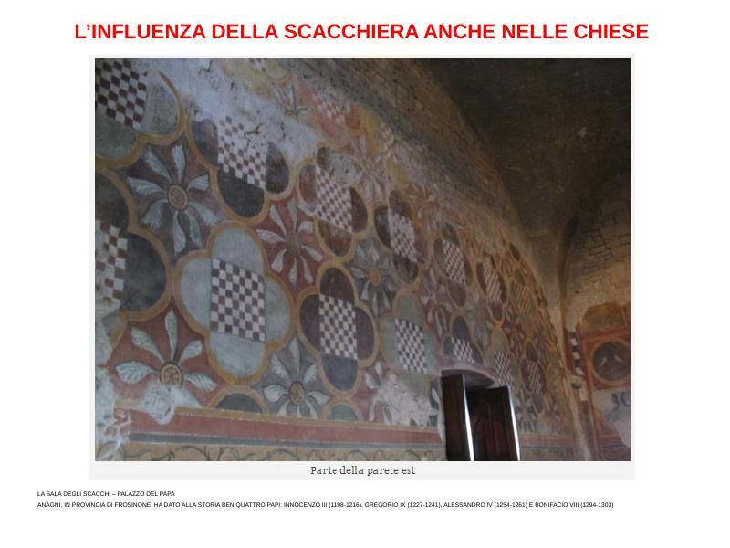{ loading=lazy style="width:47%" }

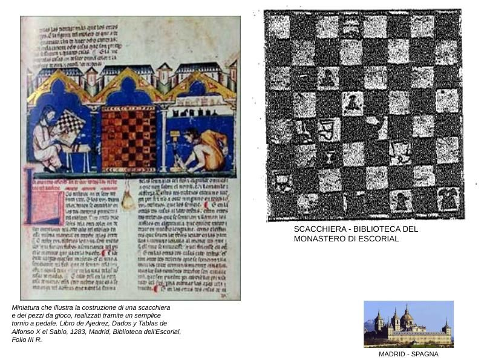{ loading=lazy style="width:59%" }

**L’INFLUENZA DELLA SCACCHIERA ANCHE NELLE CHIESE E NEI MONASTERI**

In questo caso il dualismo bene-male, luce-tenebre si ritrova nelle pareti di chiese e cattedrali cristiane (Milano, Basilica di Sant’Ambrogio).

La sala degli scacchi – Palazzo del Papa, Anagni (in provincia di Frosinone), città che ha dato alla storia ben quattro papi: Innocenzo III (1198-1216), Gregorio IX (1227-1241), Alessandro IV (1254-1261) e Bonifacio VIII (1294-1303).

Miniatura che illustra la costruzione di una scacchiera e dei pezzi da gioco, realizzati tramite un semplice tornio a pedale: *Libro de ajedrez, dados y tablas* di Alfonso X il Saggio, 1283, Madrid, Biblioteca dell’Escorial, fol. III r. Scacchiera – Biblioteca del monastero dell’Escorial.

0:07:02

Recentemente, ai funerali di Margaret Thatcher (non so se qualcuno li ha visti in tv), quando portano la bara a St Paul’s: la cattedrale di St Paul’s ha il pavimento a scacchi. Queste sono immagini riprese dall’alto (non so se si vede, si dovrebbe vedere): quindi anche la cattedrale di St Paul’s è legata a questo tema. Il simbolo classico orientale, lo yin e lo yang, tenebre e luce: anche questo si rifà sempre al tema della scacchiera. Infatti è in Oriente che dobbiamo andare alla ricerca dell’origine degli scacchi. Prima di fare questo, anche i tarocchi: vedete, questa è la Papessa, la carta numero 2, che è appunto il simbolo della dualità; nel libro (non so se si vede) c’è il simbolo dello yin e dello yang, e qua giù c’è la scacchiera sul pavimento.

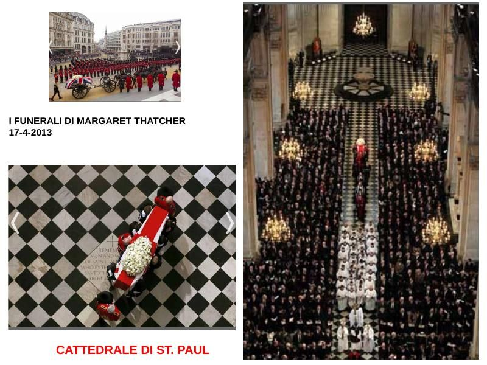{ loading=lazy style="width:58%" }

**LA SCACCHIERA**

René Guénon ricorda l’origine tra i colori della scacchiera del bianco e nero nell’Estremo Oriente tra yin-yang:

Lato in ombra della collina (yin) e il lato soleggiato della collina (yang).

Tenebre e luce; luna e sole; notte e giorno.

Che a sua volta rimanda al simbolismo di Arjuna, il bianco, e Krishna, il nero.

Mortale e immortale; l’io e il sé.

Infatti è in Estremo Oriente che dobbiamo andare per capire la nascita degli scacchi.

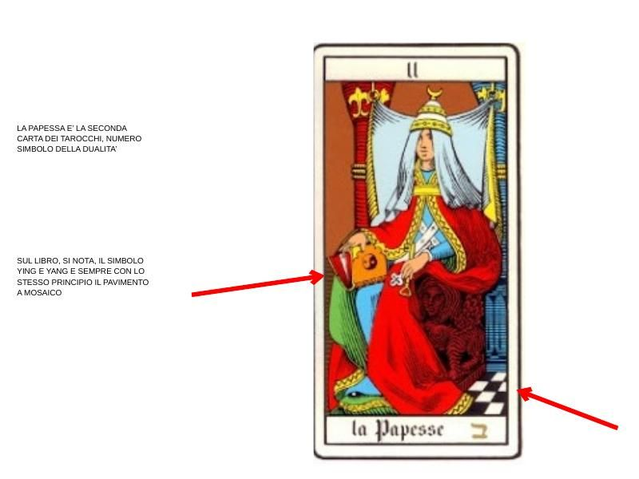{ loading=lazy style="width:36%" }

0:08:24

Allora, diciamo l’origine degli scacchi. Gli scacchi sono un po’ incerti come nascita; comunque ormai gli storici dicono che sono nati sostanzialmente in India, nel V secolo, con il nome di chaturanga. Si giocava in quattro giocatori (vedete da queste immagini: sono quattro giocatori e non due), e ognuno giocava partendo da un’estremità della scacchiera. E quindi c’erano gli elefanti, per esempio, in India appunto, i carri, la cavalleria, e il re, come sempre, era il capo supremo di queste armate che si contendevano. Da lì poi passò agli arabi, e dagli arabi il gioco degli scacchi arrivò in Europa, intorno all’anno Mille; e fu un successo enorme, perché questo gioco ebbe successo in tutte le corti europee.

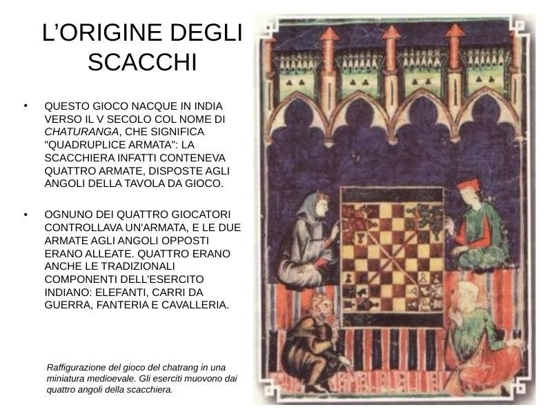{ loading=lazy style="width:59%" }

**L’ORIGINE DEGLI SCACCHI**

Questo gioco nacque in India verso il V secolo col nome di Chaturanga, che significa «quadruplice armata»: la scacchiera infatti conteneva quattro armate, disposte agli angoli della tavola da gioco.

Ognuno dei quattro giocatori controllava un’armata, e le due armate agli angoli opposti erano alleate. Quattro erano anche le tradizionali componenti dell’esercito indiano: elefanti, carri da guerra, fanteria e cavalleria.

Raffigurazione del gioco del chatrang in una miniatura medioevale. Gli eserciti muovono dai quattro angoli della scacchiera.

La disposizione di queste armi era, nella strategia bellica dell’epoca, rigidamente fissata: gli elefanti al centro, i carri ai fianchi, la cavalleria in mezzo e la fanteria davanti.

Il re, come capo dell’armata, era fermo al centro, assistito da un consigliere, o primo ministro. Dall’India il gioco passò alla Persia con il nome di *Chatran.* Quando gli arabi conquistarono la Persia vennero a conoscenza del gioco, che si diffuse fra i musulmani con il nome di Shatranj*.*

Alcuni studiosi pensano che una primitiva versione del gioco degli scacchi – col nome di *latrunculorum lusus*, il «gioco dei soldati» – fosse approdata nell’Impero romano già nel II o III secolo d.C. tramite i legionari tornati in patria dopo le lunghe guerre combattute in terre orientali.

Su quella tavola da gioco, però, i soldati utilizzavano anche i dadi.

Gli scacchi veri e propri furono conosciuti in Europa poco prima dell’anno Mille, tramite i Mori di Spagna e i crociati.

In epoca feudale la diffusione degli scacchi fu enorme: l’aristocrazia europea li elesse a passatempo preferito («il gioco dei re, e il re dei giochi») e interi poemi vi si imperniarono.

0:09:41

Allora, quello che è interessante degli scacchi è anche vedere come si adattano alla realtà in cui vengono messi. Per esempio sono rimasti più o meno i re, il cavallo o i pedoni; cambiano invece sostanzialmente, nel viaggio dall’India verso l’Europa, altri pezzi. L’elefante, che veniva chiamato al-fil, è tradotto in italiano «alfiere» (vedete, c’è anche un’assonanza), e si è trasformato in fou, pazzo, in francese e in bishop, vescovo, in inglese. Dalla parte degli arabi si riceve l’introduzione del visir, che sarebbe il consigliere del califfo; mentre per esempio il rukh, il cammello da guerra arabo, trasportato in Europa diventa rochus (anche questa è un’assonanza), che ha preso poi per noi il nome di torre. Vedete come cambia il significato dei pezzi quando passano da un paese all’altro, nel viaggio geografico.

**L’ORIGINE DEGLI SCACCHI**

Nel lungo viaggio verso l’Europa i pezzi degli scacchi non rimasero invariati, ma si adattarono alla mentalità e al modo occidentale di dare battaglia.

Restarono più o meno identici: il re; il cavallo; i pedoni.

Cambiarono invece – e sostanzialmente – l’arabo al-fil (l’elefante), tradotto in italiano per assonanza in alfiere e trasformato in fou (pazzo) in francese e bishop (vescovo) in inglese.

Agli arabi si deve l’introduzione del pezzo del visir, il consigliere del califfo.

Il visir (in arabo *fers*) divenne per i francesi fiers, cioè la vergine, la dama o la regina, cambiando così di sesso, mentre il rukh (cammello da guerra in arabo-persiano), chiamato dagli europei roccus, si trasformò in un simbolo guerresco, la torre.

La torre ci porta dunque all’Europa e alla storia degli scacchi di Lewis.

0:11:00

Allora, la torre, dicevamo, che si è trasformata, ci porta in Europa. Gli scacchi più antichi rinvenuti in Europa sono questi, gli scacchi di Lewis: risalgono al 1150-1200, sono stati ritrovati in una zona dell’isola di Lewis, nelle Ebridi, appunto, e sono conservati al British Museum. Proviamo un po’ ad analizzare, attraverso gli scacchi, la società del tempo che li aveva espressi. Qui sulla destra vedete l’elefante, quello che dicevo prima, che nel nostro mondo si è poi trasformato nell’alfiere. Questi scacchi di Lewis sono stati ritrovati nel 1831. In Europa gli scacchi hanno caratteristiche molto antropomorfe, come poi vediamo anche dopo, e riflettono bene la struttura medievale della società.

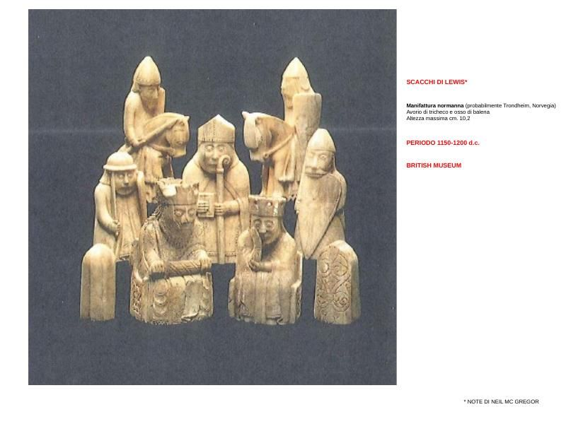{ loading=lazy style="width:47%" }

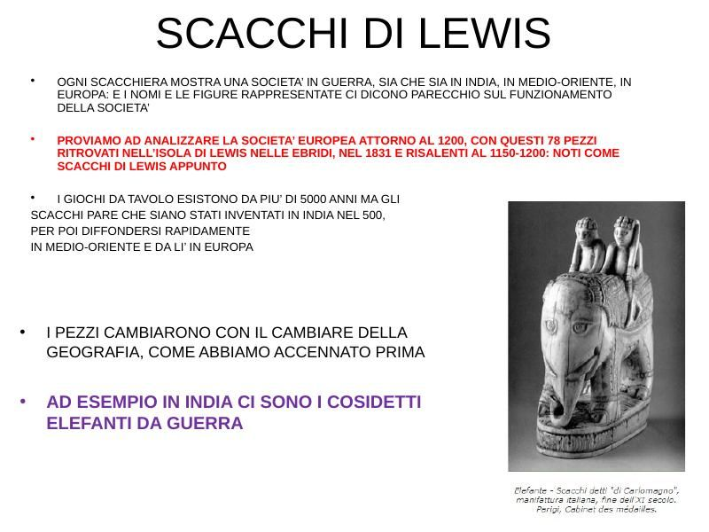{ loading=lazy style="width:47%" }

**SCACCHI DI LEWIS\**

Manifattura normanna (probabilmente Trondheim, Norvegia); Avorio di tricheco e osso di balena; Altezza massima cm. 10,2; periodo 1150-1200 d.C.; British Museum

\* Note di Neil MacGregor

Ogni scacchiera mostra una società in guerra, sia che sia in India, in Medio-Oriente, in Europa: e i nomi e le figure rappresentate ci dicono parecchio sul funzionamento della società.

Proviamo ad analizzare la società europea attorno al 1200, con questi 78 pezzi ritrovati nell’isola di Lewis nelle Ebridi, nel 1831 e risalenti al 1150-1200: noti come scacchi di Lewis appunto.

I giochi da tavolo esistono da più di 5000 anni ma gli scacchi pare che siano stati inventati in India intorno al 500 d.C., per poi diffondersi rapidamente in Medio-Oriente e da lì in Europa.

I pezzi cambiarono con il cambiare della geografia, come abbiamo accennato prima. Ad esempio in India ci sono i cosiddetti elefanti da guerra.

In Europa i pezzi hanno caratteristiche antropomorfe.

Gli scacchi di Lewis ci mostrano appunto personaggi ben delineati che riflettono le strutture medioevali del potere sociale in atto nell’Europa del nord.

In Medio-Oriente invece, viste le riserve islamiche sulla rappresentazione umana (che abbiamo già visto nelle nostre serate) i pezzi sono pressoché astratti.

0:12:23

Quello che è interessante, per esempio, è fare un confronto con gli scacchi islamici: questi sono scacchi islamici. Loro non possono rappresentare la figura umana, come ci ha più volte spiegato molto bene Lorenzo, e quindi gli scacchi assumono queste forme, che non sono facilmente riconoscibili ai nostri occhi.

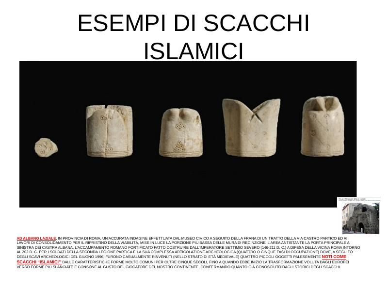{ loading=lazy style="width:50%" }

**ESEMPI DI SCACCHI ISLAMICI**

Ad Albano Laziale, in provincia di Roma, un’accurata indagine effettuata dal Museo civico a seguito della frana di un tratto della via Castro Partico e ai lavori di consolidamento per il ripristino della viabilità, mise in luce la porzione più bassa delle mura di recinzione, l’area antistante la porta principale a sinistra dei Castra Albana, l’accampamento romano fortificato fatto costruire dall’imperatore Settimio Severo (146-211 d.C.) a difesa della vicina Roma intorno al 202 d.C. per i soldati della seconda legione partica e la sua complessa articolazione archeologica (quattro o cinque fasi di occupazione) dove, a seguito degli scavi archeologici del giugno 1996, furono casualmente rinvenuti (nello strato di età medievale) quattro piccoli oggetti palesemente noti come scacchi “islamici” dalle caratteristiche forme molto comuni per oltre cinque secoli, fino a quando ebbe inizio la trasformazione voluta dagli europei verso forme più slanciate e consone al gusto del giocatore del nostro continente, confermando quanto già conosciuto dagli storici degli scacchi.

0:13:18

Lorenzo Poggi È interessante, dei pedoni, che il pedone, quando riesce miracolosamente, in mezzo alle guerre, agli agguati ecc., a raggiungere l’altra parte, allora diventa qualsiasi cosa: può liberarsi, può essere una regina, un alfiere, un cavaliere. È interessante proprio questo: quando il pedone arriva in fondo, ha percorso le otto caselle del campo. Otto: cioè che cosa ha fatto? Ha superato il sette, che è il settimo giorno, che conclude la creazione, ed è giunto all’ottavo, che è il giorno della resurrezione, il giorno della nuova vita; e quindi si trasforma e assume una nuova vita, una nuova identità: può diventare l’altro pezzo. Quindi nella simbologia, anche numerica, degli scacchi c’è il segno della visione del mondo: non è solo il gioco, è effettivamente il gioco della vita. Se tu riesci a condurre la tua vita senza cadere nel peccato, giungi alla fine della vita, continuando rettamente il tuo cammino così come Dio vuole, all’ottavo, come dicevamo, della resurrezione.

**SCACCHI DI LEWIS**

I PEDONI:

Sono gli unici a non avere forma umana, e consistono in blocchetti d’avorio ritti quasi come lapidi.

Rappresentano i contadini che nella società medievale erano brutalmente arruolati per essere spediti sul campo di battaglia.

Ogni società ha la tendenza a giudicare identiche e intercambiabili le persone sul gradino più basso della scala sociale e quindi i fanti sono qui rappresentati come se non avessero alcuna individualità.

La cosa però magnifica dei pedoni è la possibilità di trasformazione in qualcos’altro.

Quando il pedone, faticosamente, e in mezzo a mille agguati raggiunge la parte opposta della scacchiera, può trasformarsi e diventare regina, cavaliere, torre, …

0:15:01

I fonti battesimali, il luogo in cui si lascia in qualche modo il destino mortale, terreno, e si diventa partecipi della salvezza, e quindi si giunge alla trasformazione della vita eterna: i fonti battesimali sono di pianta ottagonale. Otto: due volte quattro. Otto anche per un’altra ragione: perché si può giungere alla trasformazione, al mutamento, alla perfezione, e quindi congiungersi a Dio e trascendere la propria umanità, equilibrando le quattro essenze che costituiscono la nostra forma materiale, fisica, quella della natura materiale (terra, acqua, aria e fuoco, di cui siamo fatti), con i quattro umori che costituiscono il nostro temperamento (bile nera, bile gialla, sangue e flegma), che costituiscono gli incentivi del nostro carattere. È equilibrare questi due quadrati che, messi ruotati fra loro, danno poi l’ottagono del fonte battesimale, e danno la perfezione della vita.

0:16:48

Quindi negli scacchi, nel numero, c’è veramente il simbolo dell’esistere e del trascendere l’immediatezza dell’essere per arrivare a qualcosa di diverso. E sono frutto di un tempo, di un mondo in cui questo valore simbolico era ancora qualcosa di partecipato e comunque sentito.

0:17:18

Poi vi dico una cosa: Paolo ha accennato al fatto che ci sono state delle cadute di re nel gioco degli scacchi politici, in questi ultimi giorni. Ci sono state anche le battaglie: voi sapete che spesso le partite a scacchi, proprio perché erano in fondo partite di confronto con l’avversario, finivano anche abbastanza violentemente. Quello che perdeva qualche volta tirava la scacchiera in testa all’altro. È passato alla storia: Rinaldo di Montalbano spaccò la testa a Bertolai, che lo aveva vinto, gli aveva dato scacco matto; e le scacchiere a quei tempi le facevano anche di roba pesante: Bertolai ci rimase secco, insomma. Ripasso la parola, perché ogni tanto interrompiamo: si inserisce bene questo.

0:18:25

Paolo Marcucci Questo per esempio è un altro pedone, un pezzo degli scacchi di Carlo Magno: vedete, questo invece ha una raffigurazione un po’ più marcata, c’è lo scudo ecc. Interessante per esempio è tutta la struttura, la rappresentazione dei pedoni (che, come abbiamo detto, erano invece generalmente anonimi) che fece un frate, Jacopo da Cessole, in provincia di Asti: è un testo importantissimo per tutto il Medioevo, si chiamava *Liber de ludo scachorum*, fatto intorno al 1300, e per trecento anni ha avuto un successo enorme; fu tradotto in tante lingue, francese, tedesco ecc. Erano quattro libri; il terzo era quello degli scacchi popolari, e qui rappresentò un po’ tutto il basso ceto: nei pedoni rappresentò contadini, fabbri, sarti, tavernieri, cioè non i nobili, ma la gente umile. È stato un testo interessante da questo punto di vista.

**I PEDONI DI JACOPO DA CESSOLE**

Frate domenicano, nato nella seconda metà del XIII sec. a Cessole (Asti).

*Ludus scachorum* composto intorno al 1300. L’opera, in quattro trattati, è di carattere moraleggiante ed è basata sul gioco degli scacchi.

L’opera è suddivisa in quattro tomi:

Trattato I: «della cagione del trovamento di questo gioco»

Trattato II: «delle forme degli scacchi nobili»

Trattato III: «delle forme degli scacchi popolari»

Trattato IV: «del movimento e dell’andare degli scacchi»

L’opera conobbe una immensa fortuna fino a tutto il Quattrocento, testimoniata dagli oltre 250 manoscritti latini finora segnalati; dalla traduzione catalana, dalle tre francesi, dalle cinque (una in prosa e quattro in versi) in tedesco, ancora dalle versioni olandese, svedese e ceca e infine dai volgarizzamenti italiani; dalle varie edizioni a stampa, almeno una ventina, in inglese, latino, tedesco, olandese, francese, italiano, spagnolo, che si succedettero, forse a partire dalla traduzione inglese stampata da william caxton nel 1474, fino alla metà del XVI secolo.

Contadini, fabbri, sarti, tavernieri, gendarmi, corrieri, ecc.

Pedone degli scacchi detti «di Carlomagno», manifattura italiana, fine dell’XI secolo, Parigi, Cabinet des médailles.

0:19:48

Torniamo agli scacchi di Lewis. I pezzi forti sono naturalmente il re e la regina. Il ruolo importante, la fonte suprema del potere, è il re.

0:20:00

Una volta catturato, abbattuto il re, il gioco finisce: tutti gli altri possono essere vivi, ma se cade il re il gioco smette di essere. Vedete in questa immagine i re (quello sulla sinistra): hanno sempre una spada di traverso sulle ginocchia; in quel periodo sono sempre raffigurati così, perché è appunto il simbolo del potere della guerra. Il cavaliere non è mutato, è trasversale un po’ a tutte le culture; il cavaliere è quello più strano, se volete, perché è l’unico che può saltare le pedine e passare dall’altra parte, e può muoversi in una maniera sghemba. Il cavaliere sta a difesa del re: è uno dei pezzi forti con cui il re si difende.

0:21:03

Poi negli scacchi di Lewis ci sono personaggi ancora più cattivi, da questo punto di vista. Dove noi ora conosciamo le torri, in Europa, negli scacchi di Lewis, intorno al 1150, c’erano invece i berserker: sono queste raffigurazioni qui; vedete, sono cattivi. Erano sinonimo di violenza selvaggia e distruttiva: erano le armi con cui il re si difendeva dagli assalti. La regina invece ha una funzione particolare: in questo caso le regine sono sempre rappresentate un po’ pensose e un po’ tristi, forse perché, come sempre, anche in quel periodo avevano la possibilità di una mossa sola: nel periodo medievale non potevano andare dall’altra parte della scacchiera come ora, ma potevano muovere di una casella sola. Quello che è interessante è che la regina in Europa ha preso il posto del visir islamico, perché le donne nell’Islam non si possono far vedere in pubblico; invece la regina in Europa ha una funzione pubblica di rappresentanza del potere, del re in questo caso, e quindi deve essere fatta vedere.

**SCACCHI DI LEWIS (II)**

I PEZZI FORTI:

Sono invece notevolmente caratterizzati: guardie scelte, cavalieri, re e regine (pensose in questo caso).

Il ruolo più importante va alla fonte suprema del potere legittimo: il sovrano.

Catturato lui infatti il combattimento finisce.

Tutti i re degli scacchi di Lewis sono seduti su troni decorati con una spada di traverso sulle ginocchia.

Il re e la regina sono protetti da due categorie di guerrieri scelti:

Cavaliere e torri.

Quella più conosciuta e presente costantemente in tutti gli scacchi, è quella del cavaliere.

A fianco del cavaliere ci sono personaggi ancora più sinistri.

Alle estremità, dove oggi noi conosciamo le torri, ci sono le truppe d’assalto del mondo scandinavo.

Sono minacciosi e alcuni sono presi da un tale folle istinto sanguinario che li porta addirittura quasi a masticare la parte superiore dello scudo.

Sono i berserker.

*Berserk* è una parola islandese che indica un soldato con tunica di pelle d’orso, sinonimo di violenza selvaggia e distruttiva.

**SCACCHI DI LEWIS (III)**

Giocando a scacchi anche il sovrano di una terra isolata e lontana come Lewis, poteva dimostrare di fare parte di una cultura raffinata e elitaria che accomunava tutte le corti d’Europa.

E il pezzo che più di ogni altro rappresentava queste corti europee era la regina.

Se nella società islamica le mogli dei sovrani rimanevano nascoste agli occhi del popolo, la regina europea ricopriva un ruolo pubblico e godeva dell’alta condizione di consigliere del re.

A volte, in Europa, la terra e il potere erano trasmessi attraverso la discendenza femminile.

Quindi negli scacchi islamici il re è accompagnato dal suo consigliere, il visir, sulla scacchiera europea si trova accanto la sua consorte.

Nei pezzi di Lewis le regine hanno tutte lo sguardo perso in lontananza e tengono il mento appoggiato alla mano destra per evocare nei loro contemporanei riflessione profonda e saggio giudizio (da parere quasi depresse…).

Forse perché negli scacchi medievali la regina non era un pezzo molto potente: si muoveva solo di una casella a ogni mossa e in diagonale.

Nella nostra era invece è il pezzo più potente, ma a parte questo il gioco dal Medioevo è cambiato pochissimo.

Questo gioco sedentario, cerebrale, ha sempre suscitato emozioni e passioni. Sentiamo Martin Amis: la matematica degli scacchi è molto interessante, perché dopo 4 mosse da entrambe le parti le possibilità si contano già a miliardi. È il gioco da tavolo per eccellenza. In qualche rara occasione si intravede una combinazione che un grande maestro coglierebbe a prima vista, e improvvisamente la scacchiera sembra tremendamente ricca, sembra che brulichi di possibilità. E tutti i grandi giocatori sono animati dalla volontà di combattere: hanno tutti l’istinto del killer.

Ci sono anche battute controcorrente verso gli scacchi: io credo che gli scacchi siano un po’ come la vita: intimidiscono le persone, ecco perché hanno inventato la dama. (da Bobby, film del 2006 con Anthony Hopkins, Demi Moore e Sharon Stone, regia di Emilio Estevez).

0:22:42

Una figura forse ancora più interessante per noi, che siamo di cultura cattolica, ma non solo cattolica, diciamo cristiana, in Europa, è invece questa: si parla sostanzialmente dell’alfiere. L’alfiere è quello che sta accanto al re, e nei paesi anglosassoni è chiamato appunto, come dicevamo prima, bishop, cioè il vescovo. Questo vescovo è uno dei più antichi rinvenuti in tutta Europa, ed era una parte essenziale della macchina da guerra dei sovrani. Considerate che questi scacchi sono del nord Europa, e le crociate non erano solo quelle che conosciamo noi: c’erano anche delle crociate che andavano verso est dalla Scandinavia, alla conquista di territori dell’est. Il vescovo era il consigliere, era quello che organizzava la macchina da guerra, e ha trovato una collocazione stabile in tutti gli scacchi europei.

**SCACCHI DI LEWIS (IV)**

C’è ancora un pezzo importante da menzionare, che forse è anche la figura più intrigante e rivelatrice della società che l’ha prodotta: si parla dell’alfiere, che nei paesi anglosassoni è chiamato vescovo.

Nel Medioevo il vescovo era uno dei grandi poteri dello Stato e, come sappiamo, controllava non solo la vita spirituale ma anche la terra e gli uomini.

I vescovi di Lewis sono i più antichi mai rinvenuti e ci ricordano che in tutta Europa la Chiesa era una parte essenziale della macchina da guerra dello Stato.

Non solo le crociate in terra mediorientale, ma anche le crociate del nord condotte da cavalieri teutonici volte alla conquista e cristianizzazione di intere regioni dell’Europa orientale.

0:24:00

Lorenzo Poggi Molto brevemente: abbiamo già cominciato a parlare degli scacchi come gioco, e del gioco come trasposizione simbolica, immaginativa, della vita. E quindi nella simbologia degli scacchi ritroviamo l’idea di che cosa dovrebbe essere la vita, le regole con cui vivere e le regole con cui conoscere il mondo. Il gioco degli scacchi, con le sue regole e con i suoi pezzi, simboleggia il modo con cui conosciamo il mondo e ci rapportiamo a esso nell’ordinario scorrere dell’esistenza; e per questo è estremamente interessante. È un modo di simboleggiare che cosa? La trasposizione immaginativa.

0:25:25

Noi uomini prefiguriamo il futuro: ci aspettiamo che a certe azioni seguano certe conseguenze, e ce le raffiguriamo nella mente. Il nostro essere esseri che prevedono, che agiscono nel mondo, vuol dire essere immaginativi: ci formiamo delle immagini che dovranno anticipare l’esperienza, che ancora non c’è stata perché è nel futuro; ma ce la immaginiamo, facciamo questa trasposizione da ciò che è la nostra esperienza passata a un’immagine dell’esperienza futura. E quindi il gioco, con le sue regole, mantiene ciò che è fisso in questa trasposizione, e riguarda tutti gli aspetti dell’esistenza.

0:26:37

Il gioco degli scacchi non è solo confronto con un avversario del quale anticipi con l’immaginazione le mosse di risposta. Che cos’è il gioco? È questo: io faccio questa mossa perché mi aspetto che l’altro poi risponda in un certo modo. Anticipo ciò che accadrà, immagino il futuro, faccio una trasposizione immaginativa. Questo serve per tutti gli aspetti dell’esistenza: serve quando c’è il confronto con l’altro, ed è spesso uno scontro (dicevamo di Montalbano, che spacca la testa all’avversario che l’ha sconfitto), perché è uno scontro sulle previsioni e sulla vita. Ma è anche il gioco nel quale si gioca il gioco dell’amore, il confronto con l’altro sesso.

0:27:50

Il Medioevo ci ha lasciato delle immagini bellissime del gioco degli scacchi: dicevo, Tristano e Isotta giocano a scacchi. Tristano, lo sapete, va per conto di re Marco in Irlanda, va a prendere lì Isotta, tornano con la nave, e sulla nave giocano a scacchi. Si confrontano, giocano a scacchi, e giocando a scacchi viene loro sete, e Brangania, la serva, porta loro la pozione magica… Eccolo qua, è bellissimo, c’è l’immagine: porta la pozione magica che (pensate un po’) la suocera di re Marco aveva dato alla figlia. Ecco Isotta, vedete: giocano a scacchi, sono sulla nave. Una nave stretta, non è una nave da crociera: hanno messo la scacchiera… non si capisce dove la tenessero; comunque, immaginate, è la rappresentazione, è importante il fatto.

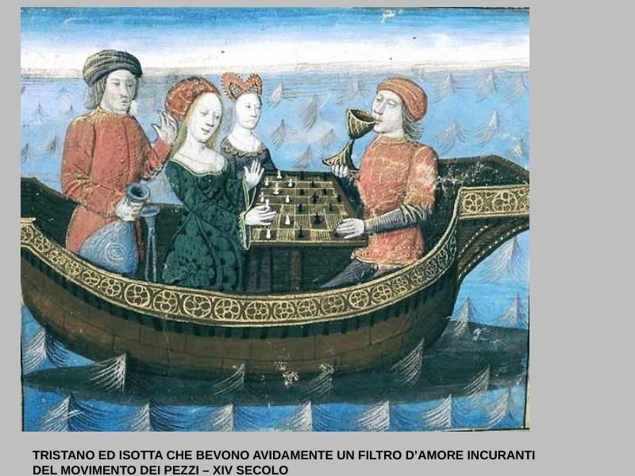{ loading=lazy style="width:39%" }

0:29:08

Ma comunque erano strette davvero le navi di un tempo. Uno dei problemi più importanti, sapete qual era? Capire come facevano a portare i cavalli. Pensate ai crociati, che si sono portati i cavalli in Terra Santa: uno che parte da Brindisi e va al porto di Tiro su una nave del genere, con il cavallo, una cosa incredibile. Il cavallo, immaginate, sul ponte non ci poteva stare: doveva stare nella stiva; la stiva non è che fosse molto alta, ma il cavallo c’entrava, nella punta, secondo le navi. Però bisognava stare attenti, perché se trovava un po’ di mare si sarebbe rotto le gambe, povera bestia: come faceva a stare in piedi? Allora lo sospendevano con due cinghie e lo legavano alla travatura del ponte superiore. Per cui queste bestie (ecco il cavallo ondulato, ondulato non per l’onda del mare) arrivavano in condizioni pietose; comunque in condizioni pietose arrivavano anche i pellegrini.

0:30:44

Beh, eccoci: allora torniamo. Come vedete, ci sono Tristano e Isotta; portano il filtro, bevono, e a quel punto si innamorano perdutamente, perché contro il filtro non c’è niente da fare: a sua volta è la magia, e da quel momento in poi nessuna forza umana riuscirà a separarli. Si vedono anche le onde, ci sono le ondine sotto, anche i pesci; e anche lì si diceva che da allora si pescano le sardine, perché il resto del filtro buttato in mare ha fatto sì che i pesci si innamorassero talmente che ci sono i più bei banchi di sardine di tutto il nord Atlantico.

0:31:32

Insomma, il gioco degli scacchi è la trasposizione di che cosa? Dell’immagine. Noi immaginiamo come dovrebbe andare il mondo, e il gioco degli scacchi ci consente di prevedere questo futuro. Perché? Perché mantiene fisse le regole: ciò che avviene, avviene secondo le regole. Quindi anticipiamo le possibili mosse dell’avversario; non sappiamo naturalmente quali saranno, non sappiamo quale sarà il futuro, quindi c’è un salto che ci porta verso il futuro; ma non è un salto nell’ignoto, è un salto in qualcosa che muta (non è detto che sia com’è), però muta all’interno di regole. E questo è anche ciò che comanda ordinariamente il nostro modo di fare esperienza. Quindi nel gioco, e nel gioco degli scacchi in particolare, è racchiusa questa idea profonda di rendere simbolicamente anche, in generale, quella che è la nostra esperienza.

0:33:08

Un minuto, poi riprendiamo il discorso su questa trasposizione simbolica, che mi sembra un argomento importante, perché non solo è alla base del gioco, ma è anche alla base di tutto ciò che è ludico. Pensate alla differenza fra come giocano gli animali e come giocano gli uomini: anche gli animali giocano, ma è un dare, come dire, espressione a quello che è il loro impulso istintivo. Gli uomini invece giocano, anche quando sono piccoli, con trasposizione immaginativa: giocano anticipando ciò che deve succedere.

0:34:19

Per cui, se avete messo in qualche punto inaccessibile qualche cosa che vostro figlio piccolo vuole, perché non vi va che vada a giocare con la ceramica di Sèvres che vi ha regalato la zia Carlotta per patrimonio (perché non si sa bene che fine farà la ceramica), allora l’avete messa in alto; però lui ha una trasposizione immaginativa. Se qualche volta avete fatto attenzione, vedete che lui va nell’ingresso, prende l’ombrello, sale sulla sedia, sale su un pezzo di mobile, aggancia la ceramica di Sèvres e la prende: ha una trasposizione immaginativa, un atto di grande intelligenza umana. Uno dice: «È una canagliata, e ora deve essere punito, perché non ne deve fare». No: è un raffinato atto di trasposizione immaginativa e di grande intelligenza. Beh, facciamo intervallo, poi riprendiamo il discorso.

\[PAUSA\]
{: .nota }

0:39:03

Paolo Marcucci Allora, passiamo a qualche curiosità sugli scacchi, legate questa volta alla letteratura. Immaginate tutti che la letteratura in materia è vastissima: non è semplice andare a trovare qualche elemento che ci faccia da sentiero nell’argomento di stasera, anche perché, come abbiamo detto più volte, quella degli scacchi è una guerra simulata, e quindi la metafora incessante dell’universo che si ripete. Montale, Dante, Cervantes: mi sembra che oggi sia l’anniversario della morte di Cervantes…

**LA LETTERATURA NEGLI/DEGLI SCACCHI**

La letteratura in materia è sconfinata e quasi impossibile da elencare (Montale, Dante, Cervantes, Goethe…).

La battaglia simulata sulla scacchiera non è soltanto una guerra tra eserciti contrapposti, ma è interpretata come la metafora della dialettica incessante dell’universo.

L’eterna contesa tra la vita e la morte, la lotta dell’uomo contro se stesso, il conscio e l’inconscio, la cui disputa mina l’integrità dell’individuo nella sua essenza con la minaccia della follia.

Forse nessun altro gioco al mondo vede una compenetrazione di scienza e filosofia, matematica e poesia, estetica e psicologia, logica e arte come questo.

Ed è forse proprio questo, insieme all’alone di mistero e leggenda che avvolge le sue origini, il motivo dell’interesse che il gioco ha suscitato in filosofi, artisti, scrittori e poeti di culture e tempi così diversi tra loro, tutti accomunati dalla seduzione e dal mistero che su di essi esercita il mondo degli scacchi.

0:40:00

E quindi forse è proprio il gioco che si presta a essere narrato in letteratura, ma anche nella scienza, nella filosofia, comunque in tutte le discipline intellettuali e umane. Stasera vedremo tre autori, un piccolo focus su tre autori: Edgar Allan Poe, Italo Calvino e Borges. Vediamo intanto come va la parola «scacchi»: dall’ultima volta mi sono fissato con questo motore di ricerca di Google, che mi piace un sacco, e ho cercato la parola «scacchi» appunto tra il 1800 e il 2000, in lingua italiana. Vedete un picco particolare intorno al 1830; poi è stata piuttosto bassa, per risalire invece negli ultimi anni, tornando a un livello molto alto come nel 1830. In lingua inglese invece è stata un po’ più costante, e negli ultimi anni è molto più alta rispetto alla lingua italiana: quindi la letteratura in materia in lingua inglese è un po’ più costante rispetto a quella italiana.

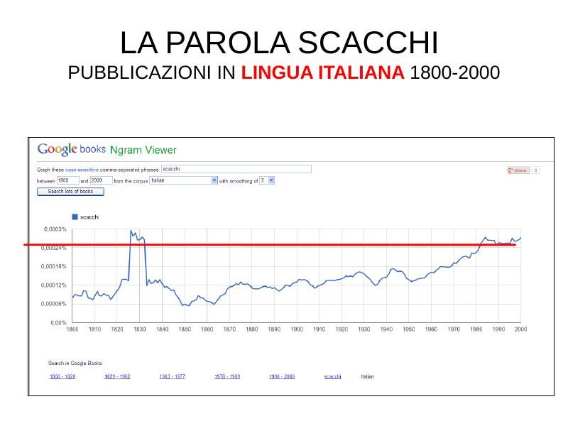{ loading=lazy style="width:47%" }

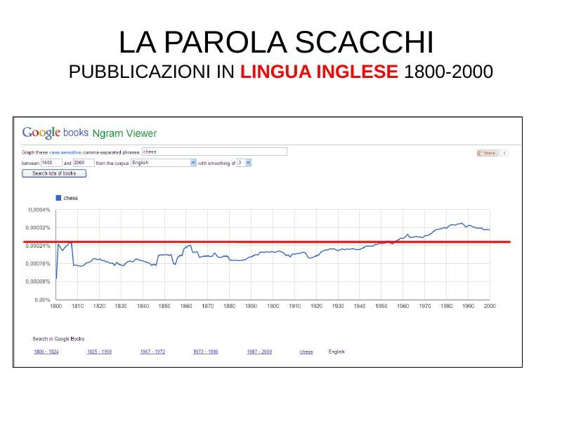{ loading=lazy style="width:47%" }

0:41:27

Vediamo, interessante, Edgar Allan Poe: *Il giocatore di scacchi di Maelzel*. È un saggio breve di Edgar Allan Poe dove in realtà, per chi l’avesse letto, il giocatore non è un uomo, ma un automa: c’è una macchina, perché si trattava di un celebre marchingegno che aveva inventato von Kempelen, che lo adoperò a scopo di lucro, per truffare il pubblico che giocava con questa macchina. Questa era la macchina originaria: in realtà, se vedete nella figura, dentro ci stava un uomo. Fu presentata la prima volta nel 1770 alla corte di Maria Teresa d’Austria, e dentro appunto c’era quest’uomo che giocava a scacchi. Infatti la macchina prese originariamente il nome di Il Turco, perché c’era questo turco che dirigeva le partite.

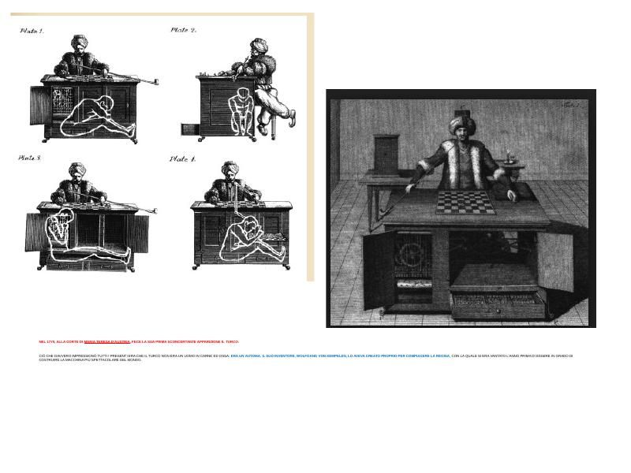{ loading=lazy style="width:59%" }

**EDGAR ALLAN POE – *IL GIOCATORE DI SCACCHI DI MAELZEL**

*Il giocatore di scacchi* di Maelzel è un saggio breve del grande scrittore americano, Edgar Allan Poe.

Il giocatore di scacchi in questione, com’è suggerito dal titolo, non è un uomo, bensì un automa.

Si trattava del celebre marchingegno inventato dal tedesco von Kempelen, poi comprato e revisionato da Maelzel, che lo adoperò a scopo di lucro, tenendo incontri con il pubblico, chiamato a sfidare la macchina.

Nel 1770, alla corte di Maria Teresa d’Austria, fece la sua prima sconcertante apparizione il Turco.

Ciò che davvero impressionò tutti i presenti era che il Turco non era un uomo in carne e ossa: era un automa. Il suo inventore, Wolfgang von Kempelen, lo aveva creato proprio per compiacere la regina, con la quale si era vantato l’anno prima di essere in grado di costruire la macchina più spettacolare del mondo.

0:42:39

E quindi anche Edgar Allan Poe ha subito il fascino di questa figura, di questa rappresentazione; anche perché nel rapporto dell’uomo con la macchina c’è sempre stata questa idea di una macchina che possa sconfiggere l’intelletto umano, e questa era proprio la raffigurazione centrale di questa idea. Infatti ebbe un successo enorme in tutte le corti europee: pensate che anche Napoleone volle sfidare questa macchina, e tra l’altro perse. Quindi il rapporto, la sfida di una macchina contro l’uomo è sempre stato un terreno fertile, soprattutto forse in Europa, dove l’Illuminismo ha avuto origine.

**EDGAR ALLAN POE – *IL GIOCATORE DI SCACCHI DI MAELZEL**

Gli scacchi sono sempre stati diffusissimi in Occidente, e rappresentano la ragione incarnata nel gioco. Il loro fascino ha sempre suscitato viaggi nella fantasia, speculazioni filosofiche, indagini scientifiche e così, da sempre.

L’idea, che una macchina potesse giocare (e trionfare) nel gioco occidentale-razionale per eccellenza, ha sempre avuto un’enorme potenza.

Se l’uomo avesse costruito una macchina capace di vincere contro i campioni nel nobil gioco, cos’altro ancora rimaneva fuori della portata della potenza umana, sua e delle sue macchine?

*Il giocatore di scacchi* di Maelzel ebbe un enorme successo addirittura tra i sovrani. Si sa che illustri uomini hanno sfidato “la macchina” e hanno perso: Napoleone è il più celebre di questi.

Questo ci rimanda a un altro episodio famoso nella storia recente: la sfida tra un computer e uno scacchista umano.

Il più famoso forse fu appunto quello con Kasparov.

0:43:36

Questo ci fa andare, facendo un salto, alla sfida famosa degli anni Novanta di Kasparov con il computer IBM: questo era vero davvero, mentre la macchina di prima naturalmente non lo era. Le sfide iniziarono appunto negli anni ’70 con i primi computer, ma quella forse più famosa fu quella con Deep Blue (si chiamava così questa macchina): la prima partita la vinse Kasparov, invece nella rivincita vinse il computer, perché aveva una sterminata mole di partite, con tutte le varianti possibili e immaginabili, e l’uomo non ce la fece a superare la macchina.

**INCONTRI DI SCACCHI TRA UOMO E COMPUTER**

Il primo computer in grado di sconfiggere un giocatore umano in condizioni regolamentari è stato Deep Thought.

La macchina, progettata dall’informatico cinese della IBM Feng-Hsiung Hsu, ha battuto lo scacchista David Levy nel 1989, vincendo una sfida lanciata da quest’ultimo per stimolare lo sviluppo dei computer scacchistici, che consisteva nel trovare un computer capace di batterlo in un match di quattro o sei partite.

Deep Thought è stato quindi il primo motore scacchistico a competere ufficialmente al livello di un GM umano. Lo stesso anno Deep Thought ha affrontato Garry Kasparov, dal quale è stato sconfitto con un secco 2-0.

Ma Kasparov è ricordato soprattutto per un altro incontro ufficiale, contro il computer IBM Deep Blue, disputato nel 1996, quando il giocatore russo era campione del mondo in carica e primo nella classifica Elo della FIDE.

Fece scalpore la vittoria di Deep Blue nella prima partita, ma Kasparov si aggiudicò la sfida con 3 vittorie e 2 patte.

La rivincita, un match di sei partite disputato l’anno successivo, venne decisa nella determinante ultima partita, vinta dal calcolatore che si aggiudica dunque l’incontro per 3,5-2,5.

Il computer fu successivamente ritirato dall’IBM, rifiutando la richiesta di rivincita di Kasparov.

0:44:28

Calvino e gli scacchi: anche Calvino è stato molto influenzato dagli scacchi. Nel libro *Le città invisibili*, un racconto di città del 1972, l’autore raffigura una grande scacchiera, dove Marco Polo, che correva frequentemente, veniva trattenuto da Kublai Khan a giocare interminabili partite a scacchi: esercizio, dice Calvino, più rischioso di una vertigine. Quindi immaginatevi questa immagine di una grande scacchiera dove Marco Polo giocava a scacchi con Kublai Khan. Da dove veniva questa cosa? Veniva da una simbologia massonica. Ovviamente gli scacchi, le tessere, il pavimento che nasce in questa narrazione di Calvino, erano stati catturati nella mente di Calvino nella casa del nonno, Gio Bernardo, dove sui muri erano affrescati i simboli dell’arte massonica.

**CALVINO E GLI SCACCHI**

La simbologia massonica nei racconti di Calvino:

Nel libro *Le città invisibili*, racconto di città inventate pubblicato nel novembre del 1972 dall’editore Einaudi, l’opera più borgesiana di Italo Calvino.

L’autore raffigura una grande scacchiera dove Marco Polo veniva trattenuto da Kublai Khan “a giocare interminabili partite a scacchi (…) esercizio più rischioso di una vertigine”.

La simbologia massonica nei racconti di Calvino:

Il tessellated pavement, il pavimento a scacchi bianchi e neri che emerge nella narrazione di Calvino, è una figura catturata nella casa del nonno Gio Bernardo dove erano stati affrescati sui muri i simboli dell’arte massonica, utilizzata nel racconto (con la capacità di chi ha penetrato il segno).

Calvino, infatti, porta il lettore verso un’atmosfera rarefatta, irreale: “Kublai era arrivato all’operazione estrema: la conquista definitiva, di cui i multiformi tesori dell’impero non erano che involucri illusori, si riduceva a un tassello di legno piallato: il nulla”.

Quando l’operazione di estrema riduzione del Khan viene compiuta, ecco Marco Polo, l’iniziato, che con colpo da maestro ribalta la situazione, riportandola dal negativo al positivo, al concreto, in definitiva al “mondo”: “La sua scacchiera sire è un intarsio di due legni: ebano e acero. Il tassello sul quale si fissa il tuo sguardo illuminato fu tagliato in uno strato del tronco che crebbe in un anno di siccità: vedi come si dispongono le fibre? Qui si scorge un nodo appena accennato: una gemma tentò di spuntare in un giorno di primavera precoce, ma la brina della notte l’obbligò a desistere.”

0:45:39

E l’arte massonica ci rimanda appunto agli scacchi. Notre-Dame de Paris (torniamo alle cattedrali) sembra costruita dai cavalieri templari, che sono un po’ gli antenati spirituali dei massoni; e sembra che gli scacchi fossero l’unico gioco a cui i cavalieri erano autorizzati a dedicarsi. Questa è Notre-Dame, con la scacchiera del pavimento. Qui si ritorna a un libro sui giochi, il *Libro de los juegos* spagnolo, del monastero dell’Escorial, come abbiamo detto: vedete, ci sono i due templari che giocano a scacchi, in questa raffigurazione del 1283. Quindi andiamo nella notte dei tempi.

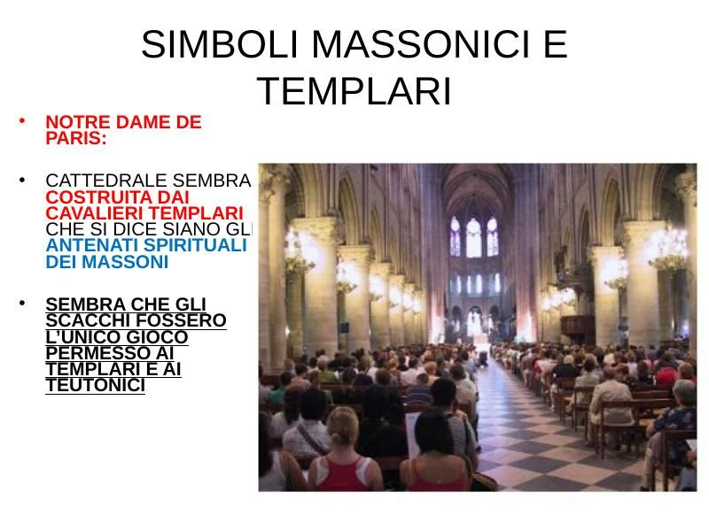{ loading=lazy style="width:47%" }

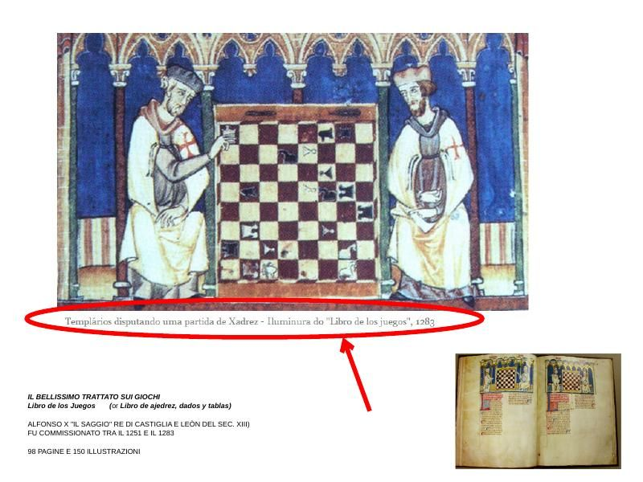{ loading=lazy style="width:47%" }

**SIMBOLI MASSONICI E TEMPLARI**

Notre-Dame de Paris: la cattedrale sembra costruita dai cavalieri templari che si dice siano gli antenati spirituali dei massoni.

Sembra che gli scacchi fossero l’unico gioco permesso ai templari e ai teutonici.

Il bellissimo trattato sui giochi, *Libro de los juegos* (o Libro de ajedrez, dados y tablas, di Alfonso X «il Saggio», re di Castiglia e León del sec. XIII) fu commissionato tra il 1251 e il 1283. Esso è composto da 98 pagine e 150 illustrazioni.

0:46:38

Borges: Borges forse è l’autore di letteratura fantastica più importante di tutti i tempi, e quindi gli scacchi non potevano non avere un ruolo preminente nella sua letteratura. In Borges (se qualcuno ha letto qualcosa) la biblioteca, il labirinto, gli specchi, gli scacchi sono tutte immagini, pezzi di rappresentazione della realtà che sono sempre al confine tra la realtà e la finzione. L’autore stesso, in un prologo a *L’oro delle tigri*, del 1972, dice che il lettore noterà l’inquietudine filosofica che gli appartiene dall’infanzia, da quando suo padre gli rivelò, con l’ausilio di una scacchiera (che era, ricorda, di cedro), la corsa di Achille e della tartaruga. Anche in casa Borges era stato introdotto dal padre a questo mondo al limite tra la realtà e il fantastico, dilatando all’infinito questo modo di sentire la realtà.

**BORGES E GLI SCACCHI\**

Ma in letteratura forse ce n’è uno in particolare di scrittori, che più degli altri coglie le caratteristiche filosofiche degli scacchi e li erge a privilegiato simbolo del suo mondo letterario e sistema filosofico.

Jorge Luis Borges, scrittore, saggista e poeta, genio della letteratura fantastico-realistica argentina, tra i più grandi e conosciuti scrittori latino-americani di tutti i tempi.

\* Mauro Ruggiero, 2005

Nato a Buenos Aires nel 1899, nella sua opera Borges crea un mondo sospeso tra la realtà e la finzione, ricco di suggestioni visionarie che hanno influenzato tutta la successiva tradizione postmoderna.

Il suo sistema filosofico è ricco di simboli: la biblioteca, il labirinto, gli specchi, gli scacchi… Rappresentano la realtà e il sogno, il tempo e lo spazio di un universo il cui carattere allucinatorio è sostanza di un mondo a metà strada tra il possibile e l’impossibile e la cui realtà non è scindibile dal paradosso.

Di tutti questi simboli di cui è ricca la poetica dell’autore, ci limiteremo ad analizzarne uno in particolare, gli scacchi.

In Borges, come nei più grandi scrittori, l’antico e il nuovo convivono armoniosamente compenetrando tutta la sua arte; un’arte che rivela i segreti del conscio e dell’inconscio, capace di farsi espressione dei sentimenti di inquietudine profonda celati nell’animo dell’individuo e riportarli ad uno stato di coscienza nel labirinto di specchi sul pavimento a scacchiera dell’esistenza.

È l’autore stesso che nel prologo a L’oro delle tigri del 1972 dice: «Il mio lettore noterà in alcune pagine l’inquietudine filosofica. Mi appartiene dall’infanzia, da quando mio padre mi rivelò, con l’ausilio di una scacchiera (che era, ricordo, di cedro) la corsa di Achille e della tartaruga».

Da questo passo risulta evidente il profondo significato filosofico che Borges attribuisce agli scacchi che si elevano molto oltre il loro stato di semplice gioco.

Il gioco degli scacchi si carica, per Borges, di significati mistici la cui simbologia diventa complessa e multiforme dilatando all’infinito il campo semantico di riferimento.

Nell’opera borgesiana, la vita stessa è un’interminabile partita a scacchi.

Le indeterminate e imprevedibili possibilità non indicano un libero arbitrio da parte degli uomini ma il loro essere assoggettati ad una volontà superiore incarnata da Dio o dal destino.

Dio, o destino, il cui arbitrio è, forse, a sua volta, condizionato dall’imperscrutabile volere di un altro dio, in un diabolico gioco di scatole cinesi la cui causa prima nella successione causale rimane sconosciuta.

Come le azioni umane, anche le mosse possibili su una scacchiera, così come i libri contenuti nella biblioteca di Babele, uno tra i suoi racconti più conosciuti (Ficciones, 1944), sono come gli atomi del mondo e le loro possibili permutazioni; di un numero smisurato, certo, ma pur sempre finito.

Il carattere paradossale dell’eternità e dell’infinito, ben si adatta, secondo Borges alle caratteristiche del gioco degli scacchi.

Profondo conoscitore della letteratura orientale dalla Cina agli arabi, lo scrittore argentino gioca con le cifre arcane di una mitologia simbolica e letteraria.

Qui gli scacchi rappresentano l’imprecisata dilatazione dello spazio e del tempo e le infinite e paradossali dimensioni della realtà, come risulta dalla lettura delle due poesie dal titolo appunto, *Ajedrez* (scacchi).

0:48:08

L’opera borgesiana è un’interminabile partita a scacchi, e anche il libero arbitrio degli uomini viene messo in discussione in un castello incrociato dove le realtà si sovrappongono l’una all’altra: il Dio, o il destino, che è a sua volta condizionato dal volere di un altro Dio. Questa è un po’ l’immagine che crea Borges. E quindi lui, grande conoscitore della letteratura mondiale, e in particolare di quella orientale, sa che gli scacchi provengono dall’estremo est, e questa rappresentazione la mette, oltre che nella prosa, anche in delle poesie.

0:48:08

\[Legge in traduzione italiana la prima delle due poesie di Borges intitolate «Scacchi» (i giocatori, i pezzi, la guerra nata in Oriente che continuerà anche dopo di loro).\]
{: .nota }

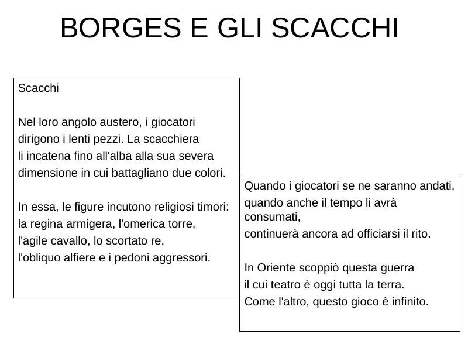{ loading=lazy style="width:59%" }

0:50:00

Quindi la scacchiera vive di vita propria, indipendentemente dai giocatori che la animano. E infatti i giocatori sono burattini, i cui burattinai sono gli scacchi: rovescia un po’ l’idea che sia il giocatore a muovere; in questo caso fa il contrario. Infatti, rifacendosi all’Oriente, dice che alcune leggende vogliono che il gioco sia antico quanto l’umanità, e che il suo inventore sia stato addirittura Adamo; altre, secondo cui gli scacchi sono ancora più antichi dell’umanità stessa, cioè sono gli scacchi che generano l’umanità stessa.

0:50:00

\[Legge la seconda poesia di Borges sugli scacchi (i pezzi che combattono senza sapere che la mano del giocatore dispone del loro destino, e il giocatore a sua volta mosso da un Dio, con il riferimento alla sentenza di Omar).\]
{: .nota }

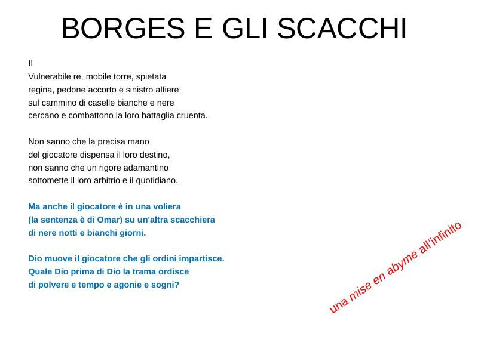{ loading=lazy style="width:59%" }

**BORGES E GLI SCACCHI**

La dimensione della scacchiera sembra uscire dal quadrato delle 64 caselle per dilatarsi all’infinito in una prigione senza confini in cui i giocatori sono prigionieri costretti a movimenti meccanici dal volere stesso dei pezzi eterni protagonisti di una battaglia di forze opposte che continuerà anche quando il tempo avrà avuto la meglio sulla loro vita di umani.

I giocatori sono burattini i cui burattinai sono gli scacchi.

In questa poesia, Borges, oltre a sintetizzare alcuni tra i problemi fondamentali del pensiero occidentale di cui è figlio, dal tema medievale della libertà umana all’incubo di Cartesio, si dimostra conoscitore delle leggende sull’origine del gioco alcune delle quali vogliono che esso sia antico quanto l’umanità e il cui inventore sia stato addirittura Adamo, o altre secondo cui gli scacchi sono ancora più antichi dell’umanità stessa.

Interessante è notare che mai, in questa eterna battaglia, nessuno dei due colori ha la meglio sull’altro. In perfetto stile con la filosofia taoista ed eraclitea, Borges crede che i principi opposti siano l’uno dipendente dall’altro e che quindi, non è concepibile che uno possa prevalere sull’altro.

Ma anche il giocatore è prigioniero, su un’altra scacchiera, quella del volere di una divinità che ne limita l’arbitrio e ne determina il destino, come diceva il poeta persiano del XII sec. Omar Khayyam: «Noi siamo i pedoni della misteriosa partita a scacchi giocata da Dio. Egli ci sposta, ci ferma, ci respinge, poi ci getta uno a uno nella scatola del nulla».

A questo punto il tema centrale della poesia si manifesta con una domanda che insinua un dubbio e che non avrà risposta; una domanda in cui confluiscono i grandi temi della filosofia, della religione e della poesia stessa.

Chi è il Dio che prima di Dio dà inizio alla trama? Chi è cioè il giocatore che gioca a scacchi con Dio stesso e la cui scacchiera è l’universo?

Borges raffigura in questa lirica l’intero universo come una serie indefinita di scacchiere contenuta l’una nell’altra e i cui pezzi sono a loro volta burattini e burattinai di un’altra partita.

L’ultima strofa del II sonetto si ricollega all’ultima strofa del primo, dove il mondo è una scacchiera, soggetta a rigide regole, e in cui realtà e gioco si confondono fino a diventare la stessa cosa.

Nel saggio Il fiore di Coleridge, parlando della previsione della profetessa Edda Saemundi, si dice che gli dei, al loro ritorno, dopo la ciclica battaglia in cui la nostra terra perirà, scopriranno abbandonati sull’erba di un nuovo prato, i pezzi degli scacchi con cui stavano giocando prima.

0:51:43

Vedete, è sostanzialmente un rimando all’infinito, non ha fine: e questa è la bellezza di Borges che tratta appunto gli scacchi. Aspettando la pasta, allora…

0:52:01

Lorenzo Poggi Gli spunti in campo sono sicuramente interessanti. Abbiamo intanto il primo punto: se le regole sono quelle, e le mosse sono prevedibili, tanto che un computer oggi può conoscere infinite possibilità di mosse, da dove viene la creatività? Da dove viene il nuovo, e che carattere ha il nuovo, se è proprio dell’umanità innovare, trasformare, pur seguendo le regole? Questo Dio che Borges rammentava, che è sopra tutti e che addirittura comanda il giocatore, che cos’è se non una qualche norma, una qualche regola, come la regola del gioco, che stabilisce un rapporto tra il passato e il futuro? È questo gioco immaginativo, dicevamo, che a partire da ciò che conosciamo del passato ci permette di lanciare la nostra immaginazione verso il futuro: un futuro che diventa inatteso, perché può essere diverso da quello che avevamo immaginato, ma non imprevedibile, non del tutto fuori dalla prevedibilità. Questo tenteremo di approfondirlo poi, perché è il legame profondo che lega il gioco degli scacchi ma anche il nostro modo di rapportarci alla realtà e di conoscere.

0:54:12

C’è un altro aspetto del discorso di Paolo che è veramente interessante: il discorso sempre legato al bianco e al nero, l’alternarsi del positivo e del negativo, che costituisce la scacchiera ma che è simbolo della nostra natura, che ha insieme caratteri positivi e negativi, a seconda di ciò che lanciamo verso il futuro come immaginazione, ma che devono essere comunque tutti equilibrati fra loro. Parlavamo prima di acqua, terra e fuoco, dei quattro elementi, e poi dei quattro umori che costituiscono l’uomo. I quattro elementi e i quattro umori devono essere equilibrati fra loro: non può l’uno sopprimere l’altro o prevalere sull’altro. Se prevale l’elemento fuoco, o il sangue, si dice che quello ha un temperamento sanguigno (si dice ancora oggi, pensate, da Aristotele in poi), o focoso; se invece prevale, dicevamo, la bile nera, è melanconico, e prevale in lui invece il sentimento di pesantezza saturnino.

0:55:46

E poi si lega anche alle costellazioni, al cielo, alla terra e alla forma geometrica del quadrato, perché la terra è quadrata, è cubo; e quindi geometria, equilibrio. Ecco perché percorrere la scacchiera è simbolicamente percorrere passo passo i gradini che ci portano verso la trascendenza, verso l’esaminare noi stessi. Riprendiamo dopo il discorso, perché penso che sia pronto il risotto.

\[PAUSA\]
{: .nota }

1:12:31

Paolo Marcucci Sì, sì. Allora approfittiamo che abbiamo stasera con noi Daniele, un artigiano di Montelupo, produttore di ceramica, che in occasione di stasera ha portato questa scacchiera di ceramica, veramente bella, che tra l’altro ha una storia particolare: se la faccio raccontare direttamente a Daniele…

1:13:07

Daniele Questa è nata in una maniera abbastanza strana, perché la forgiatura è stata fatta insieme a Franco Rienzo, che, facendo un passo indietro, è uscita dal forno alle 10 di mattina, e alle 4 di mattina lui era morto: quindi non ha avuto nemmeno la soddisfazione di vederla finita. È stata realizzata in un periodo in cui lui stava già male. E non si sapeva come fare a distinguere i pezzi, perché siamo due ignoranti: allora, invece di fare bianco e nero, si sono fatti gli africani e gli europei. È molto semplice: gli alfieri sono delle giraffe, le torri sono delle capanne, per quanto riguarda gli africani; poi la regina ha il seno scoperto, ed è coperta nelle parti più in basso; poi ci sono i cavalli, che sono delle zebre.

1:14:29

Non so se è stato il momento di sistemare tutto… però insomma sono riuscito a fare questa cosa. È stata fatta insieme a un grande modellatore, un amico con cui ci si capiva con un battito di ciglia, veramente; quindi è nata non perché c’è un traguardo, un mazzo di fiori, ma per me e per lui, e basta. E poi lui non è riuscito a vederla finita. Era anche un grande maestro: me lo ricorderò sempre, ci si capiva molto bene. Per il resto dei pezzi è stato fatto un sistema di decorazione a bassorilievo, con uno smalto molto massiccio per l’impugnatura degli oggetti, che staticamente regge abbastanza: la ceramica non è che se la volti si rompe. Quindi, se la volete… no, scherzo: questa volta l’ho portata, però non l’ho fatta per voi, né per nessuno: l’ho fatta per me e per lui, e basta.

1:16:33

Paolo Marcucci Questa scacchiera ci introduce un po’ in quest’altra parte che riguarda gli scacchi, un percorso che ci porta all’avanguardia dell’arte contemporanea, nel quale questa sicuramente ci sta benissimo; e vedrete che, nel solco delle rappresentazioni artistiche che sono state fatte della scacchiera, un esperimento come questo è veramente degno di nota. Facciamo appunto un breve viaggio nel modo in cui sono stati rappresentati nell’arte la scacchiera e gli scacchi; e poi vedremo un focus particolare che si aggancia agli anni Quaranta in America, dove ci fu un gruppo di intellettuali, prevalentemente europei, che si dedicarono in maniera particolare a questo gioco.

**GLI SCACCHI NEL TEMPO: DALLA TRADIZIONE ALL’AVANGUARDIA**

Vediamo ora un breve percorso storico per vedere l’evoluzione stilistica della rappresentazione degli scacchi e dell’arte con un focus sull’avanguardia, in particolare tra il 1940 e il 1950, dove la modernità getta le basi che ancora oggi reggono.

Vedremo un caso, filosofico e artistico, dove a New York nel 1944 (quando l’Europa è sotto la tragedia immane della guerra) un gruppo di artisti si confronta nel gioco degli scacchi e nella sua rappresentazione grafica.

1:17:43

In Italia, per esempio, le rappresentazioni più antiche sono come questa: un mosaico pavimentale della basilica di San Savino a Piacenza, che risale all’XI secolo. Facciamo un breve salto per vedere il percorso della rappresentazione degli scacchi nel corso dei secoli. Qui siamo nel 1320: il re Otto di Brandeburgo è impegnato su una singolare scacchiera con un avversario (gli artisti non sempre rappresentavano bene le dimensioni reali); è rappresentato nel Codice Manesse (1300-1340 circa), conservato alla biblioteca universitaria di Heidelberg. Questo è interessante, perché dal 1300 andiamo al 1500: sono gli scacchi di Leonardo. Questi scacchi sono disegnati da Leonardo.

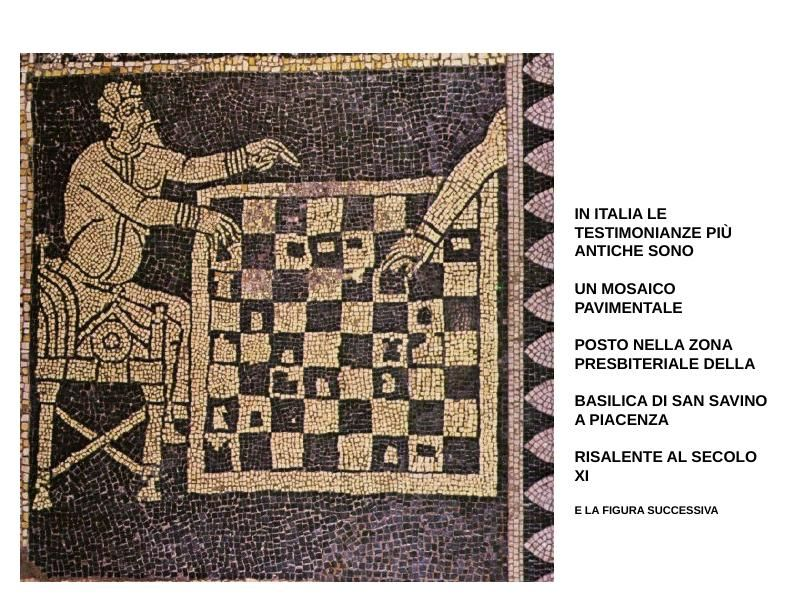{ loading=lazy style="width:47%" }

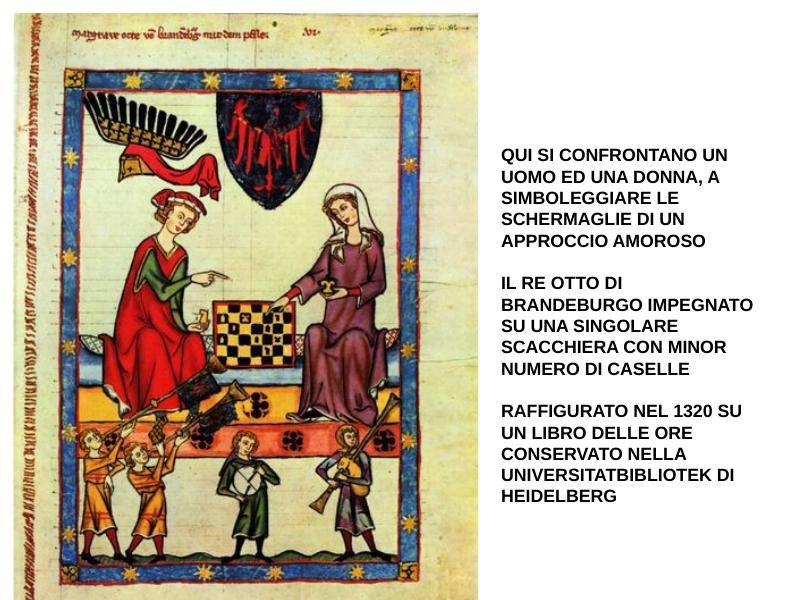{ loading=lazy style="width:47%" }

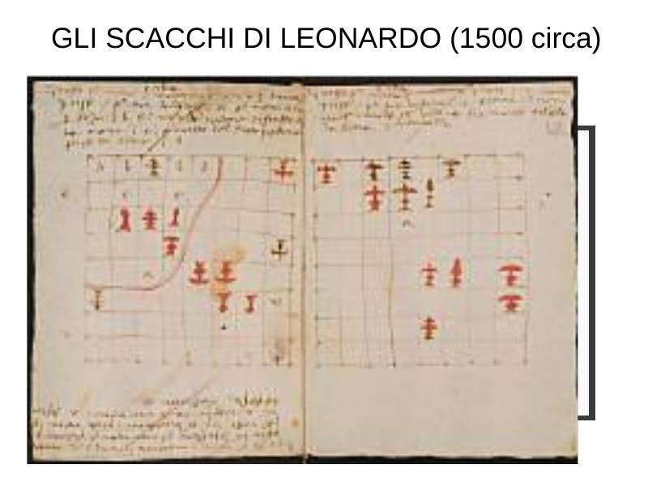{ loading=lazy style="width:59%" }

In Italia le testimonianze più antiche sono un mosaico pavimentale posto nella zona presbiteriale della basilica di San Savino a Piacenza, risalente al secolo XI, e la figura successiva.

Qui si confrontano un uomo e una donna, a simboleggiare le schermaglie di un approccio amoroso: il margravio Otto di Brandeburgo, impegnato su una singolare scacchiera con un minor numero di caselle, raffigurato nel Codice Manesse (1300-1340 circa), conservato nella Universitätsbibliothek di Heidelberg.

1:18:52

Lorenzo Poggi Volevo dire una cosa: visto che parliamo degli scacchi di Leonardo, c’è anche, non proprio degli scacchi, ma della scacchiera, la dama di Bacco; qualcuno di voi l’avrà vista. Un artista fiorentino, purtroppo scomparso, mio carissimo amico, Mario Mariotti, imitando un disegno leonardesco del Codice Atlantico, ridisegnò una scacchiera in legno, con i due sedili, il tavolino e una copertura di tela, dove si giocava con i gotti di vino rosso e bianco. Si gioca alla dama, non agli scacchi, e chi vince mangia, cioè beve; ho l’illusione della pescella, per cui con la dama di Bacco sono stato…

1:20:00

Sono state fatte delle gare: una venne disputata qualche anno fa nella piazzetta sottostante il Museo Leonardiano, a Vinci, portando questo modello della dama di Bacco fatto da Mario Mariotti; e naturalmente non vinceva tanto chi era più bravo come giocatore, ma chi reggeva meglio la vittoria. Reggere una sconfitta è dura, ma reggere una vittoria è ancora più dura, se si giocano i bicchieri di vino.

1:20:36

Paolo Marcucci Leonardo, sapete (l’abbiamo trovato anche in altre occasioni), era grande amico di fra Luca Pacioli, che in quegli anni, intorno al 1500, fece questo trattato, *De ludo scachorum*, che fu perso per oltre cinque secoli ed è stato ritrovato nel 2006 a Gorizia, in un archivio del conte Coronini. Questo *De ludo scachorum* fu illustrato appunto da Leonardo: «*De ludo scachorum*, appellato da fra Luca Pacioli, ovvero Schifanoia». Schifanoia (qui a Montelupo c’è anche la galleria sulla strada statale) voleva dire «per schivare la noia», cioè sostanzialmente un passatempo.

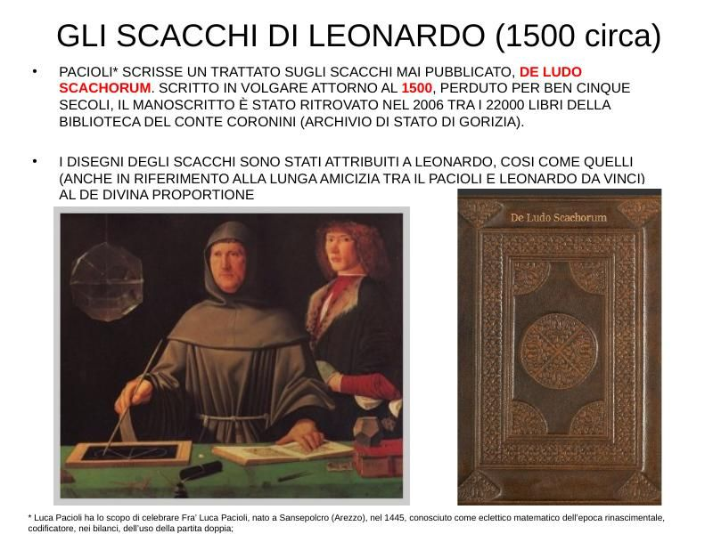{ loading=lazy style="width:47%" }

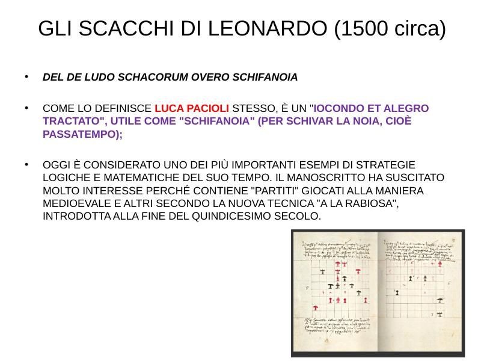{ loading=lazy style="width:47%" }

**GLI SCACCHI DI LEONARDO (1500 CIRCA)**

Pacioli\* scrisse un trattato sugli scacchi mai pubblicato, De ludo *scachorum*. Scritto in volgare attorno al 1500, perduto per ben cinque secoli, il manoscritto è stato ritrovato nel 2006 tra i 22.000 libri della biblioteca del conte Coronini (Archivio di Stato di Gorizia).

I disegni degli scacchi sono stati attribuiti a Leonardo, così come quelli (anche in riferimento alla lunga amicizia tra il Pacioli e Leonardo da Vinci) al *De divina proportione*.

\* Luca Pacioli ha lo scopo di celebrare fra’ Luca Pacioli, nato a Sansepolcro (Arezzo), nel 1445, conosciuto come eclettico matematico dell’epoca rinascimentale, codificatore, nei bilanci, dell’uso della partita doppia.

*Del De ludo scachorum overo Schifanoia*, come lo definisce Luca Pacioli stesso, è un «*iocondo et alegro tractato*», utile come «schifanoia» (per schivar la noia, cioè passatempo).

Oggi è considerato uno dei più importanti esempi di strategie logiche e matematiche del suo tempo. Il manoscritto ha suscitato molto interesse perché contiene «partiti» giocati alla maniera medioevale e altri secondo la nuova tecnica «a la rabiosa», introdotta alla fine del quindicesimo secolo.

1:21:33

Questi sono altri disegni di Leonardo dal trattato di Luca Pacioli. Sembra che Leonardo fosse un giocatore di scacchi, ma non eccelso, dalle ricostruzioni che hanno fatto; però era un giocatore: infatti in un foglio, il 12692 di Windsor, ha scritto «io arrocco», la tipica mossa di quando uno è in difficoltà. Quello che è interessante di questi disegni, che si legano molto bene alla filosofia di fra Luca Pacioli, sono le proporzioni: vi ricordate, lo abbiamo affrontato diverse volte, intorno al 1500 nasce il concetto della proporzione. E questi scacchi che abbiamo visto prima hanno tutti una proporzione aurea, e quindi si inseriscono benissimo nel trattato di fra Luca Pacioli, che è appunto in Italia il costruttore della proporzione da un punto di vista teorico.

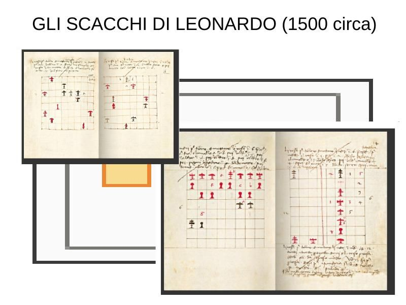{ loading=lazy style="width:59%" }

**GLI SCACCHI DI LEONARDO (1500 CIRCA)**

Pacioli di scacchi se ne intendeva. Il suo De ludo in realtà non è un manuale, ma, oggi si direbbe, una raccolta di «problemi»:

Finali di partita da risolvere con lo scacco matto in un certo numero di mosse. Ogni problema, uno schemino. Centoquaranta scacchiere, oltre millequattrocento pezzi, rossi e neri.

Leonardo era un giocatore di scacchi. Neanche lui pare fosse un fenomeno, però di sicuro conosceva le regole, sennò non avrebbe pensato come soluzione di un suo rebus (nel foglio 12692 di Windsor) l’espressione «io arrocco», mossa centrale del gioco.

La cosa interessante di questi scacchi sono le proporzioni (che li collegano al trattato principe della divina proporzione).

Le misurazioni hanno mostrato la proporzione aurea, passione e religione di Leonardo: nel rapporto fra i dischi e le aste, fra la «testa» del pedone e il suo «corpo», tra l’altezza e la base.

Alcuni critici hanno trovato alcune possibili forme ispiratrici: per esempio le «fontane di Erone» dai fogli 293r-b e 212r del Codice Atlantico, molto simili al profilo della regina. Più in generale «si nota la suggestione dei grotteschi romani appena scoperti nella Domus Aurea, che Leonardo probabilmente conosceva».

I pezzi affascinano perché sono pezzi leggeri (come sogni). I pezzi in uso all’epoca erano tozzi e squadrati, oppure erano lavori di gioielleria solo da sfoggiare.

1:22:50

Facciamo un salto: 1630, il Padovanino; questo è *Marte e Venere* che giocano a scacchi, vedete? Quindi anche in questo caso i giochi amorosi, come diceva Lorenzo, sono una costante nella pittura.

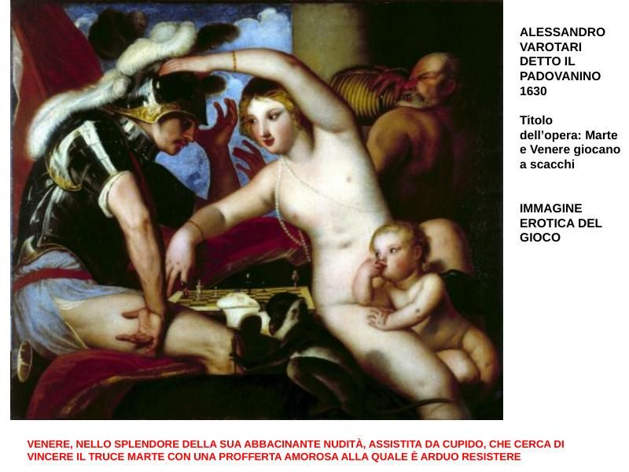{ loading=lazy style="width:44%" }

**ALESSANDRO VAROTARI DETTO IL PADOVANINO, *MARTE E VENERE GIOCANO A SCACCHI* (1630)**

Immagine erotica del gioco: Venere, nello splendore della sua abbacinante nudità, assistita da Cupido, cerca di vincere il truce Marte con una profferta amorosa alla quale è arduo resistere.

1:23:10

Lorenzo Poggi Dove c’è eros… rifaccio un attimo quello che dicevamo: dove c’è amore c’è eros, e non c’è, come dire, aggressività o possesso; allora c’è anche il bacio, c’è anche l’immaginazione, che gioca moltissimo nel legame affettivo, anche sessuale; ma è l’immaginazione, perché è sempre legata alla regola. E allora c’è eros e c’è il bacio. Quando non c’è eros, allora c’è solo istinto e possesso: ricordate, l’altra volta abbiamo parlato di Apollo e Dafne, dove Dafne è trasformata in pianta per sfuggire all’aggressione di Apollo. Non è amore, non c’è eros: c’è solo istinto, perché lui la vede, e il vedere veicola l’istinto di possesso. Vidit et incaluit: fu preso.

1:24:31

È un concetto di vedere su cui torneremo nei prossimi incontri, perché non è il nostro vedere retinico: è un vedere che è un mettere in contatto l’aura che viene dall’oggetto visto con l’aura che viene dal nostro occhio che vede (e anche in futuro c’è un discorso sugli atomi emessi dalle cose e gli atomi emessi dai nostri organi di senso). Un vedere che è un possedere: vidit, e quindi ti prende, ti impedisce di far prevalere la ragione. Quindi il gioco: perché il rapporto d’amore è tale quando l’immaginazione non è legata all’istinto, ma è guidata dalla regola, che anche qui è simboleggiata nella regola del gioco.

1:25:40

Paolo Marcucci 1863, due secoli dopo, Daumier: siamo già in un ambiente ottocentesco; «La partita» è il ritratto fatto dal pittore. Settant’anni dopo siamo già al 1937 (ho fatto brevemente questo percorso; se poi c’è tempo, in fondo c’è tutto quello che è stato tagliato nel mezzo di questa storia): nel 1937 vedete già la modernità che è apparsa sulla tela. Questo è Paul Klee, *Überschach* (Super-scacchi), con una scomposizione: la scacchiera non si sa nemmeno che contorni abbia, è indefinita; le posizioni degli scacchi sono strane; c’è una struttura che sostanzialmente non è una struttura. Enrico Baj, scacchiera del 1939, tutta in legno: vedete, ci si avvicina già a pezzi come questi che abbiamo visto prima.

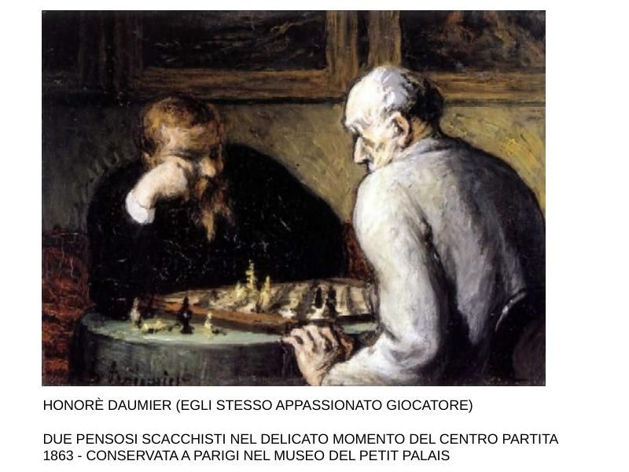{ loading=lazy style="width:47%" }

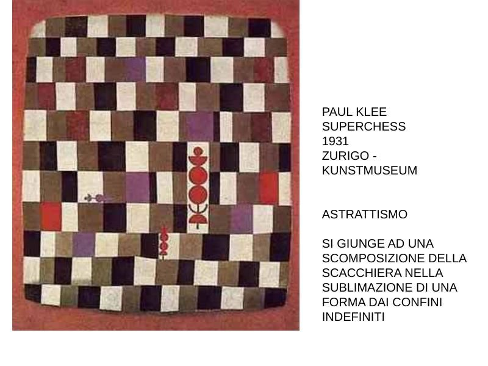{ loading=lazy style="width:47%" }

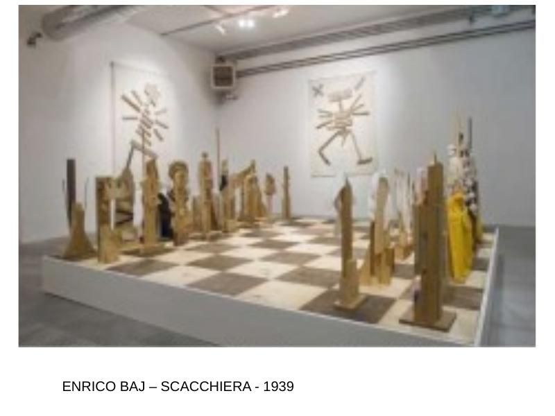{ loading=lazy style="width:59%" }

1:27:05

Quello che è interessante, nel 1942, è il cambio stilistico rispetto a queste strutture qua: 1942, Karl Truppe, «*Partita a scacchi con la morte*». Pensate che siamo alla vigilia della seconda guerra mondiale: l’artista sente già che c’è nell’aria la guerra, che il mondo va verso una certa direzione, e quindi c’è l’idea della morte che domina la scena, e domina in questo caso anche il quadro, che è una rappresentazione più realistica rispetto a quello che lo precede. Però vedete come cambiano la geografia, il luogo, e come cambia la percezione dell’artista.

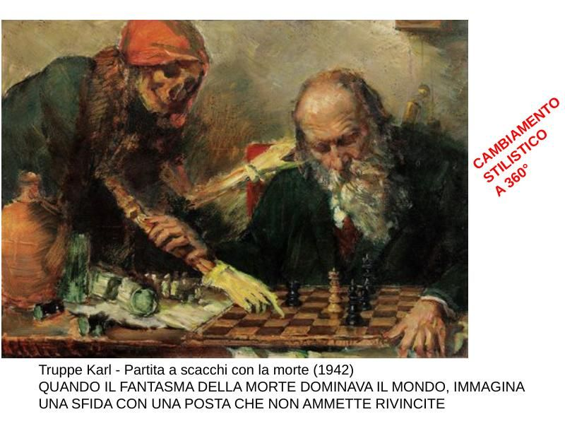{ loading=lazy style="width:48%" }

Honoré Daumier (egli stesso appassionato giocatore), *La partita a scacchi* (1863), Parigi, Petit Palais: due pensosi scacchisti nel delicato momento del centro partita.

Paul Klee, *Überschach* (super-scacchi, 1937), Zurigo, Kunsthaus – astrattismo: si giunge a una scomposizione della scacchiera, nella sublimazione di una forma dai confini indefiniti.

Enrico Baj, *Scacchiera*.

Karl Truppe, *Partita a scacchi con la morte* (1942): quando il fantasma della morte dominava il mondo, immagina una sfida con una posta che non ammette rivincite. Un cambiamento stilistico radicale.

1:28:09

Nel 1944 (ed è qui l’aggancio che dicevo con l’America, con la New York del 1944), quando l’Europa è sotto la tragedia della guerra, un gruppo di artisti, molti di estrazione europea, va a New York e si cimenta con la rappresentazione degli scacchi. Per capire bene questo percorso occorre fare una breve presentazione partendo dalla fiera d’arte di Basilea, una delle più importanti al mondo per l’arte contemporanea, nel 2012, dove una galleria, la galleria Libby Sellers, ha organizzato una mostra che si rifaceva a questo evento del 1944, che poi vedremo. Ecco, questa è la locandina dell’evento.

**GLI SCACCHI NEL TEMPO: DALLA TRADIZIONE ALL’AVANGUARDIA**

Spostiamoci di 2 anni avanti, vedendo come la geografia cambi radicalmente la percezione umana e artistica.

Vedremo il caso, filosofico e artistico, dove a New York nel 1944 (quando l’Europa è sotto la tragedia immane della guerra) un gruppo di artisti si confronta nel gioco degli scacchi e nella sua rappresentazione grafica.

Occorre però partire dal 2012 dalla mostra di arte di Basilea.

Mostra collettiva, sul gioco degli scacchi organizzata dalla galleria Libby Sellers.

La presentazione ha appunto come ispirazione una mostra ospitata dalla Julien Levy Gallery di New York nel 1944.

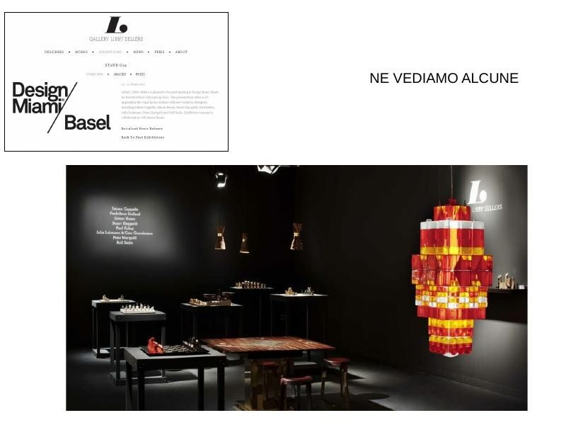{ loading=lazy style="width:42%" }

1:29:04

Ora non le vediamo tutte, ne vediamo alcune, di queste rappresentazioni degli scacchi nell’arte moderna. Questo è Rolf Sachs: è una scacchiera fatta con i pesi delle bilance, di diverse dimensioni, estremamente moderna. Questa addirittura è di Simon Hasan, con dei pezzi che sembrano forse rossetti (non si sa che oggetti siano), dove il bianco e il nero sono messi in questo modo non tradizionale. Questo omaggio al 1944 era stato fatto anche prima, per esempio a Reykjavik, oppure a Torino o a Milano, perché è un evento che è rimasto un po’ nell’immaginario collettivo dell’arte contemporanea. Anche in questo caso, da Milano, vediamone un po’, tanto per rappresentarvi quello di cui si parla.

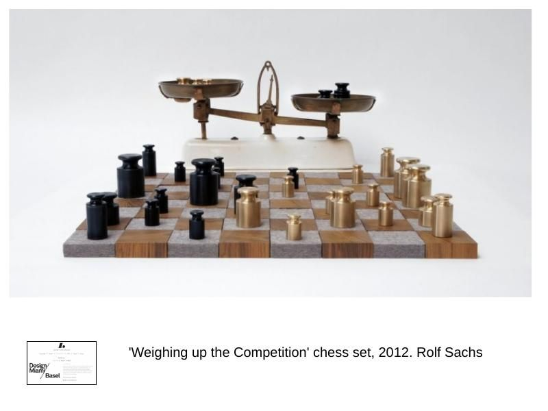{ loading=lazy style="width:47%" }

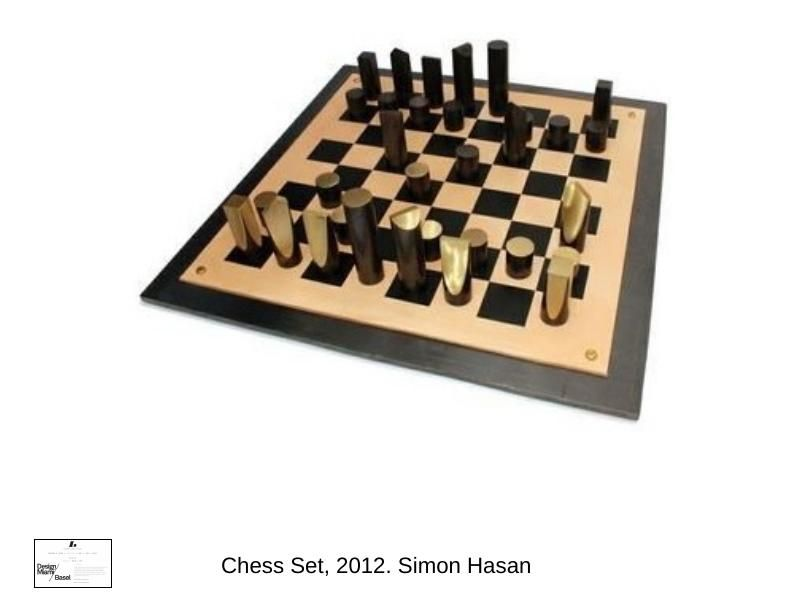{ loading=lazy style="width:47%" }

1:30:18

Questi sono i maggiori artisti mondiali in questo momento. Questo è Alastair Mackie: vedete, è un tavolino che si rifà a quello del 1944 che vedremo tra un attimo; in questo caso gli scacchi sono rappresentati da insetti fissati dentro i pezzi. Vedete questi oggetti? Quelli che si vedono lì dentro sono insetti. Questa è Barbara Kruger, una delle artiste più famose, che ha ideato questa scacchiera fatta in questo modo. Questo è Damien Hirst, quello del teschio fatto di diamanti, che ha questa scacchiera con elementi di vetro sospesi, che poi si depositano sulla scacchiera del tavolino. Questa è Kusama, giapponese, che ha fatto una zucca al cui interno sono depositati la scacchiera e i pezzi.

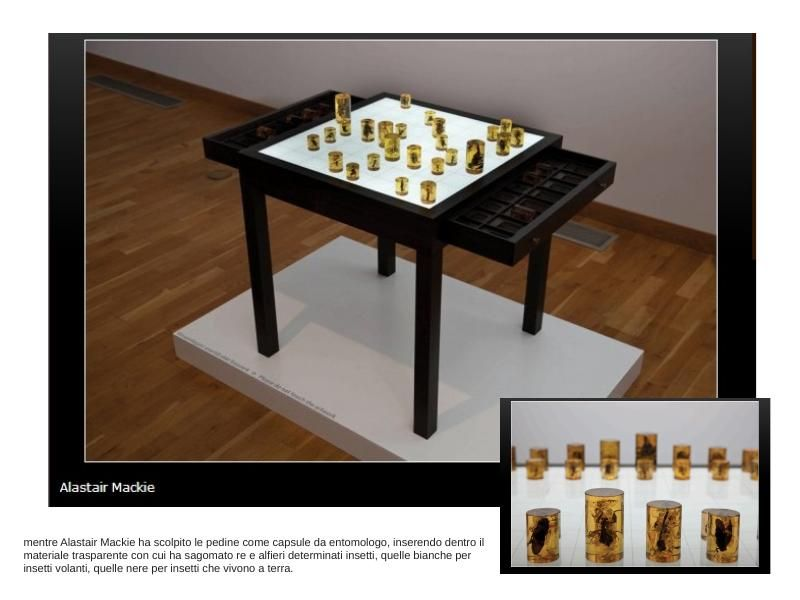{ loading=lazy style="width:47%" }

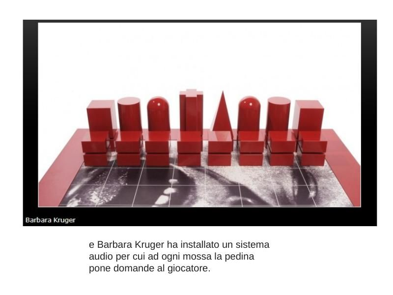{ loading=lazy style="width:47%" }

{ loading=lazy style="width:47%" }

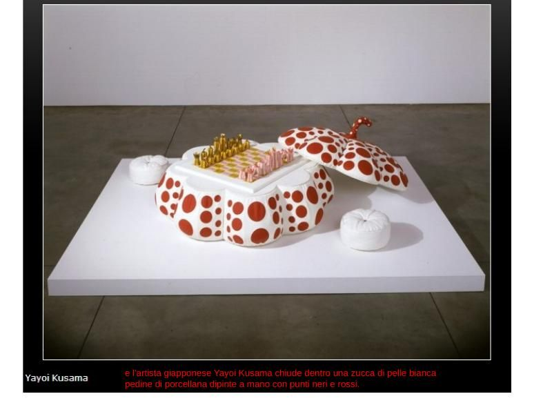{ loading=lazy style="width:47%" }

**GLI SCACCHI NEL TEMPO: DALLA TRADIZIONE ALL’AVANGUARDIA**

Rolf Sachs, *Weighing up the competition*, 2012 – Simon Hasan, *Chess set*, 2012.

Altri omaggi all’evento del 1944 erano stati fatti in molti posti nel mondo:

2009 al Museo di arte contemporanea di Reykjavik

2010 a Torino dalla galleria projectb, con la mostra «The Art of Chess» promossa in occasione della quarantanovesima edizione del Salone internazionale del mobile

2010 Milano, Opere di artisti della scena contemporanea, da Tracey Emin, a Tom Friedman, a Damien Hirst, Barbara Kruger, Yayoi Kusama, Alastair Mackie e Rachel Whiteread.

La rassegna nata in collaborazione con RS&A che a partire dal 2001 ha cominciato a commissionare scacchiere ad alcuni degli artisti più applauditi e discussi del panorama internazionale (lunghissima la lista, da Maurizio Cattelan a Jake and Dinos Chapman, Oliver Clegg, Tracey Emin, Tom Friedman, Paul Fryer, Damien Hirst, Barbara Kruger, Yayoi Kusama, Paul McCarthy, Alastair Mackie, Matthew Ronay, Tunga, Gavin Turk e Rachel Whiteread), esposte di volta in volta in eventi che hanno toccato Londra, New York, Mosca, Dublino.

Per dirla con Ernst Strouhal, «se improvvisamente (e misteriosamente) tutti i lavori del ventesimo secolo scomparissero e solo una scacchiera sopravvivesse, gli storici dell’arte delle generazioni future potrebbero ricostruire tutte le tendenze, i movimenti e gli stili dell’ultimo secolo semplicemente dallo studio di quella sopravvissuta scacchiera».

Alastair Mackie ha scolpito le pedine come capsule da entomologo, inserendo dentro il materiale trasparente con cui ha sagomato re e alfieri determinati insetti: quelle bianche per insetti volanti, quelle nere per insetti che vivono a terra. Barbara Kruger ha installato un sistema audio per cui a ogni mossa la pedina pone domande al giocatore. Il controverso Damien Hirst ricorre alle sue pastiglie da farmacia, e l’artista giapponese Yayoi Kusama chiude dentro una zucca di pelle bianca pedine di porcellana dipinte a mano con punti neri e rossi.

1:31:32

Ma a cosa si ispirano tutti questi artisti che abbiamo visto brevemente ora? Si ispirano a un evento del 1944 alla Julien Levy Gallery di New York. Questa è la locandina dell’evento, in cui degli artisti fecero la mostra appunto sull’immagine degli scacchi. C’erano artisti come Man Ray, Calder, Max Ernst, Duchamp, Breton, quindi tutta l’intelligenza europea di quel periodo, ed è rimasto un evento storico. Questa è la copertina del catalogo che fu poi distribuito: in prima pagina hanno scelto gli scacchi di Noguchi. Ecco, questo è il tavolino a cui si ispirava quello che abbiamo visto prima: è una riproduzione di quello del 1944, dove sono poggiati gli scacchi.

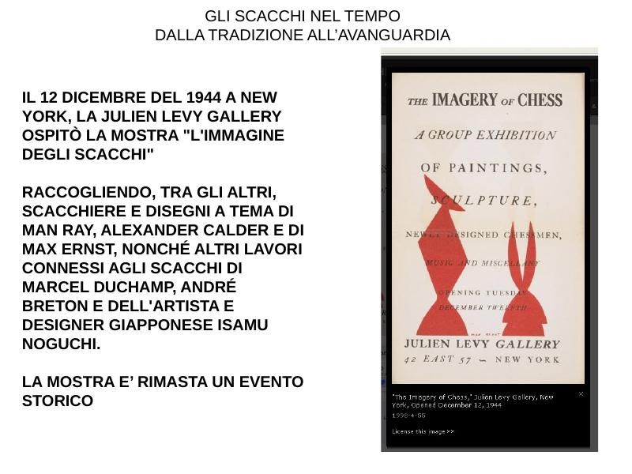{ loading=lazy style="width:47%" }

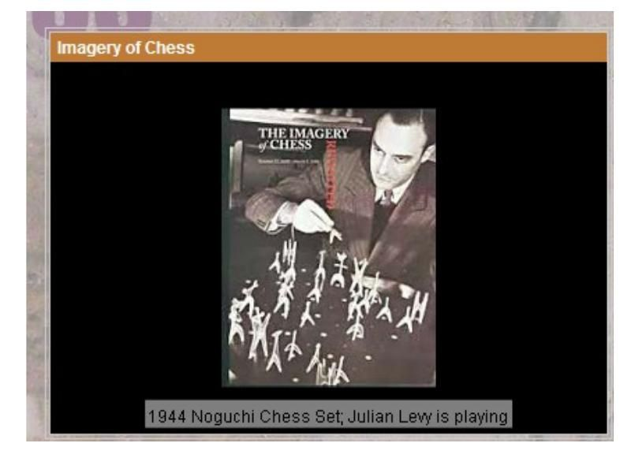{ loading=lazy style="width:47%" }

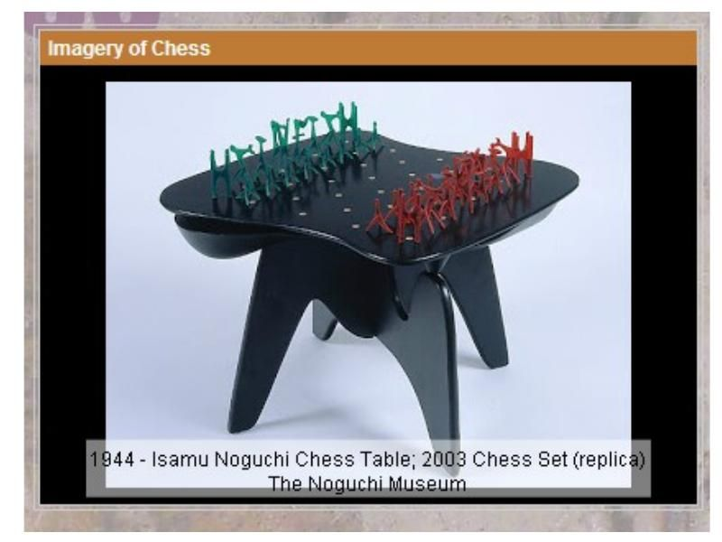{ loading=lazy style="width:59%" }

**GLI SCACCHI NEL TEMPO: DALLA TRADIZIONE ALL’AVANGUARDIA**

Il 12 dicembre del 1944 a New York, la Julien Levy Gallery ospitò la mostra «L’immagine degli scacchi» (The Imagery of Chess).

Raccogliendo, tra gli altri, scacchiere e disegni a tema di Man Ray, Alexander Calder e di Max Ernst, nonché altri lavori connessi agli scacchi di Marcel Duchamp, André Breton e dell’artista e designer giapponese Isamu Noguchi.

La mostra è rimasta un evento storico.

1:32:55

Questi invece sono gli scacchi che espose Man Ray, con questa forma particolare; questo è Max Ernst, del 1944, un rifacimento sempre di questo periodo; questo è Richard Filipowski, con i cristalli; questo è John Cage, che disegnò questa scacchiera; questa è Dorothea Tanning, «Fine del gioco». Sono tutte rappresentazioni in chiave moderna che hanno influenzato poi molta arte contemporanea successiva. Questo è Tanguy: l’abbiamo ritrovato quando abbiamo fatto la nostra serata sull’arte concettuale; Tanguy è stato uno dei precursori di questa branca dell’arte. Questo è Kay Sage: vedete, sono tutte rappresentazioni di un certo tipo. Art Week; questo è il Bauhaus Chess Set, il set di scacchi fatto per il Bauhaus.

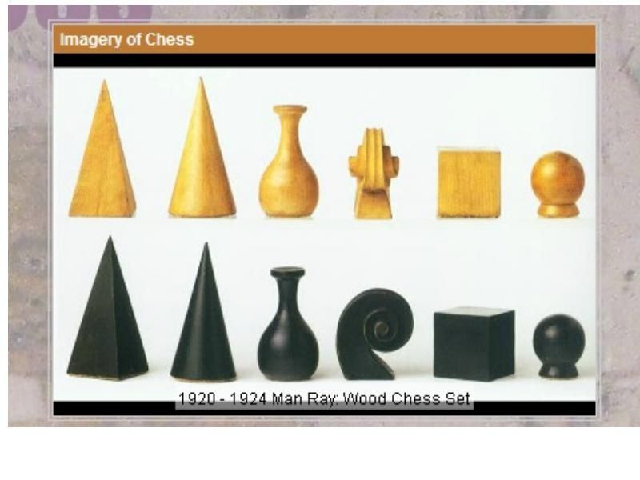{ loading=lazy style="width:47%" }

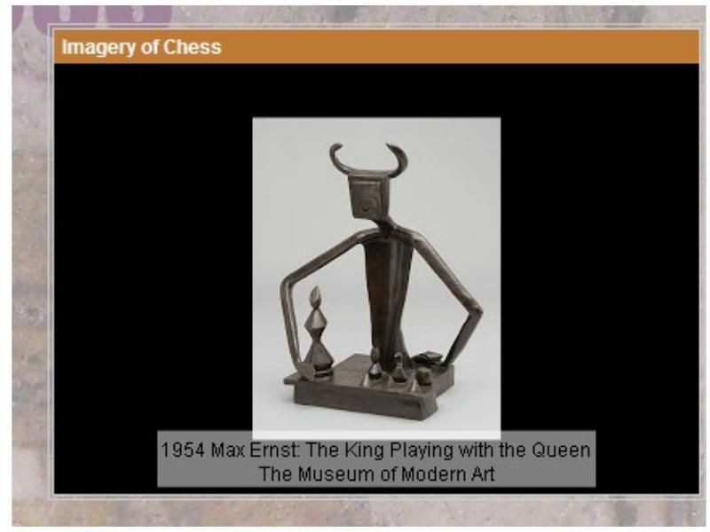{ loading=lazy style="width:47%" }

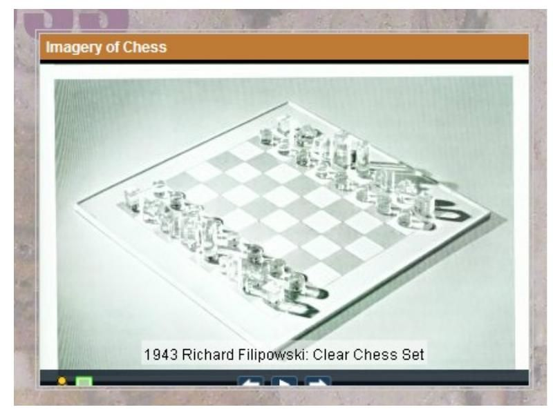{ loading=lazy style="width:47%" }

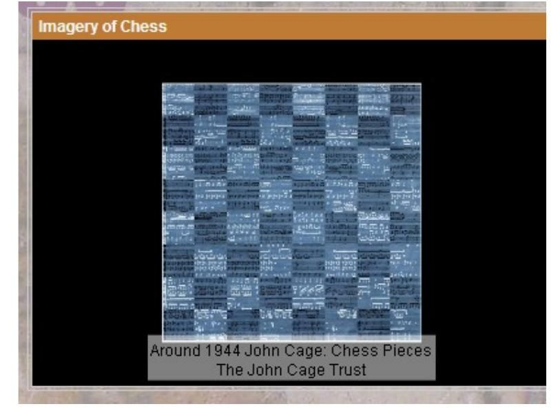{ loading=lazy style="width:47%" }

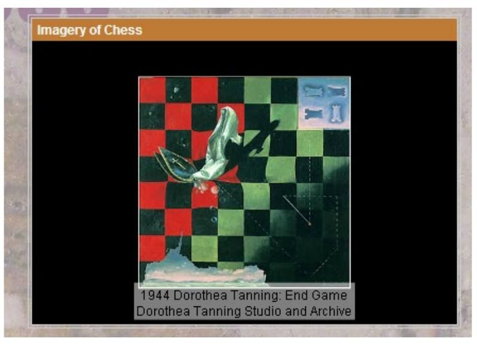{ loading=lazy style="width:47%" }

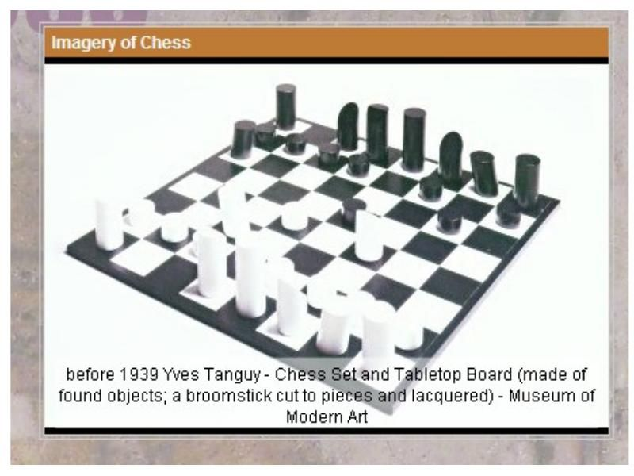{ loading=lazy style="width:47%" }

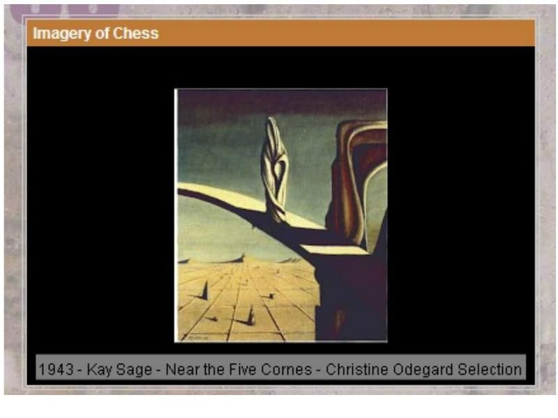{ loading=lazy style="width:47%" }

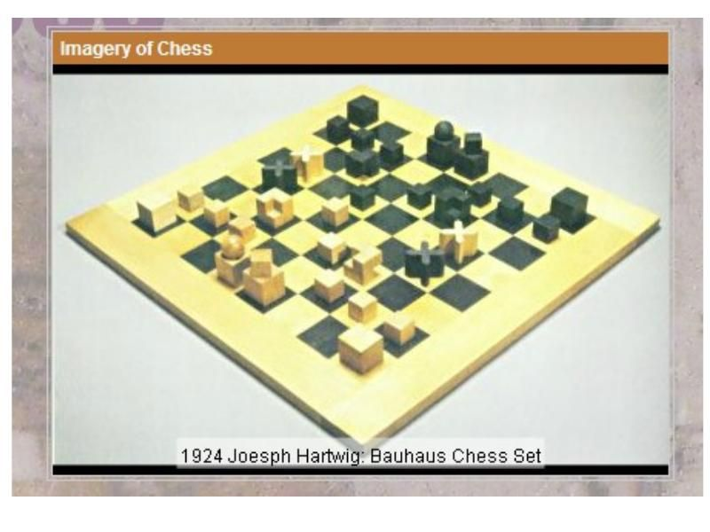{ loading=lazy style="width:47%" }

1:34:21

Quindi è la cultura europea che in quel momento va a New York, che era la culla dove venivano accolti tutti gli artisti europei in fuga, sostanzialmente, dalla guerra. Leon Kelly, Roberto Matta; questo è André Breton (è un rifacimento, una replica): vedete quante rappresentazioni di scacchi sono possibili, fatte da tutti questi artisti. Questa è Muriel Streeter, «*The Chess Queens*»: sono le regine messe insieme. Julien Levy: anche il gallerista si cimentò nel fare gli scacchi. Questo è Carol Janeway, 1944; questo è Duchamp, che fa il pocket set dove conservare gli scacchi; questo è Noguchi, con un pezzo della regina.

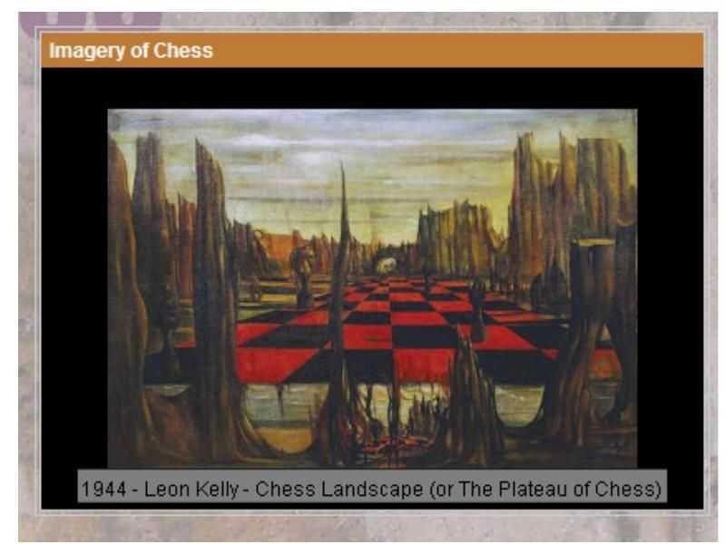{ loading=lazy style="width:47%" }

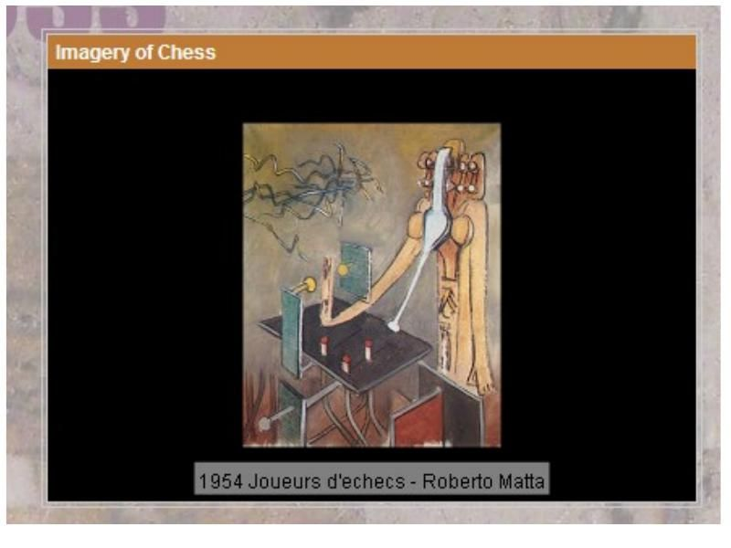{ loading=lazy style="width:47%" }

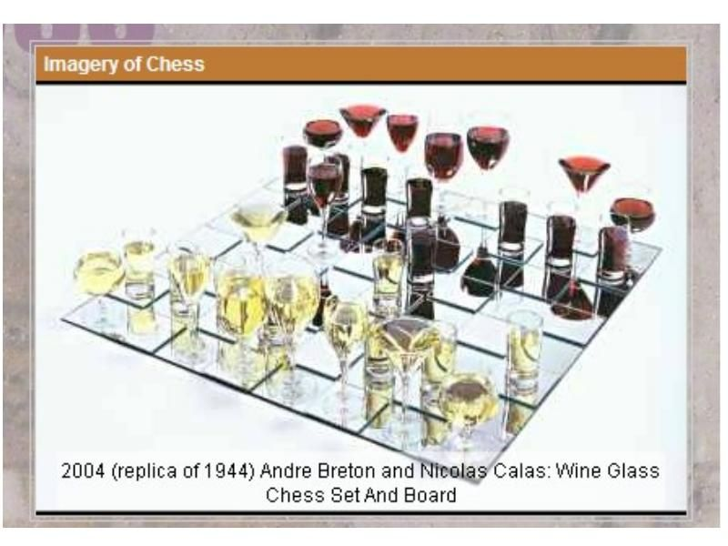{ loading=lazy style="width:47%" }

{ loading=lazy style="width:47%" }

{ loading=lazy style="width:47%" }

{ loading=lazy style="width:47%" }

{ loading=lazy style="width:47%" }

{ loading=lazy style="width:47%" }

**THE IMAGERY OF CHESS* – LE OPERE**

1944 – Isamu Noguchi, scacchi (Julien Levy gioca); tavolo da scacchi e scacchi (replica 2003), The Noguchi Museum – 1920-1924 – Man Ray, scacchi in legno – 1944 – Max Ernst, *The King Playing with the Queen* (fusione del 1954), New York, The Museum of Modern Art – 1943 – Richard Filipowski, scacchi trasparenti – 1944 circa – John Cage, pezzi degli scacchi, The John Cage Trust – 1944 – Dorothea Tanning, *End Game*, Dorothea Tanning Studio and Archive – prima del 1939 – Yves Tanguy, scacchi e scacchiera da tavolo (fatti con oggetti trovati: un manico di scopa tagliato a pezzi e laccato), Museum of Modern Art – 1943 – Kay Sage, *Near the Five Corners*, Christine Odegard Selection – 1924 – Josef Hartwig, scacchi del Bauhaus.

1944 – Leon Kelly, *Chess Landscape* (o *The Plateau of Chess*) – 1954 – Roberto Matta, *Joueurs d’échecs* – 2004 (replica del 1944) – André Breton e Nicolas Calas, scacchi e scacchiera con bicchieri da vino – 1944 – Muriel Streeter, *The Chess Queens* – Julien Levy – 1944 – Carol Janeway, scacchi – 1943 – Marcel Duchamp, scacchi tascabili, Archives Marcel Duchamp – 1931 – Isamu Noguchi (1904-1988), *The Queen*, The Isamu Noguchi Foundation.

1:35:42

Ecco, quello che è interessante per capire anche il meccanismo con cui questi artisti si erano confrontati con gli scacchi è questo signore, George Koltanowski: era belga, ed era un genio degli scacchi. Infatti questi artisti che ho citato prima, nel 1945, l’anno dopo, affrontarono a scacchi questo signore, che era talmente un genio che giocava contemporaneamente contro sette, otto, dieci avversari, e molte volte bendato. Pensate un po’ che mente doveva avere questa persona. Giocava bendato: vedete, questa è una rappresentazione di come doveva essere la partita, e lui giocava contemporaneamente contro tutti questi.

{ loading=lazy style="width:47%" }

{ loading=lazy style="width:47%" }

1:36:44

Questo è celebre: tra gli artisti, anche se non era un artista, c’era Humphrey Bogart, che frequentava questo ambiente, seppe di questo evento e volle andare a giocare con questo Koltanowski, questo belga emigrato in America. Bogart aveva fama di essere un buon giocatore, ma perse sonoramente; e vedete, lui gioca di spalle, senza guardare la scacchiera: quest’immagine è emblematica da questo punto di vista. Questi sono gli artisti che affrontarono poi il maestro: sono Dorothea Tanning e Max Ernst, che giocano su pezzi fatti da loro stessi, o del Bauhaus, o di Ernst.

{ loading=lazy style="width:47%" }

{ loading=lazy style="width:47%" }

**GLI SCACCHI NEL TEMPO: DALLA TRADIZIONE ALL’AVANGUARDIA**

L’anno successivo, il 1945, gli stessi artisti si confrontarono in partite a scacchi con il genio belga del gioco, George Koltanowski (1903-2000).

L’evento è diventato poi storico.

George «Kolty» Koltanowski era un giocatore di scacchi belga, poi naturalizzato americano.

Il suo genio gli permetteva di giocare partite in simultanea, che giocava (quasi sempre) bendato.

Questo genio riusciva a giocare, e a vincere ovviamente, decine di partite contemporaneamente.

Celebre è la partita che Koltanowski giocò alla cieca contro Humphrey Bogart.

Bogart sembra che fosse un buonissimo giocatore, ma perse sonoramente contro il grande campione belga.

Questo tipo di partite ci porta al nostro gruppo di artisti della Levy Gallery.

1:37:47

E questa è invece la locandina di quando il maestro affrontò Marcel Duchamp, che appunto voleva sfidare il maestro insieme a tutti gli altri. Ecco, la partita si svolse: questa è la fotografia che fa vedere l’incontro di questi artisti contro il maestro. Sono sette contemporaneamente: da sinistra Kiesler, Koltanowski, Barr, Duchamp, Xanti Schawinsky, Vittorio Rieti (era un italiano amico di questi artisti, anche lui artista, musicista, che non è mai stato amato in patria, mentre in America ha avuto un grande successo), Dorothea Tanning ed Ernst, appunto. E lui giocò contro di loro bendato, cioè non guardando la scacchiera. Persero tutti, tranne Kiesler, che riuscì invece a fare patta.

{ loading=lazy style="width:47%" }

{ loading=lazy style="width:47%" }

1:38:56

Finisco di raccontarvi questo evento con una battuta, secondo me stupenda, del maestro. Questi sono dei pezzi che aveva fatto per l’occasione l’artista Max Ernst; e quando giocarono con queste scacchiere ideate da lui, domandarono al maestro cosa ne pensasse, e lui disse: «Questa deve essere la prima esposizione nella quale il giocatore con gli occhi chiusi ha il vantaggio», vedendo la rappresentazione della scacchiera fatta nell’arte moderna, diversa da quella che solitamente trovava nei circoli. Con questo ti lascio la parola, Lorenzo.

{ loading=lazy style="width:59%" }

**KOLTANOWSKI E GLI ARTISTI DELLA JULIEN LEVY GALLERY**

Koltanowski negli anni Trenta giocò diverse partite contro Marcel Duchamp e anche con il resto del suo gruppo di artisti (Max Ernst, Dorothea Tanning ecc.);

From left to right: vacant Staunton set

(presumably Julien Levy’s - he is taking the photos);

1 - Frederick Kiesler (who got the draw);

\- George Koltanowski (back turned);

2 - Alfred Barr Jr (playing Ernst’s 1944 Wood Chess set

on his Strategic Value Chess board);

3 - Marcel Duchamp (standing, back turned);

4 - Xanti Schawinsky (on Hartwig’s Bauhaus Prototype set);

5 - Vittorio Rieti (on another Ernst set and board version 2);

6 - Dorothea Tanning (Staunton set and board on top of Noguchi’s chess table);

7 - Ernst (playing his own sets).

Nel 1945 organizzarono un evento presso la Julien Levy Gallery durante il quale il maestro belga sfidò in simultanea sette di loro; la cosa interessante è la brochure dell’evento (dettaglio), che annuncia la sfida fra Koltanowski e cinque giocatori ma poi elenca sei nomi (e gli sfidanti erano in realtà sette).

Persero tutti tranne Kiesler, che riuscì a ottenere una patta.

In quell’occasione giocarono con le scacchiere ideate da Ernst.

Nell’osservarle Koltanowski ebbe a commentare:

This must be the first exhibition in which the blindfold player has the advantage.

(questa deve essere la prima esposizione nella quale il giocatore con gli occhi chiusi ha il vantaggio)

1:39:51

Lorenzo Poggi Sì, ecco. È chiarissima una cosa, che a questo punto dobbiamo…

1:40:00

…chiarire il rapporto che c’è fra trasposizione immaginativa e gioco, come abbiamo visto. Il gioco è una simbolizzazione possibile di una trasposizione immaginativa, di una forma di conoscenza. L’immaginazione è la forma di conoscenza che sta alla base di tutte le nostre conoscenze: il nostro desiderio, il bisogno di dare senso alle cose, parte prima di tutto dal costruirsi un’immagine, dal mettere insieme le nostre percezioni e cominciare a costruire immagini che danno un senso a quello che vediamo, e che ci permettono quindi anche di prevedere quello che sarà il futuro. Quindi c’è sempre questo fondamento conoscitivo in tutte le nostre azioni.

1:41:12

E il gioco, abbiamo visto che cosa fa: rende questa funzione secondo regole e simboli precisi. La connessione fra le immagini del passato e le immagini del futuro è garantita dalle regole del gioco. Ci sono le regole, che dicono che ciò che potrà avvenire in futuro sarà inatteso, ma non imprevedibile: non mi aspettavo, dicevamo, questa mossa, ma poi, vedendola, la mossa era prevedibile. Così come quando mi creo un’immagine delle cose e penso che avverranno in un certo modo: può darsi che ciò che avviene sia inatteso, ma è sempre nell’ambito di certe regole, che seguono le immagini e le mie azioni.

1:42:20

Questo vale per tutta la nostra forma di conoscenza; vale anche, per esempio, per l’arte. Abbiamo di fronte una scacchiera dove sono stati reinventati i pezzi degli scacchi. Non esiste una scacchiera così: quindi è una creazione nuova, ma è pur sempre una scacchiera con i pezzi degli scacchi. Che cos’è che ha collegato questo oggetto completamente nuovo con quella che è la tradizione del passato? Sono state mantenute certe regole, certe forme: quelle sono rimaste invariate, e sono quelle che permettono alla creatività di innovare le connessioni, ma di renderle comunque riconoscibili, non del tutto fuori da ogni possibile accesso razionale. È quello che distingue la creatività dall’arbitrio. L’arbitrio è ciò che rompe questa connessione, che rompe queste regole, e quindi non si riesce a capire che legame ci sia fra quell’oggetto e quello che lo ha preceduto.

1:44:09

L’artista, se non vuole essere un imitatore, deve essere innovativo, ma all’interno di una capacità creativa che si sviluppa attraverso questo tipo di uso delle immagini. Le connessioni fra passato e presente, che negli scacchi sono le regole del gioco, ci sono anche nelle immagini con cui noi costruiamo il nostro mondo e la nostra creatività. Quando queste connessioni saltano, non è più possibile il riconoscimento, non è più possibile quindi questo rapporto tra passato e presente, e la creatività si trasforma in arbitrio: non riusciamo più a ricostruire il passaggio.

1:45:12

Questo non vale solo per la creatività nell’arte, dove si dà per scontato che ci sia. Questo discorso dell’immagine, questo fondamento dell’immaginazione, vale anche nella ricerca scientifica: anche nella ricerca scientifica c’è un porre condizioni e un ipotizzare l’immagine di che cosa sarà poi l’esperimento, che può valere soltanto all’interno delle regole che abbiamo prefissato. Quindi nel gioco, nell’avere simbolizzato in modo così chiaro nelle regole l’atteggiamento che dobbiamo avere rispetto all’attesa del futuro e al proiettarci in possibili azioni immaginate, abbiamo riassunto in brevissimo spazio, lo spazio della scacchiera, lo spazio dell’esistenza, lo spazio della vita.

1:46:23

Qui però è diviso rigidamente, perché le regole sono rigide, sono stabilite all’inizio: c’è questo Dio superiore a tutti, all’interno della cui volontà agiscono anche gli altri, e che regge tutto il mondo. Questo è l’unico mondo possibile, nel mondo degli scacchi. La creatività umana, nel mondo reale, è più libera ancora: su questa immaginazione sviluppa sempre nuovi modi di rapportarsi, nuove connessioni; ma le nuove connessioni non possono mai prescindere, dicevamo, da questa relazione con le connessioni del passato, altrimenti andremmo verso l’arbitrarietà. Oppure, quando le connessioni sono del tutto rotte e incomprensibili, allora abbiamo la follia: perché il folle è colui che, di fronte a certe connessioni che per noi sono evidenti e normali, si atteggia in un modo del tutto arbitrario e incomprensibile, perché sono saltate quelle connessioni simboliche che ordinariamente regolano la pace della nostra esistenza.

\[PAUSA\]
{: .nota }

2:15:50

Paolo Marcucci Facciamo un applauso agli amici della Zaffera, che ci hanno ospitato. Per la conclusione con Lorenzo abbiamo scelto questo quadro di Magritte, che ha degli spunti notevoli, che per fortuna il nostro maestro non mancherà di cogliere.

{ loading=lazy style="width:59%" }

René Magritte (1898-1967): immedesimazione nello sconforto del perdente, ipotizzando che possa giungere al suicidio.

2:16:27

Lorenzo Poggi Allora, leggiamolo un attimo. Può essere interpretato, dice la didascalia, come la sconfitta: il pezzo della piazza cade, e quello si spara. Ora, che Magritte rappresenti una cosa così per il suicidio, non è esattamente questo. Che cos’è che è difficile, e dove si è sconfitti? Si è sconfitti quando nell’immaginazione rappresentativa saltano quelle regole che consentono il legame tra il passato e il presente. Pensiamo un attimo a qualcosa di più facile. Il nostro amico Immanuel Kant diceva che la bellezza è un equilibrio fra intelletto e immaginazione. Che cosa vuol dire? Che l’immaginazione è in grado di darci l’idea di bellezza, quindi di equilibrio, di godimento, l’immagine soddisfacente del gioco, dell’esistenza e del mondo, se è in accordo con l’intelletto. Che vuol dire «in accordo con l’intelletto»? Che non rompe quel legame a cui accennavamo prima, il legame che deve mantenersi sempre fra innovazione e creazione immaginativa da un lato, e dall’altro quella che è stata la nostra esperienza, la connessione del passato.

2:18:12

Quando il legame si incrina o si spezza abbiamo qualche cosa di diverso: Immanuel Kant diceva il sublime, quando si incrina questo rapporto fra intelletto e immaginazione. Magritte (non vi ho portato niente di Magritte, perché è talmente celebre), in tutta la sua opera, ha indagato che cosa? Ha indagato proprio questo: il problema dell’innovazione nel modo di vedere. Guardate questo quadro: è completamente fuori proporzione. La figura in primo piano non ha nessuna proporzione con la scacchiera che vediamo sullo sfondo, che non si sa se sia una scacchiera o il pavimento di una stanza; è in prospettiva, ma è fuori dalla prospettiva in cui è costruita la figura del primo attore, quello che si spara. Quindi è saltata completamente l’organizzazione razionale dello spazio, quella della prospettiva albertiana.

2:19:34

E poi pensate un attimo: c’è una parte della testa del protagonista che è abbastanza formata, ha ancora una tridimensionalità; ma in una parte questa tridimensionalità sfuma, diventa quasi disegno, quindi Magritte mette insieme in quest’opera una serie di modi di rappresentazione, di costruire l’immagine, che hanno a che fare con le modalità con cui le immagini e le raffigurazioni sono state fatte nella storia della pittura precedente. E presuppone in chi guarda che ci sia il ricordo e lo studio di quella precedente: che è il simbolo di che cosa? Di come si costruisce l’agire nel mondo attraverso delle regole stabilite.

2:20:41

L’alfiere, forse: c’è un’altra opera di Magritte dove l’alfiere porta un occhio nel centro; lui ritorna sempre su questo, e non si sa se sia un birillo, o una zampa di tavolino rovesciata, o l’alfiere del gioco degli scacchi. Ma qui abbiamo la scacchiera, prendiamolo per un alfiere: quindi cade, e a questo punto sta accadendo… sta accadendo perché? Perché cadono le regole con le quali connettiamo l’immaginazione, che ci dà il mondo del passato, con la previsione del futuro, che ci dà il mondo inaspettato ma non imprevedibile, e che ci consente quindi di superare anche le disillusioni del presente, perché ci proietta verso una conoscenza futura, verso un futuro. Magritte vuole forse alludere a tutto questo nella sua opera, come in fondo sembra allusiva tutta l’opera di Magritte; ma ritroviamo sempre questo equilibrio, questo gioco, in tutte le opere d’arte, in tutte le opere creative.

2:22:01

Pensate a Leopardi, che da ciò che viene escluso, quindi da ciò che non può costruire l’intelletto, che non vede, costruisce l’immagine di un infinito che non può vedere, che magari non esiste in quel modo, ma che ha tutti i caratteri, gli elementi che lo collegano a ciò che ha vissuto, a ciò che anche i suoi lettori, dopo un secolo e mezzo, possono ancora capire. Così vale per le immagini della letteratura. Parlavamo, mi sembra, con voi di Carducci e della sua amata bionda, la bionda Maria, che appare nella campagna maremmana:

*«…quando tra i lunghi solchi uscivi, un fascio di fiori*

*recando, alta e pensosa, e sotto i cigli*

*di selvatico fuoco lampeggiante,*

*alto il dente, l’occhio azzurro aprivi*

*come il ciano sereno; fra il biondeggiante*

*or delle spiche, fra la chioma flava*

*vedea quell’occhio azzurro, e a te davanti*

*la grande estate…»*

2:23:31

È intorno a leggiamo: capite? Non c’è solo l’immagine, che non è presente; non c’è solo la ricostruzione dell’intelletto: c’è l’innovazione, che però non è arbitrio, perché tiene conto della regola, di quello che c’è stato prima. Anche il pensiero scientifico, vi dicevo, gioca su questo stesso tipo di rapporto. Ma vi ho citato questo esempio perché, se saltano le regole, non resta che spararsi: se salta questo rapporto che consente la creatività, consente l’innovazione, consente la conoscenza, consente di mantenere l’equilibrio fra intelletto e immaginazione, abbiamo soltanto il sogno, la follia, l’irreparabile non senso.

2:24:42

Bene, fermiamoci qui. Abbiamo provato anche a leggere Magritte; però il gioco degli scacchi ha sempre simboleggiato tutto questo: la necessità della regola, ma anche la possibilità di immaginare e prospettare il futuro e il nuovo attraverso l’immaginazione. Grazie, basta.

## Appendice

Le slide proiettate durante l’incontro.

{ loading=lazy style="width:47%" }

{ loading=lazy style="width:47%" }

{ loading=lazy style="width:47%" }

{ loading=lazy style="width:47%" }

{ loading=lazy style="width:47%" }

{ loading=lazy style="width:47%" }

{ loading=lazy style="width:47%" }

{ loading=lazy style="width:47%" }

{ loading=lazy style="width:47%" }

{ loading=lazy style="width:47%" }

{ loading=lazy style="width:47%" }

{ loading=lazy style="width:47%" }

{ loading=lazy style="width:47%" }

{ loading=lazy style="width:47%" }

{ loading=lazy style="width:47%" }

{ loading=lazy style="width:47%" }

{ loading=lazy style="width:47%" }

{ loading=lazy style="width:47%" }

{ loading=lazy style="width:47%" }

{ loading=lazy style="width:47%" }

{ loading=lazy style="width:47%" }

{ loading=lazy style="width:47%" }

{ loading=lazy style="width:47%" }

{ loading=lazy style="width:47%" }

{ loading=lazy style="width:47%" }

{ loading=lazy style="width:47%" }

{ loading=lazy style="width:47%" }

{ loading=lazy style="width:47%" }

{ loading=lazy style="width:47%" }

{ loading=lazy style="width:47%" }

{ loading=lazy style="width:47%" }

{ loading=lazy style="width:47%" }

{ loading=lazy style="width:47%" }

{ loading=lazy style="width:47%" }

{ loading=lazy style="width:47%" }

{ loading=lazy style="width:47%" }

{ loading=lazy style="width:59%" }

**CORRADINO DI SVEVIA (25 MARZO 1252 – 29 OTTOBRE 1268)**

Corrado, detto il giovane o il ragazzo, ma generalmente conosciuto con il diminutivo di Corradino, fu duca di Svevia (1254-1268, come Corrado IV), re di Gerusalemme (1254-1268, come Corrado III) e re di Sicilia (1254-1258, *de iure* fino al 1268, come Corrado II).

Dopo aver rafforzato le sue truppe, marciò verso Lucera per unirsi ai saraceni che vi si erano stabiliti fin dai tempi di suo nonno. Il 23 agosto 1268 il suo esercito, composto da italiani, spagnoli, romani, arabi e tedeschi, incontrò quello di Carlo d’Angiò a Tagliacozzo, in una zona collinare dell’Italia centrale. La prima carica dei cavalieri spagnoli, guidati dall’infante Enrico di Castiglia, ebbe successo, ma l’errore di dedicarsi al saccheggio del campo nemico, dopo il momentaneo assalto vittorioso, diede la vittoria finale ai francesi, riorganizzati.

Fuggito dal campo di battaglia, Corradino giunse a Roma; consigliato di lasciare la città, proseguì verso Astura, nel tentativo di salpare per la Sicilia. Qui fu arrestato e consegnato a Carlo, che lo imprigionò nel Castel dell’Ovo a Napoli insieme all’inseparabile Federico di Baden. Fu processato come traditore, e il 29 ottobre 1268 lui e Federico furono decapitati.

La battaglia di Tagliacozzo, combattuta tra i ghibellini sostenitori di Corradino e le truppe angioine di Carlo I d’Angiò, di parte guelfa, rappresenta l’ultimo atto della potenza sveva in Italia: la fine di Corradino segna la caduta degli Hohenstaufen dal trono imperiale e da quello di Sicilia, e apre il nuovo capitolo della dominazione angioina.

