# Santi in paradiso

Virtù dei protettori, caratteri e vizi dei protetti

**Data:** 30 maggio 2013 
**Luogo:** Museo della Ceramica, Montelupo Fiorentino 
**Incontro con:** Lorenzo Poggi e Paolo Marcucci

**Interventi:** Paolo Marcucci Lorenzo Poggi

0:02:30

Paolo Marcucci Buonasera a tutti. Non abbiamo un grande impianto audio, quindi bisogna aiutarsi, se no non si sente. Allora, buonasera a tutti: stasera parliamo di santi in paradiso: è l’ultima serata di questa stagione. Prima di iniziare con i santi, un paio di comunicazioni di servizio. Le ultime due volte avevamo detto che avevamo previsto delle uscite culturali: ne avremmo prevista una, l’ultima di quest’anno, e pensiamo di andare a Firenze a vedere *La primavera del Rinascimento*, e poi, se ce la facciamo, anche *Un’idea di bellezza*, lì a Palazzo Strozzi. Sono temi che abbiamo affrontato nel corso delle nostre serate, seppur da punti di vista diversi. Qui avevo messo che il punto di ritrovo era in testa ai binari 1 e 2 della stazione di Firenze, alle 14:50-15; va spostato un’ora dopo, perché abbiamo prenotato e c’era posto alle 16:30: quindi ci ritroviamo intorno alle 15:30-16 in testa ai binari, per chi vuol venire, oppure direttamente lì all’ingresso della mostra.

0:04:10

Quello che vi chiedo è di iscrivervi, perché c’è un numero minimo e un numero massimo di partecipanti, oltre i quali non ci fanno entrare come gruppo; se invece entriamo come gruppo, poi ci danno l’audioguida, e quindi Lorenzo ci può fare la sua spiegazione di tutta la mostra, come le altre volte. Quindi chi è interessato a venire si iscriva con i soliti mezzi, o anche direttamente stasera. L’altra comunicazione di servizio è che sempre a Firenze si è aperta di recente una mostra d’arte civica, *Dal Giglio al David*. Arte civica a Firenze fra Medioevo e Rinascimento, e questo sarebbe secondo me un tema molto interessante, che in qualche modo abbiamo sfiorato: sarebbe l’arte del potere che si mette in mostra ai fini della divulgazione e della legittimazione del potere. Questa c’è fino all’8 dicembre: vediamo magari la prossima stagione se riusciamo a organizzare anche questa.

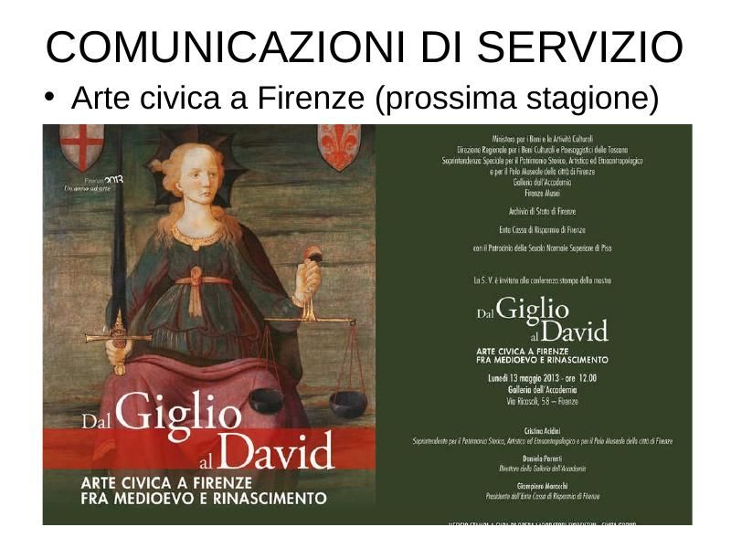{ loading=lazy style="width:49%" }

0:05:23

Va bene, detto questo cominciamo con il tema di stasera. Allora, prima di parlare dei santi forse occorre accennare un po’ al concetto di santità, da cui discendono poi i santi. La prima nozione di santità è un’idea di inviolabilità: un luogo è santo perché di lì è passata una divinità, e quindi occorre fare di tutto affinché questo luogo non sia profanato. Profanato deriva dal latino: pro, avanti, e fanum, tempio; cioè tutti quelli che sono al di là sono appunto i profani.

0:06:08

L’anno scorso, quando siamo andati a vedere il Parco Spoerri, a Seggiano, in provincia di Grosseto, nel corso della serata ci siamo imbattuti in quest’opera, l’*Ombelico del mondo* (1991), che è il centro del mondo, il tempio al centro del mondo del Parco Spoerri. Lorenzo in quell’occasione ha spiegato per la prima volta questo concetto del profano, e quindi del tempio. In quel momento, in quel luogo meraviglioso, cominciava già a fare buio, e si è sentito effettivamente nell’aria aleggiare forse un concetto, non voglio dire di santità, ma comunque interessante da questo punto di vista. Se volete, fatevi un giro, perché lo merita davvero, il Parco Spoerri.

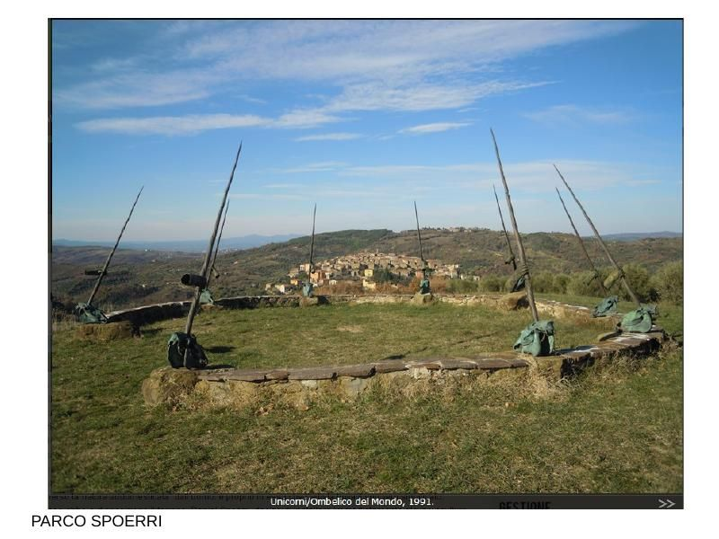{ loading=lazy style="width:42%" }

0:07:06

Allora, questo luogo è santo, abbiamo detto, vi alberga la santità; però in seguito cosa succede? Lo si circonda di una barriera, di un muro, e alla fine questo luogo diventa un tempio. Questi sono i primi simboli della santità, e quindi questo luogo poi suscita anche timore e venerazione. In principio è consentito a chiunque di accedervi; poi in seguito invece nel tempio entrano solo i sacerdoti, perché diventano gli specialisti, perché conoscono le regole della santificazione. Se ci pensate, da questo punto di vista lo stesso impianto si applica oggi agli specialisti della tecnica. Pensate per esempio al governo Monti, che era fatto di tecnici; pensate alle linee di politica economica che impone la cosiddetta troika, la BCE, la Commissione e il Fondo monetario: sono tecnici che non hanno nemmeno il mandato elettorale previsto dalla democrazia, e quindi c’è anche un problema di democrazia. Il tempio ha più o meno queste caratteristiche, perché sono gli specialisti che vi accedono a dettare le regole.

**IL CONCETTO DI SANTITÀ**

In seguito lo si circonda di una barriera, poi di un muro, e infine lo si racchiude in una casa che diventa un tempio: questi sono i primi simboli della santità.

Il rispetto dovuto a quei luoghi si traduce poi in timore e in venerazione, e si trasferisce dal luogo alle persone che vi penetrano: quindi occorre prepararsi, e financo premunirsi, quando vi si entra.

In principio a chiunque è consentito purificarsi così da poter penetrare nel santuario; poco a poco, però, solo i sacerdoti entreranno nel tempio: sono gli specialisti, perché conoscono le regole della santificazione.

Lo stesso paradigma si applica oggi: gli specialisti della tecnica, tutte le conoscenze specialistiche, sono la versione sacerdotale moderna di questa impostazione ancestrale.

– solo a pochi è concesso il sapere, e di conseguenza gli altri devono «fidarsi» dei consigli degli esperti;

– i tecnocrati della Troika: BCE, Commissione europea, FMI… (non sono eletti, eppure dettano le condizioni);

– e questa è la tavola di confronto della democrazia, che in questi anni ha vissuto momenti contraddittori: il pendolo ora oscilla da un lato, ora dall’altro.

0:08:46

Per tornare ai santi: tutti i santi delle prime comunità sono santi per antonomasia, perché sono in relazione costante e diretta con Dio. Solo dopo si è arrivati alle regole di canonizzazione dei santi, perché c’era bisogno di disciplinare il flusso enorme della santità e delle richieste di santi che provenivano da tutto il mondo. Credo si possa dire che i santi sono una delle più grandi invenzioni degli italiani. È uno dei capitoli più controversi, e anche difficili, affrontati dalla cristianità cattolica: infatti già il Concilio di Trento, del 1545, e il Concilio Vaticano, del 1962, avevano espresso un po’ di diffidenza verso i culti santorali.

0:09:39

Questa è l’immagine del Concilio di Trento del 1545, dove nella venticinquesima e ultima sessione viene riaffermata la dottrina cattolica sul purgatorio e sul culto dei santi. Tra l’altro fu anche il concilio in cui si misero all’indice i libri proibiti. Una chicca sul Concilio di Trento che ho trovato, e non ho resistito a farvela vedere: queste sono due medaglie d’argento (una copia del 1580 di un originale del 1545 circa) che fanno vedere un cardinale e un papa; però è una presa in giro del Concilio di Trento, perché se si girano le monete appaiono un demone e un giullare: il papa diventa un giullare e il cardinale un demone. Questo invece è il Concilio Vaticano II, del 1962: vedete qui il tempio, la magnificenza del tempio, questa grandiosità, dove appunto si celebrano queste funzioni.

**IL CONCILIO DI TRENTO (1545-1563)**

Nacque per fronteggiare la minaccia della Riforma, ma anche, in qualche modo, il Rinascimento, inaudito e inaccettabile per troppi motivi (l’esaltazione dell’uomo, la libertà intellettuale, l’edonismo). Bisognava porre fine a tutto questo, rimuoverlo dalle coscienze e impedire che potesse accadere di nuovo: a tale scopo la Chiesa si strutturò maggiormente per il controllo e la repressione.

Nella XXV e ultima sessione venne infine riaffermata la dottrina cattolica sul purgatorio e sul culto dei santi, delle reliquie e delle immagini sacre, e venne approvata la pratica delle indulgenze. Vennero infine affidate al pontefice e alla curia romana alcune questioni rimaste in sospeso per mancanza di tempo: la revisione del breviario e del messale, del catechismo e dell’indice dei libri proibiti.

Il Concilio di Trento in un dipinto conservato presso il Museo diocesano tridentino.

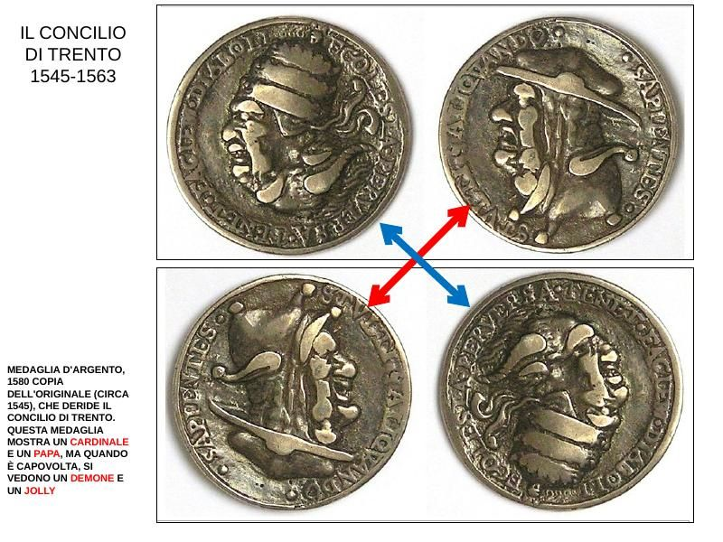{ loading=lazy style="width:47%" }

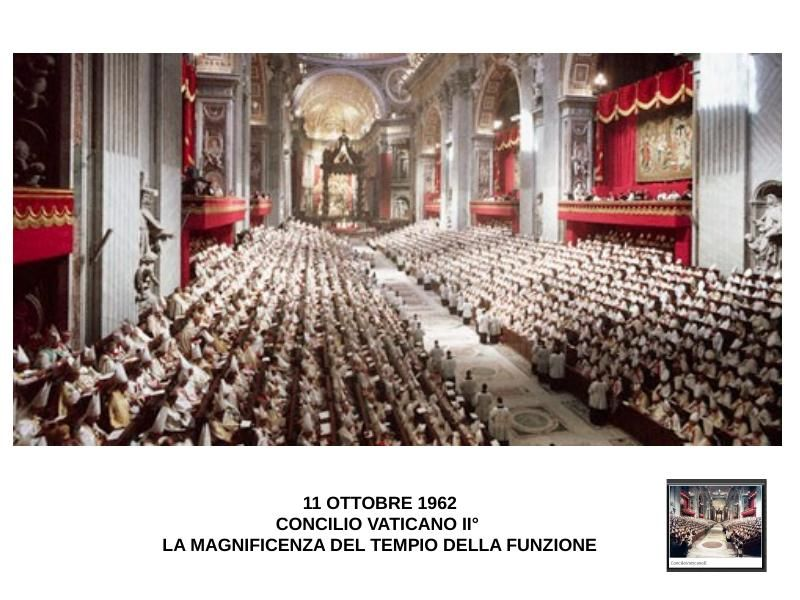{ loading=lazy style="width:47%" }

0:10:52

Allora, perché questa diffidenza anche della Chiesa verso i santi? Perché ci sono credenze per certi versi anche di carattere pagano; sono idee che possono significare anche arretratezza, grossolanità; alcune magari (ce lo dirà sicuramente dopo Lorenzo) sono falsificazioni, miti ecc. Consideriamo che anche i padri fondatori della Chiesa, e anche quelli israeliti, avevano in orrore l’idolatria che ne poteva derivare. Però, nonostante questo, nella nostra cultura non si può fare a meno dei santi: il nostro linguaggio è infarcito di proverbi. «Avere un santo in paradiso», «non sapere più a che santo votarsi», «passata la festa, gabbato lo santo», «non essere uno stinco di santo», «qualche santo ci aiuterà»: vedete, c’è tutto e di più, e questi sono una piccolissima parte.

0:12:03

Ma chi è il santo, allora? Il santo sostanzialmente è una persona devota, che conduce una vita esemplare e che porta dentro di sé anche capacità taumaturgiche, cioè riesce in qualche modo a compiere quelli che si possono definire prodigi, o a volte anche miracoli. Dietro tutto questo ci sono due concetti guida: il santo rappresenta il modello di vita, è colui a cui tendiamo; ed è un protettore. Queste sono le due anime del santo. Il santo è anche un uomo del mana, cioè emana una forza vitale che trascende anche le facoltà ordinarie di tutti noi, dell’uomo normale, ed è capace a volte di agire anche oltre la morte. Per questo certi sepolcri sono così importanti: perché da quel sepolcro dove è sepolto il santo c’è sempre da avere un qualche aiuto.

**STORIA DEI SANTI**

Il santo, da sempre nella storia cattolica, appare a volte come una figura scomoda e pericolosa, pietra d’inciampo, segno di contraddizione, motivo di scandalo.

Ma chi è allora il santo? Si definisce «santo» l’uomo particolarmente devoto, colui che conduce vita esemplare, che mostra capacità taumaturgiche (… miracoli…), di compiere prodigi. Dietro tutto questo ci sono due concetti-guida:

– il santo è un modello di vita;

– è un protettore.

Il «santo» è, in termini antropologici, un uomo del *mana* («forza vitale», una forza impersonale che si ritiene posseduta, in modo temporaneo o permanente, da persone, animali o cose, e che si manifesta in effetti insoliti e straordinari).

Chi ha il *mana* ha la forza che trascende le ordinarie facoltà dell’uomo, capace talora di agire anche dopo la morte (il che spiega il culto di certi sepolcri).

0:13:11

Lorenzo Poggi Volevo, altrimenti poi me lo dimentico, puntualizzare due cose importanti. Il santo, ha detto Paolo, è esemplare, senz’altro. Io devo pagare un vecchio debito, perché avevo promesso, quando trattavo dei santi, che avrei trattato anche delle sante. Ecco, facendo questo discorso sulle sante, viene fuori che le sante non sono esemplari, nel senso che sono qualcosa di più: le sante sono straordinarie. Le sante hanno una vita che non può essere presa come esempio da tutte le altre donne, perché vanno fuori dai limiti, nella loro idea di vita santa, vanno oltre ogni schema. Parleremo poi di un paio di sante, o perlomeno di qualche cosa, se riesco a dirlo, di Santa Caterina da Siena. Santa Caterina nella sua vita non può essere di esempio, anzi fa di tutto per non essere di esempio, per uscire da quella gabbia dentro la quale viene chiusa dalla mentalità e dalla società di allora; la sua lotta è con la famiglia, con i genitori che non la riconoscono… comunque ne parleremo.

0:14:47

E poi un’altra cosa: effettivamente il santo è in qualche modo un’invenzione italiana, diciamo così; rappresenta in fondo, per certi aspetti, uno dei caratteri fondamentali della nostra mentalità, del nostro spirito. Il santo (poi vedremo perché) essenzialmente anche perché non ammette mai totalmente la trascendenza. Importante del santo è intanto il fatto che sacralizza un territorio; ma del santo poi rimangono le reliquie, rimane il sepolcro, rimane qualche cosa che poi in qualche modo viene toccato: è qualcosa di terreno che congiunge in qualche modo la terra al cielo. L’esempio lampante di questo è la Vergine Maria, che però ha un carattere di santità del tutto particolare, di cui parleremo. Quindi sono fondamentali le reliquie, contro le quali poi si scaglia per certi aspetti il Concilio di Trento, e anche il Concilio ecumenico Vaticano II, che le ha certe libri rifiutate; però fanno parte profonda ed essenziale di questa idea di santità. Ve l’ho detto perché poi mi passano queste cose e non me le ricordo più.

0:16:30

Paolo Marcucci Quando vuoi, interrompimi senza problemi. Allora, infatti per esempio la parola tedesca heilig rende bene questo concetto, perché Heil è appunto la forza taumaturgica, il vigore, la salvezza e la salute. I missionari della Chiesa, nell’evangelizzazione dei popoli barbari, hanno reso il volgare tedesco Heil con il latino sanctus. Sanctus deriva da sancio, che significa decretare, stabilire, decidere: cioè è santo quello che è sancito come tale. Questo ci riporta al processo di canonizzazione, che è estremamente importante ai fini del concetto di santo: quindi la santità fornita dalla Chiesa mediante il potere di canonizzazione è il rapporto diretto tra il concetto di santità, da una parte, e il potere della gerarchia ecclesiastica, dall’altra.

**STORIA DEI SANTI**

Il tedesco *heilig* rende bene questi concetti. Lo *heil* (la cui radice indoeuropea è la stessa del latino *salus*) è appunto la forza taumaturgica in grado di fornire vigore, salvezza, salute.

I missionari della Chiesa presso i popoli germanici hanno fatto appunto il lavoro di rendere con il volgare *heilig* il latino *sanctus*, con un lavoro di conversione che era soprattutto di acculturazione.

I latini, utilizzando il termine *sanctus*, derivante da *sancio* (decretare, stabilire, decidere), hanno stabilito in una sola parola che è santo ciò che è stato «sancito» come tale.

0:17:33

La grande fortuna dei santi sta nell’essere, e nel ricercare, il patronatus: cioè il santo è un garante, e allo stesso tempo un compagno celeste, per sé, per la propria parte, la propria professione. Infatti ci sono i livelli di canonizzazione: basta scorrerli per vedere quanto sia complessa l’architettura messa in piedi dalla Chiesa per arrivare all’ultimo stadio, che è quello di santo. In prima battuta si diventa servo o serva di Dio; poi si può diventare venerabile, nel secondo stadio; una volta raggiunto lo stadio di venerabile, si può avviare la dichiarazione di beatificazione, e a quel punto si può diventare beato o beata; e solo dopo aver raggiunto il quarto stadio, di beato o beata, si può diventare santo. Ognuno di questi è un processo vero e proprio, e sono richieste prove, modelli di vita, miracoli ecc.: è proprio un processo vero e proprio, che può durare anche, come sapete, qualche secolo.

**STORIA DEI SANTI**

Da qui la santità fornita dalla Chiesa mediante il processo di canonizzazione, e da qui il rapporto diretto tra il concetto di santità, da una parte, e il potere e la gerarchia istituzionale della Chiesa, dall’altra. I cieli e la terra sono pieni di santi che non sono, e non saranno mai, elevati alla gloria degli altari, né figureranno mai in alcun calendario.

La grande fortuna del culto dei santi (perché di questo si tratta) va ricercata nel *patronatus*: cioè nella ricerca di un garante e di un compagno celeste per sé, per la propria professione, per la propria patria, che affonda fino ai primi tempi del cristianesimo ed è un elemento fondamentale della religiosità cristiana. Un patronato che è essenziale per la canonizzazione.

**LIVELLI DEL PROCESSO DI CANONIZZAZIONE**

A ogni livello occorrono sempre più prove, testimonianze dei miracoli e dei comportamenti tenuti in vita: si svolge un processo. Il «potenziale» santo percorrerà queste fasi, e ognuna di esse avrà bisogno del patrono (lo sponsor, in termini di oggi):

1\. Servo (o serva) di Dio;

2\. Venerabile;

3\. Avvio della dichiarazione di beatificazione;

4\. Beato o beata;

5\. Santo (se viene riconosciuto un altro miracolo, a seguito di una valutazione che ha lo stesso iter e la stessa severità del primo, il beato viene dichiarato santo).

0:18:55

E quindi la fede cristiana in questo caso, attraverso i santi, si propone come chiave per la vita celeste, ma anche per la vita terrena: il santo è colui che ci aiuta. E questa è la grande invenzione degli italiani che dicevamo prima: noi abbiamo inventato questo concetto di santo perché cerchiamo già qui sulla terra un aiuto o una protezione. Il santo diventa la garanzia di un potere celeste e di un tramite diretto con Dio: noi utilizziamo il santo per arrivare poi a Dio. E qui per esempio si vedono le differenze tra la letteratura agiografica e il culto: la letteratura, che ha avuto il compito di descrivere la vita del santo caso per caso, e invece il culto, che è quello più popolare e che proviene dalle credenze, da quello che la gente

0:20:00

pensa che il santo abbia fatto in vita. Ecco, gli oggetti della passione: questo è il punto nel quale la biografia e la potenza del santo si incontrano, ed è un punto fondamentale per capire il concetto di santo. È grazie per esempio alle frecce che un tempo Sebastiano ha realmente sofferto nelle carni che diventa il protettore contro gli strali delle malattie della pelle e delle epidemie. È grazie per esempio ai loro occhi, denti, seni strappati che Lucia, Apollonia e Agata possono difendere contro le malattie di quegli organi.

0:20:48

Allora, questo è il Martirio di San Sebastiano, un dipinto che è a Firenze, al Museo dell’Opera del Duomo. Il pittore si è ispirato alla passione del martire, che narra che l’imperatore ordinò agli arcieri di legare Sebastiano a un albero e di trafiggerlo con le frecce, finché ne fosse crivellato come un istrice di aculei: e vedete effettivamente come è ridotto Sebastiano.

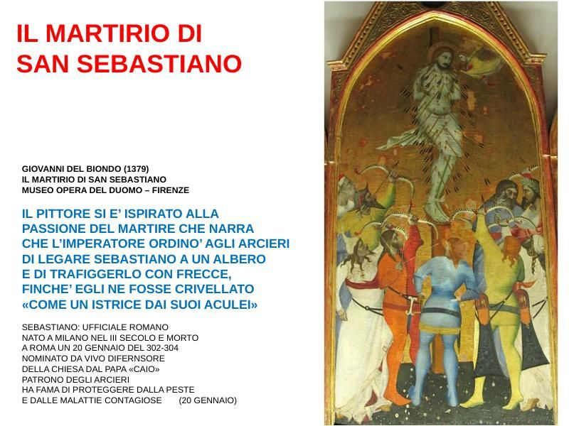{ loading=lazy style="width:52%" }

**GIOVANNI DEL BIONDO (1379),** ***IL MARTIRIO DI SAN SEBASTIANO*** **– FIRENZE, MUSEO DELL’OPERA DEL DUOMO**

Il pittore si è ispirato alla passione del martire, che narra che l’imperatore ordinò agli arcieri di legare Sebastiano a un albero e di trafiggerlo con frecce, finché egli ne fosse crivellato «come un istrice dai suoi aculei».

Sebastiano: ufficiale romano, nato a Milano nel III secolo e morto a Roma il 20 gennaio di un anno tra il 302 e il 304. Nominato da vivo difensore della Chiesa da papa Caio. Patrono degli arcieri, ha fama di proteggere dalla peste e dalle malattie contagiose (20 gennaio).

0:21:25

Questa invece è Santa Lucia, che protegge la vista. Lucia era nata a Siracusa da una famiglia cristiana, e, narra la leggenda (perché in tutti i santi c’è un incrocio di leggende e di fatti realmente accaduti), un giovane si invaghì di lei; lei lo rifiutò, e lui la denunciò al console romano, che poi la fece incarcerare e la fece rinchiudere in un postribolo. Vedete, questa è una leggenda di Santa Lucia, un dipinto del 1480: la volevano far portare in questo postribolo, ma non riuscirono a smuoverla nemmeno con una coppia di buoi. Vedete sulla destra (non so se si vede) ci sono due buoi che cercano di trascinarla, ma la ragazza non si muove. A quel punto tentano di bruciarla viva, però le fiamme non riescono a bruciarla, e allora viene trafitta alla gola con una spada: c’è quella spada lunga con cui viene trafitta. È solo intorno all’anno Mille che si comincia a parlare di occhi strappati e che Santa Lucia viene associata al concetto della vista. Se ci fate caso, Santa Lucia è il 13 dicembre, che era il giorno più corto che ci sia, legato anche alla riforma del calendario gregoriano.

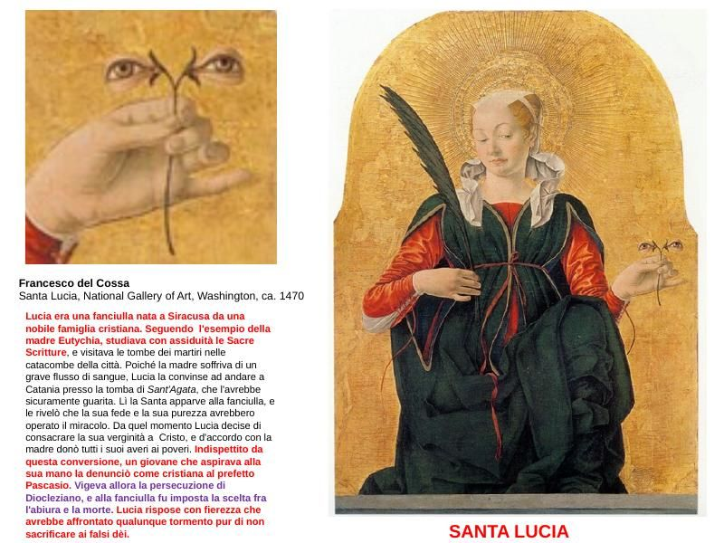{ loading=lazy style="width:47%" }

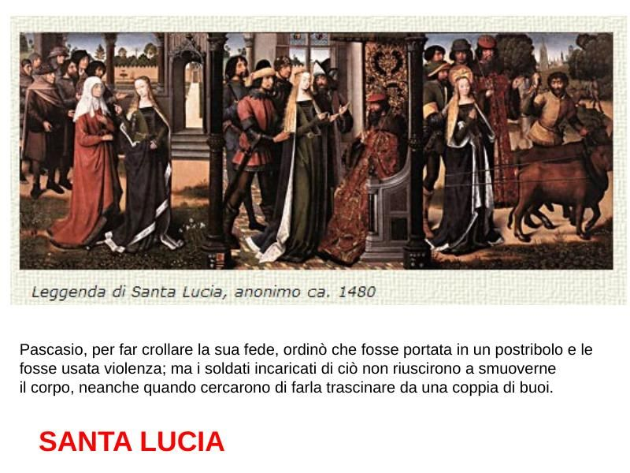{ loading=lazy style="width:47%" }

**SANTA LUCIA**

Lucia era una fanciulla nata a Siracusa da una nobile famiglia cristiana. Seguendo l’esempio della madre Eutichia, studiava con assiduità le Sacre Scritture e visitava le tombe dei martiri nelle catacombe della città. Poiché la madre soffriva di un grave flusso di sangue, Lucia la convinse ad andare a Catania presso la tomba di Sant’Agata, che l’avrebbe sicuramente guarita. Lì la santa apparve alla fanciulla e le rivelò che la sua fede e la sua purezza avrebbero operato il miracolo. Da quel momento Lucia decise di consacrare la sua verginità a Cristo e, d’accordo con la madre, donò tutti i suoi averi ai poveri. Indispettito da questa conversione, un giovane che aspirava alla sua mano la denunciò come cristiana al prefetto Pascasio. Vigeva allora la persecuzione di Diocleziano, e alla fanciulla fu imposta la scelta fra l’abiura e la morte. Lucia rispose con fierezza che avrebbe affrontato qualunque tormento pur di non sacrificare ai falsi dèi.

Pascasio, per far crollare la sua fede, ordinò che fosse portata in un postribolo e le fosse usata violenza; ma i soldati incaricati di ciò non riuscirono a smuoverne il corpo, neanche quando cercarono di farla trascinare da una coppia di buoi.

Francesco del Cossa, *Santa Lucia*, Washington, National Gallery of Art, ca. 1470; *Leggenda di Santa Lucia*, anonimo, ca. 1480.

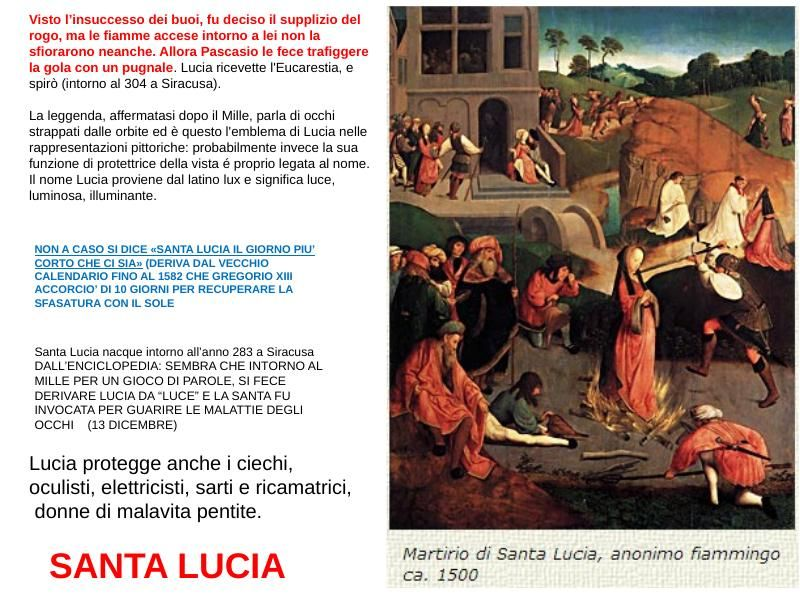{ loading=lazy style="width:59%" }

**SANTA LUCIA (13 DICEMBRE)**

Santa Lucia nacque intorno all’anno 283 a Siracusa. Visto l’insuccesso dei buoi, fu deciso il supplizio del rogo, ma le fiamme accese intorno a lei non la sfiorarono neanche. Allora Pascasio le fece trafiggere la gola con un pugnale. Lucia ricevette l’Eucaristia e spirò (intorno al 304, a Siracusa).

La leggenda, affermatasi dopo il Mille, parla di occhi strappati dalle orbite, ed è questo l’emblema di Lucia nelle rappresentazioni pittoriche: probabilmente invece la sua funzione di protettrice della vista è legata proprio al nome, che viene dal latino *lux* e significa luce, luminosa, illuminante. Dall’enciclopedia: sembra che intorno al Mille, per un gioco di parole, si fece derivare Lucia da «luce», e la santa fu invocata per guarire le malattie degli occhi.

Lucia protegge anche i ciechi, gli oculisti, gli elettricisti, i sarti e le ricamatrici, le donne di malavita pentite.

Non a caso si dice «Santa Lucia, il giorno più corto che ci sia» (deriva dal vecchio calendario, in uso fino al 1582, che Gregorio XIII accorciò di 10 giorni per recuperare la sfasatura con il sole).

*Martirio di Santa Lucia*, anonimo fiammingo, ca. 1500.

0:23:04

Santa Apollonia: un altro caso interessante, particolare. Dopo averle fatto cadere i denti e aver già preparato il falò (perché i persecutori di Santa Apollonia volevano farle rinnegare la fede cristiana), lei si getta direttamente nel fuoco. Questo è un rilievo di Felice Campi (1746-1817) che fa vedere questo momento, quando la santa si getta volontariamente nel fuoco. Questo invece è una miniatura di Jean Fouquet, del 1452-1460, che fa vedere la santa, che è invocata contro il mal di denti ed è patrona appunto dei dentisti e degli igienisti dentali: e vedete, le vengono cavati i denti direttamente con delle pinze mentre è legata. Se ci pensate, è una scena terribile, terrificante, come tutte quelle che abbiamo visto fino a ora.

**SANT’APOLLONIA (9 FEBBRAIO)**

Lo storico Eusebio, per la storia di questa Santa, si è rifatto a una lettera del vescovo Dionigi, e fa risalire i fatti ai moti pagani durante l’ultimo anno di regno dell’imperatore Filippo.

Il caso di Apollonia è particolare per un altro motivo: dopo averle fatto cadere i denti e preparato già il falò, i suoi persecutori le proposero di rinnegare la fede cristiana (e di pronunciare parole empie); Apollonia si fece slegare e si gettò da sola, volontariamente, tra le fiamme, il che creava qualche perplessità anche negli antichi padri della Chiesa: un conto è desiderare il martirio, un conto è procurarselo da soli; la sfumatura è importante. Agostino in particolare si mostra un po’ scandalizzato dalla prospettiva che le martiri facciano tutto da sole, senza chiedere aiuto ai maschi.

Felice Campi (1746-1817), *Sant’Apollonia si getta nel rogo*.

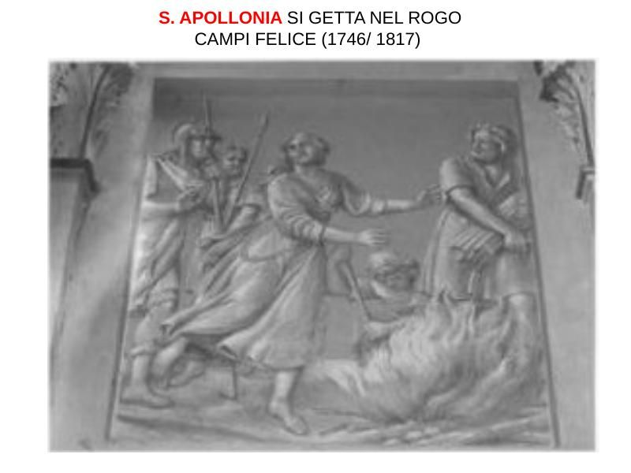{ loading=lazy style="width:47%" }

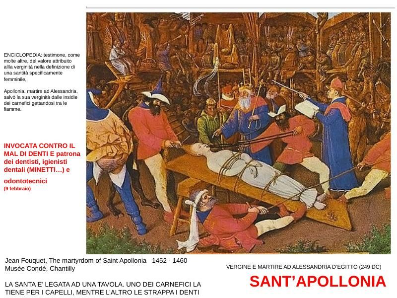{ loading=lazy style="width:47%" }

0:24:24

E qui c’è l’aneddoto delle reliquie, che diceva prima Lorenzo, che si lega con i santi. Nel Settecento i denti di Santa Apollonia in giro per la cristianità erano così tanti che il papa Pio VI li fece requisire tutti, li mise in un baule e li gettò nel Tevere, perché non era possibile che ci fossero tutti quei denti di Santa Apollonia. Questo per dire come si lega il concetto di santo.

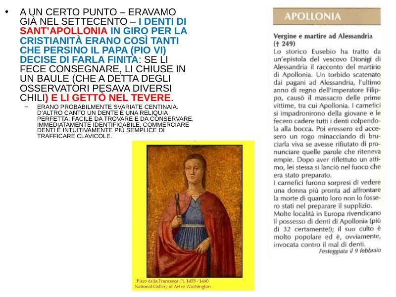{ loading=lazy style="width:59%" }

**SANT’APOLLONIA – VERGINE E MARTIRE AD ALESSANDRIA D’EGITTO (249 D.C.)**

Jean Fouquet, Il martirio di sant’Apollonia, 1452-1460, Chantilly, Musée Condé: la santa è legata a una tavola; uno dei carnefici la tiene per i capelli, mentre l’altro le strappa i denti.

Enciclopedia: testimone, come molte altre, del valore attribuito alla verginità nella definizione di una santità specificamente femminile, Apollonia, martire ad Alessandria, salvò la sua verginità dalle insidie dei carnefici gettandosi tra le fiamme. Invocata contro il mal di denti, è patrona dei dentisti, degli igienisti dentali (minetti…) e degli odontotecnici (9 febbraio).

A un certo punto – eravamo già nel Settecento – i denti di sant’Apollonia in giro per la cristianità erano così tanti che persino il papa (Pio VI) decise di farla finita: se li fece consegnare, li chiuse in un baule (che a detta degli osservatori pesava diversi chili) e li gettò nel Tevere.

Erano probabilmente svariate centinaia. D’altro canto un dente è una reliquia perfetta: facile da trovare e da conservare, immediatamente identificabile; commerciare denti è intuitivamente più semplice che trafficare clavicole.

0:24:52

Questa invece è Sant’Agata, che protegge contro le malattie del seno. Anche la sua è una storia simile a quelle di prima: anche di lei si innamorò un giovane, ma lei lo rifiutò, e allora lui la fece incarcerare. Lei è la santa siciliana, è il 5 febbraio. Vedete, in questo dipinto porta i seni in un piatto e ha alle spalle il velo rosso delle vergini: quel drappo rosso alle spalle è il simbolo della verginità. Questo è un altro dipinto che fa vedere il taglio dei seni di Sant’Agata, terribile da questo punto di vista, se lo vedete. Questo per dire che quello che hanno sofferto i santi è poi passato nella cultura popolare ed è arrivato fino a noi. Lascio la parola a Lorenzo per la sua introduzione.

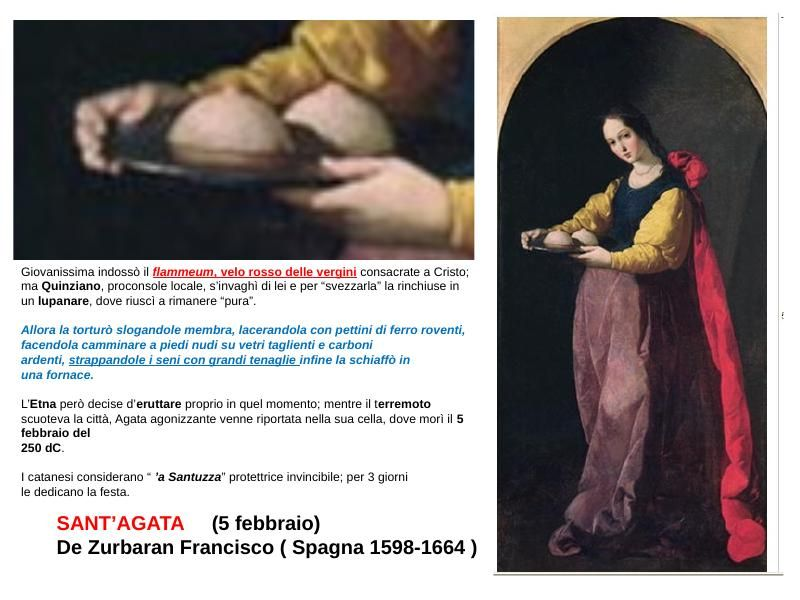{ loading=lazy style="width:47%" }

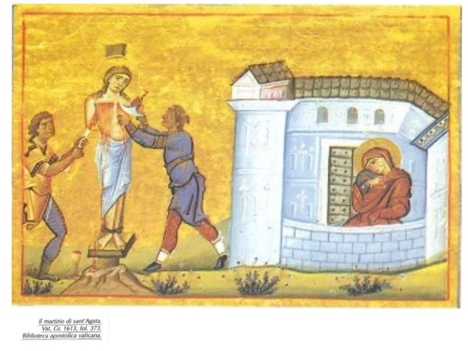{ loading=lazy style="width:47%" }

**SANT’AGATA (5 FEBBRAIO)**

Giovanissima indossò il *flammeum*, velo rosso delle vergini consacrate a Cristo; ma Quinziano, proconsole locale, s’invaghì di lei e per «svezzarla» la rinchiuse in un lupanare, dove riuscì a rimanere «pura». Allora la torturò slogandole le membra, lacerandola con pettini di ferro roventi, facendola camminare a piedi nudi su vetri taglienti e carboni ardenti, strappandole i seni con grandi tenaglie; infine la gettò in una fornace. L’Etna però decise di eruttare proprio in quel momento; mentre il terremoto scuoteva la città, Agata agonizzante venne riportata nella sua cella, dove morì il 5 febbraio del 251 d.C.

I catanesi considerano «’a Santuzza» una protettrice invincibile, e per tre giorni le dedicano la festa.

Francisco de Zurbarán (Spagna, 1598-1664), *Sant’Agata*; *Il martirio di sant’Agata*, miniatura, Biblioteca Apostolica Vaticana.

0:26:08

Lorenzo Poggi Sì, riprendiamo da qui. Allora, il discorso è essenzialmente questo: il santo rappresenta in qualche modo questo contatto con il trascendente e con la divinità. Perché si sviluppa particolarmente in Italia? Perché si crea una condizione politica tale per cui il potere politico è lontano, inaccessibile, e le classi sono estremamente conflittuali fra di loro. Nell’Europa dell’alto Medioevo, diciamo per 800 anni dalla caduta dell’Impero romano, non si crea una situazione in cui il singolo individuo si senta in qualche modo partecipe di una comunità e protetto. Il potere è arbitrario, lontano, incontrollabile, e quindi c’è la necessità di creare un potere alternativo, o qualche cosa che dia sicurezza.

0:27:30

L’unica autorità che rimane sul territorio è quella della Chiesa; quella politica è frammentata nei regni romano-barbarici, lo sappiamo tutti. E quindi occorre ricostituire in qualche modo un’autorità, ma non in astratto, in concreto; e questo ricostruire in concreto lo si ha anche, e soprattutto, attraverso questa figura dei santi. Per cui i santi, in questo modo di intenderli, legati alle condizioni più umane dell’esistere, della vita, sono veramente una parte integrante della nostra identità.

0:28:05

Noi come italiani, nella nostra identità di italiani, non abbiamo santi come Santa Giovanna d’Arco, o San Giacomo, santo patrono della Spagna: Iago, San Giacomo. San Giacomo è colui che guida i cristiani nella Reconquista, che alla battaglia di Las Navas de Tolosa appare in cielo a cavallo, opprime e sconfigge, mette sotto le zampe del cavallo e uccide i mori, i musulmani. Il suo appellativo è Santiago Matamoros, «ammazza-mori». Noi un santo che ammazza altra gente non l’abbiamo ancora inventato; santi ammazzati sì, quelli in grande quantità.

0:29:13

Nella figura di copertina, quella che è rimasta a lungo su questo schermo all’inizio, l’avete visto, c’era San Dionigi che reggeva la testa: decollato, con la testa in mano. E si diceva: accidenti, vi immaginate il boia come c’è rimasto, che figura ha fatto… li dà la gente e poi si risulta, l’hanno messo in casa. Santi decollati sicuramente, ma non è il solo episodio. Il 12 maggio, festa della mamma, papa Francesco ha proclamato santi gli 800 martiri idruntini, gli 800 martiri di Otranto: per cui io credo che oggi abbiamo il primato di una città, Otranto, che ha 800 santi patroni. Non so se l’hanno scritto nel Guinness dei primati, ma voglio vedere chi ha 800 santi patroni. Poi gli otrantini così non hanno problemi: quando si rivolgono a uno, uno libero lo trovano sicuramente.

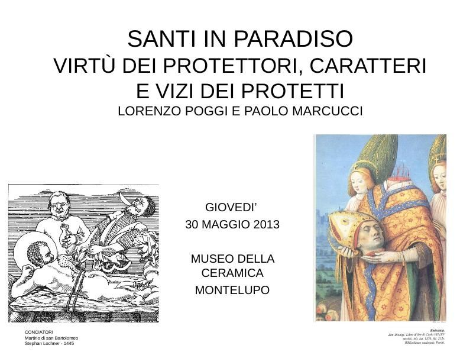{ loading=lazy style="width:47%" }

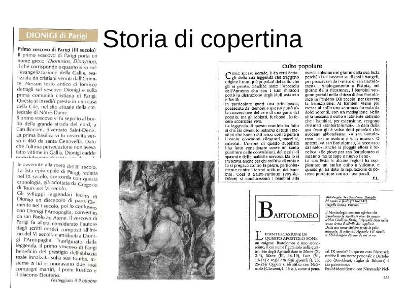{ loading=lazy style="width:47%" }

0:30:28

Questi 800 martiri idruntini sono capeggiati da Antonio Primaldo: si rifiutarono di convertirsi all’Islam e vennero decapitati sulla collina di fronte alla città. Le ossa sono ancora conservate nella parte destra della chiesa, dietro l’altare maggiore, e sotto l’altare c’è la pietra su cui vennero decollati. Il primo, Antonio Primaldo si chiamava, raccolse la testa e si mise in piedi (simile a Dionigi, vedete: tutto si ripete nella storia) e aspettò che tutti gli altri fossero decollati. Il boia ci rimase malissimo, si rifiutò di continuare; lo sostituirono, lo licenziarono, lo sostituirono con un altro e lo fecero impalare. Poi va’ a fare il boia…

0:31:31

Comunque, dicevo, nella nostra identità profonda noi abbiamo un santo patrono d’Italia che non è come Santiago Matamoros: San Francesco. Ma San Francesco si confronta con l’Islam? Certo, si confronta; però si confronta parlando, discutendo, scoprendo anche nel Sultano che cosa? La comune umanità. Questo è il carattere profondo dei nostri santi. San Francesco inventa che cosa? Inventa il presepe, cioè l’esaltazione, la commemorazione del fatto più profondo, intimo, personale, che ci lega agli altri: quello della famiglia, quello della nascita, quello della madre, del padre e del figlio. Sono santi diversi, ed è in questo che dobbiamo ricercare la nostra identità, il nostro essere italiani e il nostro ragionare in un certo modo.

0:32:50

Quindi dicevo… ah, le reliquie: ora mi viene in mente un’altra reliquia. Voi sapete il patrono di Empoli, così parliamo di roba vicina: il patrono di Empoli è Sant’Andrea (poi diciamo anche un’altra cosa, ma intanto questa). Le reliquie, il corpo di Sant’Andrea viene rubato dagli amalfitani (siamo circa alla metà del Duecento) a Costantinopoli e portato ad Amalfi. Dal sarcofago, dalla tomba di Sant’Andrea, emana un liquido, la manna, miracolosissimo. Due santi fanno acqua, fanno il liquido: uno è Sant’Andrea, appunto, e l’altra è Santa Ildegarda di Bingen, che la fa un po’ più scura. Mentre qualcuno di voi magari poi va, la acquista e gli vendono: «Questa non è di Sant’Andrea, questa è di Santa Ildegarda»… Basta, dunque, dicevamo: gli amalfitani diverranno da quel momento in poi esportatori di questa sostanza, di questa manna miracolosissima per una serie di malattie, ma soprattutto per chi ha problemi di erezione, perché Sant’Andrea (voi sapete, andros, maschio), fra le altre cose, è un santo che aiuta le donne da marito, ma soprattutto quelle che vogliono avere un figlio.

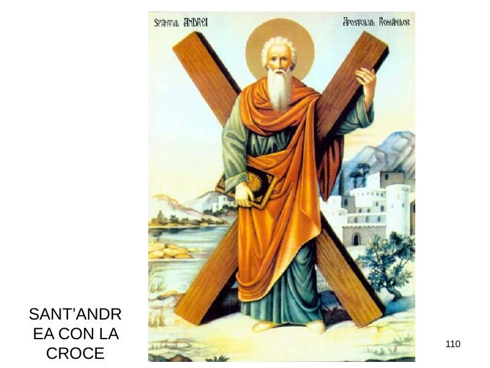{ loading=lazy style="width:41%" }

0:35:10

L’episodio lo raccontiamo ormai rapidamente. Vi ho portato anche un’immagine… Ecco, questa bella signora (insomma, non è bellissima)… lei è Violante di Baviera, andata sposa a Ferdinando de’ Medici, il Gran Principe, perché non arriverà mai a essere granduca: morirà prima. Suo padre è il granduca Cosimo III, persona piissima, piissima. Lei è Violante di Baviera, e si aspettavano degli eredi al trono. Non ci saranno: infatti poi passerà al fratello, Gian Gastone, poi la dinastia si estinguerà; ma lasciamo stare la storia, non faccio il professore di storia, veniamo a noi.

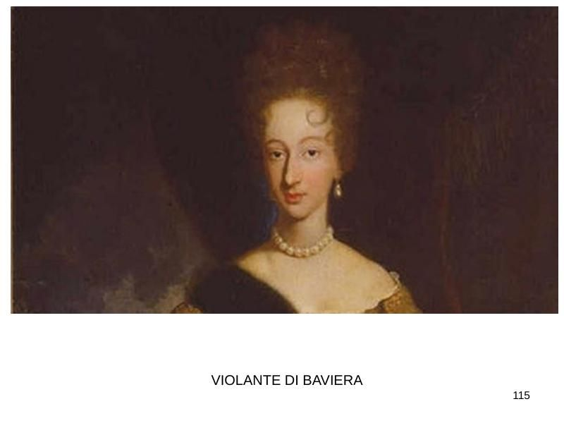{ loading=lazy style="width:39%" }

0:36:23

Dicevo, il punto è questo: non riescono ad avere figli. Ferdinando non ci riesce: sarà che lei non era una gran bellezza, ma era una donna molto colta, affascinante… Tentavano, insomma, però non andava. Sarà che lui era un po’ ambiguo, diciamo così, e aveva anche un caro amico, un musicista come lui, venuto da Venezia… Va bene, comunque la cosa non andava. Allora decisero di fare dei tridui, delle offerte, di invocare Sant’Antonio (Sant’Antonio va bene per tutte le grazie, diciamo): preghiere a Sant’Antonio ecc. Finché non venne un canonico, si pensa empolese, un certo Francesco Pizzichi, che andò da Cosimo e gli disse: «Ma che Sant’Antonio! Ci vuole Sant’Andrea: Sant’Andrea è veramente androsa. Facciamo un triduo». «Ma non basta un triduo, perché qui il caso è grave: ci vuole qualcosa di più».

0:38:00

«Facciamo un cubo di pietra, lo mettiamo in piazza San Marco, allo sbocco di via degli Arazzieri, ci mettiamo sopra una colonna, e in cima alla colonna mettiamo la statua di Sant’Andrea: e vedrai che Violante di Baviera resta incinta, il giorno dopo ci fa la grazia». Allora cominciarono i lavori, fecero il cubo; intanto Pizzichi si fece una bella casa, con questi appalti. Poi i lavori non andarono più avanti, e rimase a lungo questo ingombro allo sbocco di via degli Arazzieri, con questo pezzo di colonna che avevano cominciato e il cubo nel mezzo. I fiorentini, dopo un po’ di tempo con questo affare nel mezzo, ci applicarono un cartello (non solo le statue parlanti: anche le colonne parlano), un cartello che diceva: «Caro Pizzichi, per ingravidare le donne ci vogliono cazzi, non colonne». Siamo chiarissimi: questo vuol dire che il popolo qualche volta non ha tutta questa fiducia nei santi.

0:39:23

Un’ultima cosa. Dicevamo: il miracolo del santo, il fatto che il santo sia interprete di queste trascendenze, sia veramente chi aiuta, chi porta le aspirazioni della gente verso chi può veramente esaudirle. In questi tempi, nei tempi antichi, è soprattutto un miracolo legato alla salute del corpo, perché è con la salute del corpo che si riesce a lavorare e a vivere. Quindi i santi più importanti, quelli più venerati, sono i santi che fanno i miracoli, ma sono i santi guaritori, sono i santi medici, quelli che in qualche modo sanano il corpo; e sono ampiamente specializzati: quindi è fondamentale questa cosa. E quindi vedremo i santi specializzati, come Sant’Andrea, perché è fondamentale la continuazione della specie, è fondamentale avere figli.

0:41:06

In un periodo in cui la mortalità infantile è elevatissima… vi do solo un dato, tanto poi ne parliamo: Santa Caterina da Siena è la ventiduesima figlia di Lapa, la mamma si chiama così. È la ventiduesima figlia: Lapa, quando partorisce Santa Caterina, insieme a un’altra, è un parto gemellare; ha fatto più parti gemellari, non le sono campati tutti; ha una dozzina fra fratelli e sorelle, insomma, Santa Caterina. La sorellina muore, per esempio. Ma Lapa (la mamma di Santa Caterina si chiama Lapa Piagenti) non è un caso eccezionale: le donne passano tutta la loro vita a fare figli. È questa la loro funzione fondamentale in un tempo… qui siamo a Siena nel Trecento, ma lo potremmo dire anche per altri momenti della storia. Quindi anche i santi che riguardano la procreazione, i figli, sono santi medici importantissimi. Su questo torneremo: parleremo delle specializzazioni dopo l’intervallo.

\[PAUSA\]
{: .nota }

0:18:40

Paolo Marcucci Bene, riprendiamo con la prima parte dopo l’introduzione. Allora, abbiamo visto come per i fedeli, per il popolo, i santi rappresentino appunto la mediazione verso Dio; e quindi la tradizione, anche iconica, delle chiese, le raccolte di leggende e di prediche sono diventate per i fedeli la prova della potenza dei santi. C’è un pratico sentire del popolo verso i santi, che abbiamo anche accennato prima: Lucia, per esempio, ha finito non già per proteggere la vista in quanto è santa, ma al contrario per essere santa in quanto protegge la vista. È un approccio pragmatico: è santa perché ci protegge la vista.

0:20:00

Questo è il punto. Qui si pone, ad esempio, un tema interessante: un confronto con la concezione protestante della fede, l’idolatria che i protestanti rimproverano ai cattolici, a noi italiani in particolare. Anche perché questa storia dei santi pone da questo punto di vista anche una questione teologica: a un certo punto si mettono più in evidenza le opere umane dei santi, che una volta sono stati uomini, piuttosto che la fede stessa.

0:20:44

Per raccontare questa diversità tra l’interpretazione cristiana cattolica e quella protestante vediamo un film (non ve lo faccio vedere, naturalmente, ma ve lo racconto) di Alberto Sordi: si chiama *Fumo di Londra*, del 1966; queste sono le locandine del film di quell’anno. Alberto Sordi si trova a Londra, ospite in una famiglia protestante. A cena, quando sono lì, come noi, per fare la cena, i padroni di casa gli propongono cortesemente di leggere con loro qualche versetto della Bibbia. A quel punto Alberto Sordi li guarda e dice: «Mi dispiace infinitamente, ma io sono cattolico. Good night», e va a letto.

{ loading=lazy style="width:47%" }

**FUMO DI LONDRA* (1966)**

L’ALBERTONE NAZIONALE SI TROVA A LONDRA, OSPITE DI UNA FAMIGLIA PROTESTANTE. A CENA GLI PROPONGONO CORTESEMENTE DI LEGGERE CON LORO QUALCHE VERSETTO DELLA BIBBIA. ALBERTO SORDI, ROMANO, CATTOLICISSIMO E RELIGIOSISSIMO (NELLA VITA REALE), RISPONDE: «MI DISPIACE INFINITAMENTE, MA SONO CATTOLICO. GOOD NIGHT».

QUESTO PER DIRE CHE I CATTOLICI ITALIANI NON HANNO MOLTA DIMESTICHEZZA NÉ CON IL VECCHIO NÉ CON IL NUOVO TESTAMENTO: NOI LA BIBBIA LA LEGGIAMO POCHISSIMO.

PROBABILMENTE, SE QUALCUNO AVESSE CHIESTO AL PERSONAGGIO DI SORDI UN PENSIERO SU UN SANTO, SICURAMENTE CI SAREBBE STATO. QUESTO CI DICE DEL NOSTRO RAPPORTO CON I SANTI (CENTINAIA E CENTINAIA) E DEL SUO RISPECCHIAMENTO – E DEL SUO MODELLO – NEL NOSTRO CLIENTELISMO FAMILISTICO.

ANCHE IL TROVARE LAVORO SEGUE QUESTA PRASSI: PARENTI, CUGINI, COGNATI, NIPOTI. E UN AMICO IN PREFETTURA, UN ALTRO ALL’UFFICIO DELLE IMPOSTE, A VOLTE UN SOTTOSEGRETARIO. CI VUOLE SEMPRE QUALCUNO CHE CI PROTEGGA IN CIELO E IN TERRA: NON SI DICE FORSE «AVERE UN SANTO IN PARADISO»?

0:21:43

Questo che significa? Significa che per noi in Italia la Bibbia è importante, però sostanzialmente non la leggiamo; la leggono invece gli anglosassoni, e quelli che vengono dopo la riforma protestante. Se ad Alberto Sordi avessero chiesto un aneddoto su un santo, sicuramente ne avrebbe avuti a volontà. E questo, con i santi, ci fa vedere anche che noi abbiamo un rapporto di clientelismo: tutti abbiamo l’amico che lavora alle poste, all’ufficio delle tasse, al ministero, l’amico di un amico, il cugino ecc. È questo rapporto che si mischia con il concetto di santi, su cui abbiamo sempre appoggiato il nostro modello.

0:22:37

C’è chi ha sempre detto che la mancata riforma protestante, che non abbiamo avuto noi in Italia e in Spagna in special modo, ci ha condannato anche a una retroguardia da un punto di vista culturale. Sinceramente io non sono molto d’accordo sulla superiorità dell’Europa protestante rispetto a quella cattolica, però è interessante da un punto di vista filosofico. Tornando per esempio al discorso delle reliquie, a cui accennavamo prima nell’introduzione: Lutero si scaglia contro il commercio delle reliquie, perché era appunto l’espressione di un male considerato verso i santi e quello che rappresentavano. Nella maggior parte delle chiese di origine protestante Gesù Cristo, come deriva dal Nuovo Testamento, è il solo mediatore tra Dio e gli uomini: quindi è del tutto diverso rispetto a quello che noi invece pensiamo di avere tramite i santi.

**I SANTI, LA BIBBIA E I PROTESTANTI\**

Ritorna sempre il discorso della mancata riforma protestante in Italia come causa di molti nostri mali. Davvero l’Italia sarebbe stata diversa se la riforma protestante avesse attecchito anche da noi? Su questo ci siamo già espressi altre volte, e sinceramente non concordiamo sulla «superiorità» dell’Europa protestante; però è interessante da un punto di vista filosofico.

I protestanti (almeno apparentemente) si affidano di più alle leggi che alle persone. Sul culto dei santi (e delle loro reliquie) s’incentra uno dei capitoli più drammatici dell’urto tra la cristianità cattolica e la cristianità riformata (siamo naturalmente nell’ambito dell’Occidente).

La maggioranza delle chiese protestanti non ammette il culto dei santi, poiché la venerazione di un santo e la richiesta di una particolare «grazia» attraverso la sua intercessione sarebbero in netto contrasto con il principio del *solus christus*, cioè l’affermazione – fondata nel Nuovo Testamento – che soltanto Gesù Cristo è il mediatore tra Dio e gli uomini.

Noi invece ci rivolgiamo ai santi per chiedere ogni tipo di favore: un perdono, un favore, una sanatoria di peccati presenti e futuri; per le indulgenze, per la permanenza in purgatorio: ciò scandalizzava Lutero.

Nella *Mandragola* di Machiavelli c’è un devoto che chiede devotamente all’autorità religiosa: «Credete voi che il turco passi quest’anno in Italia?» (che paura dei turchi doveva esserci in quell’epoca…). L’autorità religiosa risponde: «se voi non fate orazione, sì». Quindi, se voi non pregate e non lasciate qualche obolo alla chiesa, sì, il turco passa (ed è terribile, il turco…). Noi scherziamo, ma la paura di essere trucidati deve essere stata brutta.

Melchior Ramminger, *Vendita d’indulgenze*, 1525 ca.

\* Alcuni spunti sono tratti da Placido e Montanelli.

0:24:01

Questo scandalizzava Lutero: il mercato delle indulgenze. Lutero infatti promuoveva la lettura diretta della Bibbia: questa è la Bibbia di Lutero del 1534, che egli stesso traduce in tedesco corrente per farla leggere. Questa filosofia della fede, e la tradizione secolare della lettura, secondo me si vede benissimo in questa foto che ora vi faccio vedere: sono degli operai al lavoro in una fabbrica americana, alla General Motors di Kansas City. Vedete, sono alcuni operai che nella pausa di lavoro leggono la Bibbia. Io credo che un’immagine come questa in Italia non sarebbe nemmeno concepibile; ma deriva dalla cultura protestante della lettura diretta della Bibbia, che Alberto Sordi aveva invece rifiutato, perché noi ci approcciamo alla fede in un altro modo, tramite qualcun altro: nel tema di stasera, appunto, i santi.

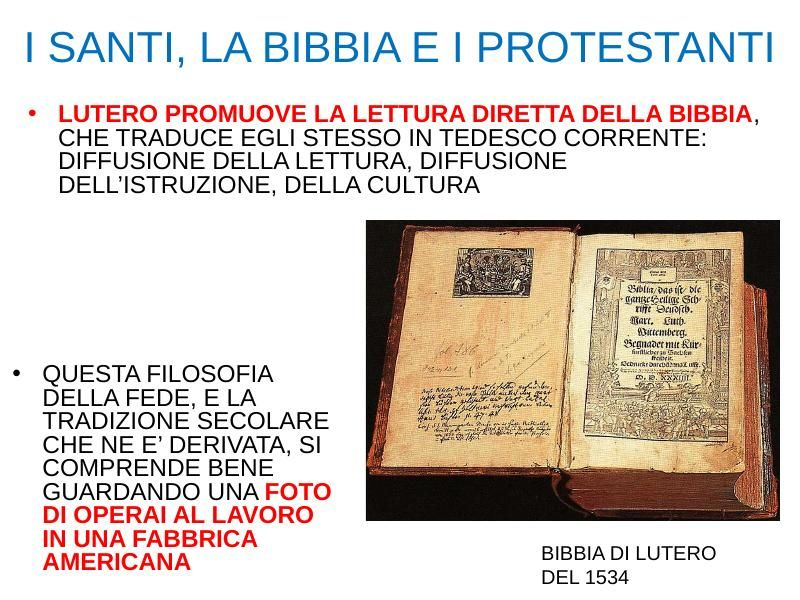{ loading=lazy style="width:47%" }

{ loading=lazy style="width:47%" }

0:25:15

Interessante a questo proposito è anche la storia delle Bibbie negli hotel. Se a qualcuno è capitato all’estero, sapete che molte volte sul comodino degli hotel ci sono le Bibbie: questa per esempio è una foto di un comodino di un hotel dove si vede la Bibbia. Tra l’altro ci sono anche le versioni elettroniche, perché il mondo va avanti e non basta più solo quella. A Stoccolma hanno messo la Bibbia anche con qualche gadget, dei sex toys, perché anche qui l’evoluzione va avanti: oltre alla Bibbia forniamo anche dei gadget da usare nella camera d’albergo.

**I SANTI, LA BIBBIA E I PROTESTANTI**

Nella Chiesa romana, invece, chi si rivolge all’assoluto senza mediazione è oggetto di censura e di condanna da parte della Chiesa.

La riforma contribuisce così alla ricostruzione dell’io cristiano riformato: l’interpretazione della Bibbia è mia e non dipende dalla mediazione e dall’autorità di nessuno.

Interessante a questo proposito, e ci spiega bene questa concezione religiosa, è la storia delle Bibbie sui comodini degli hotel.

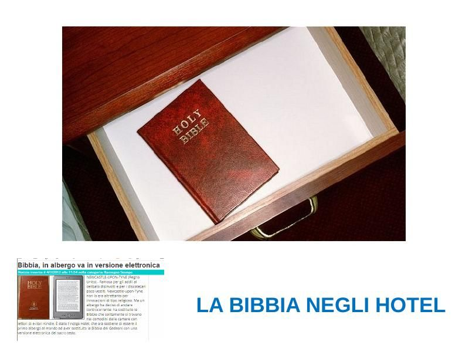{ loading=lazy style="width:47%" }

{ loading=lazy style="width:47%" }

0:26:12

Come nasce questa storia della Bibbia negli hotel? Nasce dalla concezione che si rifaceva alla riforma protestante. Un commesso viaggiatore, tale John Nicholson, si ritrova una notte a dormire in un albergo; non c’è la camera, la deve dividere con un altro, e si ritrovano tutti e due a leggere la Bibbia prima di addormentarsi. Da lì gli nasce l’idea di fornire la Bibbia a tutti gli hotel; ma nasce da questa cultura che si diceva prima.

**STORIA MODERNA DELLA BIBBIA NEGLI HOTEL**

Per conoscere le origini di questa tradizione bisogna risalire al 1898, quando un certo John H. Nicholson, viaggiatore di commercio del Wisconsin, giunse al Central Hotel di Boscobel per passarvi la notte e, dato che l’albergo era pieno, fu invitato a occupare una stanza doppia insieme a Samuel E. Hill. Quando John Nicholson, prima di coricarsi, prese la Bibbia per leggerla, i due uomini scoprirono di essere entrambi credenti e decisero di recitare insieme le loro preghiere serali.

Da questa esperienza nacque ai due un’idea, degna del migliore pragmatismo americano: indire una riunione di tutti i viaggiatori di commercio cristiani evangelici, per conoscersi e vedere se fosse possibile elaborare un nuovo progetto di evangelizzazione.

Alla riunione si presentarono solo in tre: John H. Nicholson, Samuel E. Hill e Will J. Knights. L’esiguo numero non scoraggiò, però, i tre dal fondare un’associazione per l’evangelizzazione cristiana che si proponesse di testimoniare Dio in ogni momento, in ogni luogo e in ogni circostanza della vita. Decisero di chiamarla «gedeoni» (The Gideons International), traendo il suggerimento dai capitoli 6 e 7 del Libro dei Giudici, dove si parla di Gedeone, un uomo disposto a compiere sempre la volontà di Dio con umiltà, fede e obbedienza. Se la finalità dell’associazione era la testimonianza, i membri, essendo tutti viaggiatori di commercio, pensarono di dover testimoniare il loro credo innanzitutto negli alberghi, il posto dove erano costretti a trascorrere la maggior parte del loro tempo.

Fu suggerito, inizialmente, di collocare una Bibbia sul *reception desk* di ogni albergo, a disposizione dei clienti che intendevano prenderla in prestito; poi uno dei fiduciari suggerì addirittura di rifornire di una Bibbia ogni camera da letto degli alberghi degli Stati Uniti.

I «gedeoni», viaggiatori di commercio, sapevano per esperienza che quando la gente sosta in albergo per motivi di lavoro, di vacanza o per altre necessità, lontano da casa, può aver bisogno di una parola di conforto. Così, dal 1908, iniziarono a distribuire gratuitamente Bibbie nelle stanze degli hotel e dei motel, e da allora ne sono state distribuite oltre 1,6 miliardi di copie. I «gedeoni» sono attivi in Germania, Svizzera, Austria e anche in Italia.

www.laporzione.it, 14 settembre 2011.

0:26:51

E questo fa sì che dal punto di vista protestante nasca un uomo nuovo, che ha la libertà e la responsabilità. La coscienza è importante, perché guida quest’uomo nuovo nelle scelte, a differenza invece dell’educazione cattolica, che ha un altro approccio: noi forse abbiamo non un’educazione alla coscienza, bensì all’obbedienza, se possiamo parlare in questi termini astratti e di ampio respiro. La forza del cattolicesimo è invece creare un insieme di riflessi collettivi intorno al singolo; è un po’ quello che diceva prima Lorenzo nella sua introduzione. Nella nostra concezione cattolica l’approccio è un insieme collettivo che protegge il singolo individuo: è una coscienza sociale del tutto diversa rispetto al modello protestante.

0:27:58

L’uomo della riforma protestante invece sente il rigore, la libertà, la responsabilità e il forte senso del proprio io interiore. Questo si ripercuote anche nelle conferme esibizionistiche mondane: Sciascia parlava di *inseguridad*, insicurezza, dell’Italia e della Spagna, perché non erano state toccate dalla riforma. Queste conferme esibizionistiche esteriori le vediamo per esempio in queste immagini. Questo è Martin Lutero, ritratto da Lucas Cranach il Vecchio nel 1519-1520: vedete l’austerità con cui il pittore rappresenta la figura. E questo invece è il Messale Borgia, con il ritratto di Alessandro VI, Rodrigo Borgia: vedete la ricchezza degli abiti, la fastosità, la bellezza dell’abito esteriore.

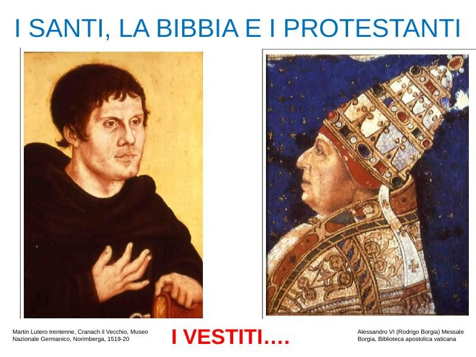{ loading=lazy style="width:59%" }

**I SANTI, LA BIBBIA E I PROTESTANTI**

Nasce quindi un nuovo uomo: libertà e responsabilità. La coscienza diventa così importante, perché ci guida nelle nostre scelte, a differenza invece dell’educazione cattolica.

Per molti versi l’educazione cattolica, si può dire, non è un’educazione alla coscienza, bensì all’obbedienza. La forza del cattolicesimo è nel creare un ambiente, un insieme di riflessi collettivi intorno al singolo: diviene così una coscienza sociale. Questa è la grande differenza.

L’uomo della riforma protestante, invece, sente il rigore, la libertà, la responsabilità: un forte senso del proprio «io» interiore. Quest’uomo non ha bisogno delle conferme esibizionistiche, mondane, del nostro povero «io» cattolico: l’inseguridad di cui parlava Sciascia a proposito di italiani e spagnoli, non toccati dalla riforma.

Lucas Cranach il Vecchio, *Martin Lutero trentenne*, 1519-1520, Norimberga, Germanisches Nationalmuseum; Alessandro VI (Rodrigo Borgia), Messale Borgia, Biblioteca Apostolica Vaticana.

0:29:00

Questo per esempio è Sant’Eligio, il protettore degli orefici; è di scuola fiamminga, e vedete che anche qui non c’è ostentazione della ricchezza come nel Borgia. È una ricchezza che si vede, sobria: si vede che non sono figure del popolo, però non è una ricchezza così eclatante e pacchiana, se mi consentite il termine. Questo è Rembrandt, ed è esemplare la storia di Rembrandt, perché nel 1631, per esempio (questo è uno dei tanti dipinti di quel periodo), ritrae un ricco mercante fiammingo che aveva fatto fortuna, e lo ritrae sempre con questa concezione della sobrietà: la ricchezza degli abiti, i tessuti pregiati, ma senza ostentazione.

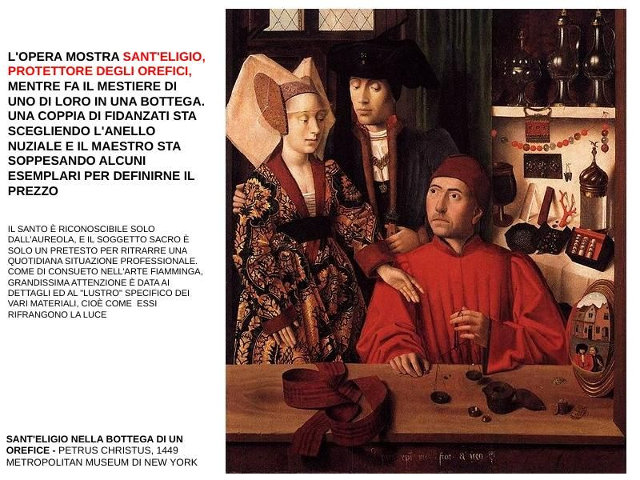{ loading=lazy style="width:47%" }

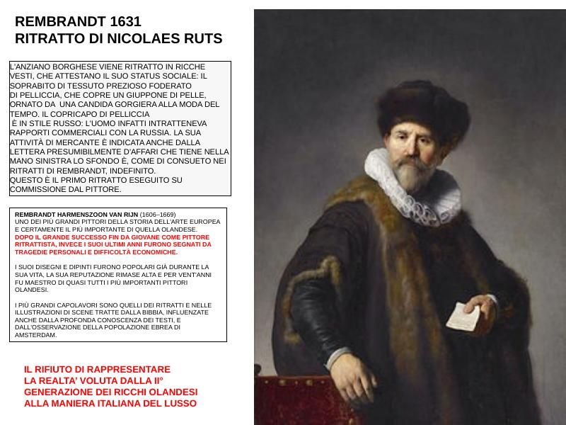{ loading=lazy style="width:47%" }

**PETRUS CHRISTUS, *SANT’ELIGIO NELLA BOTTEGA DI UN OREFICE* (1449) – NEW YORK, METROPOLITAN MUSEUM OF ART**

L’opera mostra Sant’Eligio, protettore degli orefici, mentre fa il mestiere di uno di loro in una bottega. Una coppia di fidanzati sta scegliendo l’anello nuziale e il maestro sta soppesando alcuni esemplari per definirne il prezzo. Il santo è riconoscibile solo dall’aureola, e il soggetto sacro è solo un pretesto per ritrarre una quotidiana situazione professionale. Come di consueto nell’arte fiamminga, grandissima attenzione è data ai dettagli e al «lustro» specifico dei vari materiali, cioè a come essi rifrangono la luce.

**REMBRANDT, *RITRATTO DI NICOLAES RUTS* (1631)**

L’anziano borghese viene ritratto in ricche vesti, che attestano il suo status sociale: il soprabito di tessuto prezioso foderato di pelliccia copre un giuppone di pelle, ornato da una candida gorgiera alla moda del tempo. Il copricapo di pelliccia è in stile russo: l’uomo infatti intratteneva rapporti commerciali con la Russia. La sua attività di mercante è indicata anche dalla lettera, presumibilmente d’affari, che tiene nella mano sinistra. Lo sfondo è, come di consueto nei ritratti di Rembrandt, indefinito. Questo è il primo ritratto eseguito su commissione dal pittore.

Rembrandt Harmenszoon van Rijn (1606-1669) è uno dei più grandi pittori della storia dell’arte europea, e certamente il più importante di quella olandese. Dopo il grande successo, fin da giovane, come pittore ritrattista, i suoi ultimi anni furono segnati da tragedie personali e difficoltà economiche. I suoi disegni e dipinti furono popolari già durante la sua vita, la sua reputazione rimase alta e per vent’anni fu maestro di quasi tutti i più importanti pittori olandesi. I suoi più grandi capolavori sono i ritratti e le illustrazioni di scene tratte dalla Bibbia, influenzate anche dalla profonda conoscenza dei testi e dall’osservazione della popolazione ebraica di Amsterdam.

Il rifiuto di rappresentare la realtà voluta dalla seconda generazione dei ricchi olandesi, alla maniera italiana del lusso.

0:30:10

Rembrandt finisce in povertà. All’inizio ha un grande successo (è forse uno dei più grandi pittori della scena europea di sempre), però finisce in miseria, perché si rifiuta di lavorare per la seconda generazione di ricchi fiamminghi, che volevano rappresentazioni pittoriche più all’italiana, che assomigliassero di più a quel ritratto del Borgia che vedevamo prima. Lui si rifiuta, perché nella sua concezione d’artista non le vuol fare, e finisce in miseria perché non ha più nemmeno commesse.

0:30:53

Poi, nella storia dei santi, è importante che tantissime persone, tantissime vite aspirino a essere sante; e qui entra in gioco la gerarchia ecclesiastica, perché attraverso i padri bollandisti si rimette ordine su chi ha diritto o no a essere santo. È interessante da questo punto di vista, perché i santi sono talmente tanti che emergono dei codici tipologici (ora ve ne faccio vedere qualcuno): per ogni problema, per ogni difficoltà c’è un santo. Lo diceva Lorenzo: ce ne sono un’infinità, ce ne sono delle famiglie, ci sono dei capostipiti da cui discendono tutti gli altri; aspetto fisico, sesso, età, di tutto. E c’è naturalmente, come in tutte le cose, quello che ora chiameremmo turnover: ci sono santi che sono andati di moda prima, ora ce ne sono altri, e così via.

**STORIA DEI SANTI**

Dopo questa digressione, e fatta questa comparazione tra protestanti e cattolici in tema di santi, torniamo ai problemi della Chiesa, che aveva visto crescere in modo esponenziale il numero degli aspiranti santi.

Esemplarità dei santi e storicità dei santi: ove uno di questi elementi manchi, il santo non è più tale. Ecco perché, dai padri bollandisti\* in poi, si sono tanto spietatamente perseguitati i molti santi nati dalla fantasia, dalla *pietas*, dalle ragioni acculturanti connesse con il processo di conversione.

Il carattere eroico del santo sta semplicemente nel costruire un modello, una guida, un paradigma; ciò può accadere anche in un ambito molto umile e modesto. Scorrendo la letteratura agiologica, i santi e le loro vite si possono scomporre e ricomporre all’infinito, ed emergono codici tipologici.

Una vasta quantità di vite di santi finiscono per assomigliarsi, per formare delle «famiglie», ciascuna delle quali ha un capostipite, anche perché ci sono situazioni «obbligate» che ci si aspetta vengano rivissute regolarmente da un santo. Si possono così ripartire i santi per origine etnica, per sesso, per fasce d’età, per condizione sociale, per aspetto fisico, per professione ecc.

La santità diventa così uno specchio polimorfo della vita: non c’è situazione, non c’è condizione che non possa condurre ad essa, e per ogni strada è lì pronto un modello.

I santi subiscono il passaggio del tempo (il *turnover*, diremmo oggi): accanto ai «classici» (Caterina da Siena, Angela da Foligno, Caterina Fieschi, Maria Maddalena de’ Pazzi, Ignazio di Loyola, Francesco d’Assisi…) si affiancano entrate più moderne (Teresa di Lisieux, Giovanni Bosco, Pio da Pietrelcina, Maria Goretti…).

\* I bollandisti (i primi erano gesuiti) si occupavano della raccolta critica dei documenti e dei dati sui santi. Prendono il nome dal gesuita belga Jean Bolland, che iniziò il lavoro nel 1643, poi portato avanti dai suoi successori.

0:32:06

Lì sopra c’è un’enciclopedia da cui abbiamo tratto molte delle immagini di stasera, la *Storia dei santi e della santità cristiana* (Grolier Hachette International, 1991): sono 11 volumi. Colgo l’occasione per ringraziare Massimo, il nostro bibliotecario, che ha acquistato quest’opera per la nostra biblioteca qui a Montelupo: per fortuna l’ha acquistata, perché è un’opera veramente interessante, e ci ha fatto un po’ da guida nella ricostruzione di questa sera. Questo per dire che sono tantissimi i santi contenuti in quegli 11 volumi di storia dei santi. I santi sono partiti attraverso il calendario, che ha riempito tutti i giorni dell’anno, e poi ci sono le categorie di santi.

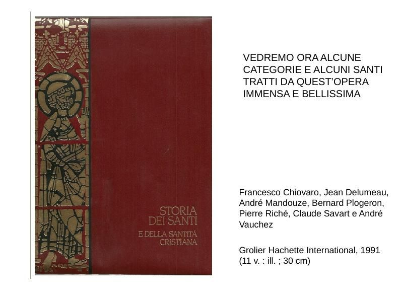{ loading=lazy style="width:47%" }

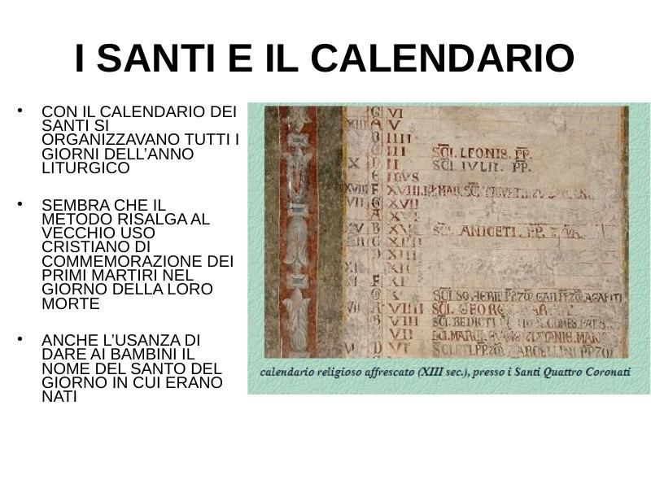{ loading=lazy style="width:47%" }

Francesco Chiovaro, Jean Delumeau, André Mandouze, Bernard Plongeron, Pierre Riché, Claude Savart e André Vauchez, *Storia dei santi e della santità cristiana*, Grolier Hachette International, 1991 (11 volumi). Vedremo ora alcune categorie e alcuni santi tratti da quest’opera immensa e bellissima.

**I SANTI E IL CALENDARIO**

Con il calendario dei santi si organizzavano tutti i giorni dell’anno liturgico. Sembra che il metodo risalga all’antico uso cristiano di commemorare i primi martiri nel giorno della loro morte; da qui anche l’usanza di dare ai bambini il nome del santo del giorno in cui erano nati.

0:33:01

Ve ne faccio vedere qualcuna, tanto per rendere l’idea. Questi sono i santi protettori degli animali: gli animali, San Francesco d’Assisi; i bovini, San Cornelio; i cani, San Vito; e così via. Questi invece sono i santi protettori dagli animali, cioè dagli animali nocivi: Sant’Agostino; gli animali nocivi alle coltivazioni, San Magno; i lupi, San Defendente; e così via. Queste invece (ne ho contate 168, ma credo di essere sicuramente in difetto) sono le professioni e i mestieri protetti dai santi: 168, pensate quante ce ne sono, è un’infinità. Per esempio gli esplosivi, Santa Barbara, lo sappiamo; gli archeologi, San Girolamo; i cavalieri, San Giorgio; i falegnami, San Giuseppe, il falegname per eccellenza; gli innamorati, San Valentino; i macellai, Sant’Antonio Abate; i teologi, Sant’Agostino; gli ubriachi, San Noè, che secondo me ha anche un’ironia di fondo; i viaggiatori, San Cristoforo; i vigili del fuoco, sempre Santa Barbara.

**SANTI PROTETTORI *DEGLI* ANIMALI**

animali: San Francesco d’Assisi, Sant’Antonio Abate

animali da cortile: Santa Brigida d’Irlanda, Santa Farailde di Gand

api: Sant’Ambrogio, San Bernardo di Chiaravalle

bachi da seta: San Giobbe

bovini: San Cornelio, San Colmano di Stockerau

cani: San Vito, San Rocco

cavalli: San Marcello, San Martino di Tours, Sant’Antonio Abate, San Giorgio

colombi: Santa Colomba

gallinacei: San Gallo, Santa Farailde di Gand

gatti: Santa Gertrude di Nivelles

maiali: Santa Gilda, Sant’Antonio Abate

muli: San Gerardo Maiella

oche: San Martino di Tours

uccelli: San Biagio

**SANTI PROTETTORI *DAGLI* ANIMALI**

animali nocivi: Sant’Agostino, Santa Barbara

animali nocivi alle coltivazioni: San Magno di Füssen

lupi: San Defendente, Sant’Ignazio di Loyola, Santa Radegonda

morsi dei cani: San Bellino di Padova, San Vito, Sant’Uberto, Sant’Eleuterio di Arce, San Donnino martire

morsi dei rettili: San Domenico di Sora, San Foca di Sinope, Sant’Ilario, San Paolo, San Primino, Sant’Uberto, San Volfango, San Donnino martire

topi: Santa Gertrude di Nivelles, San Nicasio di Reims, San Martino de Porres, Sant’Ulrico

vermi: San Maudeto di Bretagna

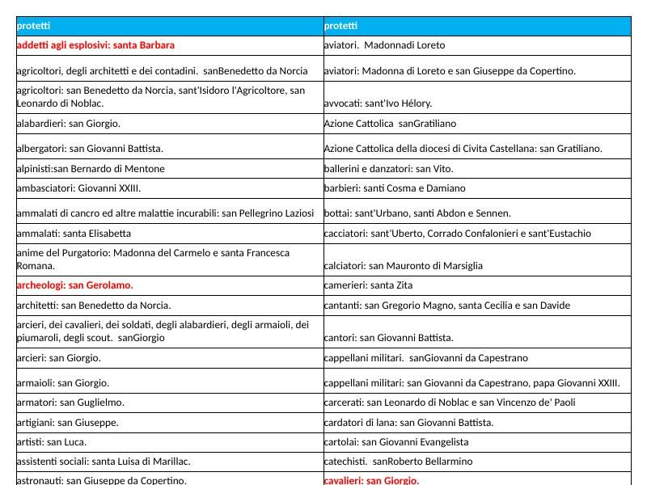{ loading=lazy style="width:47%" }

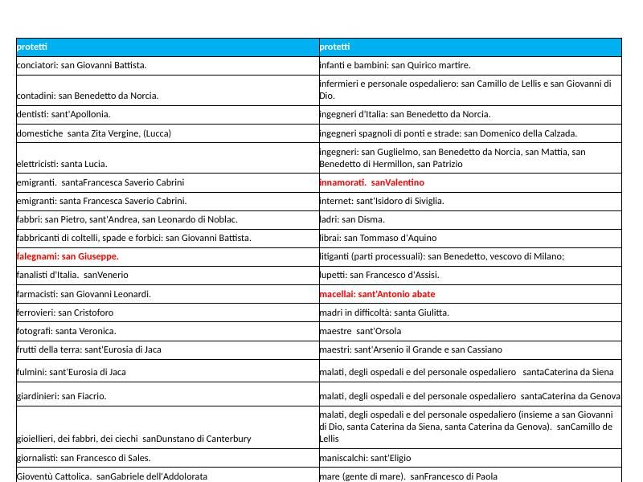{ loading=lazy style="width:47%" }

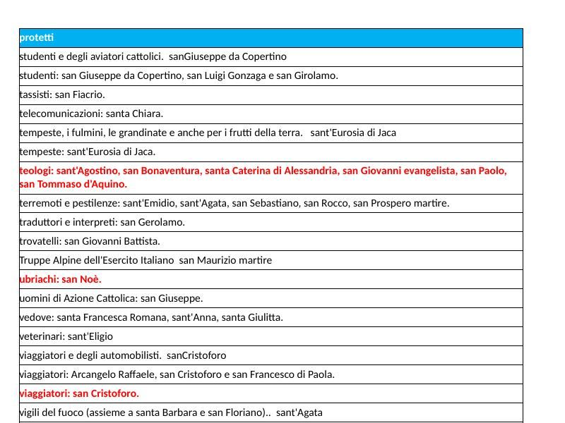{ loading=lazy style="width:47%" }

{ loading=lazy style="width:47%" }

0:34:28

Ma vi voglio raccontare invece, per chiudere questa mia seconda parte, la storia di questo, che è il patrono dei politici e degli statisti: San Tommaso Moro. Nel 2000 papa Giovanni Paolo II lo proclama patrono dei governanti e dei politici; era già stato beatificato nel 1886 e fatto santo nel 1935. Tommaso Moro era un uomo di Stato importantissimo, gran cancelliere d’Inghilterra: nasce a Londra nel 1477 e muore decapitato il 6 luglio 1535. Era amico di Erasmo da Rotterdam, il quale tra l’altro gli dedica la prima versione dell’*Elogio della follia*, giocando con il titolo originale, *Encomium Moriae*, sul significato greco di moros, che vuol dire folle: quindi gli dedica quest’opera.

0:35:46

Tommaso Moro è l’autore dell’*Utopia*, la sua opera più importante: *Utopia*, cioè nessun luogo. Anche qui c’è un gioco di parole, perché deriva da ou-topos, cioè non luogo, ed eu-topos, luogo felice: quindi utopia è letteralmente, sostanzialmente, un luogo felice inesistente. Tommaso Moro era un uomo che cercava di vivere come professava e come scriveva. Per esempio alla prima moglie aveva insegnato il latino; poi la prima moglie muore, la seconda era un po’ troppo vecchia, non ce l’avrebbe fatta a imparare il latino, e le insegna la musica. I figli, nell’orto di casa a Chelsea, a Londra, hanno un piccolo orto, e ognuno deve coltivare il suo pezzetto di terra, per l’educazione. Lui stesso porta la croce in testa alle processioni: questo ci dà l’idea di che tempra fosse Tommaso Moro.

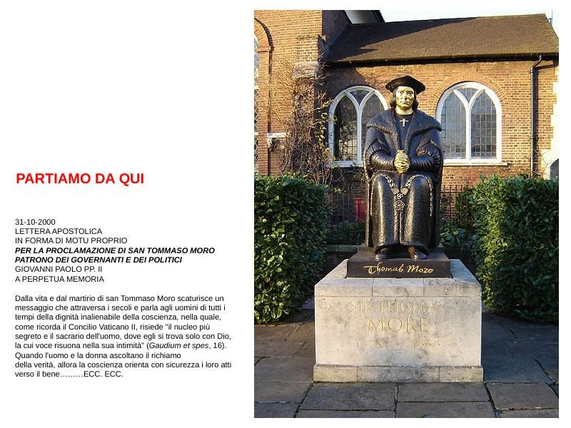{ loading=lazy style="width:59%" }

**31 OTTOBRE 2000 – LETTERA APOSTOLICA IN FORMA DI *MOTU PROPRIO* PER LA PROCLAMAZIONE DI SAN TOMMASO MORO PATRONO DEI GOVERNANTI E DEI POLITICI**

Giovanni Paolo PP. II, a perpetua memoria: «Dalla vita e dal martirio di san Tommaso Moro scaturisce un messaggio che attraversa i secoli e parla agli uomini di tutti i tempi della dignità inalienabile della coscienza, nella quale, come ricorda il Concilio Vaticano II, risiede “il nucleo più segreto e il sacrario dell’uomo, dove egli si trova solo con Dio, la cui voce risuona nella sua intimità” (Gaudium et spes, 16). Quando l’uomo e la donna ascoltano il richiamo della verità, allora la coscienza orienta con sicurezza i loro atti verso il bene…».

**NOTE SU TOMMASO MORO**

L’avvocato londinese, gran cancelliere d’Inghilterra, versò il proprio sangue per l’unità romana della Chiesa. Laico inglese, padre di famiglia, umanista e uomo politico: nato a Londra nel 1477, morto decapitato il 6 luglio 1535; beatificato nel 1886 e canonizzato nel 1935.

Amico di Erasmo da Rotterdam, il quale gli dedica la prima versione dell’*Elogio della follia*, giocando con il titolo originale, *Encomium Moriae*, sul significato greco di *moros*, «folle».

Procuratore d’affari, viene incaricato da Enrico VIII di una missione a Bruges nel 1515, la cui esperienza catalizza le sue riflessioni sul «migliore stato della società», da cui l’Utopia, pubblicata nel 1516, che porta al suo ingresso nel consiglio reale. U-topia, cioè nessun luogo (termine dal greco antico, con un gioco di parole fra *ou-topos*, non-luogo, ed *eu-topos*, luogo felice: utopia è quindi, letteralmente, un «luogo felice inesistente»). Il marinaio-filosofo riporta dall’isola l’idea della totale soppressione della proprietà privata: mettendo tutto in comune (tranne i loro congiunti), gli abitanti di Utopia hanno distrutto, insieme al denaro, il mostro dell’orgoglio e della superbia, madre di ogni iniquità.

Moro, il martire che morirà per le sue idee e per la fede nella santa Chiesa cattolica, era un uomo che cercava di vivere come scriveva. Insegna alla prima moglie il latino, affinché condivida pienamente la sua vita, compresa quella che include Erasmo. Rimane vedovo a 33 anni e si risposa quasi subito, per dare assistenza ai suoi quattro figli, perché lui è impegnato negli incarichi di governo, spesso all’estero. Alice, la seconda moglie, troppo vecchia per applicarsi al latino, imparerà almeno la musica.

Dirigerà il pensionato domestico, a cui si aggiungono molte altre persone della cerchia familiare. La casa di Chelsea ha un serraglio (una specie di zoo) e un museo di cose rare. Ognuno ha i propri compiti: per esempio, nell’orto, i figli hanno il compito di coltivare ognuno un pezzetto di terra.

Moro dice che la famiglia deve partecipare attivamente alla vita della parrocchia, e lui stesso, quando ci sono le processioni nel quartiere, porta personalmente la croce in testa al corteo; i figli devono ascoltare i sermoni in modo critico e giudicarne il contenuto.

La ricostruzione degli eventi che portano alla sua morte è straordinaria e ci fa vedere la profondità di quest’uomo.

0:36:45

Allora, Enrico VIII a un certo punto spacca la Chiesa, e Moro si oppone, insieme a Fisher. Si oppone perché il re ripudia la moglie, la sposa che rifiuta, perché vuole divorziare da questa prima moglie per risposarsi; e da lì c’è un dibattito politico, perché la prima moglie sarebbe diventata una concubina. Tommaso Moro si oppone a questa impostazione, e da lì parte la sua odissea, che lo porterà alla morte. In una lettera alla figlia dice: «In verità, Meg, grazie a Dio, non intendo inchiavardare la mia anima alle spalle di un qualunque uomo, fosse anche il migliore che conosco tra quelli ancora in vita». Fisher invece, che insieme a Moro aveva criticato Enrico VIII, ritratta e si salva la vita.

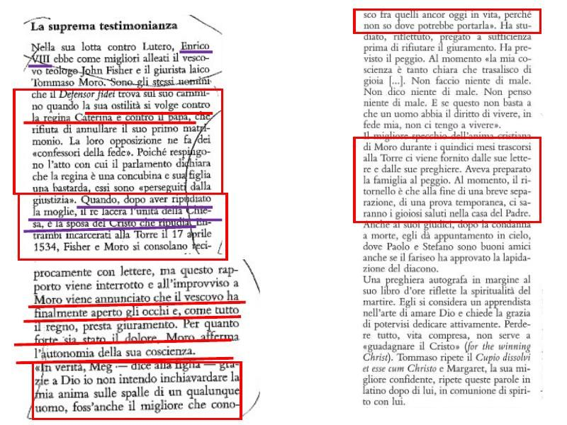{ loading=lazy style="width:59%" }

0:38:04

Questo è il primo luglio del 1535, quando viene condotto alla Torre per essere poi, dopo qualche giorno, ucciso. Vedete questa immagine, dove c’è la figlia che gli si getta addosso per salutarlo: è rappresentata in questo quadro di Antoine Caron. Che succede a questo punto? Succede che Tommaso Moro passa gli ultimi giorni in questa torre in attesa di essere ucciso, e qualcuno ha paragonato questi giorni, specialmente l’ultima notte, a quella che Gesù ha passato nel giardino del Getsemani prima di morire. Margaret, la figlia prediletta, assiste all’esecuzione del padre, e poi ottiene il permesso di prepararne il corpo prima che fosse trasportato nella fossa comune della Torre. Quindici giorni dopo, corrompendo un ufficiale, riesce a farsi ridare la testa, che intanto era stata messa su una picca sul ponte di Londra, e ne ritorna in possesso.

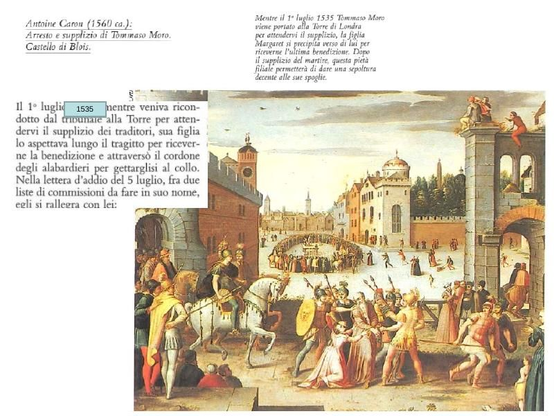{ loading=lazy style="width:47%" }

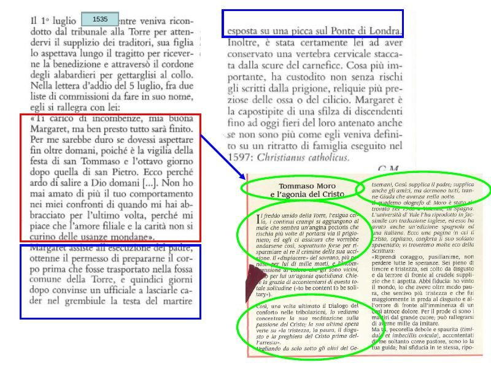{ loading=lazy style="width:47%" }

0:39:26

Questa è la decapitazione di Tommaso Moro: non ci sono quasi rappresentazioni della morte di Tommaso Moro; credo che questa sia una delle pochissime in giro. Ecco, volevo farvi vedere questa foto, perché tutta questa storia di Tommaso Moro mi è venuta in mente di raccontarvela quando ho visto questa foto. Questo è Mario Monti (non so se si vede): vedete in primo piano questa mannaia su un ceppo.

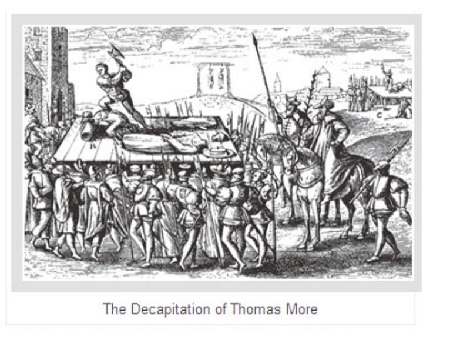{ loading=lazy style="width:41%" }

0:40:00

A me ha colpito molto l’espressione di Mario Monti: vedete che fine facevano in altri tempi i politici, e lui avrà pensato: «Meno male che siamo in tempi moderni». È una mostra a cui lui ha partecipato quando era premier, una mostra a Roma dedicata a Tommaso Moro. Questo è invece il santo patrono dei politici e dei governanti.

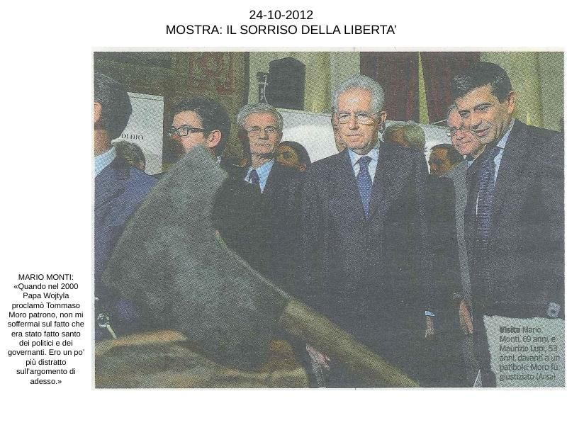{ loading=lazy style="width:59%" }

**24 OTTOBRE 2012 – MOSTRA: *IL SORRISO DELLA LIBERTÀ**

Mario Monti: «Quando nel 2000 papa Wojtyła proclamò Tommaso Moro patrono, non mi soffermai sul fatto che era stato fatto santo dei politici e dei governanti. Ero un po’ più distratto sull’argomento di adesso».

0:40:36

Lorenzo Poggi Riprendiamo: visto che siamo in tema di mannaie, ripartiamo da San Giovanni. San Giovanni ha perso la testa per una donna; altri hanno perso la testa per le donne, ma non in quel modo: lui l’ha persa proprio. Salomè ottiene la decapitazione del santo. Si può vedere… è quella del Cappellone degli Spagnoli, numero 1. Vediamo un attimo…

0:42:17

Vedete, qui è Cristo che scende al limbo e toglie dal limbo i primi patriarchi. Il diavolo è rimasto sotto: il diavolo portiere non ha fatto in tempo ad aprire, è venuta giù la porta, e il povero diavolo è rimasto sotto. E lì si vedono intanto il re David, con lo strumento musicale… vedete? E ci sono i diavoli, vedete i diavoli? I diavoli sono quelli lì: stanno guardando e dicono: «Ma che succede? Che è successo?».

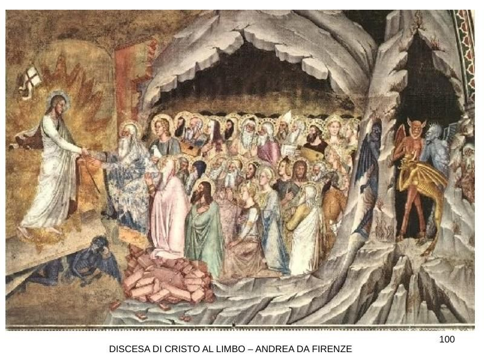{ loading=lazy style="width:50%" }

0:43:08

È interessante notare che i diavoli hanno dei colori estremamente interessanti. Per l’uomo del Medioevo il colore, quando non è un colore deciso, intenso, ma un mezzo colore, è un colore brutto. Noi amiamo molto i grigi, amiamo i rosa; i grigi e i rosa per l’uomo del Medioevo sono colori venuti male: se è rosa vuol dire che c’erano pochi soldi per fare il rosso; se è bigio vuol dire che non c’erano abbastanza soldi per fare il nero. Francesco è povero, scalzo, e ha come abito un abito di bigello, cioè grigio, perché tinto appena con un colore molto povero. E i diavoli hanno questi colori indecisi, che non sono colori squillanti.

0:44:01

Tra questi abbiamo anche San Giovanni; lo vediamo, ed è strano, perché San Giovanni guarda in macchina e alza il viso, mentre gli altri guardano quello che succede. Lui guarda. E ha senso? Perché? Ha due significati. Primo, perché lui ha annunciato, ha previsto quello che sarebbe successo: ha annunciato il Salvatore. Secondo, perché a Firenze, di cui San Giovanni Battista è il santo patrono, è conservata la reliquia del dito di San Giovanni. Non è il dito di solito che ora vengono… cioè c’è una storia del dito, che ora non si può dire più nulla; però è un altro dito, è il dito di San Giovanni.

0:44:54

Vediamo anche l’altra, se è possibile… è scomparsa; ora, quando viene, ve la faccio vedere, se riusciamo a rimettere le immagini. È nelle nicchie della chiesa di Orsanmichele, in via dei Calzaiuoli: è fatta da Lorenzo Ghiberti, ordinata a Lorenzo Ghiberti dai banchieri fiorentini, quindi gente con i soldi, che paga lo scultore più in vista del momento.

0:46:58

Quello, facciamo passare… È San Giovanni Battista, di Ghiberti. Però, siccome quelli l’hanno ordinato, l’arte dei Cambiatori, e poi è anche sulla moneta (San Giovanni è un po’ l’insegna, sul fiorino è lì a garantire), è molto serio, molto ben vestito. Ecco quella… vedete? Guardate, ha una toga perfetta. Quando faremo questa visita alla mostra sulla Primavera del Rinascimento, questo è un pezzo importante per capire cosa significa: c’è tutta l’imponenza delle statue romane, ma è qualcosa di estremamente moderno per il tempo.

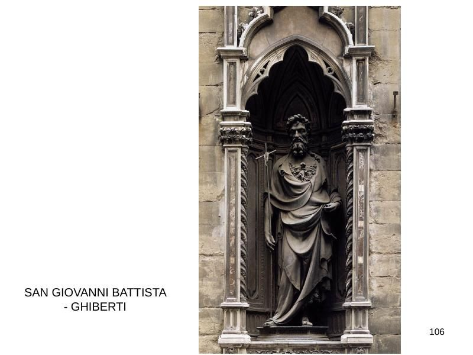{ loading=lazy style="width:44%" }

0:47:56

Guardate questo santo, che ha tutta l’autorità. Sotto, per dire che è proprio uno che sta nel deserto e si nutre di miele e di locuste, gli spunta questo ciuffo di pelle di capra, che doveva avere; ma è un ciuffo appena, che si intravede: il resto è tutto perfettamente in ordine. La cravatta non ce l’ha, insomma; perché non poteva mica chiedergli di metterci uno vestito di pelle di capra, a mangiare locuste nel deserto. Scherziamo.

0:48:25

Dicevo: lui ha perso la testa, appunto, per una donna. Abbiamo altri santi che hanno perso la testa, e qui c’è il patrono di Arezzo, San Donato: anche lui decapitato, ha perso la testa e protegge tutti quelli che hanno perso la testa, quindi folli, pazzi, e anche gli epilettici. Bellissimo, è lì, è San Donato. Quindi patrono di Arezzo, santo patrono. Patrono perché? Perché, ecco un altro carattere degli italiani, si identificano nel loro santo. Essere bolognese vuol dire essere petroniano; e ancora, se uno è milanese è ambrosiano: ambrosiano prima che milanese, perché prima che ci sia un’entità politico-geografica definita c’è come elemento unificante politico l’appartenenza a una chiesa e a un santo patrono.

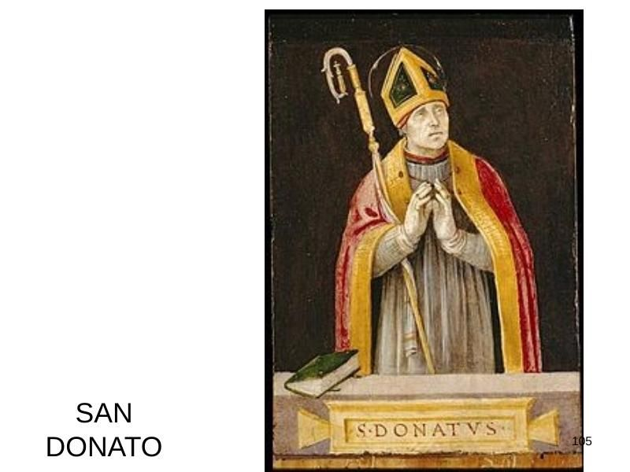{ loading=lazy style="width:38%" }

0:49:50

Per le campagne invece la cosa è diversa: la campagna è priva di autorità. Il territorio è reso sacro dalla Vergine Maria, dal culto della Madonna, perché la Vergine Maria ha un culto che non ha bisogno dell’approvazione centrale della Chiesa o del vescovo. La Madonna è santa per eccellenza, e quindi il territorio della campagna, lontano dall’autorità della città, è reso sacro dai tabernacoli dedicati alla Vergine Maria, con tutti gli appellativi della Vergine Maria, che ha attributi contrastanti: è vergine e madre, «figlia del tuo figlio», no? «Umile e alta più che creatura». Quindi è umile, e il suo fiore è la violetta; però il suo fiore è anche la rosa, che è il più elevato dei fiori, e la sua preghiera è il rosario.

0:51:20

Vedete, il simbolismo è profondo e ci riguarda tutti da vicino: la Vergine è quindi il segno tangibile di questo rapporto con la divinità attraverso qualcosa che ci accomuna tutti, l’amore materno, la dipendenza dalla madre. E qui tornano tutti quegli elementi che ha messo in evidenza prima Paolo: i seni. Potremmo fare una serata sul seno nella storia (le poppe sono una delle cose che… vedremo se ne faremo una puntata), ma sarebbe un argomento interessante, perché sono proprio il segno della maternità. Lo diciamo ancora oggi: quando una cosa è proprio nella nostra natura, diciamo che l’abbiamo succhiata con il latte materno. Santa Caterina, quando parla, parla di svezzamenti; se alla fine abbiamo un po’ di tempo ne parleremo anche. È fondamentale questo rapporto.

0:52:43

Quando nel Medioevo si vuole rappresentare in qualche modo la necessità dell’aiuto della Vergine, si rappresenta la Madonna del Latte, con delle anatomie terribili: ci si chiede se questi pittori una donna l’avessero mai vista, da dove le fanno uscire! Ma non è questo l’importante: l’importante è che si metta in evidenza questo rapporto fra divino e umano, e direi materiale nel suo esistere, nel venire all’esistenza attraverso una donna, che la Vergine del Latte mette in evidenza.

0:53:31

Tutto questo (si parlava prima della cultura protestante) viene messo in sottordine dalla cultura protestante, che accentua invece la divisione netta tra spirito e materia: tra religiosità, che deve essere esaltazione dello spirito, e materia, che invece rimane in qualche modo un elemento inferiore, conoscibile secondo altri principi, che sono quelli della meccanica, delle leggi fisiche. Questo avrà un punto nodale nella filosofia con Cartesio, René Descartes, che farà una distinzione nettissima fra res cogitans e res extensa. Poi non riusciva più a metterle in comunicazione, e scopre la ghiandola pineale: non si sapeva a che servisse, era in una posizione tale che doveva essere fondamentale, e Cartesio se ne appropria. Diceva: «La piglio io, questa mi serve»: mette in comunicazione la res cogitans, la pura capacità di pensiero, con la res extensa, materiale, il corpo.

0:54:45

Ma nel modo di sentire di cui noi ci occupiamo, dell’identità emozionale legata al rapporto con la trascendenza del divino, nella mentalità italiana questa frattura non c’è mai stata: questo collegamento è sempre stato strettissimo.

0:55:10

Torniamo un attimo a quelli… Allora, dicevamo, torniamo ai martiri, ai modi di martirio: quelli che hanno perso la testa. San Donato, lo abbiamo visto, decapitato, e quindi ha perso la testa. Sant’Aspreno, anche lui decapitato: lui è il protettore di Napoli, uno dei santi protettori di Napoli. Di Sant’Aspreno c’è ancora la chiesa, e dietro l’altare maggiore c’è una nicchia dove si infila dentro la testa per essere guariti dal mal di testa. Nel 1880… dunque, Aspreno cura il mal di testa perché nei suoi momenti di ascesi e di contrizione del corpo si metteva sulla testa, per mortificarsi, un masso pesantissimo. Poi parliamo di pietre, perché anche le pietre… \[passaggio poco intelligibile\] …anche il nostro santo protettore, Sant’Aspreno martire, fondamentale.

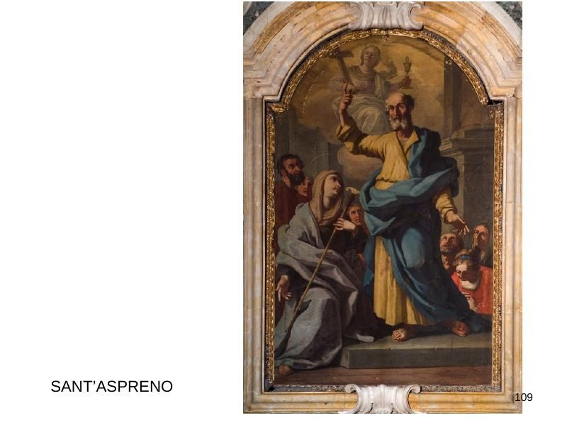{ loading=lazy style="width:36%" }

0:57:04

Il fenomeno del mettere la testa esiste, ed è derivato dai culti antichi, nei templi di Esculapio, dove si rimaneva a dormire durante la notte: è il fenomeno dell’incubatio.

0:57:40

Fra i santi guaritori fondamentali, sempre legati a Firenze, ci sono i santi Cosma e Damiano: questi ce li abbiamo. Cosma e Damiano, santi particolarmente venerati dai medici; anche loro fondamentali, importantissimi: due santi medici. Perché i Medici si chiamavano Medici: allora i santi medici sono i loro, e il nome Cosimo… Si dice che le palle dei Medici siano delle pillole, delle pasticche: sono tutte palle rosse, poi c’è la palla celeste con i gigli, che è la palla di Luigi, una palla sola, quella al centro, con i gigli.

0:58:27

Dunque, dicevo, i santi medici Cosma e Damiano: infatti il nome Cosimo è diffusissimo. Santi medici guaritori: qui sono raffigurati dal Beato Angelico, che raffigura un loro miracolo. Sono tra i più importanti guaritori di chi aveva male alle gambe: questo è il primo trapianto della storia. Hanno trapiantato la gamba di un servo etiope morto a un centurione romano che aveva subito l’amputazione dell’arto. Perlomeno dovevano stare attenti ai colori! Oggi una cosa del genere la porterebbero come esempio di malasanità. Se lo vedete, nella parte destra, sembra più una calza: è la gamba del servo. Comunque Cosma e Damiano sono estremamente importanti, e sono oggetto di un culto fervorosissimo: il loro santuario più importante si trova a Isernia.

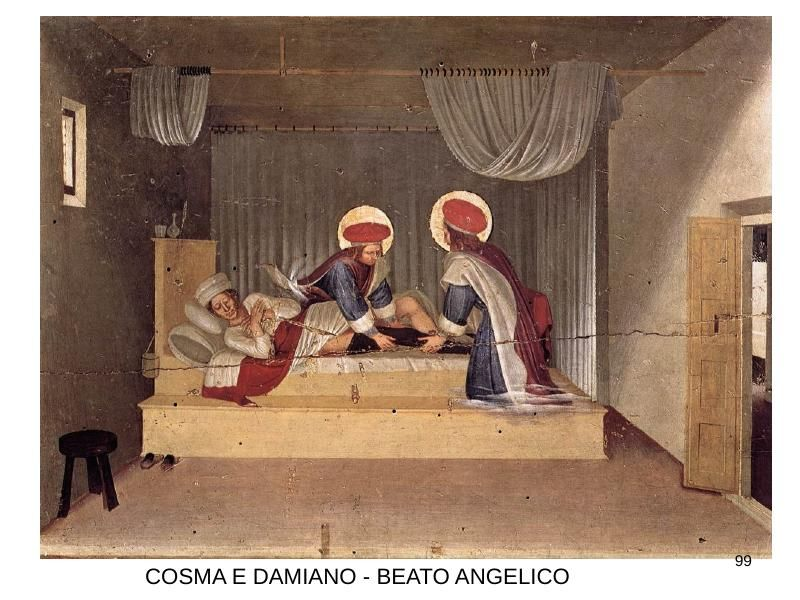{ loading=lazy style="width:40%" }

1:00:00

Qual è la loro funzione, oltre a quella di curare? La loro funzione è quella di assicurare la fecondità delle donne: siamo di nuovo tornati a quella cosa di prima, perché è importantissimo. Le donne desiderose di avere un figlio che non riescono ad averlo si rivolgono ai santi Cosma e Damiano. I santi Cosma e Damiano hanno questa prerogativa, e importantissimo è il fatto che sono diventati ancora più efficaci nella loro opera di taumaturghi da quando… siccome le donne che vanno a chiedere la grazia vanno lì un po’ prima, il giorno prima della festa (il giorno in cui ricorre la festa dei santi Cosma e Damiano a Isernia è, per chi avesse bisogno, il 27 settembre)… Sono veramente efficaci, e sono diventati ancora più efficaci da quando, siamo nel 1780 circa, i frati zoccolanti, che hanno un convento lì vicino, hanno aperto la loro chiesa alle donne che vogliono passare la notte in attesa.

1:01:40

Allora, da quando i frati zoccolanti… prima, quando ho detto di questo fenomeno, sapete perché? Perché mentre facevo una conferenza simile a questa mi è scappato detto il fenomeno dell’incubatio, e venne fuori che qualcuno si sentì male… Comunque, l’incubatio: i frati zoccolanti l’hanno accettata, e da quel momento in poi i santi sono molto efficaci.

1:02:21

La cosa interessante che vi faccio vedere è questa: quella è la lanterna dell’abside della chiesa dei santi Cosma e Damiano a Isernia. Inutile: io credo che la forma di quella lanterna sia evidente a tutti, insomma. L’hanno donata venti signore che avevano ricevuto la grazia: hanno messo i soldi e hanno fatto erigere, chiarissimo, il simbolo, la lanterna dell’abside dei santi Cosma e Damiano. Nel 1870 una ricerca antropologica fatta sul posto ci ha riportato anche la preghiera che viene fatta dalle donne di Sapicino. La preghiera dice: «Sante Damiane, sante Damiane, fammi pregna tu di mane», cioè proprio…; mentre la preghiera a San Cosma dice: «Sante Cosma benedetta, dammi il latte per le tette». Perché voi capite che la cosa non può essere… ritorniamo al punto di vista materiale.

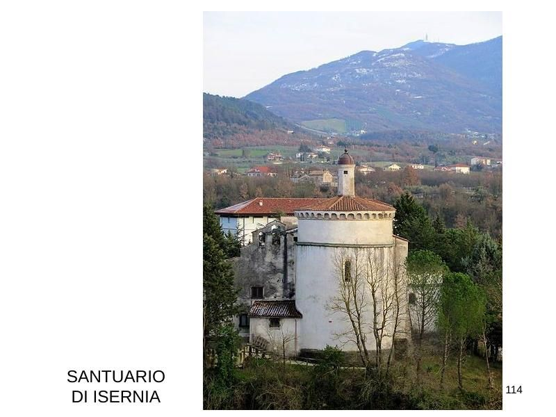{ loading=lazy style="width:42%" }

1:04:05

Questa faccenda ha attraversato tutta la storia della Chiesa, e si lega poi strettamente al culto dei santi e al culto della Vergine Maria. Da questo punto di vista, Santa Caterina d’Alessandria, quando viene martirizzata, dalle ferite emette latte e non sangue. Questo collegamento a Firenze: man mano che si avvicina l’anno della peste, si diffonde sempre di più l’uso di rappresentare la Vergine del Latte, proprio per ricordare quasi l’immunità, questo legame strettissimo. Nella chiesa di Sant’Agostino a San Gimignano c’è un bellissimo quadro dove è rappresentata l’incoronazione della Vergine Maria, e la Vergine Maria mostra i seni con i quali ha allattato Cristo. Quindi l’idea di questo collegamento, di questo stretto legame con la materialità dell’esistere, non abbandona mai la figura del santo, ed è un elemento fondamentale, legato anche alla nostra sensazione del santo.

1:06:04

La cosa oggi sta un po’ cambiando, è meno diffusa. Pensate: nel 1950 le donne di Monterchi si opposero fermamente a che il quadro (lo possiamo vedere) di Piero della Francesca, la *Madonna del Parto*, bellissima opera, stupenda, un vero capolavoro di Piero della Francesca, fosse prestato per un’esposizione a Firenze, agli Uffizi. Le donne di Monterchi, nel 1950 (quindi siamo a brevissima distanza dalla fine della guerra), si opposero fermamente a che l’opera fosse allontanata da Monterchi. Intervistate dal giornale Il Tempo, dissero che con la presenza della Vergine gravida, della Vergine del Parto, si sentivano più protette e sicure nel momento del parto.

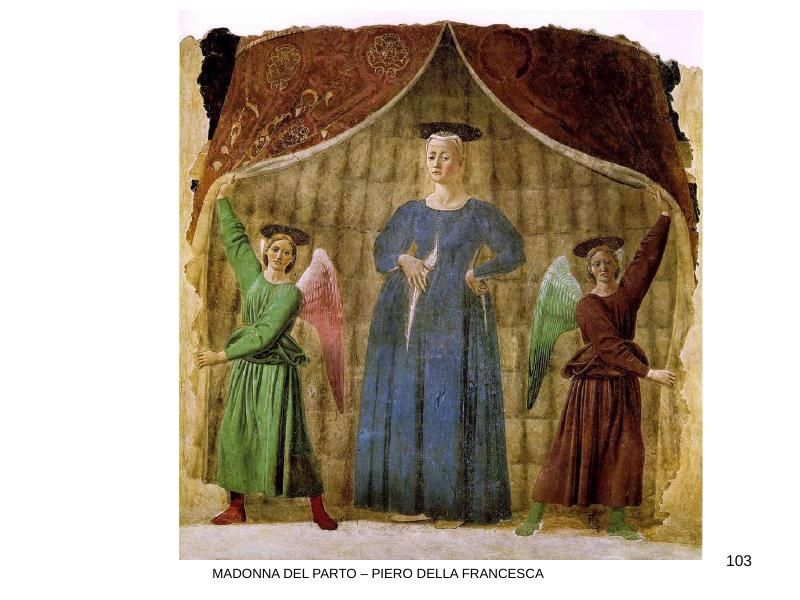{ loading=lazy style="width:40%" }

1:07:34

Nel 1975 quest’opera è andata in prestito a un museo di New York, al MoMA, e c’è stata parecchio: nessuno a Monterchi ha detto niente, non se ne sono nemmeno accorti. Non è un fatto culturale: non è che queste nel ’50 fossero fini intenditrici di opere d’arte e non volessero che l’opera rischiasse. È veramente un fatto di rapporto con il senso del sacro, un sentimento che ci fa capire quanto fosse importante il culto del santo, e quanto fosse importante il santo patrono, come santo in cui la città si identifica e che protegge la città; che è in fondo garante non solo della sacralità del territorio, ma anche dei rapporti con Dio. E quindi fondante la propria identità, il proprio rapporto, che non rinuncia mai alla materialità, agli aspetti più essenziali e materiali della vita. Questo lo ritroveremo anche in seguito.

1:09:06

Poi ci sono, vi dicevo, le reliquie. Paolo ha parlato dei santi protettori, dei santi che proteggono le professioni. Santo Stefano: Santo Stefano è protettore dei beccai, cioè dei macellai degli agnelli. Lo vedete, questo è di Giotto, bellissimo: rappresenta appunto Santo Stefano con il libro, e ha in testa il sasso, perché venne ucciso per lapidazione. Siccome negli Atti degli Apostoli si dice che morì come un agnello, è diventato santo protettore di chi ammazza gli agnelli, dei beccai: c’è sempre un’assonanza.

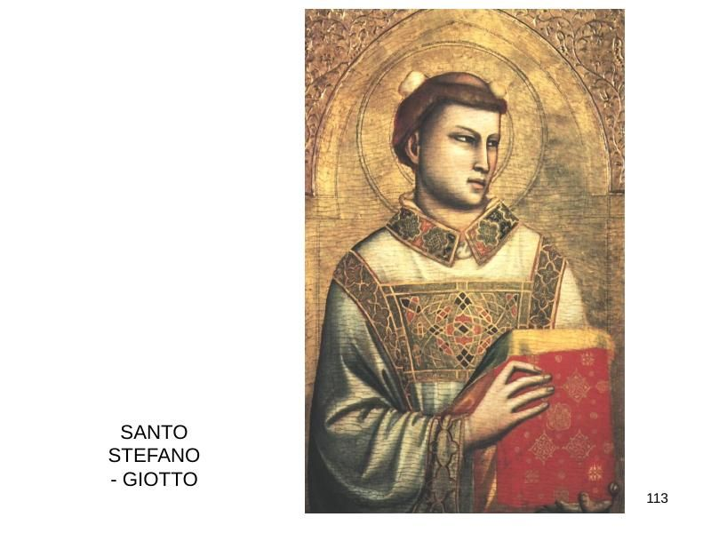{ loading=lazy style="width:36%" }

1:10:01

È un santo anche lui da mettere nel Guinness dei primati, perché a Firenze, a Santo Stefano al Ponte, in Borgo Santi Apostoli, si conservano le reliquie più pesanti del mondo: si conservano delle pietre che si dice siano quelle con cui è stato lapidato Santo Stefano. Ma sono delle pietre enormi, pesantissime: nell’Ottocento una di queste pietre cadde su un piede a un prete che le faceva vedere ai fedeli, e dicono che quello sia rimasto zoppo. Sono tra le reliquie più pesanti della storia. Bene, interrompiamo qua e riprendiamo poi.

\[PAUSA\]
{: .nota }

1:42:09

Grazie a tutti; ringraziamo gli amici del Caffè Centofiori. Andiamo con l’ultima parte: una breve carrellata sulla storia dei santi e sulle immagini relative. Questi sono i santi dei primi secoli, i martiri per eccellenza: sono Sant’Acacio e i diecimila martiri del monte Ararat; vedete lo sterminio, tratto dal Gran Libro d’Ore di Anna di Bretagna. Questi invece sono i martiri cristiani nel Colosseo, in attesa di essere giustiziati.

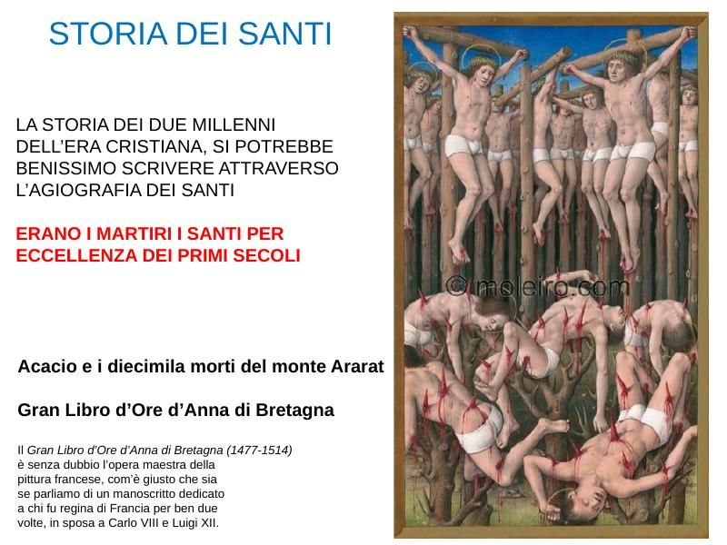{ loading=lazy style="width:47%" }

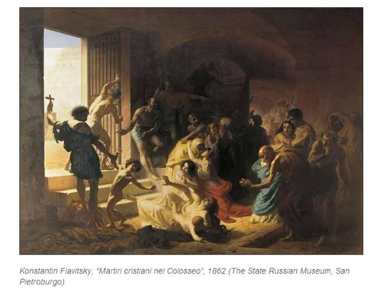{ loading=lazy style="width:47%" }

**STORIA DEI SANTI**

In questa ultima parte facciamo un breve percorso nel tempo sulla storia dei santi, perché in questo schema entra prepotentemente anche il peso della storia. Non è un mistero che vi sono santi che sono stati subito elevati alla gloria degli altari, come Francesco d’Assisi, e santi che hanno dovuto attendere secoli per la canonizzazione, come Giovanna d’Arco. Entrano in gioco quindi le contingenze della forza e della debolezza di certi modelli nella storia, e i presupposti teologici, che mutano con il variare del tempo.

La storia dei due millenni dell’era cristiana si potrebbe benissimo scrivere attraverso l’agiografia dei santi. Erano i martiri i santi per eccellenza dei primi secoli.

*Acacio e i diecimila martiri del monte Ararat*, dal *Gran Libro d’Ore di Anna di Bretagna*: è senza dubbio l’opera maestra della pittura francese, com’è giusto che sia, se parliamo di un manoscritto dedicato a chi fu regina di Francia per ben due volte, sposa di Carlo VIII e di Luigi XII (Anna di Bretagna, 1477-1514).

Konstantin Flavitsky, *Martiri cristiani nel Colosseo*, 1862 (San Pietroburgo, Museo di Stato Russo).

1:43:09

Ci sono anche diverse tipologie di martirio. C’è il martirio bianco, che consiste nell’abbandono di tutto ciò che si ama a causa di Dio; c’è il martirio verde, che invece consiste nel liberarsi, per mezzo del digiuno e della fatica, dai propri desideri malvagi; e poi il martirio rosso, quello più pesante, che consiste nel sopportare la croce o la morte a causa di Gesù Cristo. Bianco, verde e rosso, che guarda caso sono anche i colori della bandiera italiana.

**TIPOLOGIE DI MARTIRIO**

– il martirio bianco consiste nell’abbandono di tutto ciò che un uomo ama a causa di Dio;

– il martirio verde consiste nel liberarsi, per mezzo del digiuno e della fatica, dai propri desideri malvagi, o nel soffrire angustie di penitenza e conversione;

– il martirio rosso consiste nel sopportare la croce o la morte a causa di Gesù Cristo.

Il martirio rosso è stato considerato in passato il vero battesimo, purificatore di ogni peccato: subendo il martirio la santità era assicurata, non potendo più peccare. Questa è la ragione per la quale il martirio nell’antichità era non solo accettato, ma addirittura ricercato.

La bandiera italiana?

1:43:38

Dopo i primi cristiani martiri, l’iconografia dei santi prosegue: per esempio nell’alto Medioevo i santi diventano i vescovi. Questo è San Leandro, arcivescovo di Siviglia, nel VI secolo, dipinto da Bartolomé Esteban Murillo. Vedete, questa è la mappa dei vescovi che colonizzano un po’ tutta l’Europa nell’opera di evangelizzazione, tanto per darvi un’idea dell’opera che fu fatta in quel periodo. Questo è del Maestro dell’altare di re Alberto: sono sempre rappresentati i santi vescovi.

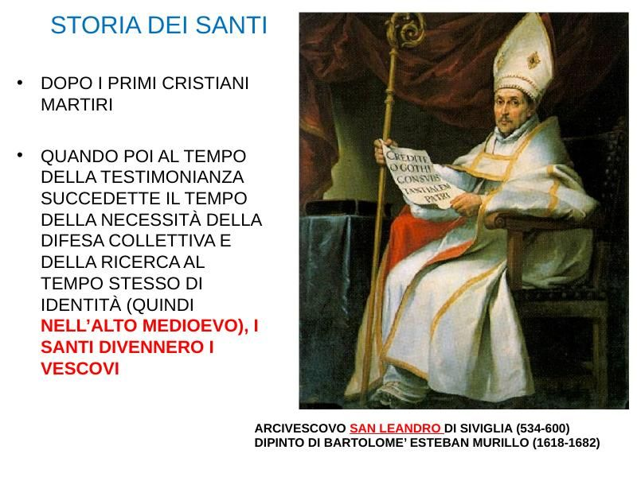{ loading=lazy style="width:47%" }

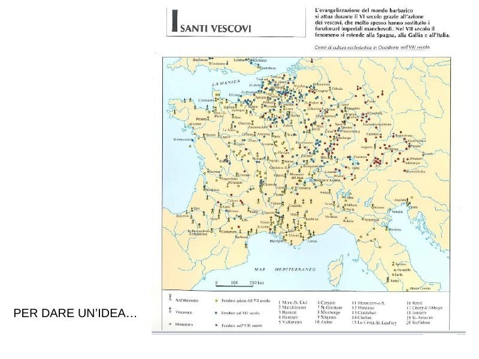{ loading=lazy style="width:47%" }

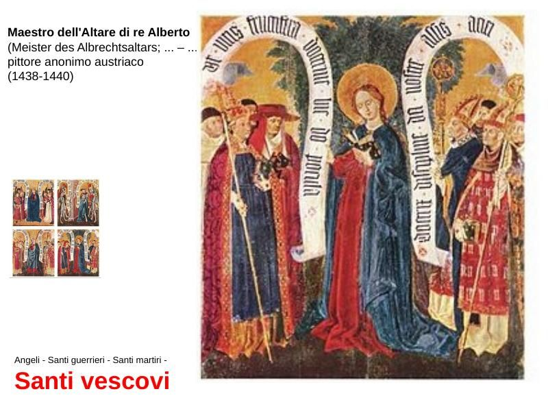{ loading=lazy style="width:59%" }

**STORIA DEI SANTI**

Dopo i primi martiri cristiani, quando al tempo della testimonianza succedette il tempo della necessità della difesa collettiva e, al tempo stesso, della ricerca di identità (quindi nell’alto Medioevo), i santi divennero i vescovi.

L’arcivescovo San Leandro di Siviglia (534-600), dipinto di Bartolomé Esteban Murillo (1618-1682).

Maestro dell’altare di re Alberto (Meister des Albrechtsaltars), pittore anonimo austriaco (1438-1440): angeli – santi guerrieri – santi martiri – santi vescovi.

1:44:24

Dopo venne invece il tempo della tripartizione sociale funzionale raccontata dallo storico Duby: gli oratores, i bellatores e i laboratores. In questo caso sono i santi monaci: questo è di Luca di Tommè, ed è San Bernardo degli Uberti; questi sono i santi guerrieri; e questo invece è un santo contadino, uno dei pochissimi: è San Gorgonio, che si perde nella memoria dell’Appia, intorno a Roma, però ha avuto influenza anche per esempio in Piemonte e in Liguria. San Gorgonio è appunto un santo contadino, uno dei pochi umili da questo punto di vista.

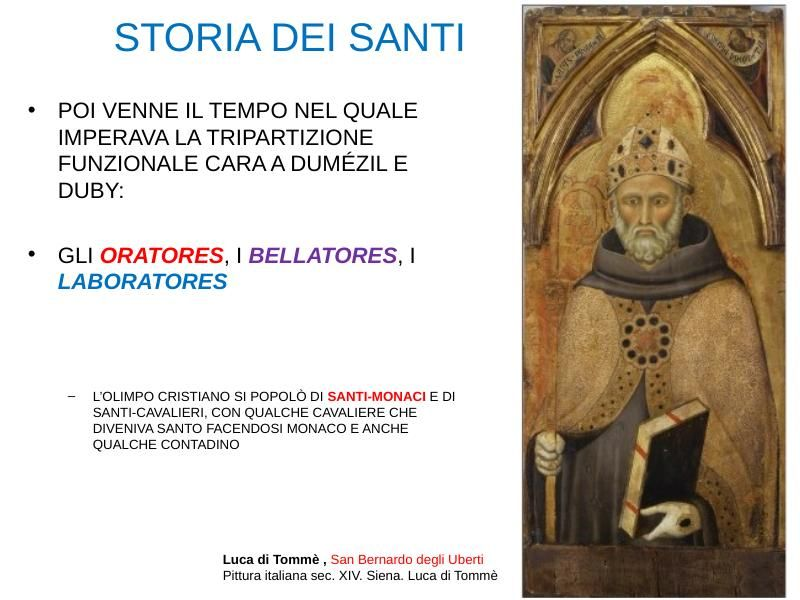{ loading=lazy style="width:47%" }

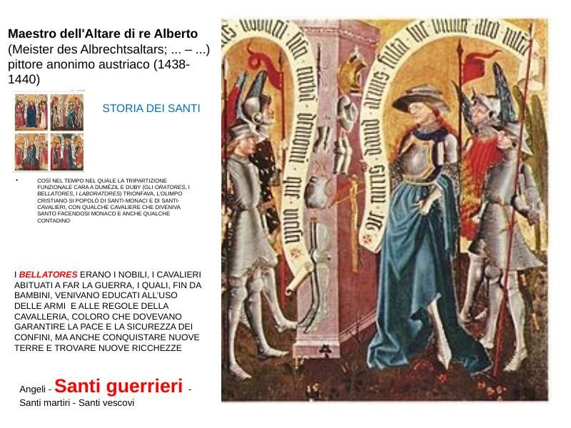{ loading=lazy style="width:47%" }

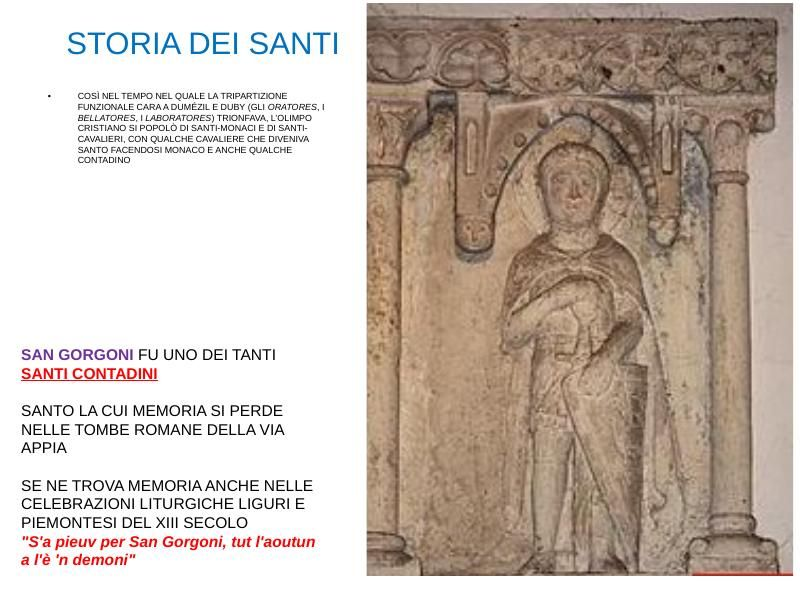{ loading=lazy style="width:59%" }

**STORIA DEI SANTI**

Poi venne il tempo nel quale trionfava la tripartizione funzionale cara a Dumézil e a Duby: gli *oratores*, i *bellatores*, i *laboratores*. L’Olimpo cristiano si popolò di santi-monaci e di santi-cavalieri, con qualche cavaliere che diveniva santo facendosi monaco, e anche qualche contadino.

I *bellatores* erano i nobili, i cavalieri abituati a far la guerra, che fin da bambini venivano educati all’uso delle armi e alle regole della cavalleria: coloro che dovevano garantire la pace e la sicurezza dei confini, ma anche conquistare nuove terre e trovare nuove ricchezze.

San Gorgonio fu uno dei tanti santi contadini: un santo la cui memoria si perde nelle tombe romane della via Appia, e di cui si trova memoria anche nelle celebrazioni liturgiche liguri e piemontesi del XIII secolo: *«S’a pieuv per san Gorgoni, tut l’aoutun a l’è ’n demoni»*.

Luca di Tommè, *San Bernardo degli Uberti* (pittura italiana del XIV secolo, Siena); Maestro dell’Altare di re Alberto: angeli – santi guerrieri – santi martiri – santi vescovi.

1:45:09

Poi fu il periodo della santità di Stato, e quindi abbiamo avuto i santi re, le sante regine, ma anche i santi mercanti, i santi artigiani, le sante vedove ecc. Questo per esempio è il *San Matteo e l’angelo* di Guido Reni: San Matteo è considerato il patrono dei banchieri, dei bancari, dei doganieri, delle guardie di finanza, dei ragionieri e dei commercialisti. Vedete, è quasi sempre rappresentato con il libro in mano, dove scrive le annotazioni. Direi poi che i santi sono cambiati con il corso del tempo, perché la storia e la società sono cambiate, e quindi queste rappresentazioni non sono più bastate e sono emerse altre tipologie di santi.

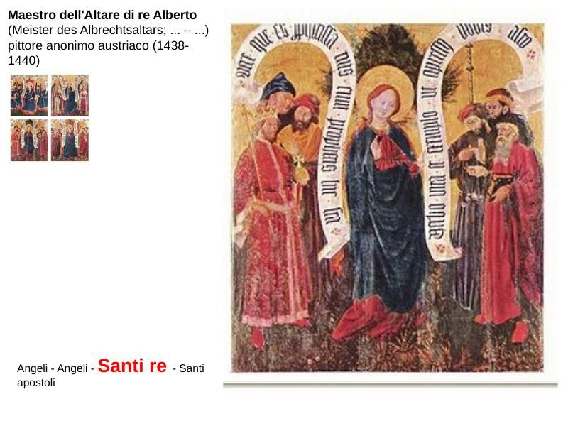{ loading=lazy style="width:47%" }

{ loading=lazy style="width:47%" }

**STORIA DEI SANTI**

Con l’era delle città, in cui la società si andava differenziando e non entrava più negli schemi trifunzionali, fu poi il tempo della «santità di Stato». In tempi di mobilità sociale bisognava ben insegnare alla gente a stare anche al proprio posto: e vi furono allora santi re e sante regine, ma anche santi mercanti, santi artigiani, sante vedove, sante serve, santi vignaioli, santi birrai.

Maestro dell’altare di re Alberto (1438-1440): angeli – santi re – santi apostoli.

Guido Reni (1575-1642), *San Matteo e l’angelo*. San Matteo è considerato il patrono di banchieri, bancari, doganieri, guardie di finanza, cambiavalute, ragionieri, commercialisti, contabili ed esattori.

1:46:15

Però il concetto di santità è arrivato anche nella letteratura europea più colta. Pensate per esempio a un libro di Hermann Hesse, *Il lupo della steppa*: qualcuno di voi forse l’avrà letto, soprattutto qualche anno fa, quando era molto di moda. I protagonisti sono Harry ed Erminia, una donna seducente che lo riconduce ai piaceri della vita moderna, facendogli recuperare il tempo perso, che lui invece aveva lasciato da parte. Vi leggo alcuni passi di questo *Lupo della steppa* di Hesse, che ci fanno vedere come il tema sia arrivato in uno dei capolavori della letteratura europea.

1:46:15

\[Legge alcuni brani del romanzo, nei quali Erminia spiega a Harry che ciò che conta non è la gloria ma l’«eternità», di cui fanno parte la musica di Mozart, i grandi poeti e i santi, che i credenti hanno riconosciuto creando la «comunione dei santi»; il brano si chiude con il riferimento a Goethe, Novalis, Mozart e ai santi Cristoforo e Filippo Neri.\]
{: .nota }

**STORIA DEI SANTI**

Sarebbero poi giunte nuove tribolazioni, e sarebbero tornati alla ribalta nuovi martiri, funzionali all’espandersi dell’Occidente sul mondo, alle missioni, alle vicende coloniali. Con l’età delle rivoluzioni, dall’Inghilterra alla Francia fino al Messico, altri santi sarebbero emersi, in vario dialogo con la realtà dei loro tempi.

Si può certo eccepire sulla tendenziosità di certi schemi, sulla necessità di propaganda, ma si è in presenza di una realtà articolata, duttile, affascinante. I santi (al di là di vederli come patroni, come taumaturghi o come semplici testimoni della loro fede) sono quasi sempre personaggi di straordinaria personalità e di forte significatività. Il loro *mana* può essere più o meno apparente: vi sono santi nascosti e silenziosi e *stars*, divi della santità, che hanno attraversato tutta la nostra civiltà, approdando anche nella letteratura più colta e più nobile: leggiamo qualche passo da Hermann Hesse.

**IL LUPO DELLA STEPPA* – HERMANN HESSE (ROMANZO DEL 1927)**

Harry Haller, il protagonista, è un intellettuale sulla cinquantina che descrive il disagio della sua «duplice» natura: l’umanità, cioè l’amore per l’arte e il divino, la nobiltà d’animo e di pensiero, e la bestialità (il lupo, appunto), alla ricerca dei piaceri selvaggi.

«L’uomo non è una forma fissa e permanente, ma un tentativo, una transizione, un ponte stretto e pericoloso fra la natura e lo spirito. Verso lo spirito, verso Dio lo spinge il suo intimo destino; a ritroso, verso la natura, verso la madre lo trae la sua intima nostalgia: tra l’una e l’altra di queste forze oscilla la sua vita angosciata e tremante».

Questo suo carattere, ombroso e irrequieto, gli rende difficile, se non impossibile, socializzare, e lo porta a odiare e disprezzare la vanità e la superficialità del mondo borghese. L’isolamento sociale e l’incapacità di godersi la vita lo avvicinano sempre più al suicidio; ma proprio nel momento più drammatico conosce, in una trattoria dei sobborghi, Erminia, donna seducente che lo conduce, poco a poco, a una conversione ai piaceri della vita moderna, facendogli recuperare il tempo perduto.

Il finale del racconto, in un «teatro magico», vede Haller, ormai convinto di aver recuperato la capacità di amare, uccidere con una pugnalata al cuore la persona amata, eseguendo così l’ultimo desiderio di Erminia; ma nel «teatro magico» il delitto di cui si è macchiato gli costa la condanna alla vita eterna, con lo scherno dei grandi del passato che, sedendogli accanto, lo invitano a comprendere una volta per tutte l’umorismo della vita, per imparare a ridere senza dare peso eccessivo ai sentimenti.

{ loading=lazy style="width:47%" }

{ loading=lazy style="width:47%" }

1:48:34

Quindi in queste poche parole si racconta un po’ tutta la storia dei santi che abbiamo narrato stasera. Finisco con una battuta, un’affermazione che ha fatto Franco Cardini, grande storico toscano, che sui santi si è soffermato più di una volta; poi la giro al nostro storico della filosofia, per un’analisi o una risposta. Cardini dice che i popoli, come in questo caso gli italiani, hanno anche fiducia: a differenza di quello che dice Bertolt Brecht, «disperato il popolo che ha bisogno di eroi», noi sentiamo la necessità di esempi che ci porgano il filo di Arianna attraverso il labirinto della storia e dell’esistenza. Su questo non sono sicuro di essere d’accordo con Cardini, però è una domanda, da un punto di vista filosofico, che giro volentieri, e almeno introduco le conclusioni di Lorenzo per questa serata.

**STORIA DEI SANTI**

I santi sono la garanzia della concretezza, del forte radicamento nella storia del cristianesimo. Franco Cardini su questi temi ha scritto: «La materialità e la storicità del cristianesimo (materialità che non è materialismo, storicità che non è storicismo) stanno anche nella fiducia che il popolo cristiano – a differenza di quello auspicato da Bertolt Brecht – ha bisogno di eroi, che esso sente la necessità di esempi che gli porgano il filo d’Arianna attraverso il labirinto della storia e dell’esistenza».

Su questo ultimo passo non sono sicuro di essere d’accordo, ma la *quaestio* aperta la giro al nostro maestro per le sue conclusioni finali.

1:49:49

Lorenzo Poggi Riprendiamo un attimo. È chiaro, i santi sono parte integrante del nostro essere italiani, del nostro carattere, perché nella nostra storia siamo stati caratterizzati a lungo da condizioni di precarietà e di insicurezza, di mancanza di una guida politica centrale sicura, di mancanza anche di quel riferimento che avevano le popolazioni barbare che avevano invaso l’impero, che era il legame sociale della tribù. La grande eredità che Roma ha lasciato, e ha lasciato anche attraverso il veicolo del popolo italiano, è stata proprio quella del diritto e quella della religiosità, della religione cattolica.

1:50:41

Il diritto romano è diverso dal diritto di marca anglosassone, che è legato alla tradizione, a ciò che si è già stabilito nei giudizi precedenti. Il diritto romano invece parte da un principio, stabilisce un codice, una legge. Lì c’è ancora l’idea che sia la comunità a fare la legge; in quello romano invece c’è l’idea che il diritto, ciò che costituisce l’elemento guida della vita comune, sia deducibile da principi e sia affermato da un potere centrale, dello Stato. Quindi vedete anche qui… ma nessuno può negare che questa concezione del diritto e del rapporto con il sacro, attraverso anche la Chiesa cattolica, sia parte integrante della civiltà europea di oggi. E la conservazione di questo modo di intendere e di questo modo di sentire è dovuta anche al popolo italiano, che l’ha vissuto sulla sua natura e sulla sua pelle, e che è costitutivo del suo essere. Ecco perché non possiamo non ricordarlo. In fondo questo discorso sui santi vuole essere proprio anche questo: un approfondimento sul nostro essere italiani ed europei, sul nostro contributo.

1:52:23

E dicevo: in che cosa si è tradotto, anche positivamente, questo modo di rapportarsi alla trascendenza, ma anche di avere bisogno, e di avere in mente l’idea che chi ci può aiutare è solo qualcuno che è vicino a noi, che ci conosce, che fa parte della nostra famiglia? Infatti il gruppo familiare è un elemento estremamente solido nella società e nella mentalità italiana. Ecco che i rapporti della Vergine con Cristo sono rapporti di inferiorità, perché è umile di fronte alla grandezza del figlio, ma anche di autorità della madre, che ha un legame di affetto, un legame strettissimo con il figlio, e quindi un rapporto che le permette di dire al figlio certe cose, di intercedere per tutti. Questo è fondamentale, per esempio, nell’immagine della vita.

1:53:41

Quindi rimane questo. Io penso che il modo più evidente, l’aspetto più importante in cui questo modo di intendere il rapporto tra immanenza e trascendenza, e questo bisogno di rendere umano questo rapporto, che è tipico della nostra mentalità, della nostra natura di popolo, è venuto fuori al meglio proprio nel momento in cui ne abbiamo fatto un modo di fare arte. L’arte, e in particolare l’arte del Rinascimento, per certi aspetti ha lasciato l’eredità più importante da questo punto di vista: come si mette insieme la rappresentazione, l’immagine, il rendere presente questo rapporto di amore e di sudditanza rispetto a qualche cosa che è il divino, il trascendente. Abbiamo lasciato l’eredità più profonda di questo modo di sentire e di intendere il rapporto con il mondo e con la politica.

1:54:57

Ritorniamo un attimo a noi. Pensate, parlando di questo, al santo patrono: il santo patrono è anche il santo in cui ci si identifica. Se una città ne conquista un’altra, impone non solo il suo dominio politico, ma impone anche il culto del suo santo patrono al posto dell’altro. E chi è sconfitto militarmente da altre città spesso attribuisce la sconfitta a una mancanza del santo patrono, che non l’ha abbastanza protetto. I pisani, sconfitti alla Meloria, licenziano il loro santo protettore, San Sisto, perché sono sconfitti proprio il giorno della festa di San Sisto, e al posto di San Sisto mettono San Ranieri. Così impara!

{ loading=lazy style="width:42%" }

1:55:58

I senesi nel 1260 affrontano i guelfi fiorentini nel punto dove è stato martirizzato il loro santo protettore, Ansano, sull’Arbia: Sant’Ansano a Montaperti. E sconfiggono clamorosamente i fiorentini a Montaperti: dice Dante che fanno «l’Arbia colorata in rosso» dal sangue dei nemici uccisi. Quindi Sant’Ansano li protegge e li fa vincere. Quando i fiorentini sconfiggono i senesi e conquistano Siena, si rapinano i loro santi, e coniano il modo di dire: «Aveste Sant’Ansano e v’andò male, aveste San Vittore e v’andò peggio: ma che santi andate a fare?». Non è solo Siena: i senesi mettono San Vittore sull’edificio di Porta Fiorentina, con la mano così (non è che faccia il saluto fascista ante litteram): è così per tenere lontani i fiorentini dalla città… È questo il concetto, l’elemento che regge la storia, ed è un carattere profondo del nostro essere.

{ loading=lazy style="width:47%" }

{ loading=lazy style="width:47%" }

1:58:05

Due cose, proprio per terminare, perché altrimenti non riesco mai a parlarne: due cose soltanto su Santa Caterina, perché avevo detto che se no mancano le donne, e invece le donne sono essenziali proprio in questo. Santa Caterina, due cose. Vi dicevo, è la ventiduesima figlia di Monna Lapa Piagenti. Ora, Monna Lapa: anche Dante, vi ricordate? «Guido, i’ vorrei che tu e Lapo ed io fossimo presi per incantamento…»: Lapo è lui, al femminile Lapa. Ventiduesima figlia, ha una sorella gemella che, fortunatamente per lei, muore, e così lei può succhiare tutto il latte della mamma, e quindi va avanti, e va bene. Monna Lapa a quei tempi ha una quarantina d’anni, e continuerà a far figli: ne farà altri sei o sette dopo Caterina. E Caterina, vi dicevo, dopo tutte queste vicende, a sei anni dice: «Io voglio rimanere vergine». Non ha dubbi.

{ loading=lazy style="width:43%" }

2:00:00

Lo narrerà dopo, lo dirà, perché poi, andando in là con gli anni, comincia a fare delle cose. Allora la Chiesa si preoccuperà del comportamento di questa donna, e il papa Gregorio XI le metterà alle costole un domenicano: perché Caterina è una donna, e non si sa mai che cosa può pensare; meglio metterle un confessore. Tanto più che per fare il confessore ci vuole uno che sia sacerdote: e quindi chi meglio di Raimondo da Capua, che è un domenicano di quelli scafati, si direbbe oggi? È stato assistente di un inquisitore, e tiene d’occhio Caterina, perché non si sa che idee abbia.

2:01:10

Quindi Caterina comincia la sua vita con l’idea che rimarrà vergine, perché si è promessa sposa a Cristo; per cui a quel punto lei è a posto. Prova in tutti i modi a uscire da quella che è la gabbia in cui sono chiuse le donne del suo tempo. Il padre non capisce perché quella figlia ora si comporti in quel modo, però a un certo punto non può fare altro che lasciar fare, perché Caterina è fortissima nella sua volontà. Comincia col mortificare il proprio corpo: non mangia, comincia col non mangiare carne. Se le mettono la carne nel piatto, la manda sotto la tavola, dove ci sono i gatti pronti: sono tutti intorno a Caterina quando mangiano. Si mangia carne in casa di Caterina, perché è una famiglia benestante: il padre fa il tintore, è un imprenditore del tempo.

2:02:31

Poi a poco a poco continuerà a mortificare sempre di più il proprio corpo. Quindi arriva la santità, non solo come negazione del suo essere donna fisicamente, ma come negazione e annullamento del proprio corpo. Nasce nel 1347, muore nel 1380, quindi muore a 33 anni, giovanissima; e muore per consunzione. Porta a lungo un cilicio di ferro per mortificare ancora di più le carni; poi Raimondo da Capua le impone di toglierlo, riesce a farsi obbedire, e Caterina lo toglie; ma continua in questo.

2:03:22

Scrive moltissimo. Non sa scrivere: detta le lettere, che poi vengono scritte. Scrive ai grandi del suo tempo, scrive al papa perché vuole che ritorni a Roma: in questo momento il papa è ad Avignone, e lei vuole che ritorni a Roma. E quando Caterina scrive, benché abbia negato, pensate, fino all’annullamento il proprio corpo, continua però a scrivere e a parlare adoperando termini tipicamente femminili, della condizione della donna. Un esempio soltanto, perché non abbiamo tempo, e ce ne sono tanti.

2:04:02

Quando dice del suo rapporto con Dio: lei ha le visioni, lei vede Dio, parla con Dio, e quando sta per avere la visione lo sente: sente in sé un desiderio, un’inquietudine, e dopo qualche tempo, ore o un giorno, ha la visione, questo colloquio con Cristo. E dice Caterina, per descrivere questa condizione: «Io sento che Cristo ha con me lo stesso atteggiamento che ha la madre nei confronti del figlio lattante al quale vuole più bene rispetto agli altri», quello che è il suo preferito, il piccolo lattante. Quando vede che ha fame e comincia a piangere, perché desidera il latte, allora lei gli fa vedere il seno; e il bambino allora agita le braccia e si avvicina, e lei non lo prende, aspetta, lascia che la desideri ancora di più; poi alla fine lo abbraccia e lo accosta al seno.

2:05:38

Caterina, benché abbia negato se stessa, benché abbia fondato il suo rapporto su questa negazione dell’essere donna (non vuole maritarsi, non vuole far figli, non vuole essere collocata in quella che è la condizione della donna del suo tempo), mantiene però nel modo di rapportarsi al mondo, nel modo di esprimere e di capire le cose, il modo con cui nella condizione femminile ci si rapporta al mondo del suo tempo. Quindi anche lei, così astratta, così mistica, fino a negare il corpo, ha mantenuto questa condizione di contatto con l’immediatezza e la materialità dell’esistere, che ha un carattere appunto, vi dicevo, che è dei nostri santi, anche in queste espressioni.

2:06:33

E dicevo: finisce poi, muore appunto nel 1380. Quando parla dei cardinali (il papa ha nominato dei cardinali, e fra questi ce ne sono alcuni che lei ritiene personaggi poco affidabili, che pensano (strano, a quei tempi c’erano anche queste cose!) più ai loro interessi che all’interesse della Chiesa; si vede che siamo nel 1300, tempi lontanissimi), allora lei che cosa dice? Scrive al papa e gli dice: temo che ci siano alcuni di questi… Un personaggio che ha la responsabilità del potere nella Chiesa (lei parla della Chiesa, ma del potere in genere) e invece usa questo potere per fare i propri interessi è come una donna che partorisce figli morti; però la donna non ha colpa, lui sì. Quindi non solo ha questo, ma ha anche la colpa. Guardate l’esempio, le parole: rimane questa materia.

2:08:03

Volevo dirvi: c’è questo carattere nei santi e nel culto dei santi, ed è ancora più accentuato nel culto delle donne, quindi nelle sante: donne, vi dicevo, più che esemplari, da questo punto di vista veramente straordinarie; hanno questa dimensione. E mi piacerebbe concludere con questa considerazione. Dicevo quindi: santi protettori, santi invece che proteggono la città, e poi il culto delle reliquie, le reliquie che sono la parte materiale, l’elemento che individua il santo.

2:08:54

Vorrei concludere, se me lo ricordo (dico «se me lo ricordo» perché ho una certa età, non tutto mi viene meglio), con un sonetto di Giuseppe Gioachino Belli che parla appunto del culto delle reliquie, e dice:

*«Tra ll’antre riliquie c’ho ddetto addietro*

*c’è ll’agnello pasquale e la colonna,*

*c’è er latte ch’è avanzato a la Madonna*

*sempre fresco in un bottone de vetro.*

*C’è un zolo du’ parmi in mezzo a le crisse*

*der Carvario, e c’è un po’ de vita eterna*

*pe’ ffa’ llievito in caso che ffinisse.*

*C’è er moccolo ch’aveva a la lanterna*

*Dio quanno accese er sole, e poi je disse:*

*“Va’ e illumina chi sserve e cchi ggoverna”».*

2:09:54

Paolo Marcucci Grazie a voi; vi auguriamo una buona estate. Per chi volesse, vi ricordo che sabato prossimo andiamo a Firenze alla mostra *La primavera del Rinascimento*. Buonanotte a tutti, grazie.

## Appendice

Le slide proiettate durante l’incontro.

{ loading=lazy style="width:47%" }

{ loading=lazy style="width:47%" }

{ loading=lazy style="width:47%" }

{ loading=lazy style="width:47%" }

{ loading=lazy style="width:47%" }

{ loading=lazy style="width:47%" }

{ loading=lazy style="width:47%" }

{ loading=lazy style="width:47%" }

{ loading=lazy style="width:47%" }

{ loading=lazy style="width:47%" }

{ loading=lazy style="width:47%" }

{ loading=lazy style="width:47%" }

{ loading=lazy style="width:47%" }

{ loading=lazy style="width:47%" }

{ loading=lazy style="width:47%" }

{ loading=lazy style="width:47%" }

{ loading=lazy style="width:47%" }

{ loading=lazy style="width:47%" }

{ loading=lazy style="width:47%" }

{ loading=lazy style="width:47%" }

{ loading=lazy style="width:47%" }

{ loading=lazy style="width:47%" }

{ loading=lazy style="width:47%" }

{ loading=lazy style="width:47%" }

{ loading=lazy style="width:47%" }

{ loading=lazy style="width:47%" }

{ loading=lazy style="width:59%" }
