# Poveri buoni e poveri cattivi

**Data:** 30 gennaio 2014 
**Luogo:** Museo della Ceramica, Montelupo Fiorentino 
**Incontro con:** Lorenzo Poggi e Paolo Marcucci

**Interventi:** Paolo Marcucci Lorenzo Poggi

0:00:01

Paolo Marcucci Buonasera a tutti, e grazie a nome mio e di Lorenzo di essere venuti qua nonostante questa serata da tregenda, quasi. Il professore ha rischiato di non arrivare, ma per fortuna è qua con noi. Va bene, iniziamo.

0:00:43

Stasera l’argomento è il tema dei poveri, e vedrete che è un argomento vasto e che arriva da molto lontano. Inizio con dei proverbi, perché nella saggezza popolare c’è sempre un fondo di verità, e anche il contrario. La santità ha sempre fatto della povertà un vanto; però nei detti popolari la povertà è sempre qualcosa da combattere. C’è infatti questo proverbio: «La povertà è come la verginità: tutti la lodano e tutti cercano di disfarsene il prima possibile». Questa è un po’ la sintesi del tema di stasera.

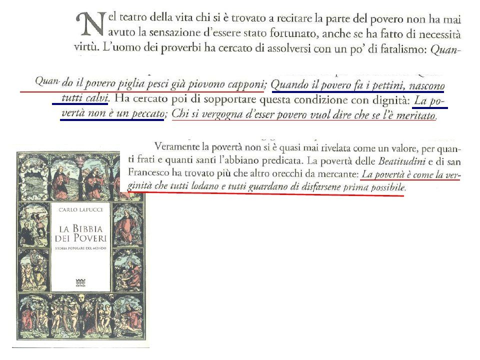{ loading=lazy style="width:58%" }

0:01:35

Come dicevo, la povertà ha attraversato tutti i secoli, tutta la storia dell’uomo; si è sempre riformulata diversamente, è mutata costantemente. Anche nella religione – la religione cattolica, la nostra in Occidente – ci sono delle frasi: «È più facile che un cammello passi per la cruna di un ago che un ricco entri nel regno dei cieli», oppure «Beati i poveri, perché di essi è il regno dei cieli», ecc. Effettivamente questa è stata la sfida che il cristianesimo, la religione, ma anche tutto l’Occidente, ha sempre messo sul tavolo.

**CONCEZIONE DELLA POVERTÀ**

La povertà, la sua simbologia, la sua rappresentazione hanno attraversato i secoli ripresentandosi ogni volta diverse, ma sempre presenti.

Oggi non è più quella medievale, per fortuna, ma ha connotazioni diverse e rapportate alla situazione attuale.

È un fenomeno che non smette mai di mutare, ma che ha anche la caratteristica di poter tornare su punti che si davano per sicuri: niente è sicuro, e la crisi economica di oggi ne è la dimostrazione più lampante, se si usa, come bisogna sempre fare, una lente storica secolare e non ci si fa schiacciare solo dalla contemporaneità.

In Occidente, nonostante la guida della religione cristiana, che ha avuto nella concezione della povertà una delle principali linee portanti («è più facile che un cammello\* passi per la cruna di un ago, che un ricco entri nel regno di Dio»; «beati i poveri di spirito, perché di essi è il regno dei cieli»), la povertà continua a essere vista con sospetto.

Questa è stata sempre la grande sfida dell’Occidente: soprattutto la povertà come condizione che rispecchia la propria capacità e il proprio merito nella società (ad esempio lo *Speculum cerretanorum* di Pini, del 1484, di cui ci parlerà Lorenzo).

\* nonostante sappiamo ora essere un errore di traduzione dal latino per «grosso canapo».

0:02:15

Questa condizione di povertà è legata in qualche modo, lo vedremo, anche al concetto di merito; ed è anche un po’ quello che probabilmente ci dirà poi Lorenzo presentando questo libro, il libro dei vagabondi, dove il merito – la scala sociale a cui si appartiene – è legato alle condizioni attraverso cui il patto sociale si manifesta e si concretizza. Ancora oggi, quando sentiamo parlare di merito – parlo di politici di destra e di sinistra – bisogna stare un po’ attenti, perché il filo è sottile, molto sottile, con questa impostazione generale e politica del concetto.

0:03:13

Direi quindi che il concetto di povero ha attraversato un po’ tutta la storia dell’uomo. C’è una definizione di Mollat, uno storico francese: «Povero è colui che in modo permanente o temporaneo si trova in condizione di debolezza, di dipendenza, contraddistinta dalla mancanza di strumenti di potere e di considerazione sociale». Questa è una definizione che può attraversare tutti i secoli.

**CONCEZIONE DELLA POVERTÀ**

Ancora oggi non bisogna dimenticare questa ottica, quando sentiamo parlare di premiare solo il merito (alcuni discorsi politici, di destra e di sinistra, parlano di premiare il merito…).

È impossibile che tutti siano meritevoli allo stesso tempo: oggi tocca a me, domani a te, a tuo figlio, a tua moglie, al tuo amico…

Ma chi è il povero? La storia ha prodotto sempre nuove forme di povertà, rinnovando a ogni tempo il concetto, come un fiume che ha attraversato i secoli e si è ramificato in ogni terra.

**UNA DEFINIZIONE DI POVERO NON PUÒ QUINDI CHE ESSERE LARGA**

*Povero è colui che in modo permanente o temporaneo si trova in condizione di debolezza, di dipendenza, contraddistinta dalla mancanza di strumenti di potere e di considerazione sociale, ossia di denaro, di relazioni, di influenza, di qualificazione tecnica, di vigore fisico, di capacità, di cultura, di libertà e dignità personale.*

Questa definizione (Michel Mollat, *I poveri nel Medioevo*), accettata da molti storici, raccoglie le larghe schiere dei rifiutati, degli asociali, degli emarginati di venti secoli.

0:03:51

Da dove si parte? Si parte dal concetto che, se c’è disuguaglianza, se c’è un povero, vuol dire che ci sono anche dei ricchi; e se Dio mi ha permesso di essere ricco è perché le mie virtù e la mia intelligenza me lo hanno permesso. Allo stesso tempo c’è il rovescio della medaglia: se tu sei povero, è perché in fondo te lo sei meritato. E questo fin dall’origine della storia del nostro mondo occidentale.

**CONCEZIONE DELLA POVERTÀ**

Cercheremo di percorrere quindi la storia della povertà occidentale, dove fin dagli inizi la diseguaglianza sociale è giustificata come voluta da Dio.

Se Dio mi ha donato e permesso di essere ricco, è perché le mie virtù e la mia intelligenza… allo stesso tempo, se permette che tu sia povero, è perché te lo sei meritato…

Sono esattamente le stesse identiche idee e convinzioni che attraversano oggi la nostra società.

Uno dei casi recenti più clamorosi è stato quello del sindaco di Londra Boris Johnson.

NB: Per poveri si intendono non i mendicanti, ma le persone «normali» che vanno a lavorare tutti i giorni… («Corriere della Sera», giovedì 5 dicembre 2013)

0:04:23

Però anche oggi: prendo un caso che mi ha colpito particolarmente, di un mese fa. Il sindaco di Londra, Boris Johnson, ha fatto questa dichiarazione: poveri, poco intelligenti. Anche se poi lui stesso ha fallito il test del quoziente d’intelligenza, e quindi c’è stata una rivalsa della storia che ha fatto giustizia. Però, quando Johnson parlava di poveri poco intelligenti, in realtà non parlava degli accattoni per strada, ma dei lavoratori normali, sostanzialmente di tutti noi. E questo è lo spirito fondamentale di quella dichiarazione.

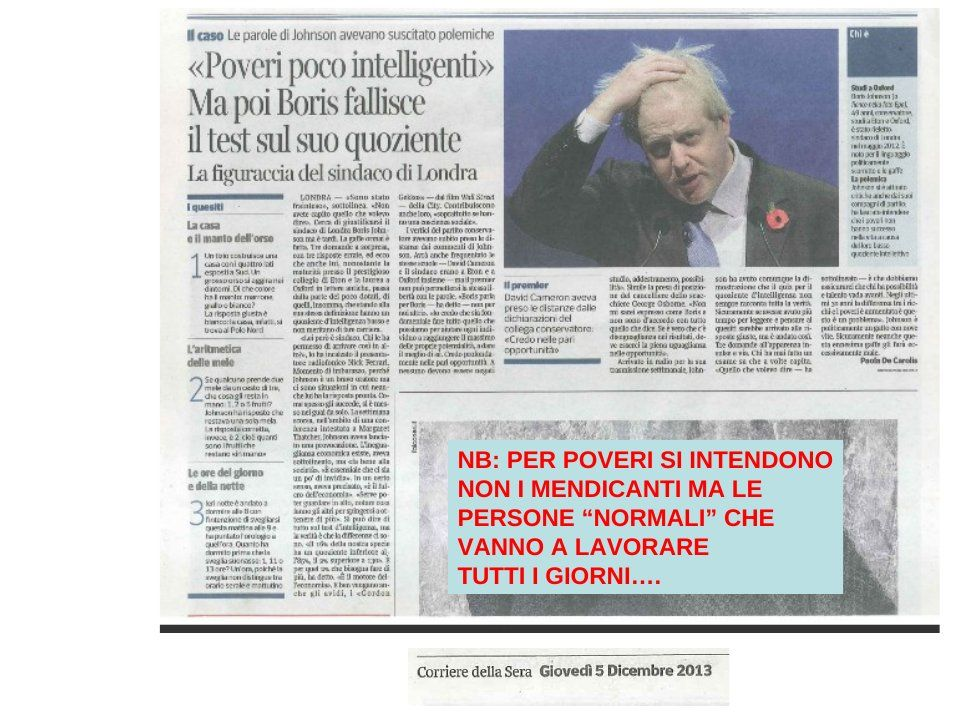{ loading=lazy style="width:42%" }

0:05:17

Su questo tema della povertà vedremo qualche dato più avanti: questo fenomeno si è molto accentuato negli ultimi venti-trent’anni. Anche Hollywood, per esempio, si è accorta di questa tendenza sociale e ha già fatto un film su questo tema. *Elysium* è un film quasi di fantascienza, ambientato nel 2154: il mondo è diviso in due blocchi, i ricchi, che vivono su un satellite, una stazione spaziale orbitante, e i poveri, che sono rimasti a vivere sulla Terra. Questa è la stazione orbitante dove vivono i ricchi, dove ci si può curare con delle macchine speciali a cui i poveri non possono accedere; e c’è una rivolta tutta giocata su questo tema. Questo per dire che anche Hollywood è già sopra questa direzione che sta prendendo la società e ci sta facendo dei film.

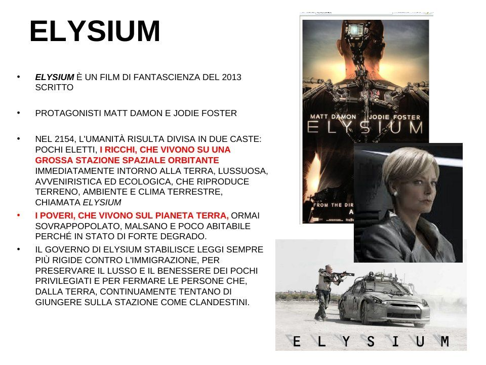{ loading=lazy style="width:47%" }

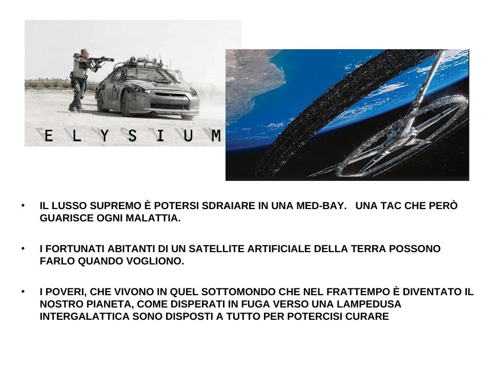{ loading=lazy style="width:47%" }

**HOLLYWOOD E LA POVERTÀ**

Su questo tema della povertà è anche interessante porsi qualche domanda sull’oggi e sul domani. Oggi anche Hollywood avverte e sfrutta questo tema: lo fa naturalmente in chiave spettacolare, ma intanto prefigura scenari che seguono le traiettorie sociali di questi ultimi vent’anni. *Elysium*, ovvero la diseguaglianza nel 2154 secondo Hollywood.

**ELYSIUM**

*Elysium* è un film di fantascienza del 2013, scritto e diretto da Neill Blomkamp; protagonisti Matt Damon e Jodie Foster.

Nel 2154 l’umanità risulta divisa in due caste: pochi eletti, i ricchi, che vivono su una grossa stazione spaziale orbitante immediatamente intorno alla Terra, lussuosa, avveniristica ed ecologica, che riproduce terreno, ambiente e clima terrestre, chiamata Elysium; e i poveri, che vivono sul pianeta Terra, ormai sovrappopolato, malsano e poco abitabile perché in stato di forte degrado.

Il governo di Elysium stabilisce leggi sempre più rigide contro l’immigrazione, per preservare il lusso e il benessere dei pochi privilegiati e per fermare le persone che dalla Terra tentano continuamente di giungere sulla stazione come clandestini.

Il lusso supremo è potersi sdraiare in una *Med-bay*: una tac che però guarisce ogni malattia. I fortunati abitanti di un satellite artificiale della Terra possono farlo quando vogliono. I poveri, che vivono in quel sottomondo che nel frattempo è diventato il nostro pianeta, come disperati in fuga verso una Lampedusa intergalattica sono disposti a tutto per potercisi curare.

0:06:24

Un’altra notizia che mi ha colpito, legata in qualche modo alla ricchezza contrapposta alla povertà, è questa sentenza di un giudice americano. Un ragazzo di famiglia ricca una sera, con l’auto, ha ucciso quattro persone, e il giudice poi l’ha assolto perché in quel momento era «malato», e ha coniato un nuovo termine, «affluenza», cioè un misto di «influenza» e «*affluence*». «Affluent» è il termine con cui si indicano le persone ricche: nelle banche oggi ci sono delle divisioni chiamate «*affluent*», dove si trattano i clienti ricchi, da un certo capitale in su. Ci sono le banche più piccole, che si rivolgono ai clienti *affluent* che possono avere mezzo milione di euro, fino a quelle più prestigiose, dove si parte da un minimo di 5-10 milioni di euro: tanto per dare una dimensione del fenomeno.

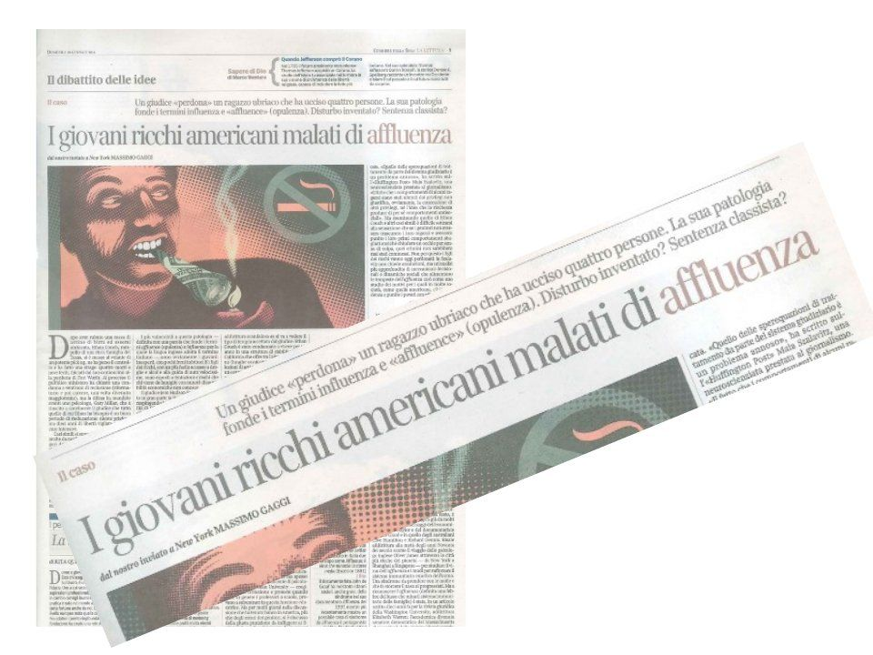{ loading=lazy style="width:42%" }

0:07:40

Però questa traiettoria di cui dicevamo si scontra un po’ con la realtà che abbiamo sempre visto finora. Robert Reich ci dice che il 70% del PIL nella società occidentale deriva dai consumi della classe media; e negli ultimi dieci anni dalla classe media provengono invece sei lavoratori disoccupati su dieci. Che conseguenze può avere questo sul nostro modello di vita?

**CONCEZIONE DELLA POVERTÀ**

La traiettoria che sta assumendo il mondo (non solo occidentale…) traccia in questo periodo una polarizzazione sempre più netta tra ricchi e poveri, e la conseguente progressiva sparizione di quella che un tempo si chiamava classe media.

Però, come ci ricorda Robert Reich, il 70% del PIL deriva dai consumi della classe media; e sempre dalla classe media provengono sei posti di lavoro persi su dieci.

Che conseguenze sociali può avere il suo progressivo immiserimento?

Da dove proviene questa fede ideologica che ci guida in questo scorcio storico? Da dove deriva la misura ideologica attuale della società, dove anche lo Stato si è sciolto nell’idea liberista?

Secondo Roberto Esposito il neoliberismo – sia nella sua versione austriaca alla Hayek, sia in quella anglosassone alla Friedman – non ha mai immaginato di fare a meno dello Stato, ma ha prodotto esso stesso una pratica di governo. Come ha spiegato per primo Foucault nei suoi corsi a essa dedicati, quella neoliberale è una razionalità eminentemente governamentale, volta alla direzione delle condotte degli uomini attraverso precise norme comportamentali.

Anche secondo Greta Krippner (Capitalizing on Crisis. The Political Origins of the Rise of F*inance*, Harvard University Press, 2012) non sono i mercati ad aver conquistato dall’interno gli Stati, ma gli Stati ad aver introdotto il modello concorrenziale dell’impresa in tutte le dinamiche sociali.

0:08:10

Alcuni, come Roberto Esposito, filosofo italiano, additano il neoliberismo come la dottrina che ha indirizzato la vita sociale in questa direzione. E dicono che il neoliberismo, sia quello di origine tedesca sia quello di origine americana, non si è impossessato dello Stato, ma è stato lo Stato a impossessarsi delle logiche neoliberiste. Questo è il concetto di Esposito.

0:08:54

Su questo gli ribatte l’ideologo del «Corriere della Sera», Ernesto Galli della Loggia, in un articolo pubblicato qualche giorno dopo quella dichiarazione di Esposito, intitolato «Come fare del liberismo un facile capro espiatorio», contestando proprio questa idea che andava contro il neoliberismo. Che cosa dice Ernesto Galli della Loggia? Dice che sostanzialmente questo modo di vivere cercando sempre il guadagno, sempre e comunque, è in realtà una pulsione dell’uomo che c’è sempre stata, che deriva dalla notte dei secoli, e che quindi non ha nulla a che vedere con questa versione del neoliberismo, che riguarda solo gli ultimi duecento anni. E dice che sono due gli elementi fondamentali avvenuti in Occidente.

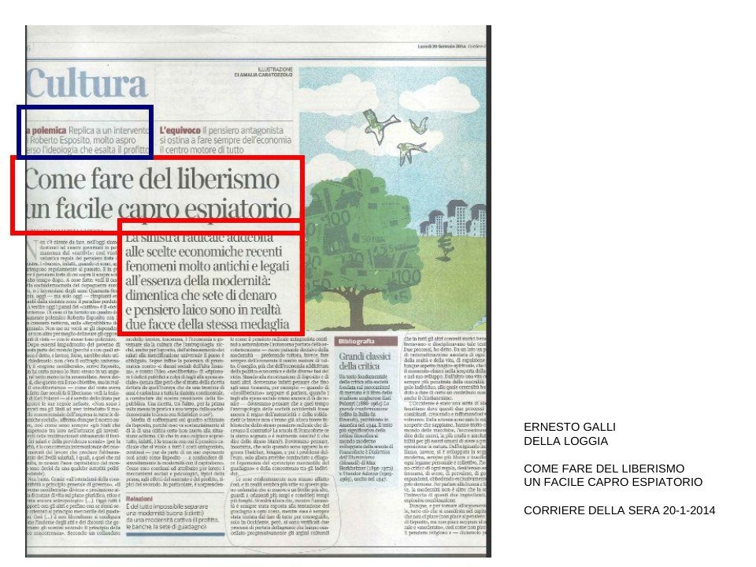{ loading=lazy style="width:47%" }

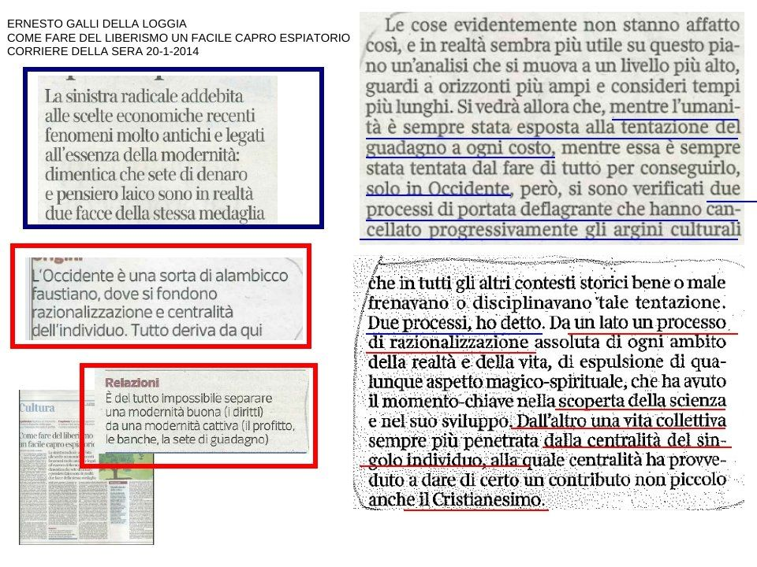{ loading=lazy style="width:47%" }

0:10:00

Il primo è quello dovuto alla scoperta della scienza, la scienza che ha confutato tutta l’ideologia magico-spirituale dell’uomo, concentrandosi invece sull’oggettività. E il secondo è una centralità sempre più evidente del mondo occidentale nell’ultimo millennio, dovuta in gran parte anche all’evoluzione del cristianesimo, che ha messo l’individuo al centro dell’universo. Questo dice Ernesto Galli della Loggia.

0:10:38

Allora, un paio di considerazioni. Dette così come le dice Ernesto Galli della Loggia, quelle affermazioni secondo me – non so poi se Lorenzo vorrà dire la sua in merito – sono anche condivisibili, perché è vero che sono evoluzioni di lungo periodo; però, messe in quella maniera, danno l’idea che la storia abbia un solo verso, una sola direzione, cosa che non è assolutamente vera, perché a volte la storia va in una certa direzione e altre volte in un’altra.

0:11:19

Basta guardare questo grafico, che mostra la popolazione e la ricchezza mondiale. Come vedete, lo 0,7% della popolazione detiene il 41% della ricchezza, mentre il 68,7% delle persone possiede solo il 3% della ricchezza. Che cosa vuol dire? Che la storia si muove. Basta vedere i dati solo degli ultimi trent’anni: non so se si vedono bene, i colori più scuri sono la concentrazione della ricchezza detenuta dall’1% della popolazione. Vedete, sono tutti Paesi del mondo, e sono tutti in salita, quindi con un guadagno anche notevole: vuol dire che la storia si muove, e si muove in una certa direzione.

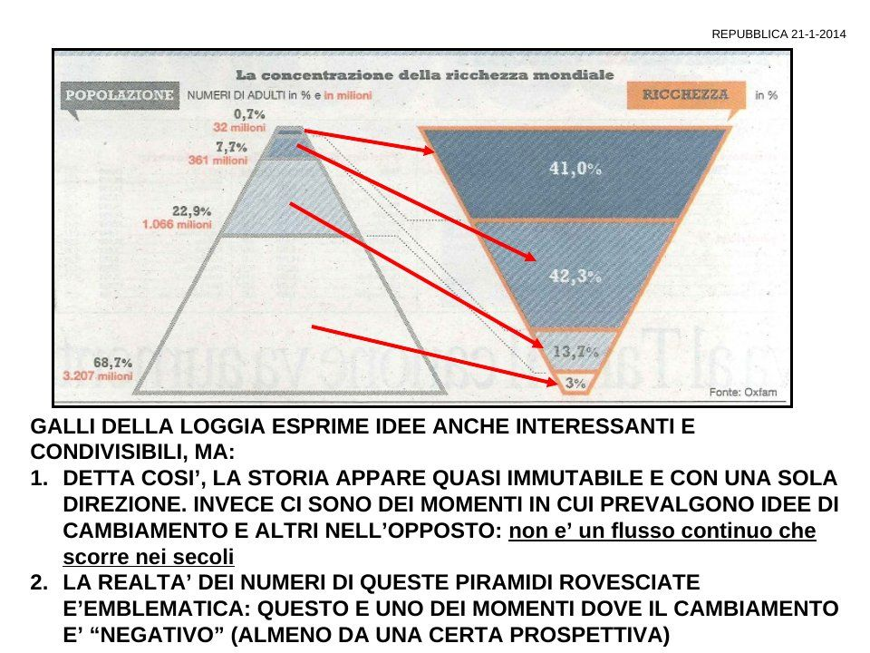{ loading=lazy style="width:47%" }

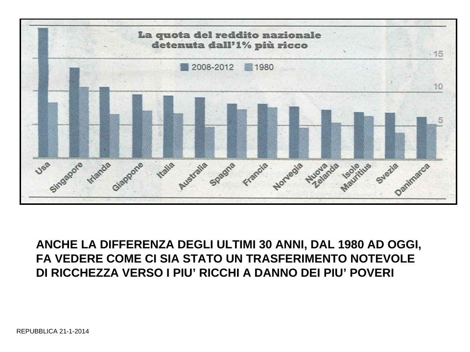{ loading=lazy style="width:47%" }

**«LA REPUBBLICA», 21-1-2014**

Galli della Loggia esprime idee anche interessanti e condivisibili, ma:

1\. detta così, la storia appare quasi immutabile e con una sola direzione. Invece ci sono dei momenti in cui prevalgono idee di cambiamento e altri nell’opposto: non è un flusso continuo che scorre nei secoli;

2\. la realtà dei numeri di queste piramidi rovesciate è emblematica: questo è uno dei momenti in cui il cambiamento è «negativo» (almeno da una certa prospettiva).

Anche la differenza degli ultimi 30 anni, dal 1980 a oggi, fa vedere come ci sia stato un trasferimento notevole di ricchezza verso i più ricchi a danno dei più poveri.

0:12:13

Un altro dato che mi ha colpito è questo rapporto dell’Università Cattolica di Milano sui giovani che vivono con i genitori, per fasce d’età, negli ultimi trent’anni, dal 1981 al 2010. Sia le donne sia gli uomini sono aumentati tra il 130 e il 150%. Questo è probabilmente sintomo anche di abitudini sociali cambiate rispetto al passato, ma è dovuto sicuramente anche alla crisi, alla mancanza di soldi che i giovani stanno vivendo; e non si parla di giovani di vent’anni, si parla di uomini e donne fatti, di 30-35 anni, non di ragazzini.

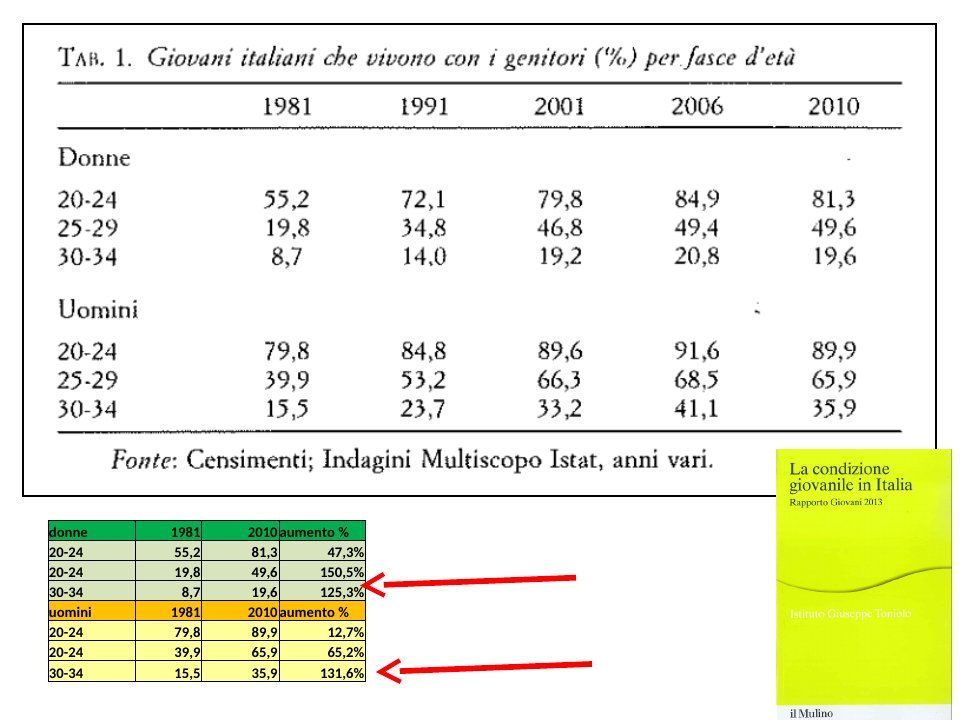{ loading=lazy style="width:45%" }

0:13:01

Ritorniamo un attimo al punto da cui sono partito, il neoliberismo. Su che cosa si appoggia? Si appoggia sul tema del *laissez-faire*: è da lì che è partito tutto. Barbara Spinelli, per citare un’altra commentatrice, dice che è una teoria darwinista, che seleziona i più forti e distrugge tutto quello che sta intorno: società, persone, Stati, democrazia. Questo tema del neoliberismo l’abbiamo affrontato una volta, quando abbiamo fatto «Lo Stato degli antichi e lo Stato dei moderni», un paio di anni fa: ho ripreso un paio di slide per ricordare il punto.

**CONCEZIONE DELLA POVERTÀ**

«…questo perché l’economia del laissez-faire resta un’ideologia, proprio come ai tempi in cui John Maynard Keynes ne denunciò le insidie, le menzogne. Il suo saggio del 1926 sulla “fine del *laissez-faire*” andrebbe riletto ogni giorno dai politburo europei e nazionali. Il liberismo del lasciar fare è a suo parere un idolo appannato, un mostro letargico: sopravvive grazie all’inclinazione – perversa, comoda – a semplificare le complessità, a occultare le smentite. È una teoria darwinista, che seleziona il più forte e distrugge tutto quel che sta intorno: società, persone, stati, democrazia. Chi vince, scrive Keynes, sono solo le giraffe col loro collo lunghissimo, che riescono a mangiare le ultime foglie rimaste in cima all’albero: gli animali col collo corto muoiono di fame. Il mercato lasciato a se stesso è quell’albero. Produce misantropia diffusa e diseguaglianze esiziali.» (Barbara Spinelli)

Visto che abbiamo citato il Neoliberismo, due parole su questi sistemi: quando nasce? L’argomento l’abbiamo trattato la sera in cui affrontammo il titolo «lo Stato degli antichi e lo Stato dei moderni: nascita della biopolitica» (gennaio 2010).

**FOUCAULT E LA MITOLOGIA DEL LIBERALISMO**

L’articolo raccontava dell’incontro (verso la fine del secolo XVII) tra Colbert e il commerciante Le Gendre, che alla domanda «che cosa posso fare per voi?» rispose: «Che cosa potete fare per noi? Lasciarci fare (*laissez-faire*)».

**LO STATO LIBERALE**

La separazione tra società civile e Stato, che il liberalismo afferma come proprio obiettivo strategico, è il passaggio decisivo per spostare sulle dinamiche di autoregolazione del mercato il baricentro dello scambio politico. Nasce così *la mano invisibile* di Adam Smith (il famoso macellaio).

Foucault ci fa capire la differenza tra il liberalismo tedesco\* e il liberalismo americano: quello tedesco con la lotta all’inflazione come principale motore della crescita; quello americano con lo sviluppo come principale obiettivo.

\* noto anche come ordoliberalismo (dalla rivista «Ordo», su cui scrivevano gli economisti liberali della scuola di Friburgo).

0:13:47

Da che cosa nasce il *laissez-faire*? Nasce dall’incontro tra Colbert, il ministro francese del tempo, e un commerciante, Le Gendre. Colbert gli domanda: «Che cosa posso fare per voi?» – si presenta pensando di essere lui quello che porta un contributo allo sviluppo sociale – e invece il commerciante gli risponde: «Che cosa potete fare per noi? Lasciarci fare»: *laissez-faire*. Da lì nasce il liberalismo, che poi assume due varianti, quella tedesca, che ha preso il nome di ordoliberalismo, e quella americana. Sono sostanzialmente diverse, ma hanno come punto centrale l’autoregolazione del mercato, e quindi che lo Stato influisca il meno possibile sulla vita sociale ed economica delle persone. È importante questa distinzione, che vedremo tra un attimo, perché ha una sua valenza.

0:15:04

Questa situazione politica ed economica sta cominciando a far montare – non so se l’avete notato anche voi, un po’ tutti no, ma qualche economista comincia a paventarlo – questo evento, cioè l’arrivo nella situazione economica di quella che si chiama deflazione: i prezzi che, invece di aumentare, diminuiscono. La deflazione è qualcosa che tutti gli economisti, di destra e di sinistra, paventano, perché è un mostro che nessuno riesce a governare bene. Sostanzialmente tutti rimandano gli acquisti, perché pensano che domani le cose costeranno meno; e quindi è un circolo vizioso che si avvita su se stesso, dando origine alla recessione. È già quello che è avvenuto in Grecia: i prezzi al consumo sono da un anno e mezzo in deflazione, sotto la linea dello zero, e quindi vuol dire che la roba il giorno dopo costa meno.

**CONCEZIONE DELLA POVERTÀ**

Inoltre (e speriamo di no) la situazione attuale, figlia diretta di questa politica, rischia di portarsi in dote un regalo che nessuno vuole e che tutti (quasi…) gli economisti di destra e di sinistra definiscono con orrore: la deflazione. Un male per tutti, ma per i poveri lo è sicuramente ancora di più.

**LA DEFLAZIONE**

La deflazione è una diminuzione del livello generale dei prezzi che porta alla recessione, e non va confusa con la disinflazione, che comporta semplicemente un rallentamento del tasso di inflazione.

Le cause della deflazione vanno imputate vuoi a una diminuzione dell’offerta di moneta, vuoi a una contrazione del ciclo economico con conseguente recessione.

La deflazione deriva quindi dalla debolezza della domanda di beni e servizi: siamo di fronte a un rallentamento della spesa da parte dei consumatori, di fronte al quale le aziende produttive, non riuscendo a vendere a determinati prezzi parte dei beni e servizi, cercano di collocarli a prezzi inferiori, spesso peraltro con scarsi risultati.

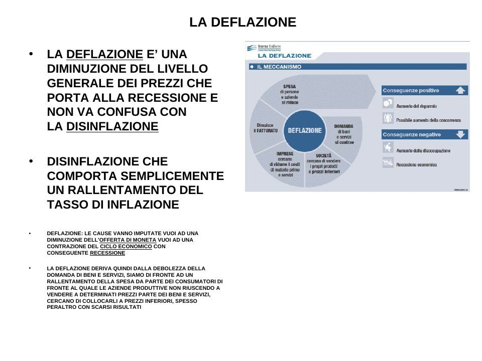{ loading=lazy style="width:47%" }

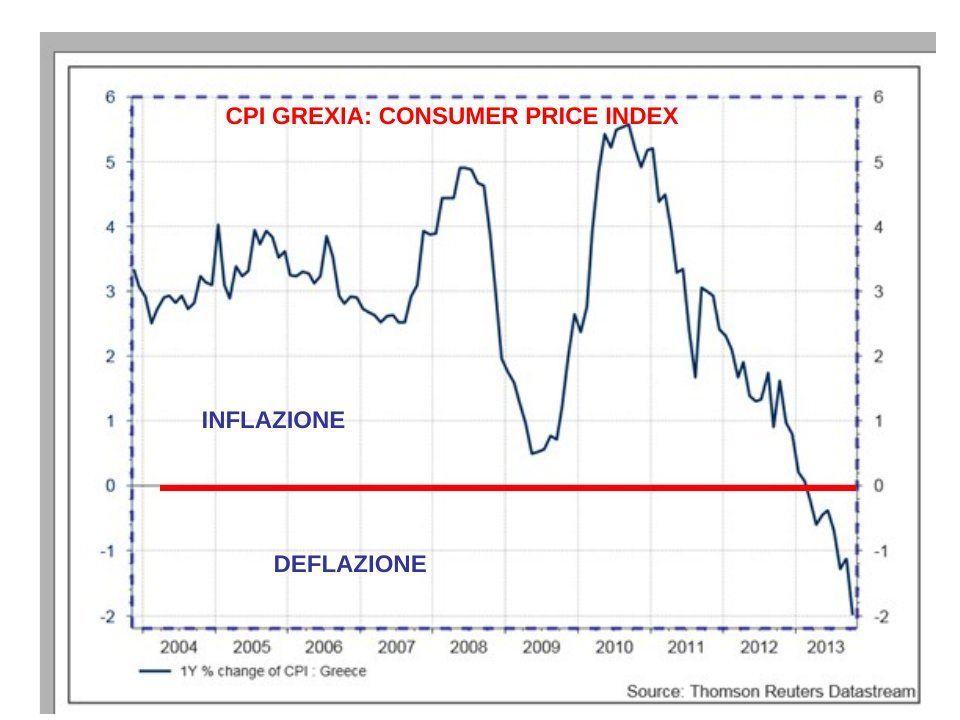{ loading=lazy style="width:47%" }

0:16:16

Ritorno al concetto di neoliberismo tedesco: questo è uno dei massimi economisti tedeschi. Che cosa dice invece? Che la deflazione può aiutare: è il frutto delle politiche che stiamo vedendo, per esempio, sulla Grecia. Il problema è che ora sulla deflazione sembra si stia allineando anche la Francia: negli ultimi due mesi la Francia si sta allineando alle posizioni tedesche su questa impostazione economica. E Hollande – a parte le problematiche di carattere privato – ha detto letteralmente che l’offerta crea la domanda. Che cosa vuol dire? Vuol dire che stimolare la domanda – che in soldoni, per noi, significherebbe aumento degli stipendi e aumento della capacità di spesa – passa solo attraverso l’offerta: una delle politiche che ha fatto, per esempio, il governo Monti, aumentando la pressione fiscale e riducendo la capacità d’acquisto delle persone.

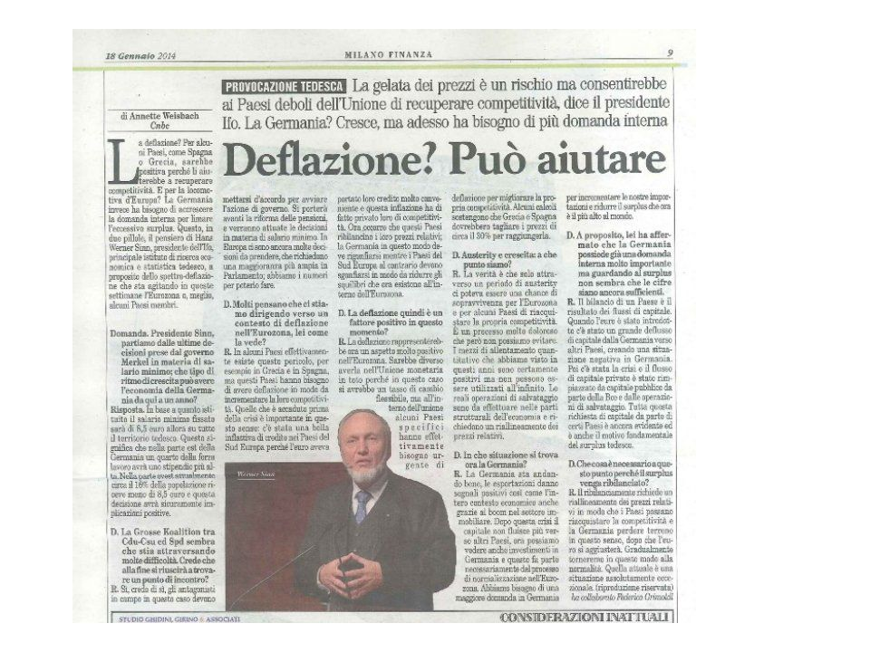{ loading=lazy style="width:36%" }

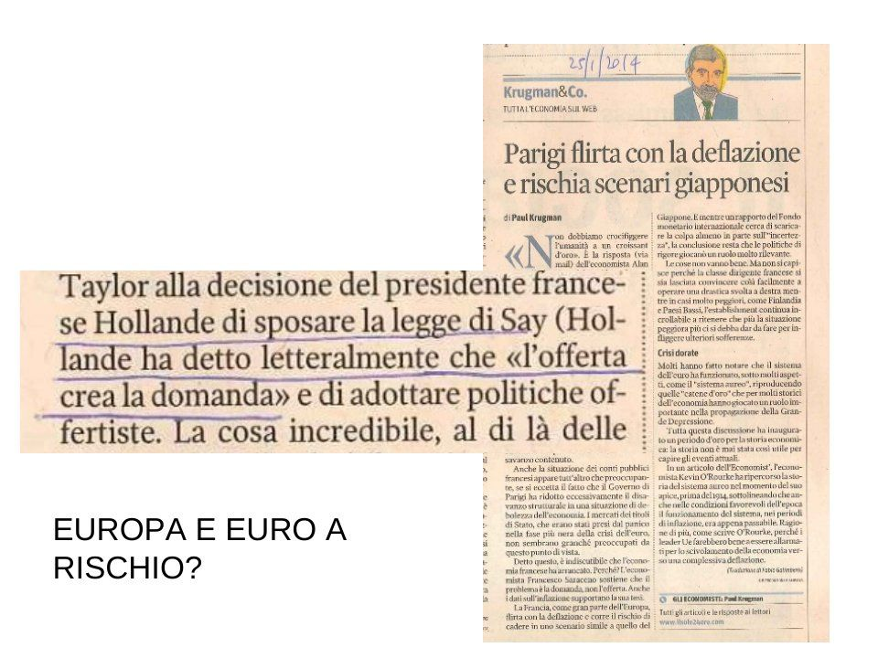{ loading=lazy style="width:39%" }

0:17:30

La deflazione fu anche un fenomeno che contribuì a caratterizzare il ventennio di Mussolini, che dopo la crisi del ’29 si trovò proprio di fronte a questo tema ostico e cattivo della deflazione. Nel 1930, a seguito della crisi del ’29 – si arrivò al ’32 che i disoccupati erano letteralmente raddoppiati – lui impose ai commercianti di ridurre il prezzo delle merci, pena l’espulsione dal Partito Fascista. Sostanzialmente questo contribuì ad avvitare i problemi, finché non si arrivò al default, cioè al mancato rimborso del debito pubblico dello Stato, perché non c’erano più soldi per pagare. È un processo terribile dal punto di vista economico; e questo nonostante ci fossero già degli economisti che avevano studiato e messo in luce le possibili contromosse a questa deflazione, che provocò tanti poveri e tanta povertà in più.

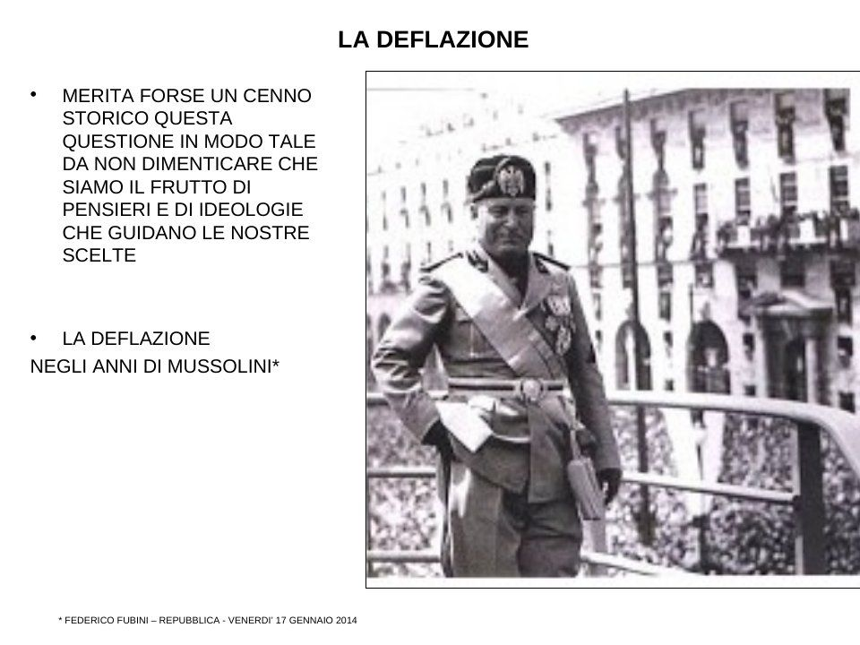{ loading=lazy style="width:30%" }

**LA DEFLAZIONE NEGLI ANNI DI MUSSOLINI**

Merita forse un cenno storico questa questione, in modo da non dimenticare che siamo il frutto di pensieri e di ideologie che guidano le nostre scelte.

Quando la grande depressione iniziò a mordere in Italia, nel 1930, il duce impose un taglio ai salari del 12%, lasciando sperare che sarebbe stato l’ultimo.

Nel gennaio del ’32 i disoccupati erano 640 mila; un anno dopo erano raddoppiati.

Nel ’34 il fascismo impose una nuova riduzione di tutte le remunerazioni, quando ormai il prezzo dell’abbigliamento o della spesa al mercato erano dimezzati o quasi. Prezzi e redditi si stavano avvitando, gli uni all’inseguimento circolare degli altri.

Solo i debiti continuavano a salire per effetto dei tassi d’interesse, fino a quando il regime decise ciò che allora fu definito «ammortamento» e oggi chiameremmo un ordinato default.

Mussolini cadde nella trappola, benché Irving Fisher, di Yale, l’avesse capita e descritta fin dagli anni Trenta.

La domanda ora è se i suoi successori alla guida del governo, anzi dei governi (perché ora, essendo in Europa, non si può parlare solo per l’Italia), ottant’anni più tardi saranno meno ottusi: errori ideologici che cercano la soluzione sempre dalla parte dell’offerta.

(Federico Fubini, «la Repubblica», venerdì 17 gennaio 2014)

0:18:49

C’è una speranza in tutto quello che vi ho detto? Anch’io me la sono andata a cercare, perché altrimenti non si riesce a capire bene; e secondo me è interessante quello che hanno studiato in questi anni in America, durante il governo Obama. Questa donna, non so se l’avete presente, è la nuova governatrice della Fed, la Federal Reserve, quindi l’omologa della BCE europea: entrerà in carica tra quindici giorni, credo, come presidente della Fed, della banca centrale americana. Obama di lei ha detto: «Gli americani avranno una paladina dei loro interessi, che capisce che il fine ultimo della politica economica è migliorare le vite dei lavoratori e delle loro famiglie». Questo, attribuito a un banchiere centrale, nel caso della Yellen...

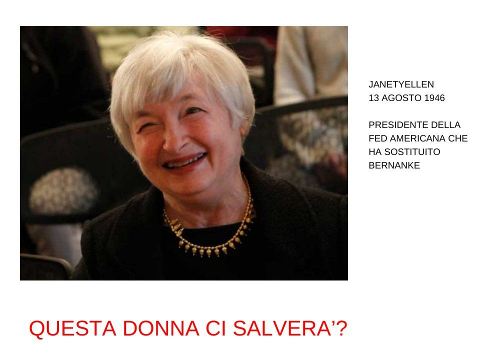{ loading=lazy style="width:37%" }

**CONCEZIONE DELLA POVERTÀ**

Ma c’è una speranza in questo contesto ideologico? Interessante da questo punto di vista è il liberalismo pragmatico del modello americano: tra la politica economica europea (derivante dal predominio tedesco) e quella americana c’è un abisso che non viene registrato a sufficienza nel sentire comune.

Questa donna ci salverà? Janet Yellen (13 agosto 1946), presidente della Fed americana, che ha sostituito Bernanke.

**IL GRANDE PRAGMATISMO AMERICANO**

Prima di tutto la Fed è per statuto diversa dalla BCE: ad esempio ha il compito statutario di combattere la disoccupazione e di regolare il cambio, al contrario della BCE, che ha «solo» l’inflazione come obiettivo, essendo questa, secondo gli europei, il punto da cui discende tutto.

Leggiamo alcune note sulla Yellen e in margine alla sua elezione: l’avvento della prima donna al vertice della banca centrale più potente del mondo coincide con una nuova centralità del lavoro.

«Gli americani avranno una paladina dei loro interessi, che capisce che il fine ultimo della politica economica è migliorare le vite dei lavoratori e delle loro famiglie» (Barack Obama).

La questione sociale viene dibattuta sulla grande stampa americana nel 50° anniversario della *War on Poverty* lanciata da Lyndon Johnson. Ultimo presidente democratico a potersi permettere un vigoroso potenziamento del *welfare state*, Johnson fu nell’ambito sociale il degno continuatore di Franklin Roosevelt e John Kennedy.

(Federico Rampini, Cronaca da New York, 8-1-2014)

0:20:00

Quali sono le differenze tra il neoliberismo tedesco e quello americano? La Fed, per esempio, la banca centrale americana, ha per statuto il compito di combattere la disoccupazione e di regolare il cambio: almeno questi due compiti li ha. La BCE per statuto ha come obiettivo solo l’inflazione, il compito di combattere l’inflazione, quindi di agire solo sull’aumento dei prezzi; invece la Fed, la Federal Reserve, ha quello di combattere la disoccupazione. Infatti negli ultimi due anni hanno immesso sul mercato una media, credo, di 40 miliardi ogni mese per stimolare l’economia; e infatti l’America ora è tornata a un 6,5% di disoccupazione, mentre in Italia credo si sia intorno al 12%, se non ricordo male.

0:21:01

Quali sono i filoni di ricerca promossi dalla Yellen? Che chi resta senza lavoro, e quindi in uno stato di povertà, per periodi prolungati corre due rischi: finisce per scoraggiarsi, e quindi non cerca più un posto ed esce da tutte le statistiche; e allo stesso modo si accontenta di lavori sempre meno pagati, perde sempre più forza contrattuale e contribuisce quindi alla stagnazione dell’economia. Un discorso del genere, fatto da un banchiere centrale, in questo caso la Yellen – se qui in Italia lo dice Vendola, forse gli sparano: sono discorsi che, estrapolati dal contesto, sono quasi da comunista, discorsi di un certo senso. L’esempio di ieri dell’Electrolux: sta succedendo anche in Italia, si accettano sempre di più lavori meno pagati e con più produttività, proprio per andare incontro alla direzione che l’economia sta prendendo.

**IL GRANDE PRAGMATISMO AMERICANO**

È lei ad aver spinto gli economisti della Fed su un nuovo filone di ricerche, per capire gli effetti della disoccupazione di lungo periodo.

Più volte nei suoi discorsi la Yellen ha lanciato un allarme: chi resta senza lavoro per periodi prolungati è esposto a un duplice rischio. O finisce per scoraggiarsi, cessa di cercare un posto, quindi esce dalle statistiche della disoccupazione e in questo modo riduce la percentuale della popolazione attiva (un fenomeno che minaccia la produttività dell’intero sistema paese); oppure si accontenta di lavori sempre meno pagati, perde ogni forza contrattuale sul mercato: e questo contribuisce a spiegare la stagnazione dei salari, la perdita di potere d’acquisto nelle fasce più deboli del mercato del lavoro.

Questi sono discorsi da comunista…

Il *quantitative easing*, i massicci acquisti di bond per generare liquidità, è stato orientato a perseguire aggressivamente una riduzione della disoccupazione. Ora la Yellen, che assume la guida della Fed dal primo febbraio, si trova di fronte a una sfida. Il quantitative easing ha avuto successo, la crescita americana è ripartita, il tasso di disoccupazione è sceso dall’11% al 7%.

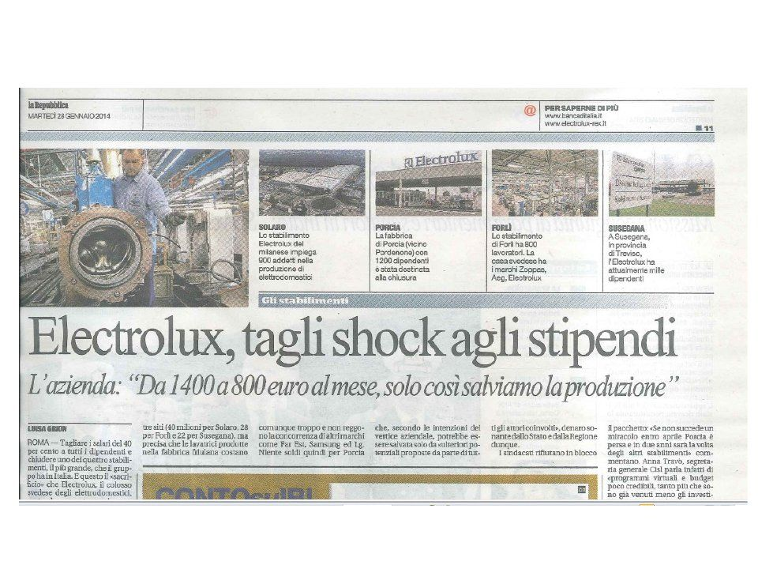{ loading=lazy style="width:46%" }

0:22:28

Questo era per fare un cappello sulla nuova povertà che, speriamo di no, si sta comunque introducendo nel nostro modo di vivere di oggi. Solo per dire che nella seconda parte faremo, come abbiamo accennato all’inizio, un po’ tutta la storia della povertà in Occidente; e per fare questo, almeno io nella mia parte, mi sono fatto aiutare da un libro di don Vincenzo Paglia – è un prete, era vescovo, ora è arcivescovo – che è molto interessante: ha fatto una *Storia dei poveri in Occidente* che attraversa un po’ tutti i secoli. Prendendo spunto da questo saggio interessantissimo di Vincenzo Paglia, proveremo poi a raccontare questa storia nel corso dei secoli. Su questo ti lascio la parola, Lorenzo.

**STORIA DEI POVERI**

Torniamo ora alla storia della povertà e alle sue origini. Per alcuni spunti su cui riflettere ci faremo aiutare da un saggio di (don) Vincenzo Paglia, *Storia dei poveri in Occidente*, uscito nel 1994.

**VINCENZO PAGLIA (1945), ARCIVESCOVO**

Presidente del Pontificio consiglio per la famiglia; ex vescovo di Terni.

Negli ultimi due anni è stato molto chiacchierato e intercettato… a febbraio 2013 è stato sostituito da Ernesto Vecchi (vescovo ausiliare di Bologna), a fronte di gravi problemi economici e di indebitamento della curia di Terni.

Per il suo impegno per la pace ha ricevuto nel 1999 la medaglia Gandhi dell’UNESCO e nel 2003 il premio Madre Teresa dal governo albanese. È stato insignito, inoltre, nel 2004 del San Valentino d’oro, nel 2005 del premio per il dialogo città di Orvieto e nel 2006 del premio Grinzane Terra d’Otranto e del «III centenario di San Daniil principe di Mosca», consegnatogli dal patriarca Alessio.

**SOMMARIO**

1\. Gesù sceglie i poveri – 2. Una nuova fraternità (I-III secolo) – 3. L’organizzazione della carità (II-III secolo) – 4. La città e i poveri (IV-V secolo) – 5. I poveri del deserto (IV-V secolo) – 6. La città e i vescovi (IV-V secolo) – 7. Il servizio ai poveri: missione della Chiesa (VI-XI secolo) – 8. Il monastero, nuova città (VI-XI secolo) – 9. Povertà e contestazione (XII secolo) – 10. I mendicanti e la riabilitazione dei poveri (XIII secolo) – 11. I mendicanti contestati, povertà e delinquenza (XIV-XV secolo) – 12. Tra carità e repressione (XVI secolo) – 13. Una grande reclusione? (XVII secolo) – 14. L’età della filantropia (XVIII secolo) – 15. Poveri operai (XIX secolo) – 16. La povertà dei popoli (XX secolo) – 17. I poveri nell’Italia del XX secolo – 18. Globalizzazione e povertà.

0:23:31

Lorenzo Poggi Grazie. L’argomento è vastissimo, per quanto lo affrontiamo. Cominciamo a stabilire una cosa: l’impressione nostra, oggi, è di trovarci di fronte a una condizione data dall’andamento dell’economia globale, dell’economia mondiale, sulla quale non si può quasi intervenire. L’esempio che faceva prima Paolo della Federal Reserve è un tentativo di intervenire nell’economia e quindi di modificare l’atteggiamento liberista, il *laissez-faire* di Colbert; ed è un atteggiamento fortemente contestato negli Stati Uniti. Obama è stato fortemente contestato per questo indirizzo. Perché? Perché ormai il sistema liberista del capitalismo finanziario avanzato è sentito come il modo naturale di essere dell’economia: è così, non c’è un’alternativa, è naturale che sia così.

0:24:42

E quando una cosa diventa naturale, ideologica, in questo modo, non sorgono nemmeno le idee per cambiarla. Gli Stati Uniti hanno un’eredità, l’eredità di Roosevelt, che si trovò a fronteggiare la crisi e che, andando anche oltre Keynes, intervenne proprio a sostegno dei disoccupati, della popolazione. Ma questo non cambia il quadro del sistema: il sistema dominante è quello del capitalismo avanzato, è il nostro, che ormai è il modo naturale dell’economia. E questo andamento dell’economia ha tutto il potere, la forza, quasi fosse un destino, la provvidenza.

0:25:40

Noi parliamo anche dei tempi in cui c’era il povero; ma il povero era tale perché era sottomesso alla provvidenza divina, c’era l’ordine divino del mondo. Non si poteva uscire da questo. Il povero deve esserci, non può essere eliminato, perché è una conseguenza del peccato originale: quindi i poveri ci devono essere, non c’è niente da fare. E chi pensa di poterli eliminare va contro natura: pensate alla *Rerum novarum* di Leone XIII, contro chi pensa di togliere dal mondo le disuguaglianze sociali ecc.

0:26:24

Quindi i poveri ci sono, ci sono sempre stati, e hanno preso la condizione di bianti, gente che va vagabonda, i *vagatores*. E quando sono più fitti, più insistenti, nella storia? Quando ci sono le crisi, è chiaro: le crisi colpiscono di più e danno luogo a questi fenomeni di incremento dei *vagatores*, di coloro che si spostano e vanno in cerca, tentano di uscire fuori da una condizione. Già Giustiniano, quando comincia a sentirsi in qualche modo la crisi dell’Impero, fa una legge contro coloro che vagano nell’Impero. La legge di Giustiniano prevede che siano rimandati nelle loro zone d’origine: si rimandano a casa, perché si spostano troppo nell’Impero. Nulla di nuovo, nulla è inventato.

0:27:38

Hanno quindi questa condizione. Il Medioevo la accentua, perché il Medioevo è una società molto totalizzante, chiusa. La società si preoccupa dei suoi membri ed è responsabile dei suoi membri. Prima Paolo ha messo in evidenza quel discorso sull’individualità, sulla responsabilità individuale: la responsabilità individuale si sviluppa con lo svilupparsi della società moderna. Nel Medioevo non c’è questa evidenza della responsabilità individuale: ognuno ha una responsabilità individuale, ma ha soprattutto una responsabilità collettiva; fa parte di un gruppo, di una società ristretta, di un gruppo sociale, e risponde per quello. E tutte le società, le corporazioni, le associazioni, i gruppi tendono a essere perfetti al loro interno e a eliminare quelli che deviano.

0:29:02

Ecco perché nel Medioevo tutti quelli che non fanno parte della società sono stranieri, sono visti con sospetto, perché non si sa a quali regole e a quali leggi rispondano, e non c’è uno Stato sovrano che fa sì che tutti rispondano alle sue. Quindi i *viatores*, i bianti, i *peregrini et advenae* sono sospetti già di per sé, perché non sono riconducibili a una condizione precisa. Poi ci sono delle categorie che si spostano e che sono tollerate: i pellegrini che vanno a Santiago di Galizia o da qualche altra parte; ci sono i mercanti, che cominciano a spostarsi quando ci sarà lo sviluppo della mercatura...

0:30:01

E poi ci sono le meretrici, che vanno soprattutto a Roma – sono soprattutto «romee» – perché Roma le attira: c’è il più grande concentrato di maschi che hanno fatto voto di castità, maschi liberi, no? E quindi è il mercato più importante. Ogni tanto qualche papa ci ha provato – sapete, c’è stato qualche papa che ha tentato, dicendo «ma come, a Roma tutte queste? No, non va bene»; ci provò lo stesso Leone X, il papa Medici, con tutte le critiche che gli venivano: «Ma come si fa?». Poi qualcuno gli fece presente: «Guardi, si potrebbero anche cacciare tutte le meretrici da Roma, ma fra loro e l’indotto...» – oggi si direbbe: bisogna pensare anche alla disoccupazione, sennò sono proprio poveri – «...fra loro e l’indotto cacceremo circa 25.000 persone da Roma», sulla popolazione che c’era allora; «praticamente torneremo a farci pascolare le pecore». Meglio di no: ci ritornarono sopra, su questi pensieri.

0:31:33

Si spostano anche i soldati; però questi in qualche modo sono tollerati, gli altri sono sempre visti con grande sospetto. Ma il sospetto aumenta, la ricerca di sicurezza aumenta, quando comincia ad affermarsi la società mercantile e quando la povertà comincia effettivamente ad assumere un segno e una caratteristica più evidenti. Perché nella società medievale il povero in qualche modo è il servo che ha avuto un raccolto andato male, una qualche disgrazia dovuta al tempo: in qualche modo lo si conosce, fa parte della comunità. Ma quando la società diventa società mercantile e cittadina, il povero intanto è più evidente, perché va a chiedere l’elemosina sul sagrato della chiesa, vicino al ricco mercante vestito di broccato, di stoffe preziose, che va a messa. Quindi le due condizioni sono visibilmente vicine. Nell’alto Medioevo il servo è lontano dal signore, per cui non c’è questa immediata visibilità della differenza sociale.

0:33:08

E poi succede una cosa, quella a cui accennava Paolo: l’individualità della responsabilità. Perché? Perché quando comincia ad affermarsi il modo di produzione capitalistico moderno, con le prime forme di manifattura nelle città del basso Medioevo, intorno al 1200 – due minuti da professore, ma due minuti soltanto – che cosa comincia? Quelle che erano attività umane legate all’appartenenza a una società, a un gruppo, vengono pagate. Pagate vuol dire che ogni attività viene distinta dalle altre, separata come lavoro, e ha un valore in denaro. Quello che era azione umana, atteggiamento umano, diventa qualcosa di esterno all’individuo: una merce che può essere venduta, separata dall’individuo, altra rispetto all’individuo che la porta. Per cui l’individualità diventa sempre più ristretta: non ci si identifica più con quello che siamo nella società; quello che facciamo diventa sempre più merce sottoposta alle condizioni del mercato. E l’uomo nella sua interezza si riduce sempre di più, perde sostanza, diventa sempre più magro, anche perché mangia di meno.

0:35:06

«L’aria della città rende liberi», dice il vecchio adagio: rende liberi perché libera dalla dipendenza personale che caratterizzava la società di prima, e rende le dipendenze tutte economiche, legate al possesso o al non possesso di denaro. Quindi un potere che non ha più nulla di umano e di personale, una forza che trascende le esigenze umane, che ha poco a che fare con queste, che sottrae all’individuo la sua capacità di agire sul mondo, la riduce a merce e su quella costruisce un altro mondo.

0:35:57

E che crea un insieme di senza lavoro, li caccia dalle campagne. La rivolta dei contadini è la rivolta contro i mercanti, quelli della città, quelli che hanno soldi e che comprano le terre che prima erano dei signori. E i signori le vendono perché non possono più campare con quello che rendono le terre, con i servi, ma devono in qualche modo, per i nuovi costumi, avere soldi. Quindi vendono ai mercanti; ma il mercante, quando compra la terra, non vuol saperne dei servi che ci sono sopra: ha bisogno semmai di manodopera. Guardate che ancora oggi – c’è anche un film – gli operai si chiamano «capitale umano»: sono capitale come l’altro; si chiamano «umani» solo per distinguerli da quello impiegato nell’acquisto dei software, ma insomma è un aggettivo: poi sono soldi.

0:37:17

I contadini svevi, nei «Dodici articoli» – siamo nel 1525 – si oppongono a questa trasformazione: vogliono vivere all’antica, vogliono che il bosco resti non loro, ma del signore, però che ci si possa fare legnatico, portarci i maiali a mangiare le ghiande: è bene comune. Ma se viene venduto, il mercante lo acquista, lo recinta e non vuole che ci si portino gli animali a pascolare e ci si faccia legna. E allora questa massa di poveri lascia il proprio luogo, si sposta e dà luogo al fenomeno dei bianti, di coloro che in qualche modo vivono...

0:38:15

Ecco il libro di Teseo Pini, scritto alla fine del Quattrocento, riscoperto e riproposto da Piero Camporesi, carissimo collega che ho avuto la fortuna di conoscere perché dividevamo una cattedra: cioè la cattedra di Camporesi la occupavo io come supplente; e quindi, finché lui insegnava all’università, a me andava benissimo, perché così potevo insegnare al liceo. Piero diceva: «Ma chi è questo che conosce il mio libro?», perché non lo conosceva nessuno, *Il libro dei vagabondi*... Vabbè, comunque è un discorso estremamente interessante quello di Piero. Ha scoperto questo testo di Teseo Pini, lo *Speculum cerretanorum*, lo specchio: come c’è il *Malleus* contro le streghe, c’è anche lo specchio dei cerretani, cioè dei poveri non più buoni, non più condizione umana, simbolo dell’essere dell’uomo povero rispetto alla provvidenza divina e quindi sottomesso a Dio, ma di quelli che sono invece in qualche modo condizione dell’esistenza del peccato, del diavolo: sono ingannatori, sono quelli che...

0:40:00

...che hanno le «ragie»: la ragia, la resina che appiccica, la pegola per impegolare quelli che ci credono, come si fa con la pegola per gli uccelli, che rimangono con le zampe attaccate al ramo impegolato. Così loro hanno le ragie per attirare quelli in buona fede e carpire loro i soldi, farsi dare i beni, le elemosine. E Teseo Pini elenca in ordine alfabetico le ragie con cui i poveri cattivi, ingannatori, ingannano il prossimo. È un trattato veramente eccezionale: le ha messe in ordine alfabetico, allampadati, accadenti, falsi bordoni... Ne parliamo di due o tre; bisognerà vederle insieme, perché sono attualissime. Sono attualissime, solo che oggi abbiamo uno spostamento della comunicazione, che non avviene se non in misura molto ridotta attraverso la persona, ma avviene attraverso i mezzi di comunicazione: allora questo tipo di ragie vengono fatte con la televisione o via web, ma sono rimaste le stesse.

0:41:38

Ci sono gli iucchi, i falsi bordoni – ne parleremo, sono eccezionali. Si chiamano cerretani da Cerreto – non Cerreto Guidi: Cerreto di Spoleto, in Umbria – un posto dove c’era il tempio della dea Cerere, e i sacerdoti della dea Cerere andavano a raccogliere dai contadini le primizie per dedicarle alla dea che faceva crescere le messi; e questi sacerdoti, che facevano grandi cose e facevano vedere i miracoli della dea, si chiamavano appunto cerretani, perché venivano da là, dal posto dove c’era il tempio di Cerere. Da «cerretano» a «ciarlatano» ecc.: è arrivato fino a noi – c’è anche la ciarla. Ma sono i falsari, i felsi, gli iucchi.

0:42:34

Sapete chi sono gli iucchi? Sono gli ebrei che si sono convertiti al cristianesimo e si sono fatti battezzare; e quando si fanno battezzare è un trionfo per la fede, bisogna fare loro un regalo, perché sono abbandonati dalla loro comunità. Ci sono degli iucchi, dice Teseo Pini, che per farsi battezzare hanno consumato più acqua di un mulino per macinare la farina: tante volte si sono fatti ribattezzare, in una città, in un’altra, in un’altra ancora, per mettere insieme di volta in volta i regali. È una ragia un po’ desueta; ma io mi ricordo di un giornalista che era musulmano e che si è messo anche il nome di «Cristiano». Oggi non avviene direttamente come qui, non è ripetuta, però avviene via cavo; ma come vedete le ragie sono sempre quelle. Riprendiamo dopo il discorso sulle ragie, sui cerretani e sui poveri che diventano cattivi.

\[PAUSA\]
{: .nota }

1:07:05

Paolo Marcucci Bene, riprendiamo. Allora, c’eravamo lasciati prima con il saggio di Vincenzo Paglia, *Storia dei poveri in Occidente*. L’ho preso solo come spunto e come traccia, per poi inserirci qualche altro argomento; comunque il libro parte dalla nascita di Cristo e viene in avanti. Avete visto che sulla copertina di questo libro c’è San Martino che divide il mantello con il povero: non a caso. Il dipinto è di Simone Martini, un bellissimo dipinto che raffigura il tema di questa sera. Tra l’altro Simone Martini è anche uno degli autori più profondamente legati al tema della serata saltata a dicembre, che era quella sull’arte civica; se riprenderemo quella serata, ne parleremo un po’ più approfonditamente.

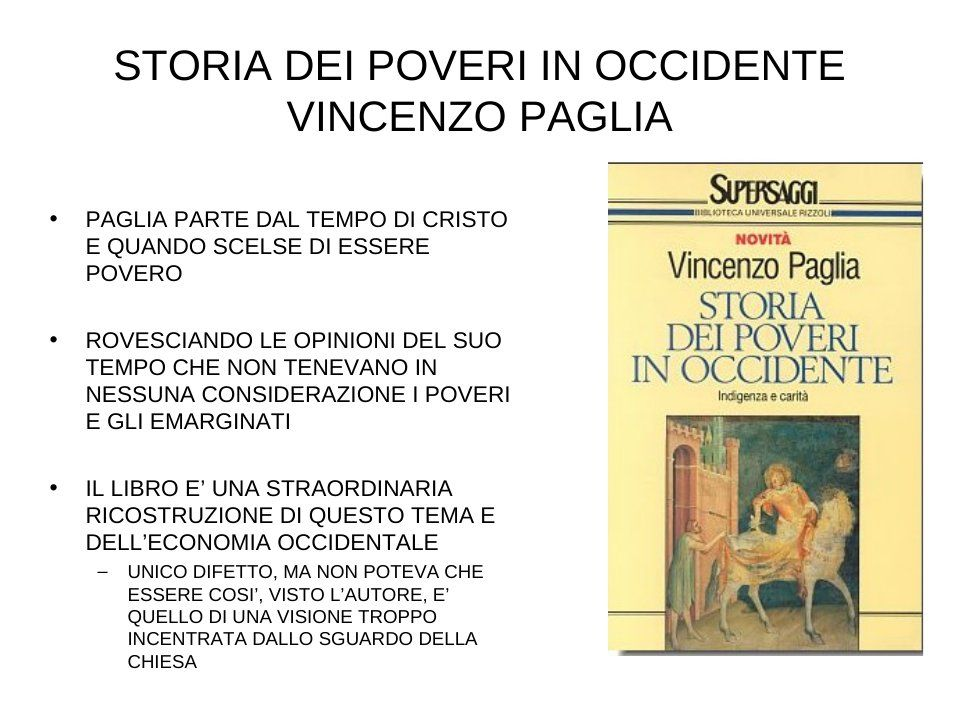{ loading=lazy style="width:47%" }

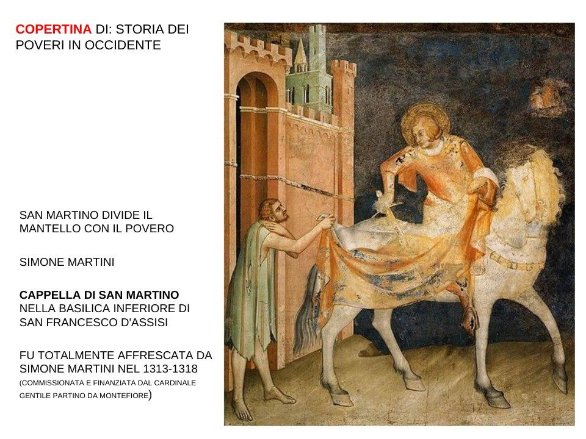{ loading=lazy style="width:47%" }

**STORIA DEI POVERI IN OCCIDENTE* – VINCENZO PAGLIA**

Paglia parte dal tempo di Cristo, quando scelse di essere povero, rovesciando le opinioni del suo tempo, che non tenevano in nessuna considerazione i poveri e gli emarginati.

Il libro è una straordinaria ricostruzione di questo tema e dell’economia occidentale. Unico difetto – ma non poteva che essere così, visto l’autore – è quello di una visione troppo incentrata sullo sguardo della Chiesa.

Copertina: Simone Martini, *San Martino divide il mantello con il povero*. La cappella di San Martino, nella basilica inferiore di San Francesco d’Assisi, fu interamente affrescata da Simone Martini nel 1313-1318 (commissionata e finanziata dal cardinale Gentile Partino da Montefiore).

1:08:25

Nella ricostruzione che Paglia fa della povertà si parte dal III secolo, e si racconta di un pranzo che Pammachio – come narra Paolino di Nola – serve ai poveri, donando tutto quello che aveva in casa. Poi c’è un altro episodio, per esempio nel 520, di Cesario di Arles, in Francia, che accoglie vari prigionieri della guerra di quel tempo e, per sfamare tutta questa popolazione di vagabondi che erano diventati dopo la guerra, vende i vasi sacri. Viene contestato, però ha questa idea del cristianesimo come carità ed elemosina.

**STORIA DEI POVERI IN OCCIDENTE**

Non a caso Paglia sceglie San Martino; e in fondo anche Simone Martini (uno dei pittori più rappresentativi delle opere che hanno caratterizzato l’arte civica…).

Sul «fare la carità» si giocano, per venti secoli, l’organizzazione concreta delle società, l’evangelizzazione, la riforma religiosa, la santità, e anche lo spirito del capitalismo e le idee marxiste: utopie secolarizzate di un mondo senza sfruttati e senza sfruttatori.

La Chiesa si è posta fin dalla sua nascita il problema: come si combatte concretamente la povertà?

Paolino di Nola scrive nella *lettera XIII*, a Pammachio, che Pammachio, alla fine del IV secolo d.C., dopo la morte di sua moglie Paolina, riunì nella basilica di San Pietro a Roma un notevole numero di poveri e offrì loro un grande pranzo. Questa la scena del pranzo: «Tu hai dunque riunito i poveri, i padroni delle nostre anime, tutti quelli che in tutta quanta Roma vivono di elemosine, tu hai radunato la loro moltitudine nella basilica dell’apostolo. Gioisco del magnifico spettacolo…».

(Pammachio, Roma 340 circa – 409, senatore romano, è venerato come santo. Paolino di Nola, ovvero Ponzio Anicio Meropio Paolino – Bordeaux, 355 – Nola, 22 giugno 431 – è stato un vescovo di origine gallo-romana.)

Cesario di Arles, dopo una battaglia, accolse i prigionieri nelle varie chiese e nella sua stessa casa, distribuendo tutte le provvigioni dell’episcopio per venire in loro aiuto (erano pagani, ariani e cristiani).

Non esitò a vendere i vasi sacri per aiutarli, e a coloro che lo disapprovavano rispose: «Non credo che Dio mi biasimi di impegnare per il riscatto dei prigionieri ciò che è per il suo servizio, lui che ha dato se stesso per il riscatto dell’umanità. Quando vi riunite qui in chiesa, ciascuno presenti quello che può da distribuire ai poveri; accogliete i viandanti nelle vostre case con grande bontà; offrite loro quanto potete, lavate loro i piedi. Sopra ogni cosa visitate i malati» (*Predica* 14).

(Cesario d’Arles – Chalon-sur-Saône, 470 circa – Arles, 27 agosto 543 – fu un monaco divenuto vescovo di Arles; è venerato come santo dalla Chiesa cattolica. Conosciamo la sua vita e le sue opere grazie alla *Vita di Cesario*, scritta poco dopo la sua morte da tre vescovi e due suoi subordinati.)

Elemosina e carità, dunque: come quella che ha reintrodotto recentemente il papa.

1:09:17

Carità ed elemosina che sono ritornate ora con papa Bergoglio, per esempio, perché ha ripristinato l’ufficio dell’elemosiniere in Vaticano. C’è una persona – non so se l’avete visto in televisione, non so nemmeno se è passato – l’elemosiniere del Vaticano, che la notte va nelle periferie di Roma e distribuisce 10-20 euro alle persone per comprarsi un paio di scarpe, una maglia, qualsiasi cosa. È quindi un’istituzione antichissima, risale all’anno Mille, e papa Bergoglio l’ha resuscitata.

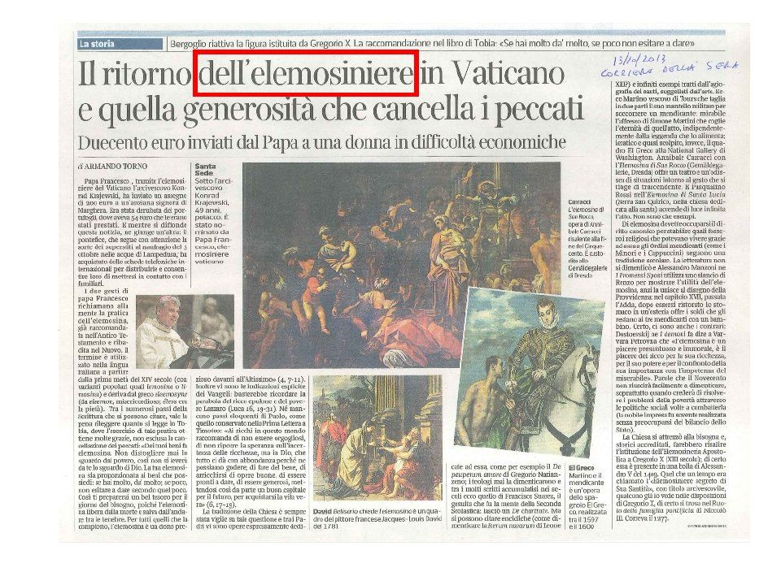{ loading=lazy style="width:40%" }

1:10:00

Questo per dire come avveniva nel monastero di Fleury-sur-Loire; le regole dicono questo: «L’ospitalità venga affidata a un religioso spiritualmente sensibile» – quindi non a qualcuno magari un po’ tentato dai soldi – «liberato dai pericoli del mondo» – quindi che non cadesse in tentazione – «come un abile navigatore fuori del turbinio del secolo e approdato ormai alla *stabilitas* del monastero; in tale modo egli potrà provare più compassione e umanità verso i poveri e i pellegrini». Questo era tra il 1020 e il 1030.

**STORIA DEI POVERI IN OCCIDENTE**

La figura dell’*eleemosynarius* nasce intorno all’anno Mille. Il compito dell’elemosiniere divenne sempre più importante, al punto che fu istituzionalizzato come un vero e proprio ufficio amministrativo.

Dicono le *Consuetudini* del monastero di Fleury-sur-Loire (1020-1030): «L’ospitalità venga affidata a un religioso spiritualmente sensibile… liberato dai pericoli del mondo, come un abile navigatore fuori del turbinio del secolo e approdato ormai alla *stabilitas* del monastero; in tale modo egli potrà provare più compassione e umanità verso i poveri e i pellegrini».

1:10:44

È rimasta famosa – non so se qualcuno di voi se la ricorda, di una decina di anni fa – l’immagine del banchiere Fazio, governatore della Banca d’Italia di quel tempo, che a New York, a una riunione del Fondo Monetario Internazionale, fu colto mentre faceva l’elemosina a un povero per la strada. Fazio era noto per essere un banchiere cattolico, di area cattolica, e non si sottraeva a questa idea della carità che c’è sempre stata nella religione cattolica.

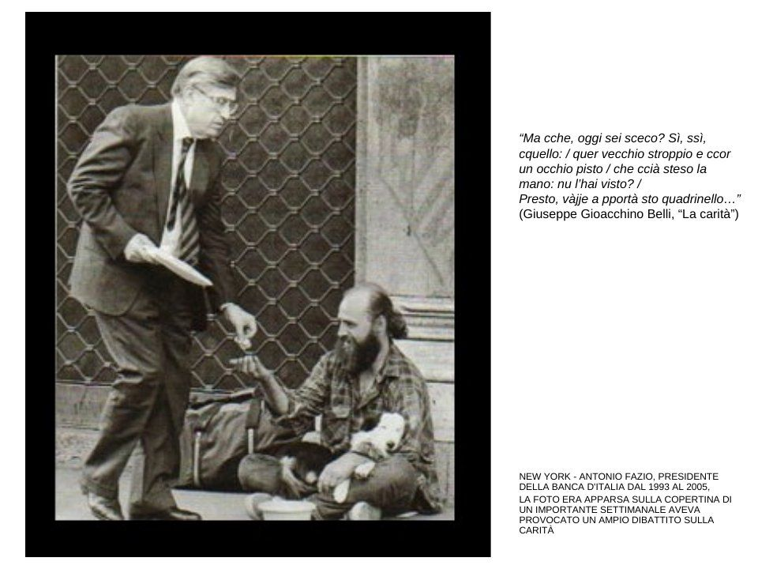{ loading=lazy style="width:59%" }

1:11:19

Nella ricostruzione di Paglia si arriva quindi al XII secolo e – quello che aveva già introdotto prima Lorenzo – a questa divisione tra la città e la campagna: si arriva alla satira del villano, cioè il villano viene sbeffeggiato in tutte le rappresentazioni; anche nel Boccaccio, per esempio, ci sono varie novelle da questo punto di vista. Questa è un’immagine del Trecento, per esempio, in cui si vede l’angelo che dona il villano al padrone: viene creato il villano, sostanzialmente, e viene dato in dono al padrone, che poi il villano dovrà servire. E l’ha accennato prima Lorenzo in modo particolare: si inserisce una concezione della povertà quasi punitiva, la miseria nasce quasi da una colpa, se non tua almeno dei tuoi genitori. E questo concetto si ritrova costantemente, attraverso i secoli. Faccio un’altra citazione...

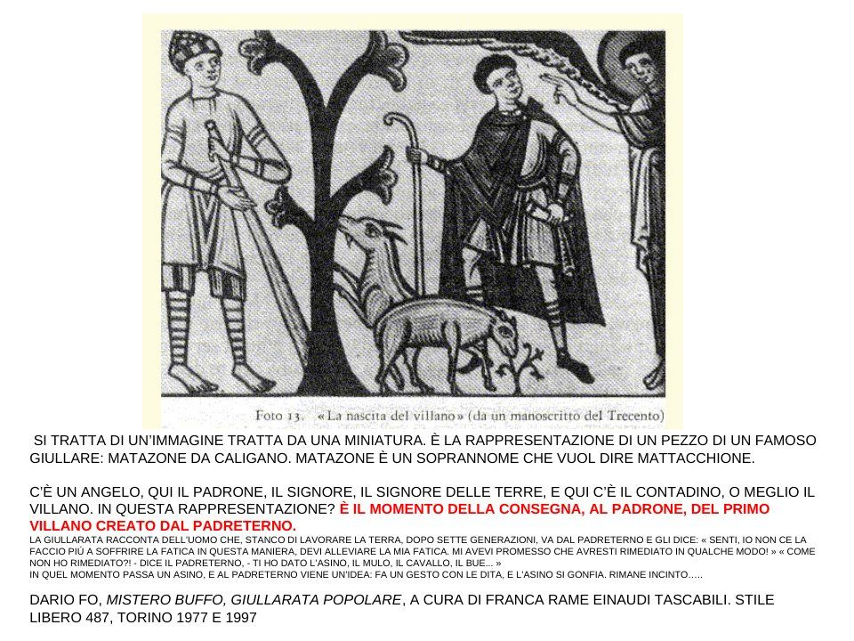{ loading=lazy style="width:59%" }

**STORIA DEI POVERI IN OCCIDENTE**

Nel XII secolo i contadini vennero identificati *tout court* con i poveri. Il disprezzo per loro era divenuto un motivo ricorrente nella letteratura medievale: particolarmente diffusa era la satira del «villano», ridicolizzato per l’inferiorità sociale e culturale delle masse contadine.

Villano: nel Medioevo, chi risiedeva nella *villa*, la terra aperta che si contrapponeva al borgo e al castello, nella condizione di servo della gleba; quindi, con significato più generico, uomo di campagna, contadino: *E a’ villani rivolto disse: «Vedete, signori, come egli m’aveva lasciato nell’albergo in arnese…»* (Boccaccio).

Alla bruttezza si aggiungeva anche la mancanza di ricchezza e, accanto alla penuria, non poteva mancare la disonestà: il povero era anche rapinatore e ladro.

L’immagine è tratta da una miniatura (*La nascita del villano*, da un manoscritto del Trecento) e illustra un pezzo di un famoso giullare, Matazone da Caligano (Matazone è un soprannome che vuol dire mattacchione): c’è un angelo, il padrone, il signore delle terre, e il contadino, o meglio il villano. È il momento della consegna al padrone del primo villano creato dal Padreterno (cfr. Dario Fo, *Mistero buffo. Giullarata popolare*, a cura di Franca Rame, Torino, Einaudi, 1977 e 1997).

La valutazione della povertà era così negativa che chi ne era colpito era escluso da qualsiasi funzione pubblica, compresa quella ecclesiastica.

Questi atteggiamenti ripescavano l’antica concezione punitiva di Dio: la miseria nasceva da una colpa, se non propria, almeno dei genitori.

Di conseguenza la stessa carità e la beneficenza restavano connotate da un senso di alterigia, se non di disprezzo, verso i poveri, i quali da parte loro non potevano che rassegnarsi. La società perbene aveva così trovato la difesa dai sensi di colpa e dai dubbi (Mollat, *I poveri nel Medioevo*).

Interessante di questo periodo è anche la ricostruzione che ne ha fatto *Le Roy Ladurie su Montaillou*.

1:12:44

Lorenzo Poggi Si può tornare un attimo all’immagine? Scusate. Ecco, guardate l’angelo, notate una cosa: è un angelo del tempo presente, insomma, dopo l’incarnazione di Dio. E l’angelo, quando indica il servo, guardate come tiene la mano: non con un dito solo, ma con due, perché sta annunciando che la natura umana e la natura divina si sono unite; e le altre dita stanno in quella posizione piegata perché Dio è uno e trino. Quindi un trattato di teologia in un gesto.

1:13:29

Paolo Marcucci Questa concezione della povertà si ritrova, dicevo, trasversalmente: per esempio anche nel famosissimo saggio di Le Roy Ladurie su Montaillou, quel paese della Francia che è stato ricostruito con una concezione che ribalta la storia, facendola dal basso invece che dall’alto. È la storia inventata dalle «Annales» francesi, e questo ne è un simbolo. È la storia di un paese, Montaillou, un paese dell’Occitania francese, al confine tra la Spagna e la Francia.

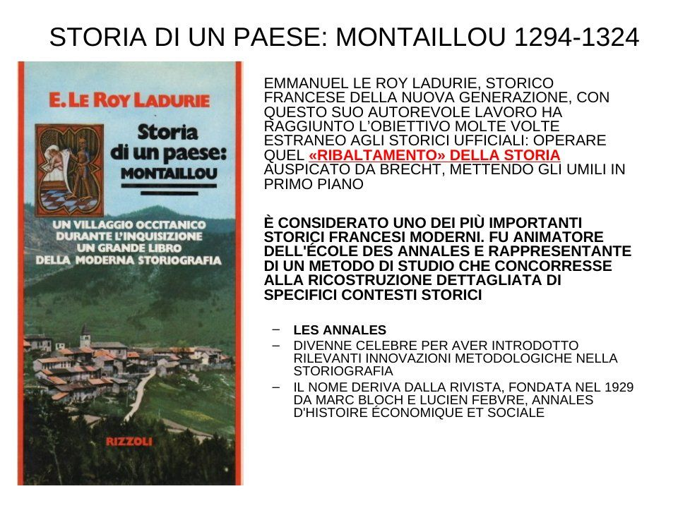{ loading=lazy style="width:47%" }

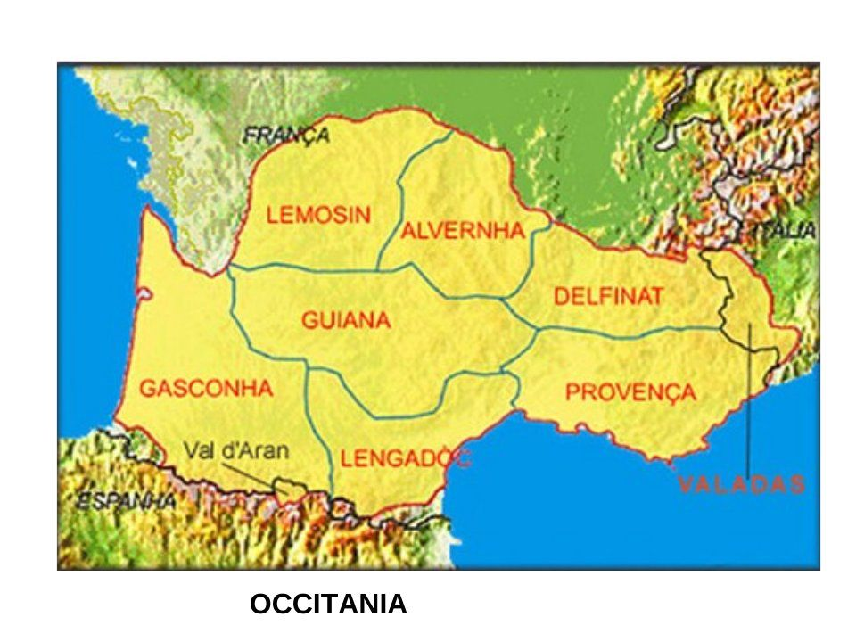{ loading=lazy style="width:47%" }

1:14:22

Perché questo si lega bene al nostro tema? Innanzitutto perché questa regione è quella dove prende corpo l’eresia catara, quindi è una regione sovversiva rispetto all’ordinamento ecclesiastico; e infatti nella ricostruzione di questo paese si trovano un paio di passaggi interessanti da questo punto di vista. Sui preti, per esempio, dice Bélibaste: «Il papa succhia il sudore e il sangue della povera gente, e allo stesso modo agiscono i vescovi e i preti, che sono ricchi, onorati, gaudenti, mentre San Pietro aveva abbandonato sua moglie, i suoi figli, i suoi campi, le sue vigne e le sue proprietà per seguire Cristo»; e lo mette in contrapposizione al concetto di povertà che dovrebbe avere la Chiesa. Il povero chi è? È il mendicante, il vagabondo, o lo zotico di infimo rango, che non ha nessun possesso, né di animali né di terra: è il povero che emerge da questo racconto di Montaillou.

**STORIA DI UN PAESE: MONTAILLOU 1294-1324**

Emmanuel Le Roy Ladurie, storico francese della nuova generazione, con questo suo autorevole lavoro ha raggiunto l’obiettivo molte volte estraneo agli storici ufficiali: operare quel «ribaltamento» della storia auspicato da Brecht, mettendo gli umili in primo piano.

È considerato uno dei più importanti storici francesi moderni. Fu animatore dell’École des Annales e rappresentante di un metodo di studio volto alla ricostruzione dettagliata di specifici contesti storici.

Les Annales: la scuola divenne celebre per aver introdotto rilevanti innovazioni metodologiche nella storiografia. Il nome deriva dalla rivista *Annales d’histoire économique et sociale*, fondata nel 1929 da Marc Bloch e Lucien Febvre.

Nel 1320 il vescovo di Pamiers, cittadina dell’Occitania, apre un’inchiesta d’inquisizione sugli abitanti di un piccolo paese dell’Alta Ariège a 1300 metri d’altezza: Montaillou, 250 abitanti, piccola comunità occitanica e pirenaica di contadini e di pastori. Si trattò di uno dei tanti episodi della lotta della Chiesa romana contro l’eresia catara.

Se la ricchezza è laica è poco contestata; se è clericale attira i fulmini popolari.

Dice Bélibaste di fronte ai Maury: «Il papa succhia il sudore e il sangue della povera gente, e allo stesso modo agiscono i vescovi e i preti, che sono ricchi, onorati, gaudenti… mentre San Pietro aveva abbandonato sua moglie, i suoi figli, i suoi campi, le sue vigne e le sue proprietà per seguire Cristo».

Nella mentalità locale la parola povero, nel senso di indigente, implica un’accezione più ristretta: il *pauper* è il mendicante, vagabondo o no, oppure è lo zotico di infimo rango, i cui beni personali non comportano né terra, né animali da tiro, né gregge degno di questo nome.

1:15:43

Perché è importante anche Montaillou da questo punto di vista? Perché proprio per combattere anche l’eresia catara nascono gli ordini mendicanti: uno è quello di San Francesco, l’altro è quello dei domenicani, di Domenico di Guzmán, che nasce proprio anche per combattere l’eresia catara. E come doveva farlo? Predicando, e proponendo un modello di vita di severità di costumi e di consumi, molto vicino al concetto di povertà. Infatti fu da lì, da questo spunto, che partì la lotta all’eresia catara.

**NASCONO ANCHE GLI ORDINI MENDICANTI**

Gli ordini mendicanti, sorti tra il XII e il XIII secolo in seno alla Chiesa cattolica, sono quegli ordini religiosi ai quali la regola primitiva imponeva l’emissione di un voto di povertà che implica la rinuncia a ogni proprietà, non solo per gli individui ma anche per i conventi, e che traevano sostentamento unicamente dalla raccolta delle elemosine (questua). I più importanti sono il domenicano e il francescano.

L’*Ordo praedicatorum* di Domenico di Guzmán: l’ordine sorse agli inizi del XIII secolo in Linguadoca (nella Francia meridionale), a opera dello spagnolo Domenico di Guzmán, con il fine di lottare contro la diffusione del catarismo, la più importante eresia medievale, e della propaganda pauperistica dei catari e dei valdesi. Domenico e i suoi compagni scelsero di contrastare le dottrine eretiche sia attraverso la predicazione, sia attraverso l’esempio di una severa ascesi personale, vivendo in povertà e mendicità.

Frati minori (ordine francescano): la povertà era il messaggio di Francesco, che trova la sua maggiore rappresentazione artistica in Giotto.

1:16:47

Lorenzo Poggi Dante, quando parla di San Francesco, ricordate? Dice che la povertà, «privata del primo marito, / millecent’anni e più dispetta e scura / fino a costui si stette sanza invito»: la donna che Francesco sposa. Dice Dante che lui «per tal donna, giovinetto, in guerra / del padre corse, a cui, come a la morte, / la porta del piacer nessun diserra». È Madonna Povertà che Francesco abbraccia. Però dice Dante che fino a lui questa donna, Madonna Povertà, privata del primo marito, cioè di Cristo, era rimasta «dispetta e scura»: la Chiesa, fino a Francesco, non aveva voluto accogliere Madonna Povertà, non l’aveva accolta. E Dante, attraverso questo discorso su Francesco, fa quindi una critica terribile alla Chiesa del suo tempo, che non l’ha sposata.

1:18:07

«Sì che, dove Maria rimase giuso, / ella con Cristo pianse in su la croce», ed è rimasta con lui fino a quando? Fino a quando ha trovato il novello Cristo, l’innovatore, portatore di una rivoluzione, quella della povertà, che è appunto Francesco d’Assisi, che nasce come il sole, come l’angelo dell’Apocalisse, l’angelo giovane. «Però chi d’esso loco fa parole» – parlando di Assisi – «non dica Ascesi, ché direbbe corto, / ma Oriente, se proprio dir vuole»: quindi dove sorge il sole, il sole del rinnovamento del mondo, che sorge quando sorge Francesco. Ma fino ad allora la Chiesa non l’ha accolta, e Dante ha poche speranze che l’accolga anche dopo. No, è un tema questo che attraversa, vedete, tutta la storia. Scusate l’interruzione, tanto mi scappano.

1:19:23

Paolo Marcucci Nascono appunto gli ordini mendicanti, che si identificano con i poveri, con quelli che vanno in giro, e prendono il nome proprio da qui. Quello di San Francesco è forse il più vicino, il più conosciuto. Per esempio ad Assisi ci sono le allegorie francescane – allegoria della Povertà, della Castità e dell’Obbedienza, e l’apoteosi di San Francesco: guarderemo un attimo questa allegoria della Povertà, che è il tema di stasera.

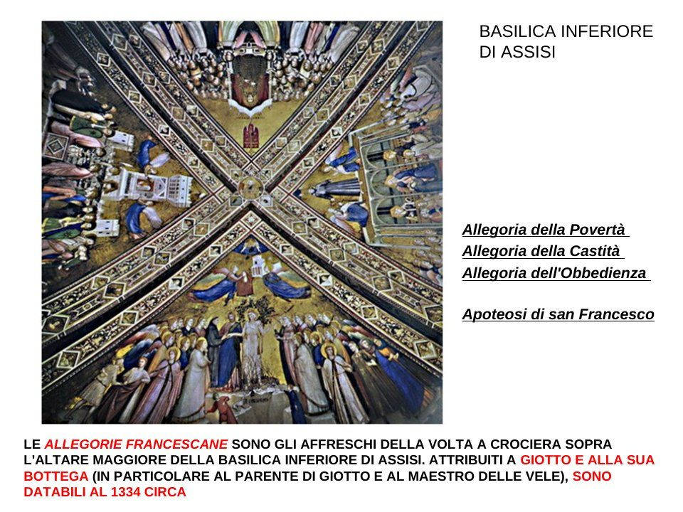{ loading=lazy style="width:47%" }

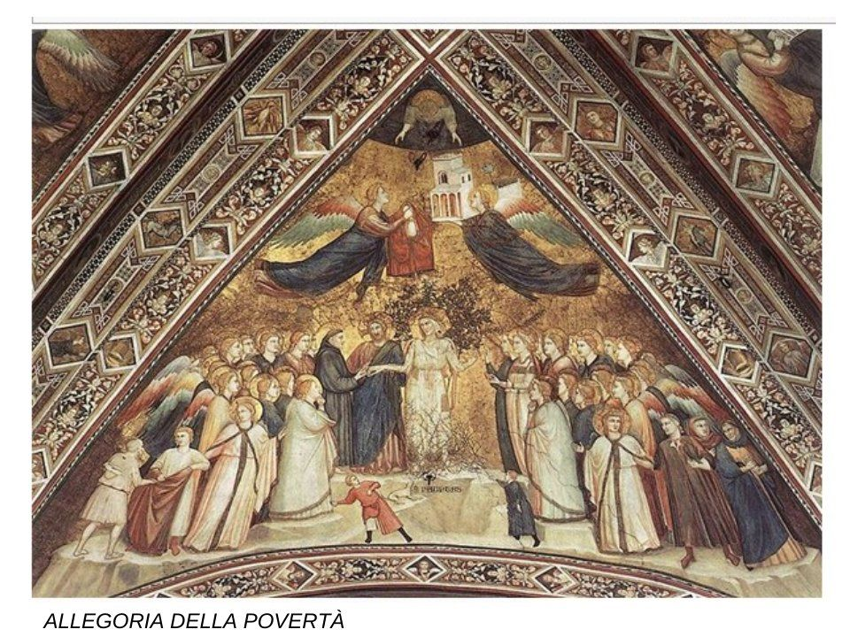{ loading=lazy style="width:47%" }

1:20:00

Ci sono due o tre cose interessanti. Qui, ai piedi, la figura della Povertà è tra i rovi, che però, con l’insegnamento di San Francesco, diventano rose e fioriscono. Qua c’è l’esempio del mantello: si vede un giovane che divide il mantello con un povero per aiutarlo. Sull’altro lato, invece, c’è un angelo che vuole portare con sé i tre giovani che sono il simbolo della superbia, dell’invidia e dell’avarizia, e loro gli voltano le spalle e se ne vanno. In basso si vede anche un cane e un bambino che prende di mira la Povertà. È una figura di Giotto che racconta il tema della povertà secondo la concezione di San Francesco.

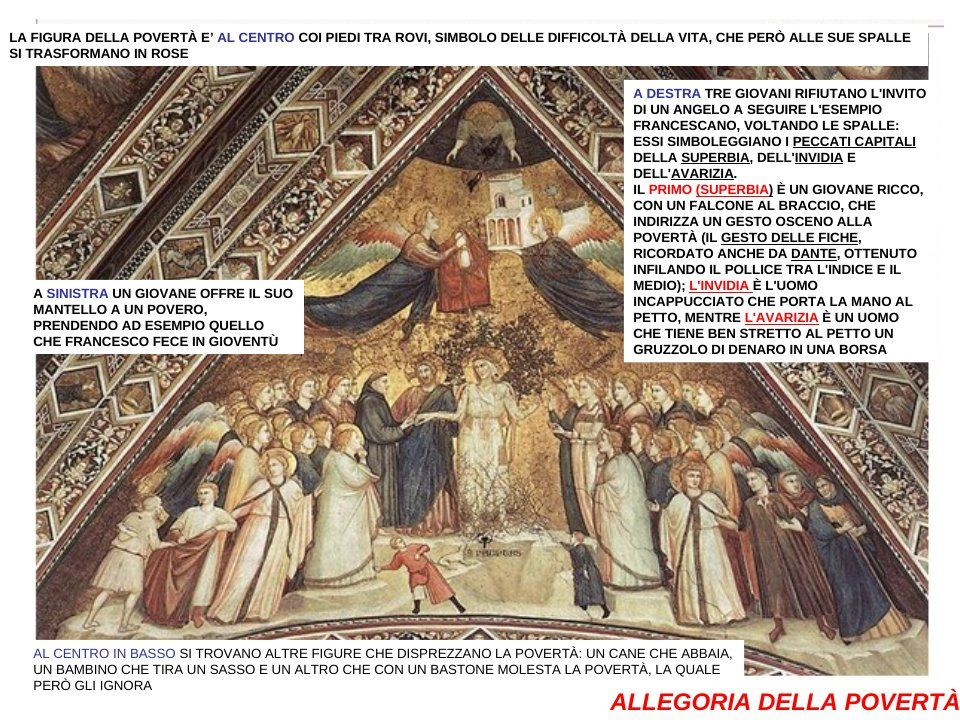{ loading=lazy style="width:59%" }

**ALLEGORIA DELLA POVERTÀ* – BASILICA INFERIORE DI ASSISI**

Le allegorie francescane (*Allegoria della Povertà, della Castità, dell’Obbedienza* e *apoteosi di San Francesco*) sono gli affreschi della volta a crociera sopra l’altare maggiore della basilica inferiore di Assisi. Attribuiti a Giotto e alla sua bottega (in particolare al Parente di Giotto e al Maestro delle Vele), sono databili al 1334 circa.

La figura della Povertà è al centro, coi piedi tra i rovi, simbolo delle difficoltà della vita, che però alle sue spalle si trasformano in rose.

A destra tre giovani rifiutano l’invito di un angelo a seguire l’esempio francescano, voltando le spalle: essi simboleggiano i peccati capitali della superbia, dell’invidia e dell’avarizia. Il primo (la superbia) è un giovane ricco, con un falcone al braccio, che indirizza un gesto osceno alla Povertà (il gesto delle fiche, ricordato anche da Dante, ottenuto infilando il pollice tra l’indice e il medio); l’invidia è l’uomo incappucciato che porta la mano al petto, mentre l’avarizia è un uomo che tiene ben stretto al petto un gruzzolo di denaro in una borsa.

A sinistra un giovane offre il suo mantello a un povero, prendendo a esempio quello che Francesco fece in gioventù.

Al centro, in basso, si trovano altre figure che disprezzano la Povertà: un cane che abbaia, un bambino che tira un sasso e un altro che con un bastone molesta la Povertà, la quale però li ignora.

1:21:26

Tra il XII e il XIII secolo nasce anche l’ospedale dei poveri, dove si cominciano ad accogliere i poveri viandanti che transitavano lungo le strade. La distinzione tra malato e povero sostanzialmente quasi non c’era: questa è una raffigurazione tra il 1200 e il 1300; vedete, da una parte si mangia e dall’altra si viene curati, quindi c’è un grande guazzabuglio da questo punto di vista.

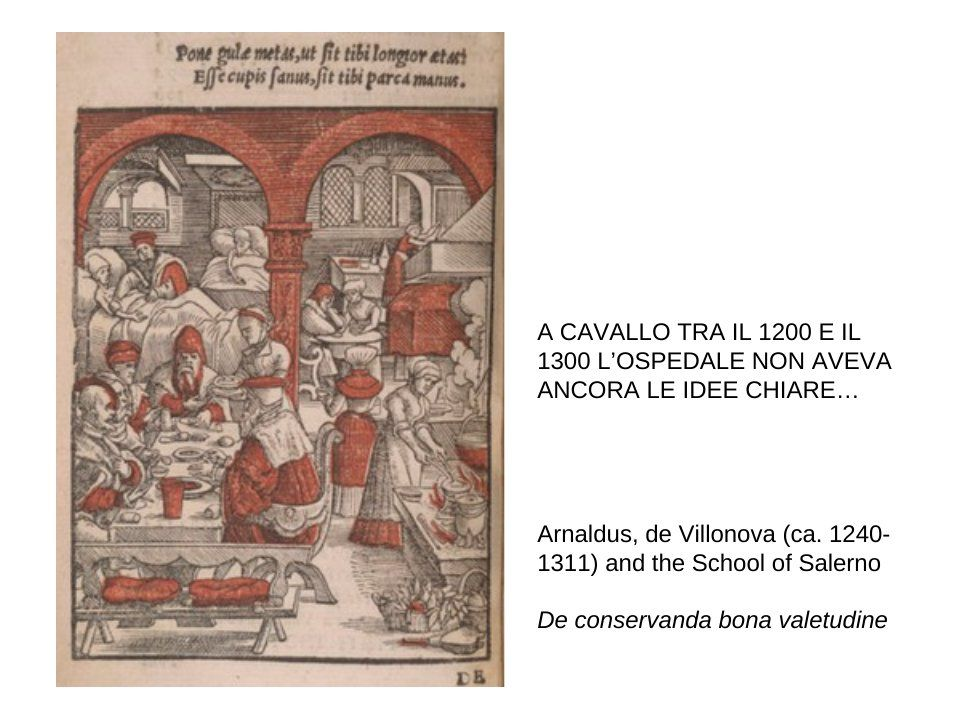{ loading=lazy style="width:59%" }

**STORIA DEI POVERI IN OCCIDENTE**

In questo periodo (XII-XIII secolo) nasce anche l’*hospitale pauperum*. L’ospedale è l’opera che più di ogni altra rappresenta la prospettiva assistenziale di questo periodo, ed è il luogo dove si iniziò a elaborare una nuova concezione della malattia, del malato e dell’assistenza.

Nei secoli passati l’assistenza era legata più genericamente agli ospizi, dove venivano accolti tutti i bisognosi: la distinzione tra povero e malato era praticamente inesistente.

A cavallo tra il 1200 e il 1300 l’ospedale non aveva ancora le idee chiare… (Arnaldo da Villanova, ca. 1240-1311, e la scuola salernitana, *De conservanda bona valetudine*).

1:22:07

E quindi già tra il Trecento e il Quattrocento ci sono cristiani che si proclamano contro la Chiesa ricca e la combattono: per esempio, Gerson scrive, al concilio di Reims del 1408: «Quale dolore! I cani dei vescovi sono meglio nutriti dei poveri»; perché c’era questa sterminata platea di poveri che vagavano, magari, al di là dei cancelli del luogo in cui si stava tenendo il concilio.

1:22:45

Nel Quattrocento nascono anche i primi Monti di Pietà. Sono una sorta di banche, nate in quel periodo, che qualcuno considera le antesignane delle banche cooperative, che forse sarà il tema che affronteremo la prossima volta. È interessante che nascano come momenti di colletta pubblica: si faceva una colletta tra tutti, si costituiva il primo fondo e con quello si finanziava poi chi ne aveva bisogno; per questo si chiamano Monti di Pietà. Qualcuno li individua come quelli da cui traggono spunto anche le moderne cooperative bancarie e finanziarie.

**STORIA DEI POVERI IN OCCIDENTE*: L’ALDILÀ**

D’altra parte l’esempio di una vita secondo i canoni cristiani era ed è sempre stato dibattuto all’interno della Chiesa.

Bernardino da Siena (1380-1444, ordine dei frati minori), in una infuocata omelia, interpellava gli ascoltatori: «Tu non senti il grido dei poveri! E sai perché? Perché per te non fa troppo freddo: tu hai la pancia piena, bevi bene, mangi bene, indossi più abiti, e spesso stai vicino al focolare. Tu non pensi più lontano, corpo ben riempito, anima consolata».

Savonarola (oltre, naturalmente, alla concezione di una Chiesa povera) ripeteva ai laici che la vera pietà passava per l’amore verso i poveri, e agli artigiani imponeva che accogliessero i bisognosi perché potessero trovare lavoro; e nello stesso tempo ammoniva i poveri validi a non sottrarsi all’occupazione.

Al concilio di Reims del 1408 Gerson arriva a scrivere: «Quale dolore! I cani dei vescovi sono meglio nutriti dei poveri».

Da qui il concetto che una vita non contaminata dall’avidità e dalla ricchezza permettesse l’accesso al paradiso e alla salvezza. La preoccupazione dell’aldilà portò molti a fare testamenti in favore dei poveri: veniva ripetuto che l’elemosina cancellava il peccato e scontava gli anni in purgatorio. Un «passaporto per il cielo», secondo l’espressione di Jacques Le Goff.

In Italia, in questa scia (la carità e il denaro), intorno alla metà del Quattrocento, nascita geniale, si ebbero i primi Monti di pietà, che trovarono ostacoli nei banchieri, che vi vedevano la concorrenza, e anche all’interno della Chiesa, per la paura dell’usura.

L’erezione del monte seguiva in genere uno schema fisso: si radunavano i fedeli e si teneva loro una predicazione specifica durante la quale si stigmatizzava la pratica dell’usura. Al termine, con una colletta pubblica, si formava il primo fondo, cui le autorità locali assicuravano il liquido ulteriormente necessario.

Questi istituti senza fine di lucro (da cui, secondo alcuni storici, traggono vita e spunto anche le cooperative bancarie, che vedremo nella prossima serata) con le loro operazioni permettevano anche ai più poveri di accedere ai prestiti.

1:23:43

È anche il momento dei poveri vergognosi. C’è un altro saggio interessante da questo punto di vista, di Bronisław Geremek, *La pietà e la forca*. Sono quei poveri – l’ha un po’ accennato prima Lorenzo – perché vergognosi, *verecundi*? Perché arrivano a essere poveri partendo da una posizione in cui prima non lo erano: erano persone normali per il tempo, che però cadono in miseria; e questi godono ancora di una certa considerazione sociale. Per questo sono i poveri vergognosi.

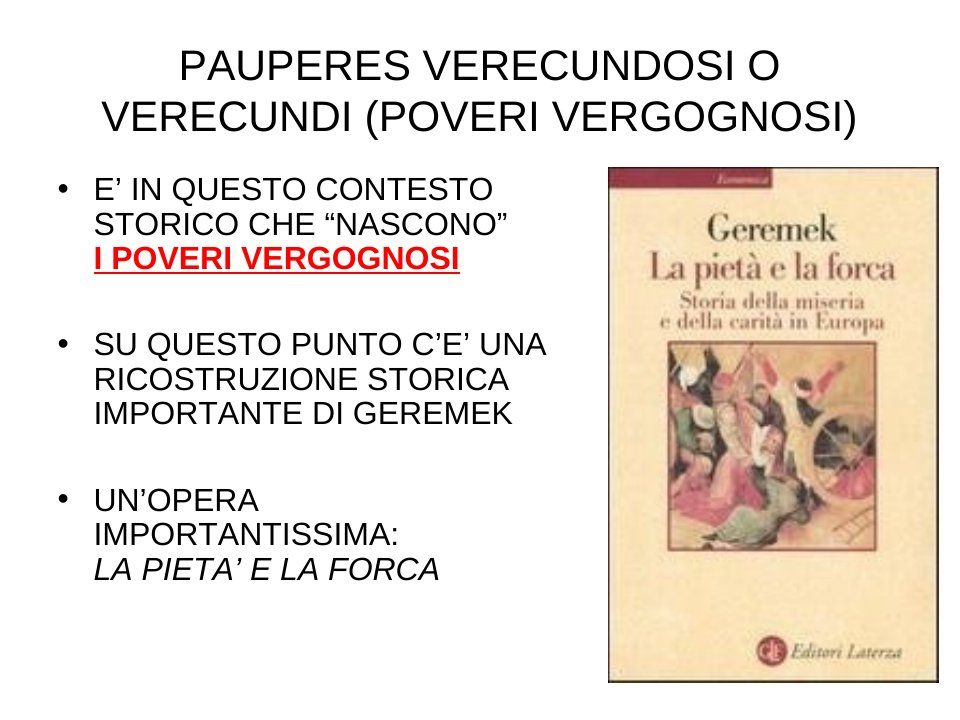{ loading=lazy style="width:47%" }

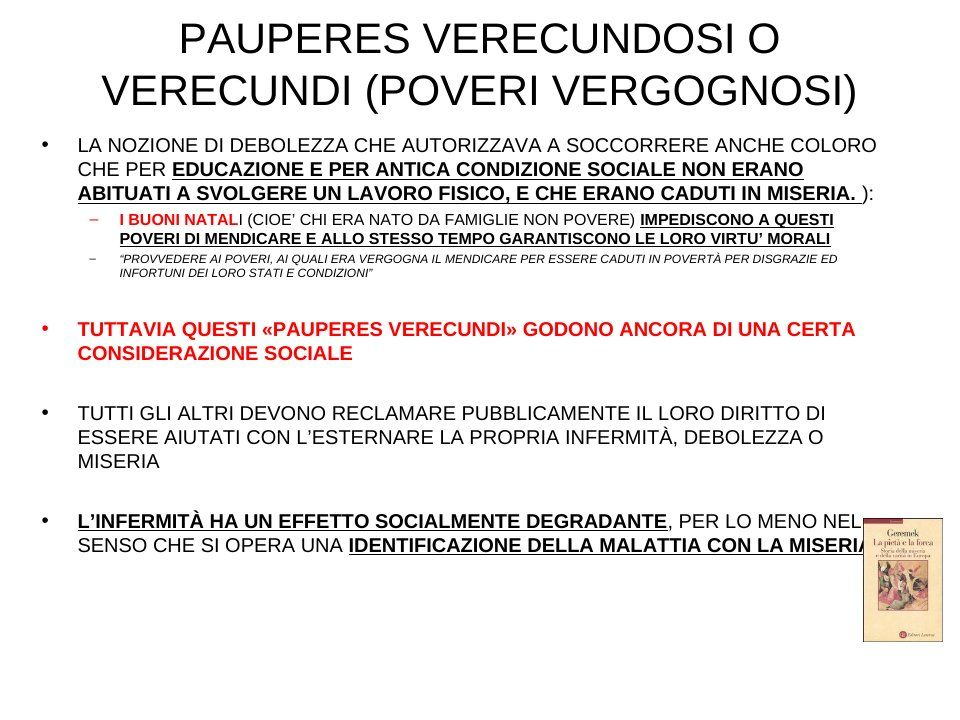{ loading=lazy style="width:47%" }

1:24:29

Tra il XIV e il XV secolo nascono anche le confraternite per aiutare tutti i poveri che c’erano. Però queste confraternite sostanzialmente si limitavano ad aiutare i poveri, ma non si spingevano mai a capire perché ci fosse la povertà, questa condizione sociale: avevano solo il compito di aiutare i poveri. Alcune sono ancora in piedi: la più famosa è a Bologna, si chiama Opera Pia dei Poveri Vergognosi, e tuttora nel simbolo, nel logo, mantiene quello originario, che è del Quattrocento.

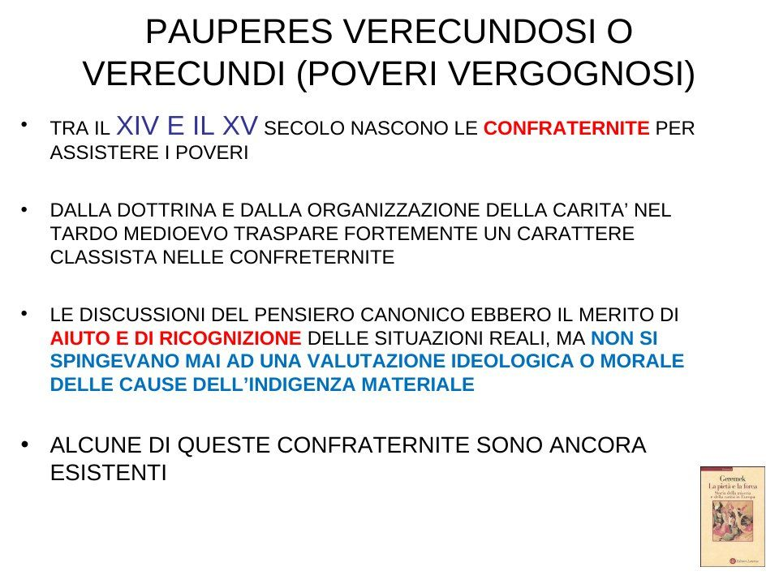{ loading=lazy style="width:47%" }

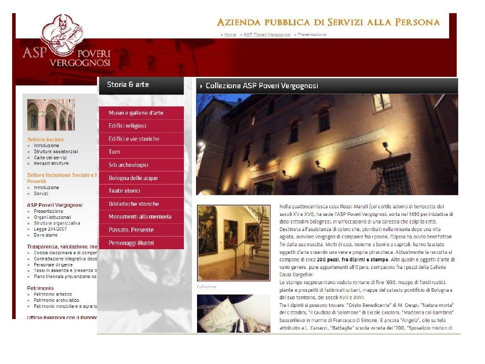{ loading=lazy style="width:47%" }

**PAUPERES VERECUNDOSI* O *VERECUNDI* (POVERI VERGOGNOSI)**

È in questo contesto storico che «nascono» i poveri vergognosi. Su questo punto c’è una ricostruzione storica importante di Bronisław Geremek, un’opera importantissima: *La pietà e la forca*.

La nozione di debolezza autorizzava a soccorrere anche coloro che per educazione e per antica condizione sociale non erano abituati a svolgere un lavoro fisico, e che erano caduti in miseria.

I buoni natali (cioè l’essere nati da famiglie non povere) impediscono a questi poveri di mendicare e allo stesso tempo ne garantiscono le virtù morali: «Provvedere ai poveri, ai quali era vergogna il mendicare per essere caduti in povertà per disgrazie ed infortuni dei loro stati e condizioni».

Tuttavia questi *pauperes verecundi* godono ancora di una certa considerazione sociale. Tutti gli altri devono reclamare pubblicamente il loro diritto di essere aiutati, esternando la propria infermità, debolezza o miseria.

L’infermità ha un effetto socialmente degradante, per lo meno nel senso che si opera una identificazione della malattia con la miseria.

Tra il XIV e il XV secolo nascono le confraternite per assistere i poveri. Dalla dottrina e dall’organizzazione della carità nel tardo medioevo traspare fortemente un carattere classista nelle confraternite.

Le discussioni del pensiero canonico ebbero il merito di aiuto e di ricognizione delle situazioni reali, ma non si spingevano mai a una valutazione ideologica o morale delle cause dell’indigenza materiale. Alcune di queste confraternite sono ancora esistenti.

1:25:18

Lorenzo Poggi In via del Presto di San Martino, a Firenze, i Buonomini di San Martino avevano la finestra con il lume acceso: quando erano finiti i soldi... da qui l’espressione «siamo al lumicino», cioè sono finiti i soldi per aiutare, e chi poteva faceva di nuovo l’offerta. I Buonomini, insomma... è una condizione. Ma il concetto è questo: la povertà è condizione umana, esemplare, non può essere eliminata, fa parte della condizione umana. Sono ideologie sbagliate quelle che pensano di eliminare la povertà e stabilire un’uguaglianza fra gli uomini: non esiste. Oltretutto, dice Leone XIII, se non ci fossero i poveri, come si farebbe a esercitare la virtù? Guardate, siamo alla fine dell’Ottocento, è Leone XIII, la *Rerum novarum*: lui ce l’ha con i socialisti. Ma scherziamo?

1:26:33

Allora io mi sono chiesto: ma quale virtù? Da parte dei ricchi è facile: la carità. E da parte dei poveri? Non riuscivo a trovare la virtù che questi dovevano esercitare per l’esistenza dei ricchi. Perché, insomma, io credo che l’esercizio della virtù debba essere reciproco, no? E se la povertà è condizione per l’esercizio della virtù, mi viene in mente soltanto la non invidia; ma mi sembra un po’ scarsina. Comunque erano solo letture di... Scusate, mi taccio, perché sennò interrompo Paolo.

1:27:15

Paolo Marcucci No, anzi... C’è quindi la necessità di distinguere tra i poveri onesti e i poveri disonesti. Un po’ tutti si rifanno a questo *Decretum Gratiani*, che aveva dato le regole e a cui tutti si rifacevano su questo tema. Qui si vede San Domenico di Guzmán che fa la carità ai poveri buoni: è un dipinto della chiesa di San Domenico a Torino.

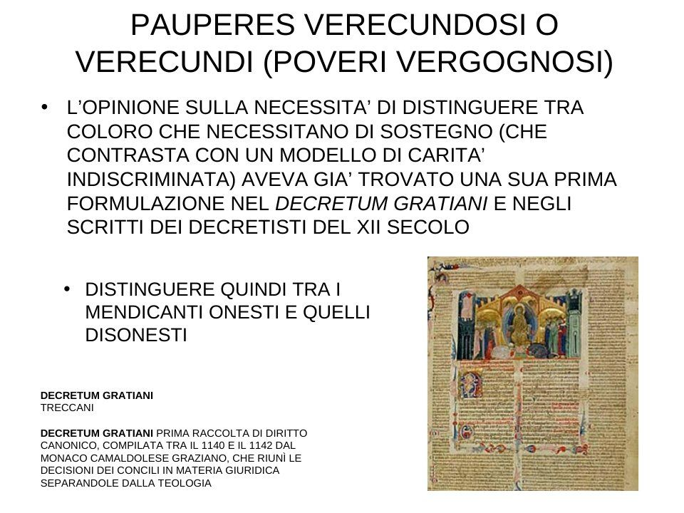{ loading=lazy style="width:47%" }

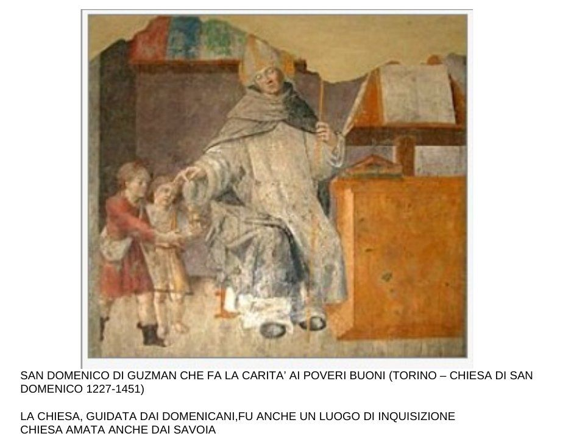{ loading=lazy style="width:47%" }

**PAUPERES VERECUNDOSI* O *VERECUNDI* (POVERI VERGOGNOSI)**

L’opinione sulla necessità di distinguere tra coloro che necessitano di sostegno (che contrasta con un modello di carità indiscriminata) aveva già trovato una sua prima formulazione nel *Decretum Gratiani* e negli scritti dei decretisti del XII secolo: distinguere quindi tra i mendicanti onesti e quelli disonesti.

*Decretum Gratiani* (Treccani): prima raccolta di diritto canonico, compilata tra il 1140 e il 1142 dal monaco camaldolese Graziano, che riunì le decisioni dei concili in materia giuridica, separandole dalla teologia.

San Domenico di Guzmán che fa la carità ai poveri buoni (Torino, chiesa di San Domenico, 1227-1451). La chiesa, guidata dai domenicani, fu anche un luogo di inquisizione; fu amata anche dai Savoia.

In particolare i disonesti erano quelli che, pur potendo lavorare, vivevano di elemosina e rubando; gli onesti erano invece quelli in condizione di indigenza fisiologica, intesa come carenza di mezzi di sussistenza per sé e per la famiglia, che meritavano un aiuto.

Tra le dispute teologiche del tempo si presenta anche la tesi che, in caso di estrema necessità, neppure il furto debba essere considerato un reato, ma una rivendicazione di ciò che spetta ai poveri.

Seicento anni dopo, negli anni Settanta del Novecento, la stessa cosa assunse il nome più moderno di espropri proletari, e ci fu anche l’evoluzione delle autoriduzioni.

1:28:00

Interessante forse questo tema, che ci permette di fare una battuta sul nostro tempo. Tra le dispute del tempo c’era anche quella sulla necessità, da parte dei poveri, di rubare, quindi una sorta di rivendicazione di quello che spettava loro perché morivano di fame; e c’era chi sosteneva che il furto in questo caso fosse necessario, non una colpa. Se ci pensate, è un po’ quello che è avvenuto nel nostro periodo con quelli che si sono chiamati espropri proletari. Mi è venuto in mente, di questi espropri proletari, un episodio simpatico: quello che successe al Parco Lambro. Il Parco Lambro è forse la manifestazione giovanile degli anni Settanta più conosciuta, dove ci fu proprio un esproprio proletario che nasceva da questa concezione: siccome lì dentro dovevano essere tutti compagni, anche i prezzi dovevano essere adeguati all’idea che c’era a monte del raduno. Successe invece che i «compagni esercenti» – si chiamavano proprio così – avevano prezzi troppo alti, e allora ci fu un esproprio proletario all’interno dello stesso raduno proletario. Fu famoso il dibattito filosofico che ne seguì; ma si rifaceva anche a questa idea che c’è sempre stata nella storia, che il povero possa rubare o autoridursi il prezzo delle merci se non ha soldi per soddisfare i suoi bisogni principali.

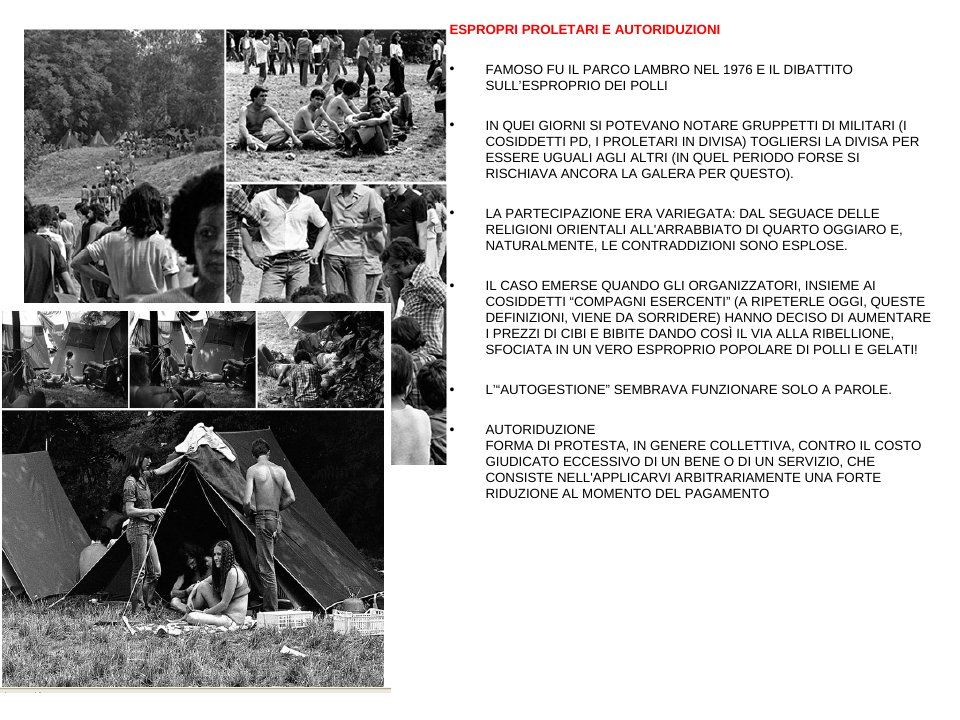{ loading=lazy style="width:59%" }

**ESPROPRI PROLETARI E AUTORIDUZIONI**

Famoso fu il Parco Lambro nel 1976 e il dibattito sull’esproprio dei polli.

In quei giorni si potevano notare gruppetti di militari (i cosiddetti *PID*, i proletari in divisa) togliersi la divisa per essere uguali agli altri (in quel periodo forse si rischiava ancora la galera per questo).

La partecipazione era variegata, dal seguace delle religioni orientali all’arrabbiato di Quarto Oggiaro, e naturalmente le contraddizioni sono esplose.

Il caso emerse quando gli organizzatori, insieme ai cosiddetti «compagni esercenti» (a ripeterle oggi, queste definizioni, viene da sorridere), decisero di aumentare i prezzi di cibi e bibite, dando così il via alla ribellione, sfociata in un vero esproprio popolare di polli e gelati! L’«autogestione» sembrava funzionare solo a parole.

Autoriduzione: forma di protesta, in genere collettiva, contro il costo giudicato eccessivo di un bene o di un servizio, che consiste nell’applicarvi arbitrariamente una forte riduzione al momento del pagamento.

1:29:54

In questi secoli, tra il Trecento e il Cinquecento, il povero sta seduto alle porte delle chiese; come diceva prima Lorenzo, è sporco, puzza, è brutto e fa anche paura: anche i cani lo mordono e lo scacciano. C’è un dipinto che siamo andati a vedere con Lorenzo un paio di anni fa a Firenze, questo di Masaccio nella Cappella Brancacci: qui è San Pietro che passa e cura con la sua ombra, vero, Lorenzo? Miracolosa. Vedete, questo è un particolare: ci sono questi storpi, i vagabondi poveri che stanno ai margini delle strade, delle chiese, a chiedere continuamente l’elemosina. Questo è un lebbroso, che fa parte della schiera di questo mondo e ha la campana per avvertire della sua presenza: qui siamo nel XIV secolo.

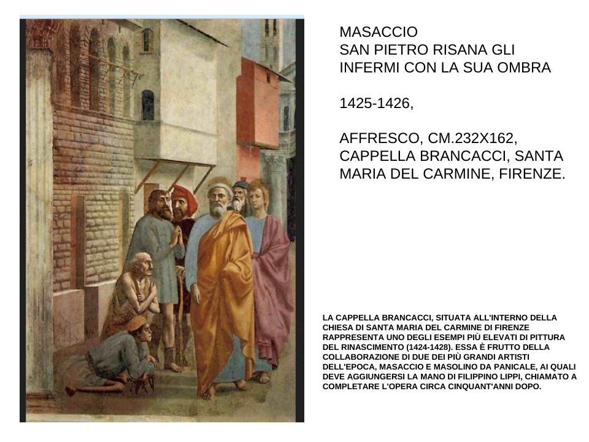{ loading=lazy style="width:47%" }

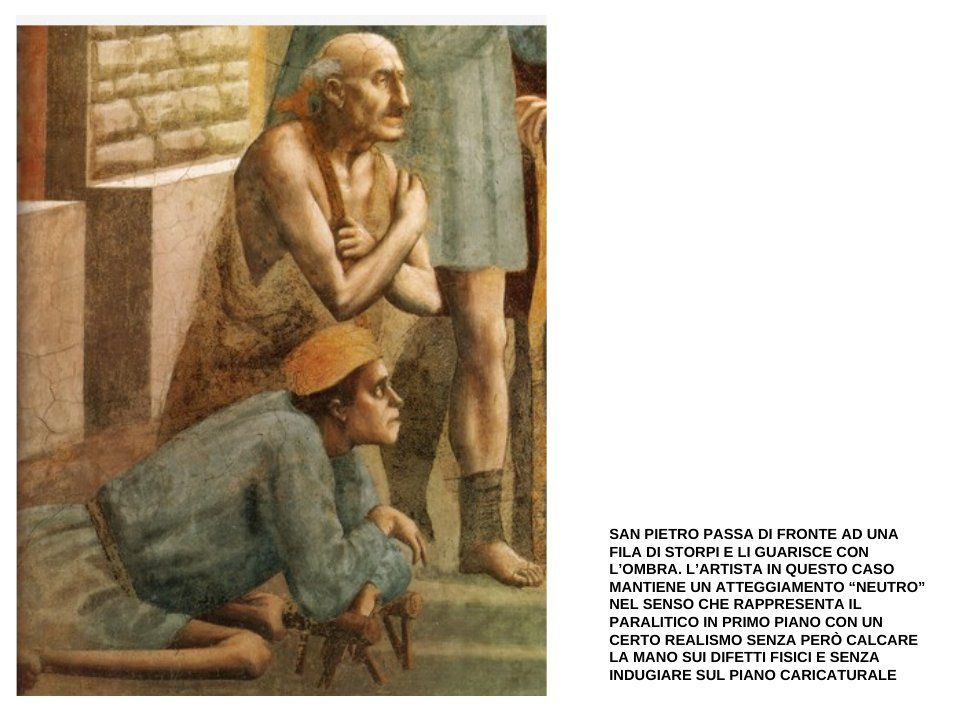{ loading=lazy style="width:47%" }

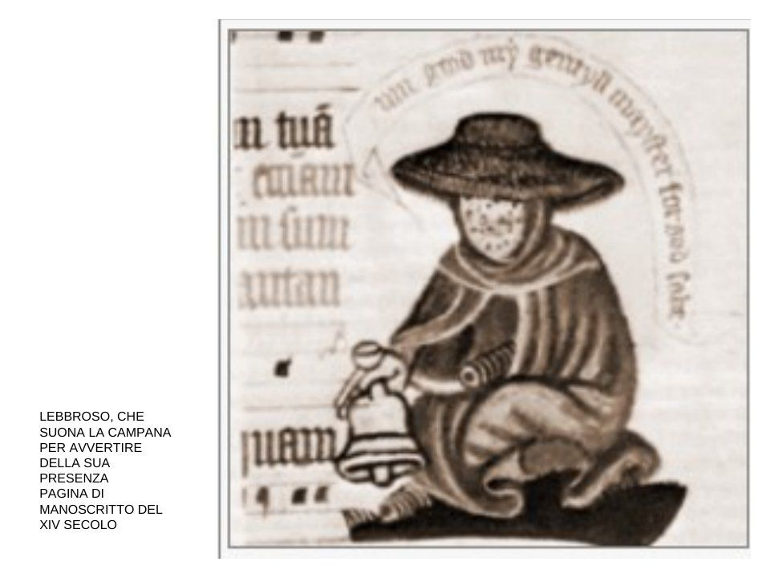{ loading=lazy style="width:59%" }

**STORIA DEI POVERI IN OCCIDENTE**

Nel XIV-XV secolo la povertà diviene sospetta: la critica allo stile di vita dei mendicanti si sviluppò proprio con la (o forse a causa della) crisi del XIV secolo.

In un secolo, dal 1350 al 1450, la popolazione europea diminuì di circa il 30% a causa dell’infernale trilogia: peste, fame e guerra.

Nel 1365 il vescovo di Parigi dichiarava: «Ci è stato riferito da persone degne di fede che sulle strade e sulle piazze di Parigi si è abbattuta la piaga di un’innumerevole folla di mendicanti».

È l’iconografia più familiare del povero: sta seduto alle porte delle chiese, talvolta entra e disturba la messa, è cieco, zoppo, monco, coperto di piaghe, infermo, è sporco, puzza, è brutto e fa paura; anche i cani lo scacciano. Masaccio interpreterà bene queste figure.

La cappella Brancacci, nella chiesa di Santa Maria del Carmine a Firenze, rappresenta uno degli esempi più elevati di pittura del Rinascimento (1424-1428). È frutto della collaborazione di due dei più grandi artisti dell’epoca, Masaccio e Masolino da Panicale, ai quali va aggiunta la mano di Filippino Lippi, chiamato a completare l’opera circa cinquant’anni dopo.

Masaccio, *San Pietro risana gli infermi con la sua ombra*, 1425-1426, affresco, 232×162 cm. San Pietro passa di fronte a una fila di storpi e li guarisce con l’ombra. L’artista in questo caso mantiene un atteggiamento «neutro», nel senso che rappresenta il paralitico in primo piano con un certo realismo, senza però calcare la mano sui difetti fisici e senza indugiare sul piano caricaturale.

1:30:56

Quindi il povero è quasi diabolico, come diceva prima Lorenzo; e anche la simulazione delle malattie era ritenuta blasfema, era considerata una sottomissione a Satana, quindi al peccato, perché i falsi poveri sottraevano il necessario ai veri bisognosi, che invece lo meritavano. E su questo c’è tutta una letteratura, oltre a quella che poi ci racconta Lorenzo: per esempio c’è *La piazza universale di tutte le professioni del mondo*, dove Garzoni, nel 1585, racconta tutti i mestieri del mondo, ma anche quelli di chi non lavorava, cioè «de gli otiosi di piazza, ovvero del mestiere di Michelazzo», che consisteva nel «mangiare, bevere e andare a sollazzo». È tutta una categoria di personaggi che vengono raccontati in questo libro.

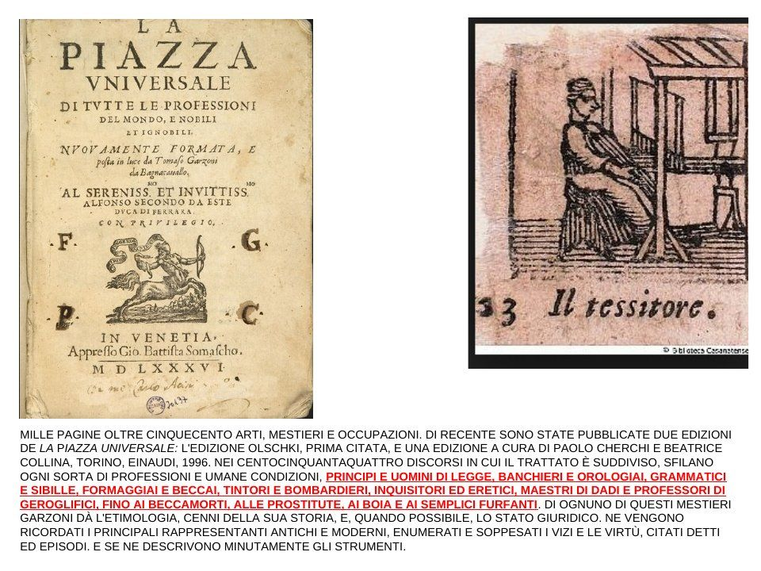{ loading=lazy style="width:59%" }

**STORIA DEI POVERI IN OCCIDENTE**

Nel XVI secolo si affermò l’identificazione dei mendicanti con la *Familia diaboli*, in contrapposizione ai «poveri di Dio».

La simulazione delle malattie da parte dei mendicanti per suscitare compassione era ritenuta blasfema e sentita in qualche modo come una sottomissione a Satana, il quale usava i falsi poveri per sottrarre il necessario soccorso ai veri bisognosi.

L’esaltazione del lavoro, anche nei suoi aspetti etico-religiosi, portava non tanto a non considerare la povertà, quanto a una ferma condanna dell’ozio.

Tipica di questa impostazione fu l’opera pubblicata a Venezia da Tommaso Garzoni nel 1585, *La piazza universale di tutte le professioni del mondo*, che oltre ai mestieri trattava anche «de gli otiosi di piazza, ovvero del mestiere di Michelazzo», che consisteva nel «mangiare, bevere e andare a sollazzo… non facendo altro che girare di qua e di là».

Mille pagine, oltre cinquecento arti, mestieri e occupazioni. Di recente sono state pubblicate due edizioni de *La piazza universale*: l’edizione Olschki e un’edizione a cura di Paolo Cherchi e Beatrice Collina (Torino, Einaudi, 1996). Nei centocinquantaquattro discorsi in cui il trattato è suddiviso sfilano ogni sorta di professioni e umane condizioni: principi e uomini di legge, banchieri e orologiai, grammatici e sibille, formaggiai e beccai, tintori e bombardieri, inquisitori ed eretici, maestri di dadi e professori di geroglifici, fino ai beccamorti, alle prostitute, ai boia e ai semplici furfanti. Di ognuno di questi mestieri Garzoni dà l’etimologia, cenni della sua storia e, quando possibile, lo stato giuridico. Ne vengono ricordati i principali rappresentanti antichi e moderni, enumerati e soppesati i vizi e le virtù, citati detti ed episodi; e se ne descrivono minutamente gli strumenti.

1:32:02

Avvicinandosi al nostro tempo, nel XVII secolo, la povertà diventa invece quasi un’ossessione, e bisogna imprigionarla. Foucault dirà che è l’epoca della grande reclusione dei poveri: nascono qui le grandi carceri e comincia anche il lavoro come riabilitazione e nobilitazione. In tutta Europa si diffondono queste carceri, che sono anche dei campi di lavoro. In Germania, per esempio, c’era scritto: «Con il lavoro mi nutro, con il lavoro mi punisco»: sono le parole dell’iscrizione sulla porta della casa di lavoro di Amburgo. Qua c’è anche quello della Francia: «Non temete! Non mi vendico del male, ma costringo al bene». È tutta una concezione che porta a questo tema del carcere come strumento con cui la società tenta di difendersi dalla povertà.

**STORIA DEI POVERI IN OCCIDENTE**

Nel XVII secolo la povertà diventò invece un’ossessione per le autorità: dappertutto si lanciavano strali contro queste canaglie, persone senza cuore, senza religione, senza istruzione, che vivono nella licenziosità e nella dissolutezza.

Richard Eburne, un predicatore inglese, nel 1624 propose di trasportare ogni anno almeno 1.600 poveri (due per parrocchia) sull’altra sponda dell’Atlantico.

Foucault sostiene che il XVII secolo è l’epoca della grande reclusione dei poveri.

Bisognerà aspettare il Settecento perché arrivi Cesare Beccaria (Cesare Bonesana, marchese di Gualdrasco e di Villareggio; Milano, 15 marzo 1738 – Milano, 28 novembre 1794), che nel 1764 diede alle stampe *Dei delitti e delle pene*, inizialmente anonimo, breve scritto contro la tortura e la pena di morte.

Nel XVII secolo nascono così i grandi istituti di reclusione (con qualche anticipazione nel Cinquecento e la definitiva espansione nel Settecento). La pratica della reclusione dei poveri è diffusa in tutti i paesi europei.

«Con il lavoro mi nutro, con il lavoro mi punisco»: sono le parole dell’iscrizione sulla porta della casa di lavoro di Amburgo.

«Non temete! Non mi vendico del male, ma costringo al bene»: motto degli *Hôpitaux généraux*.

«La mia mano è pesante, ma il cuore è pieno d’amore»: motto delle *workhouses* e delle *Zuchthäuser*.

1:33:19

In questo modo si ottengono anche due cose fondamentali, tenendo la povertà a un certo livello nella società: innanzitutto chi lavorava, avendo come concorrente una massa di poveri, doveva accontentarsi di salari più bassi – è un concetto, se volete, che c’è ancora, come abbiamo visto all’inizio; e poi lo Stato, la nazione, lo «staterello» del tempo, era più competitivo sul mercato internazionale, perché anche a quel tempo si vendevano le merci e si faceva concorrenza sul mercato.

**STORIA DEI POVERI IN OCCIDENTE* – XVII SECOLO**

In Francia si finì col dipingere il lavoro come una forma di ascesi, quasi un esercizio spirituale.

Emerge il concetto di povertà utile: cioè che la povertà fosse necessaria per la prosperità dello Stato. Le masse di poveri potevano essere forzate al lavoro per il benessere dello Stato e dovevano accontentarsi delle retribuzioni, anche se erano le più basse possibili. Vi ricordano nulla oggi queste parole?

In tale modo si ottenevano contemporaneamente due obiettivi: i poveri erano mantenuti laboriosi; la nazione diventava più competitiva sul piano internazionale.

L’interesse nazionale richiedeva che le masse fossero tenute in uno stato di povertà permanente: una dottrina dell’utilità della povertà che giustificò i pesanti provvedimenti contro i poveri.

1:34:06

Per finire questa parte, qualche rappresentazione della povertà. In questo caso è famoso questo Jacques Callot, il *Ciclo dei pezzenti*: questa è un’immagine. Però volevo chiudere con questo dipinto bellissimo di Caravaggio, la *Madonna dei Pellegrini*, o di Loreto, dei primi del Seicento, in cui si riconosce il tratto tipico di Caravaggio. Quello che ci dà il senso di questo dipinto, agganciandolo al tema di questa sera, sono i piedi in primo piano di questi due poveri che chiedono la grazia a questa Madonna. Vedete i piedi: quando fu esposto, questo quadro suscitò un clamore eccezionale, perché era ritenuto irriverente verso la fede cristiana. Invece i piedi nudi e gonfi sono un «dogma» fondamentale di quella corrente pauperistica a cui Caravaggio aderiva: sono il simbolo dell’ubbidienza e della devozione. Per finire, la Madonna è una prostituta che mi sembra fosse amica, diciamo amante, di Caravaggio.

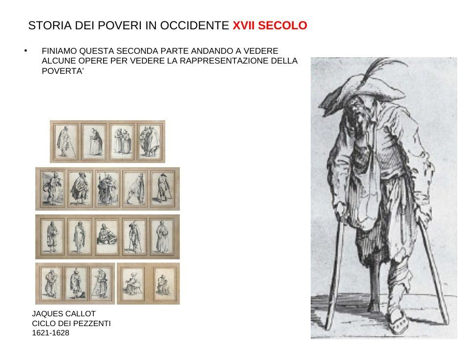{ loading=lazy style="width:59%" }

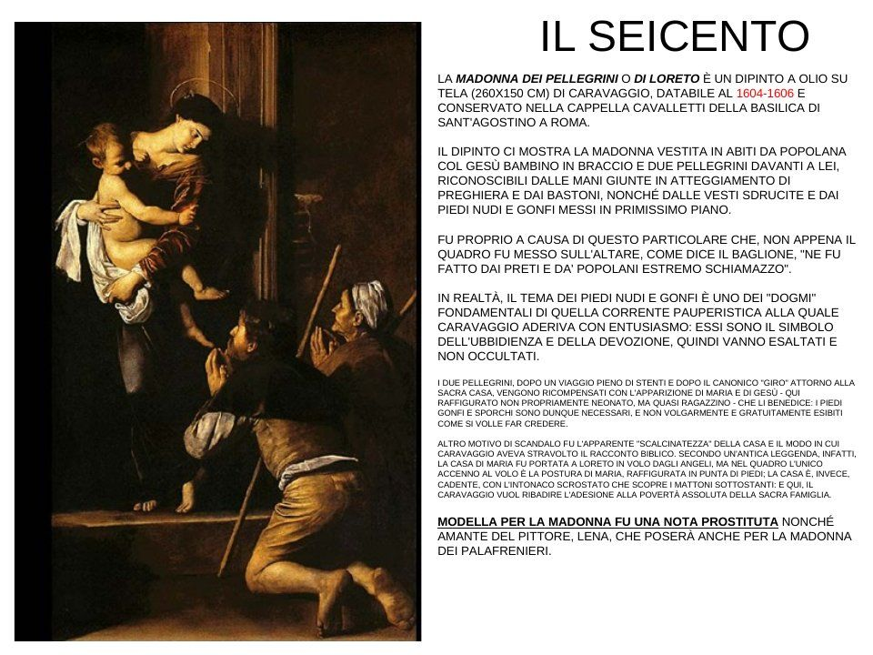{ loading=lazy style="width:59%" }

**IL SEICENTO – CARAVAGGIO, *MADONNA DEI PELLEGRINI**

La *Madonna dei Pellegrini* o *di Loreto* è un dipinto a olio su tela (260×150 cm) di Caravaggio, databile al 1604-1606 e conservato nella cappella Cavalletti della basilica di Sant’Agostino a Roma.

Il dipinto ci mostra la Madonna vestita in abiti da popolana, col Gesù bambino in braccio, e due pellegrini davanti a lei, riconoscibili dalle mani giunte in atteggiamento di preghiera e dai bastoni, nonché dalle vesti sdrucite e dai piedi nudi e gonfi messi in primissimo piano.

Fu proprio a causa di questo particolare che, non appena il quadro fu messo sull’altare, come dice il Baglione, «ne fu fatto da’ popolani estremo schiamazzo».

In realtà, il tema dei piedi nudi e gonfi è uno dei «dogmi» fondamentali di quella corrente pauperistica alla quale Caravaggio aderiva con entusiasmo: essi sono il simbolo dell’ubbidienza e della devozione, quindi vanno esaltati e non occultati.

I due pellegrini, dopo un viaggio pieno di stenti e dopo il canonico «giro» attorno alla Santa Casa, vengono ricompensati con l’apparizione di Maria e di Gesù – qui raffigurato non propriamente neonato, ma quasi ragazzino – che li benedice: i piedi gonfi e sporchi sono dunque necessari, e non volgarmente e gratuitamente esibiti come si volle far credere.

Altro motivo di scandalo fu l’apparente «scalcinatezza» della casa e il modo in cui Caravaggio aveva stravolto il racconto tradizionale. Secondo un’antica leggenda, infatti, la casa di Maria fu portata a Loreto in volo dagli angeli, ma nel quadro l’unico accenno al volo è la postura di Maria, raffigurata in punta di piedi; la casa è invece cadente, con l’intonaco scrostato che scopre i mattoni sottostanti: e qui Caravaggio vuole ribadire l’adesione alla povertà assoluta della Sacra Famiglia.

Modella per la Madonna fu una nota prostituta nonché amante del pittore, Lena, che poserà anche per la *Madonna dei Palafrenieri*.

1:35:45

Lorenzo Poggi La ritroviamo anche nel *Riposo durante la fuga in Egitto*: è la stessa donna. E alcuni critici dicono che è la stessa che nella *Morte della Vergine* è distesa, morta, con la pancia gonfia: sempre lei, un po’ più avanti con gli anni. E si pensa che sia proprio a causa di questa donna che poi Caravaggio uccise il Tomassoni. Notate che ha per sé una bella Madonna; insomma, qui non si vede tanto, nel *Riposo* in Egitto si vede di più.

1:36:32

Ah sì, dicevo, visto che continuiamo un attimo il nostro discorso: ci sono i poveri che erano condizione dell’esistenza umana, perché l’uomo rispetta Dio e la provvidenza. È *pauper*; oltre che povero è anche *infirmus*, perché è malfermo di salute; ed è anche pellegrino, perché tutti siamo pellegrini su questa terra, destinati a un’altra condizione. La povertà diventa invece povertà cattiva quando ci sono questi sconvolgimenti sociali, come dicevamo, e il povero per sopravvivere ricorre qualche volta anche all’astuzia.

1:37:23

Intanto notiamo una cosa: in quello che stiamo vedendo è presente, e ha un’importanza determinante, il corpo, la relazione diretta tra le persone. La povertà non è una condizione spirituale, è una condizione fisica, corporea, dell’esistenza. Il povero ha le piaghe; il povero è pezzente, cioè è coperto di pezzi sudici e strappati di stoffa; il povero è piagato: è una condizione fisica, di rapporto con il corpo. E i peccati, in questa società, in questo mondo, sono ancora peccati legati al corpo; benché si dicano peccati dell’anima, il corpo rispecchia le condizioni dell’anima. La lebbra è la più forte e terribile malattia del corpo, però è simbolica: denuncia la decadenza della carne. Perché? Perché in qualche modo denuncia che c’è stato un peccato, il più grave dei peccati della carne, l’incesto. Quindi la lebbra è punizione del peccato, ma si risolve sempre in un elemento del corpo.

1:38:52

E il povero – abbiamo visto i poveri risanati dall’ombra di San Pietro, come San Pietro fa la carità – questi soprattutto non camminano. Non camminano perché non possono andare verso la fede, verso la luce della verità. «Alzati e cammina», e «Seguimi», dice Cristo; ma come faccio a seguirlo se non cammino? Quindi chi non cammina ha una malattia fisica, è povero nel fisico, però è il corpo che denuncia la malattia dell’anima. C’è quindi questa condizione che attraversa tutto. Ma pensate anche ai peccati: il peccato di gola. Come si fa oggi a fare un peccato di gola con un cheeseburger e la cipolla? Non c’è verso. Pensate invece ai peccati di gola nel Medioevo, quando il signore mangia un cibo che è di per sé qualcosa di esaltante...

1:40:00

Il nostro padre Dante: «ebbe la Santa Chiesa in le sue braccia: / dal Torso fu» – papa Martino IV, mi sembra, francese, di Tours – «e purga per digiuno / l’anguille di Bolsena e la vernaccia». Ci sono le anguille di Bolsena cotte nella vernaccia, del fiume Marta: siamo a un livello elevatissimo, altro che cheeseburger, è un’altra cosa. Per il peccato di gola ci vuole una società che è impostata sul corpo e non sull’astrazione. Abbiamo fatto una serata sul cibo: è fondamentale, questo. E così anche coloro che chiedono si avvalgono prima di tutto di questa condizione in cui è in primo piano il corpo, la salute, il rapporto fisico.

1:41:11

Dicevamo prima dei falsi bordoni. Nell’elenco in ordine alfabetico di Teseo Pini ci sono le ragie: importantissimi i falsi bordoni, i falsi ecclesiastici, i falsi frati, preti – veramente, se sono preti di un certo tipo sono gli «spettini»; ma oltre agli spettini ci sono i falsi bordoni, che sono eccezionali. I falsi bordoni dicono di dover sciogliere un voto o di fare delle offerte a una chiesa.

1:42:00

C’è un falso bordone citato, un certo Rotondo da Ascoli, che fuori dalla chiesa, dopo la messa, chiede a un gruppo di donne che si sono riunite a parlare fra loro di fare un’offerta: dopo aver fatto un lungo discorso sul perché deve offrire un calice d’argento alla Madonna, chiede alle signore di versare un obolo per fare questo calice d’argento. Però, dice Rotondo, «mi raccomando: nessuna di voi che abbia qualche peccato carnale o abbia fatto le corna al marito osi dare l’offerta, perché solo quelle che sono oneste possono fare l’offerta». E quindi l’offerta la danno tutte, e fanno a gara, anzi: chi offre di più. Questa è la ragia di Rotondo, falso bordone. Ma vedete una società in cui la religione, il rapporto con la trascendenza, e quindi l’esistenza dell’uomo, è legata anche al fisico, al corpo.

1:43:26

Dicevo, c’è un altro falso bordone famosissimo: fra’ Iacopone d’Altopascio, che portava anche il segno degli ospitalieri del Tau, che c’erano ancora ad Altopascio, il famoso calderone. Fra’ Iacopone d’Altopascio è uno in gamba, perché gli piace una suora – non è mai successo al mondo che a un frate, caso strano, piaccia una suora! La suora però non si vuole concedere a fra’ Iacopone d’Altopascio, perché ha paura di rimanere incinta, e insomma le scoccerebbe moltissimo abortire, è una cosa che non può sopportare. Allora fra’ Iacopone d’Altopascio che cosa fa? Si presenta e le dice che è riuscito ad avere due oggetti. Ecco, vedete l’oggetto: il valore delle cose non sta nel valore, ma è proprio l’oggetto di per sé che acquista in questa società un valore simbolico.

1:44:57

Il primo è un contraccettivo femminile, una pillola ante litteram. Fra’ Iacopone d’Altopascio ha questa fialetta da tenere al collo con un liquido dentro: il liquido è orina di mula. Siccome la mula è sterile, l’orina di mula... La si faceva anche in pillole: c’è anche la pillola, nel Medioevo, la contraccezione femminile, fatta con la farina di lupini e l’orina di mula. È una cosa terribile: a quella che la prende passa la fantasia di fare l’amore, poi... ma lasciamo stare. Il discorso è che la mula è sterile, no? E quindi questo si capisce benissimo. E i lupini sono maledetti dalla Vergine Maria: sono una pianta maledetta dalla Vergine Maria, perché – lo sapete? – si misero a suonare, a far rumore, mentre lei si nascondeva con il Bambino: «Nessuno si sfamerà con voi». Uno può mangiare i lupini e non si sfama: sono sterili come capacità di saziare. E allora farina di lupini.

1:46:31

E allora che cosa succede? Inoltre, dice fra’ Iacopone, ha trovato anche uno scritto con una preghiera miracolosa, che deve rimanere segreta, con la quale avvolge la fialetta e la mette al collo della monaca, che naturalmente rimane incinta. Naturalmente rimane incinta. La monaca legge il breve, e il breve portava scritto questo: «Se il piede entra nello stivale, questa preghiera più non vale». Cioè: va bene, è sicuramente incinta. E questo è, come vedete, fra’ Iacopone d’Altopascio.

1:47:17

Ce ne sono molti: ci sono per esempio gli iucchi, quelli di cui dicevamo prima, che si fanno ribattezzare; e ci sono gli spettini. In una società che si regge sulla provvidenza divina, sull’ordine divino del mondo, l’aiuto per tutto può venire soltanto dal santo – avevamo fatto anche un discorso sui santi, sui santi patroni. E quindi gli spettini che cosa fanno? \[…\] miracoloso, dove si venerano santi importanti: uno dei più importanti è Sant’Antonio Abate, per i contadini, perché protegge gli animali e protegge dal fuoco. Sant’Antonio Abate è universale.

1:49:00

E questi riescono a farsi dare da una donna, raggirata da loro, un pannolino, una pezza di panno di lino. Il marito della donna torna a casa, lei gli racconta di questi santi uomini che sono venuti e a cui ha dato un pannolino; il marito le dice: «Questi sono dei truffatori!», rimprovera la moglie e si dà all’inseguimento di questi, che dovrebbero essere nei dintorni. Questi sentono arrivare i cavalli di chi li insegue: che cosa fanno? Mettono dentro il pannolino una scintilla, una brace infuocata. Questo arriva, e loro dicono: «No, non l’abbiamo preso: la signora ce l’ha regalato per il tempio, per la chiesa, per Sant’Antonio Abate»...

1:50:00

«...ma se lei lo rivuole, noi glielo ridiamo; però non sia mai che poi Sant’Antonio se la rifaccia con lei». Glielo ridanno. Questo prende il pannolino, se ne va a casa, e nel frattempo la brace all’interno... Quando arriva, il panno è praticamente infuocato, e lui cade a terra, colpito dal miracolo: «Oh, Sant’Antonio ce l’ha con me!». Torna da questi e farà un’offerta; e questi furbi eccezionali avranno le loro offerte. Questi sono gli spettini.

1:50:38

Poi ci sono i cagnabaldi, un’altra ragia. I cagnabaldi prendono il nome da Ubaldo da Spoleto, il grande signore di Spoleto ingannato da costoro: «cagnabaldi» perché hanno «cambiato» una cosa con questo Ubaldo da Spoleto. Sono quelli che scambiano gioielli falsi: fanno vedere gioielli veri e in cambio si fanno consegnare merci, soprattutto spezie, perché le spezie hanno un grande valore nel Medioevo. Vanno nella bottega dello speziale e dicono: «Non abbiamo denari, ma abbiamo una collana d’oro»; lo speziale fa un prezzo molto conveniente per lui, facendola valutare e dicendo che vale molto di meno; e poi al momento opportuno sostituiscono la collana vera con una falsa. È una vecchia ragia, credo praticata ancora oggi, una delle più praticate al mondo.

1:51:54

E ci sono il culto delle immagini, le immagini che fanno miracoli, le icone; i venditori di indulgenze; gli allampadati. Gli allampadati sono quelli che raccolgono l’olio per le lampade votive, soprattutto per il tempio di San Biagio. San Biagio è a febbraio, mi sembra. San Biagio dà due cibi, due sostanze miracolose: l’olio e la pagnotta, il pane, il pezzettino di pane benedetto di San Biagio che si fa mangiare ai bambini perché non abbiano mal di gola – pane antibiotico – e la gola che viene unta con l’olio di San Biagio.

1:53:20

Per ungere bisogna raccogliere l’olio: lo fanno gli allampadati, per la lampada votiva e per l’olio di San Biagio. Naturalmente l’olio lo raccolgono in grande quantità, con il trucco di avere sempre due secchie quasi piene, ci manca poco: «Qui si viene a fare l’offerta: se lei fa l’offerta, la secchia piena sarà ancora più apprezzata, perché ci manca pochissimo»; e la secchia si mantiene sempre a quel livello. E poi pubblicamente tutti vedono la grande quantità d’olio, perché nell’orcio si mette l’olio sopra e l’acqua sotto: quindi un orcio enorme con l’olio raccolto; e naturalmente si unge solamente con questo.

1:54:30

Altre ragie: affarfanti, affarinati. Questi raccolgono la farina – vabbè, tanto poi le vedete in televisione: gli affarinati raccolgono la farina per fare le ostie, e naturalmente la farina è importantissima; poi loro la vendono, e ne raccolgono grandi quantità, perché sono ragie ben congegnate.

1:55:05

E poi ci sono i pellegrini, ecco, questo è importante: i pellegrini che sono veri e propri ciarlatani, come dire, i più specializzati di tutti. Una sola. Un certo Giovanni Pellegrino, ciarlatano, va in una città con il cappello e il mantello da pellegrino, dice che sta andando a Santiago di Galizia e chiede della persona più importante della città, che è il vescovo. Si fa ricevere dal vescovo e dice di aver trovato per la strada un sacchetto con 300 scudi, una grossa cifra. Dice: «Siccome io sono pellegrino, sono persona onesta, vado a Santiago di Galizia per farmi rimettere i peccati, penso che sia stato smarrito da qualche mercante, da qualcuno che viaggiava; e io non voglio portare con me denaro, perché ho fatto voto di campare soltanto accattando, a sconto dei miei peccati. Quindi lo lascio a lei, vescovo, che indaghi; anzi, domani alla messa chieda se qualcuno sa di qualcuno che l’ha perso, perché vorrei che tornasse al proprietario». Pensate: 300 scudi, una fortuna, e questo pellegrino lascia tutto e dice: «Io nulla. Se ho la carità per andare avanti, vado avanti, altrimenti no, perché il mio voto è proprio di vivere di questo».

1:57:10

Il vescovo naturalmente esalta questo gesto, fa la predica ecc., e la mattina, di fronte a questa cosa, anche il signore del luogo dà una grande elemosina a questo pellegrino così onesto, così sincero; e lui il giorno dopo, raccolti tutti questi soldi, riparte contento. Naturalmente il giorno dopo arriva il compare del pellegrino, che sa benissimo che cosa c’è nella borsa, perché l’hanno messa insieme: va lì, descrive il contenuto della borsa e dice: «Io sono un mercante, ho perduto questa borsa di denari»; e loro gliela restituiscono. E tutti e due, felici e contenti, vanno a bere all’osteria del paese vicino.

1:58:01

Questo è importante: è una ragia, credo, praticabilissima, legata a questa società ancora ristretta. Ma sono ragie, e poveri, ancora legati a una società che ha questa relazione diretta fra gli uomini. Questo nel nostro tempo non si mantiene più: le nostre relazioni non sono più legate a questo, il corpo e la relazione diretta entrano sempre meno nelle nostre relazioni. E questo credo sia il carattere saliente del nostro tempo. Guardiamo a questi anche con un po’ di nostalgia, a un mondo ancora legato a questi caratteri, a questi valori primi, dove la vita, la fame, la povertà sono qualcosa di tangibile, non soltanto certi avvenimenti legati alla finanza, in un mondo che sfugge quasi incontrollabile. Qui perlomeno c’è la provvidenza divina, alla quale in qualche modo si può accedere, che è vicina.

\[PAUSA\]
{: .nota }

2:26:22

Paolo Marcucci Lorenzo ora ci vuole dire qualcosa sui dolci, perché quest’anno abbiamo preso l’abitudine di abbinare a ogni serata i dolci al tema del giorno. Vi prego di fare un applauso agli amici del Caffè Centofiori che ci hanno preparato i dolci.

2:26:43

Lorenzo Poggi Allora, intanto abbiamo questi cantuccini, dove ci sono due elementi simbolici della povertà, perché sono dolci della Quaresima; però sono simbolici il pane e la mandorla: Cristo, che è la mandorla, e il pane, che è il corpo di Cristo. Quindi non è solo il cantuccino, ma qualcosa di più simbolico, e più buono. Poi ci sono le chiacchiere, fritte; e poi l’altro elemento, il vino, che è un vino passito, quindi della passione, della sofferenza, ma anche della resurrezione di Cristo, con il cantuccino alla mandorla: se li mettete insieme, avete insieme passione e promessa di resurrezione. Il simbolismo è così: siamo in Quaresima.

2:27:58

La mandorla è Cristo perché la mandorla ha l’esterno verde, amaro, immangiabile, e l’interno dolce, nutriente; e tra l’esterno verde e immangiabile, che è l’apparenza prima, e l’interno c’è il legno, il guscio: il legno della croce. Quindi Cristo: apparenza umana, la parte esterna; all’interno Dio; e tra le due nature, il sacrificio della croce. Quindi non è un cantuccino qualsiasi, insomma: siamo al limite.

\[PAUSA\]
{: .nota }

2:35:45

Paolo Marcucci E poi ci salutiamo. Nella carrellata che abbiamo fatto mancavano sostanzialmente l’Ottocento e il Novecento, per arrivare a oggi. L’Ottocento è il momento in cui nascono i primi movimenti organizzati di rivendicazione salariale, operaia: nascono per esempio le società di mutuo soccorso. Alcune sono ancora in piedi: questa di Rifredi è forse una delle più famose in zona, risale al 1883, la SMS di Rifredi.

**STORIA DEI POVERI IN OCCIDENTE* – XVIII SECOLO**

Riprendiamo la storia ripartendo dal XVIII secolo. Il secolo si contraddistingue, con la nascita dell’industrializzazione moderna, per la concezione che la povertà sia diventata un problema sociale marginale, un residuo fisiologico che coinvolge solo singoli individui o gruppi ristretti (C. Lis – H. Soly, *Povertà e capitalismo*).

«Ci saranno sempre, ai bordi della società, individui incapaci di rispondere alle sue esigenze, e che richiederanno un intervento istituzionale o semi-istituzionale» (R.M. Hartwell).

Marx individuerà (nel secolo successivo) nei suoi studi, a parte il sottoproletariato, le categorie di poveri: gli abili al lavoro, i bambini e gli inabili. L’ambiente della miseria veniva definito come «il ricovero degli invalidi dell’esercito operaio attivo e il peso morto dell’esercito industriale di riserva» (*Il capitale*), divenendo una condizione indispensabile alla produzione capitalistica.

Passa una laicizzazione dell’amore verso il prossimo, come l’umanitarismo e il filantropismo, basata su principi laici.

Critiche feroci si volsero verso la carità assistenzialista, vista quasi come nefasta, perché non soccorreva la vera miseria e incitava alla pigrizia.

Questo sentimento umanitario si esprimeva soprattutto nello sviluppo di scuole per bambini poveri: il *Philanthropinum*, fondato nel 1774 a Dessau (Germania) da J.B. Basedow, ne fu un esempio.

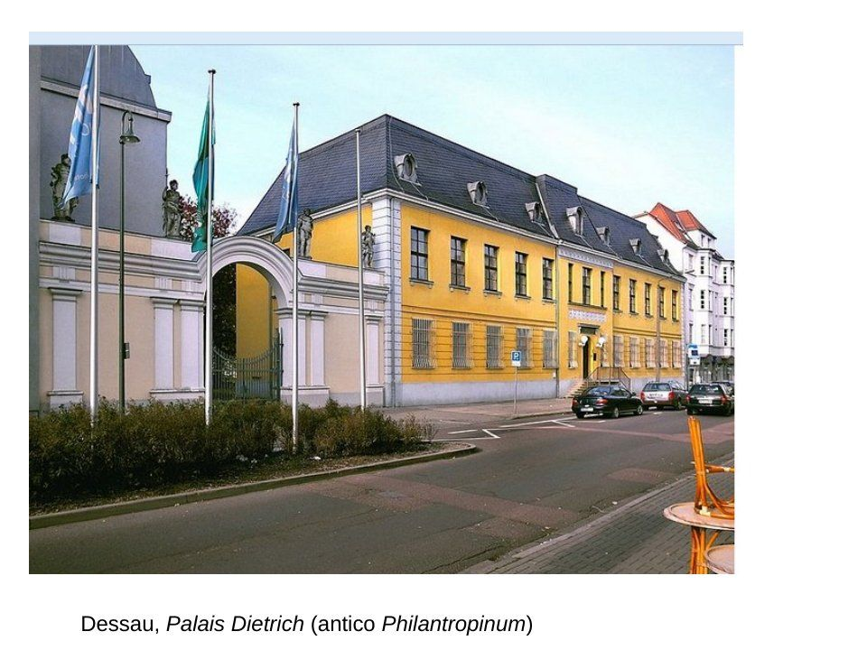{ loading=lazy style="width:47%" }

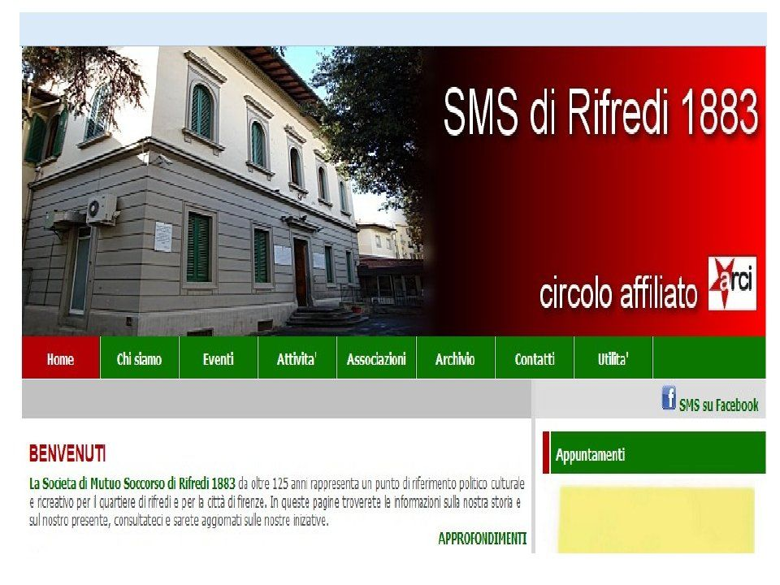{ loading=lazy style="width:47%" }

**STORIA DEI POVERI IN OCCIDENTE* – XIX SECOLO**

Il XIX secolo è quello in cui è l’operaio (e non più il povero) a essere contrapposto al ricco.

De Sismondi (*Nuovi principi di economia politica*): «Lo stato ove noi entriamo oggi è totalmente nuovo… un ordine sociale che mette in lotta tutti coloro che posseggono e tutti coloro che lavorano».

Dopo il 1848 (quando Carlo Alberto abrogò gli articoli del codice penale contro «qualunque associazione di più persone organizzate in corpo») le società di mutuo soccorso si moltiplicarono: in Piemonte, da 181 nel 1860, nel 1862 erano diventate 408. Il 1853 è l’anno del primo congresso delle società operaie del Piemonte.

È il secolo in cui nasce il mutualismo operaio, volto a risolvere i problemi dei lavoratori poveri (SMS di Rifredi, 1883).

Il cristianesimo europeo si caratterizzò di fatto per un atteggiamento di conservazione sociale che si oppose alle innovazioni.

Tipica fu, nei primi dell’Ottocento, l’opposizione delle gerarchie ecclesiastiche al cosiddetto «soccorso legale», che prevedeva un intervento organico dello Stato (finanziato con la riscossione di un’apposita tassa) attraverso istituti di previdenza e assistenza capaci di rimediare alle più evidenti piaghe del pauperismo operaio.

I vescovi affermavano che la trasformazione dell’elemosina in un diritto esigibile implicava l’impossibilità per il ricco generoso di acquistarsi il paradiso e, al contempo, privava il povero, che avrebbe dovuto accettare con rassegnazione la sua condizione, della possibilità di guadagnarsi attraverso questa via la salvezza.

Era la convinzione che la diseguaglianza sociale fosse voluta da Dio: si arrivò a parlare di «ineguaglianza ineluttabile». È esemplare una predica tenuta nel 1827 dall’abate Robinot: *«La società presuppone necessariamente la disuguaglianza delle condizioni e delle fortune… se supponete tutti gli uomini uguali… non ci saranno più legami tra di loro; non ci sarà più né ordine, né subordinazione, né autorità, né dipendenza… questa legge della disuguaglianza delle fortune, che ferisce l’orgoglio e irrita la cupidigia di certuni, è dunque nell’interesse della società, così come è nei disegni di Dio; perché è Dio che fa il povero e il ricco; Dio che abbassa ed eleva; Dio che senza nulla abbandonare al caso assegna a ciascuno il ruolo che ritiene opportuno occupi, la posizione che deve conservare, la funzione che deve svolgere nel corpo di cui è membro».*

2:36:37

È anche il momento, l’Ottocento, in cui la pittura è educativa, cioè i poveri vanno educati a una vita sana. Questo, per esempio, è il Pitocchetto, Giacomo Ceruti – tra l’altro è anche il pittore della copertina del libro di cui parlava prima Lorenzo – detto il Pitocchetto perché ritraeva sempre gli umili, i poveri, i bisognosi. Il bello di questi due quadri, se vedete, è questo interno con un gruppo di donne che lavorano in casa; però al centro, in tutti e due i quadri, ci sono due libri, simbolo dell’educazione, dell’imparare a leggere e scrivere. In quello di destra c’è una bambina sul grembo della donna, in quello di sinistra invece una bambina un po’ più grande che tiene in mano il libro. Ecco, è questa la concezione della povertà: bisogna lavorare e studiare per emanciparsi.

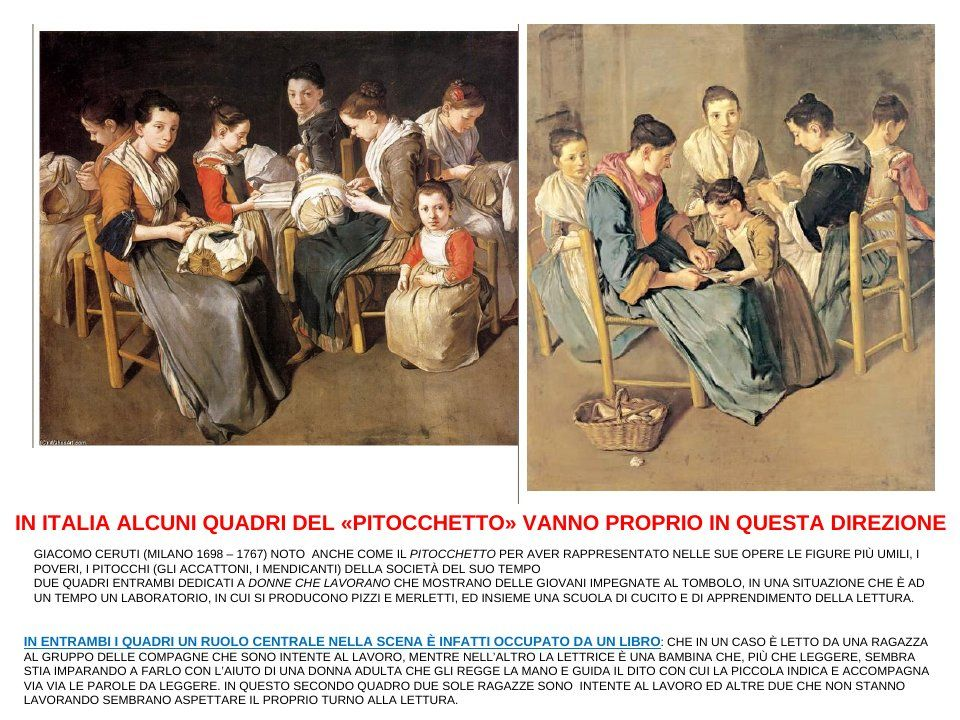{ loading=lazy style="width:59%" }

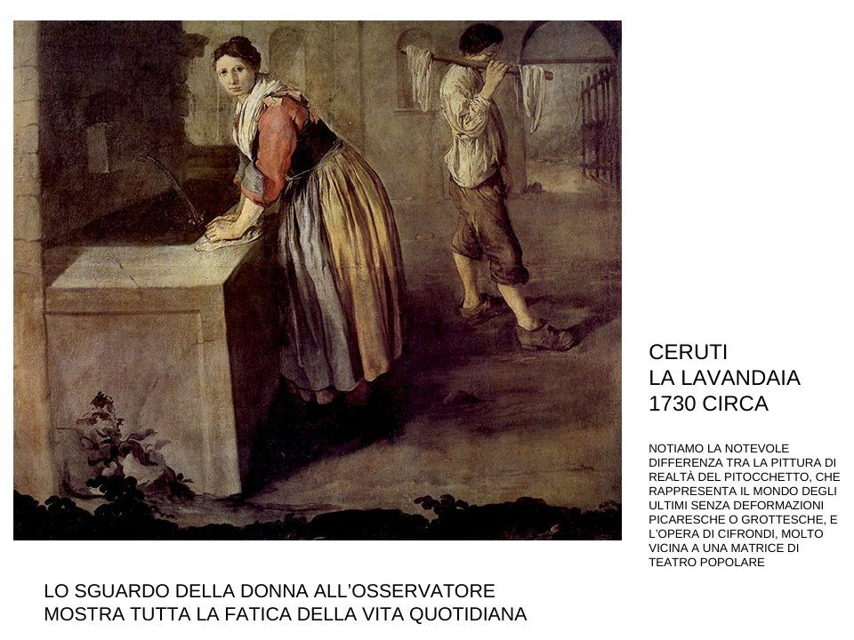{ loading=lazy style="width:47%" }

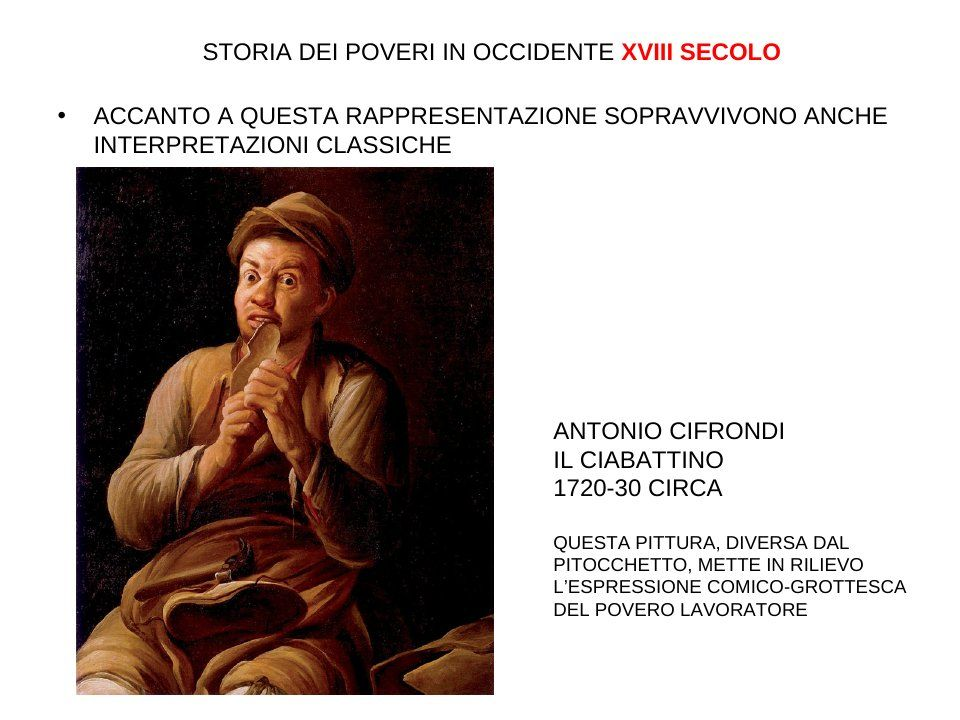{ loading=lazy style="width:47%" }

**STORIA DEI POVERI IN OCCIDENTE* – XVIII SECOLO**

Giacomo Ceruti (Milano 1698 – 1767), noto anche come il Pitocchetto per aver rappresentato nelle sue opere le figure più umili, i poveri, i pitocchi (gli accattoni, i mendicanti) della società del suo tempo. In Italia alcuni quadri del Pitocchetto vanno proprio in questa direzione.

Due quadri, entrambi dedicati a donne che lavorano, mostrano delle giovani impegnate al tombolo, in una situazione che è a un tempo un laboratorio, in cui si producono pizzi e merletti, e insieme una scuola di cucito e di apprendimento della lettura.

In entrambi i quadri un ruolo centrale nella scena è infatti occupato da un libro, che in un caso è letto da una ragazza al gruppo delle compagne intente al lavoro, mentre nell’altro la lettrice è una bambina che, più che leggere, sembra stia imparando a farlo con l’aiuto di una donna adulta che le regge la mano e guida il dito con cui la piccola indica e accompagna via via le parole da leggere. In questo secondo quadro due sole ragazze sono intente al lavoro, e altre due, che non stanno lavorando, sembrano aspettare il proprio turno alla lettura.

Ceruti, *La lavandaia* (1730 circa): lo sguardo della donna all’osservatore mostra tutta la fatica della vita quotidiana. Notiamo la notevole differenza tra la pittura di realtà del Pitocchetto, che rappresenta il mondo degli ultimi senza deformazioni picaresche o grottesche, e l’opera di Cifrondi, molto vicina a una matrice di teatro popolare.

Accanto a questa rappresentazione sopravvivono anche interpretazioni classiche: Antonio Cifrondi, *Il ciabattino* (1720-1730 circa). Questa pittura, diversa da quella del Pitocchetto, mette in rilievo l’espressione comico-grottesca del povero lavoratore.

2:37:54

Poi ci sarà tutto il Novecento, con le organizzazioni dei lavoratori e la nascita delle società cooperative, con tutto quello che ne consegue, anche dal punto di vista della pittura. Solo un cenno alla pittura francese: questo è Gustave Courbet, *Le vagliatrici di grano* (1854); in tutto l’Ottocento si rappresenta la vita della povertà, delle persone più umili, in tutta la loro realtà. Questo è Jean-François Millet, l’*Angelus* (1857-1859); e questo invece è Honoré Daumier, con il *Vagone di terza classe* (1864). Poi ci sarà tutta l’esplosione del XX secolo, con altri momenti in cui la povertà si identifica in maniera diversa, fino a oggi. Quello che abbiamo cercato di fare stasera è rappresentarvi un po’ tutto questo concetto nel mondo occidentale; per tirare qualche conclusione ci facciamo aiutare dal nostro maestro – lui non vuole che lo si chiami così – il nostro maestro di storia e di filosofia, Lorenzo.

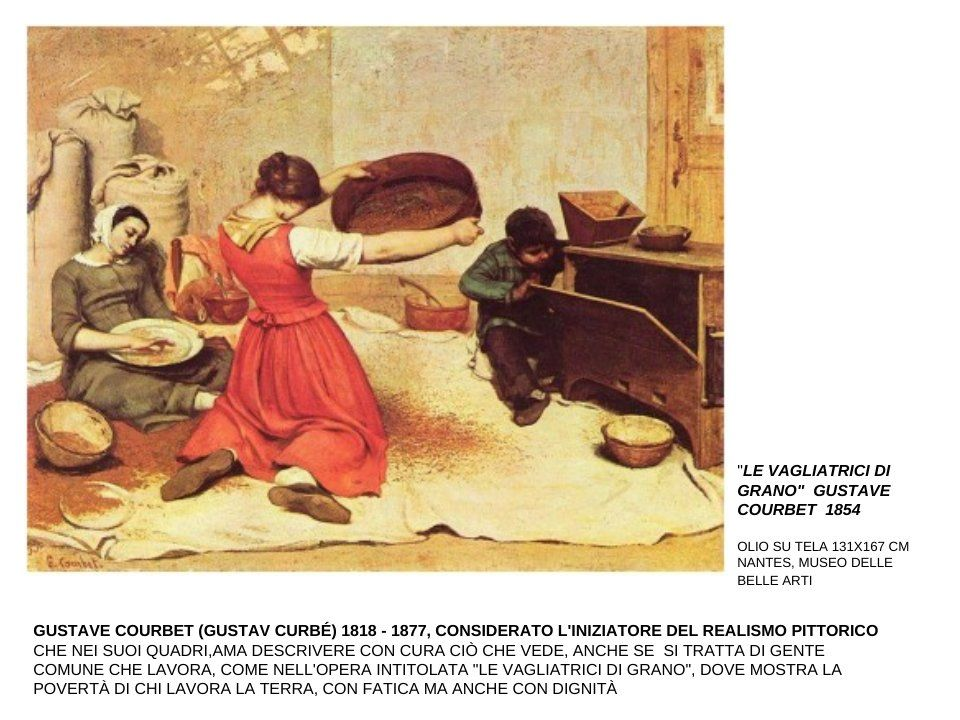{ loading=lazy style="width:59%" }

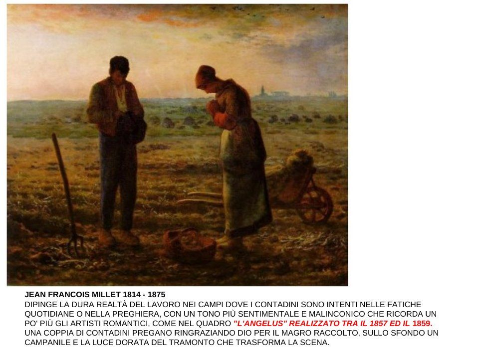{ loading=lazy style="width:47%" }

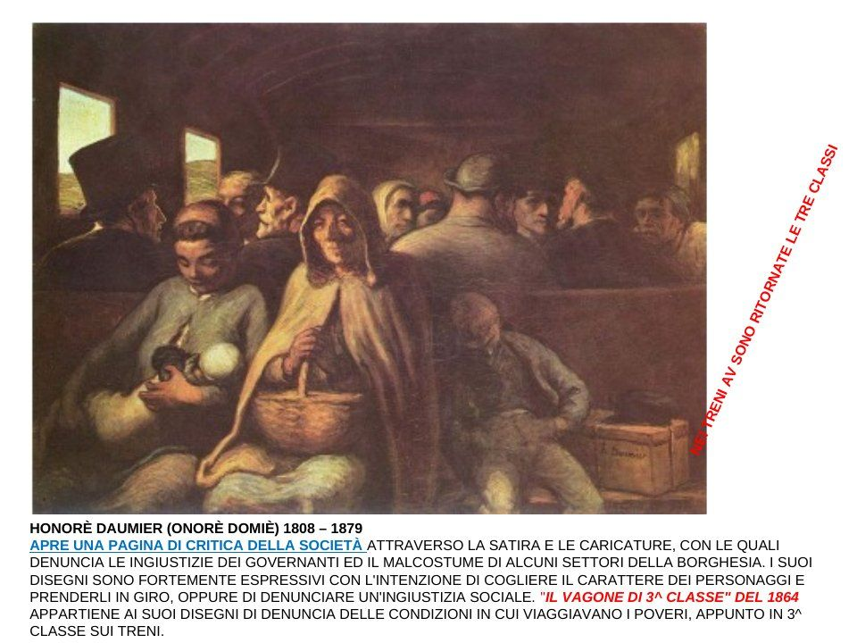{ loading=lazy style="width:47%" }

**L’ARTE DELL’OTTOCENTO**

Come conseguenza della rivoluzione industriale nasce la classe sociale operaia, e con essa le organizzazioni dei sindacati e dei partiti politici.

È il secolo in cui la rappresentazione artistica del lavoro e della povertà trova espressioni importanti: l’arte realista ha come tema principale proprio questo, la condizione sociale delle classi più povere. In Francia in modo particolare nasce la pittura realista: il realismo è una corrente artistica nata in Francia negli anni Quaranta e diffusasi successivamente in Europa. I principali pittori realisti francesi sono Gustave Courbet (1819-1877), Jean-François Millet (1814-1875) e Honoré Daumier (1808-1879).

Gustave Courbet, considerato l’iniziatore del realismo pittorico, nei suoi quadri ama descrivere con cura ciò che vede, anche se si tratta di gente comune che lavora, come nell’opera intitolata *Le vagliatrici di grano* (1854, olio su tela, 131×167 cm, Nantes, Museo di Belle Arti), dove mostra la povertà di chi lavora la terra, con fatica ma anche con dignità.

Jean-François Millet dipinge la dura realtà del lavoro nei campi, dove i contadini sono intenti nelle fatiche quotidiane o nella preghiera, con un tono più sentimentale e malinconico, che ricorda un po’ di più gli artisti romantici, come nel quadro *L’Angelus*, realizzato tra il 1857 e il 1859: una coppia di contadini prega ringraziando Dio per il magro raccolto; sullo sfondo un campanile e la luce dorata del tramonto che trasforma la scena.

Honoré Daumier apre una pagina di critica della società attraverso la satira e le caricature, con le quali denuncia le ingiustizie dei governanti e il malcostume di alcuni settori della borghesia. I suoi disegni sono fortemente espressivi, con l’intenzione di cogliere il carattere dei personaggi e prenderli in giro, oppure di denunciare un’ingiustizia sociale. *Il vagone di terza classe* (1864) appartiene alle sue opere di denuncia delle condizioni in cui viaggiavano i poveri, appunto in terza classe sui treni.

**STORIA DEI POVERI IN OCCIDENTE* – XIX E XX SECOLO**

Il XIX secolo, d’altro canto, vide anche la nascita del movimento cooperativo. Le cooperative iniziarono a vendere a prezzo di mercato, o ancora meglio al prezzo migliore esistente sul mercato, a prezzi non gravati da rendite speculative e monopolistiche.

A fine anno l’avanzo di gestione veniva in parte accantonato per gli investimenti, in parte destinato a vantaggi collettivi, e quel che rimaneva veniva distribuito fra i soci non in proporzione alle quote possedute, come avviene di fatto nelle società fondate sul capitale, ma in base agli acquisti effettuati da ciascun socio presso la cooperativa (il ristorno).

Treccani (4-7-2011): da circa la metà dell’Ottocento le cooperative accompagnano l’evoluzione di classi sociali meno protette – come gli agricoltori e gli operai – pienamente coinvolte all’interno di un processo caratterizzato da forti cambiamenti economici e produttivi. Per questo è di grande interesse analizzare la storia delle prime cooperative, inizialmente sorte nei paesi nordeuropei e via via sviluppatesi anche in Italia: dapprima intorno agli operai torinesi, e poi estese ai ferrovieri e ai braccianti delle zone di bonifica.

Ma delle cooperative parleremo più dettagliatamente nella prossima serata, «Cooperazione e denaro», del 27-2-2014.

Il XX secolo è il secolo in cui la strada si divide tra povero e operaio. Le migliorate condizioni di vita indicano che la povertà non è più sentita come una necessaria conseguenza del processo di industrializzazione, ma come qualcosa da correggere con il perfezionamento del processo stesso.

Il cambiamento è profondo: l’operaio non rivendica più la qualifica di povero, e si candida a una condizione di vita più agiata, simile alle abitudini di vita dei ricchi (soprattutto nel dopoguerra, negli anni Cinquanta). In particolare si afferma la concezione borghese del lavoro, inteso come mezzo di arricchimento e non più come condizione di vita.

Nel XX secolo vanno distinte alcune fasi:

– 1914-1943, età della catastrofe;

– 1945-1955, poveri ma belli;

– 1955-1970, dalla terra al cielo;

– 1970-2000, la fase che porta a oggi.

2:39:23

Lorenzo Poggi Io sono studente. Comunque le conclusioni sono queste. Evidentemente, man mano che esaminiamo questi momenti e questi aspetti della società del passato, ci rendiamo conto delle profonde differenze rispetto alla nostra. Ci sono differenze profonde, perché sono sempre diminuiti i contatti: le relazioni tra le persone, la relazione e l’individualità sono spesso ridotte alla funzione che si esercita. Per dire chi si è, per esprimere se stessi, si dice subito, dopo il nome, la professione, che è la relazione che abbiamo all’interno del mondo del lavoro, o del mondo delle relazioni che esiste oggi nella società. Quindi prima di tutto la nostra individualità è oggi legata a questo. Qui invece è un mondo in cui l’individualità, l’essere uomini, ha ancora almeno una parte di rapporto diretto tra persone; e abbiamo visto come vi entrino il corpo, anche il cibo, la relazione diretta.

2:40:57

Questo oggi tende a essere sempre meno importante: le relazioni sono sempre più astratte, sempre più legate a ciò che non è direttamente esperito, ma rappresentato o visto attraverso le immagini, attraverso le biografie, le trasmissioni dei media e così via. Quindi il mutamento è profondo e oggettivo. Rimane forse in comune questo senso di dipendenza da una forza rispetto alla quale non possiamo decidere o agire, rispetto alla quale dobbiamo in qualche modo tentare di trovare dei rimedi, di barcamenarci, di inserirci nel miglior modo possibile, ma che non possiamo mutare. Elementi creati dall’uomo per controllare il mondo, la realtà, se stesso – come l’economia, l’industria, la tecnica, la scienza – a un certo punto sono diventati elementi che sembrano andare avanti secondo leggi loro, le leggi del mercato, le leggi della ricerca o le leggi della tecnica, e che sfuggono alla possibilità di essere determinati in funzione umana. Per cui le condizioni umane di esistenza e di vita sono possibili solo se si relazionano alle possibilità dell’economia, dello sviluppo, alle possibilità concesse da questi altri elementi. Questo è uno dei caratteri avvertiti, salienti, del nostro tempo, che ci rende in qualche modo simili a quei tempi in cui tutto si decideva in una prospettiva sacra, nella dipendenza dal divino, nella prospettiva della provvidenza divina che regge il mondo.

2:43:02

A conclusione, un’ultima ragia, perché non si può terminare senza un’ultima ragia: quella degli affrati. Gli affrati sono falsi frati, che quindi hanno – come il tema di stasera – la povertà da praticare, come si è detto prima; perché tra i voti ci sono anche la castità e l’obbedienza, ma insomma, la castità lasciamo stare, l’obbedienza è molto relativa, però la povertà è fondamentale. Allora questi hanno la povertà: vanno mendicando vestiti di bigello, con la corda e i piedi scalzi, e chiedono alle donne – perché nella società medievale le donne sono più sensibili a questa cosa – quando ce ne sono alcune riunite, in modo che la loro azione sia subito vista, testimoniata e diffusa, un po’ di pane secco per sostentarsi e una ciotola d’acqua.

2:44:23

Viene dato loro il pane secco e la ciotola d’acqua; intingono il pane nella ciotola, lo mangiano, e poi restituiscono la ciotola dell’acqua da cui hanno bevuto un sorso: e non è più acqua, ma vino. Hanno fra i denti delle cose che schiacciano mentre bevono e che colorano l’acqua della ciotola; e le tonte gridano al miracolo: «Hanno trasformato l’acqua in vino! Sono santi!». E loro allora le chiamano e dicono: «No, per favore, non dite nulla, che non si sappia! Non vogliamo che si sappia che abbiamo fatto questo miracolo». Se vuoi far sapere una cosa in giro, devi dire a una donna di non dirlo a nessuno. E infatti da quel momento tutti lo sanno, e raccolgono elemosine, offerte, cominciano a fare miracoli... e così sbarcano il lunario, secondo quella che è la loro legge: «Con arte e con inganno si campa mezzo l’anno; con inganno e con arte si campa l’altra parte». Bene, ci lasciamo qui. Grazie.

2:45:50

Paolo Marcucci Grazie, grazie, arrivederci e buonanotte.

## Appendice

Le slide proiettate durante l’incontro.

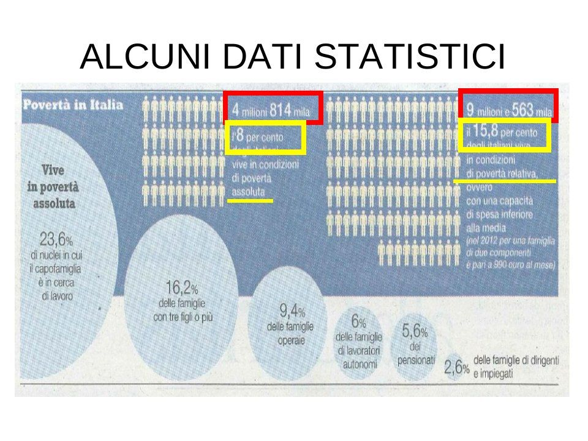{ loading=lazy style="width:47%" }

{ loading=lazy style="width:47%" }

{ loading=lazy style="width:47%" }

{ loading=lazy style="width:47%" }

{ loading=lazy style="width:47%" }

{ loading=lazy style="width:47%" }

{ loading=lazy style="width:59%" }
