# Cooperazione e denaro

**Data:** 27 febbraio 2014 
**Luogo:** Museo Archeologico, Montelupo Fiorentino 
**Incontro con:** Lorenzo Poggi e Paolo Marcucci 
**Ospite:** Francesco Bosio, direttore della Banca di Cambiano

**Interventi:** Paolo Marcucci Lorenzo Poggi Francesco Bosio

0:00:20

Paolo Marcucci Bene, buonasera a tutti. Si sente in fondo? Sì? Grazie. Buonasera a tutti. Siamo qui stasera per parlare di un argomento, «Cooperazione e denaro». Come avrete notato abbiamo un ospite, che presento subito: Francesco Bosio, direttore della Banca di Cambiano, e quindi l’uomo adatto per parlarci un po’, dal suo punto di vista, dei due temi, cooperazione e denaro.

0:00:56

Iniziamo dal dizionario etimologico. «Cooperare» è composto da «con», insieme, e «opera», che significa fatica, industria, cura: quindi già la parola stessa ci dice che la cooperazione non è facile ed è qualcosa che dobbiamo studiare. Anche il Codice civile è piuttosto preciso nel definire la cooperazione: dice, per esempio, che alla base della cooperativa c’è la comune volontà dei suoi membri di tutelare i propri interessi. Lo scopo della cooperativa non è tanto il profitto – che è invece il fine, per esempio, delle società di capitali –, quanto quello di assicurare ai propri soci servizi a condizioni migliori di quelle che troverebbero, per esempio, sul mercato.

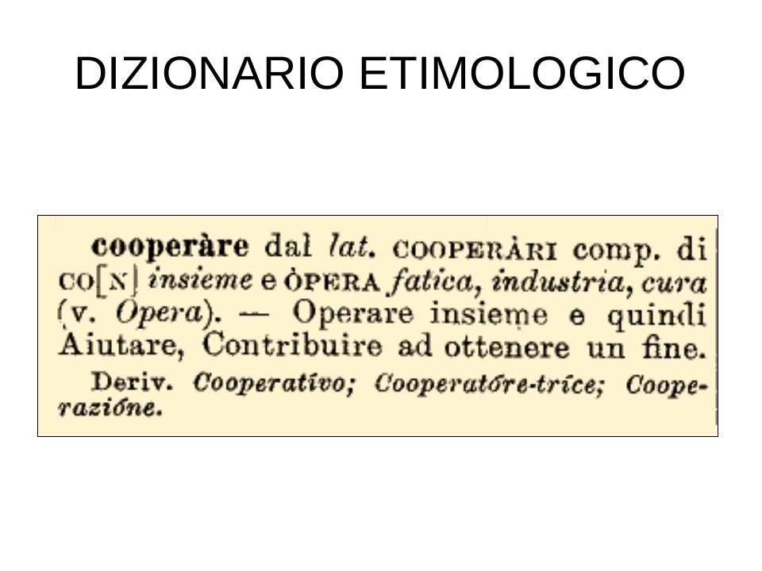{ loading=lazy style="width:47%" }

**SOCIETÀ COOPERATIVA – CODICE CIVILE**

Per il Codice civile, una società cooperativa è una società costituita per gestire in comune un’impresa che si prefigge lo scopo di fornire innanzitutto agli stessi soci (da qui lo scopo mutualistico) quei beni o servizi per il conseguimento dei quali la cooperativa è sorta.

**LO SCOPO MUTUALISTICO**

La cooperativa è un’impresa – in forma di società – nella quale il fine e il fondamento dell’agire economico è il soddisfacimento dei bisogni della persona (il socio): alla base della cooperativa c’è dunque la comune volontà dei suoi membri di tutelare i propri interessi di consumatori, lavoratori, agricoltori, operatori culturali ecc.

L’elemento distintivo e unificante di ogni tipo di cooperativa si riassume nel fatto che lo scopo non è il profitto, come invece ad esempio nelle società di capitali, dove si realizza nel riparto degli utili patrimoniali.

Le cooperative hanno invece uno scopo mutualistico, che consiste nell’assicurare ai soci il lavoro, o beni di consumo, o servizi, a condizioni migliori di quelle che otterrebbero dal libero mercato.

0:02:03

Altro elemento importante della cooperativa è che ogni socio ha diritto a un voto (articolo 2538 del Codice civile), indipendentemente dalle quote che possiede nella società. Questo è un elemento fondamentale del diritto delle cooperative, perché tutti i soci sono uguali: pensate che differenza c’è tra questo tipo di società e le società per azioni. E già qui si vede il diverso rapporto tra capitale e uomo all’interno delle diverse società.

0:02:45

Generalmente, però, quando si pensa a una cooperativa si pensa a quelle che conosciamo tutti, quelle che puliscono i giardini, che fanno servizi sociali ecc.: sono quelle che comunemente si dice appartengano al cosiddetto terzo settore. Il terzo settore è generalmente tutta quell’attività che si colloca in una fascia intermedia tra lo Stato e il mercato: sono società che non appartengono né all’area pubblica né interamente al mercato, sono una via di mezzo tra questi due elementi, e si dice appunto del terzo settore. Se digitate su un qualsiasi motore di ricerca «immagini» riferite alla cooperazione, vedete che vengono fuori tutte immagini che in qualche modo legano la solidarietà: mani che si toccano, cerchi ecc. Questo è un po’ anche il simbolo grafico dell’immaginario della cooperazione e delle cooperative.

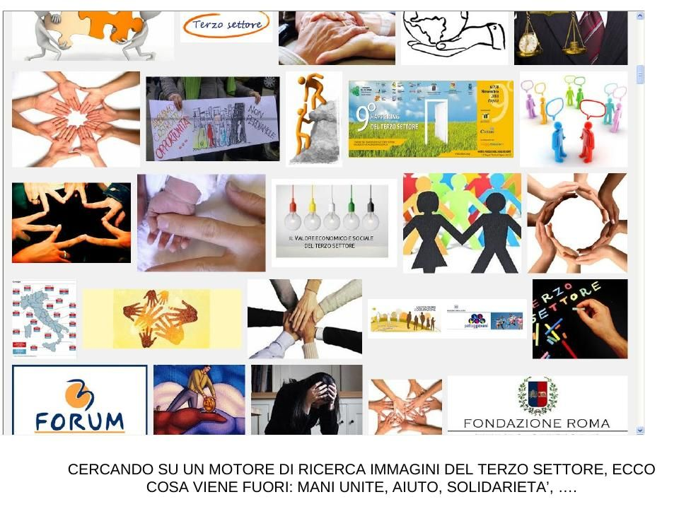{ loading=lazy style="width:59%" }

0:04:09

Un’indagine fatta a livello mondiale nel 2012 da Ethical Consumer, proprio all’apice della crisi finanziaria dei mercati degli ultimi anni – uno studio patrocinato anche dall’ONU –, aveva fatto emergere che le cooperative potevano offrire una risposta alla crisi dei mercati in maniera diversa rispetto a quella che poteva dare il funzionamento del sistema capitalistico. Perché questo? Intanto i numeri ci dicono che la cooperazione non è marginale. C’è stato un periodo, negli ultimi 15-20 anni, in cui la cooperazione pareva dovesse scomparire, perché l’ideologia principale era quella del libero mercato, quella che si rifaceva – tanto per semplificare, ma per capirci – al neoliberismo; invece la cooperativa è sopravvissuta anche in questi anni di liberismo estremo.

**ETHICAL CONSUMER**

*Londra, 27 settembre 2013: presentazione del libro «People Over Capital: The Co-operative Alternative to Capitalism» (Le persone oltre il capitale: l’alternativa cooperativa al capitalismo)*

All’origine del libro c’è l’iniziativa di *Ethical Consumer*, che nel 2012, anno internazionale delle cooperative sotto l’egida dell’ONU, aveva invitato il pubblico a rispondere alla domanda: «Esiste un’alternativa cooperativa alla finanziarizzazione?». Le risposte e i contributi si possono riassumere in questa frase: «Ciò che le cooperative possono offrire all’economia mondiale e soprattutto come i loro benefici possono essere estesi a una platea ancora più vasta di persone».

Ed Mayo, segretario generale delle cooperative inglesi, ha smontato l’errata percezione secondo la quale le cooperative avrebbero un ruolo marginale sulla scena mondiale. Altro aspetto più importante, continua Mayo, è che il contesto attuale è forse quello più adatto per l’impresa cooperativa da molti anni a questa parte.

Le cooperative impiegano oltre 100 milioni di persone (il 20% in più rispetto alle imprese multinazionali); le 300 più grandi cooperative fatturano più di 1.000 miliardi di dollari l’anno.

Nella cooperazione bancaria mondiale gli istituti di credito che si rifanno alla cooperazione sono 195.000, presenti in 110 paesi, con 420 milioni di soci, 700 milioni di clienti, una raccolta di 6.000 miliardi di dollari e impieghi per 5.000 miliardi di dollari.

**LA LEZIONE DELLE COOPERATIVE (*THE BANKER* – ANALISI DEL PROF. OLIVIER PASTRÉ)**

Dieci anni fa tutti pensavano che la cooperazione bancaria stesse per scomparire in Europa: tutto era orientato al mercato, misura e riferimento di qualunque attività economica e socialmente utile, e quanto non era di matrice capitalistica, o non era conforme alle logiche di mercato, era da rigettare.

La grande crisi, il crollo dei mercati e il collasso di alcuni dei maggiori istituti bancari hanno messo in crisi la fiducia in un modello di governance giudicato insostituibile: quello delle società per azioni.

0:05:36

Guardiamo qualche numero, a livello mondiale: le cooperative impiegano 100 milioni di persone, una cifra impressionante; le 300 più grandi cooperative del mondo fatturano circa 1.000 miliardi di dollari l’anno, quindi non sono cifre banali. Un altro elemento importante della cooperazione è quello legato al mondo bancario – non a caso stasera abbiamo un rappresentante di quest’aspetto. Gli istituti di credito cooperativi in tutto il mondo sono 195.000, quindi tantissimi; sono presenti in 110 Paesi – l’idea di cooperazione si è quindi diffusa a livello mondiale; hanno 420 milioni di soci e 700 milioni di clienti, raccolgono 6.000 miliardi di dollari e prestano soldi per 5.000 miliardi: sono numeri di tutto rispetto. Quindi quest’idea della cooperazione è sopravvissuta in questi ultimi vent’anni, è tuttora in piedi e sta dando i suoi frutti.

0:07:02

Per esempio, se guardiamo all’attuale costruzione europea, dell’euro e dell’Europa, sapete che in questo momento si sta costruendo la vigilanza europea: la BCE, la Banca centrale europea, si sta organizzando per avere il controllo su tutte le banche del sistema europeo. In questa prima fase la BCE vigilerà su 128 banche, quelle più grandi (le banche «sistemiche», con attivi superiori a 30 miliardi di euro o pari ad almeno il 20% del PIL del proprio Paese); quelle più piccole, come la Banca di Cambiano, restano sotto la vigilanza della Banca d’Italia, in questo caso, ma sotto la supervisione della BCE. Però c’è un dato importante, che ci serve stasera nella nostra discussione: di queste 128 banche europee, 15 sono italiane, le banche più grandi, e quindi con 15 banche su 128 siamo degnamente rappresentati in Europa.

0:08:16

Questo è l’elenco delle banche italiane: vedete, si va dal Monte dei Paschi di Siena a Intesa, a UniCredit ecc. Però, se andiamo a vedere la natura sociale di queste banche, vediamo che ce ne sono molte di origine cooperativa: per esempio il Credito Valtellinese, la Banca Popolare dell’Emilia-Romagna, la Banca Popolare di Milano, la Banca Popolare di Sondrio, la Banca Popolare di Vicenza, il Banco Popolare, Iccrea, UBI e Veneto Banca sono tutte banche di origine cooperativa. Perché – lo vedremo anche più avanti – sia le banche popolari sia le BCC, per esempio, in ambito bancario, sono banche di diritto cooperativo: indipendentemente dalle azioni possedute, il socio ha lo stesso diritto di voto di tutti gli altri. Questo è importante. La domanda che questi dati ci fanno porre è questa: tra le maggiori 15 banche italiane la maggioranza è di diritto cooperativo. Questo è effettivamente un dato che ci deve far pensare, e vedremo poi nel prosieguo della serata.

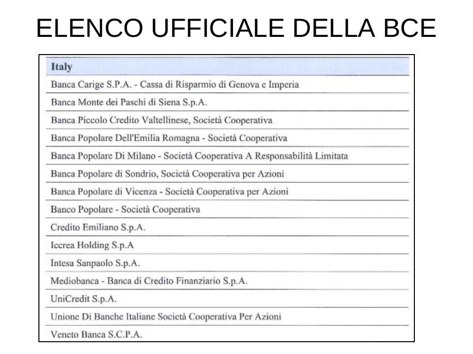{ loading=lazy style="width:47%" }

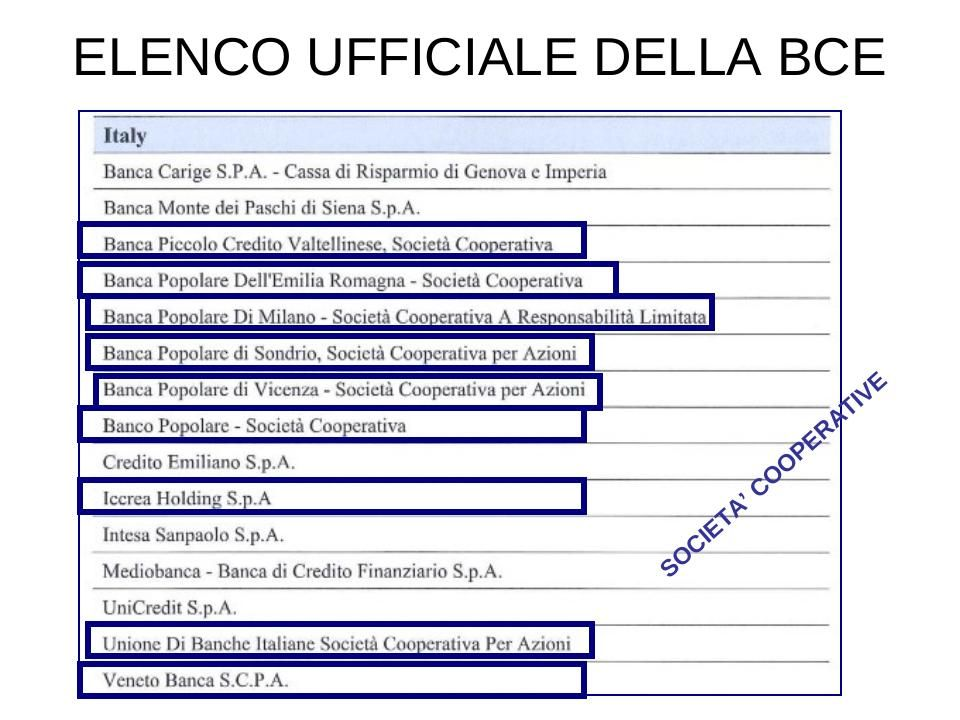{ loading=lazy style="width:47%" }

0:10:00

Come ci siamo arrivati, a questa situazione? Su questo, anche per introdurre il nostro ospite, che ci ha fatto l’onore di essere qui con noi, gli si potrebbero fare subito alcune domande: come sia possibile che tra le 15 maggiori banche italiane 9 siano di diritto cooperativo; se la cooperativa sia davvero attrezzata per reggere alle sfide che i mercati ci mettono di fronte; e se la cooperativa sia compatibile con lo sviluppo sostenibile, con lo sviluppo di un sistema economico che in questi anni ha fatto invece della matrice liberista la sua bandiera e il suo cavallo di battaglia. Su queste domande, Francesco, se ci vuoi dare una tua interpretazione, anche dal punto di vista di una banca locale – molto importante nel territorio, perché la Banca di Cambiano è una delle maggiori banche del territorio, però è una banca piccola rapportata naturalmente al sistema italiano o al sistema europeo – ma che è una banca cooperativa nata alla fine dell’Ottocento e tuttora in piedi: quindi vuol dire che ha resistito e sta andando avanti.

0:11:41

Francesco Bosio Buonasera, innanzitutto. I temi su cui Marcucci si è soffermato, tratteggiando velocemente una serie di dati desunti da queste slide, richiederebbero tanto tempo per essere centrati. Io direi questo: la cooperazione è un fenomeno legato all’uomo. L’uomo ha sempre cooperato, perché nel momento in cui in due ci si aiuta, in qualche modo si coopera. La forma organica di cooperazione, per come la si legge oggi, ha avuto una codificazione ed è comparsa come fenomeno sociale ordinato in coincidenza con la rivoluzione industriale. La rivoluzione industriale ha segnato un periodo, da fine Settecento a metà Ottocento: è stata la rivoluzione più grande che l’umanità abbia vissuto, e in quel momento è sorto il fenomeno cooperativo organizzato.

0:13:01

Il comparire di questa struttura cooperativa si vede in Inghilterra, con i cosiddetti Probi pionieri di Rochdale. Sono operai del tessile di un sobborgo di Manchester, nel 1844, che, abbandonata l’attività agricola, fino a quel momento la loro fonte di vita, si ritrovano inseriti in questo processo industriale agli albori, che stravolge il loro modo di vivere, e scoprono la necessità di doversi unire, perché da soli non rappresentano più nulla, non sono in grado di soddisfare le esigenze minime. E la famosa cooperativa sorge perché insieme si approvvigionavano di verdure: lo scorbuto all’epoca era una malattia che flagellava, e la verdura e la frutta erano praticamente impossibili da acquistare, perché la gente era a livelli di sopravvivenza; venivano dall’agricoltura, dove quella era la loro produzione costante. A fronte di quest’emergenza anche sanitaria scoprirono che l’unione fa la forza: si misero insieme e riuscivano a trovare possibilità di acquisto, perché si presentavano come acquirenti di quantità maggiori. L’unione fa la forza.

0:14:34

Questo fenomeno politico-sociale – perché la cooperazione ha una matrice politico-sociale: politica non partitica, ovviamente, ma di politica economica, di politica sociale, di politica di sopravvivenza – trovò quindi nella seconda metà dell’Ottocento una codifica addirittura nell’enciclica, la famosa *Rerum novarum* di Leone XIII, che puntualizzò questi principi della solidarietà umana, dell’essere insieme, e dette questa veste formale al fenomeno cooperativistico. Il fenomeno cooperativistico è una ricchezza incredibile di cui la gente può disporre: lo stare insieme può costituire non una forza uguale alla somma delle forze di tutti i componenti, ma una cosa enormemente più grande. E questo si può esplicare in disparatissimi settori – Marcucci parlava delle cooperative sociali: di produzione e lavoro, agricole, edilizie, sanitarie; in tutti i settori si possono creare strutture organizzate basate sui principi cooperativistici.

0:16:13

Poi anche le leggi l’hanno disciplinato, il Codice civile: oggi siamo di fronte a un terzo sistema di fare impresa, un terzo tipo di società. C’è l’individuo, l’impresa individuale; la società di capitali, nelle varie forme; e le cooperative. La maggiore o minore fortuna della cooperazione si accompagna a momenti di boom, di presunta facile ricchezza, di presunto benessere diffuso, nei quali la cooperazione registra battute d’arresto, o viene vista come una modalità di fare impresa di serie B; e a momenti di crisi, di criticità, nei quali invece la cooperazione riemerge con quella che è la sua vera forza. Quindi bisognerebbe che tutti avessimo chiaro questo grande valore.

0:17:20

La cooperazione è qualcosa di una potenzialità straordinaria, applicabile in tutti i settori. Alcune delle più grandi imprese a livello mondiale sono cooperative. In America certi settori – la gestione degli acquedotti, dell’elettricità, dei servizi pubblici – non li definiscono più beni pubblici, li chiamano *common goods*, che è una cosa diversa: vuol dire un bene di tutti, che è di più del pubblico. E loro questo l’hanno capito, e l’hanno capito bene. E queste forme cooperative hanno una potenzialità straordinaria in un Paese come l’America, che a una lettura di prima battuta è il tempio del capitalismo. Ecco, è il tempio del capitalismo, con sbavature tipo la Merrill Lynch, la Lehman Brothers ecc. – ma quello lo lasciamo a un’altra sera, dove magari si mangia meno, perché ci si chiude lo stomaco. E hanno delle entità di tipo cooperativo di primo piano. Una delle maggiori imprese del Canada è la Desjardins, una società cooperativa che opera a livello mondiale nell’ambito finanziario.

0:18:42

E ci stiamo avvicinando alle domande: la SWIFT, che è la struttura dalla quale transitano tutti i flussi finanziari a livello mondiale, per tutte le nazioni del mondo, ha una struttura di società cooperativa. Non è un caso: perché sennò c’erano possibili conflitti di interesse. Perché al fondo di questa storia c’è la vera qualità della cooperazione, che è – ripeto – un’istituzione politica e sociale che tende a moralizzare il mercato. Moralizzare non vuol dire «senza macchia e senza peccato»: vuol dire evitare le prevaricazioni che derivano da certe componenti, per esempio il capitale. Se io ho 99 e lui ha 1, lui può essere portatore della verità, ma non conta nulla; nel momento in cui siamo in una società cooperativa, è uno contro uno: è un voto a testa, il voto capitario, la partecipazione diretta.

0:20:00

Perché tutti hanno da dire: vuol dire che con l’unità si possono perseguire obiettivi che sono realmente a favore della compagine che dà vita alla cooperativa. L’articolo 45 della Costituzione disciplina la cooperazione. La società per azioni, la società di capitali, non trova nella Costituzione uno specifico riferimento normativo; la cooperazione sì. E ti dice: «La Repubblica riconosce la funzione sociale della cooperazione a carattere di mutualità e senza fini di speculazione privata». Questi sono i punti della vera cooperativa. Oggi di cooperative ce ne sono tante, e tante si dicono spurie, perché si vestono di questa forma, però in sostanza la realtà è ben diversa.

0:21:06

Quindi, secondo il dettato costituzionale, l’impresa cooperativa ha intanto una funzione sociale, perché è l’unione di tanti; quando ha principi di mutualità, che vuol dire che dall’impresa si cerca di trarre il miglior vantaggio per tutti; senza fini di speculazione privata, che non vuol dire che l’impresa cooperativa non debba guadagnare – anzi, deve guadagnare, rafforzarsi per essere sempre più in grado di operare – ma non a vantaggio del socio, nel senso di «ho un dividendo». Questo è il cardine che dà la forza della cooperazione.

0:21:52

Venendo alle banche, quelle che sono nell’elenco sono società cooperative; però io sono dell’avviso che la cooperazione abbia poi un limite, nel senso che bisogna rimanere sempre «tra noi», e allora vale il discorso della persona. Quando una società cooperativa di grandissime dimensioni, come lo sono per esempio le banche comprese in quell’elenco, è quotata in Borsa, si snatura quello che è il vero elemento caratterizzante della cooperazione. Sono sempre società cooperative, non c’è ombra di dubbio, hanno il voto a testa, c’è tutto quello che ci deve essere, ma manca quell’elemento che dovrebbe essere il vero elemento caratterizzante. Per dirla in breve: in una di quelle grosse, che sono cooperative, il cliente necessariamente deve diventare un numero.

0:23:03

Nella vera cooperazione – rimanendo nell’ambito bancario, della banca di cui faccio parte – il cliente non deve mai diventare un numero: deve rimanere Piero Bianchi, Maria Rossi. E ci deve essere questo scambio di comunità, questa conoscenza, perché il cliente che entra, socio o non socio, deve trovare un modo diverso di avere il servizio, di avere il prodotto, di relazionarsi. Perché oggi l’obiettivo della cooperativa – rimaniamo nel mondo bancario – non è da leggere solo nel «pago meno, mi danno la virgola di più»; è da leggere nel modo in cui tu ti puoi rapportare con la tua banca. E il modo vincente è che tu non diventi mai un numero: tu rimani la persona con la quale si dialoga, e la persona trova un dialogo nella banca. Ecco perché poi c’è il settore... ovviamente la cooperazione che vende i prodotti alimentari: tu sei socio, ma la mortadella la vende a me come a lui e come a lei. Diversa è la cooperativa che svolge un tipo di attività nella quale l’elemento relazionale – e ritorno alla banca – è determinante: il vero valore aggiunto è il modo in cui tu puoi utilizzare la banca non essendo un numero e restando una persona.

0:24:43

Sotto il profilo della potenzialità, la cooperazione ha potenzialità enormi, può fare di tutto: hai fatto l’esempio dell’America, ho detto del Canada, ho detto della SWIFT. L’importante è non snaturarla. È una convinzione mia, quindi discutibilissima, non necessariamente condivisibile: io sono dell’avviso che la grande qualità che la cooperazione può dare, specialmente nell’ambito bancario, debba avere un limite nella crescita dimensionale. Da noi si dice: cresciamo fin quando non dovessimo accorgerci che l’apertura di una nuova filiale ci porta a una dimensione che ci fa perdere questa possibilità; allora bisogna fermarsi. Perché, se ti fermi, mantieni la valorizzazione vera dell’impresa e il valore sociale che può rappresentare; se scatta la mania della crescita, della dimensione, corri il rischio di snaturarla. Perché l’impresa cooperativa è di una potenzialità enorme, ma è altrettanto caratterizzata da una delicatezza enorme. Quindi credo di aver detto, non tutto, ma un po’ di tutto.

0:26:02

Paolo Marcucci Grazie, Francesco, di questa testimonianza, di questo punto di vista interessante, perché, come dicevo all’inizio, si tratta di una testimonianza che mette insieme i due temi di stasera, la cooperazione e il denaro. E stasera mi sembra che il compito arduo sia quello di Lorenzo, che deve circoscrivere i nostri discorsi e inserirli nel contesto tipico del suo discorso, cioè quello della filosofia.

0:26:43

Lorenzo Poggi Grazie. È estremamente largo il collegamento. Si tratta di un’impresa che ha un modo particolare di fare la sua parte, che tiene conto della persona, dell’individualità, che non tratta il cliente come se fosse soltanto un cliente, ma lo tratta in modo diverso, valuta in lui quello che può dare. E questo si ritrova anche nella struttura associativa stessa, dove si vota per testa e non per azione posseduta. In fondo anche questo sta a sottolineare la valorizzazione dell’umano, dell’immediatezza; e questo è estremamente importante, direi, al giorno d’oggi, quando invece la tendenza delle società sottomesse alla globalizzazione del denaro e della finanza è un impoverimento di ciò che è personale, umano, e un’espansione di ciò che invece è mercato, vendibile, e che sembra essere l’unica cosa che ha valore. E quindi un discorso sull’impresa cooperativa, e su quanto la cooperativa possa incidere in questo, è estremamente interessante.

0:28:33

Fin dall’origine il denaro ha avuto una funzione di liberazione, ma insieme anche una funzione di disumanizzazione, di astrazione. La dipendenza del servo della gleba medievale dal signore è una dipendenza personale; il servo va in città, diventa dipendente di un artigiano, fa il tintore o qualcos’altro, e non è più dipendente personalmente. Diventa in qualche modo libero, ma la sua attività, la sua umanità dipende da un elemento astratto, il denaro del salario: qualcosa di estremamente astratto e difficile da capire, metafisico. Il denaro astrae, costituisce qualcosa che ha valore, ma un valore che non può essere ricondotto immediatamente ai bisogni, ai desideri, alle opzioni dell’umanità comune: qualcosa che in qualche modo libera...

0:29:54

...perché nel momento in cui un’attività, o una parte di un’attività, diventa vendibile, viene separata dal complesso delle attività umane, si specifica, diventa qualcosa di distinto, che ha una sua valenza, diversa. L’uomo comincia a essere in qualche modo frammentato: l’umanità vera va a rifugiarsi in una parte che non è più quella vendibile, che diventa parte del mercato. C’è un impoverimento e nello stesso tempo una liberazione.

0:30:35

L’economia monetaria è poi la prima economia capitalista, quella fiorentina, quella genovese, quella milanese: ha questa funzione. Genova inventa in fondo la finanza: la moneta genovese ha un valore importantissimo, astratto, perché Genova conquista rapidamente tutto il suo territorio e quindi è in grado di manovrare il denaro per il denaro, non più legato all’acquisto di terre, non più legato alla rendita fondiaria. Firenze invece, prima di arrivare a questo, avrà un’immaginazione del valore che passa anche attraverso il controllo del contado e delle terre. Ci sarà quasi un sorpasso tra le due città, tra il fiorino e il genovino, proprio per questo: perché i genovesi controllano rapidamente tutto il loro territorio, e quindi sono più pronti all’uso, diciamo così, astratto del valore.

0:31:56

Ecco, questo è l’elemento, io penso, sul quale dobbiamo cominciare a riflettere, di fronte a una condizione globalizzata, condivisa, in cui il valore portante è il valore di scambio, regolato dall’unica forma esistente di economia: il capitalismo non è più uno dei possibili modi di organizzazione dell’economia, è l’unico esistente. Qualcuno l’ha paragonato addirittura a una nuova teologia, perché ha i caratteri che prima aveva Dio; con la differenza che Dio qualcuno lo raffigurava, mentre il capitalismo oggi non lo raffigura nessuno: è un potere senza volto. La politica stessa prende decisioni che sono consentite dall’economia capitalistica globale. C’è l’ingiustizia, ci può essere il male, ma non c’è più l’immagine del male, non c’è più il responsabile. C’è un mondo che vede crescere sempre più l’emarginazione e l’ingiustizia: c’è un responsabile? No. C’è il male, ma non c’è l’individuazione della responsabilità; e anche questo è un fattore di disumanizzazione.

0:33:32

Nel Seicento, quando i guai della società e dell’economia avevano una responsabilità politica, il Re Sole si faceva fare Versailles a una certa distanza da Parigi, perché non si sa mai: la città, la gente, no? Le capitali politiche sono spesso così – pensate a Washington, negli Stati Uniti: in punti molto ben difendibili, un po’ lontani, perché a volte può scoppiare anche una rivoluzione. La marcia su Versailles è un elemento fondante della Rivoluzione. Quindi c’è stato un responsabile fino a un certo momento della storia; oggi questo scompare: c’è un male senza volto, senza nome, rispetto al quale è difficile anche la conflittualità. Perché la conflittualità si sviluppa quando hai di fronte il tuo nemico, sai con chi combatti; ma quando invece quello che capita è inevitabile, senza alternative possibili, allora è difficile anche riconoscere se stessi, riconoscere la propria umanità, è difficile capire come programmare un futuro, perché sembra che tutto debba rimanere in una ripetizione del presente, al massimo in un aumento quantitativo del presente, ma non in una possibile trasformazione. Diceva – faccio una citazione un po’ professorale – Adorno: se pensiamo impossibile la trasformazione, non c’è futuro, perché l’unico esistente è il presente. Mi fermerei qui, perché sennò andiamo a mangiare...

\[PAUSA\]
{: .nota }

1:00:46

Paolo Marcucci Bene, iniziamo la seconda parte, con un tema che abbiamo già leggermente tratteggiato, ma di cui ci sono alcuni aspetti che forse è interessante approfondire: la nascita delle cooperative. Qualcuno dice che le cooperative prendono spunto dal Medioevo, dalla metà del Quattrocento, quando nacquero i primi Monti, i Monti di pietà (il primo fu aperto a Perugia nel 1462, poi quelli di Siena e di Bologna). I Monti di pietà nascevano sostanzialmente per aiutare chi ne aveva necessità, in una forma di aiuto e mutualità: si faceva una colletta pubblica, si mettevano insieme i fondi, e poi questi fondi venivano dati a chi ne aveva bisogno. Da quest’iniziativa dei Monti di pietà alcuni studiosi, tra cui per esempio Stefano Zamagni, uno dei più famosi studiosi del mondo delle cooperative, hanno tratto spunto, e hanno rintracciato nei Monti di pietà le radici delle cooperative.

**I MONTI DI PIETÀ**

In Italia, in questa scia (la carità e il denaro), intorno alla metà del Quattrocento, nascita geniale, si ebbero i primi Monti di pietà, che trovarono ostacoli nei banchieri, che vi vedevano una concorrenza, e anche all’interno della Chiesa, per la paura dell’usura.

L’erezione del monte seguiva in genere uno schema fisso: si radunavano i fedeli e si teneva loro una predicazione specifica, durante la quale si stigmatizzava la pratica dell’usura. Al termine, con una colletta pubblica, si formava il primo fondo, cui le autorità locali assicuravano il liquido ulteriormente necessario.

Questi istituti senza fine di lucro (da cui, secondo alcuni storici, traggono vita e spunto anche le cooperative bancarie) con le loro operazioni permettevano anche ai più poveri di accedere ai prestiti.

**MONTI DI PIETÀ E FRANCESCANI – STEFANO ZAMAGNI (22 APRILE 2012)**

Come fare per far circolare la ricchezza? Ebbene, a questo punto arrivano i francescani. Hanno la soluzione, inventano la finanza. La finanza nasce all’interno del pensiero francescano e non del pensiero domenicano.

I Monti di pietà sono tutti creati dai francescani. Il primo sarà aperto a Perugia nel 1462, quindi quello di Siena e quindi Bologna: la Banca del Monte, che era un Monte di pietà. E qui nasce il conflitto con i domenicani, perché nei Monti di pietà i francescani facevano pagare, a chi chiedeva un prestito, un tasso di interesse del 6%.

Allora, dare a prestito con interesse era considerato usura. In effetti San Tommaso d’Aquino, che era un genio, aveva capito il perché dell’interesse. Egli aveva introdotto una distinzione che poi diventerà famosa. Dice: “Se io ti presto i soldi, dipende dal motivo per cui me li chiedi. Se lo chiedi per consumare è una cosa, se tu chiedi per investire è altra cosa”. Cioè a dire: se mi chiedi un prestito perché stai morendo di fame, non debbo farti pagare interessi; ma se mi chiedi un prestito perché vuoi sviluppare un’attività imprenditoriale, mercantile – allora questi imprenditori si chiamavano mercanti –, poiché con questo mio prestito avrai un sovrappiù, perché sei un mercante, è giusto che una parte di questo sovrappiù venga riconosciuta a me che ti ho consentito l’operazione. L’idea del credito nasce in questo modo.

1:02:06

Ma perché dice questo? Perché in quel periodo, tra il Trecento e il Quattrocento, c’è il punto di rottura con il passato: è il momento in cui nasce il primo mondo capitalistico – è un tema che abbiamo trattato anche altre volte nelle nostre serate – quando nasce il tema dell’interesse e dell’usura. L’usura, che in quel periodo è condannata, trova però una sponda all’interno del pensiero cristiano, che in quel momento è il pensiero dominante: è lì che vengono approfonditi gli studi, gli intellettuali sono i cristiani. Parliamo per esempio di san Tommaso d’Aquino, perché sostanzialmente si individua in quel periodo una distinzione fondamentale del prestito. La distinzione era questa: se io ti presto i soldi perché ne hai bisogno per mangiare, perché non sai come fare, allora non ti devo prendere l’interesse, sennò è usura – e l’usura, sappiamo tutti, in quel periodo avrebbe portato all’inferno, quindi è una cosa da non praticare. Se invece tu vuoi investire con i miei denari, allora ho diritto a prenderti un interesse, perché rischio il capitale. È questa distinzione fondamentale che nasce all’interno del pensiero francescano di quel tempo. È in questo modo che nasce il credito, dai primi Monti di pietà: se ci pensate, è un’impostazione, un’idea fondamentale per lo sviluppo del mondo capitalistico successivo.

1:04:24

Lo accennava prima Lorenzo, quando diceva che il denaro spersonalizza. È il punto di rottura anche sotto un altro aspetto, cioè che il mercato sostituisce la società feudale (come scrive Karl Polanyi): i legami di sangue che dominavano i rapporti tra gli uomini vengono cambiati, rivoluzionati, perché sono le relazioni di mercato, e il denaro che ne è il corrispettivo, a regolare i rapporti tra gli uomini. Non sono più i legami di sangue, di famiglia, di relazione: è spersonalizzato, è proprio quello che diceva prima Lorenzo. In questo contesto, quando nasce il mercato, nasce anche il bisogno di associarsi e di cooperare. Cooperare, come diceva prima Bosio: infatti le prime cooperative nascono in Inghilterra, l’abbiamo visto, l’ha detto prima lui. In Inghilterra, per esempio, c’era un mulino cooperativo nel 1760; in Francia nel 1831 si fonda *L’Europeo*, una pubblicazione a carattere cooperativo; e poi la cooperazione si diffonde sostanzialmente in tutta Europa.

**MERCATO E SOCIETÀ FEUDALI**

Il mercato che sostituisce la società feudale. Dice Karl Polanyi (sociologo, filosofo, economista ungherese): «La società nella quale viviamo, a differenza delle società tribali, ancestrali o feudali, è una società di mercato. L’istituzione del mercato costituisce qui l’organizzazione di base della comunità. Il legame di sangue, il culto degli antenati, la fedeltà feudale sono sostituiti dalle relazioni di mercato. Una siffatta condizione è nuova, in quanto un meccanismo istituzionalizzato offerta/domanda/prezzo, ossia un mercato, non è mai stato nulla più che una caratteristica secondaria della vita sociale».

Quindi, se vuoi sopravvivere, anche tu povero, persona normale, devi organizzarti e combattere la tua battaglia: da qui nascono le cooperative moderne.

**MOVIMENTO DELLE COOPERATIVE**

Tentativi cooperativi ci sono stati spesso nel corso dei secoli. Antiche forme di solidarietà e di lavoro collettivo sono state diffuse localmente in Europa: in Italia, per esempio, si possono citare nell’Appennino tosco-emiliano i boschi e i prati pubblici, e questo anche in alcune comunità alpine, come nel Trentino.

In Inghilterra alcuni agricoltori dettero vita a un mulino cooperativo già nel 1760, e successivamente, nel 1815, fu costruito un forno cooperativo. In Francia nel 1831 cominciò la pubblicazione del giornale *L’Europeo*, prodotto da una prima cooperativa di produzione.

La prima vera cooperativa nacque in Inghilterra nel 1844, in un sobborgo di Manchester \[Rochdale\], tra gli operai del tessile, che diedero vita al primo statuto con gli obiettivi e le finalità cooperative, rimasto in seguito il punto di riferimento per tutta la cooperazione europea.

Altra grande innovazione in questo senso furono le coraggiose società di mutuo soccorso, che prevedevano un contributo periodico da cui poi gli associati avevano diritto a un’assistenza reciproca, mutua, in caso di malattia, infortuni o morte.

Un grande apporto fu dato anche dalla Germania, dove dopo il 1848 nacquero le banche popolari e le casse rurali, con lo scopo di far accedere al credito, attraverso la raccolta dei risparmi, artigiani e contadini che ne erano esclusi. Da qui si capisce bene il rapporto tra cooperazione e denaro.

Le cooperative iniziarono a vendere a prezzo di mercato, o ancora meglio al prezzo migliore esistente sul mercato, a prezzi non gravati da rendite speculative e monopolistiche. A fine anno l’avanzo di gestione veniva in parte accantonato per gli investimenti, in parte per vantaggi collettivi, e quel che rimaneva veniva distribuito fra i soci non in proporzione alle quote possedute, come avviene nelle società fondate sul capitale, ma in base agli acquisti messi in atto da ciascun socio presso la cooperativa (il ristorno).

In Italia questo movimento prese il via dalla *Rerum novarum* di Leone XIII.

1:05:58

Il denaro, la gestione della cooperazione legata al denaro, trova una sponda importante in Germania: è in Germania che nascono le prime banche cooperative, le banche popolari e le casse rurali, come si chiamavano al tempo. In Italia arriveranno circa 40-50 anni dopo rispetto alla Germania, e infatti si ispirarono molto al modello tedesco. Sono introdotte prevalentemente dalla matrice cattolica italiana e, come ricordava prima Francesco Bosio, prendono spunto dalla *Rerum novarum* di Leone XIII del 15 maggio 1891, l’enciclica papale che entra per la prima volta ufficialmente nella regolazione della società civile del tempo.

1:06:57

È interessante quest’aspetto: in quel momento la dottrina cattolica al suo interno si divide un po’ in tre grandi filoni. C’era chi vedeva favorevolmente un avvicinamento alle idee in qualche modo socialiste, anche perché avrebbe potuto contrastare l’ateismo professato dai socialisti. C’era un’altra componente che si accostava di più ai principi del libero mercato, al *laissez-faire* francese, da cui prende spunto tutto il liberismo dall’Ottocento in poi. E poi c’erano addirittura i corporativisti, che sostenevano un ritorno alle istituzioni economiche medievali. Da questo crogiolo di idee, però, la *Rerum novarum* dette spunto alla nascita delle banche cooperative in Italia, perché c’era questa tradizione che si rifaceva ai Monti di pietà, come abbiamo visto.

**RERUM NOVARUM**

È da questa dialettica che nasce tutta la serie di cooperative cristiane (società di mutuo soccorso, patronati, cooperative, casse di credito rurali e artigiane, cantine sociali e società di assicurazione), nel convincimento di poter usare questa fitta rete di enti e strutture come argine di un nuovo ordine sociale e diga nei confronti della dilagante e materialistica ideologia socialista.

La *Rivista internazionale di scienze sociali*, nata nel 1893 su ispirazione di Giuseppe Toniolo (di cui il papa ha grande stima), vara il «programma di Milano», che nel 1894 propone la partecipazione dell’operaio ai profitti e la possibilità di essere azionista, e invita il potere pubblico a favorire la diffusione della proprietà terriera.

Per l’economista, l’azione sociale dei cattolici deve avere come obiettivo la realizzazione della «democrazia cristiana», intesa come «ordinamento civile nel quale tutte le forze sociali, giuridiche ed economiche, nella pienezza del loro sviluppo gerarchico, cooperano proporzionalmente al bene comune, rifluendo quest’ultimo risultato a prevalente vantaggio delle classi inferiori».

1:08:08

Su questo punto si possono fare alcune riflessioni e alcune domande, che giro al nostro ospite. Questa ricostruzione storica, che affonda le radici della cooperazione nel Medioevo, trova sostanza anche nella banca rappresentata da Francesco Bosio? E poi: questi temi della cooperazione sono sempre attuali, oggi? Come vengono applicati oggi, se vengono applicati, e in che modo? Sono domande che vengono in mente se si pensa a da dove veniamo, alla storia della cooperazione, e sarebbe interessante avere una risposta da chi vive tutti i giorni questo tema.

1:09:04

Francesco Bosio Qui si è parlato un po’ di date di nascita, ma questi sono fenomeni sociali, come ho detto, che hanno una trasversalità che supera le datazioni. È arbitrario stabilire quando inizia il Medioevo, quando inizia il Rinascimento: si dà una data perché in qualche modo si deve sistematizzare la storia. Però non sono fenomeni che nascono domattina e da domani si parte: hanno radici lontane, sono frutto di spinte, sono espressioni di quella vitalità umana che genera la trasformazione della storia.

1:10:00

Sono fenomeni a cui si dà una datazione per ordine nostro, ma che è ben lontana dall’essere esatta: si può dire che nascono nel Quattrocento, nel Trecento, nel Mille. Ho detto dianzi che la cooperazione è *cum operare*, vuol dire operare insieme, e quindi è connaturata all’uomo, c’è da sempre. Le è stato dato un ordinamento in certi periodi: ora si è parlato dell’enciclica *Rerum novarum*, perché poi c’è la disciplina sociale – l’enciclica, nonostante sia una promulgazione ecclesiale, ha una funzione di disciplina sociale – e quindi si puntualizzano alcuni canoni a cui riferirsi. E quindi noi la datiamo al 1891, e la *Rerum novarum* dice ecc. La nostra banca, per esempio, è stata costituita prima della *Rerum novarum*: è stata costituita nel 1884. Quest’anno si festeggiano i 130 anni: siamo la più antica banca di credito cooperativo operante in Italia. Vuol dire che Leone XIII ha copiato le regole da Cambiano? No: era un fenomeno già esistente. Raiffeisen in Germania e Wollemborg in Italia avevano già dato vita a strutture cooperativistiche in ambito bancario; i Probi pionieri di Rochdale, a metà Ottocento, erano ancora prima, e operavano in un altro settore.

1:11:51

Quindi la cooperazione – l’ho detto dianzi e lo ripeto – è connaturata all’uomo: è una potenzialità di enorme portata, purché ce ne si renda conto e la si voglia gestire. Ha delle regole precise, delle necessità precise per essere gestita bene; però è un fenomeno sociale che tende, l’ho detto dianzi, alla moralizzazione del mercato: non moralizzazione da lavagna, buoni e cattivi, ma portare nel mercato un elemento che non sia penalizzato dall’aspetto capitalistico. Il capitalismo – non facciamoci l’idea sbagliata che sia da esorcizzare – è una forza straordinaria; però sia il capitalismo sia la democrazia stessa, che sono sistemi complessi, hanno fisiologicamente al loro interno – il professore potrà sicuramente dircelo meglio – una componente che richiede delle ciclicità, anche con fasi negative, per una sorta di rigenerazione. C’è un economista, Schumpeter, che dice che il capitalismo si ricrea, e si ricrea dopo una crisi. Quindi anche quella che stiamo vivendo è una fase storica che non è straordinaria, è purtroppo ricorrente: sono i sistemi complessi che hanno insito il virus della crisi per la rigenerazione.

1:13:38

Ritorno alla rivoluzione industriale: la più grossa rivoluzione del genere umano è stata quella. Chi l’ha vissuta ha vissuto drammi incredibili: lì c’è stato uno stravolgimento totale delle regole, e chi l’ha vissuta ha vissuto un dramma esistenziale. Noi, che leggiamo il libro di storia, possiamo trovare la rivoluzione industriale trattata in 20 pagine, in 50, in otto righe, a seconda: la si legge, è passata, poveracci questa gente, andiamo avanti. Oggi siamo in una situazione analoga, e la cooperazione può essere una risposta per gestire meglio queste difficoltà. Siamo travolti dalla crisi che stiamo vivendo, perché la stiamo vivendo sulla nostra pelle. Chi ci seguirà, le generazioni future, quando leggeranno della crisi derivata dalla finanziarizzazione dei mercati, dallo stravolgimento dei valori, dalla prevalenza della finanza sull’economia reale, che ha portato alla perdita del senso etico – perché tutto qui è il problema: noi oggi abbiamo ridotto l’etica all’estetica, tutti se ne sciacquano la bocca, tutti, al punto che non si trovano più i responsabili; e diceva don Milani che quando tutti sono responsabili, come sarebbe in queste situazioni, nessuno è responsabile, perché la responsabilità si disperde. Quando leggeranno la nostra storia della globalizzazione, di questa misteriosa situazione in cui ci siamo trovati – perché siamo entrati in una situazione senza sapere che cosa avrebbe portato, dove si sarebbe andati, e qui vale il vecchio proverbio «chi lascia la strada vecchia per la nuova» ecc. –, la leggeranno e diranno: «Guarda che cosa successe». Sarà già cambiato il mondo; questa gente non ci sarà più; pagina nuova, avanti un’altra.

1:16:00

Questo è il destino che ha sempre accompagnato l’uomo in tutta la sua esistenza. Senza andare a scomodare i massimi sistemi, i famosi corsi e ricorsi storici di Giambattista Vico dicono sostanzialmente questo: ci sono questi cicli che si ripetono, con l’aggravante che l’uomo si scorda sempre dei cicli precedenti e ci ripicchia puntualmente la testa; ma se l’uomo fosse perfetto non sarebbe un uomo. In questa non facile prospettiva ritorno all’aspetto della cooperazione, che è una forza straordinaria, di attualità perenne, perché si adegua alle necessità che di volta in volta si profilano, e rappresenta una leva straordinaria per contenere i disagi, ottimizzare le risorse, perseguire obiettivi di interesse comune. Questa è la ricetta che ha sempre accompagnato la storia della cooperazione, una storia che mantiene sempre attualità; e in questo momento, come ho detto dianzi, il valore della cooperazione si riscopre con maggior vigore, come nei momenti di criticità o di crisi: ai tempi della costituzione delle banche cooperative l’usura imperante, ai tempi dei pionieri il non trovare di che sopravvivere, e così via; oggi le modalità per affrontare le situazioni rispondendo nel modo migliore.

1:17:39

Paolo Marcucci Bene, grazie. Se mi permetti, avrei anche un’ulteriore domanda, o una considerazione che possiamo fare insieme. A me ha sempre colpito questo: sapete che in Italia ci sono due grandi cooperative, quella toscana e quella emiliana. Quella toscana è Unicoop, che conosciamo tutti, nata in questo territorio, a Empoli, a Montelupo, in tutti i comuni qui vicini, e poi, aggregazione dopo aggregazione, è diventata Unicoop Firenze. Dall’altro lato dell’Appennino c’è quella emiliana. Unicoop Firenze è andata a investire capitali non indifferenti nel Monte dei Paschi, e abbiamo visto con quali effetti. La cooperativa emiliana è andata invece a investire i suoi soldi in un gruppo assicurativo: ha comprato le assicurazioni che facevano capo a Ligresti. E quindi in questo caso mi viene da dire che siamo nel caso di cui parlava Bosio all’inizio, nella prima parte: una difficile alternativa, forse snaturando la missione delle cooperative, andando a imbarcarsi in campi che non sono loro propri. Ha senso che una cooperativa, per quanto grande come sono le Coop emiliane e toscane, vada a investire i soldi dei soci, frutto del lavoro, che affondano le radici ecc.? Magari, da una riflessione, secondo me è un po’ arduo pensare che siano operazioni consone allo spirito cooperativo.

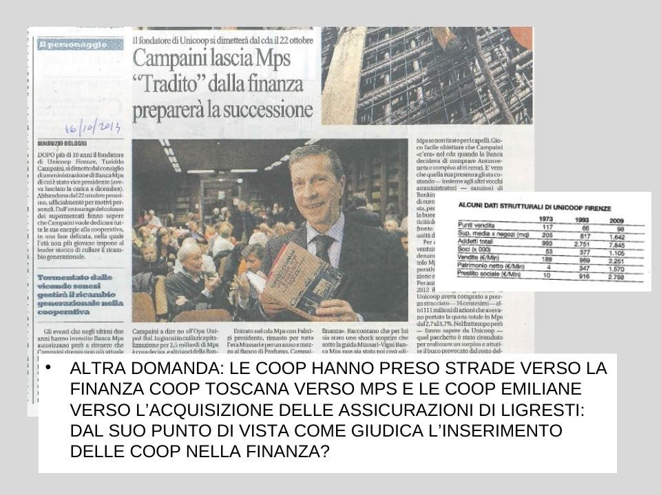{ loading=lazy style="width:59%" }

1:20:00

Il mondo che ci sta davanti in questo momento ci offre anche queste possibilità: infatti ci sono queste cooperative, le banche della nostra prima parte. Le nove banche italiane che passeranno sotto la BCE sono quasi tutte banche cooperative quotate in Borsa: se mi permettete, è quasi una bestemmia in chiesa, o qualcosa del genere. Allo stesso modo queste cooperative che investono capitali ingenti nel mondo finanziario, in questo caso il Monte dei Paschi – che ha anche delle connotazioni pubbliche, se volete, ma è una banca, un agglomerato finanziario enorme. Un parere su questo te lo chiederei, se non ti dispiace.

1:20:58

Francesco Bosio Io non te lo direi... Si è detto della cooperazione che ha una spinta morale, che ha una finalità sociale, che è una cosa che nasce dall’uomo. Ho detto che la cooperazione ha una potenzialità enorme, ma è nel contempo estremamente delicata, e quindi va gestita con obiettivi chiari, con obiettivi coerenti, con regole ispirate al principio «io devo sempre poter rendere conto delle scelte che ho fatto». Uno fa delle scelte perché fa un ragionamento; ovviamente saranno state fatte tutte a fin di bene. Per fare una citazione anch’io, professor Poggi: Pirandello diceva che la differenza tra un eroe e un galantuomo è data dal fatto che eroi si può essere anche una volta sola, galantuomini bisogna esserlo tutti i giorni. E qui si può trovare la vera essenza della cooperazione: quando uno è un galantuomo e, a fronte delle scelte che fa, si sente di poter rendere conto a tutti, tutti i giorni, ha fatto bene. E se magari dovesse comparire qualche rossore sulla faccia, io sono della scuola che è meglio arrossire dalla rabbia che dalla vergogna.

1:22:43

Paolo Marcucci Grazie, Francesco. C’è un altro punto che secondo me potrebbe essere interessante da un punto di vista speculativo e intellettuale – e poi il compito arduo ce l’avrà Lorenzo, di ricucire tutti questi nostri argomenti. Diceva Bosio che tra poco è il 130° anno; quando la banca ha compiuto cent’anni ha fatto giustamente una pubblicazione intitolata *Cambiano 1884-1984. Cent’anni di una Cassa Rurale*, e c’è un dato che mi ha un po’ colpito. Si parla anche qui dell’usura, perché la banca nasce in un periodo in cui l’usura era un fenomeno diffuso, e quindi per combattere l’usura. Ma ci sono due aspetti importanti. Il primo è che, secondo i fautori del movimento cooperativo, nelle terre dove vigeva la mezzadria, come la Toscana, che è la culla della mezzadria, la banca di matrice cooperativa aveva poche possibilità di nascere e di operare.

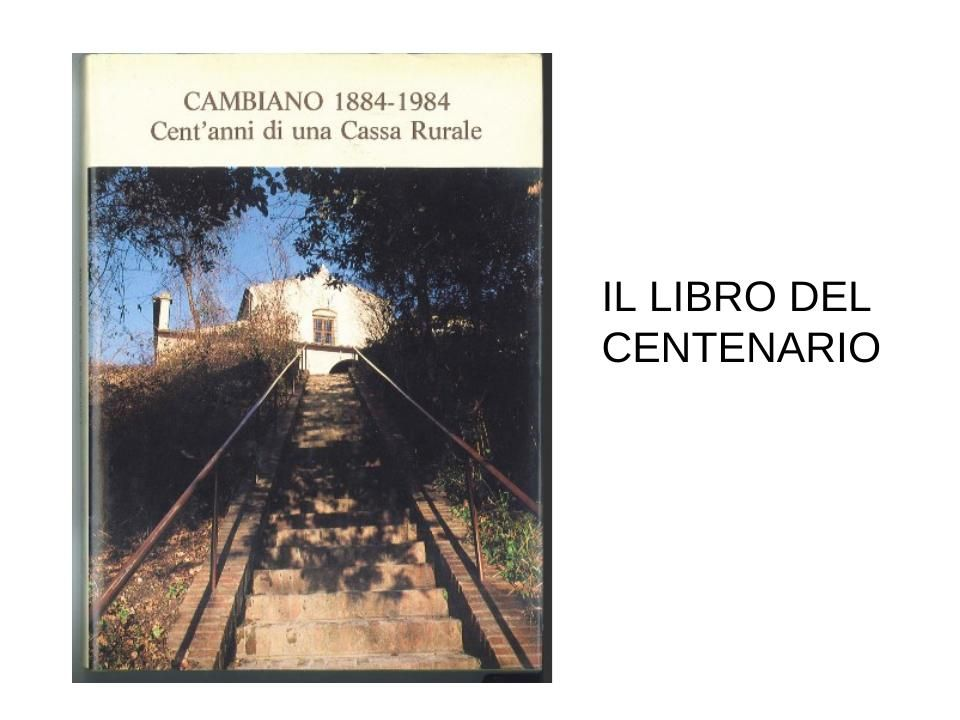{ loading=lazy style="width:47%" }

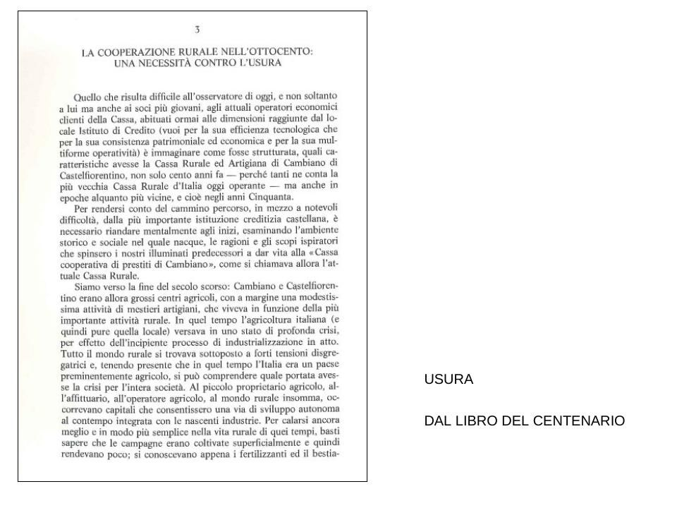{ loading=lazy style="width:47%" }

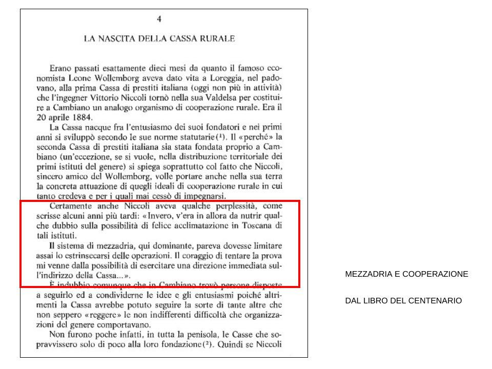{ loading=lazy style="width:59%" }

1:24:07

Effettivamente, se si va a vedere la prima compagine sociale della banca, ci sono molti mezzadri: c’è un possidente, naturalmente l’ingegner Vittorio Niccoli, che fu il fondatore della banca (la Cassa fu costituita il 20 aprile 1884 da 21 soci: 4 piccoli possidenti, 9 mezzadri, 3 camporaioli e 5 piccoli commercianti); c’è un barrocciaio, un maniscalco, e poi ci sono tanti mezzadri, perché corrispondeva alla compagine sociale del nostro territorio di riferimento. Queste sono le prime casse rurali fondate in Italia in quegli anni: l’elenco, nelle prime due pagine, arriva fino alla 72ª posizione, e in tutta la Toscana, anzi in tutta Italia dal Centro-Sud in giù, c’è solo Cambiano, in provincia di Firenze; il resto è tutto del Nord Italia. E quindi forse avevano ragione, che la mezzadria non fosse un terreno dove la banca cooperativa avrebbe potuto attecchire. Poi naturalmente le cose sono cambiate e le casse si sono diffuse un po’ in tutta Italia; però in quel momento c’è quest’idea, che sembra suffragata anche dai dati, perché effettivamente si passa da Padova, Udine, Belluno, Vicenza, Cuneo, Venezia, Brescia, ma sotto questa linea non si scende. Comunque su questo lascio la parola a Lorenzo, per qualche considerazione in base a quello che abbiamo detto.

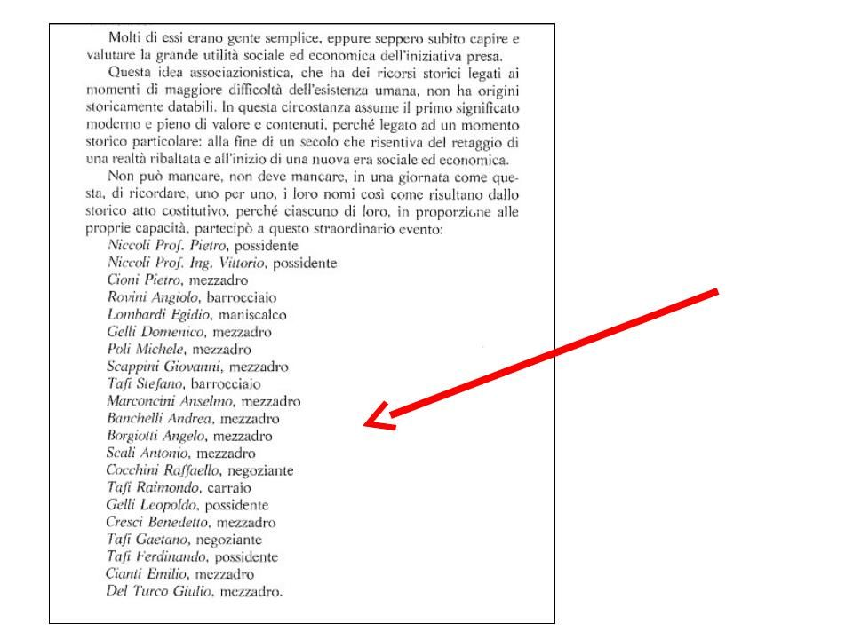{ loading=lazy style="width:47%" }

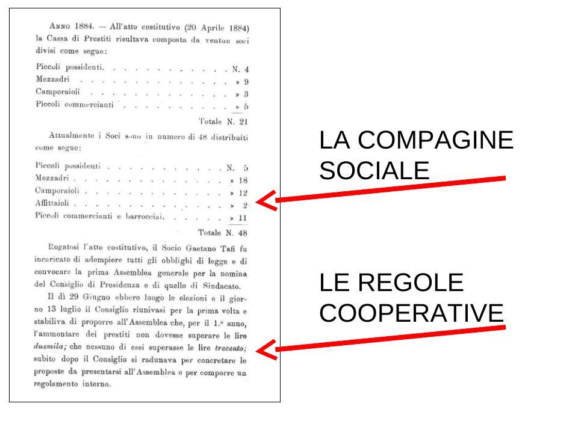{ loading=lazy style="width:47%" }

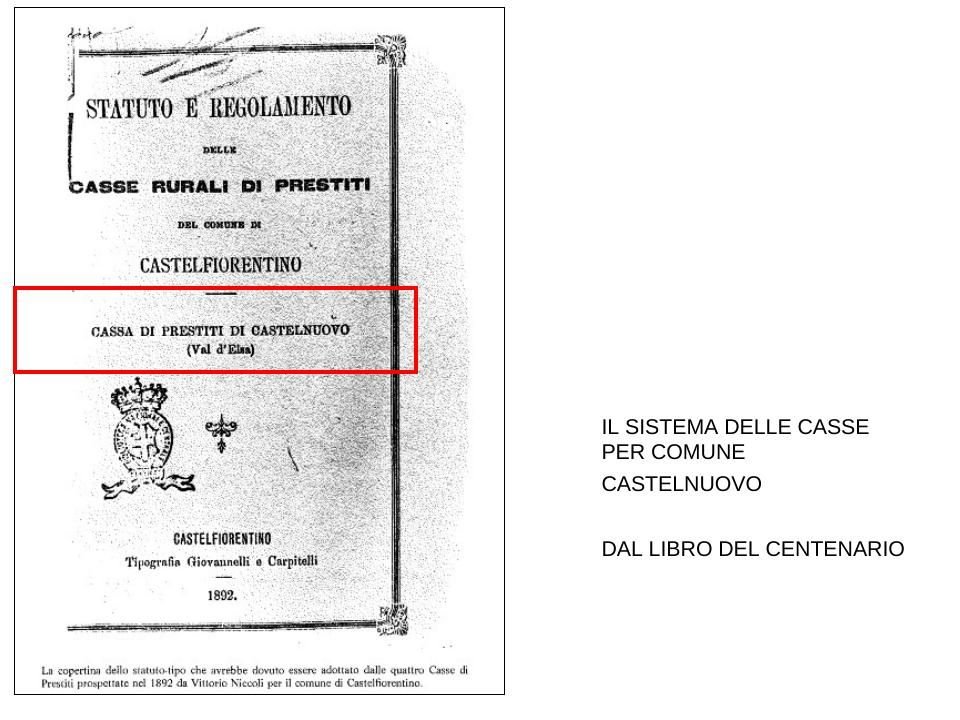{ loading=lazy style="width:47%" }

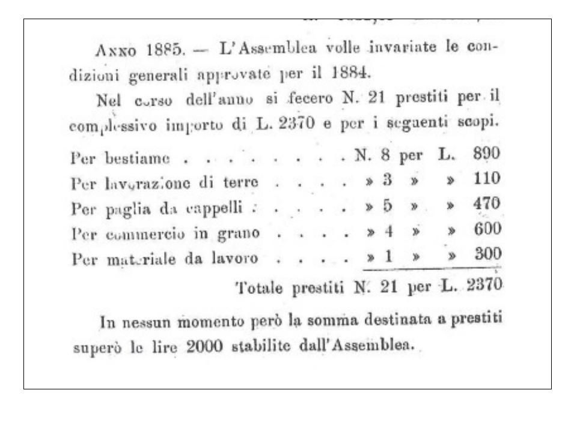{ loading=lazy style="width:47%" }

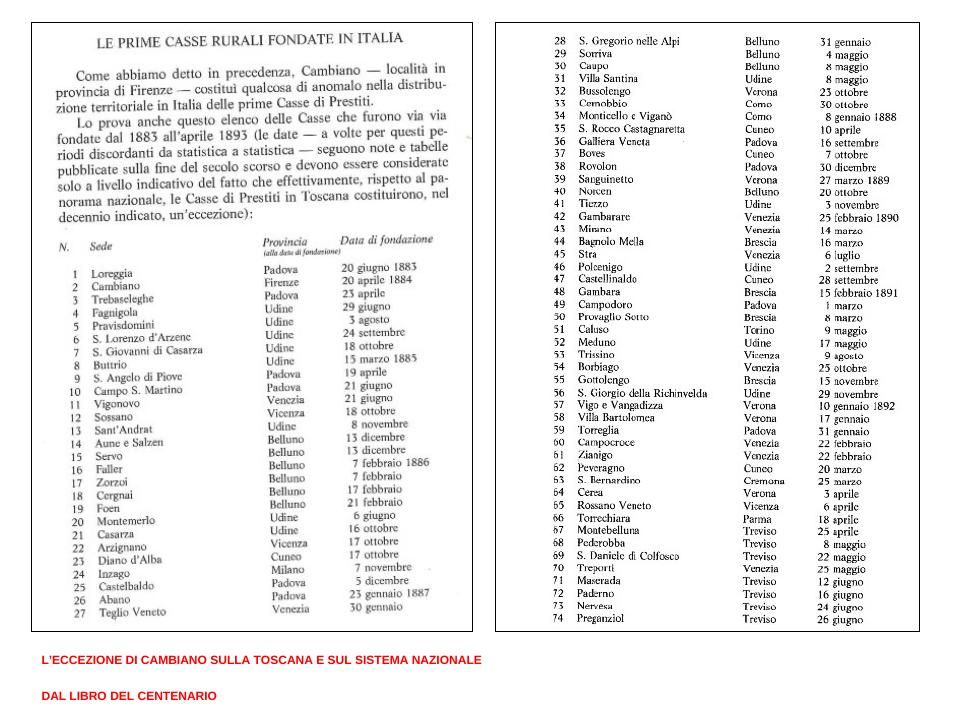{ loading=lazy style="width:59%" }

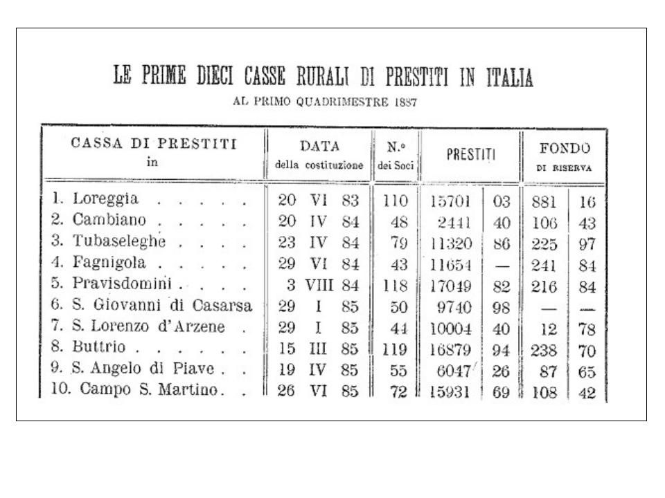{ loading=lazy style="width:59%" }

1:25:56

Lorenzo Poggi Compito sempre difficile, questo... Allora, intanto penserei un attimo a quanto sia pervasivo il sistema economico attuale rispetto alla nostra condizione di tutti i giorni, anche nelle parole. Gli operai sono «capitale umano», capitale in un’altra forma ecc.; le relazioni umane sono spesso tradotte sotto forma di contratto; la comunicazione è sempre più comunicazione e sempre meno espressione. Tantissimi caratteri riguardano il nostro momento. La stessa parola «precario»: *precarius* è uno che prega, prega per avere una vita, in un mondo dove il potere è quasi un dio, quel dio senza volto di cui dicevamo, che tutto domina; non ce l’ha più, il volto, però è rimasto il *precarius*, che è incerto sul proprio destino perché non è certo.

1:27:26

E un altro aspetto, direi, estremamente interessante, che riguarda la nostra vita, le nostre parole: il momento attuale dell’economia è un momento che diventa sempre più coinvolgente della persona. La distinzione che esisteva una volta fra tempo di lavoro e tempo di vita, tra l’attività lavorativa che veniva in qualche modo prestata e il tempo nel quale invece si svolgeva la vita individuale, questo confine non esiste più, o quasi, o si sta allentando. Il mondo del lavoro avanzato oggi è un mondo dove questi confini, questa distinzione, sono sempre meno presenti. E quindi da una parte abbiamo una finanziarizzazione dell’umano, che diventa spersonalizzato e diventa in qualche modo parte del capitale; e dall’altra abbiamo un’estensione, una commercializzazione di quegli aspetti della vita e dell’esistenza di ciascuno che erano invece personali, soggettivi. Il soggetto oggi è difficilmente individuabile in aspetti che non siano soggetti a diventare oggetto di commercio, commercializzati, qualcosa di vendibile. E questo dà alla cooperazione un compito e uno spazio ancora più importanti, perché è veramente su questo, io credo, che si incentra la possibilità – diceva prima Bosio – di socializzazione, di umanità, che porta in sé.

1:30:00

In quest’aspetto, perché può proprio recuperare in qualche modo queste caratteristiche umane, che possono avere uno spazio nell’impresa cooperativa e che invece non lo possono più avere se sottoposte al regime puro del profitto arbitrario. Quindi è una funzione, direi, estremamente importante, proprio perché si vanno accentuando questi aspetti, e quello che domina tutto sembra essere ormai soltanto la logica della massimizzazione del profitto, che non può essere quella che domina interamente la vita degli uomini. Non consente nemmeno più un esercizio critico spassionato della ragione, perché quello che viene fatto secondo quelle regole è giusto. Non si può pensare nemmeno... la politica decide in base a quelle che sono le esigenze delle cose.

1:31:23

Quindi il passaggio che c’è sempre stato nelle epoche passate, fino a poco tempo fa, tra l’esigenza di controllo della vita, l’economia e la politica, è saltato: il governo delle vite non è più nelle mani della politica, o lo è in misura minore. La politica, dove tutti sono responsabili e nessuno è responsabile: «Ho fatto le scelte, ma queste erano le scelte imposte dalla condizione»; e la condizione economica giustifica un atteggiamento, anche se appare un comportamento eticamente discutibile: non ha importanza. L’etica non si può fare con certi aspetti. Tommaso d’Aquino, che è stato citato prima, ha dovuto fare i salti mortali per giustificare l’interesse: è uno di quegli episodi dove si sente il sudore, il sudore del filosofo. Ci sono dei momenti in cui Agostino suda, Tommaso suda, si sente: ci hanno fatto una sudata. Sono questi i momenti. E dove si avverte? Questo è chiarissimo. Non si può pensare... e invece oggi c’è quasi un nuovo modo di ragionare, un nuovo modo di leggere il mondo. Faccio una citazione, poi basta: Voltaire, criticissimo, diceva: «Se vedete un banchiere svizzero che si butta dalla finestra, buttatevi anche voi, perché c’è sicuramente da guadagnare».

\[PAUSA\]
{: .nota }

2:01:10

Paolo Marcucci Bene, credo sia il momento di riprendere la nostra chiacchierata con l’ultima parte. Prima di iniziare vi prego di fare un ringraziamento agli amici del Caffè Centofiori, che ci hanno fatto la cena di stasera. Grazie. Do la parola a Lorenzo, perché, come sapete, quest’anno abbiamo messo questa tradizione di abbinare il dolce al tema della serata, e su questo ora Lorenzo ci dà la sua versione.

2:01:59

Lorenzo Poggi Semplicissima. Nella schiacciata alla fiorentina c’è un aspetto così, mediato, popolare, \[quello della pasta\]; però poi c’è anche la cooperazione con la parte più raffinata e sublimata, la crema, lo zucchero: la crema non è semplice. Dalla cooperazione viene fuori il nostro dolce. Dicevo semplicemente questo: che era molto buono, perché non aveva un gusto dolcissimo, deciso, ma era una cooperazione di sapori.

2:03:27

E volevo dire – visto che ormai ho il microfono, e forse ci troviamo anche alla distanza giusta – che potremmo fare, e la faremo probabilmente, una visita guidata a una mostra che è stata allestita a Palazzo Strozzi, sul Pontormo e il Rosso Fiorentino: una mostra interessante, perché abbiamo visto insieme la mostra sul Rinascimento, e quindi questa ci permette di sottolineare un passaggio critico per il tempo, quando muta la società fiorentina, muta la società del tempo. E come questo movimento, questa crisi, viene interpretata dal Rosso e dal Pontormo, in una trasformazione del modo di vedere lo spazio, del modo di organizzare le figure nello spazio, e del colore. Quando Firenze afferma la forza della borghesia e l’indipendenza della città, ha nella sua arte una visione dello spazio – che è poi l’immaginazione del mondo – estremamente precisa, razionale, teorizzata nella prospettiva, nell’architettura di Leon Battista Alberti. Quando questa realtà politica e sociale comincia a mutare – vediamo le vicende dei papi Medici a Roma, Roma saccheggiata, quello che succede nel passaggio dalla fine del Quattrocento alla fine del Cinquecento –, questa crisi si ha anche nella percezione della realtà, nell’immaginazione dell’artista, nella distribuzione delle figure nello spazio, nell’immaginazione dei colori. Tutto questo lo chiamiamo, da un certo punto di vista, manierismo; ma vediamo come questi pittori risolvono questa nuova realtà, nell’attività del Rosso Fiorentino \[e del Pontormo\]. Se facciamo questo discorso, lo leggiamo con gli occhiali della filosofia.

2:06:10

Paolo Marcucci Grazie. Su quest’argomento individuiamo il giorno e poi ve lo facciamo sapere tramite mail, con la solita messaggistica sui telefonini o con tutti i nostri mezzi di comunicazione: si potrebbe ipotizzare a metà marzo, a una giusta distanza; comunque ve lo facciamo sapere, ci pensiamo.

2:06:40

Bene, andiamo all’ultima parte. Rimane da indagare un aspetto della cooperazione e del denaro, quello del capitale. Abbiamo accennato nel nostro racconto, prima, all’accumulazione e anche al guadagno che le cooperative in qualche modo devono fare: c’è quest’aspetto che non abbiamo ancora indagato, e ne parleremo ora, in chiusura di questa serata. Il capitale di una qualsiasi azienda, e quindi anche di una società cooperativa, è il frutto del lavoro dei soci e del guadagno frutto del lavoro dei soci. In questa visione c’è, secondo me, un legame tra un’ideologia in qualche modo legata all’identità cristiana e quella socialista.

2:07:48

Facciamo un paio di esempi. Il Corriere della Sera di qualche giorno fa – il 19 febbraio 2014 – parla di un documento del papa attuale (la prefazione di papa Francesco al libro del cardinale Müller *Povera per i poveri. La missione della Chiesa*) su quest’aspetto: dice che vi è un legame originale tra profitto e solidarietà, che sono i temi della cooperazione, così come li abbiamo detti, «una circolarità feconda tra guadagno e dono». Bisogna guadagnare, sennò non si riesce a ridistribuire agli altri: «la ricchezza è un bene se aiuta gli altri». Quindi non si demonizzano la ricchezza e il guadagno, purché vadano ad aiutare gli altri, in questo caso nella cooperativa.

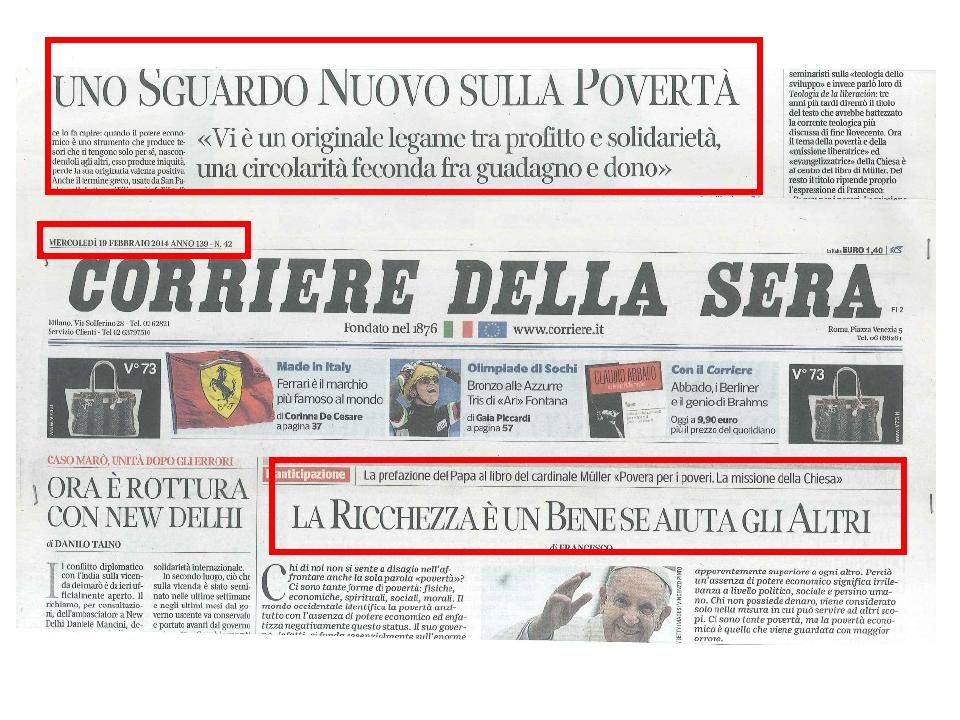{ loading=lazy style="width:59%" }

2:08:44

Prima ho citato la Coop di Firenze in senso negativo; ora la volevo citare in senso più positivo, ma sempre legato a questo tema. È uscito, tre anni fa, questo libro di Turiddo Campaini (*Un’altra vita è possibile. Quando i valori dell’uomo condizionano le leggi del profitto*, intervista di Pietro Jozzelli), che ripercorre un po’ la storia di Unicoop, e ho preso alcuni spunti per poterne parlare stasera. Diceva che negli anni Settanta, quando nasce e cresce esponenzialmente Unicoop Firenze, l’ideologia che derivava dal mondo socialista e comunista era che non si potesse concepire il profitto in una cooperativa. Loro affrontano questo tema e, attraverso prassi di ammortamento dei beni, fanno profitti, ma accumulano capitale. Poi naturalmente la cooperativa, come in questo caso Unicoop Firenze, pur potendo fare prezzi differenti, fa per esempio prezzi uguali in tutti i punti vendita.

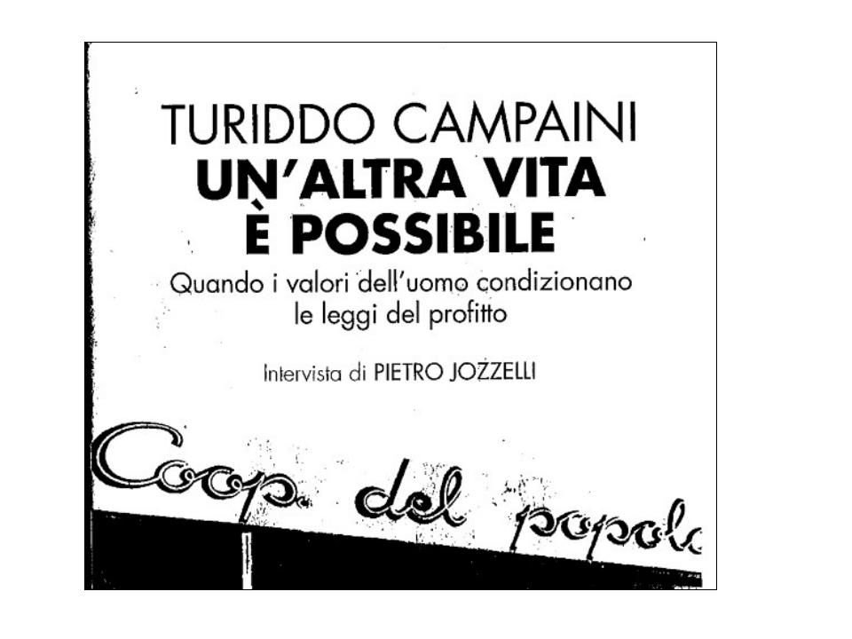{ loading=lazy style="width:47%" }

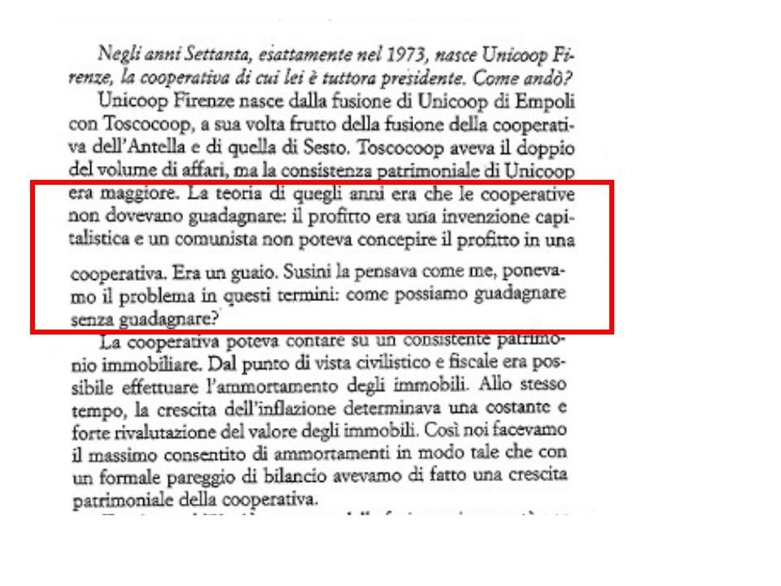{ loading=lazy style="width:47%" }

2:09:58

È proprio dell’ideologia cooperativa non fare distinzione tra le diverse piazze, dove si potrebbero fare prezzi diversi e lucrare sulla differenza. Quello che è importante, però, è che il lavoro dei soci di una cooperativa accumula nel tempo il capitale. Per esempio la banca di cui Francesco Bosio è rappresentante ha un capitale che è frutto di tutto il tempo trascorso, del lavoro fatto; e tutte le cooperative, se lavorano bene, accumulano capitale. Però c’è un fatto: il capitale delle cooperative non va in distribuzione ai soci nel caso in cui una cooperativa chiuda la sua attività. Il capitale frutto di questo lavoro non viene distribuito tra i soci: i soci hanno la loro quota rivalutata nel tempo, ma è solo una piccola parte del capitale accumulato.

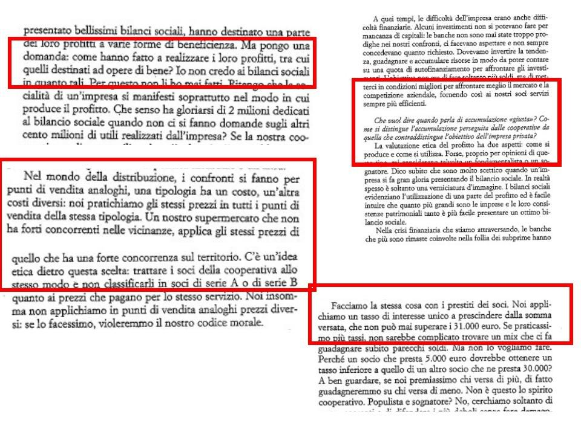{ loading=lazy style="width:59%" }

2:11:16

Questo perché, nello spirito cooperativo, a differenza della società per azioni, dove il capitale viene distribuito tra i possessori di azioni, il capitale non appartiene nemmeno ai soci cooperatori, ma appartiene per esempio al territorio dove quella cooperativa si è sviluppata. Questo è un tema estremamente importante per capire lo spirito cooperativo; e d’altra parte le cooperative hanno anche agevolazioni fiscali, quindi sarebbe del tutto improprio consentire una distribuzione del patrimonio così accumulato. Anche su quest’aspetto magari un cenno da Bosio, come rappresentante di una banca cooperativa che ha tra l’altro nel patrimonio uno dei suoi punti di forza, perché ha lavorato bene in tutti i suoi 130 anni ed è arrivata ad avere un notevole capitale, che è una ricchezza per tutta la comunità: se, come diceva prima, la banca fa il proprio mestiere di cooperativa aiutando l’economia locale, investendo nell’economia locale, sicuramente fa gli interessi della comunità; e nel caso in cui – non succederà – concludesse la sua attività, quel capitale non apparterrebbe ai soci della Banca di Cambiano, ma alla comunità del territorio dove la banca opera. Se ci dai un punto di vista secondo la tua visione, te ne sarei grato.

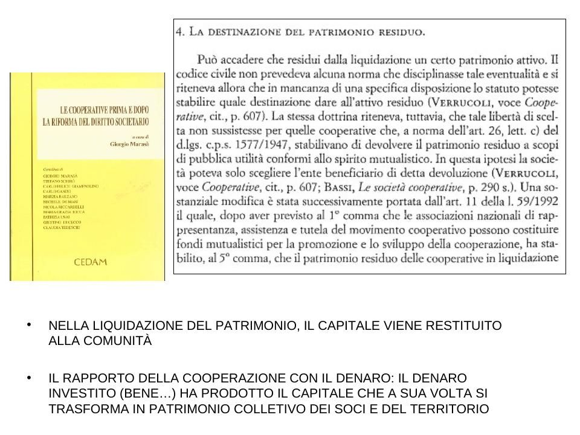{ loading=lazy style="width:59%" }

2:13:03

Francesco Bosio Il punto di vista è quello che ha detto Marcucci, e ritorna a quell’aspetto che abbiamo ricordato della funzione sociale della cooperazione, che ha caratteristiche di mutualità, senza fini di speculazione privata: l’articolo 45 della Costituzione, l’unica forma societaria che trova una trattazione esplicita nel testo costituzionale. Questo deve dare una lettura di come alla cooperazione sia veramente attribuito un valore di funzione sociale: la chiave è tutta lì. In questa funzione sociale c’è il vero valore della comunità, che la caratterizza rispetto ad altre forme, che hanno validità indubbie, con un plus dato dall’essere patrimonio sociale. Questo è il punto. Quindi capire questo deve portare a scelte consapevoli da parte dell’utenza, dell’utilizzatore, del socio, del privato: non è uguale una struttura di tipo cooperativo e una struttura di altro tipo che faccia lo stesso mestiere; non è lo stesso avvalersi dei servizi e delle prestazioni di una società di un certo tipo rispetto a quelle di un altro tipo, entrambe utilissime per il funzionamento del sistema economico. Non si sta a fare la grancassa, «viva la cooperativa, abbasso il resto»: l’economia funziona in quanto è un coordinamento di forze che agiscono per le loro finalità, è dal coordinamento che funziona il meccanismo; però all’interno delle forze ci sono elementi che caratterizzano in un modo o in un altro le componenti.

2:15:25

Il valore principale, per esempio nel caso di un’impresa bancaria come la nostra, al di là del fatto che il patrimonio è della socialità – e questo è un valore di prospettiva – è che la nostra attività, privilegiando il territorio su cui siamo insediati, attiva un circuito virtuoso: raccolto il risparmio che si forma in queste zone, lo reinveste a favore dello sviluppo economico, delle necessità dei privati, delle famiglie e delle imprese che operano su questo territorio. Quindi si innesca un circuito virtuoso: non è la banca che raccoglie le risorse nella zona A e le investe in speculazioni finanziarie all’estero o nella zona B. È un potenziamento delle possibilità di sviluppo del territorio in cui siamo. Tant’è che oggi va un po’ di moda parlare di banche del territorio: tutte le banche sono banche del territorio, anche quelle che hanno la sede a Parigi o a Milano. E allora noi siamo una banca nel territorio: la differenza tra «del» e «nel» è sostanziale. Essere banca nel territorio vuol dire avere realmente le radici nel territorio, condividerne la storia, le tradizioni, le usanze, le vicende, gli sviluppi, le crisi, le difficoltà, i successi: questa è la vera banca nel territorio.

2:17:21

Il marketing è una grande lavatrice: è capace di confondere le idee e di sottolineare in positivo, anche con grandi capacità attrattive, aspetti che tendono ad accomunare. In realtà l’accomunare non è mai un metodo giusto; quindi bisogna saper scegliere, bisogna avere consapevolezza: deve essere frutto di un convincimento intimo, ma dev’essere un ragionamento da fare. Molto dipende dalla comunicazione: la comunicazione è una cosa importante e può portare anche a stravolgimenti. Oggi siamo in un mondo in cui spesso, purtroppo, conta più l’apparire che l’essere; però, se uno riflette e sta attento, credo possa scegliere in maniera consapevole.

2:18:18

La comunicazione è uno strumento straordinario, ma può portare fuori strada; e concludo con una storiella. Ci sono due che hanno fatto il seminario insieme, e camminano leggendo il breviario, come fanno i sacerdoti: uno è un francescano e l’altro un gesuita. Tradizionalmente il francescano è visto come una persona più semplice, il gesuita come una persona più attenta, più profonda ecc. A un certo punto il gesuita tira fuori una sigaretta e l’accende. Il francescano dice: «Ma sei pazzo? Lo sai, se ti vede il superiore...». «Io ho un’autorizzazione.» «Come, l’autorizzazione? Io, che sono un fumatore accanito, ho chiesto l’autorizzazione al vescovo e mi ha trattato come una bestia.» «Scusa, che cosa gli hai detto?» «‘Eminenza, posso fumare mentre prego?’ E mi ha buttato fuori.» «Io gli ho detto: ‘Eminenza, posso pregare mentre fumo?’». Ecco: la comunicazione come può distorcere. Uno fumava e uno no. Grazie.

2:19:44

Paolo Marcucci Grazie, Francesco. Lorenzo, come al solito tocca a te chiudere questa serata.

2:19:58

Lorenzo Poggi Grazie. È chiaro che il nostro tempo, la nostra attualità, è caratterizzata da un mutamento profondo nella società, nel mondo del lavoro: c’è una sperimentazione continua, un mutamento accelerato e continuo, un prevalere dei beni immateriali, della comunicazione, ma di immagini, un consumo di immagini quale penso non ci sia mai stato in un’altra epoca, e una percezione del mondo e della realtà attraverso i media e le immagini quale non c’è mai stata al mondo. E da questo anche quello che dicevo prima: molti di quelli che erano i caratteri dell’io e della persona diventano invece caratteri commerciali, caratteristiche importanti per il lavoro. Non c’è più separazione: l’affabilità, il saper parlare, l’essere più o meno irascibili, il saper ascoltare, avere una certa disposizione erano doti personali nell’epoca dell’economia, diciamo così, fordista; oggi sono diventate caratteristiche direttamente legate al posto di lavoro, alla possibilità di inserirsi, diventano elementi economicamente valutati, e difficilmente si riesce a distinguersi, ad avere un’identità, a essere innovatori.

2:22:08

Ora, in queste condizioni, in questo mondo dove il terziario prevale sugli altri settori, dove c’è questa sperimentazione continua, il mutamento continuo dei prodotti e del modo di produrli, avere un’entità finanziaria come una banca cooperativa così presente sul territorio, e quindi capace di essere così attenta a certi elementi caratteristici, estremamente variabili ma estremamente importanti per il recupero di una caratteristica personale, di un’individualità del territorio stesso, è un elemento estremamente importante, anche di innovazione, di possibile via d’uscita da questo mondo estremamente condizionante e compatto della finanziarizzazione dell’economia. Io credo che sia questa, in fondo, la riflessione a cui ci possa portare la serata. Grazie a tutti.

2:23:21

Paolo Marcucci Arrivederci e buonanotte. Grazie ancora.

## Appendice

Le slide proiettate durante l’incontro.

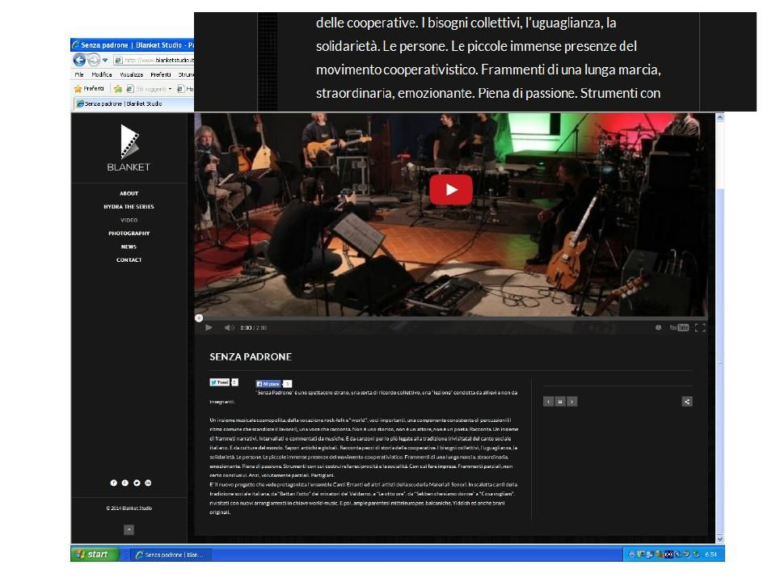{ loading=lazy style="width:47%" }

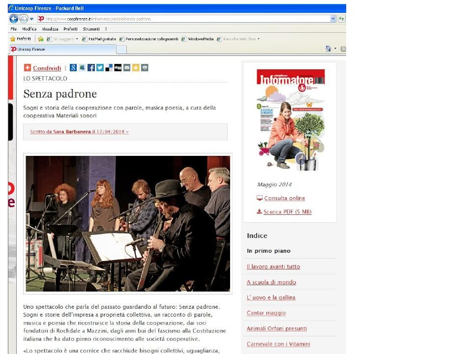{ loading=lazy style="width:47%" }

**ESEMPI COOPERATIVI: L’ALGORITMO DELLE FORMICHE (ACO)**

*Fonte indicata nella slide: okpedia.it*
{: .didascalia }

L’algoritmo ACO (*Ant Colony Optimization*) è un’euristica che ricalca il comportamento naturale delle formiche: un algoritmo di ricerca del percorso ottimale tra un nodo di partenza (la colonia di formiche) e un nodo obiettivo (il cibo), basato sull’utilizzo di tecniche probabilistiche e sull’ottimizzazione metaeuristica. Il primo algoritmo ACO è stato sviluppato nel 1992 dall’italiano Marco Dorigo; appartiene alla categoria degli algoritmi naturali (*swarm intelligence*).

In natura le formiche si muovono a caso alla ricerca del cibo. Quando lo trovano, tornano a ritroso fino alla colonia depositando sul terreno dei segnali chimici (feromoni), per tracciare un sentiero tra cibo e colonia per le altre formiche (comportamento cooperativo). Quando altre formiche incontrano il sentiero tracciato dai feromoni, smettono di muoversi a caso e cominciano a percorrerlo anche loro. Col passare del tempo i feromoni evaporano, e il segnale tende a mantenersi più a lungo nei percorsi più brevi, che sono anche i più frequentati. Pur essendo ogni formica dotata di poca memoria e di scarsa intelligenza, tutte insieme riescono a risolvere un problema complesso senza bisogno di un’organizzazione centralizzata.

A differenza degli algoritmi paralleli competitivi, in cui al termine si seleziona soltanto la soluzione migliore e le altre vengono scartate, negli algoritmi ACO gli agenti condividono dinamicamente i risultati parziali: la cooperazione consente di ottimizzare l’impiego delle risorse e di aumentare la velocità di calcolo.

SEQUENZA: QUANDO SI FORMA UN OSTACOLO, LE FORMICHE SPERIMENTANO LE DUE VIE, PER POI SCEGLIERE QUELLA PIÙ CORTA (FIG. 4).

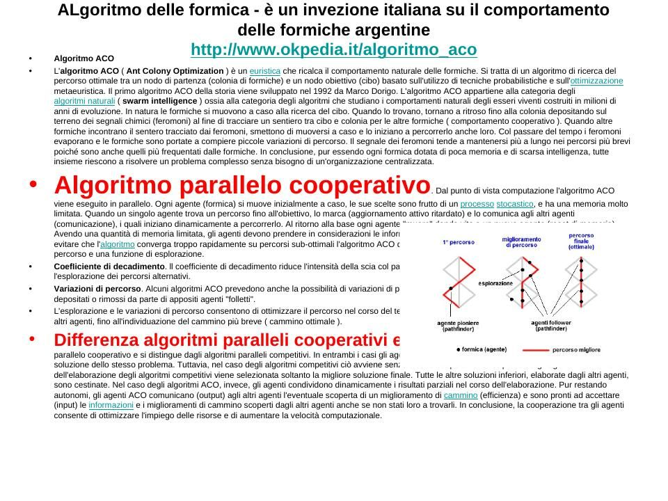{ loading=lazy style="width:47%" }

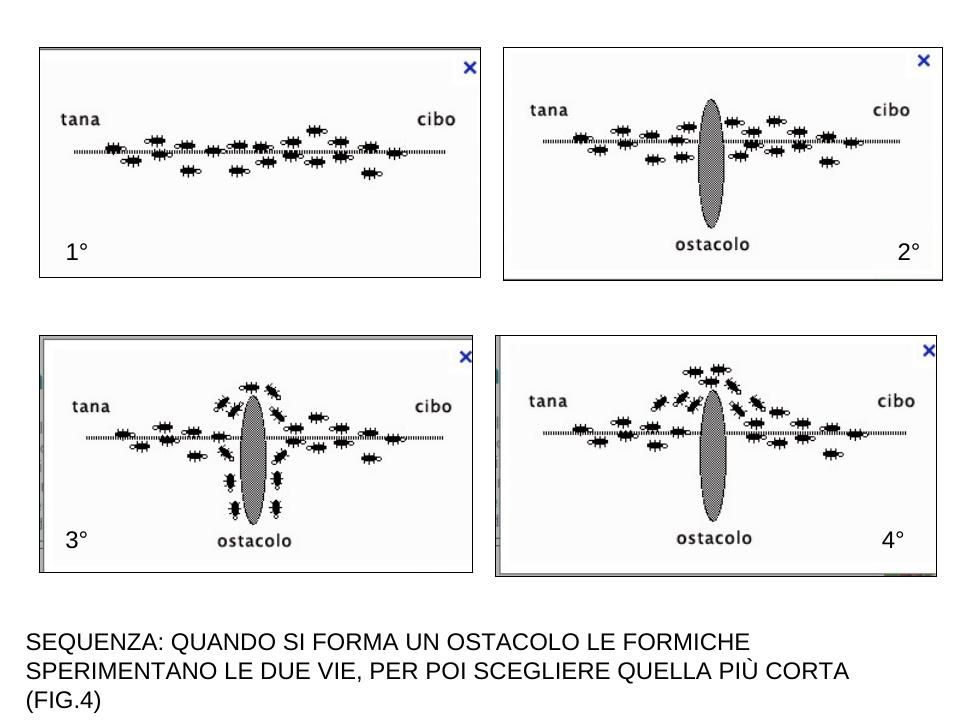{ loading=lazy style="width:47%" }

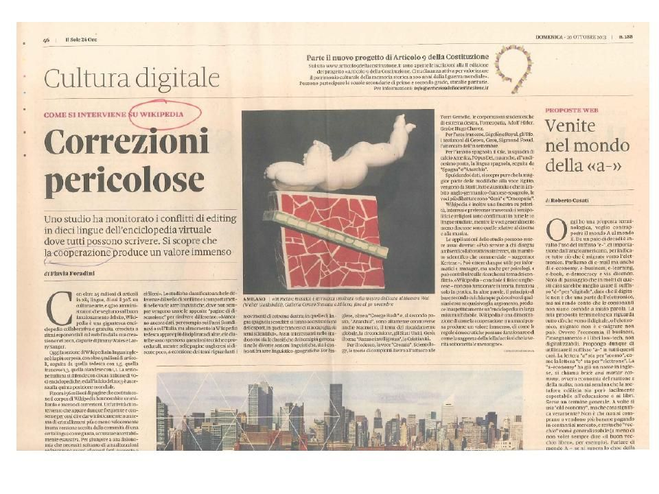{ loading=lazy style="width:47%" }

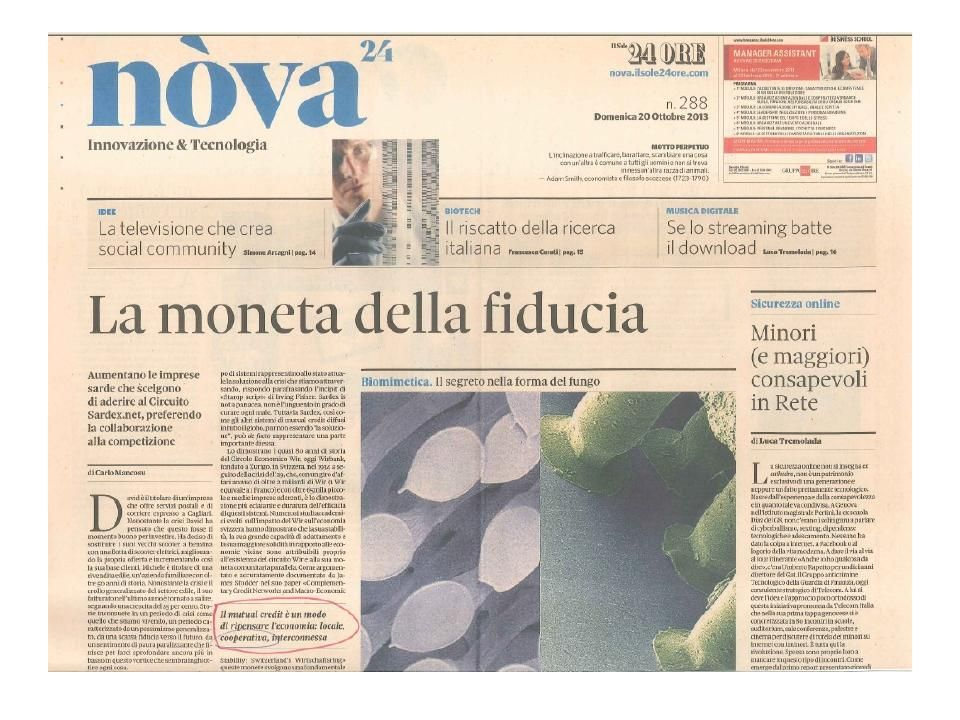{ loading=lazy style="width:47%" }

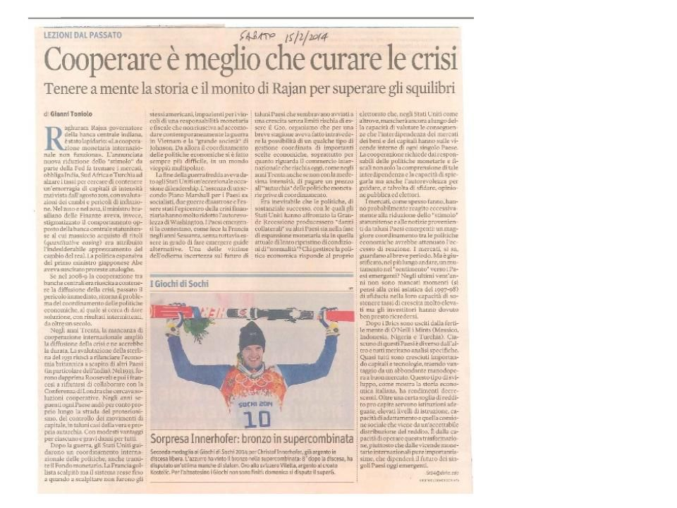{ loading=lazy style="width:59%" }
