# Il potere e l’impero digitale

**Data:** 27 marzo 2014 
**Luogo:** Montelupo Fiorentino 
**Incontro con:** Lorenzo Poggi e Paolo Marcucci

**Interventi:** Paolo Marcucci Lorenzo Poggi

0:02:48

Paolo Marcucci Bene, buonasera. Se siete pronti si può anche iniziare. Buonasera a tutti, grazie di essere ritornati. Stasera l’argomento è il potere e l’impero digitale: parleremo del potere e della dimensione delle reti nell’epoca di internet e delle comunicazioni (telefonia, intercettazioni eccetera): c’è un rapporto molto particolare con il potere, che poi cercheremo di analizzare.

0:03:33

Prima di procedere, due comunicazioni di servizio, un po’ legate al prossimo mese, perché aprile è un mese un po’ particolare per le date: infatti la prossima serata abbiamo dovuto metterla a giovedì 17. Poi c’è Pasqua, il 25 aprile, ci sono un sacco di interferenze da questo punto di vista, e quindi l’unica data possibile era il 17 aprile: questa è una comunicazione di servizio per chi volesse ritornare la prossima volta. Invece, per quanto riguarda la visita che avevamo un po’ preannunciato, di andare a Firenze, a Palazzo Strozzi, a vedere il Rosso Fiorentino e il Pontormo, abbiamo previsto sabato 10 maggio. Questo perché di aprile non era possibile: noi, se possiamo, andiamo sempre il sabato, perché è l’unico giorno in cui siamo tutti liberi, e anche per la combinazione di impegni e festività l’unica data possibile era il 10 maggio. Magari la prossima volta ve lo comunicheremo con gli orari, e vi manderemo anche una mail, per chi è nella mailing list.

0:05:18

Detto questo, partiamo con stasera. Partiamo da questa immagine: è la fotografia di un fotografo che ha vinto il World Press Photo (si tratta di «*Signal*», di John Stanmeyer, dell’agenzia VII Photo Agency, World Press Photo of the Year 2013), e vedete, è fatta a Gibuti, al confine con la Somalia. Ve la lascio qualche attimo, perché credo sia una bellissima foto. Sono immigrati che sono arrivati su questa spiaggia e cercano la connessione con il mondo, per riuscire a capire da dove possono e dove devono andare. Sono gli schermi dei cellulari dei migranti, alzati al cielo sulla spiaggia di Gibuti nella speranza di captare la copertura telefonica dalla vicina Somalia, per riuscire a chiamare i parenti lontani. Quindi sono migranti che sbarcano dalle navi e usano la tecnologia, in questo caso la rete telefonica dei telefonini, per orientarsi e trovare una nuova strada. Questa fotografia ha vinto il premio perché simboleggia l’avventura dell’uomo, che da sempre è migrato da un continente all’altro, da una terra all’altra; però questa, sotto un cielo di notte, fa vedere la connessione che questi mezzi tecnologici oggi permettono con i propri familiari e con il mondo intero.

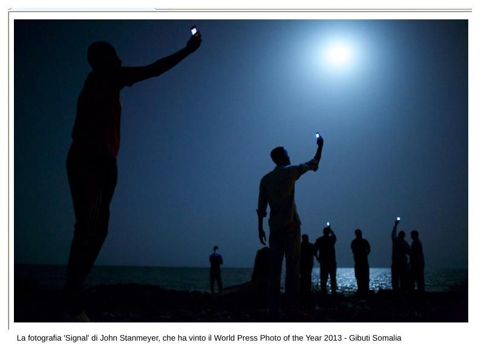{ loading=lazy style="width:59%" }

**LA FOTO «*SIGNAL*» – I COMMENTI**

«Ora come 60 mila anni fa», commenta Salopek, «ci facciamo indicare il cammino da chi l’ha già percorso prima di noi».

Una vittoria, a suo modo, anche delle nuove tecnologie: una scena illuminata solo dalla luna e dai display non avrebbe verosimilmente potuto essere catturata senza le iper-prestazioni degli apparati digitali (è stata scattata a 10.000 ISO).

«La foto è legata a tante altre storie», ha commentato la giurata Jillian Edelstein, «invita a discutere di tecnologia, globalizzazione, migrazione, povertà, disperazione, alienazione, umanità. Si tratta di un’immagine molto raffinata, ricca di sfumature».

0:06:53

Un altro esempio che mi ha un po’ colpito, che ho trovato, è questo: questo signore è Francesco Brambilla, 93 anni, e ha scoperto su YouTube un video risalente a settant’anni prima, a quando lui era giovane e stava per partire per la guerra. Il video, di quasi due minuti, era stato girato nel 1942 nella caserma di Novara alla vigilia della partenza del suo reggimento; la storia è stata raccontata dal figlio sul Corriere della Sera nel novembre 2013. Quindi considerate cosa permettono questi mezzi, questi social network, che sono tutti collegati: in questo caso questo signore stava per partire per il fronte russo, suo figlio gli ha fatto vedere dei video, e lui si è riconosciuto in un frammento di questo video. Questo per dire: nella prima immagine abbiamo visto i telefonini, nella seconda abbiamo visto le potenzialità che ci sono su YouTube.

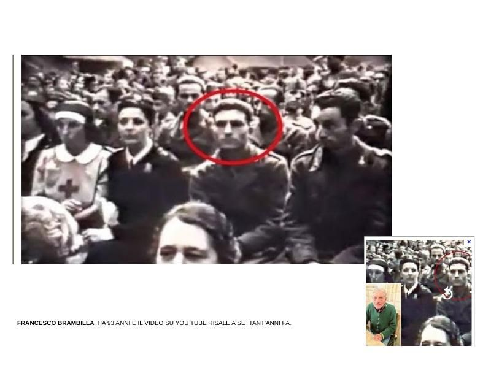{ loading=lazy style="width:59%" }

**SCOPRIRE YOUTUBE A 93 ANNI (NOVARA, 21 NOVEMBRE 2013)**

*Sintesi del testo della slide*

Francesco Brambilla, 93 anni, si è riconosciuto in un filmato anonimo di quasi due minuti, girato nel 1942 nella caserma di Novara alla vigilia della partenza del suo reggimento per il fronte russo. Il figlio, che gli aveva portato un tablet per fargli compagnia, racconta sul «Corriere della Sera» la ricerca: dopo molti siti sulla campagna di Russia, da cui nessuno dei commilitoni del padre era tornato vivo, restringono il campo alla caserma di Novara, trovano cinque filmati su YouTube, e nel quarto il padre riconosce il cortile, gli ufficiali («quelli che ci mandavano a morire») e infine se stesso tra i soldati seduti: «Papà, ma quello sei tu».

Tra il 1941 e il 1945, in piena seconda guerra mondiale, sul fronte orientale d’Europa si svolse la campagna di Russia.

0:07:47

Andando avanti: per esempio a Pisa è stato fatto un progetto, Memory Sharing, dove giovani e anziani della città vanno a caccia di ricordi per raccontare la storia di una comunità, in questo caso la città di Pisa, usando tutti i mezzi tecnologici che ci sono oggi a disposizione: Facebook, YouTube, i messaggini, internet, la posta eccetera. Anche a Montelupo (siamo a Montelupo) c’è da alcuni anni una pagina Facebook dove tutti gli abitanti possono immettere le foto, i ricordi di Montelupo, com’è e com’era prima. Di queste pagine ce ne sono un po’ dappertutto: questo per dire che questi mezzi tecnologici permettono anche una ricostruzione storica della propria comunità.

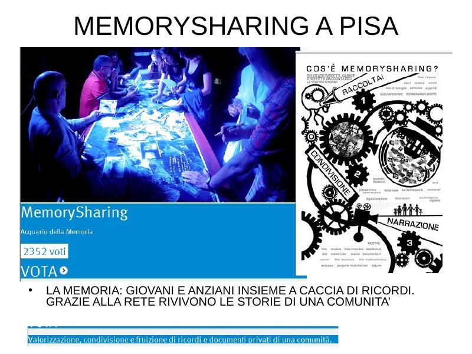{ loading=lazy style="width:47%" }

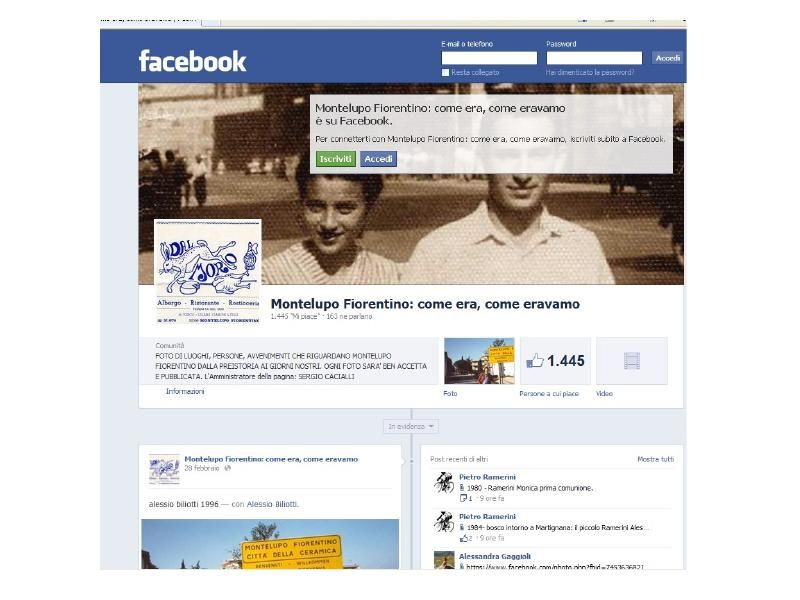{ loading=lazy style="width:47%" }

0:08:59

Una cosa interessante, che va un po’ all’opposto di quello che abbiamo visto ora, è una mostra fotografica a Firenze in questo periodo: si chiama *Connected to Somebody* (alla galleria C2 Contemporanea2, a cura di Antonio Lo Pinto, fino al 27 marzo), di un fotografo giovane, Cosimo Piccardi, che ha stampato dei fotogrammi dalla webcam. C’è infatti un sito che si chiama Chatroulette, dove le persone possono far vedere con la webcam quello che vogliono; e lui, indagando su queste webcam, ha tratto fuori delle istantanee, su cui poi ha costruito questa mostra che c’è a Firenze in questo periodo. Vedete che la fauna umana che ne viene fuori è fantasmagorica: c’è di tutto. Ci sono militari, donne nude, uomini nudi, finestre, sedie vuote, c’è un po’ di tutto. Su queste immagini particolari lui ha costruito la mostra che è ora in visione a Firenze. Già il nome del sito da cui sono tratte le immagini richiama un gioco d’azzardo, la roulette: Chatroulette è l’origine.

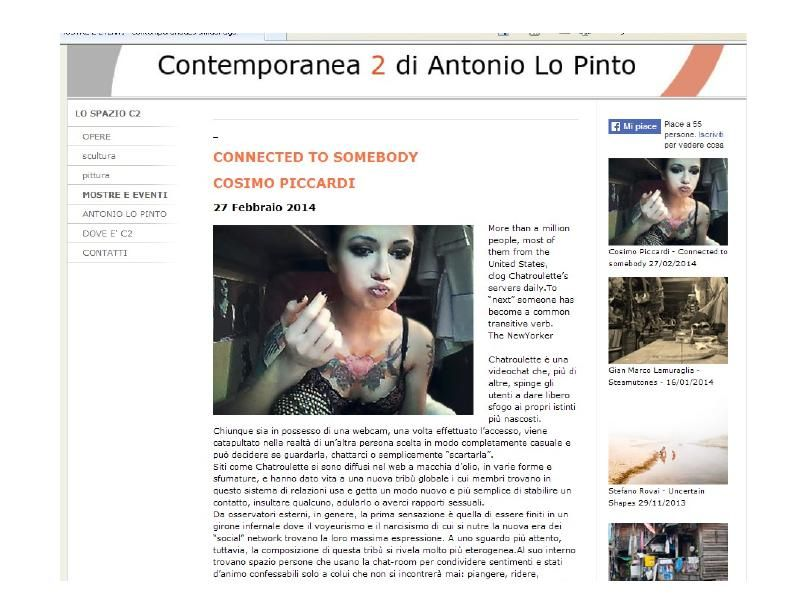{ loading=lazy style="width:47%" }

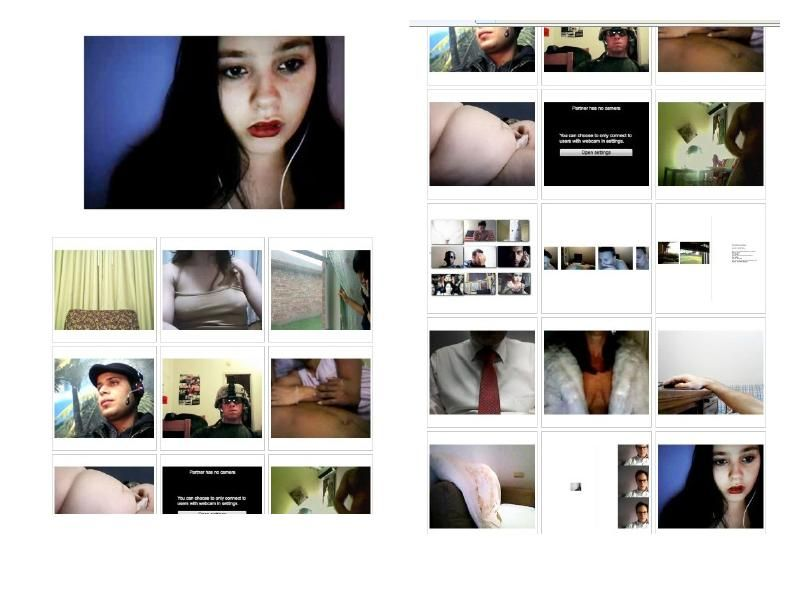{ loading=lazy style="width:47%" }

**IMMAGINI DALLA CHAT ROOM**

(«la Repubblica», 5 marzo 2014, articolo di Laura Montanari)

*Sintesi del testo della slide*

Fino al 27 marzo, alla galleria C2 Contemporanea2, la mostra *Connected to Somebody* del giovane fotografo Cosimo Piccardi, formatosi allo studio Marangoni. Chatroulette è una videochat che catapulta chiunque nella realtà di un’altra persona scelta in modo del tutto casuale, che si può guardare, con cui si può chattare o che si può «scartare»: una nuova tribù globale di relazioni usa e getta. Il curatore, Antonio Lo Pinto, spiega di essere stato affascinato dalla modernità del linguaggio e dalle strade che portano gli uomini a mettersi in contatto. Entrare e uscire dalle vite degli altri, spesso senza lasciare traccia: basta un clic sul tasto «next». Un algoritmo senza logica, che fin dal nome somiglia a un azzardo.

0:10:31

Questo che abbiamo visto era solo per dare un’idea della sterminata, infinita varietà, della vastità delle relazioni e delle possibilità di cui i moderni mezzi permettono oggi di usufruire. E questo ci dà lo spunto per fare una riflessione: tutta questa libertà che abbiamo visto nelle immagini, fino all’ultima, a Facebook, a volte, entrando nel discorso del potere, fa anche un po’ paura. Pensate un po’ a quello che sistemi come la Cina hanno fatto con le restrizioni di accesso a certe parole chiave di Google, per esempio. L’ultima è la Turchia con Twitter: proprio la settimana scorsa la Turchia ha bloccato Twitter perché lo riteneva pericoloso, non si sa bene per chi; oggi ho sentito alla radio che hanno bloccato anche Facebook. I tecnici naturalmente dicono che bloccare questi strumenti è come svuotare il mare con un cucchiaino (l’immagine è di Clay Shirky, della New York University, citato da Vittorio Zucconi su «la Repubblica» del 22 marzo 2014: «vuotare il mare con un colino da tè»): tanto si aggirano, perché i server su cui si poggiano questi social media sono dislocati in tutto il mondo, e quindi, anche se ne blocchi uno, la rete permette di arrivarci ugualmente.

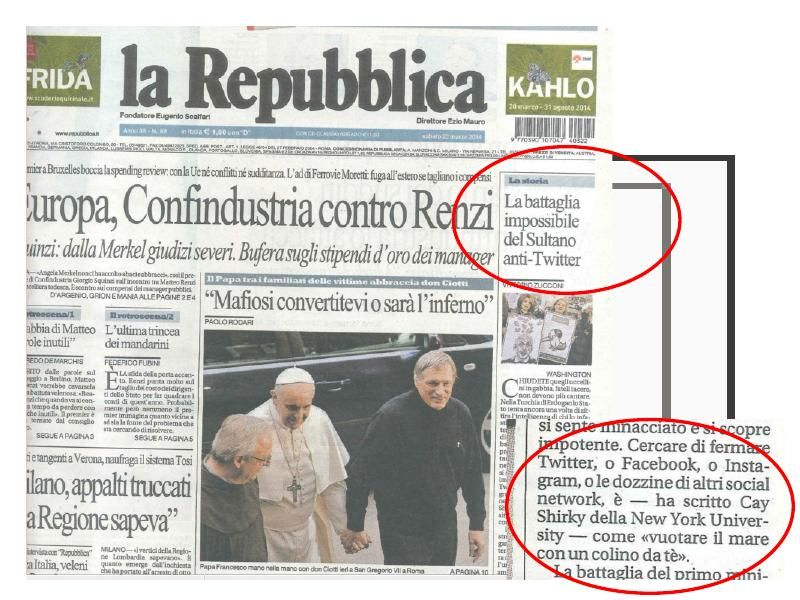{ loading=lazy style="width:59%" }

0:12:15

È interessante una cosa: facciamo un passo indietro. L’origine della rete, da cui poi sono emersi internet, ma anche Facebook, Twitter eccetera, è in ambito militare. Trent’anni fa questo strumento, internet (che tra l’altro è una contrazione di due parole inglesi, interconnected network: quindi internet), nasce in ambito militare. Perché questo? Pensate un po’ all’idea che c’era dietro la nascita di internet: doveva permettere di recuperare i sopravvissuti, i soldati che si erano persi durante una guerra; in quel caso la guerra immaginata era quella nucleare. Proprio per questo era stata studiata e costruita per funzionare comunque, ma non con un’architettura di protezione e di riservatezza. E il potere, che ha imparato presto a capire e a sfruttare ogni possibilità, forse oggi si domanda se ha fatto bene a creare, a permettere, questo «mostro».

0:13:30

A me per esempio tutta la rete internet (avete visto anche le immagini che c’erano all’inizio) ha sempre fatto pensare a un firmamento: tanti punti nel cosmo, che evocano il firmamento delle stelle. Infatti, se ci pensate, dietro internet c’è una sorta di firmamento, ed era stato pensato per riportare a casa, per il desiderio grande di riportare a casa i propri soldati rimasti feriti durante la battaglia. Qui però volevo invitare Lorenzo a raccontarci di nuovo l’etimologia della parola «desiderio», che credo sia molto appropriata a quello che abbiamo detto fino a ora.

0:14:22

Lorenzo Poggi Paolo se lo ricorda, ma anche alcuni di voi: nel *De bello Gallico* Giulio Cesare dice che dopo la battaglia, nel campo romano, si disponevano delle guardie che durante la notte stavano ai margini dell’accampamento, vicino ai fossati, o si spingevano qualche volta anche un po’ più in là, per stare attenti se qualcuno dei soldati feriti o dispersi tornava verso l’accampamento. A questi gruppi di guardie partecipavano volontariamente quelli che avevano un amico che non era tornato, che aveva combattuto con loro; e queste compagnie di guardia venivano chiamate *desiderantes*, coloro che fanno il turno sotto le stelle, di notte. E da qui il desiderio: aspettare che torni dal viaggio, che torni dalla battaglia qualcuno che, nonostante non si sia visto, si spera sia scampato e sia vivo.

0:15:53

Noterei subito però una cosa: il carattere dell’interconnessione, cioè l’inarrestabilità. Non c’è argine che possa arrestare i social network: non si può, con il potere politico, pensare di oscurarli. È un’acqua che nessuna diga può fermare, è un potere liquido che sfugge al potere politico tradizionale. Si possono uccidere coloro che emettono i messaggi, se si trovano, ma non si può impedire l’interconnessione. E questo muta profondamente il nostro modo di pensare il rapporto con il potere. Di questo ci occuperemo; non voglio interrompere troppo a lungo Paolo, ma teniamolo presente, perché sta esponendo cose estremamente importanti da questo punto di vista.

0:17:16

Paolo Marcucci Sì, infatti le parole di Lorenzo mi danno modo proprio di introdurre il potere legato al tema di stasera. Perché il potere (ricordatevi che la rete è nata in ambito militare, e il potere militare è la massima espressione della forza, del potere politico) ha concesso l’uso pubblico della rete nata in ambito militare; però il potere da sempre ha degli obiettivi precisi: il controllo del tempo, il controllo dei corpi, comunque il controllo della società sulla quale deve esercitarsi. Ma anche il controllo del pensiero e la secretazione degli atti nocivi al suo percorso; e, dopo avere concesso la rete, il potere ha deciso di sfruttare per i suoi scopi questo potenziale di informazioni gratuite. Tradizionalmente il potere è sempre stato visto dall’alto: si cerca di interpretare, di vedere, di considerare il potere come una visione dall’alto. Ma oggi, con questi mezzi di espressione e di democrazia che sono i social network, è cambiato qualcosa? Il potere è uguale al passato, oppure è qualcosa di differente? Tradizionalmente il potere tende a considerare la base della società, i cittadini, come sudditi; ma oggi non siamo forse noi a dare, a consegnare al potere i nostri dati, le nostre informazioni? (da alcune note di Ferrarotti)

0:18:41

Tra l’altro i paradossi del potere sono noti: il potere ha bisogno di solitudine, perché l’uomo di potere vede esaltata in questo modo la sua autosufficienza. C’è un dato interessante: Zuckerberg, il fondatore di Facebook, è uno degli uomini di potere di oggi, sicuramente, a capo della società forse più importante al mondo in questo momento nella parte tecnologica. In California cosa ha fatto? Ha comprato le ville circostanti la sua, perché aveva bisogno di privacy. (a Palo Alto, nell’ottobre 2013: un investimento da 30 milioni di dollari per tutelare la propria privacy) Se pensiamo a cosa voglia dire, può sembrare anche un paradosso, visto che Facebook entra nella vita di tutti noi tutti i giorni. Però il potere ha anche bisogno di qualcuno su cui esercitarsi, perché…

0:20:00

…ha bisogno di manifestare appunto il suo potere. Elias Canetti ha trovato (in *Massa e potere*) secondo me un’immagine importante per sottolineare il potere: dice che il sogno di un generale vittorioso consiste nel trovarsi solo, dopo la battaglia, in piedi sul campo ancora fumante di rovine, cadaveri e sangue. L’unica immagine che ho trovato che si avvicina a questa è questa, che raffigura Bonaparte, Napoleone, sul campo di battaglia di Bassano (un’incisione di Charles George Lewis da un dipinto di Thomas Jones Barker), e che dà un senso a queste parole. Però per esempio Ferrarotti, il sociologo Ferrarotti, dice che il potere è anche in un certo senso pauroso (il potere nudo riposa solo sulla forza, ma la violenza che lo definisce lo rende anche pauroso; e il vincitore solitario ha bisogno anche di nemici in catene, di rivali su cui mostrare il suo dominio *coram populo*: un potere senza trionfo è un potere povero): ha in qualche modo il rimorso di una violazione che ha fatto. Cita per esempio Giulio Cesare, che si ripara in cantina durante i temporali: quindi il potere massimo dell’impero di Roma, Giulio Cesare, si ripara in cantina. Napoleone, che abbiamo citato prima, è ansioso, e ai suoi generali domanda sempre, con quella frase famosa: «Avez-vous de la chance?» («Lei è o non è un uomo fortunato?», domandava a quelli che stava per nominare marescialli sul campo; e non era insensibile alle divinazioni delle cartomanti): affidarsi alla fortuna; il potere a volte si affida anche alla fortuna.

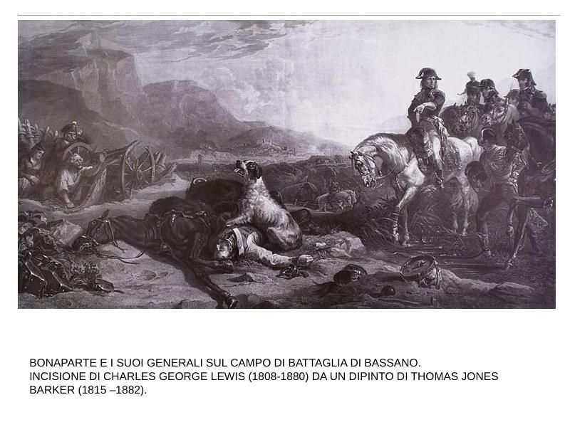{ loading=lazy style="width:59%" }

0:21:30

E d’altra parte il potere oggi non è nemmeno al riparo da se stesso, se vogliamo usare questa parola. Dieci giorni fa hanno incriminato big pharma, cioè quell’accordo tra due case farmaceutiche multinazionali (Roche e Novartis: secondo «la Repubblica» del 7 marzo 2014, le mail dei manager mostrano l’accordo per far apparire il farmaco a basso costo, l’Avastin, meno sicuro di quello più caro, il Lucentis; l’Antitrust le ha sanzionate con 180 milioni di euro) sul farmaco da vendere in Italia a 50 euro oppure a 10 euro (non mi ricordo quali fossero le cifre). Il concetto è questo: nessuno, nemmeno i capi delle multinazionali, in questo caso due tra le più importanti del mondo, si può salvare, perché ormai tutto è così registrato che anche il più potente degli uomini, se viene deciso di indagarlo, si trova tutto: infatti sono emerse mail, telefonate, con uno schiocco di dita. E quindi, qual è il pericolo? Il pericolo oggi è che il potere possa esercitare arbitrariamente la sua forza con questi strumenti, ancora più che nel passato, e che l’individuo possa perdere le sue prerogative di libertà e di democrazia.

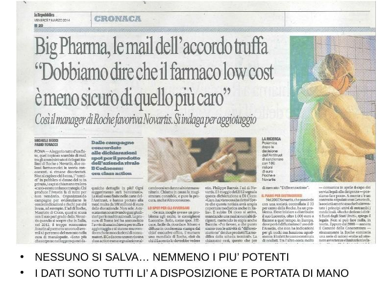{ loading=lazy style="width:59%" }

**IL POTERE**

Ripetiamo: chi è oggi il potere? I mercati finanziari, le banche, il FMI, la BCE, Berlusconi, Renzi…?

Il potere in questi anni è invece sfuggente, non si manifesta volentieri, e i simboli che lo rappresentano organicamente nel mondo (i politici pro tempore, i registi della macchina del cinema, gli attori, gli sportivi…) sono solo testimoni momentanei (molte volte inconsapevoli) della grande macchina del potere.

Ferrarotti: «oggi il potere massmediatico, soprattutto nelle sue forme più recenti che si richiamano alla cosiddetta rivoluzione digitale, sembra offrire all’individuo maggiori, più ricche possibilità di informazione e di libera fruizione».

Ferrarotti: «c’è però il pericolo che venga meno l’individuo autonomo».

0:22:59

Se vi ricordate *Le vite degli altri* (film del 2006 scritto e diretto da Florian Henckel von Donnersmarck, premio Oscar per il miglior film straniero), per chi l’ha visto: nella Germania dell’Est avevano messo su un complesso di spionaggio della vita privata delle persone: metà dei cittadini controllava l’altra metà; e questo, per ricordare il film, è il capitano che segue direttamente queste violazioni con le intercettazioni (è l’attore tedesco Ulrich Mühe, nella parte del capitano della Stasi). Quello che è interessante è che Havel, che appunto era di Praga, disse in quel periodo che questo film rappresentava un memento per l’Occidente, perché gli mostrava che cosa sarebbe diventato e quale sarebbe stato il suo destino. Probabilmente Havel si sbagliava sul modo; però la realtà ci dice, come abbiamo visto anche nell’incriminazione di big pharma, che forse ha sbagliato la forma: è un po’ più sottile, e in questo il potere è cambiato molto. Su questo magari sentiamo che cosa ci può dire Lorenzo.

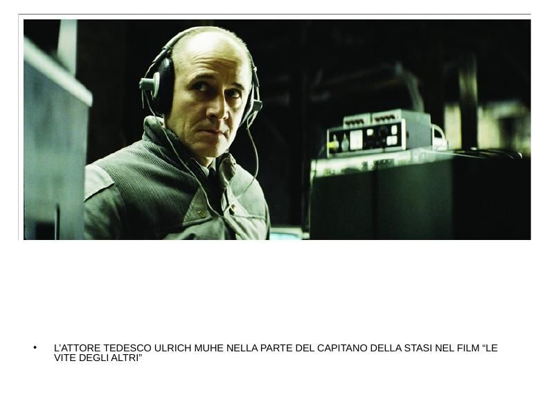{ loading=lazy style="width:47%" }

0:24:14

Lorenzo Poggi Un argomento direi estremamente interessante; ma io partirei da un punto, e vediamo se riesco a essere chiaro e a svilupparlo. Intanto pensiamo una cosa: quando si pensa al potere, si pensa alla democrazia, si pensa anche a un punto, a un posto. Pensate la democrazia ateniese senza la piazza, senza l’agorà: dov’è che si esercita il potere politico? Nella città democratica si esercita in uno spazio, l’agorà, dove chi sta al centro è di volta in volta colui che rappresenta in quel momento la decisione, il potere; di volta in volta si prende la parola, ci si avvicina a un punto, e lì lo si esercita. Il potere quindi è un potere orientato a un centro.

0:25:28

Nelle città medievali la struttura, la mappa della città, è orientata sui centri del potere: spirituale, della Chiesa, e politico, del palazzo civico, il palazzo dove hanno sede le istituzioni politiche. Tutti noi abbiamo a mente Bologna: la torre degli Asinelli, il centro di Bologna, e la città divisa in spicchi, in qualche modo equidistanti, tutti con la distanza calcolata dal centro dove si decide politicamente. Il potere è anche un luogo, è un posto, è un orientamento. Attualmente i mezzi di collegamento e di comunicazione hanno abolito lo spazio, perché hanno abolito il tempo: alla velocità della luce siamo tutti immediatamente presenti e tutti collegati, e quindi hanno modificato il nostro modo di pensare il rapporto con il punto, con la concretizzazione del potere.

0:27:09

Nel momento in cui si afferma la scrittura, si afferma anche la possibilità per alcuni (quelli che sanno leggere, che leggono, che sono coloro che posseggono la scrittura) di tenere il potere culturale, di mantenerlo. Durante la Rivoluzione francese sono in qualche modo loro, coloro che leggono i proclami, che leggono i giornali di allora, a partecipare al potere della rivoluzione: si crea quella che si dice l’opinione pubblica. Che cos’è? È un luogo ideale, centrato sulla possibilità di condividere certe idee, perché esiste la stampa, esiste la possibilità di leggere e di interiorizzare. Ecco un’altra parola: interiorizzare. Cioè con la scrittura, con la possibilità della lettura, si crea un’interiorizzazione del pensiero, che poi si comunica, a cui si partecipa; e si crea una specie di potere politico di eletti, con il quale si controlla il potere, con il quale si tiene il potere.

0:28:47

Condorcet è convinto di questo. Sapete, Condorcet è girondino, e finirà male, perché, vestito da carpentiere, fuggiva, perché c’è il Terrore, e i giacobini l’avrebbero fatto fuori volentieri. Ed è lui che sosteneva che la rivoluzione si reggeva sulla possibilità, finalmente, per la classe colta che rappresentava il popolo, di tenere il potere non più dall’alto, non più per sacralità, ma per condivisione; e la condivisione viene dalla possibilità di comunicare attraverso lo scritto, e anche attraverso l’oralità, ma soprattutto attraverso queste élite di competenti e informati che si creavano attraverso la carta stampata. Grande rivoluzione, pensate, la stampa: grande rivoluzione, che ha messo insieme le persone e ha contestato il potere.

0:29:49

E vi dicevo, Condorcet lo beccano perché si veste da carpentiere e scappa: lui era nobile, quindi rinuncia ai pantaloncini e si veste da carpentiere, con i pantaloni sfrangiati dei sanculotti, che non avevano il calzoncino, la culotte. Però sbaglia: va a mangiare all’osteria, e che vuole mangiare? Chiede una frittata. «Di quante uova?» «Di dodici uova». Un carpentiere… a parte che una frittata di dodici uova per una persona ci vuole del coraggio; ma voi capite, un carpentiere mangia una fettaccia di pane, e lo dice… insomma, c’è qualcosa che non va. E l’oste disse: «Ma chi è questo?». E finì male. Però Condorcet, girondino, è convinto che il nucleo della rivoluzione sia questo: lo scritto.

0:30:47

Pensate alla rivoluzione, all’assalto al potere e all’autorità della Chiesa portato dal fatto che si stampa la Bibbia: Lutero. Ogni cristiano si legge la Bibbia e se la interpreta; se la legge e se la interpreta perché la si può stampare. Il Concilio di Trento proibisce ai cattolici la lettura della Bibbia se non in latino: la traduzione in volgare non la possono leggere, fanno peccato; in latino sì. In latino che cosa voleva dire? O eri prete o non la leggevi, insomma: molto chiaro. E come mai c’è una disaffezione alla lettura nei paesi che hanno avuto la Controriforma? Vorrei vedere chi leggeva le Scritture: era molto vicino all’eresia, visto con sospetto.

0:31:50

Questa è la scrittura. La scrittura comporta anche un altro effetto (scusate, sono un po’ lungo, un po’ professorale; faccio rapidissimo, se no non cogliamo quella che credo sia la cosa importante, l’aspetto di mutamento profondo, che non è solo una maggiore capacità di comunicazione, non è solo velocità: è qualcosa di diverso, e io credo più profondo, che comporta un mutamento di atteggiamento e di mentalità, se ci riesco). Dunque, secondo punto: capite che la lettura, la possibilità di avere lo scritto, comporta un’interiorizzazione. Comporta cioè che io leggo la storia, l’argomento, lo interiorizzo, lo rielaboro, ci posso tornare sopra, e creo una differenza, una separazione tra interiorità ed esteriorità: ciò che è mio, privato, personale, su cui rifletto, e ciò che metto in pubblico e condivido.

0:33:06

Le culture che hanno solo l’oralità e non sono ancora arrivate alla scrittura hanno delle visioni del mondo che sono in gran parte, quasi totalmente, condivise: non c’è qualcuno che ha un parere differente sul mondo, una visione differente sui principi della realtà; i principi e le visioni del mondo sono tutti condivisi, perché sono comunicati immediatamente con l’oralità. Lo scritto ha favorito questo processo di interiorizzazione, e questa distinzione fra ciò che mettiamo in pubblico e ciò che è la mia privacy; ma privacy anche mentale: riflessione, ripensamento, approfondimento di coscienza. Di nuovo Lutero: ci si salva perché nella nostra coscienza ci si sente in qualche modo salvati.

0:34:19

Twitter e i social network sono scritti, adoperano la scrittura, ma la adoperano in un modo tale che la rende estremamente vicina all’orale: non c’è l’elaborazione, la consequenzialità; la parte della sintassi è sparita. Bisognerebbe fare un comitato di difesa del congiuntivo… no, ma il congiuntivo è scomparso, è uno strazio, è un macello: altro che la biodiversità degli animali, è finito anche il congiuntivo, da un pezzo. Dicevo, capite di che cosa si tratta? Questo è un elemento fondante, estremamente importante. Non c’è mai stato un così grande uso e una tale diffusione dello scritto, però questo scritto tende sempre di più a prendere le mosse, la struttura, le consequenzialità dell’orale. Questo comporta, secondo me, quel processo di riavvicinamento alla collettivizzazione, alla condivisione anche di ciò che è personale, per cui tutte le questioni personali stanno diventando partecipate.

0:36:00

Prima Paolo ci faceva vedere le immagini di Facebook eccetera: è molto difficile avere qualcosa di privato, di rielaborato, di nostro (perché ciò che è rielaborato è nostro), e distinguerlo da quello che è condiviso. Avremo sempre più cose condivise, perché la comunicazione è talmente vasta che, anche se le nostre idee e i nostri gusti sono molto particolari, troviamo senz’altro altri due milioni di persone che li condividono; ma non avremo mai qualcosa di elaborato, di nostro, perlomeno non da questo tipo di scrittura. Abbiamo perso una parte di quella che era la caratteristica dello scritto, questa capacità di interiorizzazione e di elaborazione. Quindi abbiamo molta più memoria, enormemente più di quanta l’umanità ne abbia mai avuta; abbiamo molta più capacità di aggregazione e di comunicazione; cominciamo ad avere meno capacità di individualizzazione, di interiorizzazione, di passaggio dall’immediata percezione e dalla reazione emotiva all’elaborazione del sentimento. Sono effetti dell’evoluzione tecnologica; ma se no vi annoio: poi ne vedremo altri.

\[PAUSA\]
{: .nota }

1:01:42

Paolo Marcucci Bene, direi di continuare. In questa seconda parte vi farò vedere una serie di immagini tratte dai giornali, dai quotidiani. I quotidiani spesso dicono molte inesattezze sui temi che trattano, però hanno il pregio di essere un diario molto sintetico e interessante dei fenomeni che accadono nella società. Guardiamo una carrellata. Vi ricorderete che l’anno scorso è successo il caso dello spionaggio da parte del governo americano anche sui governi europei: la Francia in questo caso è sotto shock, 70 milioni di telefonate spiate dagli USA («la Repubblica»: «Datagate, Francia sotto shock. 70 milioni di telefonate spiate. Parigi agli Usa: “Inaccettabile”»), e quindi per la Francia è sicuramente inaccettabile. Questa è un’altra immagine tratta da un giornale che ci fa vedere il meccanismo di come vengono raccolte, spazzolate tutte le informazioni: prendono questi dati su di noi, indipendentemente da chi siamo, da cosa facciamo, da tutte le piattaforme, per esempio Apple, YouTube, Yahoo, Google (uno dei massimi fornitori), Facebook, Skype, Microsoft, tutte le reti telefoniche.

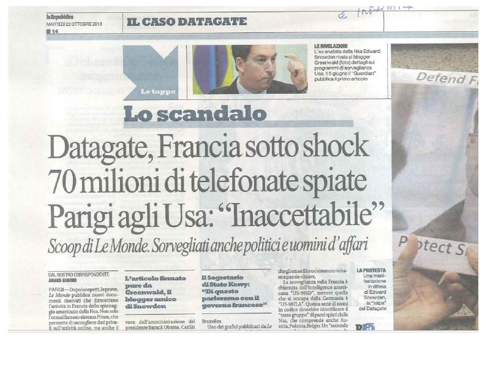{ loading=lazy style="width:47%" }

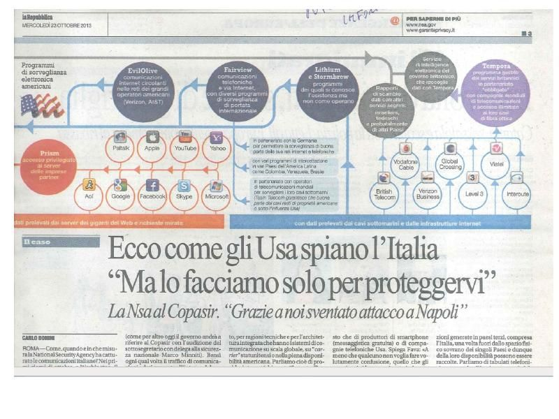{ loading=lazy style="width:47%" }

1:03:47

C’è da dire che l’Occidente ha anche un certo timore, per esempio, della Cina. Nell’immagine che avevo messo all’inizio come simbolo dei collegamenti ci sono questi server, computer, che sono distribuiti in tutto il mondo; molti passano anche in Cina, e queste reti, per trovare il percorso più breve, passano anche attraverso i server dislocati in Cina: sicuramente la Cina si sta facendo delle copie di tutti i messaggi, dei pacchetti di informazioni che passano attraverso i suoi server. («È la Cina la paura dell’Occidente», titolava Il Sole 24 Ore del 31 ottobre 2013: i timori si concentrano sull’azienda cinese Huawei) La risposta europea è un web diverso in ogni paese («Un web diverso in ogni Paese. Ecco il dossier dell’intelligence per scongiurare nuovi Datagate», «la Repubblica», 17 febbraio 2014); ma sono tutti tentativi di risposta in qualche modo a questo shock, che poi non è stato nemmeno tale, perché probabilmente sapevano che c’era questo accumulo di dati, di informazioni, da parte di diverse agenzie americane su tutto il mondo, e specialmente su quello occidentale, europeo. La Merkel: un web europeo contro le spie USA. Anche qui si ritorna a una proposta; diceva, mi sembra dopo l’estate dell’anno scorso: «Ne discuterò con Hollande» (la proposta della cancelliera, del 15 gennaio 2014, era di creare «un web europeo contro le spie americane»).

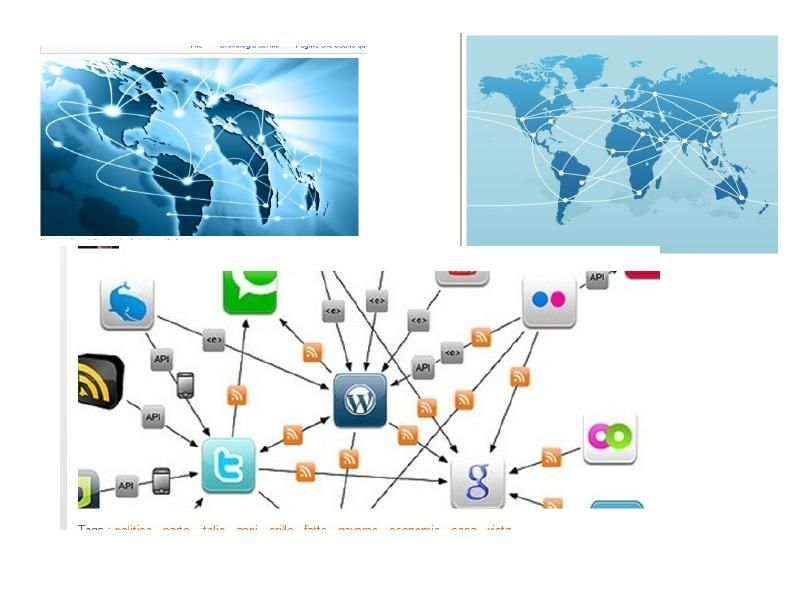{ loading=lazy style="width:47%" }

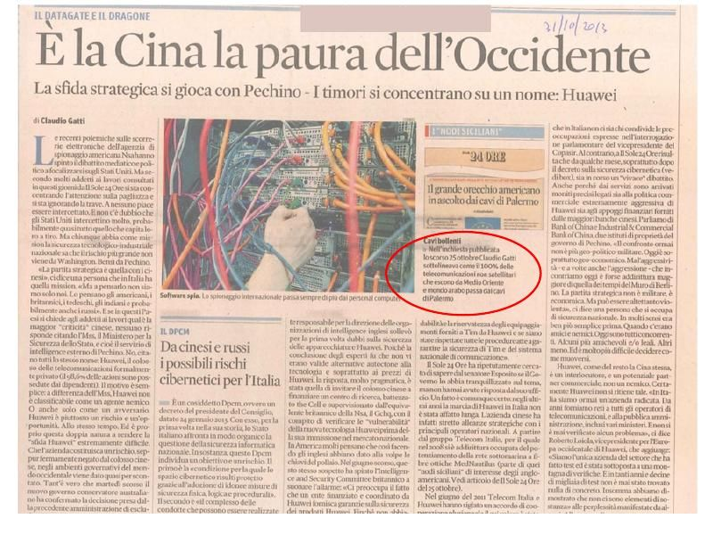{ loading=lazy style="width:47%" }

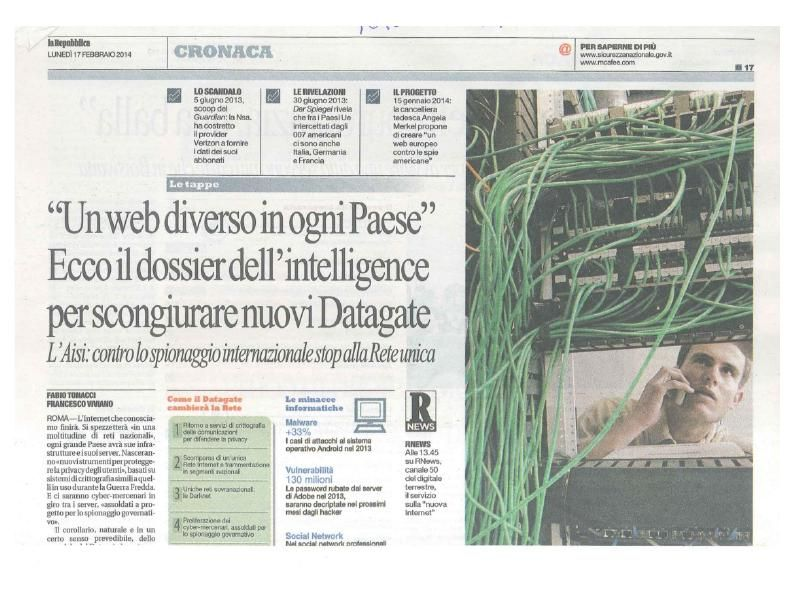{ loading=lazy style="width:47%" }

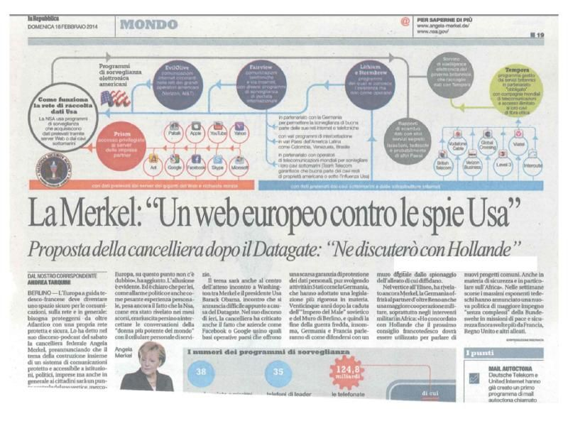{ loading=lazy style="width:47%" }

1:05:18

L’America comincia a fare le prime ammissioni: si dice, controlliamo i paesi alleati, per noi conta solo la legge americana («La Nsa e le ammissioni sull’Italia», «la Repubblica», 22 ottobre 2013), che dopo le Torri Gemelle ha abolito tutte le garanzie sulla privacy, perché, con la giustificazione (anche ragionevole) della lotta al terrorismo, ha potuto intromettersi nel sistema delle libertà americane, andando oltre quel confine della privacy personale che in America era sempre stato storicamente molto difeso. Avete visto oggi, per esempio: a Roma c’era Barack Obama, che è andato a visitare il Papa, poi ha visto Napolitano, Renzi, e non so chi altro. Il dato interessante, legato al tema di cui parliamo stasera, è che, a differenza delle vecchie visite dei capi di Stato americani, c’era molta meno polizia, molti meno elicotteri. Perché? Perché ormai la guerra tecnologica gli americani la fanno con i droni: i droni sono quelle piccole macchine volanti, come un bicchiere o poco più, che volano sulle nostre teste, riprendono e controllano, come se fossero degli eserciti in miniatura. Quindi c’è meno bisogno di forze di polizia, perché ci sono questi droni, che hanno un costo nettamente inferiore rispetto per esempio ai carri armati, alle forze umane eccetera.

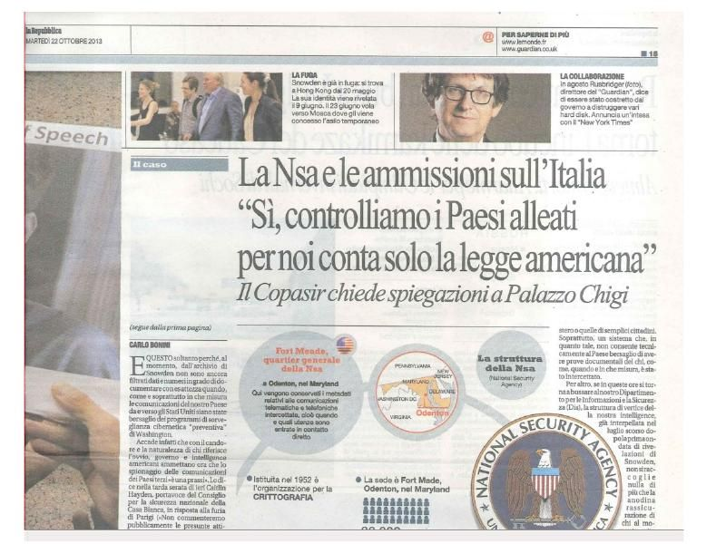{ loading=lazy style="width:47%" }

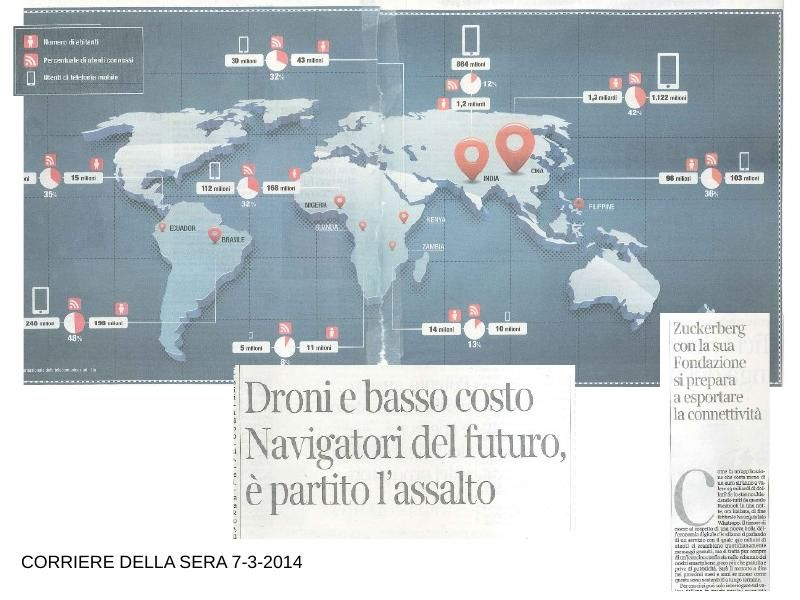{ loading=lazy style="width:47%" }

1:07:20

La National Security Agency, l’NSA, ha in budget 500 miliardi per controllare ogni cosa (500 miliardi di dollari in poco più di dieci anni, secondo «Pagina99» del 15 marzo 2014, che riprende il Washington Post sulla base dei documenti di Edward Snowden): spazzolano tutti i dati a disposizione e li mettono da parte. Per darvi un’idea (forse non si legge, ve lo leggo io): questo è il centro di questa agenzia; ogni giorno raccoglie 440.000 indirizzi mail da Yahoo, 105.000 rubriche dal servizio di Hotmail, 82.000 liste di contatti di Facebook, 33.000 rubriche da Gmail, 22.000 rubriche da altri provider e 500.000 liste di contatti da servizi di chat. (Secondo l’articolo, nel corso del 2013, in una giornata tipo, la Special Source Operations collezionava esattamente 444.743 rubriche di indirizzi mail da Yahoo, 105.068 da Hotmail, 82.857 liste di contatti da Facebook, 33.697 rubriche da Gmail, 22.881 da altri provider e 500.000 liste di contatti da servizi di chat; il totale dei contatti archiviati nell’anno, anche escludendo le liste di amici delle chat, ammonta a 250 milioni di documenti.) Questo per darvi l’idea di qualche numero di queste megainfrastrutture: e questo moltiplicato per ogni giorno dell’anno. Pensate a cosa possa voler dire questo accumulo di dati e di informazioni su ciascuno di noi, anche se ne siamo oggetto inconsapevolmente.

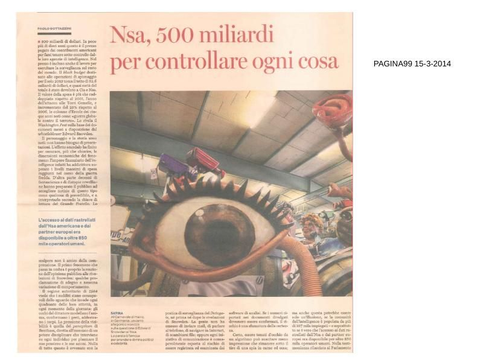{ loading=lazy style="width:47%" }

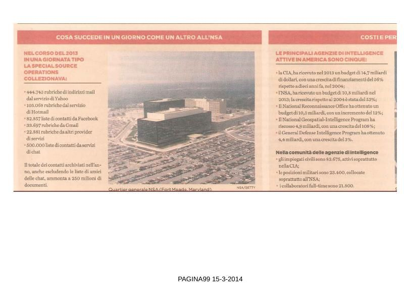{ loading=lazy style="width:47%" }

1:08:46

Proviamo a fare qualche ragionamento. I social network, dice un esperto, Massimo Sideri (nel libro *Tecnologismi*, presentato sul Corriere della Sera del 20 settembre 2013 con il titolo «I social network sono antibiotici»), possono fare bene o fare male: dipende dall’uso che ne facciamo. Però, da quello che abbiamo visto ora, indipendentemente dall’uso che ne faccio io personalmente di quella piattaforma, c’è qualcuno che mette da parte tutte le informazioni che metto sulla rete. Però non c’è solo l’aspetto negativo: l’aspetto positivo è il cambiamento antropologico a cui accennava prima Lorenzo, che è un cambiamento strutturale del nostro modo di comunicare. Abbiamo visto prima la pagina Facebook di Montelupo, quella di Pisa; per esempio a Bolzano è stata proposta una piattaforma che usa questi social network per un’innovazione partecipata (il festival «Innovazione partecipata» di Bolzano, Corriere della Sera, 26 settembre 2013): la vita e le scelte politiche di una città si discutono su queste piattaforme, affinché venga fuori la proposta migliore. Quindi questi mezzi sono anche utili, si possono sfruttare anche a fini pubblici, cooperativi, sociali eccetera: dipende effettivamente dall’uso che ne facciamo noi cittadini. Però c’è l’altro lato della medaglia, che è quello del potere, il tema di stasera.

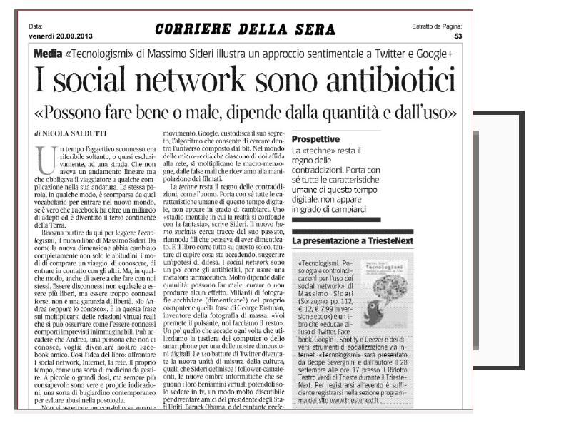{ loading=lazy style="width:47%" }

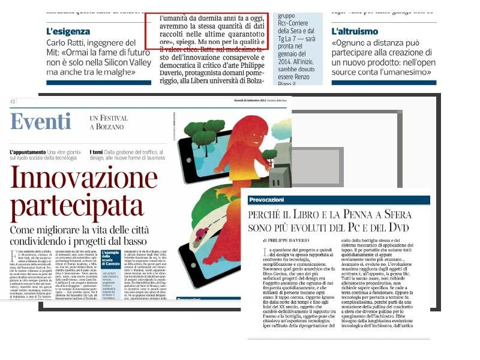{ loading=lazy style="width:47%" }

1:10:32

Interessante per noi italiani è che le macchine intelligenti che hanno permesso di costruire tutta quell’enorme mole di dati che abbiamo visto spazzolare ogni giorno dai supercomputer americani sono frutto di ingegneria italiana: in questo caso Antonio Nucci, quello a sinistra nell’immagine, è un italiano che ha costruito delle macchine particolari (leccese, laureato al Politecnico di Torino, è Chief Technology Officer di Narus; la sua storia è stata raccontata da Claudio Gatti su Il Sole 24 Ore del 24 settembre 2013) che gli vengono comprate dal governo americano; ha costruito degli algoritmi che permettono di spazzolare tutte queste informazioni e metterle al sicuro sui server degli americani. Infatti lui si difende dicendo: «Io, quando mi comprano queste macchine (in questo caso l’America, ma dice di averne vendute anche un paio all’Italia, allo Stato italiano), non ho idea di dove le mettano, di che cosa ne facciano: io faccio solo il fornitore di queste tecnologie». Questo sistema si chiama Narus. Quindi in questo caso l’ingegnosità italiana ha permesso di fare anche questo tipo di elaborazioni, e se volete di sfruttare economicamente anche questo passaggio.

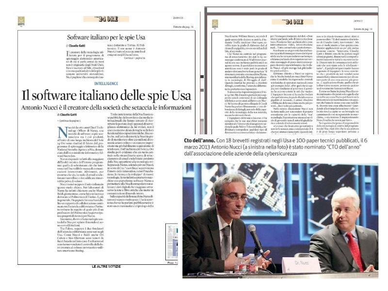{ loading=lazy style="width:47%" }

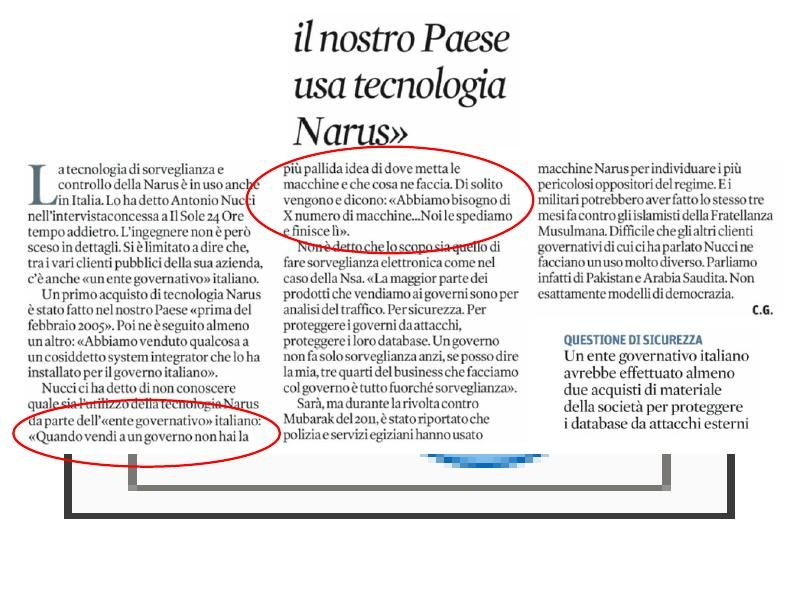{ loading=lazy style="width:47%" }

1:12:15

Alcuni dati e alcune riflessioni. Dino Pedreschi, che è un esperto di questa materia (ordinario di informatica all’Università di Pisa, che con Fosca Giannotti del CNR ha creato il KDD Lab, primo centro di ricerca italiano sul data mining), ha chiamato tutte queste tracce di cui dicevo prima «briciole digitali». Tutti i giorni, quando ci muoviamo, facciamo come Pollicino, che perde un piccolo pezzettino di pane che rimane lì sul terreno dove abbiamo mosso i passi; e tutte queste briciole digitali sono raccolte, come abbiamo visto, da queste megastrutture, che cominciano ad accumulare questi dati. Questi dati sono raccolti sia dallo Stato, dal potere; ma il potere oggi, abbiamo visto, non è solo lo Stato: il potere è anche negli agglomerati finanziari, nelle multinazionali commerciali. Facebook e Google forniscono obbligatoriamente, e senza darne pubblicità, tutte queste informazioni allo Stato federale americano, ma al loro interno sono già uno Stato loro stessi, perché mettono già da parte tutte queste informazioni e le sfruttano ai loro fini commerciali. Quindi è un potere frantumato, se volete.

**BIG DATA: I CLIC LASCIANO TRACCE E CI AIUTANO A CAPIRE COME CAMBIA IL MONDO**

(«la Repubblica», 9 ottobre 2013, articolo di Laura Montanari)

Lasciamo tracce, «briciole digitali», tutti i giorni, spesso inconsapevolmente: pagando con la carta di credito, usando una carta fedeltà, mettendo «mi piace» su un social network, scrivendo mail, interrogando un navigatore o un motore di ricerca. Sono i «big data», tema dell’Internet Festival di Pisa. Per Dino Pedreschi, ordinario di informatica all’Università di Pisa, che con Fosca Giannotti dell’Istituto di scienza e tecnologie dell’informazione del CNR ha creato il KDD Lab, primo centro di ricerca italiano (e tra i primi in Europa) sul data mining, i big data sono «una specie di nuovo microscopio per rendere misurabile la società» e spingono verso una sociologia quantitativa, computazionale; l’ostacolo principale è l’accesso ai dati, tutt’altro che aperto, per ragioni di privacy o di business.

Al festival Pedreschi partecipa a un dibattito con i sindaci di Pisa, Marco Filippeschi, e di Livorno, Alessandro Cosimi, con lo scrittore Marco Malvaldi e altri ospiti sui reali confini tra le due province: il KDD Lab ha infatti analizzato le tracce digitali delle auto dotate di GPS per conto di una compagnia di assicurazione e quelle del traffico della telefonia cellulare, studiando come si muovono le persone nell’arco di una giornata e di un mese (un esperimento analogo è stato fatto su Parigi).

1:13:38

E queste tracce digitali, queste briciole digitali, vanno ad accumulare tutti i dati che ognuno di noi lascia, e sono sia nelle multinazionali sia nelle imprese: basti pensare anche al sistema bancario, o al sistema della Coop, dei supermercati. Quando facciamo la spesa lasciamo delle briciole digitali, perché scegliamo una certa acqua minerale, un certo vino, un certo detersivo, e tracciamo in questo modo il nostro profilo. Se si sommano tutte queste informazioni a quello che diciamo su Facebook, o alle telefonate, o alle chat su WhatsApp, o a quello che uno usa di più a seconda delle piattaforme, viene fuori una percezione direi abbastanza vicina al vero di quello che uno è in realtà, del nostro modo di essere.

1:14:46

Infatti stanno cominciando a pensare (lo diceva sempre Pedreschi l’anno scorso al festival di Pisa) di incrociare, per esempio, le denunce fatte alla polizia e agli organi competenti con le telecamere e con le tabelle delle celle telefoniche, per vedere dove si manifestano di più atti criminosi. Se vi ricordate, qualche anno fa *Minority Report*, un film con Tom Cruise, vagheggiava già una prevenzione del crimine fatta su questi algoritmi. È un futuro che cambia alla svelta: pensate che la radio, per raggiungere 50 milioni di persone, ci ha impiegato 38 anni; la televisione 13; internet 4; l’iPod 3; e Facebook 2. Sono numeri impressionanti, se pensiamo alla velocità, alla complessità con cui sta andando avanti il mondo in questo momento. (Gli stessi dati, tratti da Il Sole 24 Ore del 13 ottobre 2013, ricordano che nel 1970 sulla Terra vivevano circa 3,5 miliardi di persone e oggi superiamo i 7 miliardi, e che gli utenti collegati a internet erano mille nel 1984, un milione nel 1992 e oltre due miliardi nel 2013.)

**RISCHI CRIMINALI NELLA CITTÀ DIGITALE**

(dallo stesso articolo de «la Repubblica», 9 ottobre 2013)

Andrea Di Nicola, criminologo della facoltà di Giurisprudenza di Trento, è tra gli ideatori del progetto eSecurity, che tenta di prevedere i luoghi e le ore in cui è maggiore il pericolo di criminalità predatoria. Si costruisce una grande banca dati dei luoghi in cui la criminalità ha colpito (fonte: le forze di polizia), incrociandola con giorni, ore, mesi dell’anno e con molti altri dati: la dislocazione delle telecamere, il meteo, i giardini pubblici, l’illuminazione, la percezione di insicurezza della gente (raccolta anche con questionari che includono i reati non denunciati), le segnalazioni di luoghi degradati e i dati delle smart city, come i parcheggi pagati con il cellulare o con il telepass. Tra gli altri esempi dell’uso dei big data: la catena di supermercati inglese Tesco ha risparmiato in un anno 16 milioni di sterline monitorando le abitudini di acquisto dei clienti.

1:16:00

Ho trovato questa frase di Ernesto Illy, l’imprenditore vecchio: diceva giustamente che la complessità esisteva anche prima, però non ce ne rendevamo conto, perché ogni epoca è complessa, non è complessa solo la nostra; anche il passato era complesso per chi viveva in quel momento. Questa la frase, riportata da Il Sole 24 Ore: «Quando la vita scorreva lenta come un pigro fiume, la complessità esisteva, ma non veniva percepita. Oggi tutti se la sentono addosso, perché il ritmo si è fatto serrato come un torrente vorticoso». Però i tempi e la velocità erano più ridotti, e avevamo più tempo per capire, per assorbire tutta questa massa di informazioni.

1:16:43

E l’ultima cosa che vi volevo dire su questo è la distinzione che passa tra i fini politici di un potere, di uno Stato, e quelli propri delle aziende commerciali; e questo sta cominciando a diventare un problema, perché molte volte è incompatibile anche con i diritti umani. (l’espressione è dell’attivista Richard Stallman, citato dal Corriere della Sera del 26 ottobre 2013) A me ha sconvolto, mi ha colpito molto questa notizia. Abbiamo parlato dell’NSA, la sigla americana dove transitavano tutte queste informazioni: è emerso dalle rivelazioni, quelle di Snowden, che poi, paradosso del paradosso, è finito incriminato, ricercato. Lui ha svelato questo sistema non legale di raccolta di dati, di informazioni su tutte le persone: quello che svela il reato viene poi perseguito, e gli tocca vivere nell’ambasciata del Nicaragua.

**SORVEGLIANZA GLOBALE. I GOVERNI NELL’ERA DEI «BIG DATA»: DEMOCRAZIA OSTAGGIO DELLA TECNOLOGIA?**

(«Corriere della Sera», 26 ottobre 2013)

Internet, la politica, le aziende: il «patto» con i cittadini si è rotto, e occorre rinegoziarlo mettendo sul tavolo vantaggi e rischi del mercato delle informazioni personali.

Peter Galison (Harvard): pochi mesi fa la tecnologia era celebrata nelle primavere arabe come promessa di democrazia, ora «big data» è diventato «bad data», e «dalla tecno-utopia siamo già passati alla tecno-distopia». Bruce Schneier parla di una «guerra per il controllo del cyberspazio» tra istituzioni del potere (governi e corporazioni) e dissidenti, hacker e movimenti per la privacy, con i cittadini come campo di battaglia.

Evgeny Morozov: l’origine del problema è la convergenza di interessi tra governi e aziende, che con fini diversi vogliono accedere ai dati personali degli utenti. L’alleanza tra Silicon Valley e governo americano sul data mining ha portato la sorveglianza a un livello che l’attivista Richard Stallman definisce «incompatibile con i diritti umani».

Il paradosso: sono gli stessi cittadini a lasciare le proprie impronte digitali in rete, secondo il «modello feudale» descritto da Schneier (dati in cambio di servizi gratuiti). Eric Schmidt, presidente di Google, ammette nel libro *La nuova era digitale* (con Jared Cohen) che esiste «uno spaventoso potenziale per l’abuso di potere». Per Alec Ross, consigliere di Hillary Clinton, la questione cruciale è come vengono usati i sistemi di sorveglianza; per Helen Nissenbaum (New York University) il modello «notifica-consenso» lascia tutto in mano alle aziende, mentre bisogna rendere trasparenti i termini del patto tra cittadini e istituzioni.

Già negli anni Ottanta Spiros Simitis sosteneva che nessun progresso è tale se non si concilia con il diritto di decidere quali dati personali diffondere. Tra gli aneddoti emersi sulla NSA: dipendenti che usavano i database per spiare i propri partner. Per Viktor Mayer-Schönberger (*Big Data*) l’idea di prevedere i comportamenti umani resta da escludere: il sistema pre-crimine di *Minority Report* è ancora un’invenzione narrativa.

1:18:21

Insomma, è grazie a lui e ad altri come lui che si sono potute verificare, da un punto di vista democratico e pubblico, tutte queste informazioni che prima non si sapevano; e questo è magari il lato positivo della rete, perché la rete in questo momento ci permette di avere anche un controllo pubblico che prima magari non esisteva. Per esempio, se vi ricordate i «furbetti del quartierino», una decina, dodici, tredici anni fa, quando cominciarono a pubblicare le prime intercettazioni telefoniche (perché ormai si può intercettare quasi tutti in qualsiasi momento), venne fuori uno spaccato che prima di allora non era mai emerso nella vita pubblica. Non si sapeva: i reati rimanevano sotto traccia, i processi finivano e nessuno aveva poi voglia di andare a leggere le carte del processo; invece con la pubblicazione delle intercettazioni è emersa tutta questa materia, che prima non sarebbe emersa. Quindi ci sono dei lati positivi in questa diffusione dei social media, di internet e della rete in particolare.

1:19:44

Però, ritornando al punto: i dipendenti di questa NSA americana che cosa facevano? Sfruttavano l’accumulo di informazioni su tutte le persone per spiare i propri familiari o i propri partner. (la notizia è riportata dallo stesso articolo del Corriere della Sera) Questo è l’esercizio, l’abuso del potere: quando c’è la possibilità, chi ne ha la possibilità lo fa. E questo va un po’ contro la democrazia, che è un po’ il tema che stasera volevamo affrontare. Non so che cosa ne pensi Lorenzo di questo tema; ti do la parola.

1:20:24

Lorenzo Poggi Certamente. Paolo che cosa ci illustrava? Ci illustrava la difficoltà di convivenza tra quello che è un potere politico spazializzato (uno Stato che ha un ambito giurisdizionale all’interno di un territorio, un centro, una capitale) e un sistema invece di rete, di collegamento di rete, che non ha la stessa logica e la stessa spazialità. La spazialità degli Stati è una spazialità diciamo geometrica, su tavola, su piano: c’è un centro, abbiamo visto, c’è una periferia, c’è una distanza, ci sono i collegamenti. Non è solo una questione spaziale, è una questione di consequenzialità. Parlavamo prima dello scritto: la parola scritta non è soltanto un modo di mantenere ferma la memoria, di poterci tornare sopra, di registrare le cose; è anche qualcosa di più profondo, perché allena noi stessi e il nostro cervello a percepire prima delle cose e successivamente delle altre.

1:22:00

A parte il discorso sulle neuroscienze e sugli emisferi del nostro cervello (voi sapete che c’è un’inversione: il destro comanda il sinistro e il sinistro il destro), c’è anche una capacità diversa di percepire le cose: uno percepisce meglio la sequenza, e l’altro percepisce meglio la distinzione. Nelle forme di scrittura, voi sapete che ci sono scritture che mettono i caratteri uno sull’altro, verticali (il cinese, per esempio), o le scritture ideografiche egiziane, e quindi più attente al particolare di come è fatta la lettera, la grafia, l’ideogramma: sviluppano di più l’attenzione, la disposizione all’attenzione analitica del particolare. Il greco, il fenicio, ma anche le nostre lingue, quelle occidentali, caratterizzanti della nostra cultura, sono lingue che si scrivono da sinistra a destra, comunque linearmente; qualche volta sono bustrofediche, cioè come l’aratura dei campi: il primo rigo va da sinistra a destra e il secondo da destra a sinistra, perché è chiaro, non si ritorna mica in cima con i buoi. Però sono sempre ad andamento lineare.

1:23:41

Questo vuol dire che si privilegia la consequenzialità: da secoli, da millenni, la nostra cultura, il nostro atteggiamento nell’immaginazione della realtà e del mondo è incentrato sulla consequenzialità, nel tempo e nello spazio. È il concetto di causa, che è a fondamento del nostro modo di pensare la realtà: quel che viene prima è causa, quel che viene dopo è effetto. Hume, quando tentava di ridurre la causa a percezione… mamma mia, qui fa il professore, sta facendo una cosa terribile, scusatemi. Però bisogna chiarirlo, se no non si riesce a capire dove sta la profondità, se no sembra solo uno strumento per comunicare meglio. Non è uno strumento per comunicare meglio: è una trasformazione della nostra cultura, e questa trasformazione ha questo fondamento.

1:24:43

Quindi abbiamo di fronte questo aspetto: si privilegia di più un aspetto rispetto all’altro. La nostra consequenzialità la ritroviamo nel principio di causa: il principio di causa regge tutte le nostre relazioni nella scienza, causa ed effetto. E l’altro principio che si regge su questa consequenzialità, di cui parleremo nei prossimi incontri, è il principio di identità e di non contraddizione, che regge la logica: una cosa è quello che è e non può essere altrimenti, non può essere contemporaneamente questo e quest’altro. Guardate che i popoli che hanno adottato delle scritture verticali, e si sono abituati di più a questo modo di intendere la realtà e di simboleggiarla, hanno sviluppato anche idee di mondo globalizzanti, dove siamo parte di un tutto quasi indifferenziato. Noi, la cultura occidentale, siamo partiti dal principio di identità, di non contraddizione, e dalla distinzione: una cosa è quella e non può essere un’altra.

1:26:00

La dea dice a Parmenide: «Guarda, impara una cosa molto semplice: l’essere è, il non essere non è; non si può essere e contemporaneamente non essere». Sembra una cosa da poco, ma è fondante del nostro modo di pensare. E questo comincia ad avere un allentamento: nella rete c’è una logica diversa. La rete ha una logica diversa: non è più la logica e la disposizione spazio-temporale del piano, ma è la logica disposta su qualche cosa di globale, la sfera. La sfera ha una relazione fra i punti differente da quella del piano. È chiaro? E quindi implica una logica diversa, una consequenzialità diversa. E questo lo vediamo anche nella globalizzazione.

1:27:08

È logico quello che sta facendo la globalizzazione: sta spianando tutto il pianeta a modo di superficie sferica. Per essere adeguati a quella che è la globalizzazione finanziaria, che è la prima legata alla simbolizzazione, all’immaginazione della comunicazione, bisogna spianare i muri, gli ostacoli, le colline che impediscono la libera circolazione, facendo i tunnel; bisogna spianare i muri che ostacolano la comunicazione nel mondo. Quali sono i muri? Sono tutti quelli che possiamo mettere come politica degli Stati: le esigenze sociopolitiche che sono di ostacolo al libero mercato si devono abbattere, perché altrimenti si allontanano i finanziamenti e si mettono i propri cittadini nella miseria. Se ci sono degli ostacoli di ordine sanitario, di conservazione della natura, di mantenimento del pianeta, di ordine sociale (perché vogliamo conservare il lavoro anche in certi settori che non potrebbero essere del tutto concorrenziali con altri, perché se no mettiamo la gente alla fame), questo muro deve essere abbattuto, perché la superficie della sfera deve essere liscia. Capite? Per avere più posti di lavoro nel posto A devo fare non-A, cioè devo eliminare i posti di lavoro che sono di ostacolo, perché così vengono altri finanziamenti.

1:29:01

Sembra assurdo: è contro la logica aristotelica, del principio di identità e di non contraddizione. Perché contro questa, con la globalizzazione del mondo, c’è la nuova visione, che è quella indotta dal fatto che l’immaginazione del nostro mondo è costruita su un’immaginazione sferica, non più planare. Qual è stata la realizzazione più bella, più importante, più completa della visione planare (fatemela chiamare così, per capire) del potere, dello Stato, dell’immagine del mondo? La prospettiva di Leon Battista Alberti, il Rinascimento, fondamento di certi aspetti della cultura moderna. Perché? Perché ha indotto questa visione dello spazio e del tempo. Gli antichi greci lo avevano sentito, lo avevano anche rappresentato. Che cos’è che dava più timore di tutto? L’immagine della perdita di razionalità era il labirinto, perché il labirinto non ha centro, non ha orientamento: è una sfera proiettata su un piano, a pianta circolare. E quindi rifiuta che cosa? La logica geometrico-matematica che regge invece la polis, l’agorà, che regge i monumenti, che regge tutto, e che si è sovrapposta alla ziggurat, alla piramide egizia, all’immaginazione verticale dello spazio.

1:31:03

Quindi quando parliamo di prevalenza dell’orale sullo scritto, quando parliamo di diffusione delle notizie in modo globale, e quindi di un’immaginazione del mondo e della superficie non più tabulare ma sferica, atmosferica, parliamo di qualcosa di estremamente importante per il mutamento della nostra cultura, del nostro modo di pensare. Ma non perché ne siamo coscienti e allora da domattina cominciamo a pensare diversamente: ma perché ci cambia nel profondo, ci cambia nel momento stesso in cui ne siamo parte. Questo non vuol dire che dobbiamo tornare all’antico: dobbiamo renderci conto di questo, e capire che il nostro tempo è un tempo di profonde, radicali trasformazioni, non semplicemente che ci sono i telefonini e sono più comodi.

1:32:13

E queste profonde, radicali trasformazioni riguardano l’immagine del potere, riguardano l’ampliamento enorme della memoria che c’è stato con l’accesso (basta avere uno smartphone e si sa immediatamente tutto, e quindi non c’è più bisogno di memoria in un altro modo): l’allargamento enorme della memoria, l’enorme potere di aggregazione che hanno i social network. Le rivoluzioni ora si fanno perché si aggrega la gente attraverso Facebook, attraverso i social network. Le prime furono fatte con i messaggini dei telefoni: «Trovatevi in piazza vestiti di nero, e così contestiamo quel farabutto che si è comportato così al governo, e lo buttiamo fuori». Roba preistorica, roba di sei o sette anni fa: parliamo di roba lontanissima, sei o sette anni fa. Non proprio di una generazione fa: ci si ricorda di quando i telefonini portatili pesavano mezzo chilo, con due etti di batteria. Non c’erano mica i dinosauri nel Padule di Fucecchio, si andava in giro con quelli; però è pure preistoria.

1:33:51

Quindi la trasformazione profonda è, diceva giustamente Paolo: siamo in grado… l’uomo è in grado… il risultato non è che sia del tutto obsoleto, però l’adeguamento è molto difficile, perché tanti aspetti passano sotto silenzio, non sono immediatamente avvertibili. Chi controlla i network, chi controlla veramente la programmazione su scala di queste possibilità di comunicazione, appartiene a una nuova casta di scribi. Una volta c’erano gli scribi… passo a Paolo, e c’è…

1:34:42

Paolo Marcucci È interessante: me l’hai fatto venire in mente ora, mentre dicevi questo. Non più di dieci giorni fa in America, a Los Angeles, in un quartiere dove sono dislocate tutte le maggiori compagnie di software americane, è scoppiata una rivolta. Perché? Perché gli ingegneri che lavorano lì, che fanno girare tutte queste aziende, sono i nuovi sacerdoti del sapere e del potere, perché è attraverso la loro fantasia che viene creato il software che permette queste piattaforme; e sono pagati, strapagati: si parla di persone che fanno software pagate qualche milione di euro l’anno. E questo comporta che nella società civile si muovano per esempio in SUV enormi e blocchino il traffico; e tutti quei lavoratori che invece gravitano intorno a loro, perché gli fanno da cuochi, da accompagnatori di cani, da inservienti, da tutto quello che volete, si ritrovano a prendere l’autobus e non riescono ad andare a lavorare, perché le fermate sono occupate dai SUV in doppia fila di chi è strapagato. C’è stata una rivolta in questo senso: questo per dire che i nuovi sciamani del nuovo potere cambiano, e ora sono questi.

1:36:38

Lorenzo Poggi Sì, capite, questo crea chiaramente tensione: la nuova classe di scribi. Gli scribi in Egitto erano quelli che possedevano la scrittura, e quindi il deposito della sapienza; lo *scriptorium* dei monasteri era il punto dove si manteneva la memoria, la conoscenza e il potere. Ora questi aspetti esistono, hanno una possibilità di sviluppo positivo, ma possono avere anche sviluppi negativi; però ne parleremo dopo. Io volevo far vedere… però lo faremo vedere dopo, se ho tempo; perlomeno un’immagine… non so quanto tempo abbiamo… Intanto facciamo vedere l’immagine dei *Blackberry Paintings*.

1:37:51

Questo è un esempio. Questo signore è un artista greco (noi importiamo artisti dalla Grecia, gli elleni sono tra i più importanti): è Miltos Manetas (pittore e artista multimediale, formatosi all’Accademia di Belle Arti di Brera), che ha curato nel 2011 il padiglione della Biennale di Venezia dedicato a questo (il padiglione internet). Lui fa una pittura invisibile: interessante, perché la pittura è qualcosa che si vede, e questa non si vede, è una pittura invisibile. E la fa con il telefonino. Come vedete ha in mano una matita, un pennello, quello che è, e sta dipingendo qualche cosa che non c’è, cioè un’ombra, ripresa mentre la dipinge con i BlackBerry: per questo sono i *Blackberry Paintings*. Non esiste, esiste soltanto il gesto. Ti fa il ritratto (a me non lo fece, ma lo stava facendo): come? Con il telefonino ti fa la fotografia, e nello stesso tempo segue con la mano il tuo profilo, e la mano nel vuoto ti ridisegna; e tutto questo viene ripreso da un altro telefonino, per cui rimane il disegno della mano che fa il disegno seguendo la fotografia del BlackBerry.

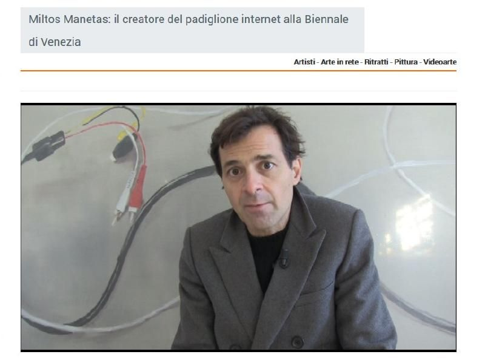{ loading=lazy style="width:47%" }

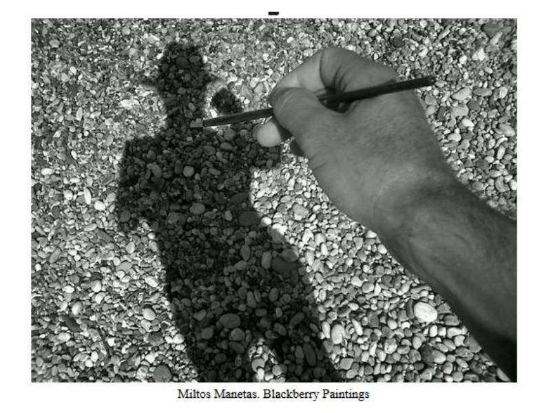{ loading=lazy style="width:47%" }

**IL BLACKBERRY UTILIZZATO COME STRUMENTO ARTISTICO**

Miltos Manetas è un pittore e artista multimediale greco che ha frequentato l’Accademia di Belle Arti di Brera a Milano. Comincia la sua carriera a Milano negli anni Ottanta con una personale presso la Galleria Fac-Simile. Come uno psicologo «post-contemporaneo», Manetas analizza nel suo lavoro il rapporto tra computer, videogiochi e umani. Una parte del lavoro è «classica» (pitture a olio), l’altra è costituita da Neen e dai lavori in Internet. È proprio in questo ambito che entra in gioco lo smartphone BlackBerry.

1:39:39

È scomparsa quella che era la relazione con il mondo: è mediata totalmente dal telefonino. Quindi anche l’arte, da questo punto di vista, coglie che cosa? Coglie il mutare dei linguaggi. L’artista è estremamente sensibile a come muta la percezione della realtà, al mutamento indotto dalle novità, da ciò che cambia nel modo di relazionarsi e di comunicare; e qualche volta riesce anche a renderlo in operazioni artistiche che lo simboleggiano. Nel 1514 un altro grande artista, Albrecht Dürer, renderà in qualche modo la percezione del mutamento, del disorientamento che vive lui nel suo tempo con l’acquisizione di quel mutamento di visione, di precisazione della visione dello spazio e del mondo, dovuto alla prospettiva di Leon Battista Alberti e dei pittori. Se abbiamo tempo la vediamo dopo, e commentiamo anche qualche cosa che si lega poi alla visita del Pontormo, perché in qualche modo Pontormo e Dürer… il Duro, lo chiama Vasari: il Duro aveva in qualche modo sedotto il Pontormo, e il Pontormo, quando aveva conosciuto Alberto Duro, secondo Vasari aveva peggiorato la sua maniera. Però dopo: mi sono dilungato.

**\[PAUSA\]**
{: .nota }

2:10:59

Paolo Marcucci Vi chiedo di fare un applauso agli amici che ci hanno dato la cena, il Caffè Centofiori: grazie. Allora, abbiamo fatto una carrellata di argomenti e di informazioni; abbiamo visto come il potere, attraverso queste nuove tecnologie, riesca a mettere da parte tutte queste informazioni su ognuno di noi, e come le possa sfruttare. Un filosofo, Ulrich Beck, che qualche volta abbiamo citato in altre serate, ha messo secondo me in evidenza un punto importante. (Lo scandalo PRISM, scrive, ha aperto un nuovo capitolo della società mondiale del rischio: dopo il mutamento climatico, il rischio nucleare, il rischio finanziario e l’11 settembre, ora il rischio digitale e globale della libertà.) Dice: quando ci sono stati per esempio gli incidenti ai reattori, a Chernobyl, e l’ultimo in particolare, quello giapponese a Fukushima, dietro questi avvenimenti c’è stata dopo una discussione pubblica, tant’è che il Giappone ha deciso magari di non continuare più a investire nelle centrali nucleari, ma addirittura di fare marcia indietro, perché il rischio era troppo alto rispetto ai vantaggi. Quindi c’è stato un dibattito pubblico. Nel caso invece dei big data, come si chiamano tecnicamente tutte queste informazioni raccolte, non c’è stato un dibattito pubblico democratico: la catastrofe, in questo caso l’accumulo delle informazioni dei privati, è già avvenuta, e non c’è stata nessuna discussione pubblica. Questo mi sembra un punto di vista molto interessante: il disastro è avvenuto, sono state accumulate informazioni su ognuno di noi, e non c’è stato un dibattito, non c’è stata trasparenza.

2:13:49

In chiusura, due atteggiamenti. Abbiamo visto che questi mezzi nuovi, nell’uso delle persone, possono essere positivi o negativi. Positivi, abbiamo visto: YouTube permette di ricostruire la propria giovinezza, in quel caso la partenza per la guerra; i profili Facebook per la città. Ci sono modi di interpretarli che possono essere positivi o negativi, come si diceva prima, e dipende dall’uso che ne facciamo, come un po’ con tutta la tecnologia: la televisione, che è ormai un mezzo forse un po’ superato, se ci sto 24 ore al giorno mi fa male; se ci sto un’ora al giorno e vedo i programmi che mi interessano, è un mezzo positivo; e così tutti questi.

2:14:50

Anche gli scrittori, per esempio, si dividono in due categorie. (Il tema è ripreso da un articolo di Vittorio Zucconi su «la Repubblica» del 29 settembre 2013, «Social hate-work», che ricorda anche come nel 1943 il presidente dell’IBM, Thomas Watson, prevedesse nel mondo un mercato «per quattro o cinque computer al massimo».) Per esempio Franzen, Pynchon, che non perdono occasione di sparare a zero contro questa nuova narrazione del mondo che avviene attraverso i social network; per esempio Tom Wolfe, famoso scrittore americano, o Morozov. Loro dicono letteralmente, leggo: «l’ineffabile banalità del web e la dispotica stupidità dell’intelligenza collettiva che si manifesta attraverso i social media». Quindi sono contro, sparano contro la letteratura di questo mondo che viene trasmessa attraverso i social network. Al contrario Salman Rushdie, lo scrittore che è stato oggetto di una fatwa di condanna a morte perché si è scagliato contro l’ideologia e la morale islamica, esalta invece questi nuovi mezzi di comunicazione, e sbeffeggia questi scrittori tradizionalisti attraverso Twitter. Quindi in questo caso c’è una parte del mondo della letteratura e degli intellettuali che è a favore di questi mezzi nuovi, e chi invece è nettamente contrario. Come per tutti i mezzi nuovi, c’è sempre questa ambiguità di fondo, che ci chiede se siamo in grado di capire fino in fondo quello che stiamo vivendo, o se siamo un po’ refrattari ad accettarlo. Questa è un po’ la conclusione, che forse si riallaccia a quello che tra un po’ ci farà vedere Lorenzo.

2:17:12

Lorenzo Poggi Certo, i network, i nuovi mezzi di comunicazione, hanno un potere eccezionale di aggregazione, abbiamo detto; hanno un potere estremamente grande di comunicazione; sono più carenti dal punto di vista della rielaborazione dell’informazione. Quindi c’è oggettivamente questo. Se si sviluppa in un certo modo la possibilità di accesso a questi mezzi e alla memoria, ricordiamoci che c’è anche un’altra cosa: nella nostra concezione della democrazia c’è la possibilità di confronto (parlavamo dell’agorà, di chi sta al centro), ma c’è sempre un potere superiore, lo Stato, che garantisce le regole del confronto. Qui un potere superiore a questi mezzi non esiste: se ce n’è uno, è semmai quello di coloro che costruiscono il software, e che in qualche modo, fino a un certo punto, lo controllano. Fino a un certo punto. Quindi manca uno degli ingredienti fondamentali: l’estraneità di quello che era lo Stato, che garantiva le regole.

2:18:56

C’è un altro aspetto: questi mezzi potrebbero essere veramente lo strumento che finalmente unisce insieme la cultura e la diffusione dell’informazione e della cultura, tanto da renderla globale; ma possono anche diventare uno strumento estremo di potere nelle mani di chi è in grado di controllare la rete stessa. Quindi sono sviluppi successivi, futuri, di fronte ai quali ci troviamo. Il carattere che essi presentano, però, è indubbiamente quello di una trasformazione del punto di vista, di un ripensamento del nostro modo di intendere il potere e anche del nostro modo di intendere la realtà. Vi dicevo: finora un pensiero legato alla consequenzialità e alla continuità, che si regge sulla logica del principio di identità e di non contraddizione, sulla continuità e sul principio di causa; che ha creato il nostro modo di pensare, la scienza moderna; che è retto anche da un’immaginazione spaziale del mondo, quella della prospettiva, che ha il suo sviluppo più importante nella teorizzazione di Leon Battista Alberti.

2:20:50

E non è solo prospettiva dello spazio, è anche visione della storia: così come gli oggetti si dispongono in una certa relazione spaziale all’interno dello spazio del quadro, così anche gli avvenimenti si dispongono in una prospettiva temporale all’interno della storia. La consequenzialità proporzionale è sempre la stessa, e quindi l’immagine che ne deriva è sempre la stessa. Il Rinascimento informa di sé lo spazio (non per nulla, lo abbiamo visto nella mostra insieme, abbiamo detto che nasce con la scultura, e prima ancora con la pittura), che informa di sé proprio ciò che prende spazio. Pensate poi anche al mutamento: che cos’è che rappresenta il mondo e la visione prima della razionalizzazione del piano, della disposizione consequenziale dei punti e del tempo consequenziale? Il labirinto. Il labirinto è la sfera schiacciata. Teseo è colui che sconfigge il labirinto: è colui che riesce a uscirne fuori, e riesce a uscirne fuori con l’orientamento, con la visione, con la teoria, cioè il vedere in ordine, in successione.

2:22:30

Quando si afferma la nuova visione del mondo dal punto di vista prospettico, umano, questo grande artista, Alberto Duro, ci ha lasciato questa immagine. Allora, se ve la sentite, vedo se ci arrivo e ve ne propongo un’interpretazione da questo punto di vista. Intanto si chiama *Melencolia* (molto rapidamente, perché è tardi). La melanconia, nella divisione degli umori di Aristotele, è la bile nera, quella legata alla terra: gli umori designano e caratterizzano il carattere delle persone. Uno si dice che è focoso quando in lui prevale il sangue, e quindi ha un carattere, si dice ancora oggi, sanguigno, e quindi il fuoco; gli elementi terra, acqua, aria (faremo una serata su queste cose, perché c’è spazio). Dunque dicevamo, la melanconia: la melanconia ha due sorelle, una è l’accidia e l’altra è la *tristitia*… anche le Parche sono belle… grazie, grazie. E allora dicevamo, va bene: ha due sorelle, si trova fra la *tristitia* e l’accidia; tutta roba medievale.

2:24:24

E guardate com’è: è un angelo, ha le ali, ma è un angelo seduto in terra; è a terra, e ha in mano quello che serve a misurare, il compasso. E ha a terra altri due strumenti che servono a dividere, la sega e la riga, e vicino ciò che dovrebbe ridurre a pianura ciò che non torna, la pialla. Questi strumenti di orientamento e di disposizione dello spazio, e quindi di visione simbolica della realtà e del mondo, e quindi della posizione dell’uomo rispetto a ciò che lo circonda, sono ai piedi, inutili, non servono. E anche il levriero, cane abituato alla corsa, a percorrere gli spazi, appare sfinito, non più adatto a percorrere gli spazi da segno a segno. Vediamo ancora sullo sfondo il tempo, la clessidra che segna. C’è anche il quadrato magico, su cui non mi soffermo, perché è un trattato di scienze e pseudoscienze rinascimentali: mi soffermo solo sulla parte centrale (ma si vede poco), che riporta la data in cui è stata fatta l’incisione, il 1514… Ecco, perfetto: lo vedete, il quadrato? Si prendono i numeri da 1 a 16, lo si forma, poi si girano le diagonali, e lui ha invertito anche gli ultimi due quadrati interni per ottenere la data. Rapidamente, torniamo a noi.

2:26:45

Dunque dicevo: l’angelo tiene la mano con il pugno chiuso al volto, appoggia la testa: è il momento del pensiero e della meditazione, e il pugno chiuso sta a significare che il problema che è sorto nella mente non lo si lascia; è un problema su cui continuiamo a pensare, un problema che non riusciamo a risolvere. Qual è il problema? Il problema è dare una nuova dimensione allo spazio. Ai suoi piedi giace la sfera, vedete? E il nuovo spazio non ha ancora un orientamento perfetto. L’arcobaleno che si trova nel cielo, sotto la luna, e la cometa, non centrale ma decentrata nello spazio. E il cartiglio con scritto *Melencolia*, vedete, è portato dal pipistrello, che non è solo animale saturnino, notturno, ma è anche un animale che muta con il punto di vista: da terra è mammifero, visto dall’alto in basso è uccello. E quindi l’ambiguità, il mutamento anche nel punto di vista.

2:28:39

L’occhio dell’angelo non guarda a terra: la sfera è offerta alla contemplazione di chi guarda, non è contemplata dall’angelo. L’angelo guarda davanti a sé, in modo fisso, diremmo noi. Perché? Perché sta contemplando la problematicità di dare un nuovo orientamento allo spazio, di disporre il punto di vista astratto, simbolico, ma nello stesso tempo rappresentativo della posizione dell’uomo nel creato, secondo uno spazio geometrico perfetto, quello appunto che sarà indotto dalla prospettiva. Bene, per farlo vedere come un problema di disposizione: noi siamo di fronte alla fine di questo tipo di logica, che aveva segnato la fine della logica medievale, e siamo di fronte a una nuova visione globale dello spazio, al passaggio dalla possibile disposizione immaginativa nel piano alla disposizione nella sfera, dove non vigono più tutte le regole logiche immediate che vigevano invece nel piano, e che hanno segnato l’età moderna, dal Rinascimento alla scienza moderna fino, diciamo, quasi ai nostri giorni. Bene, grazie, basta questo: credo che sia uno spunto importante per vedere come si fa questo.

2:30:43

Paolo Marcucci Bene, abbiamo concluso: grazie a tutti, buonanotte, e alla prossima volta. Grazie.

## Appendice

Le slide proiettate durante l’incontro.

**IL PROCESSO – FRANZ KAFKA**

«Qualcuno doveva aver calunniato Josef K., poiché un mattino, senza che avesse fatto nulla di male, egli fu arrestato».

Così inizia uno dei più grandi romanzi del XX secolo, *Il processo* di Franz Kafka.

C’era qualcosa di strano e misterioso negli uomini che erano venuti ad arrestare Kafka.

«Che genere di gente era? Di che cosa parlavano? Quale autorità rappresentavano? Alla fine dei conti K. viveva in uno stato di diritto, dappertutto regnava la pace e tutte le leggi erano in vigore: chi si permetteva di entrare in casa sua e di sopraffarlo?»

Quella mattina, dopo essere stato arrestato da personaggi taciturni e impassibili, vestiti con giacche nere e attillate, Josef K. fu incriminato, anche se non riuscì mai a scoprire quali fossero le accuse. Da quel momento la sua vita sarebbe diventata un labirintico tribunale…

Un compatriota di Kafka, Václav Havel, ha descritto l’impersonalità delle società totalitarie, dove il potere maligno del sistema trascende ogni individuo.

**EUGENIO SCALFARI SUL «DATAGATE»**

(«la Repubblica», 3 novembre 2013)

*Sintesi del testo della slide*

Non esiste un Datagate solo nordamericano: la registrazione e l’ascolto delle conversazioni avvengono in ogni società telefonica locale, e tutte sono interconnesse tra loro e con la rete di internet. La privacy, e la libertà che ne discende, appartiene ormai a un’altra epoca; resuscitarla è tecnicamente possibile, ma richiede regole e strumenti sofisticati e la volontà politica di applicarli. Le nuove tecnologie danno al sistema mediatico una potenza ambivalente: può scoprire la verità e insieme manipolarla.

Scalfari ricorda il caso italiano delle intercettazioni abusive legate alla Telecom (con la condanna di Tavaroli e della sua squadra) per sostenere che, per un cittadino comune, è molto più pericolosa la rete locale che lo registra di quella americana: la National Security Agency non sa neppure chi sia, un «Pollari di turno» sì. Conclusione: il Datagate abolisce la privacy; e perfino Assange e Snowden, per rivelare le loro informazioni, hanno dovuto ricorrere a due giornali, il «Guardian» e il «New York Times».

**STEFANO RODOTÀ: «SUL DATAGATE I COLPEVOLI SONO DUE»**

(«la Repubblica», 26 ottobre 2013)

Negli Stati Uniti è vivo il «paradosso Snowden»: si perseguita proprio chi ha svelato pratiche oggi ritenute illegittime. Non bisogna cedere al riduzionismo di chi dice che si è sempre spiato e che la privacy è già morta: la «morte della privacy» è una costruzione sociale che serve alle agenzie di sicurezza per legittimare la violazione della sfera privata e ai signori della rete, come Google o Facebook, per considerare i dati degli utenti una loro proprietà. Occorre contestare l’argomento della lotta al terrorismo come giustificazione di raccolte di informazioni senza confini (come ha mostrato in Italia Armando Spataro), definire nuove regole per la privacy e chiedersi se gli Stati che protestano contro gli Stati Uniti abbiano le carte in regola nella tutela dei dati dei loro cittadini. Se la posta in gioco è la democrazia, né cedimenti né convenienze sono ammissibili.

**IL FAUST DIGITALE DEL NUOVO CAPITALISMO – ULRICH BECK (23 FEBBRAIO 2013)**

Già nel 1832 Goethe, nella seconda parte del *Faust*, aveva preconizzato il dominio mondiale del denaro; all’inizio del XXI secolo bisogna aggiungere il «Faust digitale», la temerarietà e la cecità «faustiane» dell’ego-capitalismo. I tecnocrati della finanza e le agenzie di rating emettono sentenze che colpiscono interi Stati; è nata la figura dell’«imprenditore di se stesso», che scarica sull’individuo l’autosfruttamento. I mercati finanziari sono solo i primi mercati automatizzati: seguiranno comunicazione sociale, big data, servizi segreti, controllo dei consumatori, relazioni d’amore digitalizzate. Gli «alchimisti del mercato» (Schirrmacher) trasformano ipoteche tossiche in prodotti di prima classe; davanti a noi sta «il nuovo mondo della manipolazione digitale dell’anima», e la politica del risparmio con cui l’Europa risponde alla crisi viene percepita dai cittadini come una mostruosa ingiustizia.

**MICHEL SERRES (INTERVISTA, 22 DICEMBRE 2013)**

In *Petite Poucette* Serres descrive tre rivoluzioni storiche: il passaggio dall’oralità alla scrittura, la stampa di Gutenberg nel XV secolo e quella dei computer. Ognuna si basa sulla coppia mezzo/messaggio (hard/soft): nell’oralità il mezzo è il corpo e il messaggio il parlato; poi il mezzo è la carta; oggi il messaggio è elettronico. Tutte hanno trasformato quasi completamente la società, dalla finanza al linguaggio, dalla scienza alla religione (alla scrittura è associata la religione del Libro, alla stampa la Riforma protestante), e anche oggi dobbiamo aspettarci crisi analoghe.

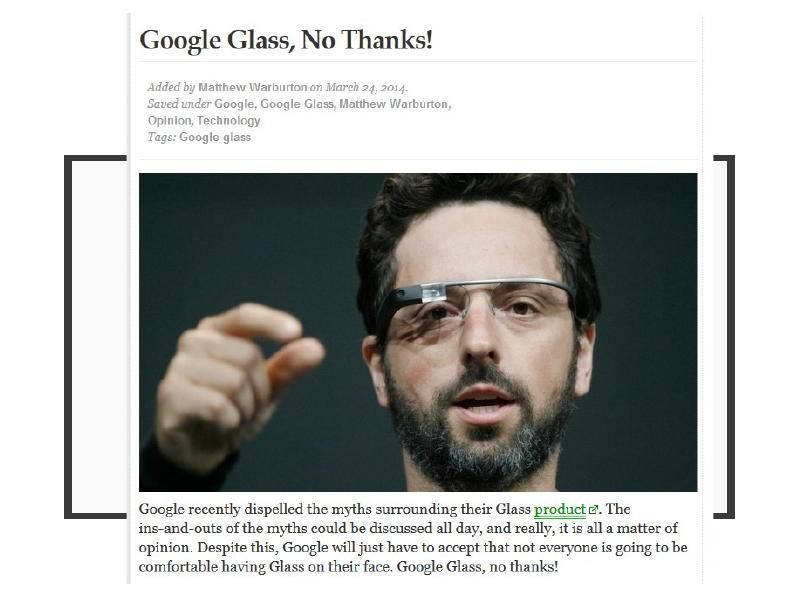{ loading=lazy style="width:47%" }

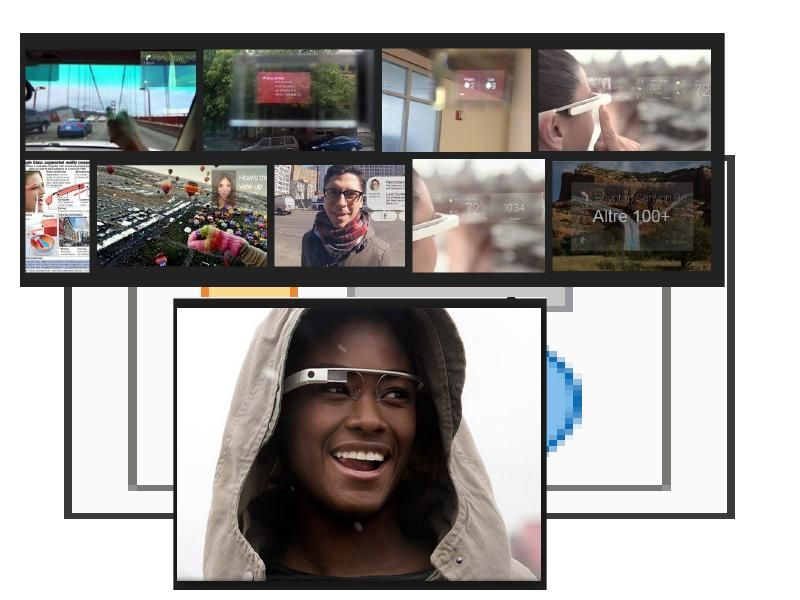{ loading=lazy style="width:47%" }
