# L’istruzione, il lavoro, la scuola

**Data:** 17 aprile 2014 
**Luogo:** Museo Archeologico, Montelupo Fiorentino 
**Incontro con:** Lorenzo Poggi e Paolo Marcucci

**Interventi:** Paolo Marcucci Lorenzo Poggi

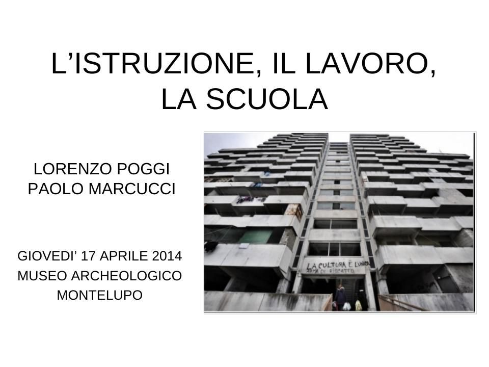{ loading=lazy style="width:59%" }

0:00:31

Paolo Marcucci Va bene, allora possiamo iniziare. Buonasera a tutti. Innanzitutto grazie di essere presenti, perché ormai la partecipazione è diventata quasi una corsa a ostacoli, tra telefoni che non ricevono e mail che non partono, dovuti allo spostamento della biblioteca del Comune al Museo della Ceramica, dove facevamo sempre queste serate; quindi è difficile anche iscriversi, e poi le date non ci hanno aiutato, perché ci sono tutti questi ponti. Comunque grazie davvero di essere presenti.

0:01:27

Una comunicazione di servizio: confermiamo che sabato 10 maggio andiamo a Firenze a vedere la mostra del Pontormo e del Rosso Fiorentino a Palazzo Strozzi («Pontormo e Rosso Fiorentino. Divergenti vie della “maniera”», 8 marzo – 20 luglio 2014). C’è già una lista, dal ragazzo all’entrata, per chi si vuole segnare; intanto anticipiamo i tempi, comunque poi manderemo la settimana prossima una comunicazione più ufficiale, una mail, sperando che arrivi.

0:02:01

L’argomento di stasera è la scuola, la formazione e il rapporto con il lavoro in questo tempo: vediamo di interrogarci un po’ su questo tema. Ogni tanto vado a fare una lezione a un master universitario a Pisa; quest’anno ci sono andato – è un master (il master Eraclito 2000) che riguarda il mondo finanziario – e mi hanno dato la brochure. Mi è cascato l’occhio su questa frase: «L’istruzione e la formazione sono le armi più potenti che si possono utilizzare per cambiare il mondo». Nelson Mandela. Mi è sembrata una bella frase, attinente al tema di stasera.

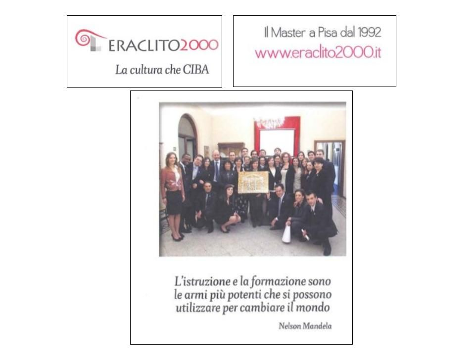{ loading=lazy style="width:59%" }

0:02:53

Però una ancora più bella, forse, è questa, che avevo letto a suo tempo in un libercolo – passatemi il termine – di Carlo Azeglio Ciampi, *A un giovane italiano*, che citava a sua volta Benjamin: «La scuola è l’istituzione che conserva le conquiste dell’umanità come patrimonio, riproponendolo in continuazione. La gioventù, al cui servizio è la scuola, le offre il futuro». Forse è la più bella, la più profonda definizione che si possa dare della scuola, ma comunque della cultura e della formazione. Ora vi proporrò alcune immagini che ho trovato di recente e che vi voglio sottoporre.

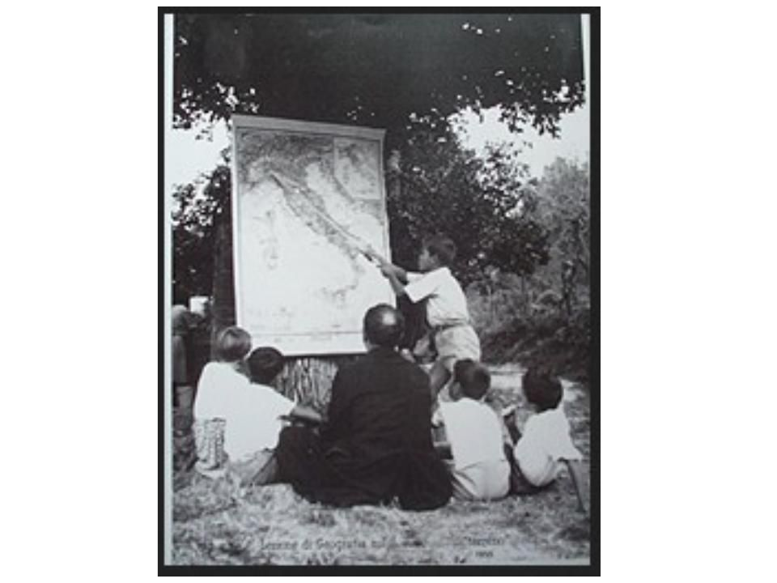{ loading=lazy style="width:47%" }

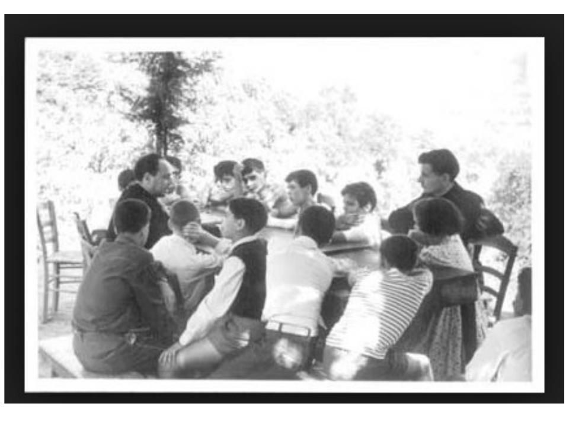{ loading=lazy style="width:47%" }

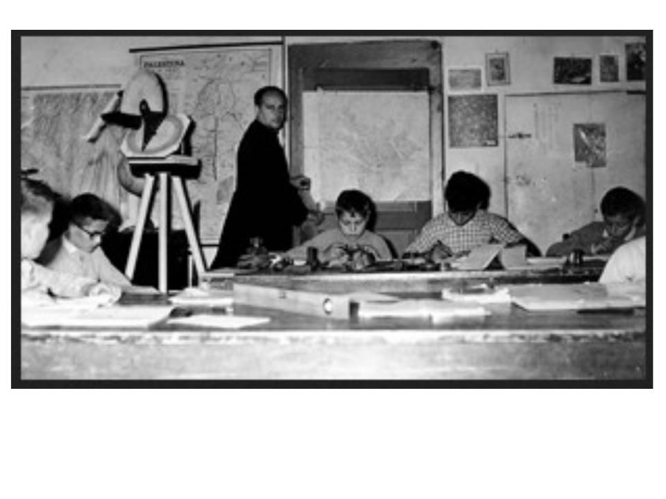{ loading=lazy style="width:47%" }

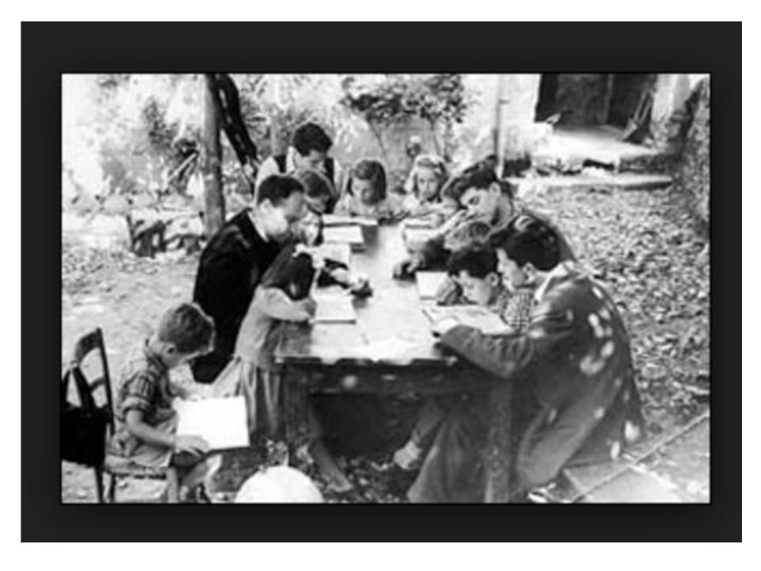{ loading=lazy style="width:47%" }

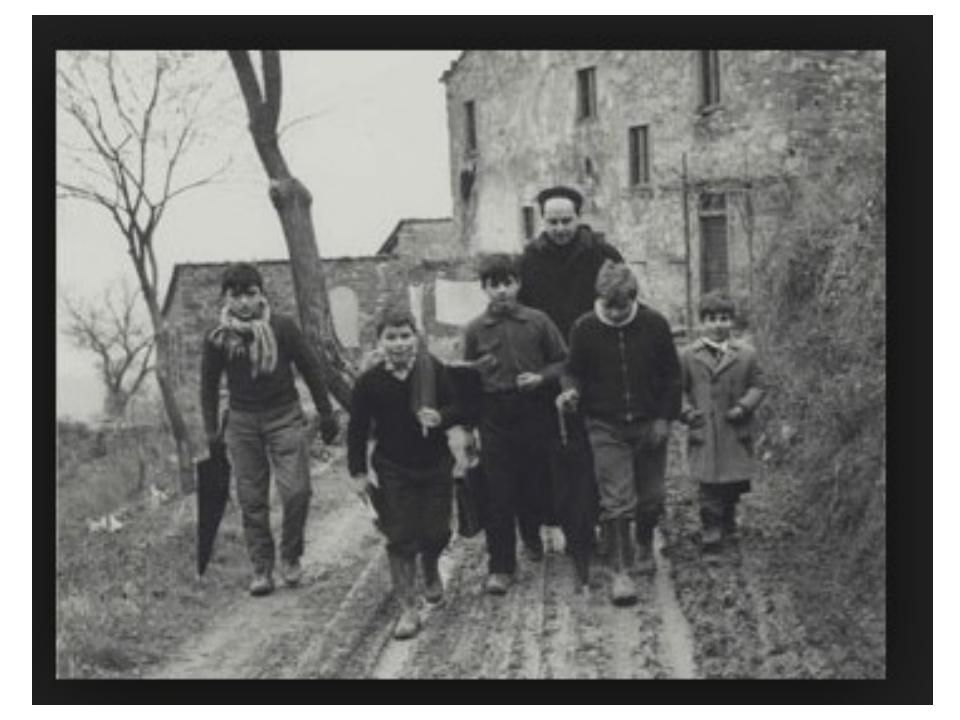{ loading=lazy style="width:47%" }

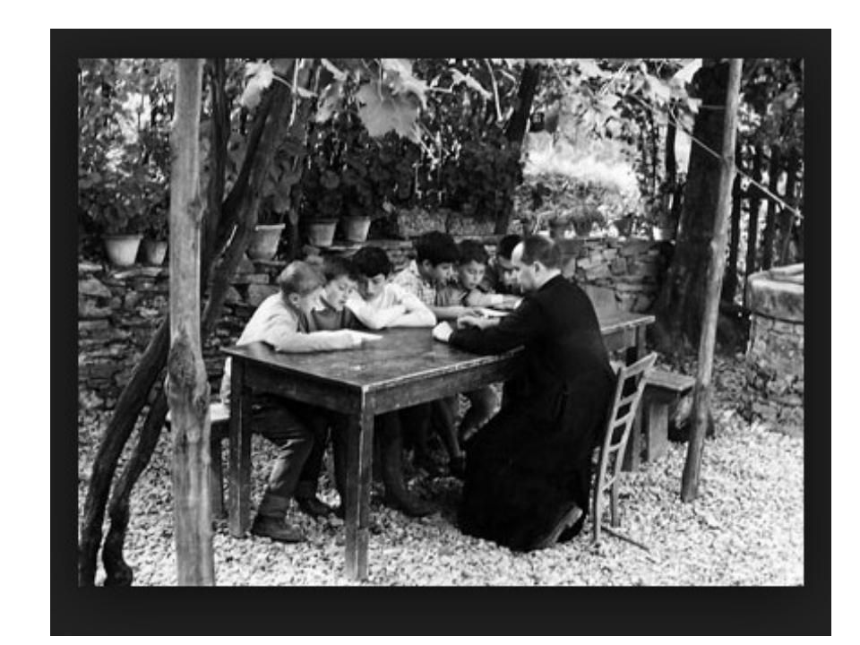{ loading=lazy style="width:47%" }

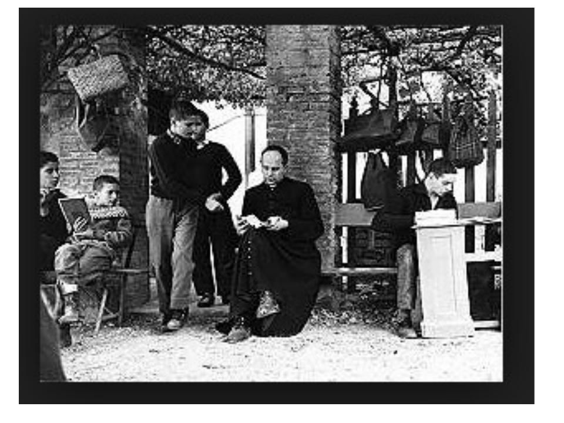{ loading=lazy style="width:47%" }

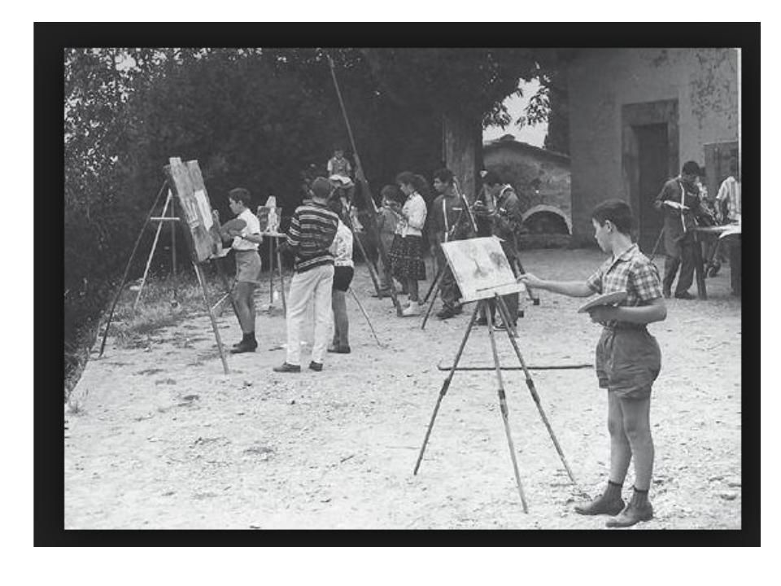{ loading=lazy style="width:47%" }

0:04:40

«Non c’è nulla che sia più ingiusto che far parti uguali fra disuguali»: *Lettera a una professoressa*, di don Milani, del 1967. Anche questa mi è parsa una carrellata di immagini attinenti al tema di stasera, che poi vediamo di approfondire.

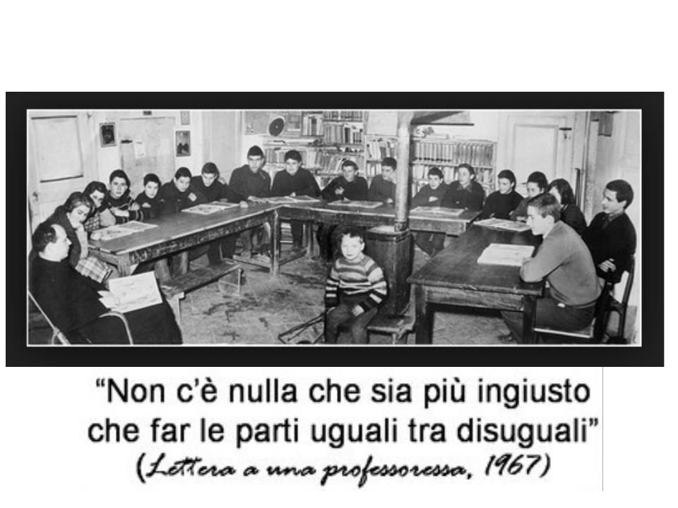{ loading=lazy style="width:59%" }

0:04:59

Una ricerca dell’Università di Stanford, in California, ha recentemente messo in luce la diversità dei destini sociali tra chi proviene da famiglie abbienti e chi da famiglie disagiate: un divario che inizia subito, a 18 mesi, con un gap linguistico. Sostanzialmente quello che l’Università di Stanford, una delle più prestigiose al mondo, mette in luce era quello che diceva già don Milani: «I ricchi comandano perché hanno più parole dei poveri», e soprattutto «la scuola deve curare i malati e non guastare i sani». L’idea era che con la conoscenza e la cultura avrebbe funzionato quello che, con una bella definizione, molti hanno chiamato l’ascensore sociale, cioè il modo in cui ci si muove da un livello, da una classe all’altra.

0:05:57

Anche l’Ufficio studi della Banca d’Italia – per esempio questa è una dichiarazione di Mario Draghi, quando era governatore della Banca d’Italia, nel 2009 – trattava il tema dell’ascensore sociale. La Banca d’Italia ha un prestigioso ufficio studi, di elevatissimo *standing*, con studi di profondità storica interessanti; e da questi studi viene fuori che l’abbandono scolastico è più presente nelle famiglie dove c’è il più basso livello di scolarità. E quindi la scuola, anche in questo caso – certificava Mario Draghi –, fallisce nel ruolo di ascensore sociale, che è quello a cui dovrebbe tendere.

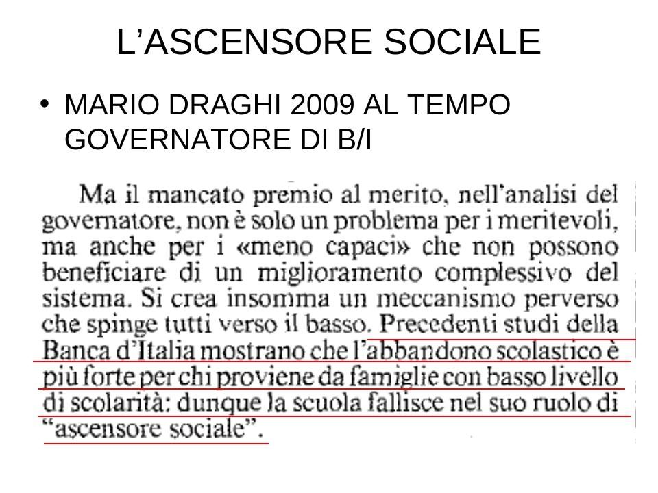{ loading=lazy style="width:59%" }

0:06:51

Tra l’altro, ho trovato qualche tempo fa questa notizia sul Corriere della Sera: in un paesino del Piemonte – Ala di Stura – è stato riproposto il modello della scuola di don Milani. Essendo un paese con pochi abitanti, si ripropone il modello che c’era nelle campagne italiane, toscane, dove tutte le classi erano mischiate all’interno di una stessa aula perché non c’erano numeri sufficienti; e questo modello è stato riproposto proprio per non far scomparire la scuola dal paese e non far scomparire la cultura da questi luoghi. Mi era sembrato un buon esempio.

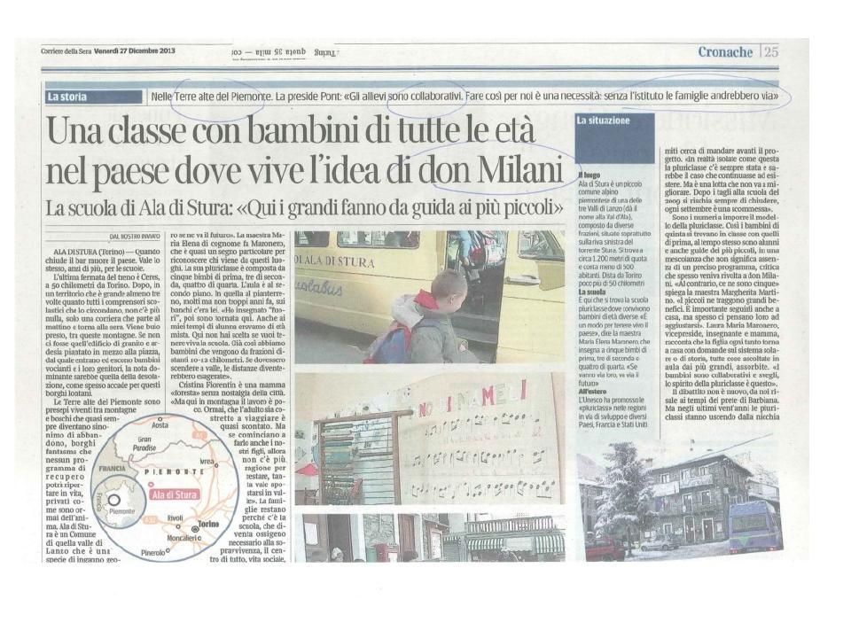{ loading=lazy style="width:59%" }

0:07:35

Un passo indietro. La scuola media, per esempio, viene istituita in Italia nel 1962 (legge n. 1859 del 31 dicembre 1962, che introduce anche il superamento delle classi divise tra maschi e femmine): si abolisce la famosa scuola di avviamento, cioè la scuola che avviava al lavoro, rendendo paritaria la scuola e consentendo a chi faceva la scuola media di accedere a tutte le scuole superiori. È una riforma fondamentale, a cui nel 1969 seguirà la liberalizzazione dell’accesso all’università da tutte le scuole superiori, mentre prima era riservato ai soli diplomati del liceo classico.

0:08:27

Tra l’altro c’era anche questa intervista, che ho letto e che era molto interessante, a Macaluso, uno dei leader storici del Partito Comunista, poi del PD – ma non è di questo che volevo parlare. Lui ricordava la sua infanzia in Sicilia: era figlio di operai, che lavoravano anche in miniera, e diceva che i figli degli operai, quando era giovane lui, non potevano fare il liceo. E qui ritorna il liceo come emblema di classe, che quelle riforme avevano cercato di far superare.

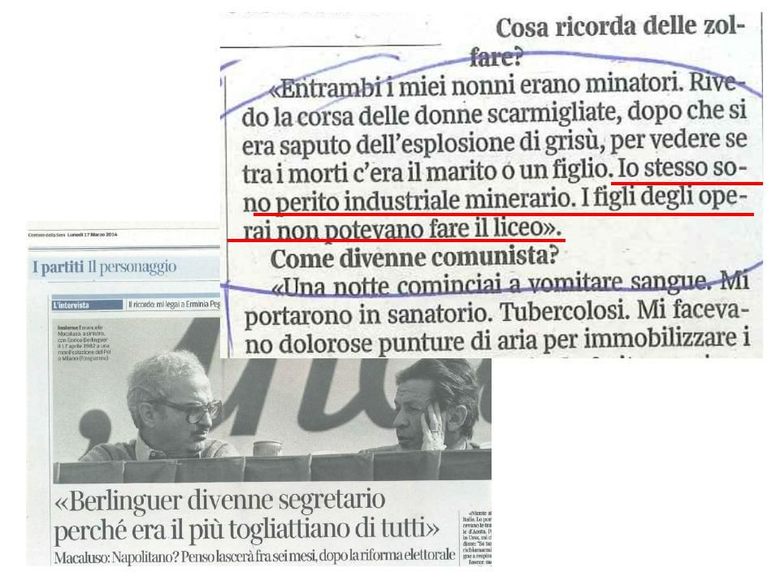{ loading=lazy style="width:59%" }

0:09:23

La settimana scorsa – magari, se qualcuno ha qualche idea, si può anche dibattere su questo tema – c’è stato un processo al liceo classico («Il classico rimandato a settembre», «Italia Oggi», 15 aprile 2014), perché negli ultimi anni il liceo classico ha perso tantissimi iscritti rispetto al passato. C’era una giuria, con accuse e difese; il verdetto è stato di parità, quindi non c’è un verdetto, però la sostanza è che il liceo classico ha perso negli ultimi anni il 50% degli iscritti, a favore di altri licei, scientifici, o degli istituti tecnici. Questo è un altro elemento da tenere in considerazione.

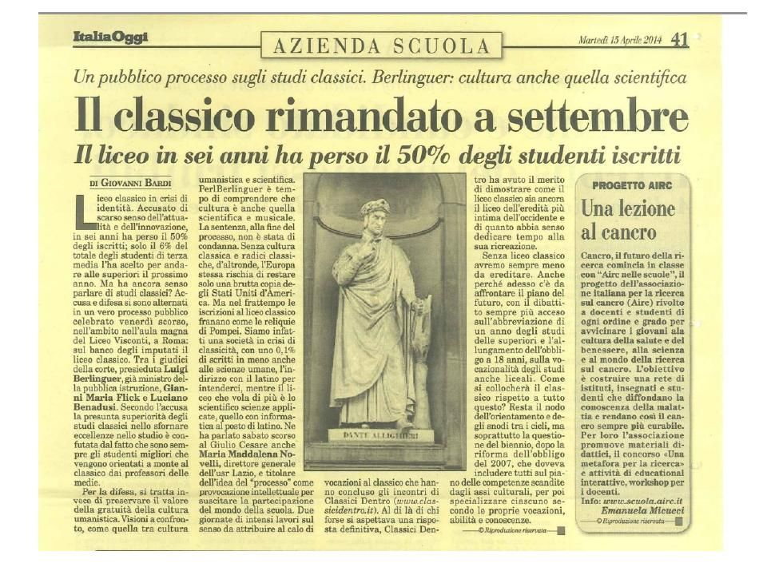{ loading=lazy style="width:59%" }

0:10:04

Ma ora le nostre scuole come sono? In molte scuole non c’è più quella di Barbiana, di don Milani, ma ci sono anche lavagne elettroniche come queste, in tutte le aule. A Montelupo – permettetemi di dirlo – abbiamo investito 6 milioni di euro \[nella slide: circa 5,2 milioni\] nella nuova scuola, una scuola tecnologicamente avanzata, con tutti i crismi della bioedilizia e quindi del rispetto dell’ambiente, che si autoalimenta attraverso l’energia solare, si scalda, si raffresca. Sulle scuole ci abbiamo investito perché crediamo che siano un momento importante nella vita sociale dei cittadini. Però in Italia sappiamo anche che ci sono scuole con un degrado altissimo: questa è solo una fotografia di una scuola presa a caso, dove crollano i tetti. Su questi temi cerchiamo stasera di porre qualche interrogativo e di dare qualche risposta.

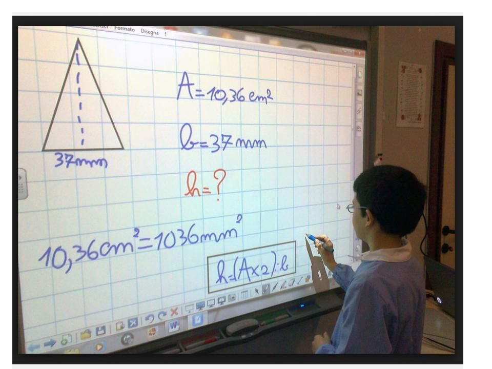{ loading=lazy style="width:47%" }

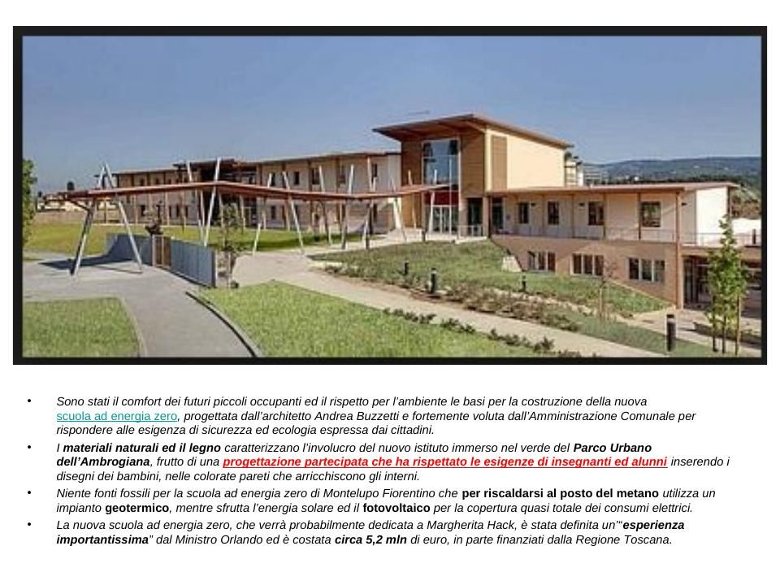{ loading=lazy style="width:47%" }

**LA NUOVA SCUOLA DI MONTELUPO FIORENTINO**

Sono stati il comfort dei futuri piccoli occupanti e il rispetto per l’ambiente le basi per la costruzione della nuova scuola a energia zero, progettata dall’architetto Andrea Buzzetti e fortemente voluta dall’Amministrazione Comunale per rispondere alle esigenze di sicurezza ed ecologia espresse dai cittadini.

I materiali naturali e il legno caratterizzano l’involucro del nuovo istituto immerso nel verde del Parco Urbano dell’Ambrogiana, frutto di una progettazione partecipata che ha rispettato le esigenze di insegnanti e alunni, inserendo i disegni dei bambini nelle colorate pareti che arricchiscono gli interni.

Niente fonti fossili per la scuola a energia zero di Montelupo Fiorentino, che per riscaldarsi, al posto del metano, utilizza un impianto geotermico, mentre sfrutta l’energia solare e il fotovoltaico per la copertura quasi totale dei consumi elettrici.

La nuova scuola a energia zero, che verrà probabilmente dedicata a Margherita Hack, è stata definita un’«esperienza importantissima» dal ministro Orlando ed è costata circa 5,2 milioni di euro, in parte finanziati dalla Regione Toscana.

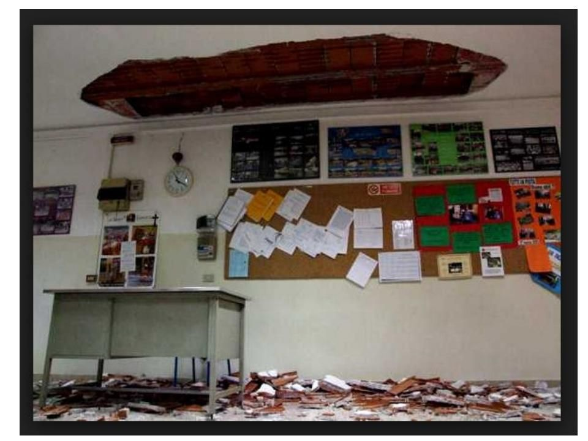{ loading=lazy style="width:59%" }

0:11:20

Personalmente credo che la scuola del dopoguerra, per esempio, abbia assolto in pieno il compito che si era presa in carico. Era una scuola che doveva rispondere a una società che veniva da un’arretratezza culturale, quella dei primi decenni del secolo, e che con il boom economico aveva invece bisogno di persone che sapessero leggere, scrivere, far di conto ed essere adatte al cambiamento economico che con gli anni Sessanta si era fatto avanti e manifestato.

0:12:07

E ora qual è il compito della scuola? È sempre in grado di fare questo tipo di lavoro? È sovradimensionata oppure, all’opposto, è sottodimensionata? C’è un rapporto tra la scuola e la disoccupazione attuale? Sembrerebbe di sì, e magari dopo lo vediamo; solo alcuni dati. Non dimentichiamoci che in questo momento siamo in una delle peggiori crisi economiche, che ha portato il tasso di disoccupazione italiano al 13%, al secondo posto in Europa dopo la Spagna. Il 13%: vedete il grafico rosso in alto, sale, si impenna clamorosamente; è quasi raddoppiato in cinque anni, era al 6,1% e siamo al 13%.

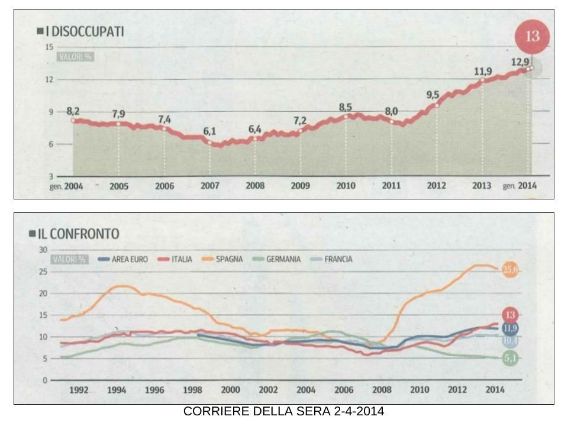{ loading=lazy style="width:59%" }

0:13:03

Se prendiamo invece i giovani, il tasso di disoccupazione attuale è del 42,3%: anche qui siamo a cifre enormi. E se vedete la parte sottostante, ci sono i NEET (*Not in Education, Employment or Training*), l’acronimo che indica i giovani che in questo momento non stanno né studiando né lavorando: sono al 21%, molto più alti rispetto alla media UE, che è al 13%, ma soprattutto rispetto a Paesi come la Francia e la Germania, con cui noi dobbiamo confrontarci, e non con altri: siamo al doppio. E quindi sicuramente la scuola ha a che fare con questo.

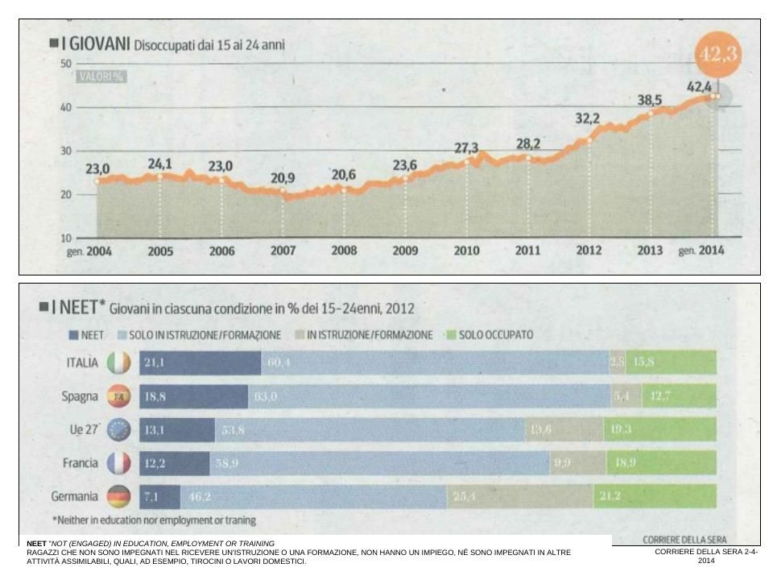{ loading=lazy style="width:59%" }

0:13:51

Però questa è la mia introduzione. Ora, visto che Lorenzo è arrivato in ritardo – e quindi si deve scusare – e dal suo punto di vista, che è stato professore per tanti anni, sono anche curioso di sentire la sua opinione.

0:14:09

Lorenzo Poggi Sì, grazie. Nonostante il ritardo, però... quarant’anni di carriera alle spalle: non ho insegnato per quarant’anni, però la scuola la conosco, magari così, in superficie. L’argomento è estremamente interessante, ed è un argomento che ha una portata profonda sul nostro modo di pensare il mondo.

0:14:34

Cominciamo con una considerazione storica. La nostra scuola, la scuola pubblica, comincia istituzionalmente con gli anni Settanta dell’Ottocento. Fino ad allora non c’era una scuola pubblica: c’era la scuola privata, o per chi se lo poteva permettere il precettore, oppure in qualche caso una scuola comunale, ma insomma molto sporadica. Negli anni Settanta invece il ministro Coppino decide di fare una scuola pubblica, con tre anni di insegnamento obbligatorio: quindi non la terza media, la terza elementare. Nella scuola gentiliana, quella che anch’io ho frequentato – io sono vecchissimo, in terza elementare facevamo un esame: era il residuo della vecchia scuola obbligatoria. Qualcuno si fermava in terza, perché sennò troppa cultura danneggia: la terza elementare era il primo intoppo che si trovava nel percorso.

0:16:05

E la scuola, il leggere e scrivere, è intanto in contrasto con la Chiesa. Nel 1870 \[recte 1864\] Pio IX pubblica il Sillabo – il Sillabo, elenco per alfabeto dei peccati, degli errori che si devono evitare –, e in questo elenco c’è, bollato come peccato mortale, pensare che l’insegnamento debba essere sottratto al controllo della Chiesa e del vescovo, che si possano istituire delle scuole pubbliche con dei maestri che non hanno l’approvazione del vescovo. È un peccato mortale, dice Pio IX, pensare che sia possibile questo. Quindi tutta la scuola pubblica, e tutti quelli che ci insegnavano dentro, erano... per dire da dove si sviluppa la prima scuola.

0:17:34

Nel 1912 si istituisce il suffragio universale maschile. Per poter votare si doveva essere alfabeti, si doveva dimostrare di saper leggere e scrivere. Guardate: dimostrare di saper leggere e scrivere non vuol dire effettivamente leggere qualcosa e capirci qualcosa; vuol dire scrivere «L’Italia è la mia patria»: se lo sai scrivere sei alfabeta e puoi votare, non è detto che tu lo sappia leggere. Ma, insomma, se uno non sapeva leggere poteva lo stesso votare – questo apriva la strada ai contadini, alla gran massa contadina del Sud – purché avesse fatto il servizio militare o avesse compiuto trent’anni. Quindi il suffragio universale maschile del 1913 – mi sembra sia la prima votazione, siamo alla vigilia della Prima guerra mondiale – porta queste novità. Perché votino le donne, lo sappiamo, ci sono state delle difficoltà: ci vorranno ancora una trentina d’anni. Però intanto c’è il suffragio universale maschile. La scuola era importante, perché chi sapeva leggere e scrivere poteva votare anche se aveva solo la maggiore età, 21 anni.

0:19:22

Quindi la scuola come strumento di educazione, di passaggio di conoscenze, fondata sulla figura del maestro. La divisione tra maschi e femmine è rigorosissima: ci sono i maestri maschi che insegnano ai maschi, in classi maschili, e le maestre, eccetera. Questa divisione sarà mantenuta fino al ’62, fino alla scuola media unica, quando ci saranno ancora insegnanti di educazione fisica maschili e femminili – mentre anche le signore potrebbero insegnare educazione fisica ai maschi. C’è una divisione nettissima, anche delle classi. Sì, lo so che sono preistorico, ma non è colpa mia.

0:20:24

E dicevo: la scuola serve a che cosa? Serve a trasmettere conoscenze. La nostra scuola, anche quella precedente la riforma della scuola media del ’62, è ancora la scuola della riforma gentiliana. Giovanni Gentile fa la riforma della scuola che durerà più a lungo, nel 1923. Mussolini la definisce «la più fascista delle riforme»: è già un apprezzamento importante da parte del capo del governo. In effetti Gentile non è che fosse proprio fascista fino in fondo: rappresentava una certa idea di liberalismo che aveva volentieri aderito al fascismo, e sarà uno dei suoi più importanti esponenti. «La più fascista delle riforme».

0:21:21

L’idea gentiliana è che esiste uno spirito che si sviluppa nel tempo e che viene attualizzato, fatto vivere nel presente, dagli uomini che vivono nel presente e che si riconoscono in questo spirito. Non è l’individuo che conta: l’individuo conta in quanto si relaziona con questo spirito. Il compito della scuola è quello di trasmettere queste verità, queste conoscenze, questo spirito, e quindi di mantenere viva l’idea della verità e di consentire alle nuove generazioni di dare il loro contributo alla storia, alla crescita di questo spirito.

0:22:18

Questo per coloro che sono destinati alla dirigenza e fanno il liceo classico, con la filosofia e il latino. Per tutti gli altri c’è un altro tipo di scuola, senza latino e senza filosofia; e in questa scuola c’è l’insegnamento, dopo il ’29, della religione, perché la religione è il precedente della filosofia: è un modo di accostarsi a questo spirito che diviene nel tempo, concretizzandosi in momenti storici. E quindi, per chi non arriva alla filosofia, c’è la religione, che serve a dare l’idea della trascendenza, dei principi eccetera. Questo sarà estremamente utile a Mussolini nel ’29, quando farà il Concordato con la Santa Sede.

0:23:09

Quindi una scuola di questo tipo, con tutti gli sbarramenti per impedire che la scuola servisse come ascensore sociale: esame in terza elementare, esame in quinta elementare, con la possibilità poi di continuare facendo una sesta, addirittura una settima. Sbarramento per l’ingresso nella scuola media, con il latino. Io sono preistorico: quando ho fatto l’esame di ammissione alla scuola media, nei comuni di Lastra a Signa e di Signa c’era una sola scuola media, a Lastra. Tutti gli studenti dei comuni di Lastra a Signa e di Signa eravamo in tutto circa 36: 36 ragazzi che facevano l’esame d’ammissione a settembre, e riuscimmo a passarlo in 22. Poi la classe era di 25, perché c’erano tre ripetenti. Una sola classe per due comuni di 30-35.000 abitanti. Quindi sbarramenti di tutti i tipi; poi all’università si arrivava soltanto attraverso il liceo classico.

0:24:51

Perché? Perché la cultura, la conoscenza e la verità arrivano attraverso la partecipazione a questo spirito, che è individuato dalla cultura classica e dalla filosofia. Questa riforma durerà a lungo nella nostra scuola, praticamente fino alla riforma del ’62, e da lì in poi arriveremo a una trasformazione. Oggi stiamo vivendo una trasformazione ancora più profonda, perché viene meno questo senso di valore sicuro, di conoscenze certe che la scuola trasmette e ha il compito di trasmettere. Oggi nella rappresentazione del mondo che la cultura fa entrano in gioco una serie di elementi, che ci metteremo poi a vedere.

0:26:09

Il primo, il più importante di tutti, è il fatto che, per esempio dal punto di vista etico, non esiste più il senso di una serie di valori certi riconducibili a un valore assoluto. L’etica oggi si pone in una condizione estremamente mobile: più che di norma, del dovere che serve a dare indicazioni sulle scelte, è un’etica che insegue ciò che avviene. Prima la scuola, quando trasmetteva valori etici, trasmetteva valori sicuri, che consentivano ai discenti che li ricevevano di atteggiarsi nei confronti di ciò che succede nell’ordinario scorrere dell’esistenza. L’idea di dovere legata a una verità trascendente assoluta: nel Medioevo era quella della religione; per l’Illuminismo sarà quella dettata dal dovere della ragione, di radice kantiana; poi ci saranno i vari valori civici legati all’esistenza. Poi questo è andato svanendo.

0:27:49

Oggi si è perduto questo, e da qui la difficoltà della scuola a insegnare valori. Perché? Perché abbiamo un’etica che non è più un dire, un dovere rispetto alle scelte che si presentano nell’esistenza – era ancora l’etica che la scuola ha trasmesso a me –: c’è un’etica che dice che dobbiamo inseguire di volta in volta i problemi che l’esistenza pone; non c’è più la guida sicura. Quando lo sviluppo e il progresso delle tecnologie, della biologia, della medicina pongono dei problemi, di fronte a questi non abbiamo una serie di valori certi che guidano l’etica, quelli che venivano trasmessi una volta: di volta in volta dobbiamo inventare, dobbiamo inseguire quello che avviene, i fatti, e per rispondere ai fatti costruire di volta in volta un principio etico. Da qui la difficoltà, per esempio, della scuola di trasmettere valori come invece una volta veniva fatto.

0:29:21

Ha occupato le cronache il caso della signora che, per un’inseminazione, si è trovata a gestire una gravidanza di due gemelli che non sono biologicamente suoi. Questo è un fatto, è un problema etico di fronte al quale non c’è un valore certo: è il progresso tecnico della biologia che di volta in volta può porre questo tipo di problemi. È sempre successo che le signore magari avessero dei figli che non erano proprio del marito – non c’era bisogno di un grande progresso –, ma lì c’era un principio etico preciso. Come diceva Tertulliano, non si deve guardare alla bellezza della moglie, si deve guardare che essa sia fedele, basta: il pericolo era quello, da cui il vecchio proverbio «*mater certa, pater semper incertus*». Questo è sempre successo, ma non è mai successo in questo modo, ponendo questo problema. È un esempio.

0:30:46

Non c’è più il valore certo che ci permette di scegliere di fronte all’avvenimento: sono l’avvenimento, la novità, i continui mutamenti e trasformazioni dovuti al progresso che ci pongono di volta in volta il problema della scelta. Da qui la difficoltà dell’istituzione scuola nella trasmissione dei valori, quelli certi, solidi, incorruttibili, che una volta c’erano perché appoggiati e sostenuti dalla verità trascendente della filosofia e dalla verità trascendente della religione. Poi riprendiamo l’argomento.

\[PAUSA\]
{: .nota }

0:48:00

Paolo Marcucci Allora, dopo la prima pausa riprendiamo, e guardiamo di recuperare un po’ di tempo, a causa del nostro Lorenzo. Qual è la situazione attuale del sistema educativo e della scuola? E soprattutto la domanda è questa: che tipo di formazione, di educazione, arriva oggi come richiesta dalla società e dall’economia? È un po’ il tema che Lorenzo ha introdotto nell’ultima parte, prima: i cambiamenti della tecnica e dell’economia impongono alla scuola anche la richiesta di adeguarsi a questo nuovo sistema, e quindi bisogna chiedersi se siamo in grado di fornire, e se è giusto poi fornire, quel tipo di educazione e di formazione. Infatti ci sono tanti punti di vista.

0:49:21

Mi piaceva, per esempio, narrare un paio di storie attraverso i curriculum che girano. In questo momento, per certi tipi di attività, la cultura, la formazione è diventata un peso o una zavorra, e non sempre è bene dirla. Infatti ora di curriculum se ne fanno sempre di due o tre tipi, a seconda della società, della ditta o dell’impiego che si va a cercare: per certe ditte si fanno curriculum più leggeri, per certe altre più pesanti, perché a volte la troppa cultura può essere anche un peso. Raffaella si è laureata in criminologia nel 2011 e da due anni cerca lavoro custodendo nello zaino due curricula: era quello che dicevo prima. Marta, per esempio, si è laureata nel 2007, con un master in didattica museale; l’ultimo lavoro sfiorato, racconta, è di qualche mese fa: ha risposto a un annuncio di una scuola di design che cercava una segretaria, contratto di due mesi passando per un’agenzia interinale – capite che cosa significa. Sostanzialmente, per la mansione e il tipo di lavoro richiesto, tutta questa formazione è eccessiva: infatti nell’annuncio successivo \[la scuola ha specificato «No laurea»\] e lei ha cancellato dal suo curriculum la laurea, l’ha proprio tolta dal testo.

**LE STORIE ATTRAVERSO I CURRICULUM**

Quando la laurea diventa un peso o una zavorra si inizia a nasconderla, perché? È meglio non farlo sapere.

Raffaella si è laureata in criminologia nel 2011. Da due anni cerca lavoro custodendo nello zaino due curricula: nel primo ha scritto tutte le sue qualifiche, nell’altro appare solo diplomata.

Marta, laureata nel 2007 e con un master in didattica museale, racconta: «L’ultimo lavoro sfiorato è di pochi mesi fa. Ho risposto a un annuncio, una scuola di design cercava una segretaria. Contratto di due mesi, passando per un’agenzia interinale, e poi un anno direttamente assunta dalla scuola. Requisito fondamentale: un’ottima conoscenza dell’inglese. Ho superato tutti i test e alla fine mi sono sentita dire che non andavo bene perché avevo una laurea e un master».

Nel successivo annuncio la scuola di design ha pubblicato la stessa richiesta specificando in calce: «no laurea».

0:51:09

E quindi a volte ci si potrebbe chiedere: ci sono tanti giovani che oggi hanno una laurea – qualcuno ha anche dottorato e master –, sanno tutto di come gira in questo momento il mondo, l’economia e anche la cultura, però non trovano sbocchi ai loro studi; e quindi ci si chiede, e loro se lo chiederanno ancora più di noi, in che cosa hanno sbagliato, in questa formazione, se è convenuta (scrive Luciano Gallino: «i giovani che non trovano occupazione nemmeno quando sono in possesso di laurea, dottorato e master, oltre a smanettare sui tablet come professionisti, si chiederanno in che cosa hanno sbagliato»).

0:51:48

In questo momento, per esempio – dall’altro lato della medaglia – nei curriculum assumono peso anche esperienze fatte nel sociale, dove il volontariato diventa un valore aggiunto. La realtà non è così semplice: da una parte ci sono casi come quelli di prima, dove la laurea è un peso, e dall’altra casi in cui magari esperienze di tipo sociale o di volontariato assumono un valore positivo nel presentare il proprio curriculum.

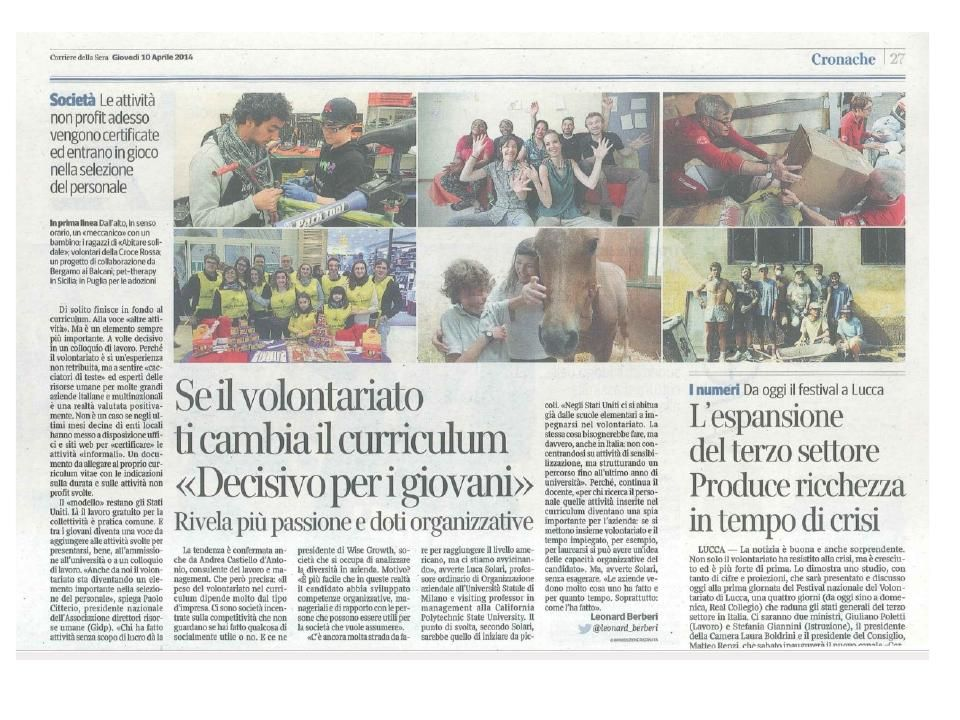{ loading=lazy style="width:59%" }

0:52:17

In questo momento, per esempio, molte aziende, quando ricevono i curriculum di presentazione delle domande di lavoro, stanno tracciando attraverso i social media che tipo di persona sia chi presenta il curriculum. Perché nei social media, in internet – l’abbiamo visto anche nella serata passata, quando avevamo parlato di questi temi – lasciamo delle briciole; e queste briciole ora sono rintracciate dalle aziende, per capire che tipo di persona sia quello lì e se il curriculum che presenta è allineato con quello che traspare invece dalla ricerca in rete delle informazioni che lasciamo.

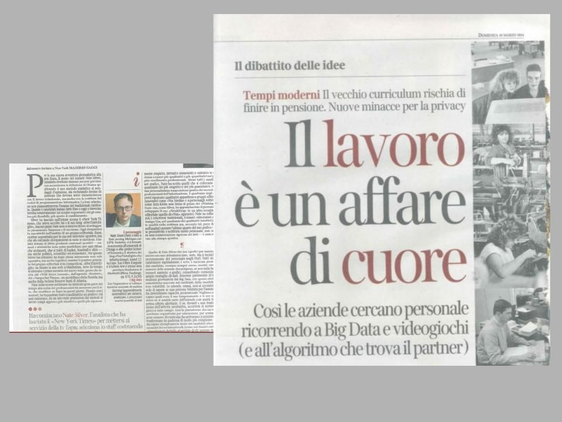{ loading=lazy style="width:59%" }

0:53:16

E quindi c’è un’altra cosa, oltre a questa. Noi ora abbiamo visto il lato di chi presenta il curriculum della propria formazione; però un curriculum si presenta in genere a un’attività, a una società, a un ente pubblico. Se ci limitiamo, per esempio, alle ditte e alle società, si vede che le aziende italiane sono ancora arretrate, perché sono posizionate su un tipo di mercato che non richiede tutte queste specializzazioni. Ci sono studi che lo dimostrano, e ora ve ne do una piccola introduzione.

**LE STORIE ATTRAVERSO I CURRICULUM**

Nell’Italia della precarietà il lavoro che si offre è sempre più dequalificato: rispondere al telefono di un call center, occuparsi degli scaffali e della cassa nei supermercati, assolvere compiti di segreteria pura (ricevere telefonate, imbustare e inviare lettere, annotare appuntamenti, rispondere a email: basta una conoscenza di base del linguaggio dei computer per tutto questo).

Imprese dove quattro titolari ogni dieci hanno la terza media (fonte: AlmaLaurea) hanno sempre più bisogno di manovalanza e sempre meno di pensiero e conoscenza. In questo contesto la laurea diventa solo un ostacolo. Un manager laureato, dicono ancora le ricerche, assume laureati tre volte di più rispetto a un manager senza titolo.

Ma vediamo ora l’analisi che ne fa il *prestigioso* ufficio studi della Banca d’Italia.

0:54:16

Anche qui mi rifaccio all’Ufficio studi della Banca d’Italia, che, come vi dicevo, è uno dei più prestigiosi in Italia in questo momento. Per esempio, nel 2014 la produzione industriale italiana risulta più bassa di circa un quarto, quindi del 25%, rispetto al 2008; il tasso di occupazione per quelli in età compresa tra i 15 e i 24 anni è sceso al 42%, mentre prima era al 60%. Questo studio della Banca d’Italia si intitola *Capitale umano, innovazione e crescita economica* \[intervento del governatore Ignazio Visco al convegno biennale del Centro Studi Confindustria, Bari, 29 marzo 2014\], quindi è un po’ il tema che stiamo cercando di affrontare stasera. Negli anni della crisi, tra il 2008 e il 2012, la produttività è arretrata nel nostro Paese, -0,2%, mentre negli altri Paesi, in Germania, in Francia e nella media UE, al contrario è aumentata.

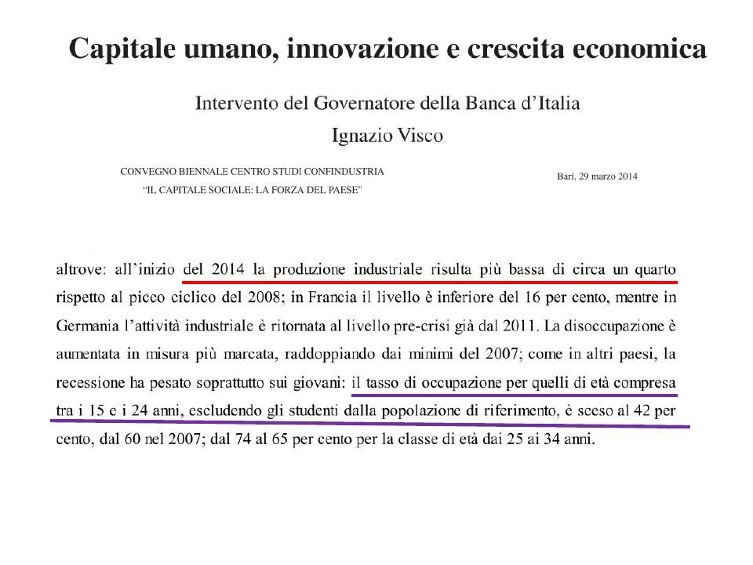{ loading=lazy style="width:47%" }

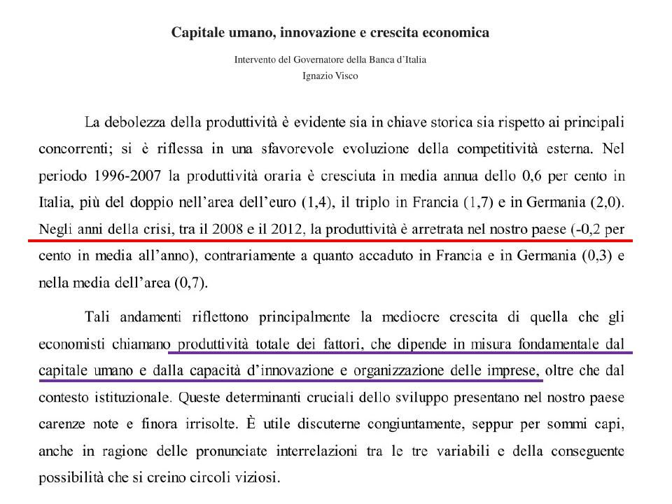{ loading=lazy style="width:47%" }

0:55:18

Allora, che cosa dice lo studio della Banca d’Italia? Che la produttività dipende da diversi fattori, e in misura fondamentale dal capitale umano; e l’utilizzo del capitale umano dipende anche dalla capacità di innovazione e di organizzazione delle imprese. Perché, se uno ha cultura ma la produzione, come dicevamo prima, non la richiede, è quasi inutile. Perché ci sia una crescita della produttività, ci devono essere delle aziende e degli imprenditori dinamici, che possano sfruttare questo capitale e cambiare anche il tipo di produzione, in modo che richieda questo tipo di competenze.

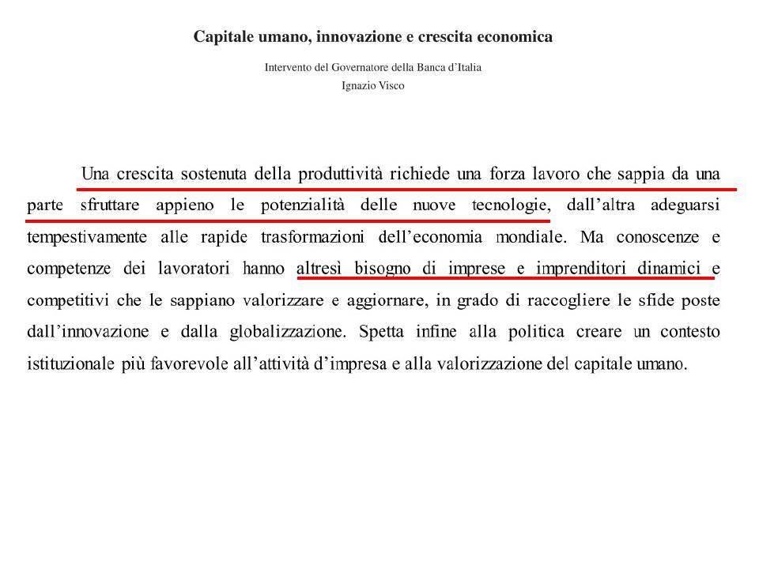{ loading=lazy style="width:59%" }

0:56:12

Questa è la fotografia di due anni fa della struttura economica – tanto non è cambiata, ci serve per avere un’idea. Nei quadretti cerchiati di rosso ci sono, a sinistra, le dimensioni delle aziende: quelle con un dipendente, quelle tra due e nove, e poi il resto, quelle più grandi. Dall’altra parte ci sono il numero delle imprese e degli addetti: sono la stragrande maggioranza del totale italiano, 2 milioni e 6 \[imprese\], 5 milioni e mezzo \[di addetti\]. Quindi vuol dire che la nostra struttura economica è fatta di micro e PMI, piccole e medie imprese; e in queste piccole e medie imprese il capitale umano non è richiesto in maniera così forte, a meno che non si trovi un’innovazione culturale, economica, di spirito imprenditoriale, come quella che nel boom economico fece nascere in Italia tutte queste piccole aziende, che sono state e sono tuttora la struttura portante della nostra economia. Però probabilmente c’è bisogno di reinventarle, perché in questo modo non si riesce a coniugare bene la formazione italiana, che è anche di livello, e la struttura economica che deve sostenerla.

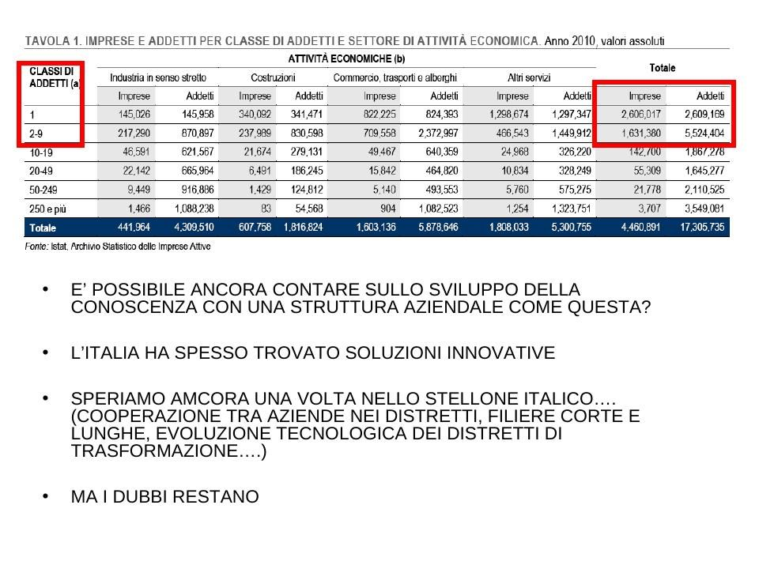{ loading=lazy style="width:59%" }

**LA STRUTTURA DELLE IMPRESE ITALIANE**

*Nella tabella (Istat, anno 2010): le imprese con un solo addetto sono 2.606.017 (2.609.169 addetti), quelle da 2 a 9 addetti 1.631.380 (5.524.404 addetti), su un totale di 4.460.891 imprese e 17.305.735 addetti.*

È possibile ancora contare sullo sviluppo della conoscenza con una struttura aziendale come questa?

L’Italia ha spesso trovato soluzioni innovative.

Speriamo ancora una volta nello stellone italico… (cooperazione tra aziende nei distretti, filiere corte e lunghe, evoluzione tecnologica dei distretti di trasformazione…).

Ma i dubbi restano.

0:58:02

E questo però vale anche a livello generale: per esempio c’è un analfabetismo funzionale, non solo dei giovani ma anche degli adulti, e l’Italia è uno dei Paesi europei più indietro da questo punto di vista. Questo è un altro grafico, che mette in relazione, per esempio, il parlare inglese con le attività e lo sviluppo del PIL e dell’economia. L’Italia, dove c’è la freccia – non so se si vede da là –, anche lì è sul medio-basso. Non so se questa sia una relazione decisiva, ma comunque ci fa pensare che anche lo sviluppo delle lingue, soprattutto dell’inglese, abbia una sua importanza.

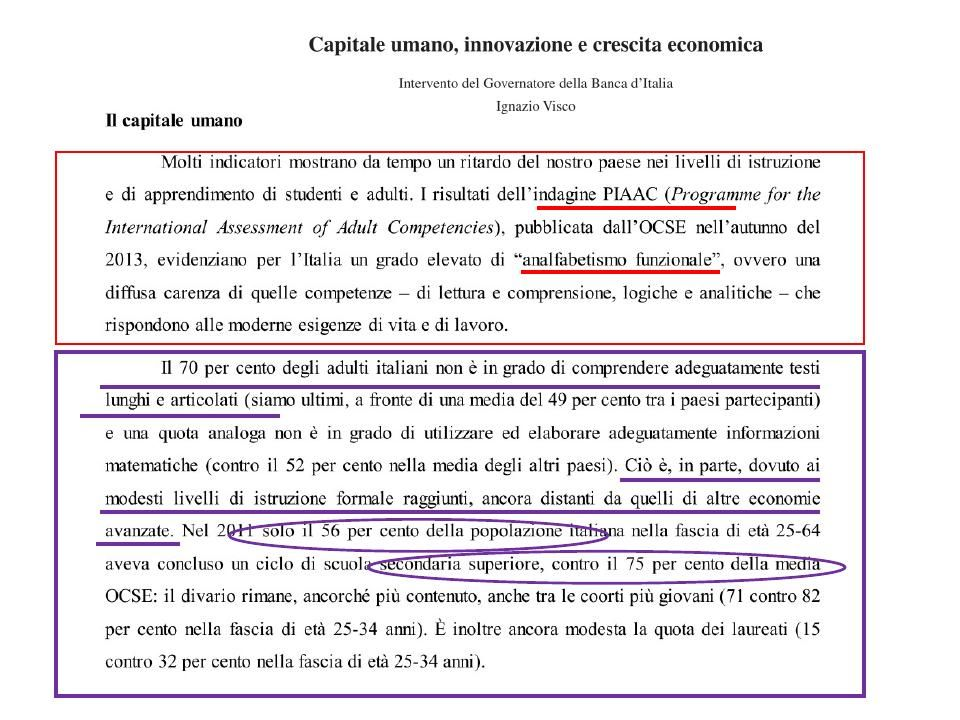{ loading=lazy style="width:47%" }

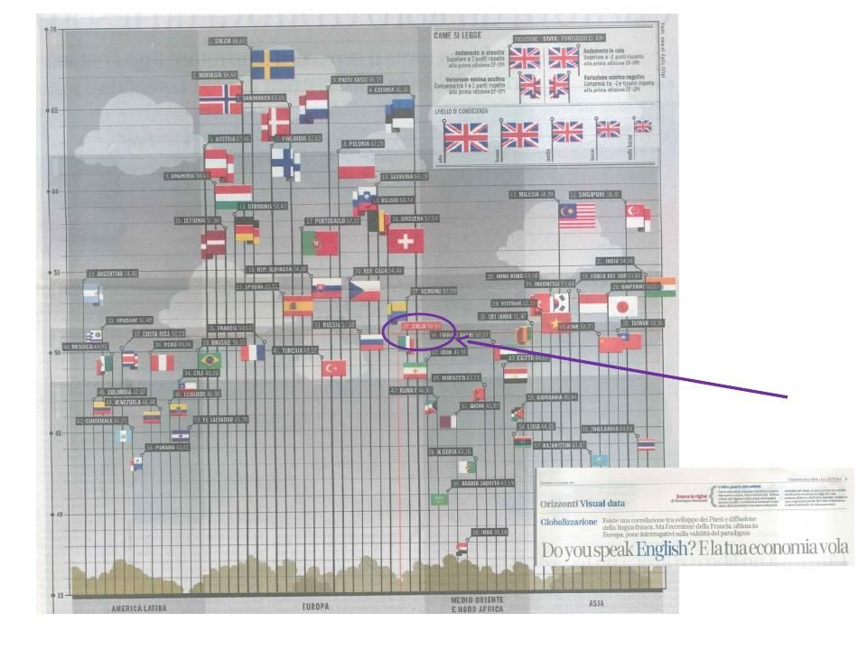{ loading=lazy style="width:47%" }

0:59:00

Tra l’altro, da questo studio della Banca d’Italia ci dicono che in Italia chi si è laureato ha un tasso di rendimento, rispetto a chi non lo è, del 5%: vuol dire che un laureato in genere guadagna il 5% in più rispetto a chi non lo è. Negli altri Paesi questo tasso si attesta intorno all’8-10%: cioè i nostri laureati sono pagati molto meno rispetto agli altri Paesi europei. Infatti negli ultimi anni c’è stata anche quella che si dice fuga dei cervelli: ci sono tanti giovani italiani che sono andati all’estero e fanno anche la fortuna di centri di ricerca.

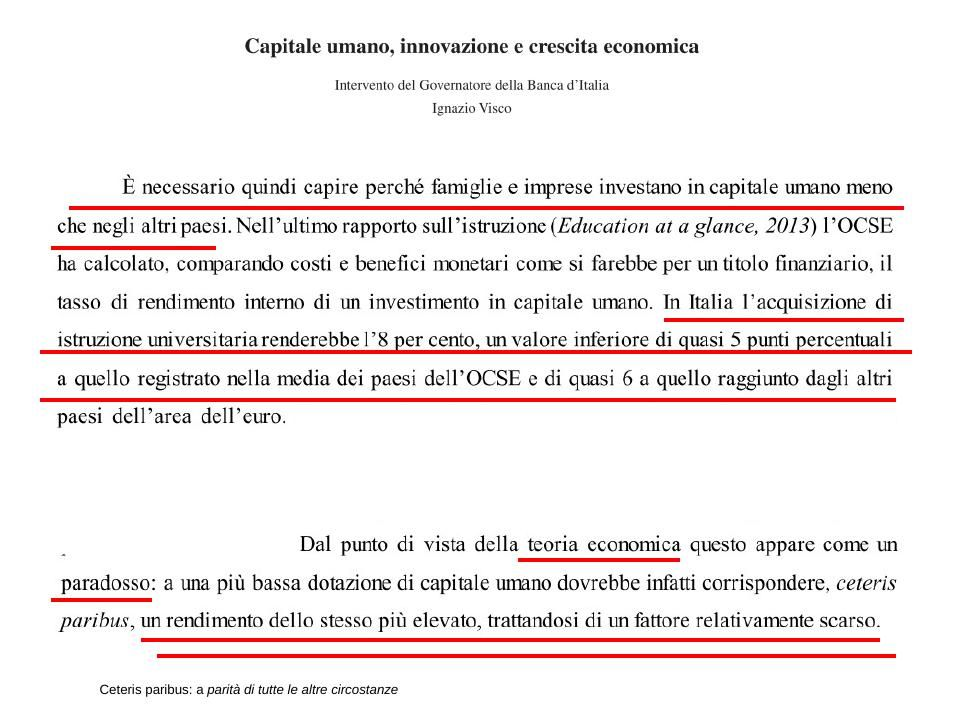{ loading=lazy style="width:47%" }

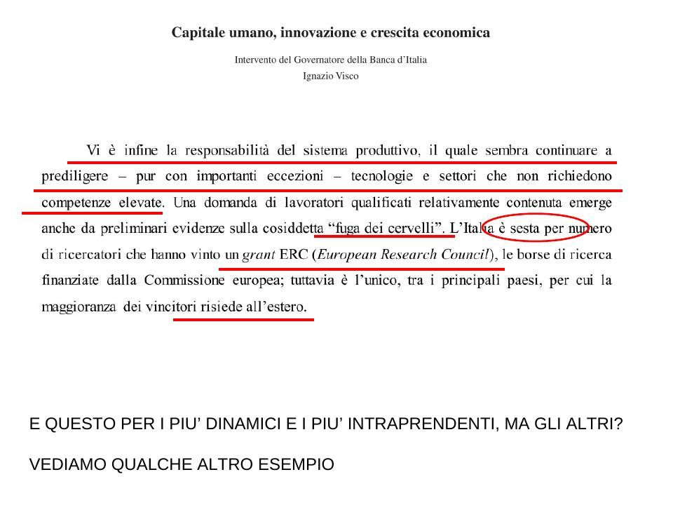{ loading=lazy style="width:47%" }

1:00:00

Non so se avete visto: la scorsa settimana, quindici giorni fa, c’è stato un *casting* degli sceicchi a Padova \[nella registrazione: «a Roma»\] («Il *casting* dello sceicco. Quelle ragazze in coda per il tour di shopping», «la Repubblica»). Cercavano ragazze, anche laureate, colte, che parlassero inglese e le lingue, per poter essere assunte per andare a fare shopping: il loro contratto di lavoro era andare a fare shopping insieme agli emiri in giro per l’Europa; gli veniva dato un milione di euro e dovevano tornare a casa alla fine dei quindici giorni avendo speso tutto. Questo era il lavoro. Alla fine prendevano quelle più belle, ma sceglievano anche quelle che avevano lauree e cultura. Questo è il mondo che cambia: chi se lo sarebbe aspettato? Un tipo di impiego, anche momentaneo, come questo qua.

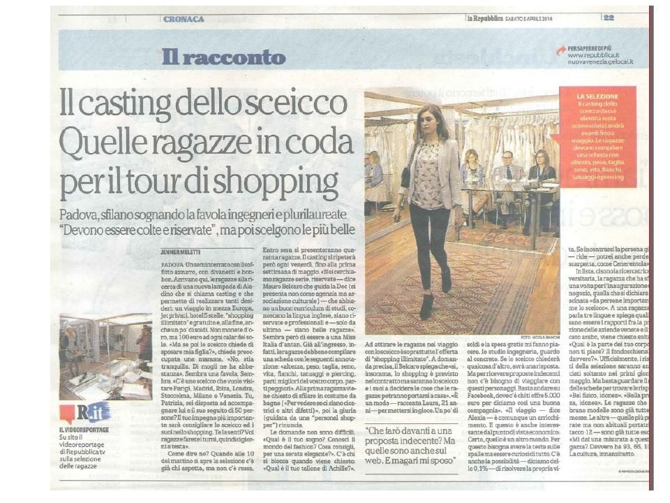{ loading=lazy style="width:59%" }

1:01:09

Su eBay ormai si mette il lavoro. C’è questo annuncio (riportato da «Diritto & Rovescio», 8 aprile 2014), che mi ha un po’ colpito: «Sono una ragazza di 33 anni, laureata, automunita, libera professionista nel settore editoriale. Cerco lavoro *part-time* come baby sitter, dog sitter e aiuto compiti, pulizie, badante in zona San Mauro Torinese, Torino centro. Bella presenza, parlo fluentemente inglese. Ho una bambina di due anni. Prezzi orari onesti». Questa è la realtà.

**EBAY E IL LAVORO**

Ormai su eBay non si mettono in vendita solo le macchine blu dello Stato ma anche coloro che, dopo averlo cercato con ogni altro mezzo, vogliono comunque riuscire a trovare un posto di lavoro.

I testi meriterebbero di essere analizzati dalle facoltà di economia che, attardandosi a sfrugugliare solo i dati statistici (che pure sono importanti, intendiamoci bene), si lasciano poi scappare di mano il paese così com’è, con le sue tensioni e le sue speranze che non si prestano a essere messe in equazioni ma che contribuiscono a costruire il mood dell’Italia.

Vediamo un annuncio: «Sono una ragazza di 33 anni, laureata, automunita, libera professionista nel settore editoriale. Cerco lavoro part-time come baby sitter, dog sitter e aiuto compiti, pulizie, badante in zona San Mauro Torinese, Torino centro. Bella presenza, parlo fluentemente inglese. Ho una bambina di due anni. Prezzi orari onesti».

(«Non arrossite, voi? Io, sì», «Diritto & Rovescio», 8 aprile 2014)

1:01:48

E forse in questo momento c’è un altro elemento che stiamo sottovalutando: l’automazione che sta avvenendo nella società. I cambiamenti a cui accennava prima anche Lorenzo sono sotto gli occhi, e ci sono degli studi che ci permettono forse di intuire quello che sarà non tra cinquant’anni, ma il futuro di ora, dei prossimi cinque-dieci anni. Questo è un robot che dirige l’orchestra, in America, a Detroit: si chiama Asimo, è il robot della Honda, e ha diretto la Detroit Symphony Orchestra in un concerto (maggio 2008) in onore del violoncellista Yo-Yo Ma. Ma questo era solo per introdurre quest’ultima scheda.

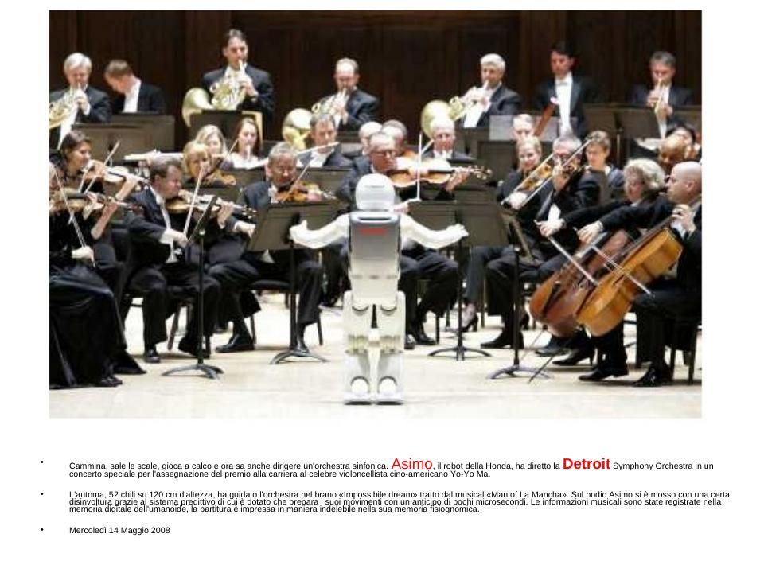{ loading=lazy style="width:59%" }

1:02:37

È stato calcolato («Pagina99», 8 marzo 2014) – le percentuali possono essere più o meno giuste, ma ci danno l’idea di quello che potrà essere il futuro prossimo venturo – la probabilità che un robot ci sostituisca. Si parte dalla probabilità più bassa fino a quella più alta: per i medici c’è solo lo 0,42% di probabilità di essere sostituiti dalle macchine, così come per gli ingegneri meccanici; i matematici sono al 4,7%, gli elettricisti al 15%, gli analisti finanziari al 23%, gli idraulici invece al 35%, e via via a salire: gli addetti alle pulizie o i librai al 65-70%, i muratori all’88%, gli autisti all’89%, i ragionieri al 94%, gli addetti al telemarketing al 99%. Questo sembra un po’ lo scenario che il mondo del lavoro ci offre nei prossimi anni. Quindi anche la scuola, e anche noi, quando dobbiamo consigliare a qualche giovane dove indirizzarsi, forse dobbiamo tenere un po’ conto anche di questa parte della realtà sociale ed economica. Ti lascio la parola.

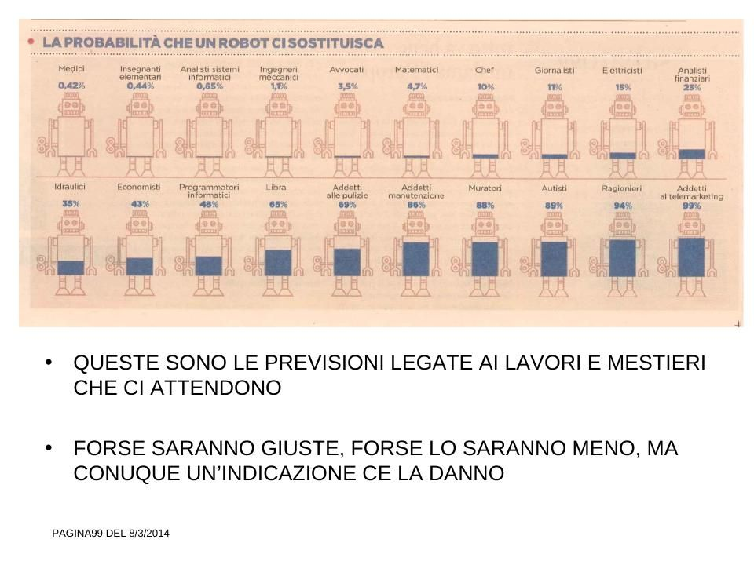{ loading=lazy style="width:59%" }

1:04:12

Lorenzo Poggi Sì, mi lascio la parola... È un argomento estremamente complesso. Riprendiamo un attimo: questo è estremamente interessante, l’uomo ormai è obsoleto e quindi può essere sostituito – fino a che punto, e nelle nostre prospettive in quale professione?

1:04:36

Torniamo al punto. Un elemento importante della relazione fra la preparazione che uno riceve e il lavoro era, e in parte lo è ancora oggi, sotto il segno della specializzazione. La parola d’ordine è che bisogna specializzarsi: uno è tanto più apprezzato, e ha tante più possibilità di lavoro, quanto più è specializzato, quanto più le sue capacità rispondono a ciò che il compito gli chiede. La specializzazione è l’elemento fondamentale del rapporto tra individui e lavoro. E la specializzazione è un inseguire, da parte di chi deve prepararsi per una vita di lavoro, per l’ingresso in società, il progresso tecnico, lo sviluppo.

1:05:50

Quindi la scuola dovrebbe formare degli specialisti: pensate agli istituti tecnici, per esempio, che dovrebbero in qualche modo fornire delle specializzazioni, delle capacità. Voi capite che è impossibile che ci sia una relazione così stretta fra ciò che si può insegnare e ciò che avviene nello sviluppo tecnologico e nel mondo del lavoro. La scuola che c’è stata, e che in parte continua a esserci ancora oggi, non insegnava abilità di specializzazione specifiche e tecniche: dava soprattutto una formazione generale, che poi doveva essere resa più specifica a seconda del lavoro.

1:06:47

La nostra era una scuola – il liceo classico, che era la via per l’università nella scuola italiana della riforma gentiliana – che dava una formazione umana: alla fine del liceo venivano fuori dei giovani maturi. Ora non si chiama più nemmeno esame di maturità, si chiama esame di Stato: siamo passati da una considerazione sulla maturazione umana alla considerazione giuridica del passaggio, all’attestazione che si è frequentato. Anche questo la dice lunga. Quindi formazione umana: perché? Perché la relazione era una relazione vasta, che coinvolgeva tutto l’individuo, e prima di tutto ci dovevano essere individui in grado di fare delle scelte, di relazionarsi in modo consapevole e critico ai problemi, al mondo che si trovavano di fronte.

1:07:54

Lo sviluppo tecnologico, l’avanzare enorme delle conoscenze, della società e del modo di organizzare il lavoro hanno portato tutto questo alla specializzazione: uno è tanto più bravo, e tanto più trova lavoro, quanto più è specializzato, quanto più risponde pienamente a ciò che le tecnologie richiedono. Se la tecnologia chiede questo e tu sei in grado di eseguirlo perfettamente, sei altamente specializzato. Man mano che la tecnologia avanza, man mano la vita produttiva si estende all’intera vita dell’individuo: i nuovi mezzi tecnologici già a molte persone non consentono più tempo libero; non c’è più differenza tra il tempo di lavoro e il tempo libero, siamo sempre connessi. Quindi l’intera vita, anche in quegli aspetti che erano personali – la capacità immediata di reazione, l’essere sempre vigili e presenti, avere un’attenzione sempre pronta a ricevere ed elaborare dati –, diventa invece parte di una specializzazione che ti rende più o meno adatto a fare un lavoro.

1:09:42

Le ragazze che accompagnano gli emiri hanno il compito di acquistare in tutta Europa, probabilmente per fare una selezione di mercato dovuta al gusto di una ragazza che ha anche una certa cultura, in modo che questi vedano quali sono i prodotti che incontrano il gusto di chi ha una certa età e di chi si intende di certe cose. Queste ragazze impegnano in quello che è un lavoro tutte loro stesse: non fanno distinzione, non c’è un tempo libero. Perché anche quando vanno a fare un giretto e vedono «guarda che bel paio di scarpe, quasi quasi me lo compro», non è un piacere, non è un’espressione di sé – è anche un’espressione di sé –, ma nello stesso tempo è un incidere, un dare un segnale al mercato, che è tutto, che ci riguarda completamente, in ogni aspetto della nostra vita. Chi mette se stesso su Facebook, chi mette se stesso nella rete, presenta se stesso e si adegua a ciò che è già in parte costruito sulla figura che ha messo in rete.

1:11:20

Da sempre l’uomo vive l’immaginazione del mondo. Gli animali vivono nel mondo e nella natura – questo è un vecchio discorso, perché ormai, dopo cinque anni di cene, io credo di aver preso anche qualche chilo, ma insomma mi sono sfogato, vi ho raccontato un po’ di cose, e penso di aver detto anche questo –: gli animali vivono la natura, l’uomo non vive la natura, vive un’immaginazione della natura, un’immaginazione del mondo. Se lo costruisce, se lo immagina. E l’immaginazione del mondo che è costruita dagli sviluppi delle tecnoscienze, cioè dai mezzi di comunicazione più recenti, dalla rete, costituisce un’occasione di esperienza, di relazione con gli altri e con le cose, con le immagini delle cose nel tempo e nello spazio, quale l’umanità non ha mai avuto. E quindi comporta un modo differente di relazionarsi al mondo.

1:12:37

E questo comporta che l’istituzione che per sua natura dovrebbe trasmettere delle conoscenze, la scuola, cambi, si trasformi: perché non ha più di fronte chi fa esperienza del mondo in un determinato modo, ha di fronte chi fa un’esperienza diversa del mondo, in un mondo diverso, che è quello dell’immagine, quello della rappresentazione.

1:13:10

Pensiamo a una cosa banalissima – sennò faccio quello vecchio: per me uno dei lavori che portava via più tempo, quando facevo una ricerca, era reperire i testi, le fonti, trovare la bibliografia. Oggi, credo, con lo smartphone chiunque si mette lì e ha subito a disposizione un’enorme quantità di conoscenze. Quindi, per quanto riguarda l’accesso e il volume delle conoscenze, non c’è più confronto, non si può fare nessun confronto. Vogliamo insegnare la biblioteconomia ai ragazzi che devono fare una ricerca? Non gli serve a nulla capire come si va a cercare un libro in base alla collocazione: per le loro esigenze è più che sufficiente la rete, anche se sono esigenze molto elevate.

1:14:28

Muta dunque la relazione. È mutata, abbiamo visto, riguardo all’etica: l’etica che prescriveva, dicevamo prima, il dovere, che si riferiva a un valore per giudicare i fatti; un’etica ora che invece, di fronte ai fatti, di volta in volta deve adeguarsi, deve inseguire i fatti. Una volta il percorso della conoscenza era un viaggio: si sapeva che c’era una verità e si faceva un percorso, più o meno accidentato, per arrivare a questa verità. Oggi il viaggio è rimasto, ma è un viaggio senza meta, non si sa dove andiamo: è un viaggio che riproduce se stesso, perché non ha altro obiettivo che il viaggio stesso, il viaggiare. Sappiamo sicuramente che ci sarà necessità di intensificare e continuare il viaggio, ma la ragione per cui c’è una meta, per cui ha una direzione, questa sfugge.

1:15:53

È Ulisse, dicevamo, vi ricordate? Anche Ulisse si lascia alle spalle la verità e va verso l’ignoto, e per questo è destinato a perire, perché lascia alle spalle il vero e va verso il buio dell’incertezza: è un «folle volo», il suo. Quindi, quando parliamo di questo, parliamo di un allargamento della professionalità, della specializzazione, che si allarga e in qualche caso ormai assorbe totalmente la vita dell’individuo, anche nelle sue caratteristiche personali. Per cui non c’è una fine del lavoro, non c’è più una differenza. Questo comporta il problema di capire in che cosa è mutato il modo di ragionare, e come un’istituzione come la scuola, come l’insegnamento, come una società che vuole in qualche modo riprodurre l’eredità di se stessa, si ponga di fronte a queste cose. Quanto tempo ho?

\[Voce dalla sala: Tre minuti.\]
{: .nota }

1:17:39

Lorenzo Poggi Allora tre minuti. Bisogna chiedere un altro tempo, perché mi lascio andare a chiacchierare... Io credo sia un discorso estremamente importante da fare oggi, come vedete, di attualità immediata.

1:17:57

Quindi che cosa caratterizza questo modo di pensare? Intanto, se le informazioni sono a disposizione, e la rete permette un accesso che nemmeno nei momenti di maggiore ottimismo, una trentina d’anni fa, si pensava possibile, le informazioni, i dati, non sono più un obiettivo della scuola, della trasmissione. Che cosa, allora? Visto che le informazioni sono a disposizione in grandissima quantità, quello che non è a disposizione, anzi è quasi assente, è l’elaborazione delle informazioni. Ma per elaborare le informazioni occorre non adeguarsi a ciò che richiede il mercato, perché rientriamo nel discorso della professionalità, e la professionalità, abbiamo visto, risponde alle esigenze della tecnologia. La scuola non può seguire la tecnologia: deve quindi elaborare un suo progetto, che trasmetta ai discenti la capacità di organizzare, di scegliere, di sapersi orientare nella grandissima, enorme, disorientante messe di conoscenze, di informazioni, senza che queste abbiano alcuna elaborazione, alcun costrutto.

1:20:03

Come può riuscire a questo, se ormai non ci si può certo più affidare all’esistenza di una verità metafisica assoluta? Dove andremo a trovare il punto di ancoraggio del nuovo modo di relazionarsi? Come si orienterà l’insegnante? Che cosa faranno gli insegnanti di fronte a studenti che, più bravi di loro, si collegano in rete e riescono ad avere tutte le notizie, che hanno delle relazioni con le immagini del mondo, e su queste relazioni con le immagini del mondo costruiscono la loro capacità di relazione anche emozionale, emotiva, con i mostri, con i robot, con i giochini? Ci siamo?

1:21:24

Sarà successo a tutti di sentire il ragazzino che, quando lo chiamano – «Vieni, Gianni, vieni a cena, dai, vieni a cena!» –, risponde: «Sì, mamma, muoio l’ultima volta e poi \[vengo\]». Assoluto: come «muoio l’ultima volta»? L’esperienza addirittura della morte, del soccombere di fronte al mostro, o dell’uccidere una ventina di mostri, è diventata qualcosa d’altro. E questo va in qualche modo gestito. Ne parliamo dopo, perché credo di aver sforato i tre minuti.

1:22:08

Paolo Marcucci Grazie, Lorenzo. Facciamo la seconda e ultima pausa. Tra l’altro ci sono dei giovani che fanno tanti soldi a fare queste app di cui parlava Lorenzo, su cui muoiono altri giovani: quindi è un mondo effettivamente strano.

1:22:26

Lorenzo Poggi Effettivamente è così, ma è la nostra realtà. Ora non voglio altri tre minuti, li ho già sfruttati; però effettivamente questo è il punto. Il resto suona molto come passato: oggi ci troviamo a gestire questo.

\[PAUSA\]
{: .nota }

1:50:20

Paolo Marcucci Bene, riprendiamo per l’ultima parte. Permettiamoci di fare un applauso agli amici del Caffè Centofiori, che ci hanno fatto la cena. Grazie. \[Applausi\]

1:50:42

Allora, abbiamo parlato di cultura e del rapporto tra cultura ed economia. Un po’ tutte le statistiche ci dicono che c’è una relazione diretta, per esempio in questo caso tra la quota di laureati tra i 25 e i 34 anni e il PIL pro capite dei Paesi: l’Italia, vedete, è quel pallino rosso là in fondo. Quindi, se finora con la nostra capacità di invenzione, con la nostra inventiva, siamo stati tra i protagonisti della scena economica mondiale – siamo ancora il secondo Paese d’Europa per produzione manifatturiera, abbiamo delle grandi capacità –, forse effettivamente bisogna ripensare un po’ la nostra struttura e il nostro modo di lavorare.

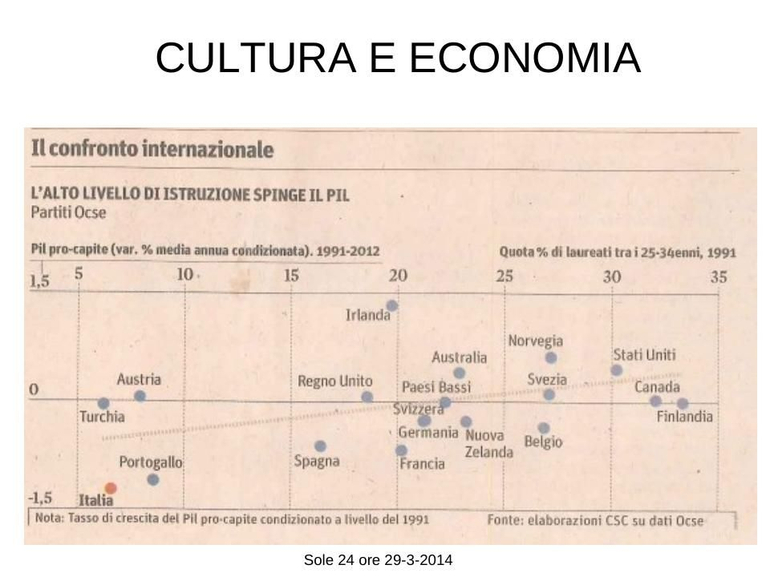{ loading=lazy style="width:59%" }

1:51:41

Perché ora, per esempio, le scuole che dettano la linea non sono italiane: sono quelle del mondo anglosassone. Stanford, che abbiamo citato prima, tutte le altre scuole americane, o anche inglesi: sono queste che sfornano i manager che poi vanno a guidare le maggiori istituzioni finanziarie o economiche, o le aziende, un po’ in tutto il pianeta. Quindi c’è anche un effetto perverso, perché da un certo punto di vista sono omologate, danno quasi tutte una stessa linea di indirizzo e di pensiero, e quindi forse c’è un appiattimento culturale da questo punto di vista.

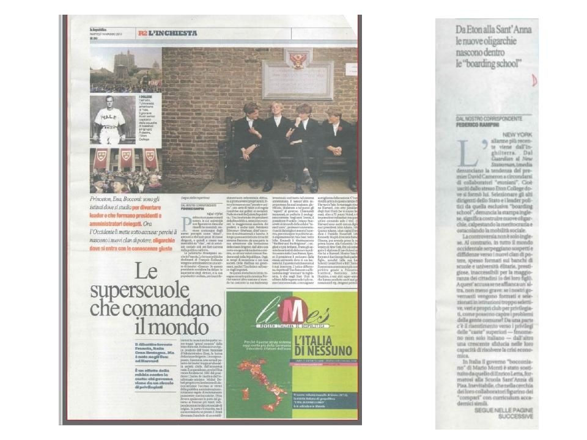{ loading=lazy style="width:47%" }

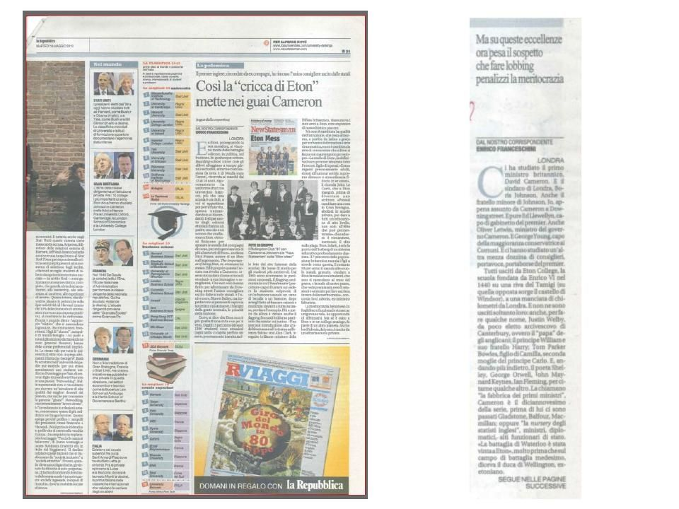{ loading=lazy style="width:47%" }

1:52:34

In queste università si cerca anche di premiare il merito – non so se questo sia effettivamente positivo o negativo –: in molte università, per esempio a Oxford, si entra solo se si hanno certi requisiti di sapere, di cultura, perché ci sono dei test all’ingresso; e in questo caso è una struttura pubblica, non un’università privata. Come diceva prima Lorenzo, sta ritornando ora di moda, tra i super ricchi, il *tutor*, quello che una volta era il precettore. Oppure Richard Branson, quello della Virgin, educa i suoi figli da solo, con degli educatori, in una sua isola (Necker Island, ai Caraibi), una delle tante isole che possiede. È un po’ quello che aveva sperimentato Jean-Jacques Rousseau con l’*Emilio*, rifacendosi alla scuola dell’educazione naturale: un’educazione con cui lui già nel 1762 aveva provato a superare il concetto del precettore. Quindi si ritorna un po’ a quei punti di partenza, là dove i ricchi si formano una cultura molto diversa da quella media e più popolare.

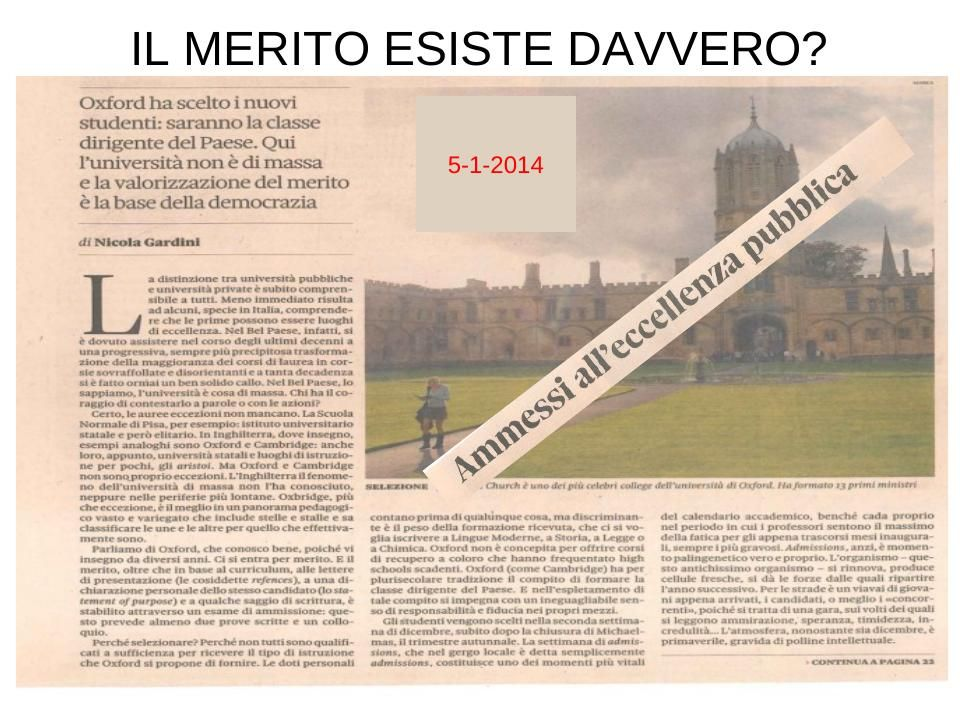{ loading=lazy style="width:47%" }

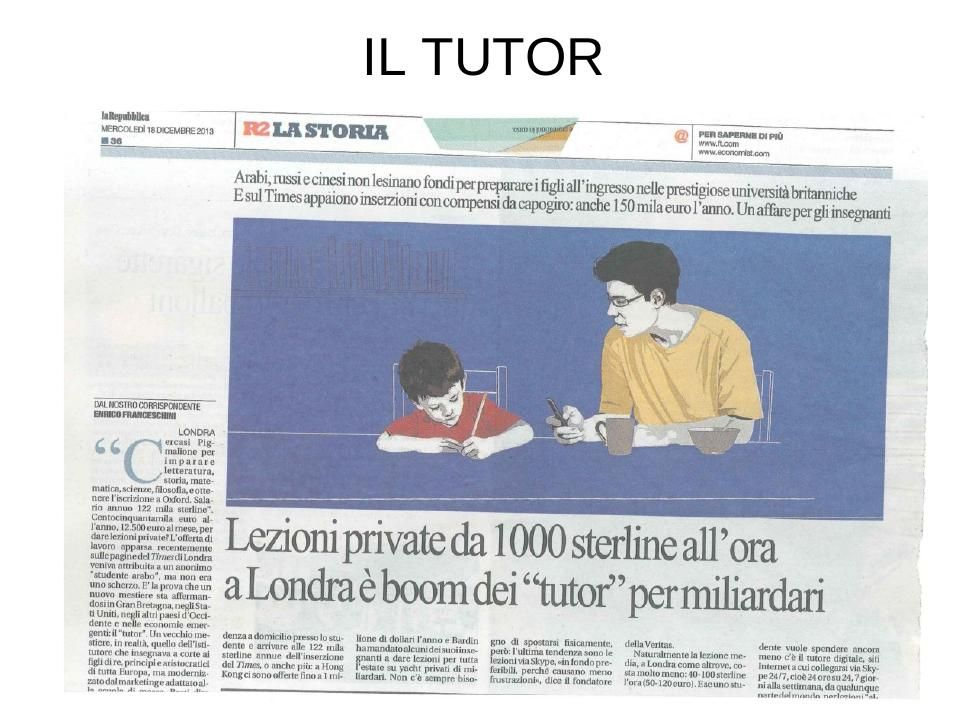{ loading=lazy style="width:47%" }

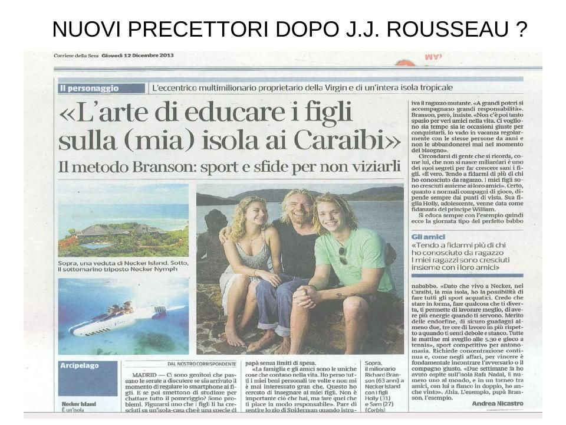{ loading=lazy style="width:59%" }

**JEAN-JACQUES ROUSSEAU, *EMILIO O DELL’EDUCAZIONE* (1762)**

«*On n’est curieux qu’à proportion qu’on est instruit*» («Si è curiosi soltanto nella misura in cui si è istruiti»).

Rousseau si dimostra polemico nei confronti di tutta la tradizione educativa e scolastica e anche con i principi dell’educazione «positiva», proponendo un’educazione «naturale». Il principio fondamentale dell’opera è che l’uomo nasce buono e che il male scaturisce dalla corruzione della società e da un’educazione non corretta, che non asseconda lo sviluppo armonioso delle potenzialità naturali. Secondo Rousseau, l’educazione si deve svolgere in ambiente neutro, preferibilmente in campagna, dove il futuro cittadino non sarà sottoposto ai nefandi stimoli della città. Non riceverà una vera e propria educazione (nel senso di conoscenze imposte dall’alto), ma sarà lasciato libero di sviluppare le proprie facoltà, con stimoli ridotti da parte del maestro, in modo da non essere influenzato in maniera eccessiva e artificiale dalle conoscenze altrui.

Si tratta di un romanzo pedagogico diviso in quattro parti, corrispondenti alle quattro fasi fondamentali della vita del giovane considerate da Rousseau.

La prima fase va dalla nascita fino a quando il bambino è in grado di parlare. Durante questa fase il fanciullo fa le prime esperienze con le realtà esterne.

La seconda fase arriva fino ai dodici anni. Ciò che maggiormente colpisce il giovane in questa fase della vita sono le esperienze sensoriali; il criterio in base a cui valutare tali esperienze è costituito dal piacere e dal dolore.

La terza fase, dai dodici ai quattordici anni, è quella in cui il ragazzo riceve la sua educazione sessuale e religiosa. Secondo Rousseau questa è l’età migliore, perché prima non sarebbe in grado di comprendere il valore degli insegnamenti fornitigli in materia.

La quarta e ultima fase è quella in cui è ormai pronto a entrare nella società e ricerca la donna della sua vita, Sofia, educata in maniera da essere la compagna ideale di Emilio.

1:54:19

E la scuola italiana è davvero in fondo a questa scala? Intanto vediamo un po’ – e qui abbiamo un professore che da poco non insegna più. Questi numeri ci dicono che effettivamente la classe dei professori in Italia è più o meno nella media degli altri Paesi. L’unico dato che si discosta un po’ è l’età media, che in Italia è molto più alta rispetto agli altri Paesi; poi guadagnano un po’ meno, e come ore di lavoro sono più o meno allineati. Però l’età media è un fattore che effettivamente distingue la scuola italiana dalle altre. È un bagaglio di esperienza, se lo si vuole leggere in maniera positiva; si può leggere anche da altri punti di vista, più negativi, perché magari non c’è capacità di adattarsi alla società che cambia. Il mondo dell’educazione è anche frutto del fatto che l’81% del corpo docente in Italia, se si prendono tutti gli ordini di scuole, è fatto da donne: e questo qualche significato sicuramente ce l’ha.

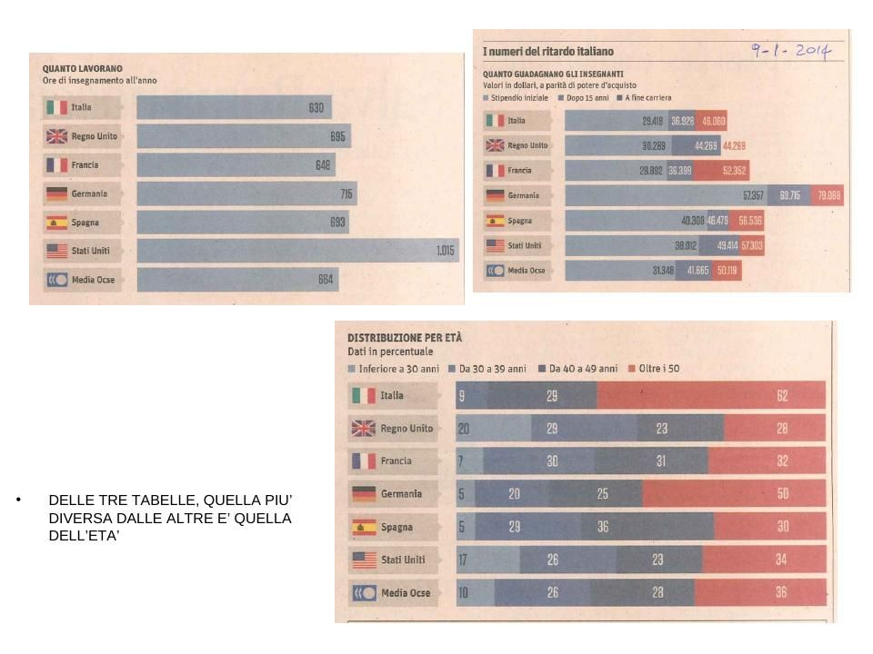{ loading=lazy style="width:59%" }

**LA SCUOLA È FATTA SOPRATTUTTO DI DONNE?**

A sostenerlo, del resto, sono anche i numeri: oggi il corpo docente italiano è per l’81,1% composto da donne. Una percentuale altissima: in Europa solo un paese, l’Ungheria, conta una presenza maggiore di sesso femminile dietro la cattedra (82,5%).

A livello di scuola d’infanzia, poi, tocchiamo un record mondiale: solamente lo 0,4% dei maestri sono uomini.

Una presenza che alle superiori si riduce sensibilmente, ma sfiorando il 60% costituisce sempre la grande maggioranza. Anche in questo caso si tratta di una caratteristica tipicamente italiana: basti pensare che in Germania le donne di ruolo impegnate nella scuola secondaria di secondo grado sono il 46,2%.

Questi numeri forse ci dicono anche del valore sociale che diamo alla scuola e alla formazione.

Ma non tutto è perduto… Alla fine la nostra scuola e la nostra cultura qualche spiraglio ce lo lasciano.

1:55:45

Volevo chiudere però con una nota positiva. Abbiamo detto che la scuola italiana ha delle difficoltà rispetto alle scuole di altri Paesi, che siamo indietro. Le nostre scuole di eccellenza, per esempio, possono essere la Bocconi o il Sant’Anna di Pisa. La Bocconi – se mi consentite una battuta – ha sfornato anche i primi ministri o i ministri degli ultimi governi: non è che ci abbiano dato un grosso aiuto, anzi forse era meglio se non li sfruttavamo. E questo per dire della Bocconi.

1:56:34

Quindi la scuola italiana ha dei problemi; abbiamo visto che probabilmente in questo momento la scuola italiana forma anche troppo rispetto alle esigenze del tessuto sociale. Però un qualche elemento positivo c’è. C’è uno studio dell’OCSE – l’OCSE è quell’organizzazione dei Paesi maggiormente sviluppati nel mondo – che ha fatto un test molto approfondito, prendendo in esame molti studenti, e ha visto per esempio che gli italiani nelle singole materie sono indietro rispetto agli altri, però nel *problem solving*, come lo chiamano loro, cioè nel cavarsela e nel risolvere i problemi, sono i migliori (secondo l’articolo «Gli italiani, bravi a cavarsela», «Italia Oggi», 8 aprile 2014, nel *problem solving* gli studenti italiani si sono classificati quindicesimi su 65 Paesi). Questo vuol dire che la nostra cultura di fondo in qualche modo riesce a sopperire a qualche carenza che magari c’è nelle singole discipline.

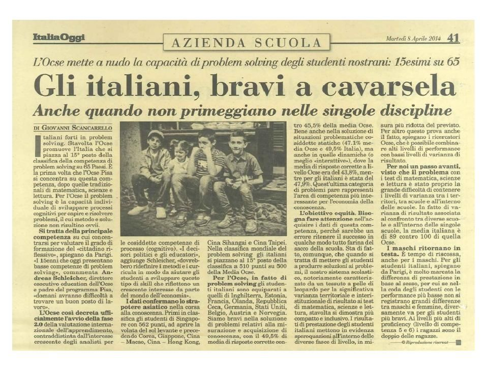{ loading=lazy style="width:59%" }

1:57:49

Io credo – e non è un omaggio retorico – che questo sia dovuto anche a professori come Lorenzo, che hanno dedicato la loro vita all’insegnamento dei nostri ragazzi. Perché effettivamente, se c’è una diffusione della cultura, se c’è questo zoccolo duro che resiste, e questi dati OCSE lo mettono in risalto, probabilmente è dovuto anche a questi insegnanti che, nonostante tutto, credo ce la mettano davvero tutta per continuare a insegnare. Le strade davanti sono difficili, probabilmente questo non basterà più, anzi forse siamo arrivati alla fine di un ciclo; però effettivamente è da questo che bisogna ripartire. Il legame tra la scuola, il lavoro e le prospettive economiche è un legame da cui non si può prescindere. Insomma, Lorenzo, se ci dai la tua conclusione, come storico della filosofia, te ne siamo grati.

1:59:06

Lorenzo Poggi Allora, troppo impegno; però mi piace fare due considerazioni. La prima avevamo iniziato a farla, ed era questa: l’insegnante è chi si pone il problema della trasmissione di una conoscenza che non è più, naturalmente, trasmissione di contenuti; deve essere essenzialmente trasmissione della capacità di istituire relazioni, della capacità di risolvere problemi, della capacità di orientamento, in un mondo dove la disponibilità del materiale da coordinare, nel quale orientarsi, è enorme, dispersiva, può essere veramente disorientante. Quindi io penso che il compito che si pone all’insegnante sia soprattutto quello di saper gestire situazioni di apprendimento che gli studenti cominciano a gestire da soli, ma che hanno poi negli insegnanti un punto di riferimento, un punto di orientamento; e quindi dare, da questo punto di vista, una spinta allo sviluppo delle capacità di selezione.

2:00:50

L’altro argomento che mi piaceva trattare credo sia essenziale per chi si pone il problema di quale debba essere la funzione della trasmissione della cultura in un mondo in rapidissimo mutamento come il nostro: tentare di capire la differenza essenziale fra l’intelligenza che è a fondamento dei mezzi di comunicazione – i media, i computer, i modi che abbiamo adesso di risolvere le relazioni spazio-temporali, la comunicazione alla velocità della luce che viaggia su internet, l’abolizione praticamente del tempo e dello spazio, in questo consistono le nuove esperienze – e invece il modo di funzionamento della mente umana.

2:01:59

Ci sono, penso, differenze fondamentali, per cui non sarà possibile, se non entro certi termini, costruire un’intelligenza artificiale. E le differenze profonde sono differenze che, penso, sono maturate nella nostra mente, nel nostro cervello, attraverso millenni di evoluzione: quell’evoluzione ha costruito l’uomo attuale, l’Homo sapiens così com’è. E in che cosa consiste questo? Nel fatto che nel nostro modo di pensare esiste una razionalità che risolve i problemi, ma che non è esaurita dalla razionalità matematica. Credo che questo sia lo spazio entro il quale c’è ancora possibilità per la filosofia, e anche lo spazio per relazionarsi al... Vediamo se, così dopo i dolci, riesco a essere chiaro.

2:03:47

Pensiamo un attimo al pensiero matematico, quello che regge la struttura delle nostre macchine calcolatrici, dei computer: è una logica binaria, legata alla logica della matematica. Prendiamo una cosa ancora più semplice, che abbiamo imparato tutti alle scuole elementari: nella somma il risultato è indipendente dall’ordine degli addendi. Un principio matematico: devi fare 3 più 4, puoi fare anche 4 più 3, il risultato non cambia, è indipendente dall’ordine degli addendi. Pensiamo però un attimo invece a come funziona la nostra mente. La nostra mente non funziona secondo questo principio matematico: per la nostra mente la somma non è indifferente rispetto all’ordine degli addendi. Scusate la banalità dell’esempio: se dobbiamo fare 3845 più 5, non facciamo 5 più 3845, ma partiamo da 3845, poi 46..., e ci aggiungiamo 5. Sarebbe indifferente partire dall’uno o dall’altro, ma noi partiamo dal dare per scontato quello con le unità più numerose e successivamente aggiungiamo quelle meno numerose. Perché nell’evoluzione del nostro cervello abbiamo imparato a mettere a fuoco prima certi aspetti della realtà e poi altri: il prima e il poi sono elementi determinanti del tempo, e il prima e il poi condizionano il nostro modo di relazionarci alla realtà.

2:06:07

Questo modo di relazionarsi alla realtà è anche quello che sta a fondamento della percezione del linguaggio e della percezione delle immagini. Nella cena precedente parlavamo delle lettere, ricordate? Degli alfabeti che hanno le lettere della scrittura poste in verticale e di quelli che le hanno poste in orizzontale. Quelli che le hanno poste in verticale favoriscono un’immediatezza della percezione non consequenziale, più incentrata sull’analisi del singolo carattere: da questo punto di vista sono meno legati al legame consequenziale, di causa-effetto – quello viene prima, quello viene dopo, quello condiziona quello che viene dopo – e più condizionati dagli elementi analitici di ciascuna parte, più attenti al particolare, all’analisi di ciascun pezzo, che alle relazioni.

2:07:23

I popoli che hanno un linguaggio scritto con lettere che hanno valore a seconda della relazione che istituiscono fra di loro, quindi consequenziali, non ideogrammi, sono più attenti alle relazioni spazio-temporali, e quindi sviluppano molto di più una relazione con il mondo che intende non tanto analizzare un singolo fenomeno, quanto notare le relazioni che rimangono costanti. Guardate che la scienza moderna, che è un’astrazione sulle relazioni esistenti nell’immaginazione del mondo, si sviluppa nel mondo occidentale, in cui c’è un alfabeto simile a quello greco, consequenziale e non ideografico come quello cinese o quello \[...\]. C’è un legame stretto.

2:08:30

E questo tipo di relazione, dicevo, non legata alla logica binaria, non legata alla logica matematica, ma al modo di relazionarsi al mondo e di percepire il mondo, e che costituisce la struttura della nostra mente, è quello che consente, per esempio, il primo passo dell’immaginazione, che non dà luogo a strutture di immaginazione del mondo che noi chiamiamo vere, ma a strutture di immaginazione del mondo che sentiamo fortemente nostre, di cui siamo fortemente partecipi, e che sono in grado di soddisfare il nostro desiderio di completezza e anche di soddisfazione. Un tipo di queste combinazioni lo chiamiamo bellezza: è un tipo di percezione di relazioni che ci dà gioia, che ci dà tranquillità, che ci dà pace.

2:09:46

Kant – così facciamo un po’ di filosofia – metteva all’esame questo aspetto dell’immaginazione. Lui aveva però una concezione particolare del tempo e dello spazio; comunque metteva questo a cavallo tra la *Critica della ragion pura*, che determinava l’oggettività matematica delle relazioni spazio-temporali, e quindi del mondo, e la morale, che determinava il dover essere. Nel mezzo ci metteva, nella *Critica del giudizio*, quest’idea di bellezza come conciliazione fra intelletto e immaginazione, che era fondamentale, che costruiva il mondo.

2:10:41

Bene, penso sia questo l’aspetto sul quale dobbiamo porre l’accento, è questo che dobbiamo sviluppare: il resto del mondo è già condizionato, già determinato da quelli che sono gli sviluppi delle tecnologie, dell’informazione e delle immagini, perché tutto è immagine e spettacolo; però questo aspetto è quello che ci consente di mantenere il carattere distintivo dell’umanità, che ha una qualche indipendenza rispetto ai condizionamenti dell’esperienza del mondo contemporaneo. Ed è su questo che dovrebbe fondarsi anche l’insegnamento, anche il dare orientamento rispetto a quello che è il mondo. Grazie, basta, mi sembra. Scusate se ve l’abbiamo fatta così lunga. \[Applausi\]

2:11:59

Paolo Marcucci Grazie. Siamo arrivati in fondo: buonanotte a tutti, e alla prossima volta, se volete essere con noi.

## Appendice

Le slide proiettate durante l’incontro.

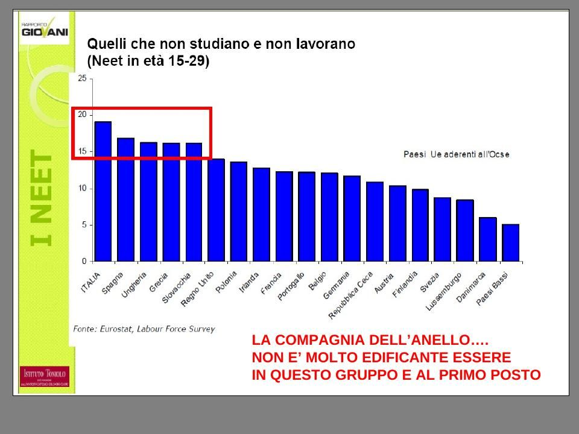{ loading=lazy style="width:47%" }

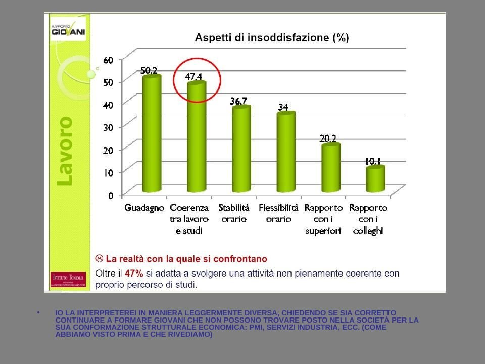{ loading=lazy style="width:47%" }

**LA CONDIZIONE GIOVANILE IN ITALIA (RAPPORTO GIOVANI 2013)**

*Nelle slide: «Il futuro che sognano. Giovani tra famiglia e lavoro. Una fotografia dal Rapporto Giovani 2013» (Istituto Giuseppe Toniolo, convegno a Montelupo Fiorentino, 21 marzo 2014); la polemica tra John Elkann («Giovani poco ambiziosi, non cercano lavoro, stanno bene a casa») e Diego Della Valle; i giovani italiani che vivono con i genitori (1981-2010); i NEET tra i 15 e i 29 anni nei Paesi UE aderenti all’OCSE; gli aspetti di insoddisfazione nel lavoro (oltre il 47% si adatta a svolgere un’attività non pienamente coerente con il proprio percorso di studi).*
{: .didascalia }

La compagnia dell’anello… non è molto edificante essere in questo gruppo e al primo posto.

Io la interpreterei in maniera leggermente diversa, chiedendo se sia corretto continuare a formare giovani che non possono trovare posto nella società per la sua conformazione strutturale economica: PMI, servizi, industria ecc. (come abbiamo visto prima e come rivediamo).

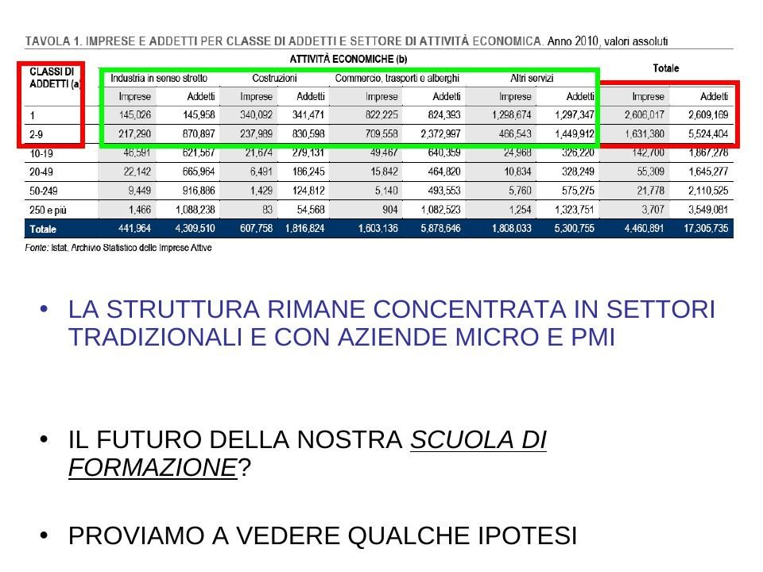{ loading=lazy style="width:59%" }

**IL FUTURO DELLA NOSTRA SCUOLA DI FORMAZIONE?**

La struttura rimane concentrata in settori tradizionali e con aziende micro e PMI. Il futuro della nostra *scuola di formazione*? Proviamo a vedere qualche ipotesi.

Tito Boeri (19 marzo 2014): scuole di formazione universitarie professionalizzanti. Le imprese richiedono qualificazioni intermedie fra il diploma e la laurea magistrale: in questo modo le famiglie vedrebbero i propri figli cominciare ad acquisire professionalità e a guadagnare qualcosa.

Eliminare il valore legale delle lauree? Uno dei sostenitori è Carlo Carraro, rettore di Ca’ Foscari (… conta solo essere bravi…).

**IVAN ILLICH, *DESCOLARIZZARE LA SOCIETÀ* (1971)**

Georges Lapassade con *Il mito dell’adulto* demolisce nel 1963 l’entità dell’uomo adulto, che ha pesato come un macigno nella tradizione pedagogica occidentale. Egli invece contrappone a esso l’infanzia e la sua natura genuina attraverso i processi dell’autogestione pedagogica. La teoria della descolarizzazione è stata portata avanti da Ivan Illich, che con essa intendeva lo smantellamento del sistema d’istruzione statale e l’eliminazione dalla società di ogni tipo di educazione formale.

La proposta di descolarizzare la società derivava da un’attenta analisi delle istituzioni, le quali sono intrinsecamente caratterizzate come manipolatorie o conviviali.

Mentre queste ultime si mettono a servizio dell’utente, quelle di tipo manipolativo (tra le altre la scuola), invece, vanno a influenzare la loro utenza: mentre dovrebbero porsi al suo servizio, cercano di plasmarla nel perseguire interessi «particolari».

Perciò la scuola, nell’opinione di Illich, è al servizio di interessi particolaristici (soprattutto economici) e arriva a svolgere funzioni di controllo sociale.

In quanto istituzione che ha eminentemente compiti di selezione sociale e di custodia, finisce con l’essere essenzialmente antieducativa e produce una serie di mali quali l’indottrinamento, la competizione, il rispetto delle apparenze e dei rituali.

Illich, quindi, propone di sostituire il sistema scolastico con una rete di risorse e di personale educativo, cui gli individui possano rivolgersi liberamente in relazione ai propri bisogni e interessi.

«Il mero possesso di titoli di studio per accedere a qualcosa è una discriminazione e va abolita; la discriminazione dovrebbe avvenire soltanto in base alle capacità e non al pedigree scolastico» (Ivan Illich).

L’istituzione scolastica al giorno d’oggi rappresenta una nuova religione inattaccabile e universalizzata, capace di preparare l’individuo a un consumo disciplinato, diventando così il maggior datore di lavoro della nostra società.

**IL FUTURO PROSSIMO?**

Se è vero che, soprattutto per la tecnologia, quello che accade in America arriva da noi negli anni successivi, vale la pena dare un’occhiata alle idee del ministro dell’istruzione degli Stati Uniti.

Senza accettazione supina di quello che arriva dagli USA, ma neanche con la sufficienza dovuta alla nostra cultura classica.

Articolo su «Le Scienze» di ottobre 2013 («Scuole ad alta velocità») – Arne Duncan, ministro dell’istruzione degli Stati Uniti d’America.

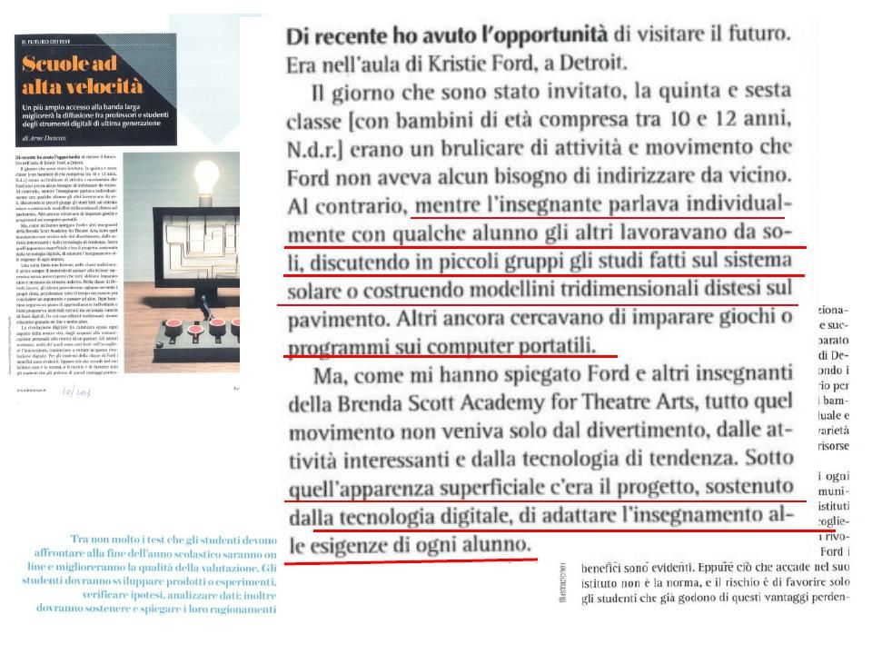{ loading=lazy style="width:47%" }

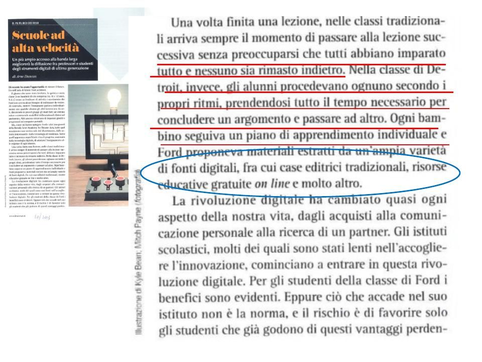{ loading=lazy style="width:47%" }

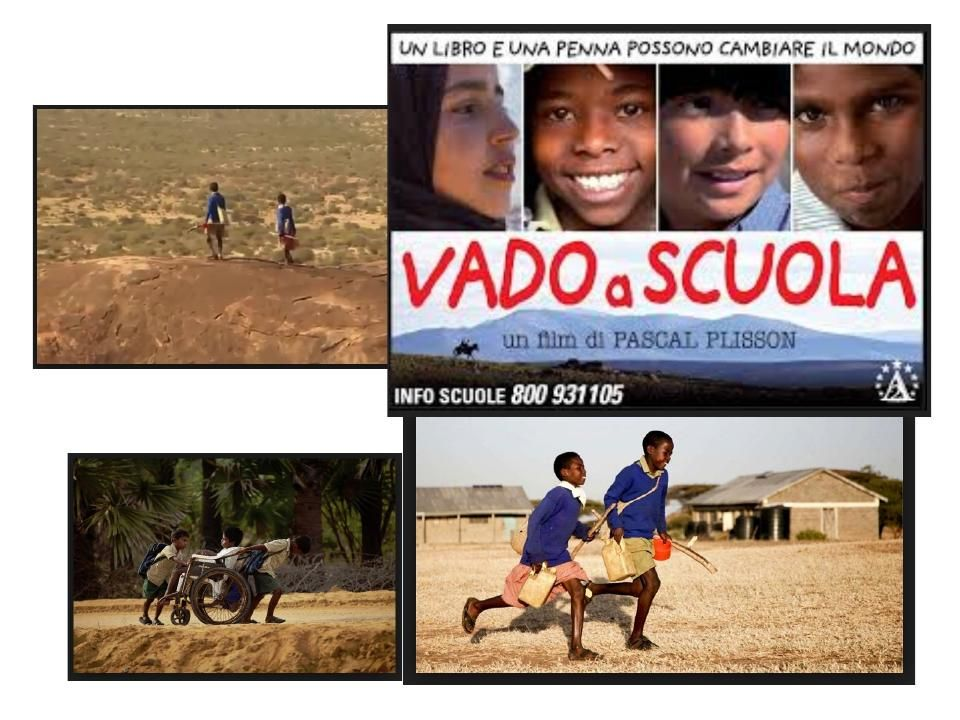{ loading=lazy style="width:59%" }

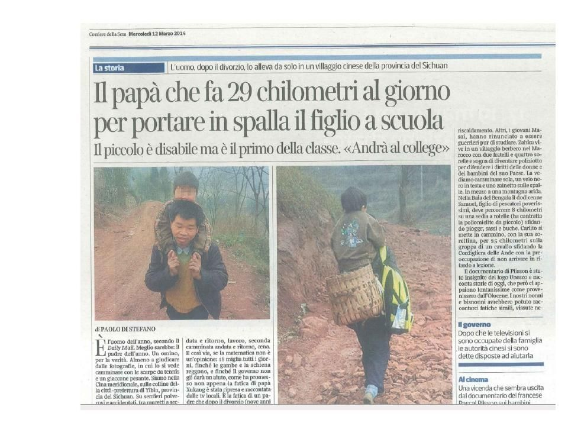{ loading=lazy style="width:47%" }

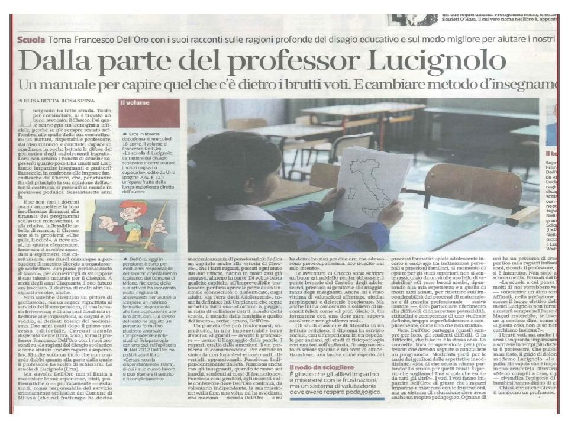{ loading=lazy style="width:47%" }
