# Il pensiero

**Data:** 29 maggio 2014 
**Luogo:** MMAB, Museo della Ceramica, Montelupo Fiorentino 
**Incontro con:** Lorenzo Poggi e Paolo Marcucci

**Interventi:** Paolo Marcucci Lorenzo Poggi

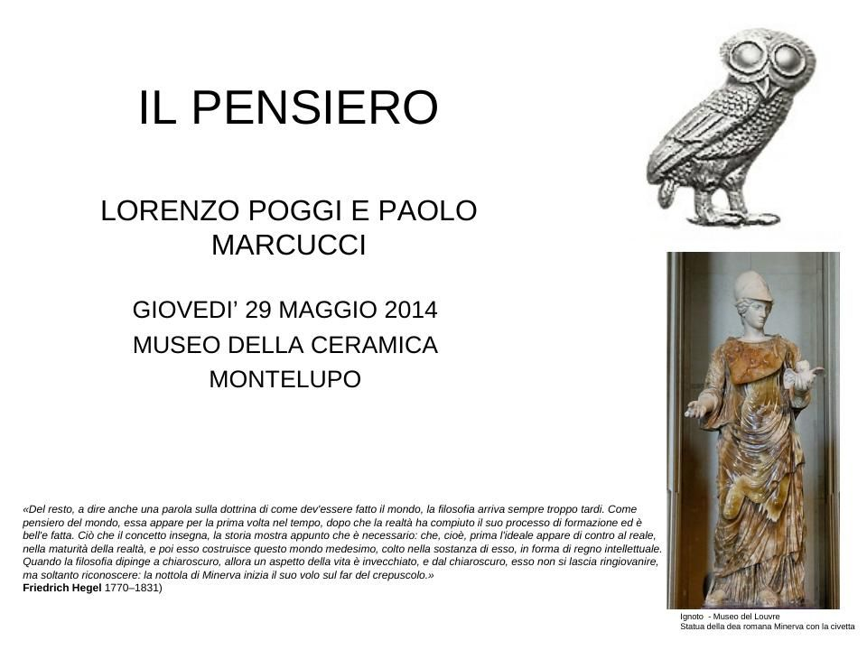{ loading=lazy style="width:59%" }

«Del resto, a dire anche una parola sulla dottrina di come dev’essere fatto il mondo, la filosofia arriva sempre troppo tardi. Come pensiero del mondo, essa appare per la prima volta nel tempo, dopo che la realtà ha compiuto il suo processo di formazione ed è bell’e fatta. Ciò che il concetto insegna, la storia mostra appunto che è necessario: che, cioè, prima l’ideale appare di contro al reale, nella maturità della realtà, e poi esso costruisce questo mondo medesimo, colto nella sostanza di esso, in forma di regno intellettuale. Quando la filosofia dipinge a chiaroscuro, allora un aspetto della vita è invecchiato, e dal chiaroscuro esso non si lascia ringiovanire, ma soltanto riconoscere: la nottola di Minerva inizia il suo volo sul far del crepuscolo.»

Georg Wilhelm Friedrich Hegel (1770-1831), *Lineamenti di filosofia del diritto*, Prefazione

*Nella slide: statua della dea romana Minerva con la civetta (ignoto, Museo del Louvre).*
{: .didascalia }

\[La registrazione inizia a serata già avviata: manca l’introduzione di Paolo Marcucci. Il primo intervento registrato è l’introduzione di Lorenzo Poggi. Si riportano qui di seguito le slide dell’introduzione di Paolo Marcucci.\]
{: .nota }

**INCIPIT**

A che servono i filosofi? A che serve la filosofia? A che serve il pensiero?

La filosofia è attenzione per ciò che è chiaro, preoccupazione per ciò che ci permette di dare una risposta al dolore dell’esistenza senza ricorrere all’oscurità del sacro e del mistero.

{ loading=lazy style="width:47%" }

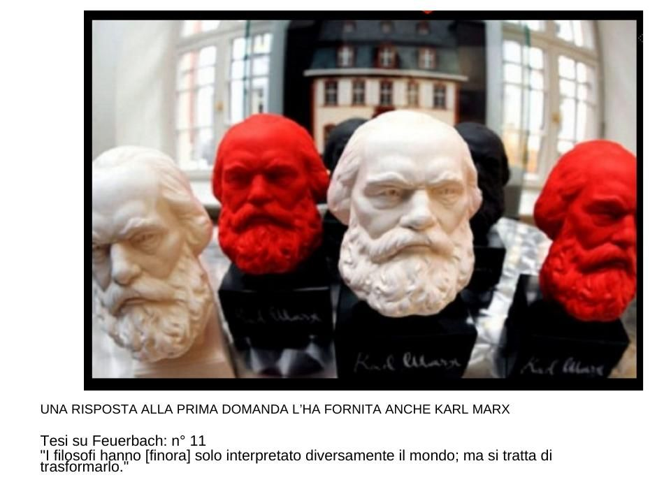{ loading=lazy style="width:47%" }

**INCIPIT**

Socrate riteneva il male una questione di ignoranza e Sant’Agostino un’assenza di bene: qual è la giusta affermazione? (*Nella foto: una donna anziana e alcuni bambini avviati alle camere a gas ad Auschwitz.*)

Una risposta alla prima domanda l’ha fornita anche Karl Marx, nell’undicesima delle *Tesi su Feuerbach*: «i filosofi hanno \[finora\] solo interpretato diversamente il mondo; ma si tratta di trasformarlo».

INCIPIT: *Je pense donc je suis* – *Cogito ergo sum* – Penso dunque sono (René Descartes, Renatus Cartesius, Renato Cartesio, 1596-1650).

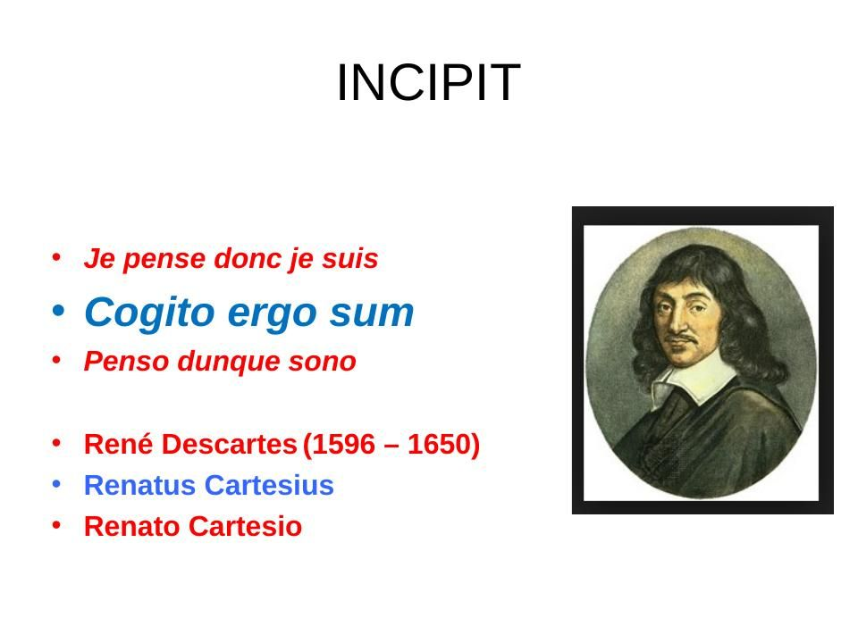{ loading=lazy style="width:47%" }

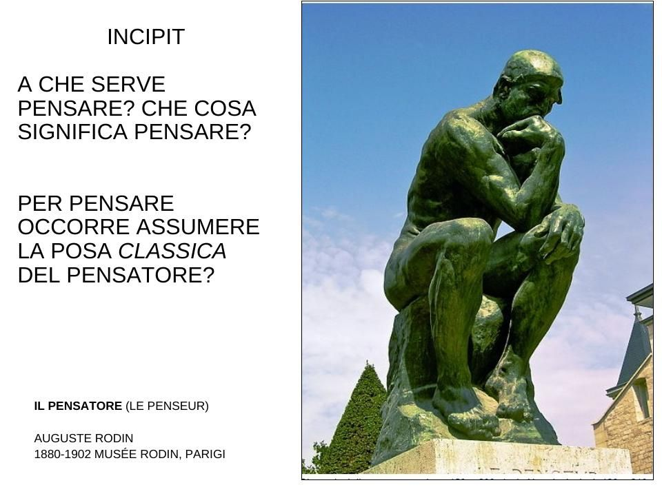{ loading=lazy style="width:47%" }

**INCIPIT**

A che serve pensare? Che cosa significa pensare? Per pensare occorre assumere la posa *classica* del pensatore? (*Il pensatore* – *Le Penseur* – di Auguste Rodin, 1880-1902, Musée Rodin, Parigi)

Ma siamo sicuri che per pensare occorra quindi assumere per forza la posa del pensatore?

Eppure il pensiero non è il frutto di un momento statuario, ma nasce nella vita di tutti i giorni, in movimento, dove il fare dei ragionamenti corretti può essere determinante per non fare la fine del tacchino (induttivista).

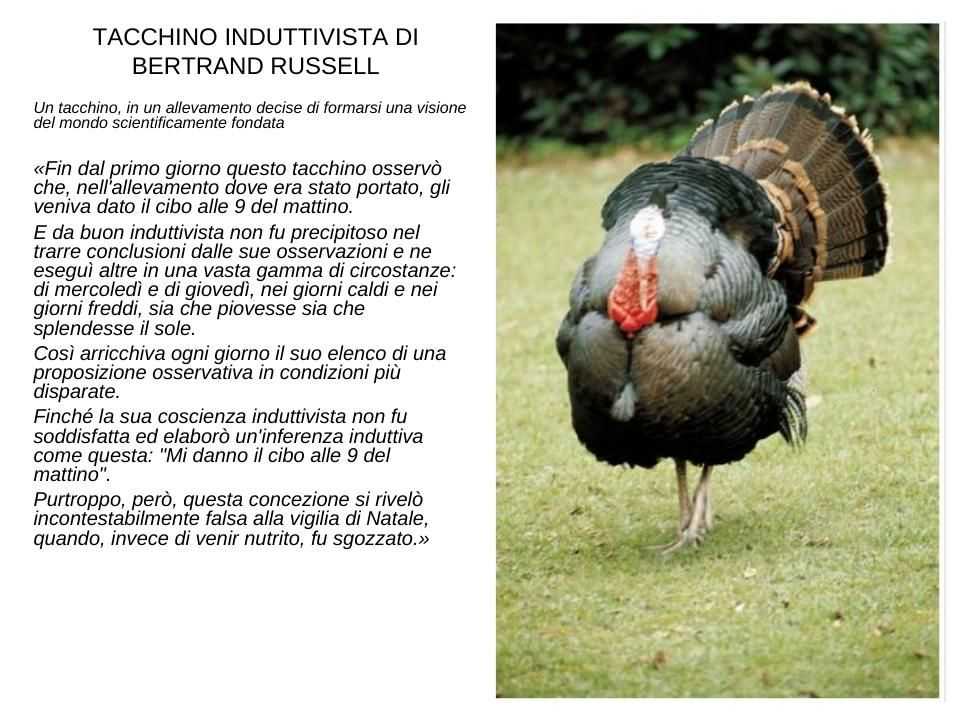{ loading=lazy style="width:59%" }

**IL TACCHINO INDUTTIVISTA DI BERTRAND RUSSELL**

Un tacchino, in un allevamento, decise di formarsi una visione del mondo scientificamente fondata.

«Fin dal primo giorno questo tacchino osservò che, nell’allevamento dove era stato portato, gli veniva dato il cibo alle 9 del mattino.

E da buon induttivista non fu precipitoso nel trarre conclusioni dalle sue osservazioni e ne eseguì altre in una vasta gamma di circostanze: di mercoledì e di giovedì, nei giorni caldi e nei giorni freddi, sia che piovesse sia che splendesse il sole.

Così arricchiva ogni giorno il suo elenco di una proposizione osservativa in condizioni più disparate.

Finché la sua coscienza induttivista non fu soddisfatta ed elaborò un’inferenza induttiva come questa: “Mi danno il cibo alle 9 del mattino”.

Purtroppo, però, questa concezione si rivelò incontestabilmente falsa alla vigilia di Natale, quando, invece di venir nutrito, fu sgozzato.»

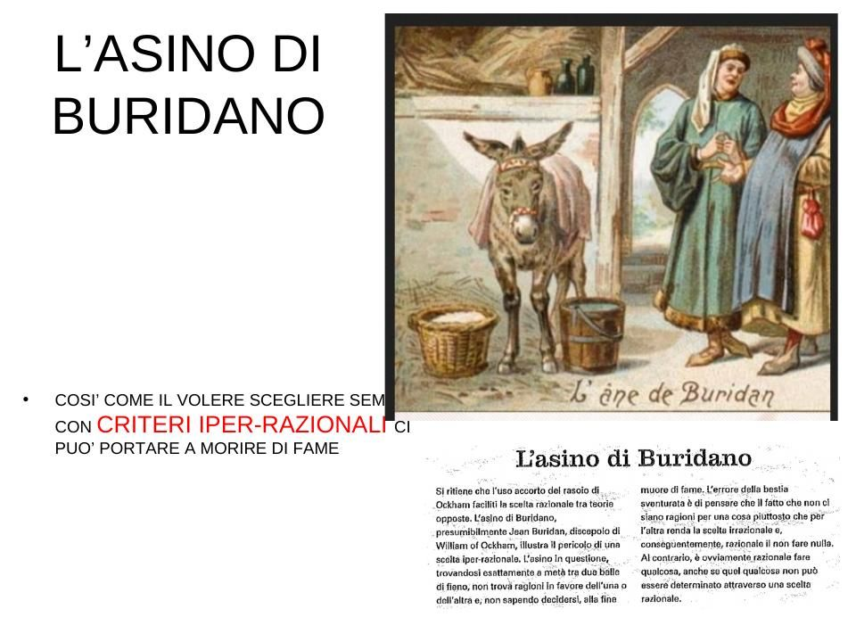{ loading=lazy style="width:47%" }

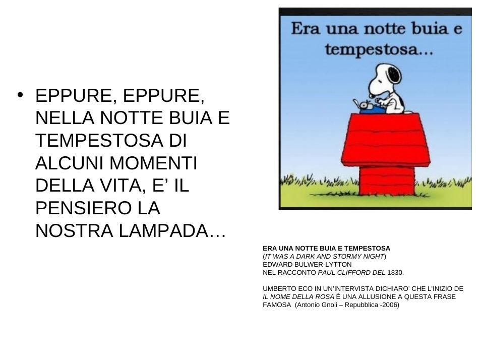{ loading=lazy style="width:47%" }

**L’ASINO DI BURIDANO**

…così come il voler scegliere sempre con criteri iper-razionali ci può portare a morire di fame.

Eppure, eppure, nella notte buia e tempestosa di alcuni momenti della vita, è il pensiero la nostra lampada…

«Era una notte buia e tempestosa» (*It was a dark and stormy night*): Edward Bulwer-Lytton, nel romanzo *Paul Clifford* del 1830. Umberto Eco in un’intervista dichiarò che l’inizio de *Il nome della rosa* è un’allusione a questa frase famosa (Antonio Gnoli, «la Repubblica», 2006).

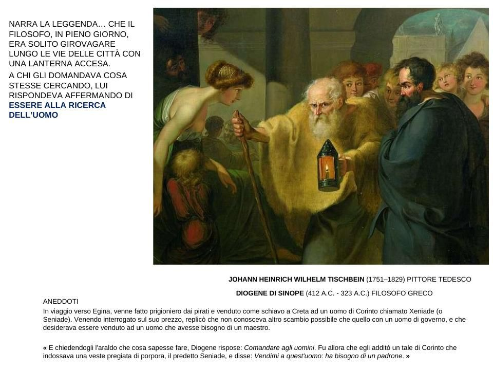{ loading=lazy style="width:59%" }

**DIOGENE DI SINOPE (412-323 A.C.), FILOSOFO GRECO**

Narra la leggenda… che il filosofo, in pieno giorno, era solito girovagare lungo le vie delle città con una lanterna accesa. A chi gli domandava che cosa stesse cercando, rispondeva di essere alla ricerca dell’uomo.

*Nel dipinto di Johann Heinrich Wilhelm Tischbein (1751-1829), pittore tedesco.*

**ANEDDOTI**

In viaggio verso Egina, venne fatto prigioniero dai pirati e venduto come schiavo a Creta a un uomo di Corinto chiamato Xeniade (o Seniade). Interrogato sul suo prezzo, replicò che non conosceva altro scambio possibile che quello con un uomo di governo, e che desiderava essere venduto a un uomo che avesse bisogno di un maestro.

«E chiedendogli l’araldo che cosa sapesse fare, Diogene rispose: “Comandare agli uomini”. Fu allora che egli additò un tale di Corinto che indossava una veste pregiata di porpora, il predetto Seniade, e disse: “Vendimi a quest’uomo: ha bisogno di un padrone”.»

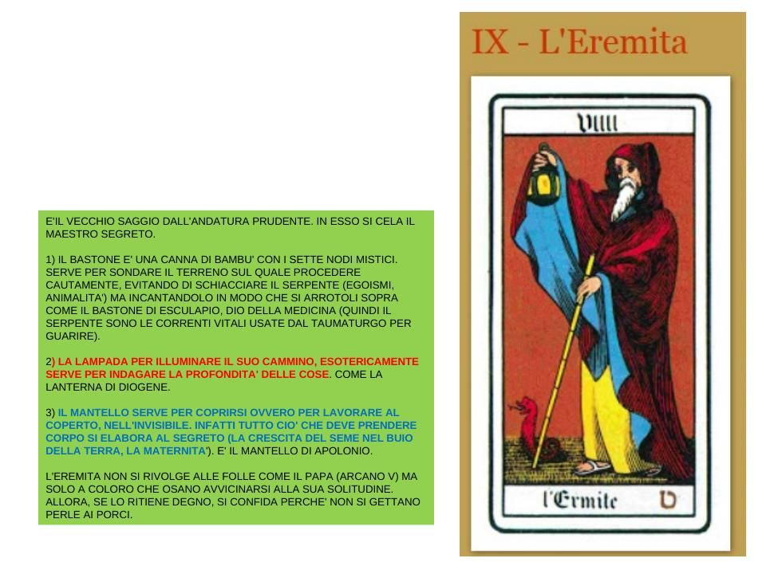{ loading=lazy style="width:59%" }

**IX – L’EREMITA**

È il vecchio saggio dall’andatura prudente. In esso si cela il maestro segreto.

1) il bastone è una canna di bambù con i sette nodi mistici. Serve per sondare il terreno sul quale procedere cautamente, evitando di schiacciare il serpente (egoismi, animalità) ma incantandolo in modo che si arrotoli sopra come il bastone di Esculapio, dio della medicina (quindi il serpente sono le correnti vitali usate dal taumaturgo per guarire).

2) la lampada per illuminare il suo cammino, esotericamente serve per indagare la profondità delle cose. Come la lanterna di Diogene.

3) il mantello serve per coprirsi ovvero per lavorare al coperto, nell’invisibile. Infatti tutto ciò che deve prendere corpo si elabora al segreto (la crescita del seme nel buio della terra, la maternità). È il mantello di Apollonio.

L’eremita non si rivolge alle folle come il papa (Arcano V) ma solo a coloro che osano avvicinarsi alla sua solitudine. Allora, se lo ritiene degno, si confida perché non si gettano perle ai porci.

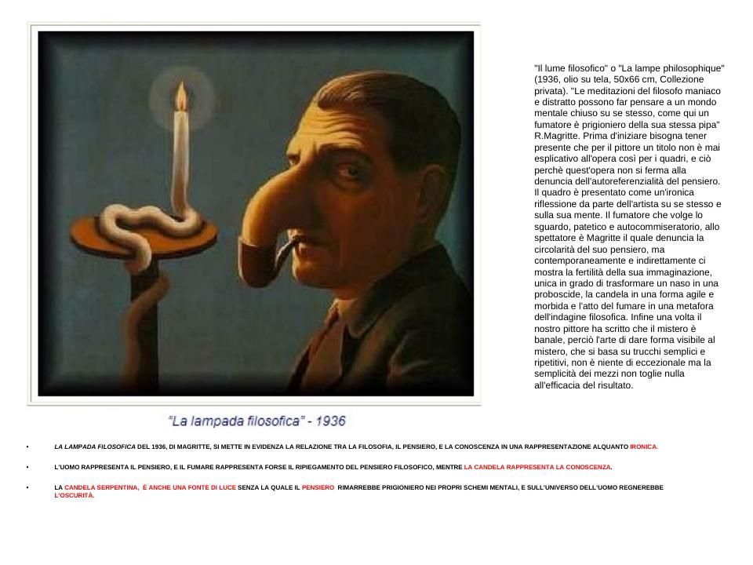{ loading=lazy style="width:59%" }

**LA LAMPADA FILOSOFICA* DI MAGRITTE (1936)**

Nella *Lampada filosofica* del 1936, di Magritte, si mette in evidenza la relazione tra la filosofia, il pensiero, e la conoscenza in una rappresentazione alquanto ironica.

L’uomo rappresenta il pensiero, e il fumare rappresenta forse il ripiegamento del pensiero filosofico, mentre la candela rappresenta la conoscenza.

La candela serpentina è anche una fonte di luce senza la quale il pensiero rimarrebbe prigioniero nei propri schemi mentali, e sull’universo dell’uomo regnerebbe l’oscurità.

*Il lume filosofico* o *La lampe philosophique* (1936, olio su tela, 50x66 cm, Collezione privata). «Le meditazioni del filosofo maniaco e distratto possono far pensare a un mondo mentale chiuso su se stesso, come qui un fumatore è prigioniero della sua stessa pipa» R. Magritte. Prima d’iniziare bisogna tener presente che per il pittore un titolo non è mai esplicativo dell’opera, e così per i quadri, e ciò perché quest’opera non si ferma alla denuncia dell’autoreferenzialità del pensiero. Il quadro è presentato come un’ironica riflessione da parte dell’artista su se stesso e sulla sua mente. Il fumatore che volge lo sguardo, patetico e autocommiseratorio, allo spettatore è Magritte il quale denuncia la circolarità del suo pensiero, ma contemporaneamente e indirettamente ci mostra la fertilità della sua immaginazione, unica in grado di trasformare un naso in una proboscide, la candela in una forma agile e morbida e l’atto del fumare in una metafora dell’indagine filosofica. Infine una volta il nostro pittore ha scritto che il mistero è banale, perciò l’arte di dare forma visibile al mistero, che si basa su trucchi semplici e ripetitivi, non è niente di eccezionale ma la semplicità dei mezzi non toglie nulla all’efficacia del risultato.

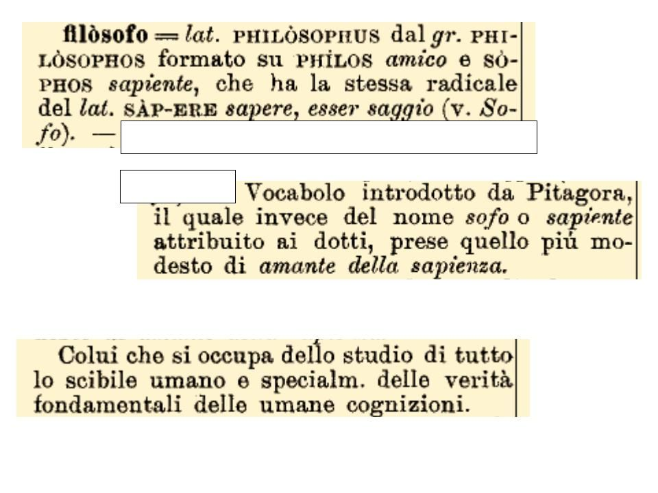{ loading=lazy style="width:59%" }

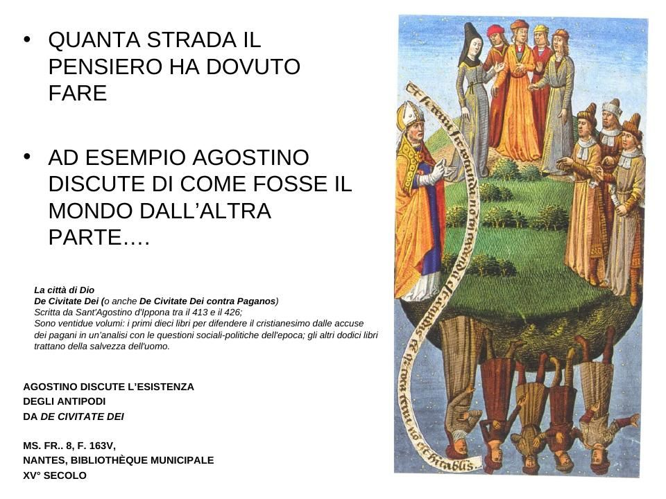{ loading=lazy style="width:59%" }

**QUANTA STRADA IL PENSIERO HA DOVUTO FARE**

Ad esempio Agostino discute di come fosse il mondo dall’altra parte… (Agostino discute l’esistenza degli antipodi, dal De civitate Dei, ms. fr. 8, f. 163v, Nantes, Bibliothèque municipale, XV secolo)

*La città di Dio* (*De civitate Dei*, o anche *De civitate Dei contra paganos*), scritta da sant’Agostino d’Ippona tra il 413 e il 426, è in ventidue libri: i primi dieci difendono il cristianesimo dalle accuse dei pagani, con un’analisi delle questioni sociali e politiche dell’epoca; gli altri dodici trattano della salvezza dell’uomo.

**È DIFFICILE PENSARE…**

E a volte è anche pericoloso per la propria vita

Piena ne è la storia umana

Si dice che il primo martire occidentale della libertà di pensiero sia stato Socrate

Il filosofo che sapeva di non sapere

**VERITÀ PERICOLOSE: IL PROCESSO A SOCRATE**

Ventiquattro secoli fa, nel 399 a.C., tre cittadini ateniesi portarono in tribunale il filosofo Socrate, perché ritenuto una minaccia per la società.

Al termine del processo, durante il quale accusa e difesa presentarono le rispettive tesi, la maggioranza della giuria, formata da rappresentanti dei cittadini ateniesi, riconobbe Socrate colpevole e, con singolare severità, lo condannò a morte.

Platone poi, forse il discepolo che più di ogni altro amò Socrate, trascrisse il suo discorso di difesa che è giunto fino a noi con il titolo di *Apologia*:

– Il concetto di empietà, il carattere dei suoi accusatori, le imputazioni di eresia, corruzione dei giovani e oltraggio all’identità democratica ateniese.

\- La politica e i rischi a cui si espone chi voglia dire la verità: «nessun uomo sulla terra che, coscienziosamente, impedisca il verificarsi di ingiustizie e di illegalità nel proprio stato di appartenenza potrà mai salvare la propria vita. Il vero difensore della giustizia, che intenda sopravvivere anche per breve tempo, deve necessariamente confinarsi nella vita privata e abbandonare la politica».

– Socrate accetta la condanna, e non fa niente per evitarla: né la ritrattazione, né la richiesta di perdono, né l’esilio, né la fuga.

Accetterà quindi la condanna: «è meglio subire ingiustizia piuttosto che farla»;

Accetterà quindi la morte che d’altra parte non è un male perché forse ci darà la possibilità di visitare un mondo migliore dove, dice Socrate, s’incontreranno interlocutori migliori con cui dialogare. Oppure perché è un sonno senza sogni.

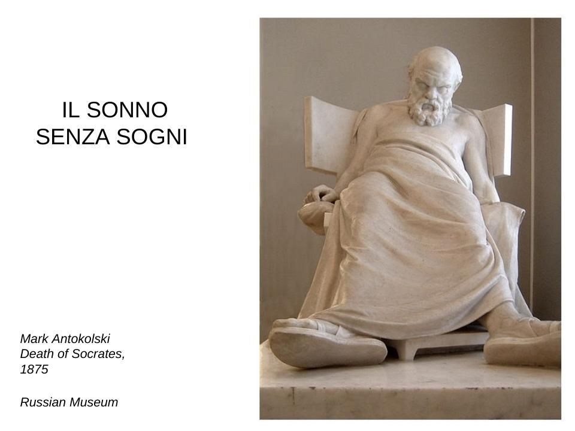{ loading=lazy style="width:47%" }

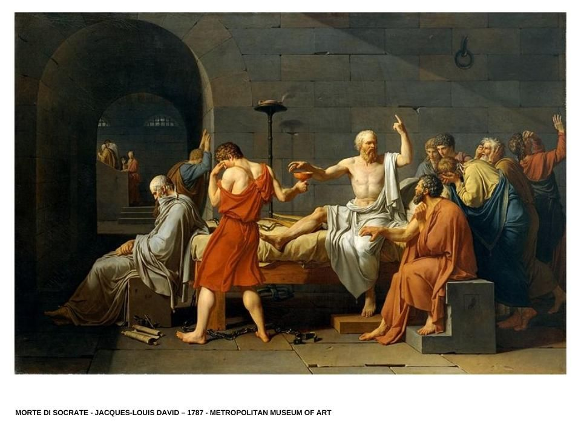{ loading=lazy style="width:47%" }

**LA MORTE DI SOCRATE DI J.-L. DAVID**

Un quadro che, partendo dal *Fedone* di Platone, si presta a molte letture: Antiplatonico? Anticristiano? Politico?

*Nelle immagini: Mark Antokolski,* La morte di Socrate*, 1875, Museo Russo (San Pietroburgo); Jacques-Louis David,* La morte di Socrate*, 1787, Metropolitan Museum of Art (New York).*
{: .didascalia }

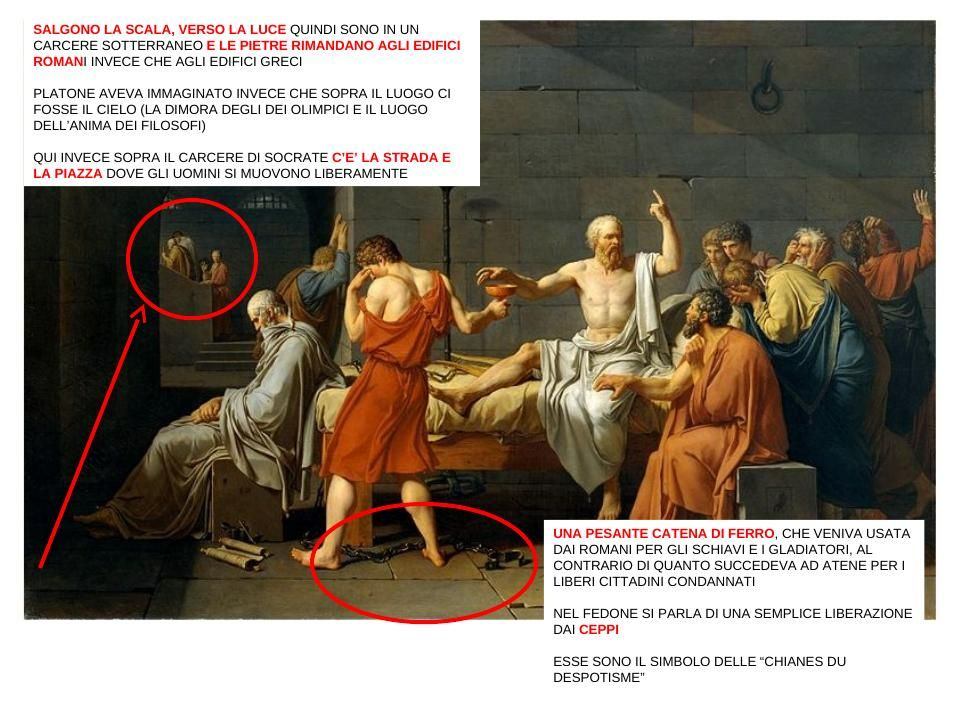{ loading=lazy style="width:59%" }

**LA MORTE DI SOCRATE DI J.-L. DAVID**

Salgono la scala, verso la luce: quindi sono in un carcere sotterraneo e le pietre rimandano agli edifici romani invece che agli edifici greci.

Platone aveva immaginato invece che sopra il luogo ci fosse il cielo (la dimora degli dei olimpici e il luogo dell’anima dei filosofi).

Qui invece sopra il carcere di Socrate c’è la strada e la piazza dove gli uomini si muovono liberamente.

Una pesante catena di ferro, che veniva usata dai romani per gli schiavi e i gladiatori, al contrario di quanto succedeva ad Atene per i liberi cittadini condannati.

Nel Fedone si parla di una semplice liberazione dai ceppi.

Esse sono il simbolo delle «*chaînes du despotisme*».

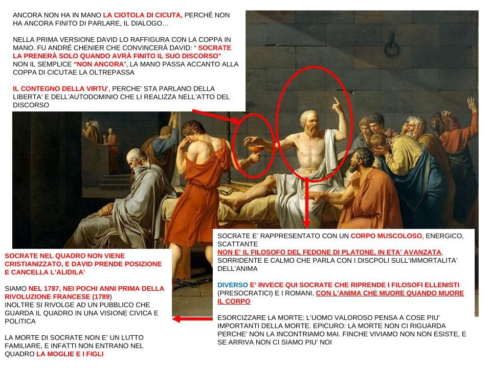{ loading=lazy style="width:59%" }

**LA MORTE DI SOCRATE DI J.-L. DAVID**

Socrate è rappresentato con un corpo muscoloso, energico, scattante.

Non è il filosofo del Fedone di Platone, in età avanzata, sorridente e calmo che parla con i discepoli sull’immortalità dell’anima.

Diverso è invece qui Socrate che riprende i filosofi ellenistici (presocratici) e i romani, con l’anima che muore quando muore il corpo.

Esorcizzare la morte: l’uomo valoroso pensa a cose più importanti della morte. Epicuro: la morte non ci riguarda perché non la incontriamo mai. Finché viviamo lei non esiste, e se arriva non ci siamo più noi.

Ancora non ha in mano la ciotola di cicuta, perché non ha ancora finito di parlare, il dialogo…

Nella prima versione David lo raffigura con la coppa in mano. Fu André Chénier a convincere David: «Socrate la prenderà solo quando avrà finito il suo discorso».

Non il semplice «non ancora», la mano passa accanto alla coppa di cicuta e la oltrepassa.

Il contegno della virtù, perché sta parlando della libertà e dell’autodominio che le realizza nell’atto del discorso

Socrate nel quadro non viene cristianizzato, e David prende posizione e cancella l’aldilà.

Siamo nel 1787, nei pochi anni prima della Rivoluzione francese (1789).

Inoltre si rivolge a un pubblico che guarda il quadro in una visione civica e politica.

La morte di Socrate non è un lutto familiare, e infatti non entrano nel quadro la moglie e i figli.

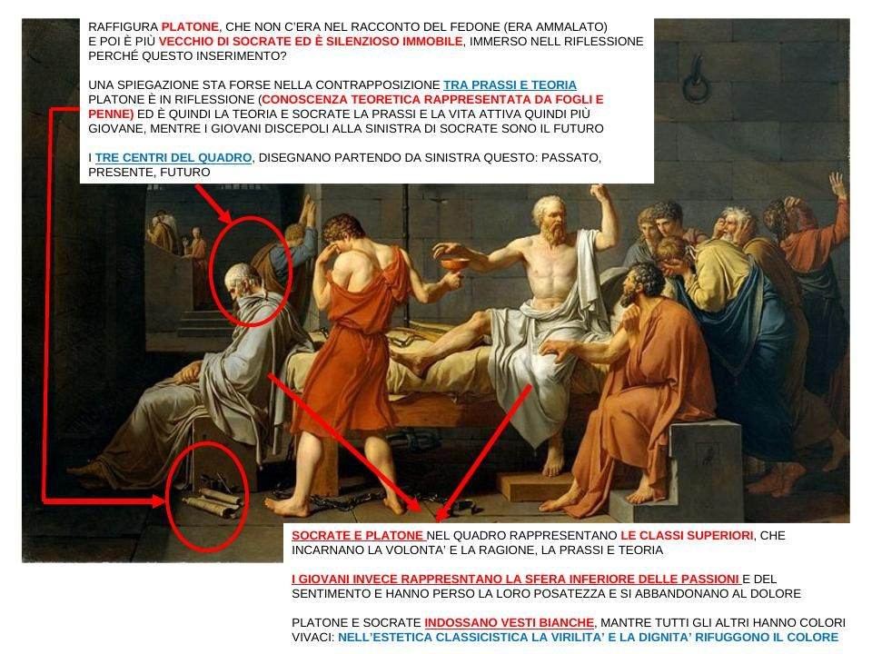{ loading=lazy style="width:59%" }

**LA MORTE DI SOCRATE DI J.-L. DAVID**

Raffigura Platone, che non c’era nel racconto del Fedone (era ammalato), e poi è più vecchio di Socrate ed è silenzioso, immobile, immerso nella riflessione.

Perché questo inserimento?

Una spiegazione sta forse nella contrapposizione tra prassi e teoria: Platone è in riflessione (conoscenza teoretica rappresentata da fogli e penne) ed è quindi la teoria e Socrate la prassi e la vita attiva quindi più giovane, mentre i giovani discepoli alla sinistra di Socrate sono il futuro.

I tre centri del quadro disegnano, partendo da sinistra questo: passato, presente, futuro.

Socrate e Platone nel quadro rappresentano le classi superiori, che incarnano la volontà e la ragione, la prassi e teoria.

I giovani invece rappresentano la sfera inferiore delle passioni e del sentimento e hanno perso la loro posatezza e si abbandonano al dolore.

Platone e Socrate indossano vesti bianche, mentre tutti gli altri hanno colori vivaci: nell’estetica classicistica la virilità e la dignità rifuggono il colore.

0:00:00

Lorenzo Poggi Il problema è la realtà. E quello che diceva Paolo mi ha sollecitato una riflessione. Platone nel *Teeteto* dice che la filosofia nasce dalla meraviglia. Che cosa significa? Non meraviglia nel senso comune: le cose suscitano in noi delle domande, sono quasi qualcosa che diventa problema, diventano problematiche; sono – noi diremmo – traumatiche nel loro presentarsi alla nostra vista, alla nostra esistenza, alla nostra considerazione. La filosofia è questo: nasce dal trauma, nasce dal colpo che si riceve di fronte alla realtà, che improvvisamente ci appare non più ovvia, come realtà esistente così com’è, ma come problema, come qualcosa che ci impegna a riflettere.

0:01:26

Talete, che in tutti i libri di filosofia viene annunciato come il fondatore della filosofia, si chiede quale sia l’origine di tutte le cose; si chiede come spiegare la realtà che gli sta davanti, delle cose che si trasformano pur rimanendo in qualche modo se stesse. E non trova altra spiegazione che dire che le cose si comportano in questo modo, si possono capire, se diciamo che sono fatte tutte d’acqua. E siccome sappiamo che l’acqua, pur rimanendo acqua, può essere ghiaccio, liquido e vapore, così anche le cose, pur rimanendo se stesse, hanno apparenze e forme diverse. E così tenta di dare una risposta. Non più gli dei, la spiegazione ovvia del tempo, che diceva che ci sono cose che si trasformano perché dietro ogni trasformazione c’è un *genius*, un dio, un’essenza esterna.

0:03:05

La filosofia inizia quando, meravigliati dalla realtà come Talete, ci si chiede quale sia la vera natura della trasformazione e, nello stesso tempo, del mantenimento dell’identità del reale. Ci si fa una domanda, diremmo oggi, metafisica: è l’inizio della filosofia, il momento in cui l’uomo comincia a dire: «Non mi accontento più di una semplice spiegazione sacra, cioè di un’entità sacra, degli dei che fanno queste cose. Voglio capire, voglio capire». Mi accorgo che ciò che mi circonda, e che potrebbe benissimo essere banalmente accettato come realtà, e quindi non sottoponibile a problema o a interpretazione, diventa invece meraviglia, cioè un trauma, qualcosa che mi colpisce; e la realtà acquista tutta la bellezza e la ricchezza della variabilità, è di nuovo diventata problema.

0:04:25

La nostra cultura occidentale fino a oggi non ha mai rinunciato a questo tipo di atteggiamento; e da questo tipo di atteggiamento sono derivate, con la loro natura particolare, tutte le scienze – in questi cinque anni di incontri qualcosa abbiamo visto anche di questo. Dal corpo della filosofia si sono sviluppate poi, a poco a poco, tutte le scienze particolari; ma si sono sviluppate proprio per questo carattere fondamentale: non accontentarsi della realtà, ma assumere nei confronti di essa un atteggiamento che la problematizza, e dalla cosa reale, banale nella sua esistenza, trarre invece tutta la ricchezza, il fascino del problema. La filosofia è *aporein*: che cosa vuol dire? Si allunga la strada: si percorre la strada dell’esperienza, ma quella non basta; oltre la strada dell’ovvio, oltre la strada dell’apparenza e dell’immediatezza, c’è la possibilità di andare oltre. Questo andare oltre, questo rendere problematico, è il carattere fondamentale della filosofia.

0:06:12

Talete, mentre pensava a queste cose, inciampò e cadde in un fosso, e una servetta trace lo prese in giro, dicendo che lui, grande filosofo che diceva di aver scoperto la natura delle cose, poi non riusciva a vedere che cosa aveva davanti ai piedi e cadeva rovinosamente nei fossi. Il riso della servetta trace è diventato emblematico: è diventato il disprezzo nei confronti della filosofia, del filosofo che si pone problemi – e non sono problemi, in apparenza – perché la filosofia è quella cosa senza la quale tutto rimane tale e quale. Questo è il punto di vista ordinario, di fronte al quale la filosofia non ha risposte: la servetta trace ride di Talete.

0:07:18

Ma nella storia di Talete c’è anche un’altra cosa, una vendetta di chi ci ha tramandato questa storia. In fondo problematizzare l’esistente, andare al di là, cercare di dare una spiegazione razionale, ragionata, del perché dell’identità e della trasformazione delle cose, è il problema fondamentale della metafisica, no? Il problema fondamentale della filosofia: che cosa è vero, che cosa è reale, che cos’è che, pur trasformandosi nel tempo, è sempre se stesso? Come facciamo a dire che è lo stesso fiume, se nel fiume passano sempre acque nuove, e le mani che vi immergiamo sono ogni giorno diverse, perché ogni giorno più vecchie? Eppure diciamo che sono le stesse mani e che quello è lo stesso fiume. Che cos’è che mantiene l’identità? Questi sono i problemi della filosofia, quando nasce, e sono problemi che hanno caratterizzato il nostro pensiero occidentale: dal tentativo di dare loro risposta è sorta anche la scienza moderna.

0:08:44

Platone, in fondo, fonda per primo uno dei possibili linguaggi della scienza moderna. Ciò che rimane nelle cose non è la loro apparenza, che muta, ma la loro essenza di idea, *eidos*, di razionalità, che esiste prima e indipendentemente dalle cose materiali. E così siamo in grado di comunicare, di istituire relazioni di causa-effetto fra i fenomeni e di comunicarle, e quindi siamo in grado di prevedere il futuro e di avere sicurezza.

0:09:36

Ritorniamo a Talete. Talete poi sconfessò la servetta trace: aveva visto che ci sarebbe stato un bel raccolto di olive, e così prese in affitto tutti i frantoi che c’erano a Mileto; poi, quando ci fu questo grande raccolto, li riaffittò guadagnandoci moltissimo, e mostrando che il filosofo, quando voleva, poteva anche fare quattrini, perché insomma erano conoscenze abbastanza banali. Ma non riuscì – e qui la storia diventa emblematica – nonostante la sua filosofia e la sua capacità di razionalizzare il mondo, a sfuggire alla natura. L’oracolo gli aveva predetto che sarebbe morto per il crollo di una casa; e lui per questo andava sempre in giro in campagna, stava all’aperto. E proprio mentre andava in giro, un’aquila che aveva catturato una tartaruga con gli artigli, per mangiarla e spezzarne il guscio, andò in alto e poi la lasciò cadere sulle rocce: e beccò in pieno in testa il nostro povero Talete \[?\], che ci rimase secco. Per il crollo di una casa, anche se era il guscio di una tartaruga. Quindi la filosofia non riesce a vincere la natura, e solo all’interno di essa può iscriversi: così racconta la storiella. Basta così, proseguiamo dopo la nostra avventura con gli occhiali della filosofia.

0:11:30

Paolo Marcucci Bene, facciamo la prima pausa: mangiamo il primo piatto.

\[PAUSA\]
{: .nota }

0:31:01

Paolo Marcucci Direi di iniziare la prima parte dopo l’introduzione, così vediamo di recuperare un po’ del tempo dell’inizio. Allora, in questa prima parte c’era un altro tema che volevo approfondire un po’, che è il dualismo, il rapporto mente-corpo. Esiste sempre questo concetto? Uno dei massimi teorizzatori fu Cartesio. Questo è un quadro di Magritte, *Décalcomanie*, che mi pareva raffigurare bene questo concetto del dualismo mente-corpo.

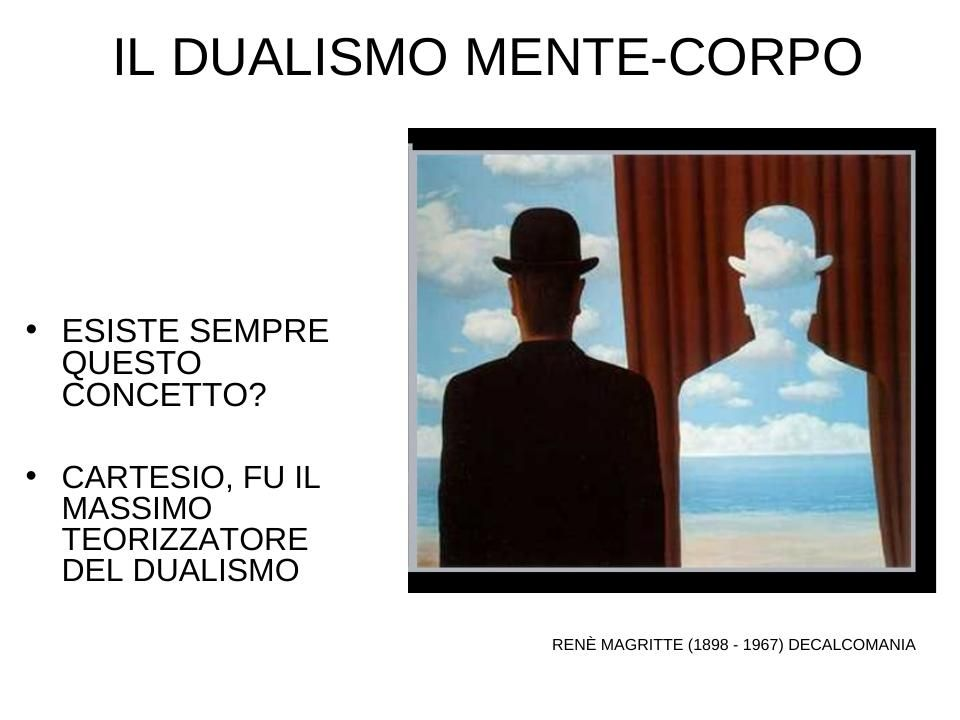{ loading=lazy style="width:59%" }

0:31:57

Dicevamo di Cartesio, che è il principale sostenitore di questa impostazione. Si rifà a Platone, che concepiva l’anima come immortale, essenzialmente separata dal corpo. Cartesio fa sua quest’interpretazione – la interpreta naturalmente a modo suo, sono trascorsi molti secoli dall’affermazione platonica – e dice sostanzialmente che la mente è una sostanza immateriale che interagisce con il corpo, cioè con una sostanza materiale. Cito alla lettera (dal *Discorso sul metodo*): «L’anima razionale non si può in nessun modo ricavare dalla potenza della materia, ma deve essere creata espressamente». Quindi prende posizione su questo tema. Da qui, se si prende per buona questa impostazione, possiamo credere anche all’immortalità dell’anima, perché allora la nostra anima può andare in paradiso, all’inferno – per chi crede – o addirittura alle reincarnazioni. Non è quell’anima, quella mente, quel pensiero che abbiamo visto prima nel quadro di David: qui si ritiene invece che l’anima possa essere staccata dal corpo.

0:33:24

Allora il cervello è un organo come il cuore o il fegato; e che cos’è la mente? È effettivamente qualcosa di diverso dal cervello, perché il cervello è una cosa e la mente e il pensiero sono altro: sono fatti di un’altra materia (la mente sembra essere quella dimensione volatile e insieme così intima che ci dà la sensazione di vivere «in prima persona» le esperienze del mondo). Però è anche vero, se ci pensiamo, che le eventuali lesioni che possiamo subire al cervello influenzano, condizionano, fanno morire il nostro pensiero e la nostra mente. Quindi, anche se sono due cose separate, c’è una relazione diretta: senza cervello non c’è mente, sostanzialmente. Ma anche il corpo, tutto il corpo, condiziona il nostro pensare e il nostro cervello: pensiamo agli stimoli della vista, dell’udito, a tutti i sensi, che condizionano anche il nostro pensiero. Tant’è vero – se ci avete fatto caso – che a Guantánamo i prigionieri vengono incappucciati proprio per isolarli dal mondo. Questo ci riporta al concetto del dualismo mente-corpo: se si costringe il corpo in certe situazioni, si trasforma anche il pensiero, il modo di sentire. Infatti sono trattati in questo modo proprio per far perdere loro la ragione e la memoria.

{ loading=lazy style="width:59%" }

0:35:05

Perché senza memoria non c’è nemmeno responsabilità: si perde il contatto con il mondo e con quello che abbiamo fatto. Le vestigia – qualcuno ha usato questa bellissima parola – le vestigia dei nostri peccati sono la memoria. E se ci pensate, Google questo lo sa benissimo, perché conserva tutto quello che andiamo tracciando delle nostre vite. C’è quindi questa linea sottile tra questi due mondi. Vittorio Sereni, un poeta, ha detto che l’anima non è che una fitta di rimorso; ed è vero, è anche bella questa frase. Il ricordo: senza memoria non c’è nemmeno rimorso, perché non possiamo ricordare gli sbagli e gli errori che abbiamo fatto. E pensiamo al dramma di certe malattie dell’età anziana, in cui si perde la memoria: si perde la vita.

**IL DUALISMO MENTE-CORPO**

Senza memoria la responsabilità e la decisione morale non potrebbero avvenire.

Come si può essere responsabili senza avere a che fare con le «vestigia» dei nostri peccati?

Google questo lo sa bene, e conserva tutto di noi.

La linea è sottile: la memoria si può utilizzare anche senza pensare a quello che si sta dicendo: posso recitare a memoria una poesia e pensare in realtà a tutt’altro. La memoria quindi, si può azzardare, non è pensiero, non è ancora pensiero.

Vittorio Sereni, il poeta, ha detto che l’anima non è che una fitta di rimorso.

Questa fitta di rimorso nasce dalla possibilità di ricordare: senza memoria non c’è rimorso, non ci sono affetti, non c’è soggetto, non c’è niente, come sanno quelli che «bevono per dimenticare».

Però, se la memoria non è ancora pensiero, come possiamo affrontare gli spettri più ossessionanti di questi tempi come l’Alzheimer, ossia la perdita di memoria?

Non siamo più noi, e gli iniziali inciampi si trasformano in un addio del nostro spirito e della nostra vita.

0:36:22

Quindi questo pensiero è costante. La tecnologia in questo momento sta andando avanti: chi lo dice che tra un po’ non si costruiscano degli androidi, delle creature che possano in qualche modo pensare? L’immaginazione di *Blade Runner* – se qualcuno se lo ricorda – le lacrime perse nella pioggia dell’androide che si era costruito un’anima: quindi non è così banale, questo tema.

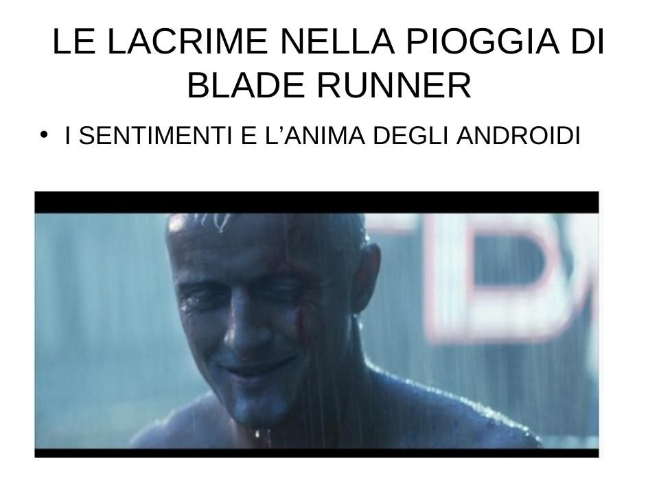{ loading=lazy style="width:59%" }

0:36:55

Per finire, c’era il «cervello viscerale», che mi aveva colpito in questo dibattito moderno sul dualismo mente-corpo. Il linguista forse più famoso al mondo in questo momento, Noam Chomsky, il 24 gennaio 2014... in Vaticano ci sono state una serie di conferenze, e lui ha tenuto la prima, sul linguaggio. Pensiamo che queste conferenze sono state fatte in Vaticano – questa è la novità interessante – per parlare di tutti quei meccanismi che ci permettono di interpretare l’uomo e il mondo: quindi un’apertura al mondo esterno, alle filosofie e ai modi di pensare. Chomsky fa una lezione: è un linguista e parla del suo campo, però dice una cosa interessante, cioè che è stato scoperto – anche lui ne è stato affascinato – un apparato digerente molto particolare, di cui cominciamo ora a intravedere le potenzialità, che è stato denominato il «secondo cervello», o «cervello viscerale».

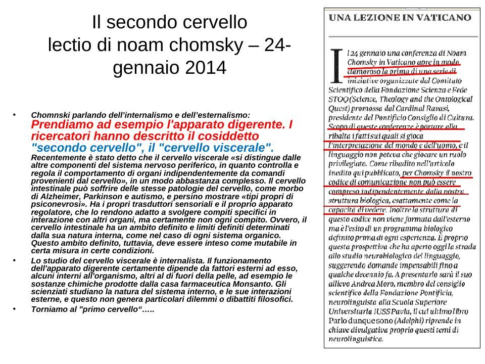{ loading=lazy style="width:59%" }

**IL SECONDO CERVELLO: LECTIO DI NOAM CHOMSKY (24 GENNAIO 2014)**

Chomsky, parlando dell’internalismo e dell’esternalismo: Prendiamo ad esempio l’apparato digerente. I ricercatori hanno descritto il cosiddetto «secondo cervello», il «cervello viscerale». Recentemente è stato detto che il cervello viscerale «si distingue dalle altre componenti del sistema nervoso periferico, in quanto controlla e regola il comportamento di organi indipendentemente da comandi provenienti dal cervello», in un modo abbastanza complesso. Il cervello intestinale può soffrire delle stesse patologie del cervello, come morbo di Alzheimer, Parkinson e autismo, e persino mostrare «tipi propri di psiconevrosi». Ha i propri trasduttori sensoriali e il proprio apparato regolatore, che lo rendono adatto a svolgere compiti specifici in interazione con altri organi, ma certamente non ogni compito. Ovvero, il cervello intestinale ha un ambito definito e limiti definiti determinati dalla sua natura interna, come nel caso di ogni sistema organico. Questo ambito definito, tuttavia, deve essere inteso come mutabile in certa misura in certe condizioni.

Lo studio del cervello viscerale è internalista. Il funzionamento dell’apparato digerente certamente dipende da fattori esterni ad esso, alcuni interni all’organismo, altri al di fuori della pelle, ad esempio le sostanze chimiche prodotte dalla casa farmaceutica Monsanto. Gli scienziati studiano la natura del sistema interno, e le sue interazioni esterne, e questo non genera particolari dilemmi o dibattiti filosofici.

Torniamo al «primo cervello»…

*Nella slide anche l’articolo «Una lezione in Vaticano»: la conferenza di Chomsky, il 24 gennaio, ha aperto in Vaticano una serie di iniziative del Comitato scientifico della Fondazione Scienza e Fede STOQ, promossa dal Pontificio Consiglio della Cultura del cardinale Ravasi.*
{: .didascalia }

0:38:22

Allora, due o tre dati per far capire meglio questo concetto. Il nostro corpo è invaso da miliardi e miliardi di microbi: fin dalla nascita, appena usciamo dal sacco materno, veniamo popolati, colonizzati da miliardi di microbi, alcuni positivi, alcuni negativi. Questa massa di microbi si chiama microbioma: sono 100.000 miliardi di cellule, e il genoma, cioè il sequenziamento genetico, di questi microbi è pari a 3 miliardi. Vi ricordate di quando cominciò la mappatura del genoma umano? Insomma, sostanzialmente è finita, e sono circa 23.000 geni. Quindi il nostro corpo è fatto di 23.000 geni; il microbioma, cioè tutti i microbi che popolano il nostro corpo, è fatto di 100.000 miliardi di cellule. Sostanzialmente vuol dire che due persone geneticamente uguali a un’altra al 99,9% hanno il microbioma uguale solo per il 10-20%.

**IL SECONDO CERVELLO**

*Uno studio prova che lo stato dell’intestino influisce direttamente sul cervello – «Domani i microbi ci salveranno. Gli organismi microscopici possono combattere le malattie» (Massimo Piattelli Palmarini)*

Ci siamo resi conto che i microbi presenti intorno e dentro di noi sono almeno dieci volte di più, e molto più eterogenei, di quelli che venivano tradizionalmente identificati in coltura. Pullulano batteri, funghi e altri infinitesimi organismi viventi soprattutto nell’intestino (dove vivono mille miliardi di microrganismi per ogni grammo di tessuto), ma anche nel profondo della pelle, nelle mucose, nella congiuntiva, nella saliva, negli organi genitali, nelle vie aeree.

Microbioma: 100.000 miliardi di cellule. Genoma del microbioma: 3 miliardi. Genoma umano: 23.000. Due persone con un genoma uguale al 99,9% hanno il microbioma uguale solo per il 10-20%.

Diversi studi hanno messo in relazione le alterazioni e le modificazioni del microbioma con il nostro umore, la nostra psiche, la nostra ansia, la depressione. Come si dice: «ragionare con la pancia».

*Sintesi del resto della slide:* recenti studi (Sarkis K. Mazmanian e undici collaboratori del California Institute of Technology, sulla rivista «Cell») hanno messo in rilievo come l’intestino influisca sul cervello. I microrganismi sono almeno dieci volte più numerosi delle cellule del nostro corpo e la nostra salute dipende dalla pacifica coabitazione con loro: topi privati di ogni microbiota hanno un’esistenza molto precaria. Nei topi, introducendo nella prole un batterio presente nell’uomo (*Bacteroides fragilis*), i ricercatori hanno ottenuto miglioramenti in difetti del comportamento comunicativo, maggiore resistenza allo stress, minori sintomi di ansia; la conclusione è che esiste un asse intestino-cervello.

0:39:56

Tutto questo per dire che questo microbioma è concentrato molto nell’apparato digerente: per questo si dice «ragionare con la pancia», e si parla di questo secondo cervello. Quindi, se da un punto di vista filosofico si è dibattuto per secoli su questo punto – vedo Lorenzo sorridere, perché è così – la scienza ora ci apre anche nuovi modi di pensare, a cui non siamo nemmeno abituati; e probabilmente siamo solo agli albori, perché nell’interazione corpo-mente si è scoperto un altro punto da indagare in futuro. Ti lascio la parola, Lorenzo, se vuoi dire qualcosa anche su questo tema del dualismo.

0:40:55

Lorenzo Poggi È vastissimo: vedete, Paolo sta mettendo al fuoco tantissima carne che non faremo mai in tempo a cuocere. Però è chiaro che, quando parliamo di dualismo, partiamo da Cartesio, visto che è lui che ha posto questo dualismo così nettamente: il pensiero, *res cogitans*, e la *res extensa*. Va tutto bene; e poi, quando ha dovuto fare il ricongiungimento, sono stati guai, perché non sapeva come rimetterle insieme. La *res cogitans* andava benissimo per conto suo, e la visione della realtà era soggettivizzata, perché tutto stava nella chiarezza e distinzione con cui le cose apparivano all’io pensante: e quindi vero era ciò che all’io appariva chiaro e distinto. Subito dopo, dice Cartesio: «Quindi io sono una cosa pensante». E commette lì il primo errore, perché, se dice che l’unica cosa di cui siamo certi è il pensiero, «io penso», non può dire che questo io è una cosa, una res: dire che è una res è già andare oltre. Io sono un pensiero, non una res che pensa.

0:42:33

Qui c’è un passaggio successivo, ma lasciamo stare questo errore, abbastanza sottile. Poi, quando si trattò di fare il ricongiungimento, successe il macello, perché aveva trovato la ghiandola pineale al centro del cervello, ma non riusciva a capire come con questa cosa, che era anch’essa qualcosa di materiale, si congiungesse la *res cogitans* con la *res extensa*. E poi la sua stessa esistenza – lo diciamo anche insieme – è una contraddizione: dopo aver negato il valore dell’esperienza del corpo, pensa tutte queste cose con il corpo al caldo, in un momento di tranquillità, davanti alla stufa, come ci dice, nel 1619, in un momento di sosta della guerra dei Trent’anni. E poi vedete il destino: come Talete, muore di freddo, di polmonite, perché andava alle sei a insegnare filosofia a Cristina di Svezia. Quindi, dopo aver negato il valore del corpo, il corpo si vendica.

0:43:42

Traiamo invece da questo una conclusione, una lezione, un modo di intendere. Quando parliamo di filosofia non parliamo di storia della filosofia, di una serie di dottrine, ma di quello che dicevo prima: di questo atteggiamento, di questo punto di vista problematico sul mondo, che non ha paura delle contraddizioni, anzi dalle contraddizioni e dai fallimenti cresce e guadagna. Quando nelle nostre scuole facciamo la filosofia come storia della filosofia, serve sì alla cultura, ma dovrebbe servire soprattutto a dare agli studenti l’idea che occorre mantenere vivo il problema e non affidarsi all’ovvietà del senso comune. Occorre mantenere il fascino del problematizzare, che è quello che ci ha caratterizzato come cultura e che ci ha consentito di costruire la scienza moderna, e anche quello che oggi caratterizza gran parte del mondo. Quindi è questo che conta. E tutte le filosofie, tutti i vari filosofi – ma questo dice il contrario dell’altro!: si contraddicono benissimo; vuol dire che la razionalità del discorso, il problematizzare, il non affidarsi mai all’ovvietà dell’esperienza comune, è l’elemento portante della nostra civiltà e della nostra comunità.

0:45:44

Abbiamo fatto questo esempio di Cartesio; ed è continuo. Quando la filosofia si confronta, per esempio, con la religione, la religione dà una risposta diversa, una risposta assertiva: le cose sono così perché così la volontà di un Dio le ha predisposte, le ha fatte; e la tua conoscenza è nel giusto se si adegua a questa conoscenza di Dio. E quindi conoscere la verità ha prima di tutto il segno della fede e della rivelazione. Voi sapete che la nostra cultura occidentale, nemmeno nei momenti in cui questa forma culturale era dominante, ha mai rinunciato alla filosofia: non ha mai rinunciato a dire «sì, c’è la rivelazione, c’è la verità rivelata, ma questa deve anche essere giustificata dalla ragione».

0:47:08

Tommaso d’Aquino... Voi sapete che cosa succede: a metà del Duecento si riscopre l’Aristotele fisico. Fino ad allora si era conosciuto l’Aristotele logico, l’*Organon*; si riscopre l’Aristotele che dice come stanno le cose del mondo, della fisica, della natura. Lo riscoprono i commentatori arabi, al-Kindi, Avicenna, Averroè; lo riscoprono, lo passano poi all’Occidente nei loro commenti, e ritorna in Occidente attraverso gli arabi. E arriva a Parigi: Aristotele va in città, alla Sorbona, e a Parigi naturalmente viene letto e insegnato all’università, che ha la facoltà di teologia come suo culmine. E viene insegnato come qualcosa che va contro quella che è la dottrina ufficiale del cristianesimo e della Chiesa: non c’è un Dio creatore, non c’è un Dio consapevole del mondo, nella filosofia aristotelica, eccetera – è utile sottolineare le differenze. Ci sono un mucchio di cose che non tornano; però dal punto di vista fisico, dimostrativo, razionale, Aristotele è molto più efficace, molto più conseguente delle dottrine della Chiesa.

0:48:59

I professori di teologia e di filosofia dell’Università della Sorbona che cosa dicono? Ci sono due verità, una verità di fede e una verità di ragione; siccome non si riesce a metterle insieme, secondo ragione e secondo filosofia ha ragione Aristotele. E così tentano di salvarsi l’anima; oltretutto l’università dipende dal vescovo di Parigi, per cui capite, insomma, non era mica tanto comodo dirlo. Questa cosa va un po’ avanti, poi a un certo punto il vescovo di Parigi, come dire, si inquieta – si chiama Stefano Tempier (Étienne Tempier, autore delle condanne del 1270 e del 1277) – e li condanna tutti; non solo li condanna, li scomunica. Molto semplice.

0:50:00

Si era innervosito – ora c’è un altro termine, proprio come... Alcuni gli avevano riferito che questi signori osavano dire che c’era più verità negli scritti dei gentili dannati che nelle Sacre Scritture; e così corrompevano i giovani, immaginate. Allora lui che cosa fa? Molto semplicemente li scomunica tutti, e naturalmente pretende che entro dieci giorni vadano, si presentino da lui o dal suo cancelliere a confessarsi del peccato; e una volta che si saranno confessati e pentiti, lui vedrà quale pena comminare, secondo quelle che il diritto dice siano da infliggere. E non ci andavano mica leggeri: non pensate che se la cavassero con gli arresti domiciliari o con i servizi sociali. Erano altri tempi, erano tempi duri.

0:51:29

Che cosa succede? Succede che a un certo momento, proprio all’epoca della condanna, viene fuori, studente alla Sorbona, un signore che si chiama Tommaso dei conti d’Aquino, entrato nell’ordine domenicano fondato da Domenico di Guzmán, che pensa di superare l’averroismo e dice: «Non è vero che ci sono due verità: ce n’è una sola, la verità di fede, ma questa coincide con la verità di ragione». E scrive la *Somma teologica* per dimostrare come le verità di fede e le verità di ragione coincidano perfettamente: se non coincidono, è perché il filosofo non è abbastanza bravo da farle coincidere.

0:52:22

E piglia delle cantonate. Ci sono dei passi della *Summa contra Gentiles* di Tommaso d’Aquino in cui si sente veramente, si diceva, il sudore del filosofo che non ce la fa, si arrabbia, si arrampica sugli specchi, scivola. A un certo momento tenta di dimostrare una cosa: sa che la verità di fede dice che il matrimonio fra consanguinei è peccato, e lui deve dimostrare razionalmente che il matrimonio tra consanguinei è peccato. Allora dice che il peccato consiste nel fatto che la ragione deve prevalere sempre sull’istinto; e se al desiderio che è alla base dell’amore carnale tra coniugi si unisce anche un amore maggiore, perché quello, oltre che coniuge, è anche fratello, sorella, madre, congiunto, la spinta amorosa è così forte che in qualsiasi momento è insuperabile per la ragione, e quindi è fomite di peccato. Pare una cosa... sudore tremendo: ce l’ha fatta, ma si è arrampicato, capite, fino in cima, per dimostrarlo.

0:53:38

Però rimane sempre una cosa, in Tommaso, allievo di Alberto Magno di Colonia – lo ritroveremo, Alberto di Colonia: rimane l’idea della ragione, e quindi della discussione, della problematizzazione, del rendere i problemi affrontabili attraverso il ragionamento e l’immaginazione delle conseguenze, quando si tratta di qualcosa che riguarda l’etica e la morale. Questo rimane; tanto che anche nel momento in cui si dice che la verità viene da Dio – sì, viene da Dio – bisogna anche dimostrarla con la ragione. Pensate: una delle prime cose che abbiamo visto è stato proprio il Cappellone degli Spagnoli in Santa Maria Novella, con il *Trionfo di San Tommaso d’Aquino*. È fondamentale, questo: non vi abbiamo mai rinunciato, nemmeno nei momenti in cui sembrava prevalere l’altro modo di intendere.

0:55:02

Pensate a Dante, a Guido da Montefeltro, canto ventisettesimo dell’Inferno, quando Guido è assolto dal papa dai peccati \[...\]. Lui ha paura di dare il consiglio fraudolento, perché ha paura di finire all’inferno; ma Bonifacio VIII ha bisogno di lui per il consiglio e gli dice: «Tuo cuor non sospetti; / finor t’assolvo, e tu m’insegna fare / sì come Penestrino in terra getti. / Lo ciel poss’io serrare e diserrare, / come tu sai; però son due le chiavi / che ’l mio antecessor non ebbe care» – Celestino V, che ha lasciato, non avrebbe avuto a cuore le chiavi per serrare e aprire il cielo. «E io ti assolvo, non ti preoccupare, sono il papa: fin d’ora ti assolvo, e tu insegnami a fare in modo di gettare in terra Palestrina». Guido gli dà il consiglio fraudolento – tutto bene, assolto; e il consiglio fraudolento è che «lunga promessa con l’attender corto / ti farà triunfar ne l’alto seggio»: prometti, prometti, poi quanto al mantenere... Tanto la campagna elettorale: l’importante è la promessa, la promessa è già un adito aperto alla speranza, è importantissima; mantenere è un’altra cosa. E così lui espugna Palestrina, caccia i Colonna.

0:57:09

Ma quando Guido muore – ecco il punto – viene San Francesco – lui si era fatto francescano – a prendere l’anima; ma sale un diavolo dall’inferno e gli dice: «No, eh no, perché me lo togli? Questo è mio»: «Venir se ne dee giù tra’ miei meschini / perché diede ’l consiglio frodolente, / dal quale in qua stato li sono a’ crini; / ch’assolver non si può chi non si pente, / né pentere e volere insieme puossi / per la contradizion che nol consente». E poi il diavolo ride e gli fa: «Forse tu non pensavi ch’io löico fossi!»: non te l’aspettavi che io fossi logico, filosofo. Il diavolo ragiona da filosofo: siccome per essere assolti occorre pentirsi, e non ti puoi pentire mentre commetti il peccato, perché volerlo commettere e pentirsi insieme non si può, il papa non ti può assolvere, anche se è il papa; e allora devi venire giù, perché vale più la ragione, a cui è sottoposto il problema della verità e della fede, che non l’autorità del pontefice, capite? Sì, lo so che è Dante, e ce l’aveva con Bonifacio, insomma, uno ci mette dentro tutto; però c’è l’emergere della necessità della razionalità, della problematizzazione razionale.

0:58:53

Certo, alla filosofia non toccano più i problemi di una volta, quelli che erano anche problemi delle scienze, perché tutte le scienze, abbiamo detto, si sono sviluppate dalla filosofia. Ora c’è una scienza ben sviluppata, che non ha certo bisogno della filosofia, se non per certi aspetti, quelli dell’epistemologia, come si dice in termini tecnici: e lì il filosofo è ancora consultato dallo scienziato, anzi filosofo e scienziato per certi aspetti si identificano. Per il resto rimangono tutti i problemi aperti, quelli non risolvibili semplicemente nell’attualità e nella realtà, quelli più impegnativi per noi, perché riguardano le possibilità, le scelte che dobbiamo fare non solo in quanto reali, ma in quanto possibili.

1:00:00

E quando dobbiamo fare delle scelte secondo il possibile, allora ritorna in campo la problematizzazione, quel trauma di cui dicevamo prima, quella meraviglia per la problematicità della realtà che ha fatto sorgere la filosofia. La politica è uno di questi aspetti. Quando – dice Platone – Dio lasciò il timone del mondo, allora gli uomini inventarono la politica, che dovrebbe sostituire Dio al timone del mondo nella scelta del possibile. Ed è uno dei campi, la massima *techne*, dice Platone, a cui la filosofia è chiamata, perché lì non si decide secondo scienza, secondo un esame del reale sottoponibile all’incontrovertibilità dell’esperimento: lì si decide secondo possibilità; e per lasciare aperto il campo al problema della possibilità resta solo, sovrano, lo spazio della filosofia. Oggi non sempre questo spazio è frequentato, nemmeno per quanto riguarda il timone del mondo e la politica. Bene, se ti interrompo... facciamo un’altra interruzione.

\[PAUSA\]
{: .nota }

1:30:23

Paolo Marcucci Bene, direi che è giunta l’ora dell’ultima parte. Mi permetto di chiedervi un applauso agli amici del Caffè Centofiori – grazie – che sono diventati i nostri abituali amici di queste serate. \[Applausi\]

1:30:51

Dunque, l’ultima parte, per quello che interessava a me illustrare su questo tema, riguarda i nuovi campi di applicazione della filosofia. Lorenzo prima ci ha lasciato con un punto sulla filosofia, sul suo campo d’azione. I big data, di cui a volte abbiamo già parlato nelle nostre serate, cioè questa nuova tecnologia per cui i social media, Google, i motori di ricerca tracciano le nostre vite e i nostri dati. C’è una nuova frontiera di indagine filosofica che sta nascendo in questo momento, legata proprio a questo tema. Le prime applicazioni ci fanno vedere, per esempio, che quello che crediamo essere un nostro comportamento legato a una conquista secolare, storica, il libero arbitrio, forse tanto libero non è più.

1:32:15

Questa è solo un’immagine, quella di destra, per far vedere quanti miliardi di informazioni si immagazzinano nei computer in un minuto nel mondo, tra YouTube, mail, Google, i vari blog, Apple eccetera: sono miliardi e miliardi di informazioni che si depositano. Questi dati sono ora indagati anche da un punto di vista filosofico, perché si cominciano ad analizzare i nostri comportamenti, cioè le nostre scelte. È quindi uno strumento in più che ci è venuto in mano, come è venuto tempo fa il microscopio, che ha cambiato il nostro modo di pensare, il nostro modo di indagare la realtà: in questo momento sta nascendo questo tipo di indagine. Perché ci sta dimostrando che i comportamenti umani, presi e studiati, sono abbastanza prevedibili, sia presi come gruppi sia anche come singoli.

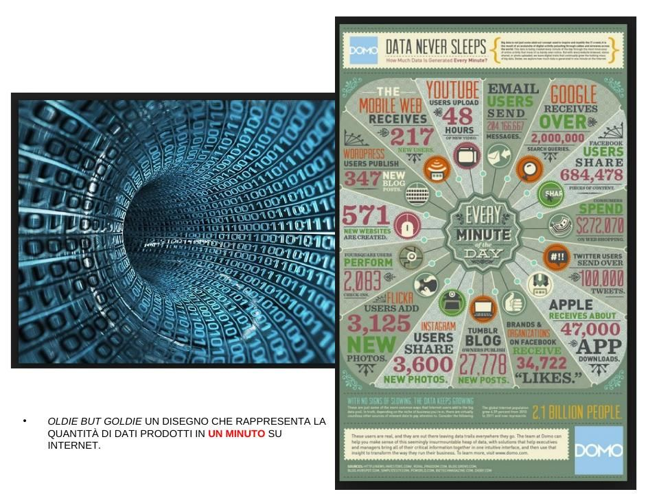{ loading=lazy style="width:59%" }

**NUOVA FILOSOFIA E BIG DATA**

Gli ultimi studi offrono lezioni più ampie di quelle che le singole correlazioni individuali ci permettono di vedere.

Gli strumenti che abbiamo a disposizione modificano e plasmano le stesse domande che l’uomo si fa (David Weinberger).

Il microscopio ci ha svelato un mondo nuovo, ma ha anche influenzato e plasmato il modo in cui la scienza, il pensiero, l’uomo poteva investigare quel mondo.

Il microscopio (dal greco *mikrón*, «piccolo», e *skopéin*, «guardare») è uno strumento che consente di risolvere e ingrandire oggetti di piccole dimensioni. I primi strumenti efficaci, nell’ambito dei microscopi di tipo ottico, vennero prodotti in Olanda alla fine del XVI secolo, ma l’invenzione vera e propria è tuttora controversa.

Galileo ne inviò uno di sua costruzione al principe Federico Cesi, fondatore dell’Accademia dei Lincei, per mostrarne il funzionamento. Galileo definiva lo strumento un «occhialino per vedere le cose minime».

In uguale misura i big data ci permettono di porre domande che pensavamo al di là dei confini dell’indagabile, per esempio intorno ai comportamenti sociali o alle interazioni di sistemi molto complessi.

Le grandi quantità di dati che ora abbiamo a disposizione mostrano che gli umani sono più prevedibili di quanto eravamo abituati a pensare.

Ad esempio gli acquisti ai supermercati (ma è solo uno dei migliaia di campi di applicazione).

Se abbiamo (se avessimo…) il libero arbitrio, dovremmo essere tendenzialmente imprevedibili.

1:33:41

Però noi abbiamo avuto una conquista fondamentale, che era quella del libero arbitrio, come abbiamo detto, cioè di comportamenti imprevedibili: libero arbitrio vuol dire che io, in base alle mie credenze o a quello che sento, posso scegliere in un modo o in un altro. Il libero arbitrio, naturalmente, è mutato di concezione nel corso dei secoli e anche dei millenni, perché l’interpretazione ha avuto diverse fasi. Forse la parte più nobile, che ci ha portato alla nostra modernità, è quella che nasce nel Rinascimento, in cui l’uomo viene posto al centro dell’universo e quindi gli si dà anche la libertà di scelta. Lutero, per esempio, avrà una concezione un po’ diversa di questo libero arbitrio, negandolo in qualche modo e attribuendo solo alla provvidenza divina la capacità di salvare e di agire a favore degli uomini. E quindi quello che in questo periodo viene dato all’uomo è la capacità di scelta del bene o del male: questo significa sostanzialmente il libero arbitrio.

**LIBERO ARBITRIO**

Treccani: «espressione usata per indicare la libertà dell’uomo, i cui atti non sono determinati da forze superiori (di tipo soprannaturale o naturale), ma derivano da sue autonome scelte. L’espressione è nata sul terreno delle discussioni teologiche cristiane, in relazione alla conciliabilità tra onnipotenza e onniscienza divina e libertà umana. A sostenere la tesi del libero arbitrio con particolare calore sono stati soprattutto i protagonisti dell’Umanesimo e del Rinascimento».

Diversa la posizione di Lutero, che giungerà a negare qualsiasi possibilità di salvezza al di fuori della grazia, mirando all’imperscrutabilità dell’aiuto divino piuttosto che ai meriti umani.

Argomento che nel corso dei secoli è stato affrontato e si è evoluto col cambiare della società.

1:35:17

Ci sono dei dipinti bellissimi che illustrano questo aspetto: sono quelli che affrescano la Cappella degli Scrovegni a Padova, affrescata da Giotto (1305), che è questa. Sulla porta d’uscita, vedete in fondo, sono rappresentati a monito, prima di uscire, il bene e il male: a sinistra il bene e a destra il male, con Cristo giudice al centro. Questa è l’immagine che c’è sopra la porta, quella che si vede in fondo là, dove vedete questa immagine terrificante dell’inferno e del male, dove il libero arbitrio, se si sceglie male, porta alla perdizione e all’inferno. E quindi la capacità di scegliere e di discernere tra le varie scelte è propria dell’uomo, e oggi, dopo secoli e millenni di filosofia, sentiamo di averla: noi siamo responsabili delle nostre azioni, abbiamo detto che scegliamo, che abbiamo la possibilità di scegliere; però questa scelta è messa in discussione.

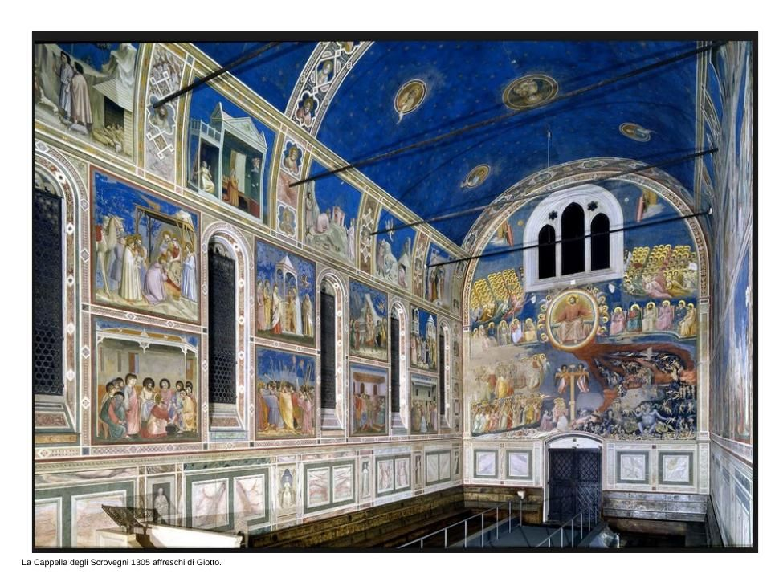{ loading=lazy style="width:47%" }

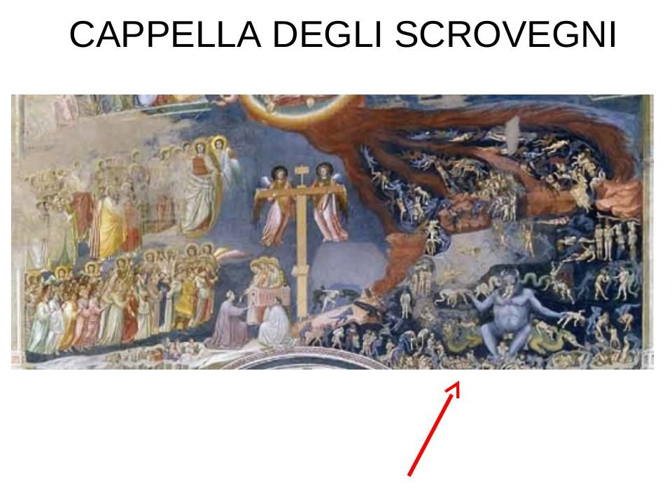{ loading=lazy style="width:47%" }

**LIBERO ARBITRIO**

Il libero arbitrio si può definire anche come la capacità – da parte di un soggetto razionale – di scegliere un’azione tra diverse alternative.

In che modo tale capacità è connessa con una responsabilità di tipo etico?

In che modo, cioè, si è responsabili e consapevoli delle proprie azioni?

(tornando all’esempio di prima delle scelte al supermercato…)

Per essere fino in fondo responsabili dobbiamo conoscere non solo quali sono le diverse alternative implicate nella scelta, ma dobbiamo anche essere consapevoli del concetto stesso di responsabilità e degli effetti che le nostre azioni potrebbero avere sugli altri individui.

Il libero arbitrio, quindi, ha a che fare anche con le nostre capacità conoscitive.

Nella tradizione antica per l’uomo forse il fato aveva un ruolo fondamentale nelle scelte.

1:36:44

E questo anche se abbiamo ancora oggi qualche reminiscenza, qualche aggancio con un passato antico, che ci identificava ancora prima che nascesse la religione cattolica, e che affonda le radici nella storia dell’uomo: quello del fato. C’è questa rappresentazione, quella delle Parche (*A Golden Thread* di John Melhuish Strudwick, 1885), dove queste tre figure femminili tessono il filo del fato di ogni uomo; e vedete, c’è la terza, quella nel mezzo, Atropo, che è lì in attesa di recidere il filo della vita di un uomo, in qualsiasi momento, dovuto un po’ a questo caso che in fondo regola la vita dell’uomo. È un po’ quello a cui gli antichi si rifacevano, non avendo prima altri agganci a cui appellarsi.

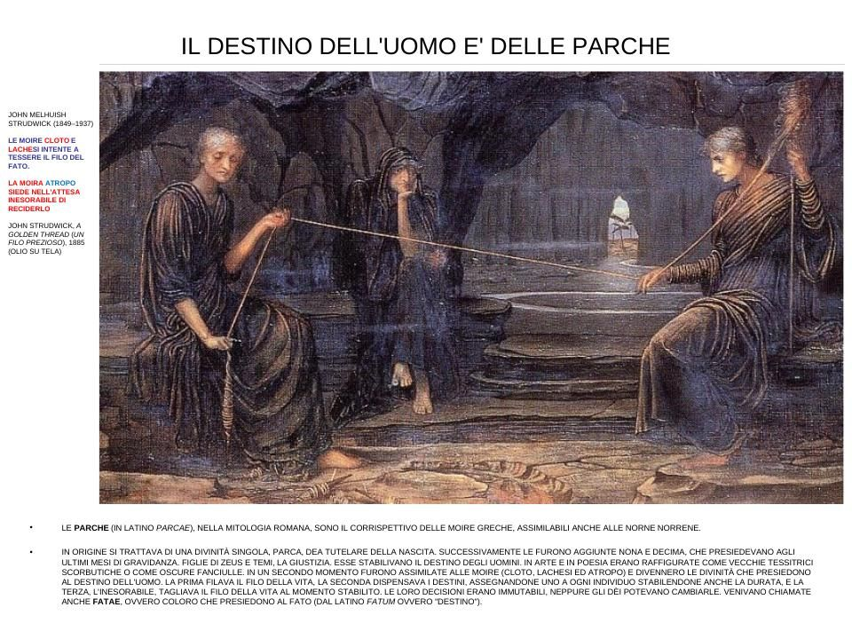{ loading=lazy style="width:59%" }

**IL DESTINO DELL’UOMO È DELLE PARCHE**

Le Parche (in latino *Parcae*), nella mitologia romana, sono il corrispettivo delle Moire greche, assimilabili anche alle Norne norrene.

In origine si trattava di una divinità singola, Parca, dea tutelare della nascita. Successivamente le furono aggiunte Nona e Decima, che presiedevano agli ultimi mesi di gravidanza. Erano figlie di Zeus e di Temi, la giustizia. Esse stabilivano il destino degli uomini. In arte e in poesia erano raffigurate come vecchie tessitrici scorbutiche o come oscure fanciulle. In un secondo momento furono assimilate alle Moire (Cloto, Lachesi e Atropo) e divennero le divinità che presiedono al destino dell’uomo. La prima filava il filo della vita, la seconda dispensava i destini, assegnandone uno a ogni individuo stabilendone anche la durata, e la terza, l’inesorabile, tagliava il filo della vita al momento stabilito. Le loro decisioni erano immutabili, neppure gli dèi potevano cambiarle. Venivano chiamate anche *fatae*, ovvero coloro che presiedono al fato (dal latino *fatum*, «destino»).

*Nell’immagine: John Melhuish Strudwick (1849-1937),* A Golden Thread *(Un filo prezioso), 1885, olio su tela. Le Moire Cloto e Lachesi intente a tessere il filo del fato; la Moira Atropo siede nell’attesa inesorabile di reciderlo.*
{: .didascalia }

1:37:55

Ecco, ritornando all’esempio di prima, si capisce che il libero arbitrio, come abbiamo detto, sta cominciando ad avere qualche limite. Perché? Perché questi dati ci dicono che noi non siamo così liberi quando facciamo le nostre scelte. E questa nuova filosofia non cambia la realtà: cambia l’interpretazione della realtà, e per questo è anche interessante. Quindi, in conclusione, è un nuovo campo della filosofia che si sta affermando e che a me è sembrato interessante, perché alla fine di questi cinque anni quello che almeno io ho provato, quando si indaga un tema, è una sorta di felicità, in questa capacità di indagare quello che non si riesce a cogliere a prima vista, in questa voglia di non accontentarsi e di indagare ancora un po’ di più. Con questo ti lascerei la parola per la tua conclusione.

**NUOVA FILOSOFIA E BIG DATA**

Se veniamo considerati socialmente, prendendo ad esempio dei gruppi, l’analisi dei big data ci mostra che nella realtà siamo correlati in maniera piuttosto prevedibile.

Prevedibile fino al punto di potere anticipare dov’è probabile che si sia domani in un preciso momento.

I big data quindi potrebbero finire col rivelarci che come individui siamo molto meno liberi di quanto non pensassimo.

Forse queste scoperte ci portano anche a riflettere che forse il libero arbitrio non è così libero come noi lo pensavamo.

O che ci è sembrato tale (il libero arbitrio) per la complessità e la minutezza dei fattori che non riuscivamo a dominare.

Le scoperte attraverso l’analisi di enormi quantità di dati non entrano in contraddizione con le leggi generali della scienza – la forza è ancora uguale alla massa per l’accelerazione – ma i big data consentono di esplorare relazioni molto piccole e complesse tra le molte, molte, molte tessere del mosaico del mondo.

Le strade quindi per la filosofia, o per il pensiero dell’uomo, si aprono continuamente.

La felicità, e il senso, stanno forse in questa nostra capacità di indagare, di non accontentarsi.

1:39:26

Lorenzo Poggi Sì, grazie. Vediamo di elaborare una conclusione – è praticamente impossibile – però due cose proviamo comunque a dirle. Evidentemente c’è un carattere che si sta sempre più evidenziando e che è un elemento distintivo della nostra contemporaneità...

1:40:00

...è un carattere che richiederebbe l’intervento sempre più massiccio della filosofia, e invece la filosofia sembra avere sempre meno credito. Basti dire che anche nella scuola a un certo momento si pensava di eliminare la dizione stessa dell’insegnamento della filosofia: al posto della filosofia si mettevano le «scienze umane», che comunque un po’ di contatto con essa l’avevano, ma volevano dire non la filosofia, bensì un’indagine sull’uomo simile alla scienza: come c’è una scienza della realtà fisica, c’è poi una scienza umana, ma il carattere rimaneva sempre quello. Mentre abbiamo visto che il carattere della filosofia è proprio quello di essere qualcosa che sta al di sopra, al di là, che semmai coordina le varie scienze. Le varie scienze si occupano del reale; la filosofia si occupa di qualcosa che non è sottoponibile e misurabile con la scienza. Le scienze vi dicono quali sono gli elementi che caratterizzano la realtà; alla filosofia si chiede quale significato abbiano tutti questi elementi, qualora si vogliano coordinare insieme e renderli significativi per noi.

1:41:25

Immanuel Kant diceva che l’uomo deve essere sempre considerato come fine e mai come mezzo: «Agisci in modo da trattare l’umanità, tanto nella tua persona quanto in quella di ogni altro, sempre come fine e mai semplicemente come mezzo»: l’imperativo categorico. Che cosa vuol dire «sempre come fine e mai come mezzo»? Voleva dire che l’uomo rimane l’elemento che decide delle possibilità del mondo, che utilizza la scienza. Ora, uno dei caratteri del nostro tempo è proprio la crescita smisurata dell’elemento oggettivo della conoscenza scientifico-tecnica del mondo, che ha ridotto a sua parte anche l’uomo.

1:42:35

Pensate alla scienza economica, che dovrebbe essere uno strumento nelle mani della possibile scelta politica – veniamo da un po’ di campagna elettorale, quindi sono argomenti per tutti. Abbiamo detto che, quando Dio lascia il timone, il timone tocca alla politica: il timone vuol dire che gli uomini, attraverso la politica, scelgono il possibile. Ma sembra che non sia così: sembra che le scelte siano giuste se sono le scelte dell’economia. Anzi, l’uomo stesso non è più definito come tale: gli uomini diventano «capitale umano», cioè una parte del capitale. Presso i latini, quando c’era la schiavitù e si lasciava un’eredità, c’erano gli *instrumenta* *sine voce* e *cum voce*: quelli *cum voce* erano gli schiavi, che avevano la parola; poi c’erano le mucche. Così c’è il capitale impiegato nelle macchine e poi quello impiegato per dare il salario agli operai: quello è il capitale umano. Le «risorse» – «risorse» è sempre un termine economico: non è più «l’umanità nella tua come nell’altrui persona sempre come fine e mai come mezzo».

1:44:17

L’umanità diventa strumento, i cui destini sono sottoposti a quella che è la naturalità dell’essere economico, perché la realtà esistente è diventata la naturalità dell’essere economico: tanto poco considerata come un elemento del possibile, delle possibili scelte umane, che non si mette nemmeno in discussione. È così naturale che non esiste: non se ne parla, non si parla della possibilità di un’altra visione economica; si parla di possibili interpretazioni e approfondimenti dell’esistente, non di una diversa possibilità. È tanto naturale che scompare, non è neppure più oggetto di problematizzazione.

1:45:22

E l’uomo stesso è diventato un elemento di questo, tanto che anche le sue pulsioni più intime, più umane – l’affabilità, la capacità di relazionarsi con gli altri, il buonumore, la capacità relazionale in genere – vengono sempre di più esteriorizzate: vengono messe nei curriculum, perché sono merce nel mercato dell’economia. Quando vi presentate per un posto di lavoro, ci mettete sempre di più le vostre caratteristiche personali, quelle che una volta facevano parte dell’intimità, della riservatezza della persona. C’è un’esteriorizzazione, una pubblicizzazione, che ha eliminato quello che una volta era il pudore, l’intimità, il personale, che non è più né intimo né personale – a parte Facebook, i social network. Per cui addirittura molti giovani oggi non hanno più nulla di personale: appena hanno qualcosa di personale corrono a metterlo in pubblico, a farlo diventare condiviso.

1:46:51

Questa pubblicizzazione, questo esteriorizzare, è talmente avanzato, e il carattere che abbiamo impresso al mondo è così vasto, da diventare – come potremmo dire? – incommensurabile. Non è una parolaccia: incommensurabile vuol dire che non lo possiamo più sottoporre a misura, a misura umana, per considerarlo secondo quelli che sono i parametri con cui consideriamo le cose. Ci suscita pietà, condivisione, ribrezzo, un senso di rivolta, tutte queste emozioni che sono emozioni umane: è difficile provarle nei confronti di qualcosa che non è più misurabile secondo la misura umana. È diventato incommensurabile; ed è diventato tanto incommensurabile il modo di operare economico e produttivo del nostro tempo che ciò che sta costruendo nel mondo, e facendo all’umanità e alla natura, è diventato – spesso anche nelle cose che vengono rese pubbliche – odioso, qualcosa che fa ribrezzo. Pensate alla miseria, alla mortalità infantile nei Paesi sottosviluppati, alla distruzione della natura, al pianeta che non sopporta più: tutte queste cose sono diventate banali, così banali e così incommensurabili – che cosa vuol dire? non più misurabili secondo le percezioni e le emozioni umane – che non ci suscitano più nulla.

1:49:02

Per cui ho degli amici che dicono: «Ma come è possibile? La gente sa che stiamo distruggendo il pianeta, sa che stiamo inquinando, sa che il pianeta non riesce a rifare le proprie risorse, sa che, date queste condizioni economiche, muoiono migliaia di bambini di fame? E che cosa fa di fronte a questo?». Non suscita nessuna reazione, perché è diventato incommensurabile, e se è incommensurabile è inadatto a suscitare le nostre reazioni.

1:49:41

La tecnica ha allargato... però c’è un’apertura, in questo. L’apertura possibile, secondo me, viene proprio dallo stesso sviluppo dei mezzi di comunicazione, che hanno ampliato in qualche modo la capacità di comprensione, hanno messo a disposizione informazioni e anche la capacità di comprendere tutto questo. Se questo si sposa di nuovo alla riscoperta, alla rifrequentazione della possibilità di mettere sotto inchiesta l’esistente e il presente, di sottoporlo di nuovo al ragionamento, di non accontentarsi più dell’accettazione, del dire soltanto «è così, è naturalmente così e non possiamo fare altro che accettarlo», ma siamo di nuovo disposti a continuare quell’atteggiamento che supera il reale, che non si accontenta della banalità e che ricomincia a discutere del possibile, allora in questo sprazzo di luce, aperto forse ancora dalla possibilità della filosofia, possiamo ricominciare a trattare l’umanità, nella nostra persona come nell’altrui, come fine e mai come mezzo, e cominciare a ripensare umanamente il mondo. Forse è questa, forse è una possibilità. Grazie, terminerei qui quest’ultima serata.

1:51:41

Paolo Marcucci Grazie. Siamo arrivati in fondo: noi vi ringraziamo e speriamo di vederci dopo l’estate, per la prossima stagione. Buona estate a tutti, e grazie ancora.

## Appendice

Le slide proiettate durante l’incontro.

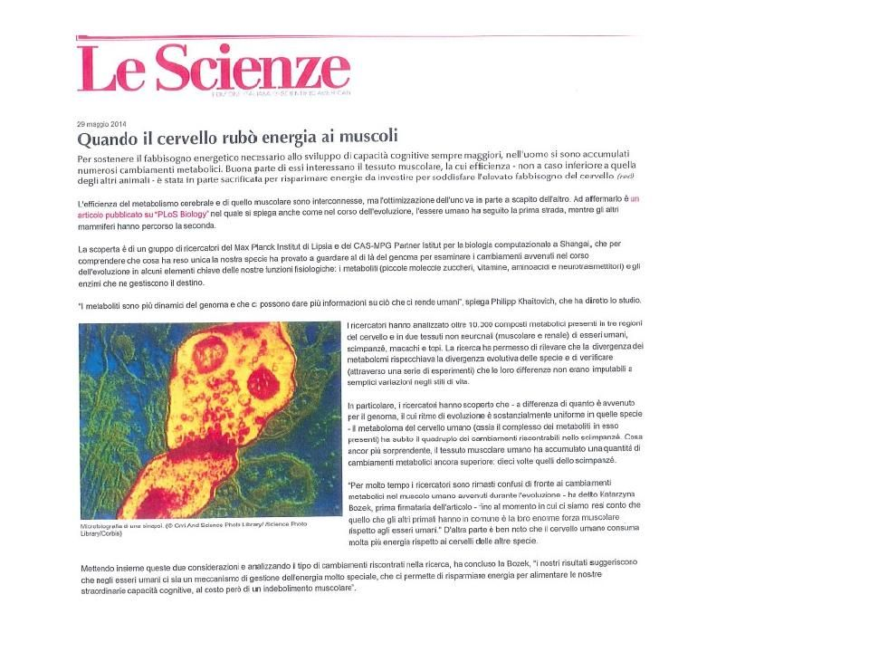{ loading=lazy style="width:59%" }

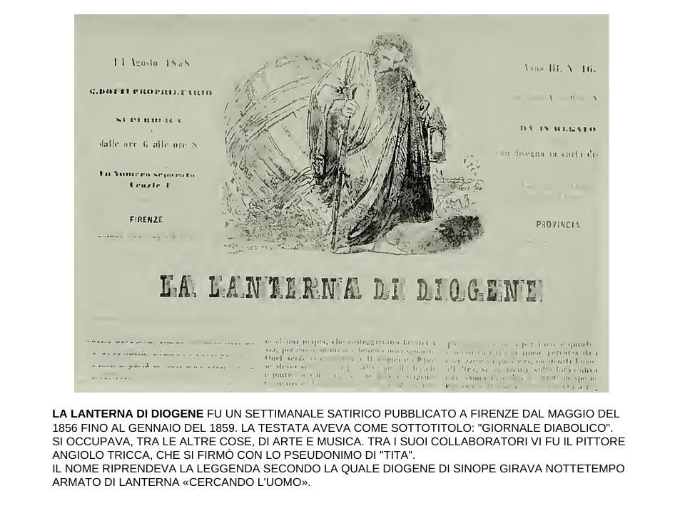{ loading=lazy style="width:59%" }

**LA LANTERNA DI DIOGENE**

*La lanterna di Diogene* fu un settimanale satirico pubblicato a Firenze dal maggio del 1856 fino al gennaio del 1859. La testata aveva come sottotitolo: «giornale diabolico».

Si occupava, tra le altre cose, di arte e musica. Tra i suoi collaboratori vi fu il pittore Angiolo Tricca, che si firmò con lo pseudonimo di «Tita».

Il nome riprendeva la leggenda secondo la quale Diogene di Sinope girava nottetempo armato di lanterna «cercando l’uomo».

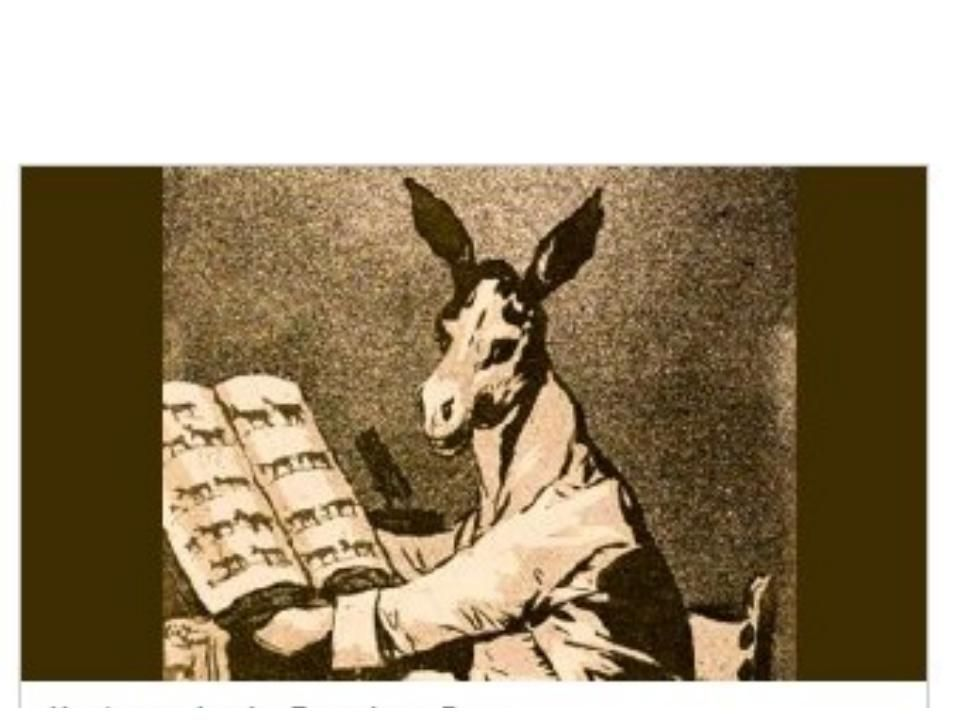{ loading=lazy style="width:47%" }

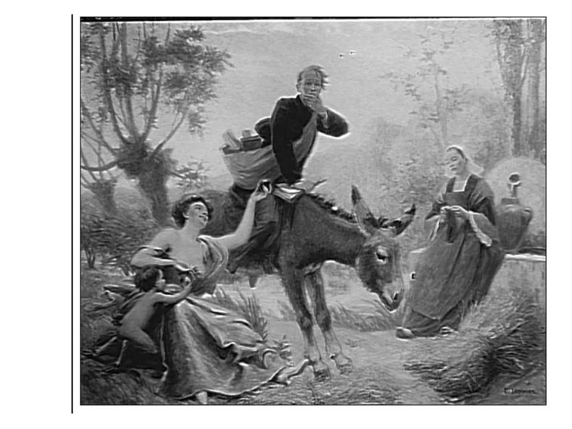{ loading=lazy style="width:47%" }

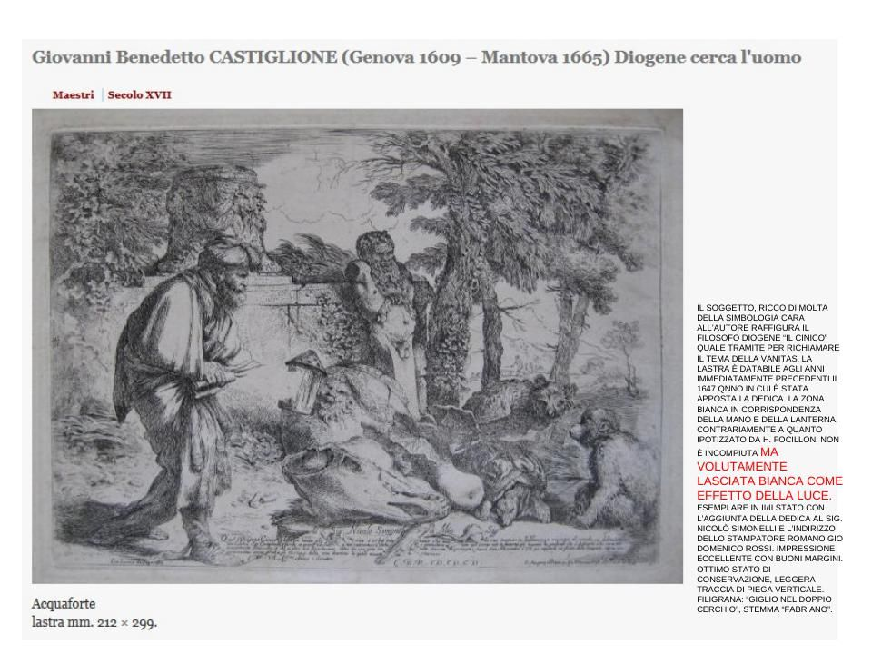{ loading=lazy style="width:59%" }

**GIOVANNI BENEDETTO CASTIGLIONE (GENOVA 1609 – MANTOVA 1665), *DIOGENE CERCA L’UOMO**

*Acquaforte, lastra mm 212 × 299*

Il soggetto, ricco di molta della simbologia cara all’autore, raffigura il filosofo Diogene «il cinico» quale tramite per richiamare il tema della *vanitas*. La lastra è databile agli anni immediatamente precedenti il 1647, anno in cui è stata apposta la dedica. La zona bianca in corrispondenza della mano e della lanterna, contrariamente a quanto ipotizzato da H. Focillon, non è incompiuta ma volutamente lasciata bianca come effetto della luce. Impressione eccellente con buoni margini. Ottimo stato di conservazione, leggera traccia di piega verticale.

Filigrana: «giglio nel doppio cerchio», stemma «Fabriano».

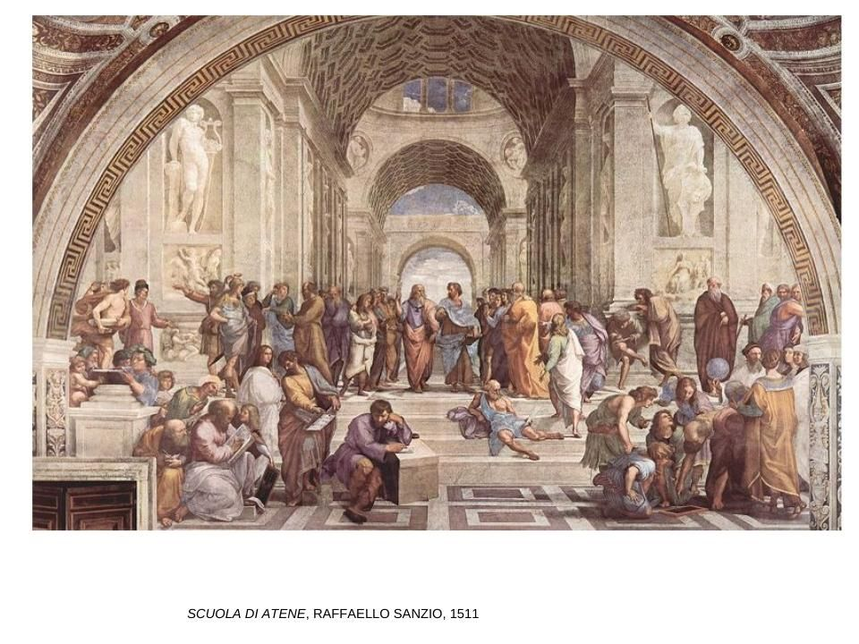{ loading=lazy style="width:59%" }

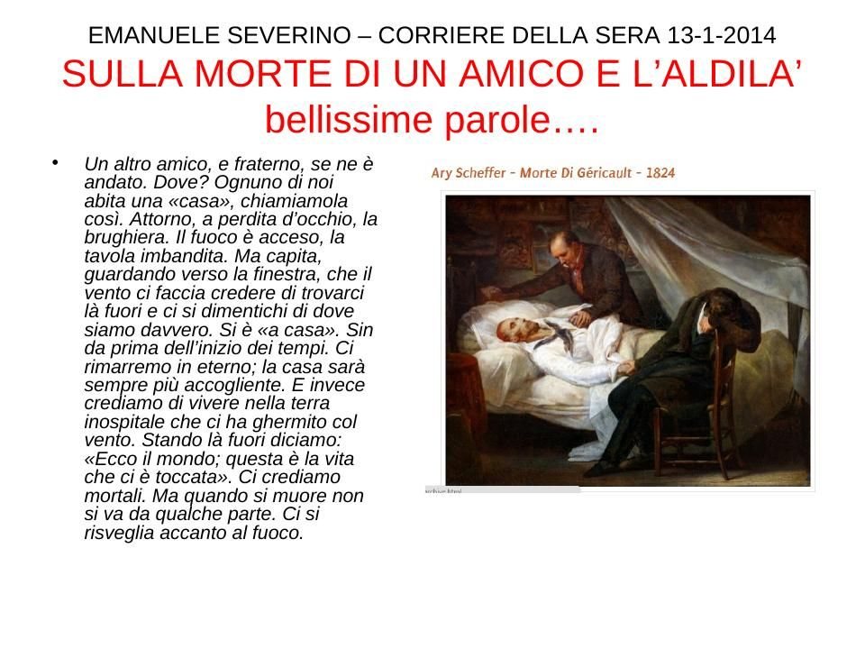{ loading=lazy style="width:59%" }

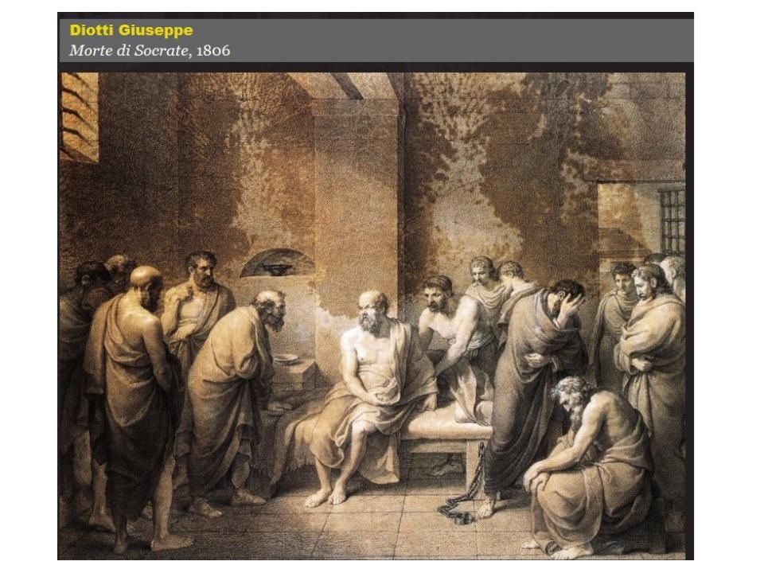{ loading=lazy style="width:59%" }

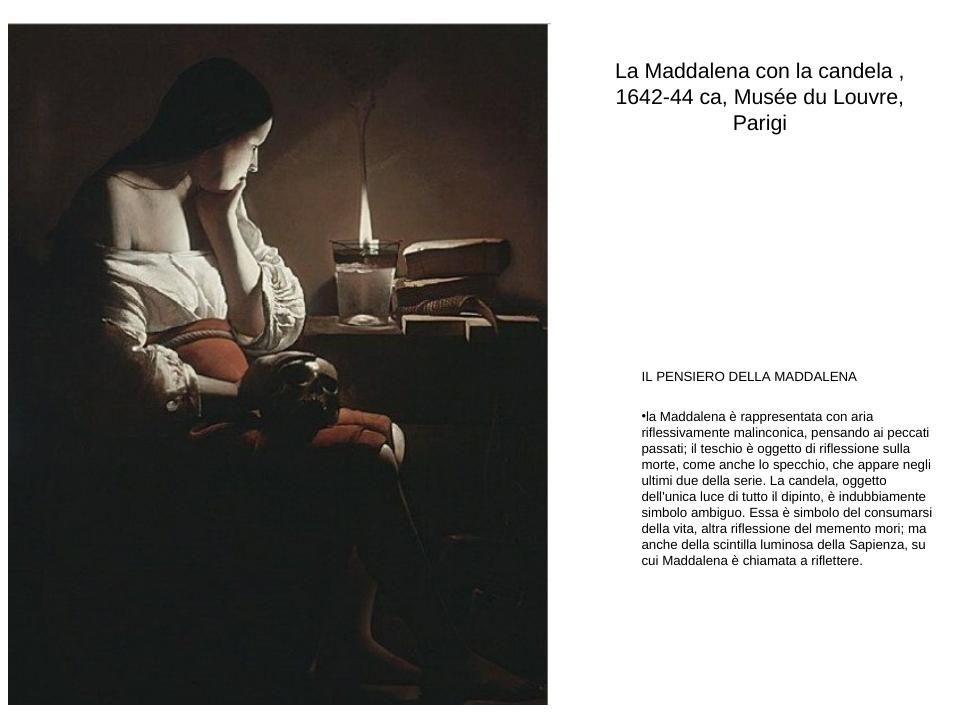{ loading=lazy style="width:59%" }

**IL PENSIERO DELLA MADDALENA**

*Georges de La Tour, La Maddalena con la candela* (o *Maddalena penitente*), 1642-1644 ca., Musée du Louvre, Parigi

La Maddalena è rappresentata con aria riflessivamente malinconica, pensando ai peccati passati; il teschio è oggetto di riflessione sulla morte, come anche lo specchio, che appare negli ultimi due della serie. La candela, oggetto dell’unica luce di tutto il dipinto, è indubbiamente simbolo ambiguo. Essa è simbolo del consumarsi della vita, altra riflessione del memento mori; ma anche della scintilla luminosa della Sapienza, su cui Maddalena è chiamata a riflettere.

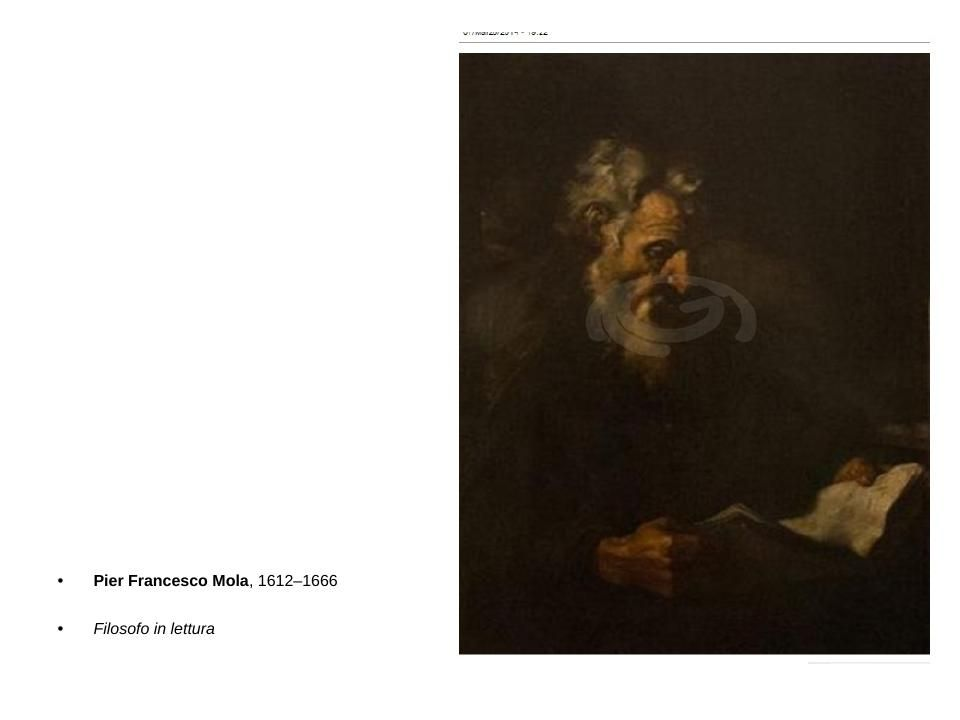{ loading=lazy style="width:59%" }

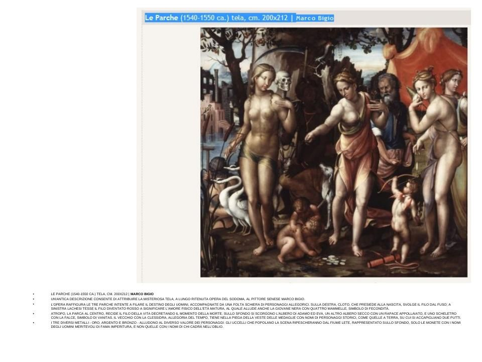{ loading=lazy style="width:59%" }

**MARCO BIGIO, *LE PARCHE* (1540-1550 CA.), TELA, CM 200 × 212**

Un’antica descrizione consente di attribuire la misteriosa tela, a lungo ritenuta opera del Sodoma, al pittore senese Marco Bigio.

L’opera raffigura le tre Parche intente a filare il destino degli uomini, accompagnate da una folta schiera di personaggi allegorici. Sulla destra, Cloto, che presiede alla nascita, svolge il filo dal fuso; a sinistra Lachesi tesse il filo diventato rosso a significare l’amore fisico dell’età matura, al quale allude anche la giovane nera con quattro mammelle, simbolo di fecondità.

Atropo, la parca al centro, recide il filo della vita decretando il momento della morte. Sullo sfondo si scorgono l’albero di Adamo ed Eva, un altro albero secco con un rapace appollaiato, e uno scheletro con la falce, simbolo di *vanitas*. Il vecchio con la clessidra, allegoria del tempo, tiene nella piega della veste delle medaglie con nomi di personaggi storici, come quelle a terra, su cui si accapigliano due putti.

I tre diversi metalli – oro, argento e bronzo – alludono al diverso valore dei personaggi: gli uccelli che popolano la scena ripescheranno dal fiume Lete, rappresentato sullo sfondo, solo le monete con i nomi degli uomini meritevoli di fama imperitura, e non quelle con i nomi di chi cadrà nell’oblio.

**LA FILOSOFIA: CATEGORIE, DISCIPLINE, SCUOLE**

**Categorie classiche**

Logica, epistemologia, metafisica, ontologia, etica, estetica, gnoseologia.

**Discipline tematiche**

Filosofia teoretica: metafisica; ontologia; filosofia della natura (filosofia naturale); filosofia della scienza; filosofia della fisica; filosofia della biologia; logica e filosofia della logica; filosofia della matematica; filosofia del linguaggio; semiotica; filosofia della mente (filosofia della psicologia); filosofia della storia; filosofia della tecnologia (filosofia dell’informatica).

Filosofia pratica: filosofia morale, etica, bioetica; filosofia del diritto; antropologia; filosofia della religione; filosofia delle scienze sociali; filosofia politica; filosofia dell’economia; pedagogia (filosofia dell’educazione).

Estetica: filosofia dell’arte (filosofia della letteratura); filosofia del cinema; filosofia della musica; poetica e retorica.

Storia della filosofia: storia della storiografia filosofica; teoria della storiografia filosofica.

**Scuole e correnti**

Filosofia antica e medievale: presocratici; scuola pitagorica e neopitagorismo; platonismo e neoplatonismo; Liceo di Aristotele e filosofia scolastica; epicureismo; scetticismo; stoicismo; cinismo.

Filosofia moderna: naturalismo; illuminismo; materialismo; meccanicismo; sensismo.

Filosofia contemporanea: esistenzialismo; fenomenologia; filosofia analitica; hegelismo; idealismo e neoidealismo; marxismo; neokantismo; Scuola di Francoforte; positivismo logico o neopositivismo; postmodernismo; pragmatismo e neopragmatismo; neotomismo; costruttivismo; essenzialismo; evoluzionismo; fenomenismo; filosofia continentale; idealismo tedesco; irrazionalismo; spiritismo; spiritualismo; strutturalismo; trascendentalismo; umanesimo; utilitarismo; nichilismo.

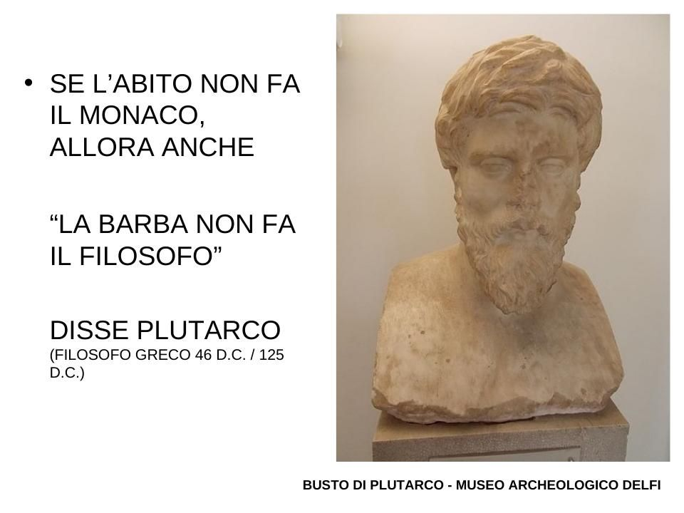{ loading=lazy style="width:47%" }

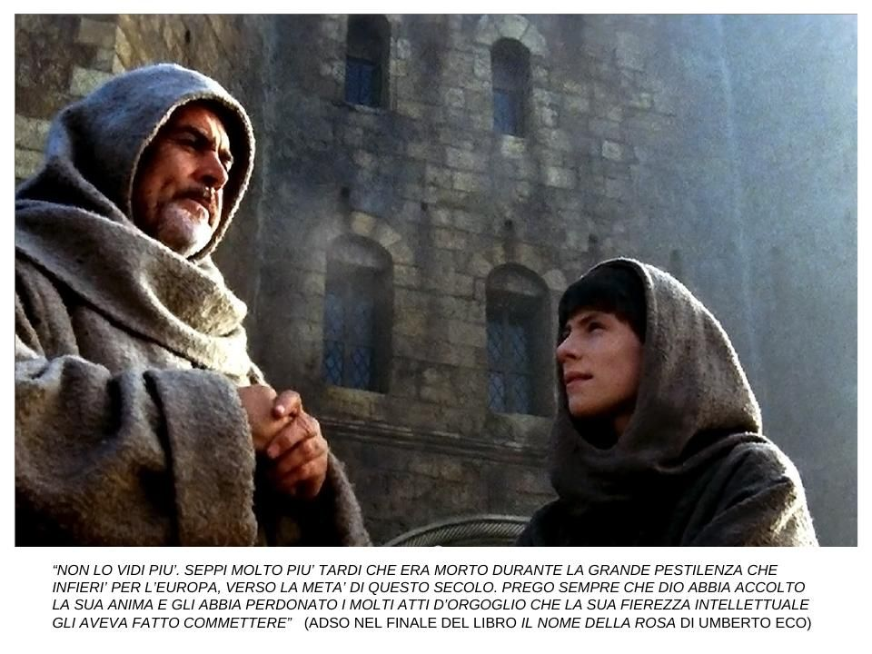{ loading=lazy style="width:47%" }

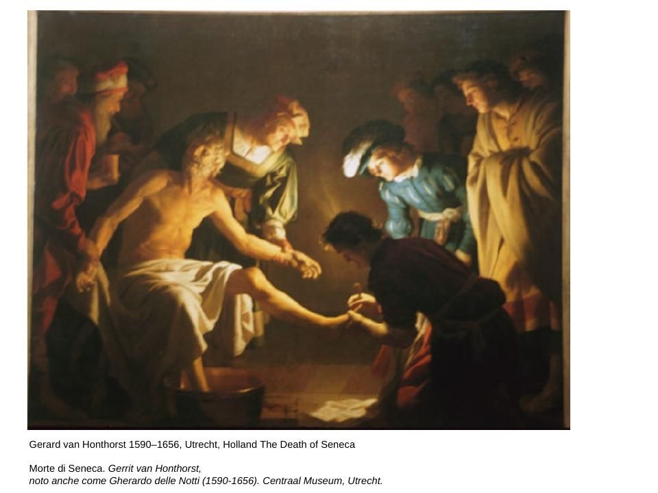{ loading=lazy style="width:47%" }

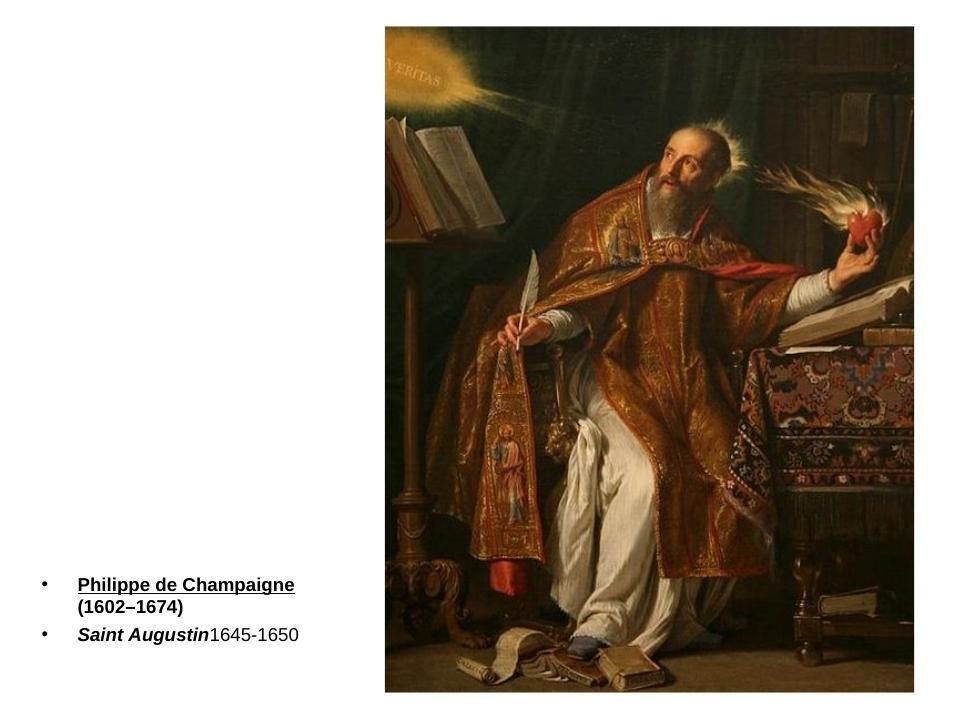{ loading=lazy style="width:47%" }

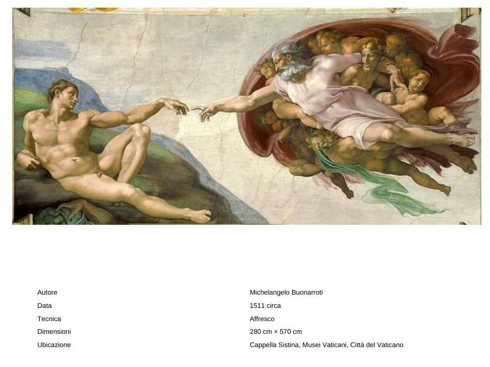{ loading=lazy style="width:59%" }
