# Le immagini del potere, il potere delle immagini

**Data:** 18 dicembre 2014 
**Luogo:** MMAB, Museo della Ceramica, Montelupo Fiorentino 
**Incontro con:** Lorenzo Poggi e Paolo Marcucci

**Interventi:** Paolo Marcucci Lorenzo Poggi

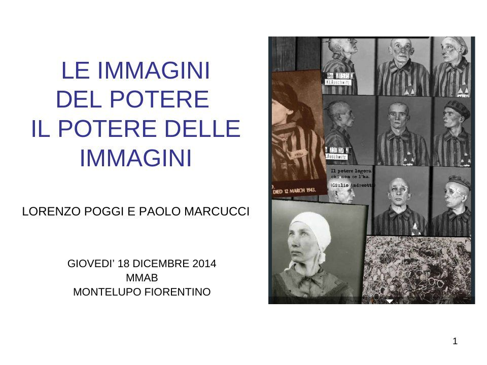{ loading=lazy style="width:46%" }

0:09:20

Paolo Marcucci Bene, buonasera a tutti. Direi di iniziare. Grazie di essere con noi in questa settimana che precede il Natale; magari gli auguri ce li facciamo prima di andare via. Allora, stasera l’argomento, come avete visto dal programma e dalla prima immagine, è appunto «Le immagini del potere e il potere delle immagini».

0:09:56

Pensando a questo tema mi è venuta una domanda, cioè sulla neutralità dell’arte. Succede anche in questo periodo di veder distruggere opere d’arte, e quindi sorge spontanea una domanda: è possibile una neutralità dell’arte, quando si fa un’opera d’arte? Naturalmente nel corso del tempo ci sono state tesi a favore e tesi contrarie. Questo, per esempio, è uno dei tanti esempi di distruzione, da parte dell’ISIS, il movimento islamico; ma ce ne sono state anche prima, a Petra, da altre parti. Si distruggono le opere d’arte e la cultura che incarnano una certa immagine del potere precedente.

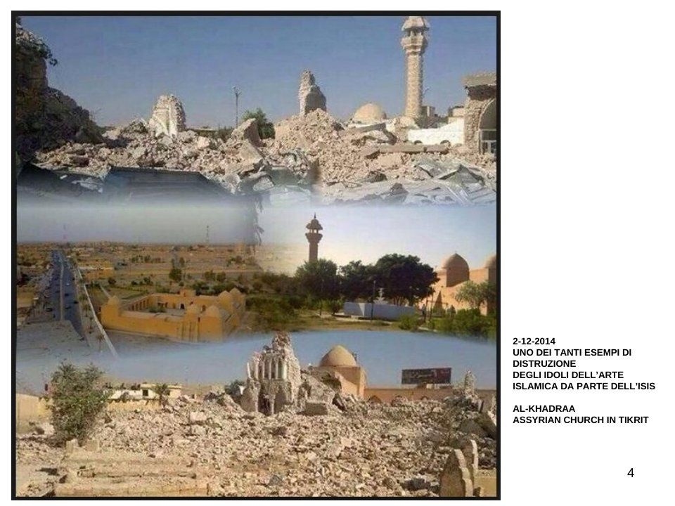{ loading=lazy style="width:59%" }

**LA NEUTRALITÀ DELL’ARTE**

Quando succede che il potere del momento distrugga le opere d’arte del potere precedente, ci si pone nuovamente una delle domande più interessanti: è possibile la neutralità dell’arte?

C’è chi dice no e chi dice sì; e se la risposta è sì, perché il potere spesso distrugge le opere d’arte precedenti? Ora e nel passato (vedremo ad esempio il passaggio dalla Repubblica di Firenze alla Signoria).

Nell’immagine (2-12-2014): uno dei tanti esempi di distruzione degli idoli dell’arte islamica da parte dell’ISIS (Al-Khadraa; chiesa assira di Tikrit).
{: .didascalia }

0:11:01

Arte e politica: una relazione pericolosa. Da sempre ci sono condizionamenti ideologici. Basta pensare, per esempio, nel nazismo ai film della famosa regista Leni Riefenstahl: questo è *Il trionfo della volontà*. Vedete, in questa immagine si vede tutta la potenza del potere nazista in quel momento; il film è del 1935, quindi siamo verso il massimo della potenza del periodo di Hitler. Al contrario, però, c’erano anche alcuni artisti che avevano già visto il pericolo che Hitler poteva rappresentare. In questa immagine fotografica – un fotomontaggio di John Heartfield (Helmut Herzfeld) – si comincia a usare l’immagine anche in maniera dissacrante: in questo caso si mostra Hitler come un omino piccolo – forse giocando anche sulla sua statura personale, era piccolo – come un piccolo uomo in cerca dei soldi del grande capitale, che quindi lo manovrava e lo comprava secondo le proprie esigenze.

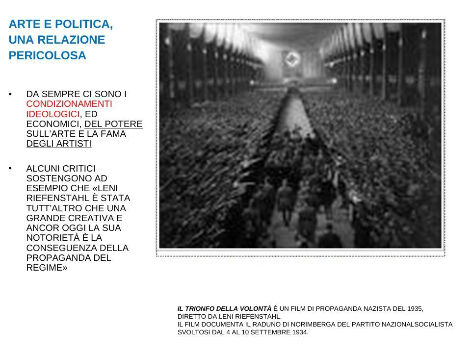{ loading=lazy style="width:30%" }

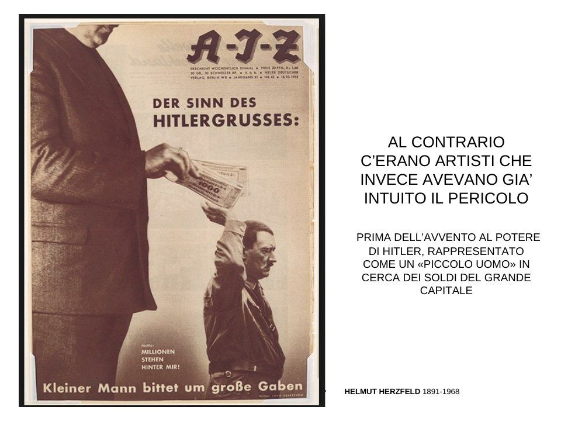{ loading=lazy style="width:30%" }

**ARTE E POLITICA, UNA RELAZIONE PERICOLOSA**

Da sempre ci sono i condizionamenti ideologici, ed economici, del potere sull’arte e sulla fama degli artisti.

Alcuni critici sostengono ad esempio che «Leni Riefenstahl è stata tutt’altro che una grande creativa, e ancor oggi la sua notorietà è la conseguenza della propaganda del regime».

*Il trionfo della volontà* è un film di propaganda nazista del 1935, diretto da Leni Riefenstahl; documenta il raduno di Norimberga del partito nazionalsocialista, svoltosi dal 4 al 10 settembre 1934.

Al contrario c’erano artisti che avevano già intuito il pericolo prima dell’avvento al potere di Hitler, rappresentato come un «piccolo uomo» in cerca dei soldi del grande capitale (John Heartfield, alias Helmut Herzfeld, 1891-1968).

0:12:25

Ma l’arte che vediamo oggi risponde a un sistema occulto del potere? I concetti di buono, di bello, o anche di brutto, si articolano in un sistema di categorie che rispondono a che cosa? E qual è la bellezza? Come si fa a decidere che cosa è bello e che cosa non lo è, in questo momento storico in cui ha prevalso l’ideologia di mercato, cioè quella che viene definita «post-ideologica»? Cerchiamo di approfondire un po’. Quest’ideologia di mercato, nell’arte – forse, perché ci sono anche elementi contraddittori – cerca forse di sottrarsi a un senso di responsabilità sociale che l’arte invece molte volte ha. Nel corso del tempo, sia i sistemi democratici sia quelli totalitari hanno usato l’arte per suggellare, per raccontare il potere di turno. C’è anche la tesi, famosa, di Croce, che diceva che l’artista può creare privo di un’intenzione politica, animato solo da fini estetici. Ma è vero? È possibile?

**ARTE E POLITICA, UNA RELAZIONE PERICOLOSA**

E l’arte che oggi vediamo nei musei, o nelle gallerie a prezzi stellari, risponde a un sistema occulto di potere?

E in un momento di crisi come quello attuale, i concetti di bello, di buono e di brutto si articolano dentro un sistema di categorie, giochi e finzioni dove ognuno gioca un ruolo mai dichiarato apertamente.

Dov’è la bellezza? E chi decide che cosa è bello? Solo il potere, incarnato oggi dal sistema finanziario che manipola il mercato? In una fase storica in cui domina l’ideologia di mercato dell’era post-ideologica…

E forse l’ideologia di mercato dell’era post-ideologica crea il bisogno di sottrarsi a un senso di responsabilità sociale.

Storicamente tanto i totalitarismi quanto i sistemi democratici hanno usato l’arte per legittimare la propria egemonia politica. Si può dire che l’arte è sempre ideologia?

Quando si dice che un artista crea privo di un’intenzione politica, animato solo da fini estetici, anche in quel caso si afferma una precisa ideologia dell’arte: l’idea (crociana) del bello assoluto, della solitudine dell’artista, dell’astrazione dal mondo.

0:13:53

La storia si ripete. Nel 29 a.C. Augusto, a Roma – nasce come Ottaviano – prese poi il nome di Augusto, perché gli fu attribuito un titolo che deriva da *augere*, cioè aggiungere, ampliare, accrescere, e indicava colui che con le sue imprese aveva accresciuto il dominio romano. Ottaviano si presenta quindi come un governante vicino al popolo, di buone maniere; però, complice l’atteggiamento remissivo del Senato che trova a Roma, diventa Augusto, con un potere molto più forte rispetto a quello con cui si era presentato.

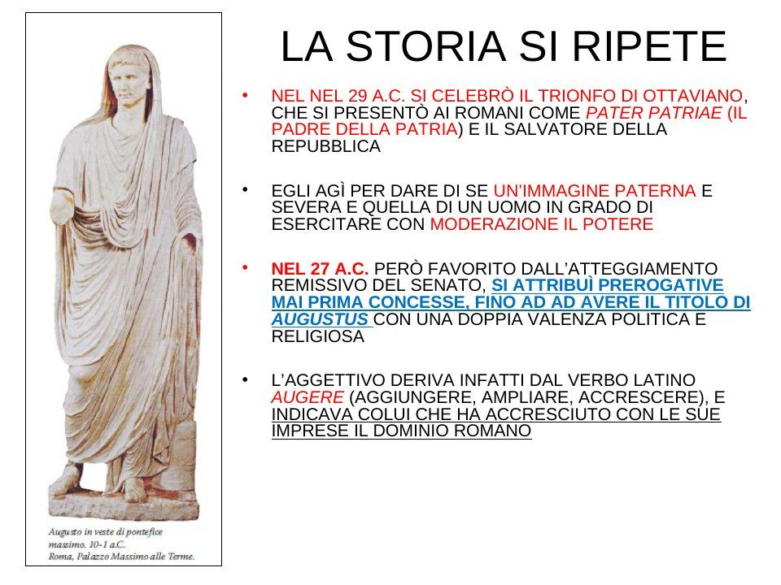{ loading=lazy style="width:30%" }

0:15:05

E che cosa fa? Il capolavoro di Augusto è quello di comprare gli intellettuali: ben consapevole di come continuare a predominare sulla scena romana, incarica il suo amico Mecenate di costituire un circolo che aveva lo scopo principale di finanziare gli intellettuali, affinché riconoscessero e raccontassero il potere di Augusto. Quello che va un po’ di moda nei politici attuali è lo *storytelling*: tutti gli *spin doctor* dei politici di oggi dicono che bisogna raccontare una storia; e Augusto nel 29 avanti Cristo l’aveva già fatto. Infatti da Mecenate deriva poi il nome di mecenatismo, che è appunto il finanziare gli artisti. Gli intellettuali del circolo esclusivo di Mecenate avevano solo l’obbligo di realizzare le loro opere, senza preoccuparsi della condizione economica, che – come ci ha più volte ricordato Lorenzo in tutte le nostre serate – è stata invece sempre un cruccio degli artisti: sbarcare il lunario, arrivare alla fine del mese, e quindi collocare sul mercato le loro opere.

**LA STORIA SI RIPETE**

Nel 29 a.C. si celebrò il trionfo di Ottaviano, che si presentò ai romani come il salvatore della repubblica (il titolo di *Pater patriae*, padre della patria, gli sarà conferito nel 2 a.C.).

Egli agì per dare di sé un’immagine paterna e severa, quella di un uomo in grado di esercitare con moderazione il potere.

Nel 27 a.C., però, favorito dall’atteggiamento remissivo del Senato, si attribuì prerogative mai prima concesse, fino ad avere il titolo di *Augustus*, con una doppia valenza politica e religiosa. L’aggettivo deriva infatti dal verbo latino *augere* (aggiungere, ampliare, accrescere) e indicava colui che ha accresciuto con le sue imprese il dominio romano.

**SI COMPRANO GLI INTELLETTUALI…**

Augusto, ben consapevole della difficoltà di far accettare ai suoi concittadini la natura assoluta del proprio potere personale, cercò (con successo) di conquistare il consenso della classe intellettuale, rivestendo il proprio operato di contenuti etici e storici.

Affidò al fedele amico e collaboratore Gaio Cilnio Mecenate (da cui deriva il termine mecenatismo) il programma di propaganda ideologica.

Mecenate, uomo colto e raffinato, circondato di artisti, scrittori e poeti, affidò loro il compito di promuovere l’ideologia del principato e il programma augusteo attraverso la celebrazione delle imprese di Roma, dei suoi miti fondatori, dei suoi eroi, con l’esaltazione dei costumi austeri delle origini e della semplicità della vita agreste, contrapposta alla corruzione e al lusso della vita cittadina (Carminati «il Guercio», c’era anche allora…).

Si trattava in sostanza di accreditare l’immagine tranquillizzante della *Pax augustea*. Gli intellettuali, per dedicarsi completamente al loro impegno politico e artistico, venivano liberati da ogni preoccupazione economica, e i meritevoli venivano iscritti al cosiddetto «circolo di Mecenate» (nell’immagine, Orazio).

0:16:49

Nel Novecento, per esempio, si parla del «tradimento degli intellettuali». Gramsci classificava gli intellettuali come «organici»: organici al potere, perché raccontavano un’immagine del potere adatta al momento. Invece nel *Quarto Stato* – Giuseppe Pellizza da Volpedo, che chi era alla visita del Museo del Novecento a Milano ha visto dal vivo – si dipinge in contrapposizione: il quarto stato, perché i tre stati erano il clero, la nobiltà e la borghesia, e invece ci sono anche i lavoratori. In questo caso l’arte viene usata in contrapposizione al potere, ma vuole sempre esprimere qualcosa.

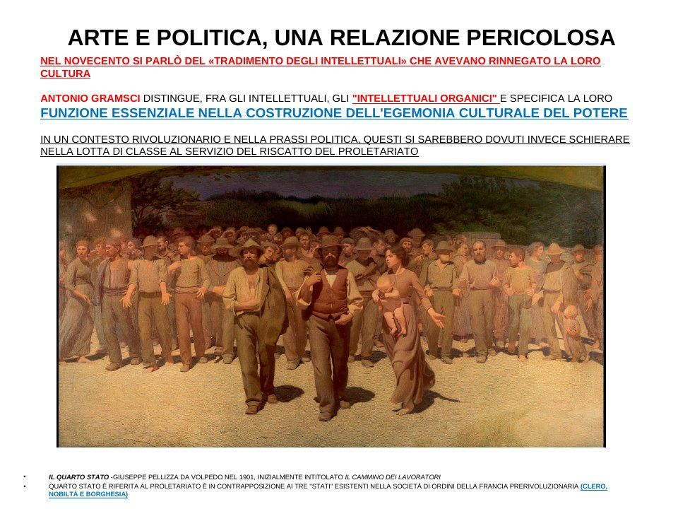{ loading=lazy style="width:37%" }

0:17:50

Questo è un quadro famosissimo – chi ha frequentato un po’ le case del popolo, i circoli... io mi ricordo di averlo visto sicuramente in due o tre: *I funerali di Togliatti* di Guttuso. Negli anni Settanta, credo, non voglio dire in tutte le case del popolo, ma insomma in molte c’era questo dipinto. È un dipinto importante, perché ci fa capire la differenza nella concezione artistica.

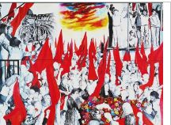{ loading=lazy style="width:30%" }

**ARTE E POLITICA, UNA RELAZIONE PERICOLOSA**

Nel Novecento si parlò del «tradimento degli intellettuali», che avevano rinnegato la loro cultura.

Antonio Gramsci distingue, fra gli intellettuali, gli «intellettuali organici», e specifica la loro funzione essenziale nella costruzione dell’egemonia culturale del potere. In un contesto rivoluzionario e nella prassi politica, questi si sarebbero dovuti invece schierare nella lotta di classe al servizio del riscatto del proletariato.

*Il Quarto Stato*, di Giuseppe Pellizza da Volpedo (1901), inizialmente intitolato *Il cammino dei lavoratori*: «Quarto stato» è riferito al proletariato, in contrapposizione ai tre «stati» esistenti nella società di ordini della Francia prerivoluzionaria (clero, nobiltà e borghesia).

A volte gli artisti si sono adeguati e a volte si sono contrapposti all’ideologia del potere del momento. Un esempio è la nota vicenda di Renato Guttuso, che rispose ai canoni del realismo socialista con il dipinto *I funerali di Togliatti*.

Opera manifesto del pittore siciliano (1911-1987), dipinta nel 1972: ritrae il corteo che nel 1964 partecipò a Roma ai funerali di Palmiro Togliatti, segretario e leader del Partito Comunista Italiano.

0:18:25

Lorenzo Poggi Volevo dire una cosa. Voi sapete che c’era la contrapposizione fra alcuni aspetti dell’arte contemporanea – la pop art, ma anche l’arte astratta, l’arte informale – e invece il realismo, quella che veniva chiamata Sots Art, il realismo sovietico. Sì, ce ne sono di bellissimi, e c’è quell’altra: vedete, questo è Stalin, insieme alla musa (Komar e Melamid, *Le origini del realismo socialista*) – è una fanciulla, è una donna, non è una musa qualsiasi. E dicevo: vedete l’idea del realismo, la condanna di quella che è invece l’arte astratta, l’arte che non riproduce le cose. Questo continuerà anche negli anni Quaranta e Cinquanta: nel 1948 Palmiro Togliatti, dalle pagine di «Rinascita», condannava le mostre fatte a Roma da artisti astratti e diceva che erano scimmiottature.

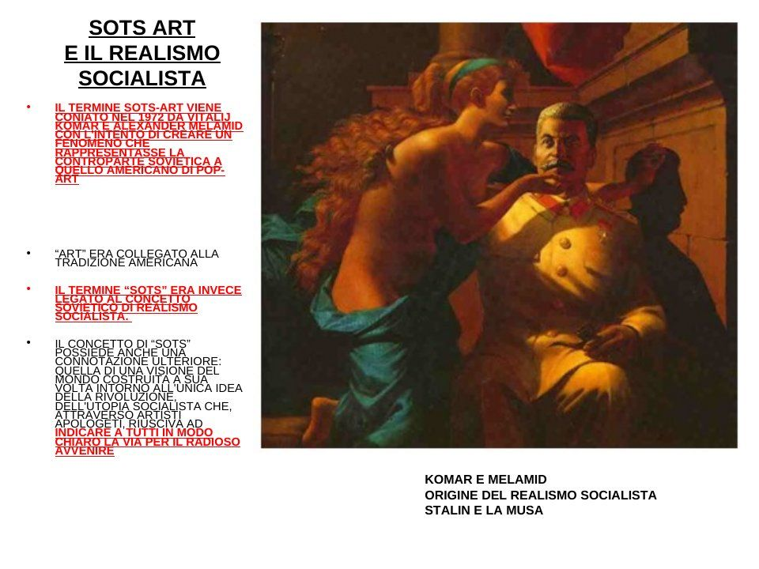{ loading=lazy style="width:30%" }

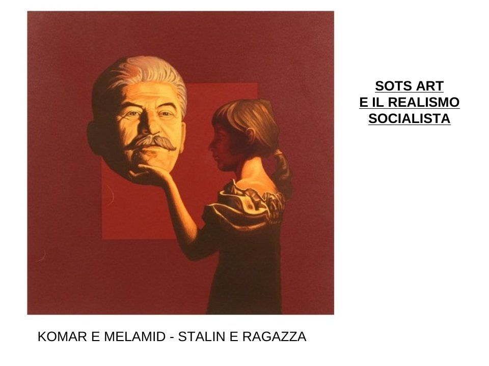{ loading=lazy style="width:30%" }

**SOTS ART E IL REALISMO SOCIALISTA**

IL TERMINE *SOTS ART* VIENE CONIATO NEL 1972 DA VITALIJ KOMAR E ALEKSANDR MELAMID, CON L’INTENTO DI CREARE UN FENOMENO CHE RAPPRESENTASSE LA CONTROPARTE SOVIETICA DELLA POP ART AMERICANA: «ART» ERA COLLEGATO ALLA TRADIZIONE AMERICANA, MENTRE «SOTS» ERA LEGATO AL CONCETTO SOVIETICO DI REALISMO SOCIALISTA.

IL CONCETTO DI «SOTS» POSSIEDE ANCHE UNA CONNOTAZIONE ULTERIORE: QUELLA DI UNA VISIONE DEL MONDO COSTRUITA A SUA VOLTA INTORNO ALL’UNICA IDEA DELLA RIVOLUZIONE, DELL’UTOPIA SOCIALISTA CHE, ATTRAVERSO ARTISTI APOLOGETI, RIUSCIVA A INDICARE A TUTTI IN MODO CHIARO LA VIA PER IL RADIOSO AVVENIRE.

KOMAR E MELAMID, *LE ORIGINI DEL REALISMO SOCIALISTA* (STALIN E LA MUSA); *STALIN E RAGAZZA*.

0:20:00

...addirittura cose che non si potevano guardare. La condanna non era firmata con il nome di Palmiro Togliatti – aveva vari pseudonimi – ma con quello di Roderigo di Castiglia. È lui che condanna; invece il pittore era Guttuso, che si legava a un’arte realista. Quindi è estremamente importante, perché che cosa ci fa capire? Che l’arte, le immagini, hanno un potere fortissimo, di cui la politica tenta di servirsi.

0:20:51

Hitler nel 1937 farà una mostra delle opere dell’«arte degenerata». Pensate: ci vuole una dittatura fortissima per dichiarare che c’è una parte dell’arte degenerata, mentre c’è un’arte bella, speciale, quella che lui prediligeva. E ci saranno migliaia e migliaia di persone che vedranno queste opere dell’arte degenerata, portate in giro per tutte le città della Germania: dove si fermano, le vanno a visitare, sapendo che è l’ultima volta che le potranno vedere, perché queste opere erano destinate alla distruzione. Molte verranno distrutte, ma molte i gerarchi nazisti le venderanno sottobanco, al nero – è una cosa che succede sempre – e ci faranno i soldi; così però si conserveranno anche le opere. Molte opere, comunque, vengono distrutte.

0:21:51

Perché Hitler amava l’arte antica, l’arte classica, quella che si confaceva alla razza ariana, che raffigurava persone dolicocefale – Lucas Cranach, per esempio – cioè con la testa con dimensioni di larghezza e lunghezza differenti. Era quindi affascinato da questo tipo di arte e di immagine. Quando verrà in Italia, si farà un elenco delle cose da vedere: si fa la lista della spesa, così poi, quando si occupa, si sa che cosa prendere. Si va a vedere prima, come in un negozio con gli sconti: «Ci sono gli sconti? Andiamo a vedere se mi interessa qualcosa... Aspetta, ho già fatto la nota: in quel negozio vado a prendere i pantaloni, in quell’altro...». E così Hitler verrà a vedere agli Uffizi, verrà a vedere alla, dove c’erano le opere che poi verranno regolarmente portate via tutte; poi, come dire, verranno recuperate, ma sul momento... Scusami, ho interrotto troppo; poi magari vedremo anche altre immagini su questo.

0:23:13

Però è interessante vedere come lui avesse quest’idea di bellezza: il maschio, l’uomo nazista, la donna nazista, alti, slanciati, biondi, muscolosi; e lui era un tappo con la pancia – era 1,62 – quindi un tappo, moro, stortignaccolo. Però l’ideale era quello. Vabbè, basta, è vero tutto.

0:23:49

Paolo Marcucci Allora, Guttuso dipinge *I funerali di Togliatti* nel 1972 (i funerali si erano svolti nel 1964), rispondendo ai canoni del realismo socialista. L’accennava prima Lorenzo: c’è proprio la Sots Art, il realismo socialista, un termine coniato in quel periodo, che vuol dire proporre delle immagini con un certo messaggio: l’uomo forte – in questo caso Stalin – sofferto, ma che ha in mano il presente e guida verso il futuro, verso il sole dell’avvenire. Tutte le immagini hanno questo come sottofondo, come retropensiero.

0:24:43

Perché è importante partire da questo dipinto? Perché, per esempio, nel 1934 il Partito Comunista sovietico aveva vietato ogni forma di arte indipendente dal controllo dello Stato: non si poteva dipingere se non qualcosa che fosse codificato. E quindi quando Guttuso dipinge questo quadro, viene messo in discussione da chi non aveva fede nell’arte del realismo socialista sovietico: perché l’artista si era venduto a quest’idea di arte; la libertà che nel corso dei secoli, fino al Novecento, l’artista si era un po’ presa rispetto alle grandi commesse dei nobili o della Chiesa in questo caso era persa.

**ARTE E POLITICA, UNA RELAZIONE PERICOLOSA**

Il dipinto evoca così, sul piano formale, le posizioni di quanti in Europa e in Unione Sovietica si riconobbero nei principi estetici del comitato centrale del Partito Comunista Sovietico, che nel 1934 aveva peraltro vietato ogni forma di arte indipendente dal controllo dello Stato.

La critica non vuole mettere in discussione la libertà di Guttuso (…): la questione non riguarda il cosa, ma il come: è il linguaggio (il come) che determina la qualità dell’arte. Forse, dipingendo un quadro celebrativo che rispondeva ai dettami del realismo sovietico, Guttuso ha accettato quel che Picasso ha sempre rifiutato.

*La libertà dell’artista, che nel corso dei secoli si è affrancato dalla committenza della Chiesa e dei nobili: l’artista ha così cominciato a produrre per sé e a lavorare per il miglior offerente.*

0:25:42

In contrapposizione a questo dipinto di Guttuso c’è la nota vicenda di Picasso. Quando muore Stalin, Picasso viene incaricato da Louis Aragon, il famoso poeta francese che era il direttore di «Les Lettres françaises», di fare un ritratto di Stalin; e lui, vedete, lo fa quasi come una caricatura. Se si guarda la differenza con questo, si vede bene: qui è goffo, non ha lineamenti marcati, ha anche un doppio mento; non ci si può ispirare a quest’uomo per andare verso il sole dell’avvenire. Infatti Picasso viene criticato dall’altra parte; tra l’altro Louis Aragon è poi costretto a ritrattare, e il dipinto viene fatto fuori dal settimanale diretto da Aragon, perché Picasso aveva privilegiato la creatività individuale invece della visione del Partito Comunista di quel tempo. Quindi in questo dipinto di Picasso è l’individuo artista che entra sulla scena.

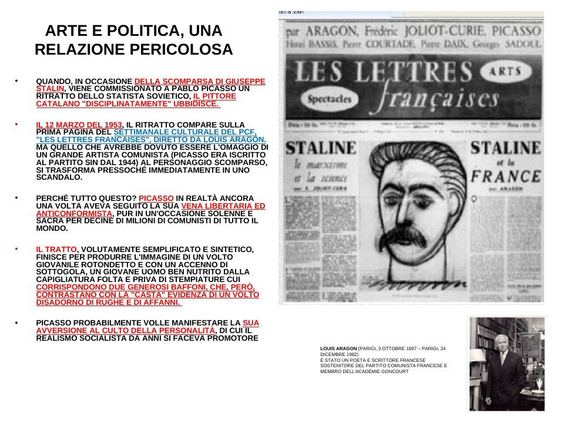{ loading=lazy style="width:30%" }

**ARTE E POLITICA, UNA RELAZIONE PERICOLOSA**

Quando, in occasione della scomparsa di Stalin, viene commissionato a Pablo Picasso un ritratto dello statista sovietico, il pittore spagnolo «disciplinatamente» ubbidisce.

Il 12 marzo 1953 il ritratto compare sulla prima pagina del settimanale culturale del PCF, «Les Lettres françaises», diretto da Louis Aragon. Ma quello che avrebbe dovuto essere l’omaggio di un grande artista comunista (Picasso era iscritto al partito sin dal 1944) al personaggio scomparso si trasforma pressoché immediatamente in uno scandalo.

Perché tutto questo? Picasso in realtà, ancora una volta, aveva seguito la sua vena libertaria e anticonformista, pur in un’occasione solenne e sacra per decine di milioni di comunisti di tutto il mondo.

Il tratto, volutamente semplificato e sintetico, finisce per produrre l’immagine di un volto giovanile, rotondetto e con un accenno di sottogola, un giovane uomo ben nutrito dalla capigliatura folta e priva di stempiature, cui corrispondono due generosi baffoni, che però contrastano con la «casta» evidenza di un volto disadorno di rughe e di affanni. Picasso probabilmente volle manifestare la sua avversione al culto della personalità, di cui il realismo socialista da anni si faceva promotore.

Il disegno, volutamente poco elaborato, fu visto dai lettori come una caricatura. Indignati, i lettori protestarono, il segretario del partito biasimò l’accaduto, e Aragon si vide costretto a dichiarare pubblicamente che Picasso, disinteressandosi dei sentimenti delle masse, aveva privilegiato la creatività individuale.

Louis Aragon (Parigi, 3 ottobre 1897 – Parigi, 24 dicembre 1982) è stato un poeta e scrittore francese, sostenitore del Partito Comunista Francese e membro dell’Académie Goncourt.

0:27:28

D’altra parte – lo accennava prima Lorenzo – tutto l’astrattismo americano, per esempio, si sa che è stato finanziato con molti capitali, c’è chi dice dalla CIA; effettivamente l’astrattismo americano ha avuto molti finanziamenti, e questo ha portato a un valore inestimabile anche degli artisti: Pollock, Rothko e altri. Però, a differenza del movimento sovietico, non ha fatto un’estetica di Stato: gli artisti sono stati abilmente finanziati per questo.

**ARTE E POLITICA, UNA RELAZIONE PERICOLOSA**

Da sempre si è parlato delle strategie occulte della CIA nel sostenere gli espressionisti astratti, che ci aiutano a mettere a fuoco la differenza sostanziale fra i metodi adottati nell’URSS e quelli in atto negli USA.

Contrariamente a quanto accadde in Unione Sovietica, negli Stati Uniti non ci sono state vere imposizioni agli artisti: non si è fatto cioè dell’espressionismo astratto un’estetica di stato.

Però sono noti anche gli interventi politici del governo americano nel dare fondi e organizzare mostre, e questo ha portato a rendere potente l’espressionismo astratto americano (Jackson Pollock, Ad Reinhardt, Mark Rothko…) e a penalizzare in maniera sostanziale anche l’Italia (Fontana e Burri) e l’Europa.

0:28:16

Ma oggi chi è il potere, e chi sovvenziona le opere d’arte? In questo periodo il potere, da questo punto di vista, non è proprio chiaro, è un po’ sfuggente, se ci pensate: i politici vanno e vengono. Prima si identificava più facilmente il potere, e quindi il suo finanziamento alle opere d’arte; oggi è un po’ più difficile, e cercheremo magari di approfondirlo un po’ più avanti, perché è un tema interessante. Se si vanno a vedere gli artisti le cui opere in questo momento hanno quotazioni stratosferiche nelle compravendite, si vede che c’è anche un disegno ideologico preciso, che si rifà sicuramente a quella visione del mondo che all’inizio abbiamo chiamato post-ideologica, che non è altro che la visione del mondo di concezione neoliberale, si direbbe ora, per capirsi.

**IL POTERE**

Chi è oggi il potere? I mercati finanziari, le banche, il FMI, la BCE, i grandi capitalisti…?

Il potere in questi anni è sfuggente, non si manifesta volentieri nelle forme tradizionali, e i simboli che lo rappresentano organicamente e artisticamente nel mondo sono solo testimoni momentanei (molte volte inconsapevoli) della grande macchina del potere.

E l’artista? Si può difendere l’opera degli artisti, in qualche modo ignari e usati a loro insaputa come arma politica per la legittimazione ideologica? Non sempre gli artisti sono complici della politica: Pollock e De Kooning non sono espressione della CIA, come Michelangelo e Caravaggio non lo sono della Chiesa cattolica.

Dalla fine degli anni Ottanta in poi si è affermata l’ideologia uscita vincitrice (neoliberale), incarnata soprattutto dalla finanza internazionale. La progressiva rottura, da parte degli stati-nazione, del tradizionale legame tra economia e politica ha forse costretto l’arte a scegliere il campo in cui stare.

«La finanza internazionale, divenuta un vero potere occulto, ha cercato il sostegno degli artisti. Un sostegno che non poteva più essere manifestato attraverso proclami, ma attraverso strategie più sottili, come, per esempio, concepire il proprio nome come un *brand*, o mettersi al servizio di un *brand*; produrre opere esplicitamente indirizzate ai grandi investitori; legittimare il ruolo museale di gallerie private concepite come multinazionali; vanificare l’autonomia della critica a totale vantaggio del potere del mercato» (Demetrio Paparoni).

0:29:29

Questo è un esempio: questo è Jeff Koons, e questa è un’opera d’arte, *Made in Heaven*, proposta alla Biennale di Venezia nel 1990. Quest’opera ha un valore inestimabile, di molti milioni di dollari. Jeff Koons in questo caso è ritratto a letto con Cicciolina: lui si sposò con Cicciolina...

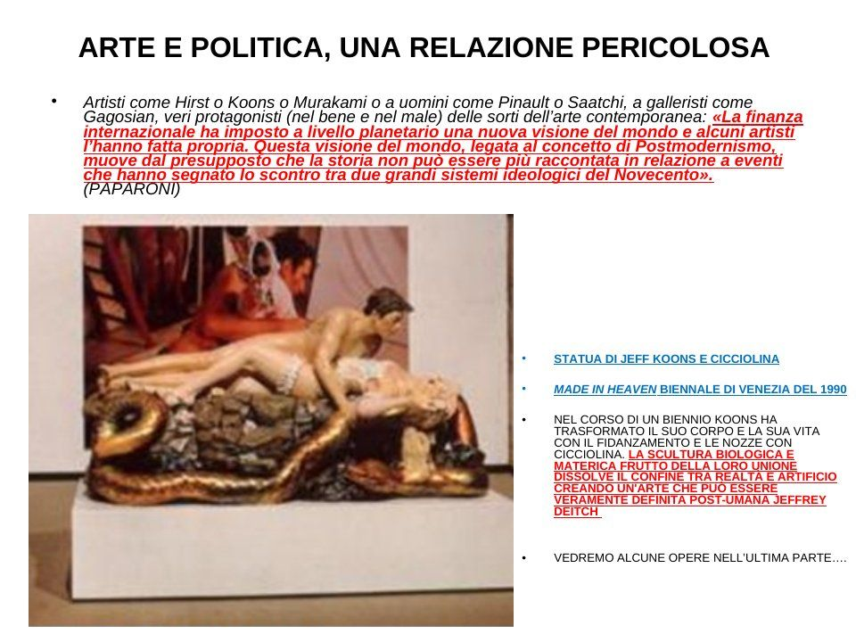{ loading=lazy style="width:59%" }

**ARTE E POLITICA, UNA RELAZIONE PERICOLOSA**

Artisti come Hirst o Koons o Murakami, uomini come Pinault o Saatchi, galleristi come Gagosian sono i veri protagonisti (nel bene e nel male) delle sorti dell’arte contemporanea: «La finanza internazionale ha imposto a livello planetario una nuova visione del mondo, e alcuni artisti l’hanno fatta propria. Questa visione del mondo, legata al concetto di postmodernismo, muove dal presupposto che la storia non può più essere raccontata in relazione agli eventi che hanno segnato lo scontro tra i due grandi sistemi ideologici del Novecento» (Paparoni).

Statua di Jeff Koons e Cicciolina, *Made in Heaven*, Biennale di Venezia del 1990: «Nel corso di un biennio Koons ha trasformato il suo corpo e la sua vita con il fidanzamento e le nozze con Cicciolina. La scultura biologica e materica frutto della loro unione dissolve il confine tra realtà e artificio, creando un’arte che può essere veramente definita post-umana» (Jeffrey Deitch).

0:30:00

...e di seguito una serie di opere che hanno tutte questo tema. Vedete la differenza che c’è tra quest’opera di Koons e quelle che abbiamo visto prima, del realismo sovietico o addirittura di Picasso: è tutto un altro mondo. E Koons è forse proprio l’espressione di questa cultura e di questo potere, che finanzia un certo tipo di arte, nella quotazione.

0:30:36

Un ultimo appunto, prima di lasciare l’introduzione a Lorenzo: nel mercato, per fortuna, ci sono anche visioni contrapposte a quella che abbiamo visto come esempio. Per esempio c’è questo cinese, Zhang Dali (*Chinese Offspring*, 2004), che fa questo tipo di opere d’arte: contadini appesi per i piedi al soffitto, a denunciare la precarietà dell’esistenza e della condizione del lavoro. Oppure anche questa, devo dire bella, *A Real Birmingham Family* di Gillian Wearing (2014), la famiglia di Birmingham: si tratta di due sorelle, entrambe madri single, una delle quali è incinta di nuovo, come la nuova famiglia, e viene rappresentata così perché si cerca di dare all’opera d’arte un valore sociale, in questo caso di rappresentare il volto nuovo della città, di chi abita davvero la città, in Inghilterra.

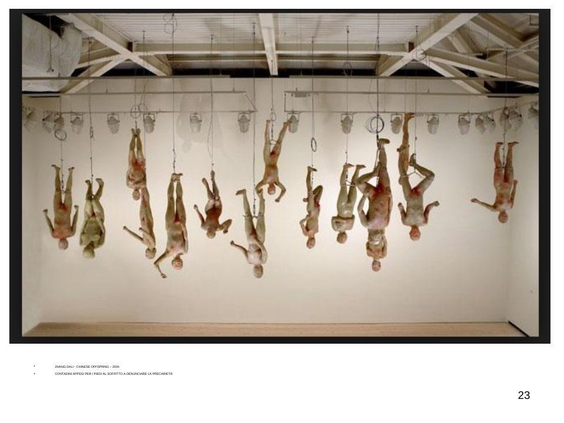{ loading=lazy style="width:47%" }

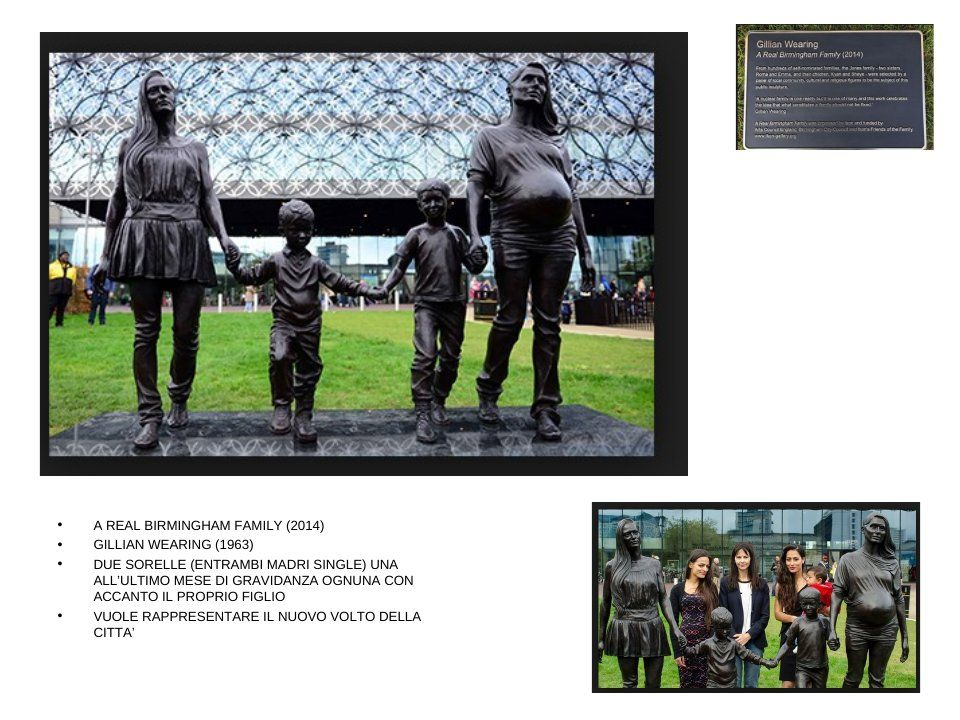{ loading=lazy style="width:47%" }

0:31:41

Oppure il *Cristo operaio*, di un artista argentino, Alejandro Marmo, che vuole mettere nella sua opera pezzi poveri, materiale di scarto, materiale che non è bello, non tanto per realizzare un’opera d’arte bella, quanto per il suo significato. Forse non a caso questo artista è stato chiamato anche da papa Francesco a Roma. Qui però si entra in un altro tema; era interessante il concetto di questa tipologia di arte. Ti lascio la parola per l’introduzione.

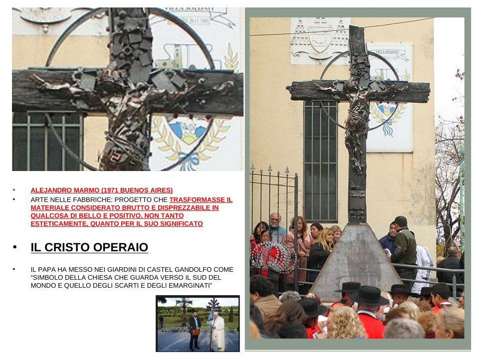{ loading=lazy style="width:47%" }

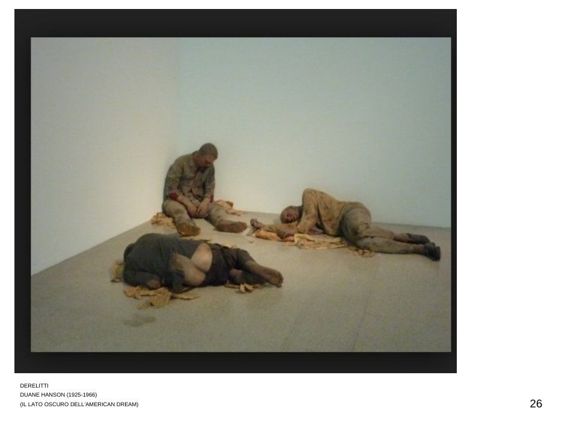{ loading=lazy style="width:47%" }

**ARTE E POLITICA, UNA RELAZIONE PERICOLOSA**

Ma l’arte ha anche deviazioni dalla retta indicata (per fortuna…?). Ci sono artisti che interpretano diversamente l’impossibilità di rimanere estranei alle logiche generate dall’ideologia di mercato dell’era (appunto finemente chiamata) post-ideologica.

Ci si pongono allora nuove questioni etiche, che fanno riflettere sul valore estetico e sociale dell’arte. Qualche esempio:

Zhang Dali, *Chinese Offspring* (2004): contadini appesi per i piedi al soffitto, a denunciare la precarietà.

Gillian Wearing (1963), *A Real Birmingham Family* (2014): due sorelle (entrambe madri single), una all’ultimo mese di gravidanza, ognuna con accanto il proprio figlio; vuole rappresentare il nuovo volto della città.

Alejandro Marmo (Buenos Aires, 1971), «Arte nelle fabbriche»: un progetto che trasformasse il materiale considerato brutto e disprezzabile in qualcosa di bello e positivo, non tanto esteticamente quanto per il suo significato. Il *Cristo operaio* il papa lo ha messo nei giardini di Castel Gandolfo come «simbolo della Chiesa che guarda verso il sud del mondo e quello degli scarti e degli emarginati».

Duane Hanson (1925-1996), *Derelitti* (il lato oscuro dell’*American dream*).

0:32:30

Lorenzo Poggi Intanto facciamo una piccola introduzione filosofica, ma piccola piccola, roba che non… C’è uno statuto conoscitivo differente tra le immagini e l’altro modo di descrivere il mondo, che è la parola. Abbiamo essenzialmente due modi di descrivere la realtà: il simbolo, che è appunto l’immagine, e il discorso, il parlare, la parola. Hanno uno statuto conoscitivo nettamente differente. Il dire è legato a una struttura binaria, soggetto-predicato: esclude altre relazioni fra gli oggetti presi in esame e il mondo; dà un’immagine chiusa, precisa della realtà, dalla quale non si può sfuggire. Vi ricordate: da Parmenide in poi, «l’essere è, il non essere non è»; la cosa ha un nome, e quello è il suo statuto di essere. Quindi è una relazione binaria, e quindi una visione abbastanza rigida, compiuta, legata alla logica formale e alla predicazione.

0:34:04

Invece l’immagine non è dire: l’immagine è mostrare. E il mostrare lascia aperti larghissimi spazi all’immaginazione; il mostrare non è mai qualcosa di esaurito. Un’opera d’arte del Trecento che noi guardiamo oggi è ancora in grado di comunicarci una visione del mondo, è ancora in grado di muovere le nostre emozioni. L’opera, l’immagine, varia nel tempo, varia con lo sguardo di chi la osserva. Quindi l’immagine mantiene uno statuto conoscitivo molto più aperto, diverso. E siccome l’immagine, anche se è realistica, è sempre un’immaginazione della realtà – non ha nulla a che vedere con la realtà, è sempre una ricostruzione – ci permette di esercitarci in quella eccezionale disposizione simbolica nei confronti del mondo che è saltare il dato immediato dell’esperienza, il dato di fatto, per esercitare invece la costruzione immaginativa. Ed è ovvio: dalla capacità di fare questo salto, dalla capacità di immaginazione, nascono tutte le scoperte umane. Tutto ciò che l’uomo fa e innova sorge da questa capacità di anticipazione immaginativa.

0:35:58

E quindi l’immagine di per sé porta con sé una ricchezza di conoscenza e di emozione che, durante la storia dell’umanità, ha sempre costituito un elemento importantissimo della propaganda, un elemento fondamentale per imporre una visione del mondo. Da qui il discorso che facevamo: per le immagini si sono fatte delle guerre sanguinosissime, e se ne sono fatte molte. Paolo faceva vedere l’ISIS e la distruzione delle immagini. Ci sono le religioni aniconiche, come l’Islam, come l’ebraismo. Perché aniconiche? Perché ciò che è Dio, ciò che è il sacro, non lo deve e non lo può dire l’immagine, che si presenta in quella variabilità, dal punto di vista del mutamento, di cui dicevamo prima; lo deve dire la lingua, la parola, perché la parola presenta quello statuto conoscitivo chiuso: è parola di Dio, è parola di Allah.

0:37:30

Sono state fatte delle guerre. Leone III Isaurico, dopo aver finalmente sconfitto, in una guerra durata duecento anni, i persiani, dà inizio alla lotta iconoclasta all’interno dell’impero bizantino. Leone III lancia la distruzione delle immagini perché si vuole opporre a chi ha le immagini – i monasteri, la Chiesa – e detiene un potere alternativo al suo: chi possiede l’immagine in qualche modo possiede il santo, possiede Dio. E fa distruggere le immagini; comincia a far distruggere l’immagine della Madonna che c’è sulla porta di Costantinopoli. Manda l’esercito, manda per primo un militare a distruggere l’immagine: quelli ci vanno armati di rulli, come quelli che si adoperano adesso per imbiancare, li mettono in cima alle picche, li tuffano nel colore e imbiancano la Madonna. Vorrebbero sostituirla con una croce, ma non ce la fanno, perché appena si presentano alla porta le donne danno loro addosso – pensate, una rivolta di donne – ne feriscono alcuni, e questi se ne vanno.

0:39:26

Perché le donne? Perché le donne hanno in quell’immagine della Vergine Maria sulla porta un punto di riferimento, un sostegno al loro essere donne, al loro rischiare la vita nel partorire, al loro essere in una condizione di dipendenza, di differenza, di inferiorità; quell’immagine della Vergine sulla porta è per loro un elemento di sicurezza. Le donne di Monterchi nel 1952 si opposero...

0:40:00

...a che la *Madonna del Parto* di Piero della Francesca fosse portata a una mostra a Firenze. Ma non perché fossero raffinate conoscitrici dell’arte di Piero, per cui quell’opera non doveva essere spostata: no, perché avere lì l’immagine della Madonna gravida, incinta, con gli angeli, era per loro un segno di sicurezza. Il potere profondo dell’immagine: tanto profondo che il potere politico, quando può, tenta di utilizzarlo.

0:40:49

Il senso di coinvolgimento, di inserimento: abbiamo visto, come ha fatto vedere Paolo, la messa in scena delle parate naziste. Quella è una messa in scena per far sentire a chi partecipa di essere parte coinvolta di qualcosa di immenso, di ineluttabile, che è il destino del mondo: l’idea di forza e di appartenenza a un impero che nessuno potrà mai battere viene da lì.

0:41:28

Quando gli imperatori bizantini si battono contro i persiani, portano un’immagine – non una bandiera, ma un’immagine – del volto di Cristo. Si può vedere il *mandylion* tra le immagini? Non mi ricordo che numero è... Ve lo faccio vedere, se vi annoia ditemelo, perché è un discorso un po’ diverso dal solito; tentiamo di farlo a cena. Dicevo: questo è il *mandylion*, questa è la bandiera. È un panno simile... noi pensiamo immediatamente alla Veronica, alla Berenice, e poi pensiamo alla Sindone. Questo è un panno con il vero volto di Cristo, il volto santo di Dio. Con questo *mandylion* si sconfiggono i nemici, perché chi possiede il volto santo, chi possiede il *mandylion*, è invincibile. Il potere dell’immagine è questo.

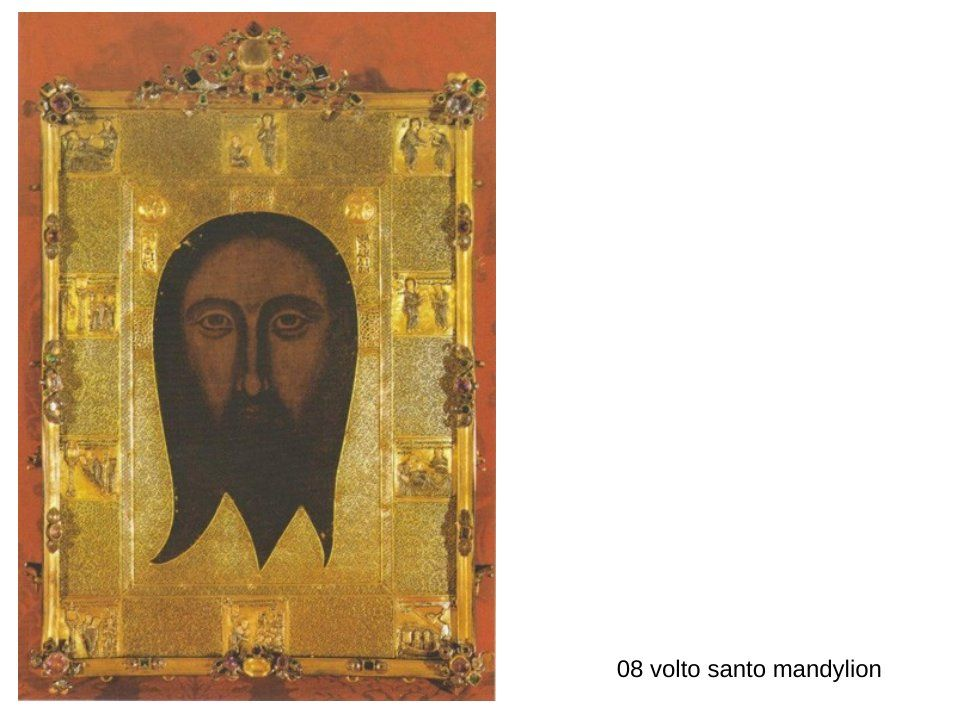{ loading=lazy style="width:30%" }

0:42:51

Capite: Firenze, quando costruisce le proprie mura – potete andare a vedere, ora sono rimaste solo le porte dell’ultima cerchia – dietro le porte ci mette l’immagine della Madonna, come a Costantinopoli; ma non perché Firenze imiti la cultura orientale di Istanbul, ma per la protezione santa della città attraverso l’immagine.

0:43:21

Gli iconoclasti sono quelli che vogliono distruggere le immagini e affidare la verità del mondo solo alla parola. Gli iconoclasti che cosa dicono? «Non possiamo adorare un pezzo di stoffa, un pezzo di carta, un pezzetto di legno coperto di colori di seconda mano: non è sacro, è un oggetto come gli altri». Gli altri, invece, quelli che sentono il sacro dell’immagine, gli iconoduli, dicono: «No, quella è la vera immagine, la vera icona; quella è l’immagine di Dio, ha un collegamento con Dio». Molte di queste immagini, come il Volto Santo, sono acheropite, cioè non c’è un autore, non le ha fatte nessuno: sono state portate sulla terra dagli angeli, o sono state date direttamente da Dio.

0:44:54

Quindi l’immagine è il collegamento con il sacro, la chiamano «la porta del sacro»: è ciò che consente il passaggio, attraverso l’esperienza, dall’ordinarietà del dato di fatto all’immaginazione, a ciò che va oltre, che ci mette in contatto con quello che va oltre il mondo immediato della realtà. Quindi l’immagine è porta, passaggio. Ed è un discorso che va avanti a lungo: molte persone sono state uccise durante la lotta iconoclasta. Vengono cancellate le immagini: se sono in un tondo o simili, vengono cancellate con il bianco e poi sopra si mette una croce.

0:46:06

C’è un’immagine di Santa Sofia che devo farvi vedere... ecco, poi si vede anche qualche altra. Eccola qua: questo è l’interno di Hagia Sophia, prima chiesa a Costantinopoli, poi moschea dal 1453 e ora museo. Queste immagini sono state tutte tolte: sono rimaste solo delle ornamentazioni e poche immagini della Vergine. E Maometto II, nel 1453, quando entrò a Costantinopoli e conquistò la città, non fece toccare niente della chiesa – una chiesa che non ha subito nessun danno dall’occupazione della città – e fece mettere questi quattro tondi con i versetti del Corano e il nome di Allah. È bastato questo, perché Hagia Sophia era già stata purgata dalle immagini.

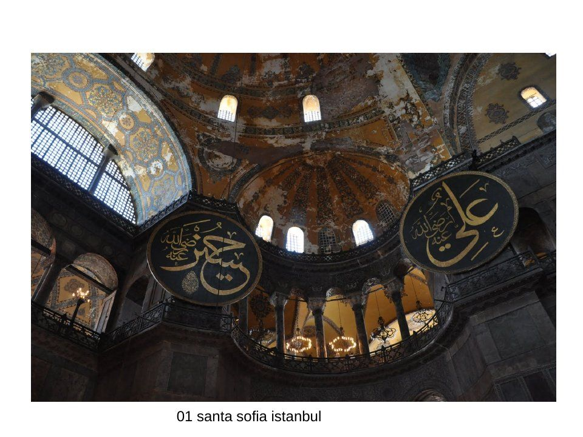{ loading=lazy style="width:47%" }

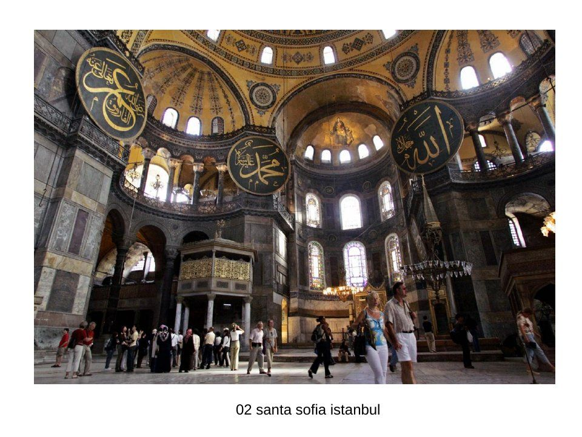{ loading=lazy style="width:47%" }

0:47:30

Quando cancellavano le immagini della Vergine e dei santi, i soldati di Costantinopoli, se erano in una chiesa, ci mettevano al posto la croce; se erano in un luogo pubblico, allora venivano utilizzate altre immagini, immagini che piacevano alla gente: cavalli, veline, quelle che facevano gli spogliarelli – c’erano anche a quei tempi. La stessa Teodora, l’imperatrice moglie di Giustiniano, si dice che da giovane, prima di fare l’imperatrice, facesse la spogliarellista, la velina. Insomma, è importante questo discorso: si sostituivano queste immagini a quelle che erano immagini sante, per rompere il monopolio.

0:48:42

Ora, visto che ci siamo, si possono vedere anche i volti santi, perché noi in Italia di queste cose... loro hanno il *mandylion*, ne hanno uno; noi ne abbiamo tre o quattro. Intanto questo è famosissimo: è il Volto Santo di Lucca. Ora non ho qui l’immagine, ma nelle monete di Lucca... Firenze ha Giovanni Battista, nel fiorino – ce l’ha dopo? Ah, benissimo, basta – e poi vedete che cosa ha Lucca: il Volto Santo. E c’è il Volto Santo di Manoppello: ecco, guardate; sono stati fatti degli studi e hanno detto anche che si somigliano. Sono acheropite. E c’è il pittore per eccellenza, protettore dei pittori, San Luca, raffigurato mentre dipinge la Vergine Maria: ecco, vedete l’angelo che regge la tela.

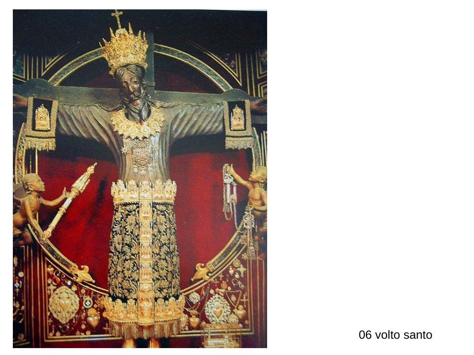{ loading=lazy style="width:30%" }

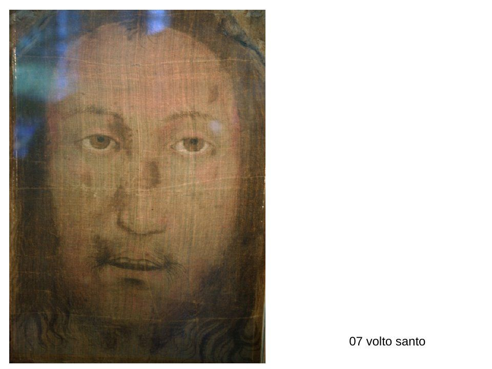{ loading=lazy style="width:30%" }

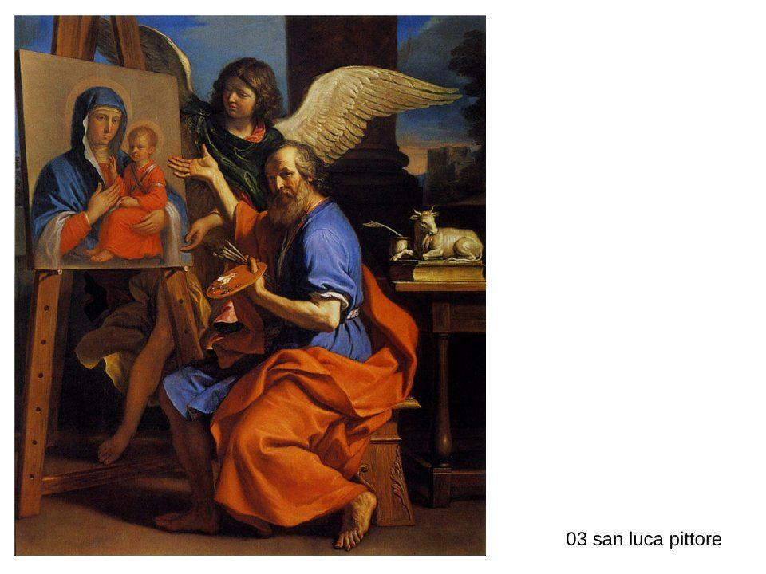{ loading=lazy style="width:31%" }

0:50:00

San Luca, naturalmente... non è il Guercino, che si è autoritratto come San Luca che dipinge la Madonna; insomma, ci ha poco a che fare. San Luca è poi il santo protettore dei pittori. Perché, se l’immagine sacra è legata al sacro, è legata a Dio, intanto deve rimanere sempre uguale a se stessa. Pensate alle icone della Chiesa ortodossa, che non hanno subito nessuno dei mutamenti che ha subito la storia dell’arte: non c’è una Madonna astratta, non c’è una Madonna cubista; l’arte è rimasta legata a questo. E solo il monaco, dopo una preparazione spirituale, può dipingerla, come solo il rabbino scrivano può scrivere i testi della Bibbia da dare alle nuove sinagoghe che sorgono nel mondo. C’è un collegamento.

0:51:15

Ci sono poi i volti, li vediamo dopo. Ah, quella di Uta: vi faccio vedere Uta e poi basta. Questa è Uta degli Ascani, famosissima, l’avrete vista tutti: è la strega di Biancaneve nella versione di Disney. È invece Uta degli Ascani, margravia – no, è marchesa – che sposò il principe Eckhard II, nell’altra immagine che è accanto: ha la spada, eccolo là. Eckhard tiene le distanze dalla sposa, dalla margravia: le tiene tra la spada, segno dell’amministrazione della giustizia, del potere, e lo scudo, per proteggersi, perché non si sa mai. Perché questa è una strega: venne processata per stregoneria e scampò al rogo. È qui, nella cattedrale di Naumburg, del Duecento; è stata presa come ideale della donna nazista. E naturalmente Walt Disney, quando ebbe bisogno di fare una strega – quella che chiede «chi è la più bella del reame?» – prese appunto Uta degli Ascani, dei margravi Ascani di Naumburg, moglie del principe Eckhard II.

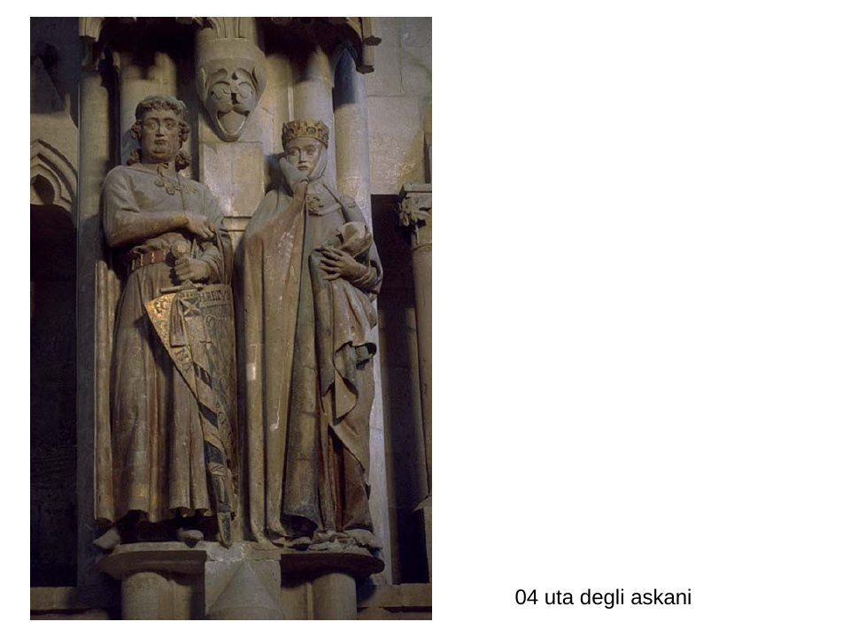{ loading=lazy style="width:30%" }

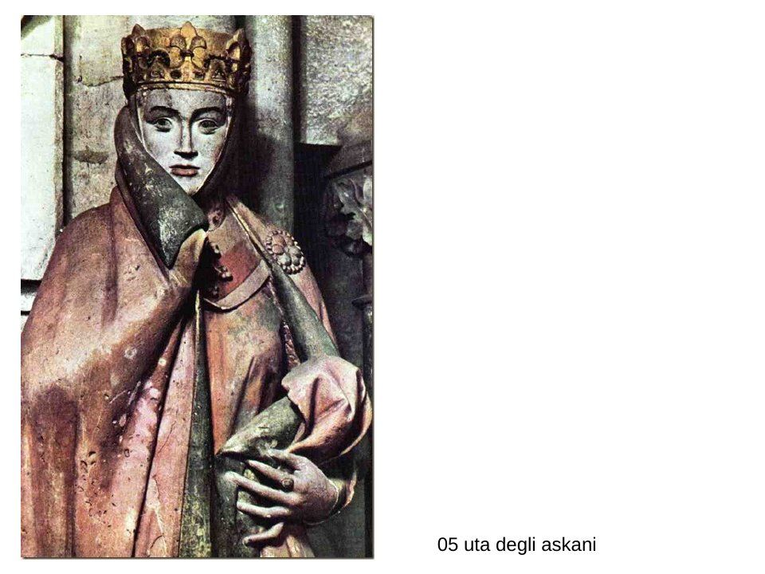{ loading=lazy style="width:30%" }

0:53:32

Capite quanto valore abbiano le immagini, come incidano profondamente, come portino sempre nella nostra mente qualcosa di nuovo e mutino con il mutare del tempo. Basta, è stato un discorso lunghissimo.

0:53:57

Paolo Marcucci Bene, facciamo la pausa. C’è una novità, per chi viene con noi anche le altre volte: non facciamo più due pause, ma mangiamo ora sia il primo sia il secondo, tutto insieme, e poi finiamo dopo. Sono necessità tecniche del ristorante.

\[PAUSA\]
{: .nota }

1:33:29

Paolo Marcucci Bene, allora iniziamo questa seconda parte, perché abbiamo messo insieme le tre parti che tradizionalmente facevamo. Abbiamo concordato con il professore: faremo ora una panoramica sull’arte pubblica, civica, del Trecento; e poi, in contrapposizione a queste immagini, faremo invece le immagini dell’arte moderna, da cui riprenderemo Jeff Koons, e analizzeremo quel periodo, proprio per mettere a confronto questi due periodi della storia e il modo in cui l’arte è stata rappresentata in questi due periodi storici.

**NASCITA DELL’ARTE CIVICA**

Dopo l’introduzione vediamo ora il momento chiave che vede l’opera d’arte come espressione di un’idea collettiva, sociale, educativa. Questa idea prende il nome di *arte civica*. E quando nasce?

L’arte civica nasce anche per la necessità di rappresentare forme pubbliche e democratiche del potere. Non è semplice, in quanto si deve rappresentare un’idea pubblica del potere, e non solo quella del re o del principe.

Nasce infatti tra i comuni dell’Italia settentrionale e trova in Toscana forse il suo apice, divisa tra esigenze di rappresentazione sintetica della nuova istituzione, che consentisse una continuità nel repertorio tradizionale, e allo stesso tempo la sottolineatura della costituzione politica.

1:34:27

Allora, l’arte pubblica, o anche arte civica, quando nasce? Nasce in un preciso momento, in cui il potere pubblico deve rappresentare nelle forme più congeniali a quest’idea pubblica del potere un’immagine, un messaggio, che passa attraverso l’opera d’arte: quindi una concezione nuova, un’idea pubblica del potere che fino a quel momento non c’era. Dove nasce l’idea di un’arte civica? Nasce in Italia, precisamente in Toscana e nelle regioni del Nord Italia. Questa è la rappresentazione dell’Italia intorno al 1300: sostanzialmente la Toscana e tutte le regioni del Nord Italia o sono Comuni o sono ex Comuni; comunque hanno una forma di potere che è pubblica e non del sovrano, come il Regno di Sicilia o lo Stato Pontificio nel Lazio e nell’Italia centrale. Non è un caso che quest’arte civica nasca in queste zone d’Italia.

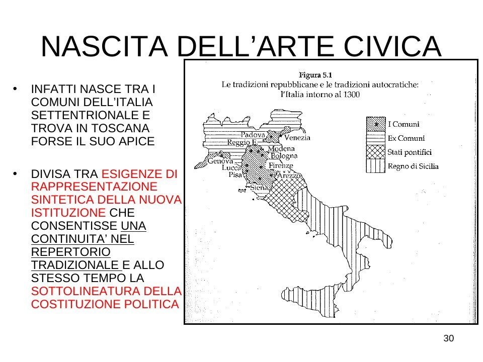{ loading=lazy style="width:59%" }

1:36:04

Per esempio, come si utilizzano le immagini? A Bologna, nel 1300, i traditori venivano dipinti nel palazzo comunale mentre bruciavano vivi o venivano squartati dai cavalli; così a Padova i corrotti erano dipinti con la borsa al collo; a Verona... Questo per esempio è a Mantova, dove si dipinsero a infamia alcuni fuoriusciti che avevano tramato per vendere alle forze imperiali, alle spalle della città, il castello di Marcaria; e quindi furono poi rappresentati in questo affresco – si vede un po’ male, ma è il concetto che è importante.

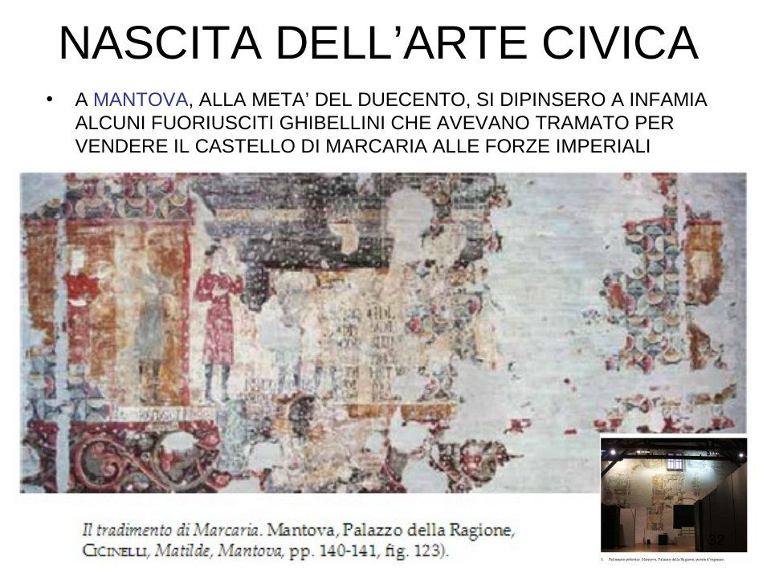{ loading=lazy style="width:59%" }

**NASCITA DELL’ARTE CIVICA**

Queste nuove istituzioni pubbliche, per affermare la capacità giuridica di punire azioni di un certo tipo, come ad esempio punire i ribelli, ricorrevano alle immagini:

A Bologna, nel 1300, i traditori venivano dipinti nel palazzo comunale mentre bruciavano vivi o venivano squartati dai cavalli;

A Padova i funzionari corrotti erano dipinti con la borsa al collo;

A Verona i traditori di Mastino I della Scala (1277) vennero giustiziati e attaccati alle forche nel palazzo pubblico;

A Mantova, alla metà del Duecento, si dipinsero a infamia alcuni fuoriusciti ghibellini che avevano tramato per vendere il castello di Marcaria alle forze imperiali.

A Firenze con le pitture infamanti si stigmatizzavano i delitti contro la sicurezza della città, il suo territorio e il suo assetto economico. Quest’ultimo uso dell’immagine era giuridicamente regolato e penalmente rilevante, teso a documentare e a rendere noti il reo, la colpa, la pena.

Andrea del Sarto, *Studi per figure maschili appese per un piede*, 1530.

1:36:50

A Firenze si usavano le pitture infamanti. Qual era lo scopo? Gli scopi principali erano tre: far sapere chi aveva commesso il reato, la colpa, e la pena per questo. Questi, per esempio, sono gli studi di Andrea del Sarto per figure maschili appese: questa era la pittura per i traditori del bene pubblico.

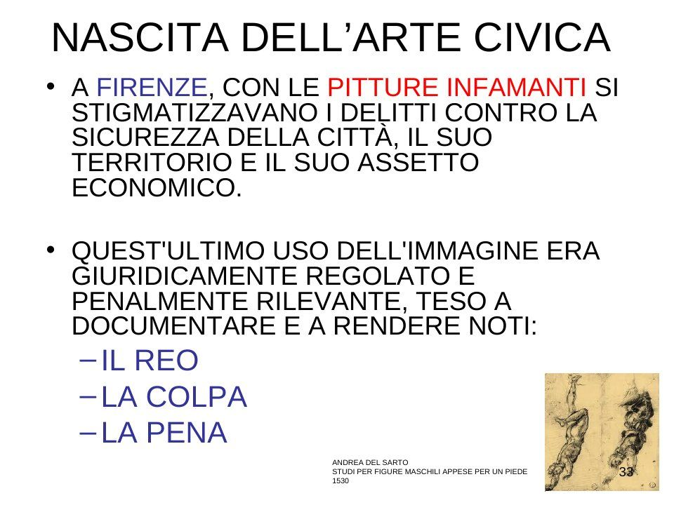{ loading=lazy style="width:47%" }

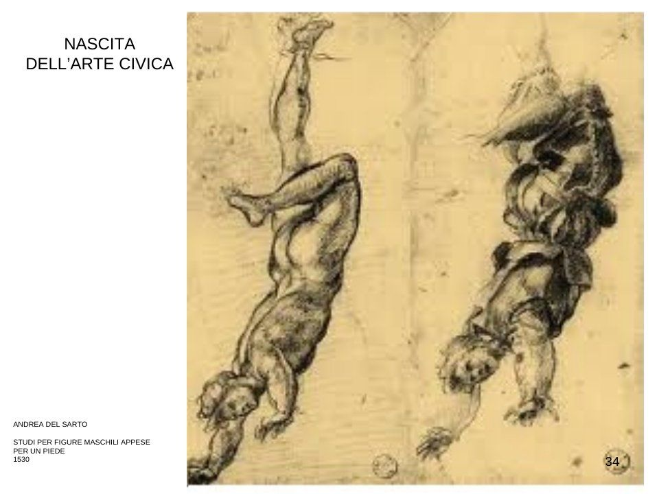{ loading=lazy style="width:47%" }

1:37:19

Firenze e Siena furono le capitali di quest’idea civica dell’arte. A Siena nel Duecento si istituì il Memoriale delle offese e delle conquiste: il dipinto di Simone Martini, *Guidoriccio da Fogliano*, è proprio questo, l’immagine simbolica della città, del bene della città, che in questo caso va alla conquista di Montemassi, e viene rappresentato in questo modo per il bene e la prosperità della città. Dalle città l’idea si irradia anche alla periferia: questo, per esempio, è Certaldo, il Palazzo dei Vicari (*Incredulità di San Tommaso* di Pier Francesco Fiorentino, 1490), dove San Tommaso viene preso come modello per i giudici, i giudici che vanno a toccare, a vedere, a cercare la verità. C’è sempre questa commistione tra una tradizione iconografica religiosa e un’innovazione che deriva invece dallo spirito civico di quel tempo.

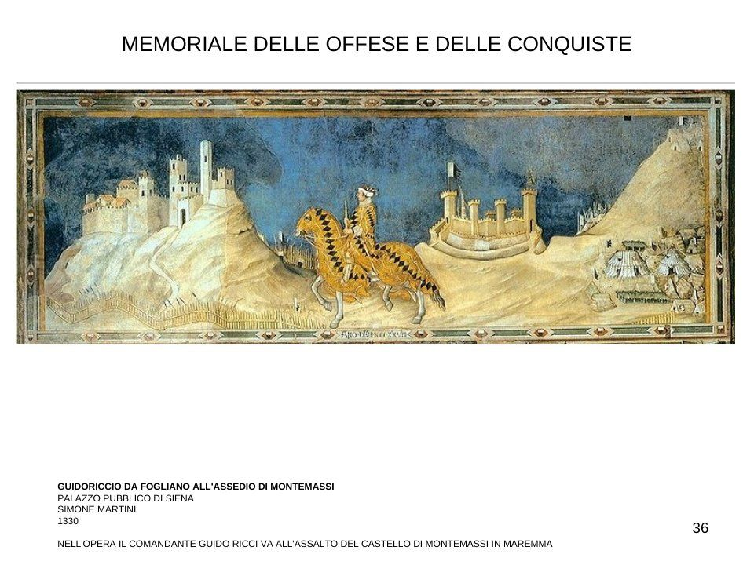{ loading=lazy style="width:47%" }

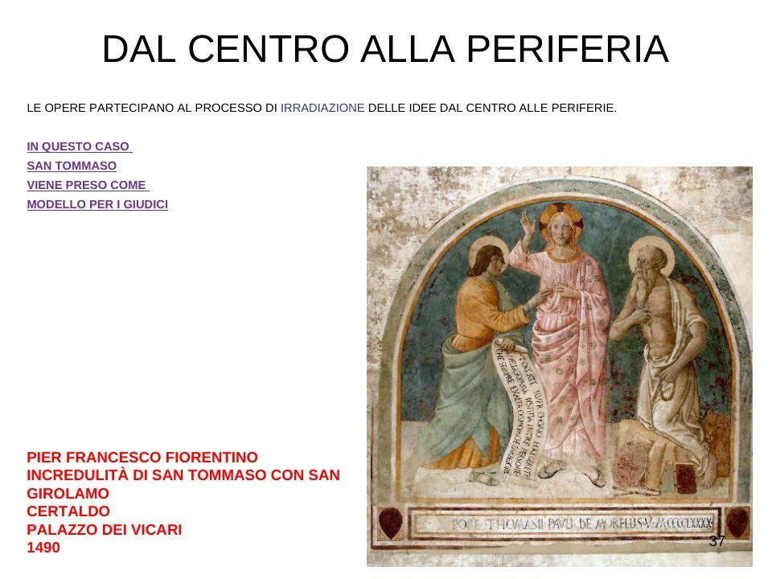{ loading=lazy style="width:47%" }

**MEMORIALE DELLE OFFESE E DELLE CONQUISTE**

A Siena nel 1223 fu istituito il Memoriale delle offese (alla città…) e delle conquiste di castelli da parte del comune (Grosseto, Montemassi…).

Firenze, 1329: una provvisione (provvedimento di un’autorità…) tesa a restringere gli spazi dell’affermazione personale (ad esempio la Signoria di Carlo di Calabria) stabilisce che sarebbe stato permesso rappresentare solo «vittorie o conquiste di città o di castelli da parte del comune di Firenze».

Simone Martini, *Guidoriccio da Fogliano all’assedio di Montemassi*, 1330, Siena, Palazzo Pubblico: nell’opera il condottiero Guidoriccio da Fogliano va all’assalto del Castello di Montemassi, in Maremma.

**DAL CENTRO ALLA PERIFERIA**

Le opere partecipano al processo di irradiazione delle idee dal centro alle periferie: in questo caso San Tommaso viene preso come modello per i giudici (Pier Francesco Fiorentino, *Incredulità di San Tommaso con san Girolamo*, 1490, Certaldo, Palazzo dei Vicari).

1:38:33

La giustizia è uno dei temi fondamentali; vedremo ora due o tre immagini che ci aiutano a capire – tra l’altro, la giustizia è anche in questo momento al centro del dibattito della vita pubblica. Allora, siamo a Padova, Giotto, la Cappella degli Scrovegni. Si vede l’immagine della Giustizia: i due piatti della bilancia; a destra un angelo con la spada sguainata che sta per colpire un malfattore, a sinistra un altro angelo che incorona un saggio. Questa è l’immagine simbolo della giustizia. Quello che è interessante è anche la base, in basso, dove si vedono la vita e il buon governo in cui la giustizia funziona: si vedono scene ordinarie, in cui le bestie rispondono ai loro padroni, dove c’è vita, le attività tipiche della città. Questa invece è l’Ingiustizia, sempre di Giotto, nella Cappella degli Scrovegni a Padova: qui l’Ingiustizia è rappresentata da un anziano. Vedete la differenza rispetto all’immagine precedente?

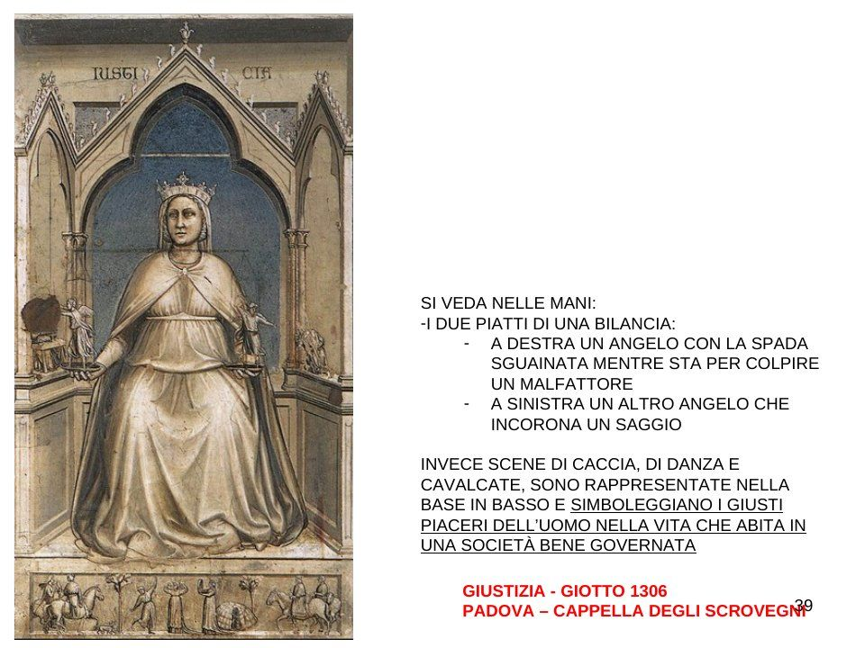{ loading=lazy style="width:59%" }

1:40:00

È un anziano, ci sono delle erbacce che crescono intorno alla sua figura, tiene in mano una spada ma è incapace di usarla, perché non ha più la forza. Vedete in basso, invece, a differenza dell’immagine precedente, i cavalli che si rifiutano di obbedire, i ladrocini: è l’ingiustizia, e la giustizia non può esserci.

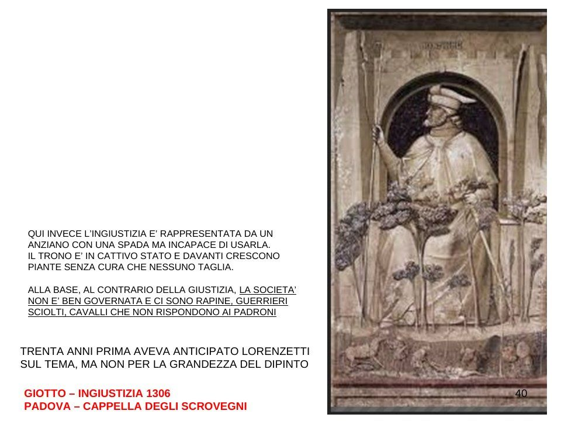{ loading=lazy style="width:59%" }

**IL TEMA DELLA GIUSTIZIA**

La giustizia era uno dei temi fondamentali (come ora…): molte rappresentazioni artistiche riguardano appunto questa parte della vita civica.

Giotto, *Giustizia*, 1306, Padova, Cappella degli Scrovegni. Si vedano nelle mani i due piatti di una bilancia: a destra un angelo con la spada sguainata sta per colpire un malfattore, a sinistra un altro angelo incorona un saggio. Nella base in basso sono rappresentate scene di caccia, di danza e cavalcate, che simboleggiano i giusti piaceri dell’uomo nella vita di una società bene governata.

Giotto, *Ingiustizia*, 1306, Padova, Cappella degli Scrovegni. Qui invece l’ingiustizia è rappresentata da un anziano con una spada, ma incapace di usarla. Il trono è in cattivo stato e davanti crescono piante senza cura, che nessuno taglia. Alla base, al contrario della giustizia, la società non è ben governata: ci sono rapine, guerrieri sciolti, cavalli che non rispondono ai padroni.

Trent’anni prima, Giotto aveva anticipato Lorenzetti sul tema, ma non per la grandezza del dipinto.

1:40:30

Il massimo di quest’idea della collettività pubblica, civica, l’abbiamo forse invece a Siena, dove la giustizia era uno dei temi importanti per i Comuni che volevano rappresentare il potere che detenevano in quel momento. C’è per la prima volta nella storia la difesa del patrimonio pubblico, e infatti viene fatto il Costituto senese, che tra le sue caratteristiche aveva anche quella di essere scritto in volgare, affinché tutti lo capissero. Trent’anni dopo, nel 1339, Lorenzetti traduce quest’idea, che era appunto il Costituto senese, nell’affresco del Buono e del Cattivo Governo.

**LA NASCITA DELL’ARTE CIVICA**

La giustizia (vedremo *il Buono e il cattivo governo* di Lorenzetti) fu al centro delle immagini d’arte, insieme a una proposta positiva delle idee pubbliche dell’impegno economico e sociale. In modo particolare e profondo ciò avvenne in Toscana.

L’arte e le opere nascevano da quello che apparentemente non si vede: il cosiddetto patrimonio intangibile, il patrimonio culturale e civico. Questo era il patrimonio intangibile di norme sociali e tradizioni civiche, di istituzioni e competenze diffuse.

A Siena, nel 1309, il *Costituto senese* diventa il primo esempio di leggi in volgare, affinché arrivassero al maggior numero possibile di cittadini.

Trent’anni dopo Ambrogio Lorenzetti traduce le idee nel ciclo di affreschi del *Buono e del cattivo governo* nel Palazzo Pubblico di Siena.

1:41:32

Allora, se si guarda in alto a sinistra, c’è la Sapienza divina, la figura più in alto, alata, con un libro in mano; con la destra tiene la bilancia, sui cui due piatti, destro e sinistro, due angeli amministrano i due rami della giustizia, perché la giustizia era sempre un tema importante. Il primo angelo decapita un uomo e ne incorona un altro; il secondo angelo, quello di sinistra, consegna invece a due mercanti gli strumenti di misura del commercio. Questo è il Buon Governo, e la giustizia: la Giustizia in trono, che vediamo nella figura in mezzo alle due frecce, è appunto virtù, istituzione cittadina, che però è solo amministratrice, perché è la Sapienza divina a reggere il peso della bilancia.

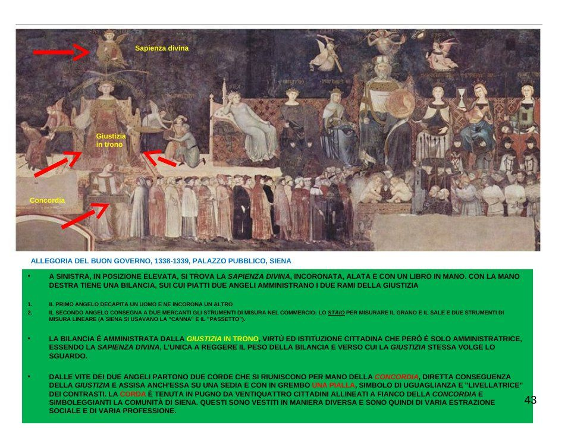{ loading=lazy style="width:59%" }

**AMBROGIO LORENZETTI, *ALLEGORIA DEL BUON GOVERNO*, 1338-1339, SIENA, PALAZZO PUBBLICO**

A sinistra, in posizione elevata, si trova la Sapienza Divina, incoronata, alata e con un libro in mano. Con la mano destra tiene una bilancia, sui cui piatti due angeli amministrano i due rami della giustizia: il primo angelo decapita un uomo e ne incorona un altro; il secondo consegna a due mercanti gli strumenti di misura del commercio: lo staio per misurare il grano e il sale e due strumenti di misura lineare (a Siena si usavano la «canna» e il «passetto»).

La bilancia è amministrata dalla Giustizia in trono, virtù e istituzione cittadina, che però è solo amministratrice, essendo la Sapienza divina l’unica a reggere il peso della bilancia, e verso cui la giustizia stessa volge lo sguardo.

Dalle vite dei due angeli partono due corde che si riuniscono per mano della Concordia, diretta conseguenza della giustizia, assisa anch’essa su una sedia e con in grembo una pialla, simbolo di uguaglianza e «livellatrice» dei contrasti. La corda è tenuta in pugno da ventiquattro cittadini allineati a fianco della Concordia, simbolo della Comunità di Siena: sono vestiti in maniera diversa, e sono quindi di varia estrazione sociale e di varia professione.

1:42:44

È importante perché dalla Giustizia partono due corde, una a destra e una a sinistra, che vanno sotto, alla Concordia, la figura più in basso, che ha il simbolo della pialla: vedete, ha in mano una pialla, livellatrice della giustizia e delle regole sociali. Questo è importante: tiene una corda a cui sono aggrappati tutti i cittadini, in rappresentanza di tutti gli stati sociali della città. Questa è l’interpretazione della giustizia nell’affresco di Lorenzetti.

1:43:40

Questa invece è l’Allegoria del Cattivo Governo, dove si vede che la Giustizia, che prima era in trono, una delle figure principali, qua giù è legata, avvolta in un panno perché non può più muoversi, non può più liberarsi, ed è tenuta in scacco da una corda retta da un uomo solo, e non da tutta la città come nel Buon Governo. Anche la Divisione, la *Divisio* – vedete – non ha più in mano la pialla livellatrice delle ingiustizie, ma una sega, che taglia le situazioni senza fare una buona giustizia.

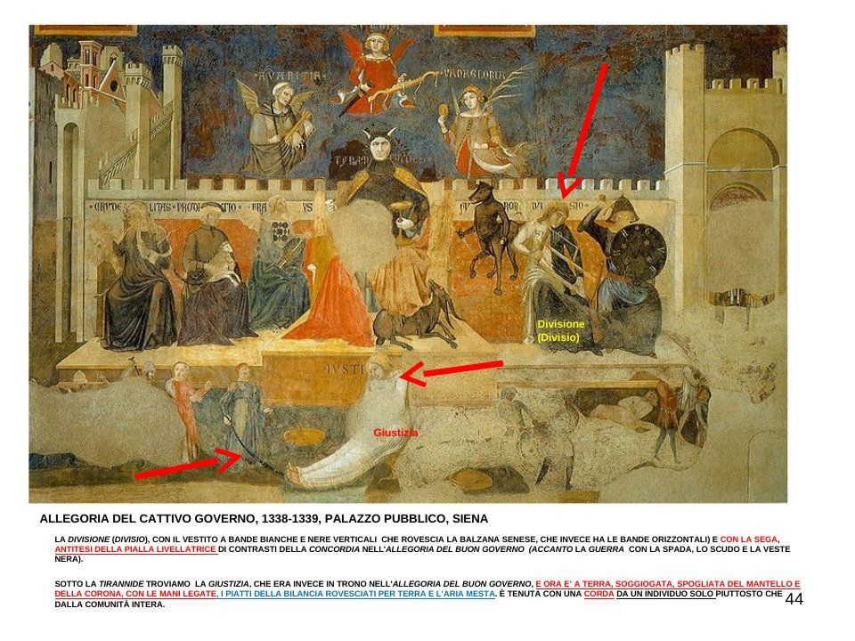{ loading=lazy style="width:59%" }

**AMBROGIO LORENZETTI, *ALLEGORIA DEL CATTIVO GOVERNO*, 1338-1339, SIENA, PALAZZO PUBBLICO**

La divisione (*divisio*), con il vestito a bande bianche e nere verticali (che rovescia la balzana senese, che invece ha le bande orizzontali) e con la sega, antitesi della pialla livellatrice dei contrasti della Concordia nell’allegoria del Buon Governo (accanto, la guerra con la spada, lo scudo e la veste nera).

Sotto la tirannide troviamo la Giustizia, che nell’allegoria del Buon Governo era in trono, e ora è a terra, soggiogata, spogliata del mantello e della corona, con le mani legate, i piatti della bilancia rovesciati per terra e l’aria mesta. È tenuta con una corda da un individuo solo, piuttosto che dalla comunità intera.

1:44:49

Questa che abbiamo visto è l’idea di fondo dell’arte civica di quel periodo. Vedete la differenza tra rappresentare un’idea del governo e del potere in questo modo e un’immagine di una Madonna o di un’altra figura che l’arte aveva rappresentato fino a quel momento. Qui dietro c’è un’idea di fondo: l’idea, per la prima volta nella storia, di una comunità in cui non c’era più il principe o il re, ma era la collettività a dover esprimere il proprio potere.

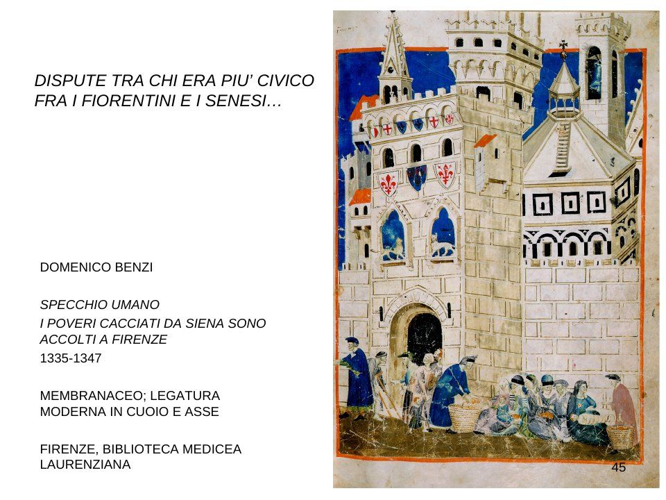{ loading=lazy style="width:47%" }

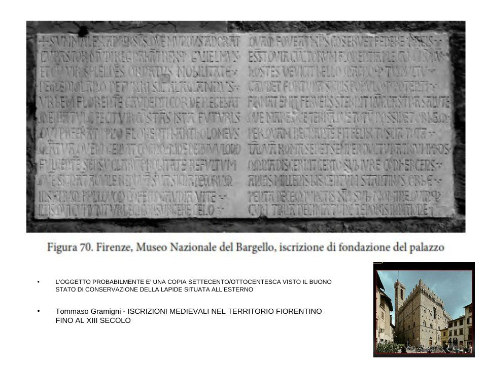{ loading=lazy style="width:47%" }

**LA NASCITA DELL’ARTE CIVICA**

Dispute tra chi era più civico fra i fiorentini e i senesi… Domenico Lenzi, *Specchio umano*: i poveri cacciati da Siena sono accolti a Firenze (1335-1347; membranaceo, legatura moderna in cuoio e asse; Firenze, Biblioteca Medicea Laurenziana).

Il *Costituto* senese del 1309, ben tradotto in immagini da Lorenzetti, riconosce il ruolo sociale della cultura, in particolare quando ricorda ai governanti di tenere conto «massimamente della bellezza della città, per cagione di diletto e allegrezza ai forestieri, per onore, prosperità e accrescimento della città e dei cittadini».

**LA PRIMA TAVOLA…**

A Firenze, prima di vedere la bellezza di alcune opere di arte civica, bisogna rifarsi a una lapide del 1255: l’autoritratto della città tracciato nell’epigrafe che nel 1255 consegna ai posteri (*futuris*) il primo palazzo civico, quello del Capitano del popolo (oggi Bargello).

Mentre chiede che Cristo la conservi in pace, una Firenze *fervens salute* si proclama non solo reduce da successi militari ed egemone su *Tuscia tota*, ma segnata dal crisma della sovranità: una nuova Roma, consacrata dalla forza delle armi e dalla certezza del diritto.

L’oggetto è probabilmente una copia sette-ottocentesca, visto il buono stato di conservazione della lapide, situata all’esterno (Tommaso Gramigni, *Iscrizioni medievali nel territorio fiorentino fino al XIII secolo*).

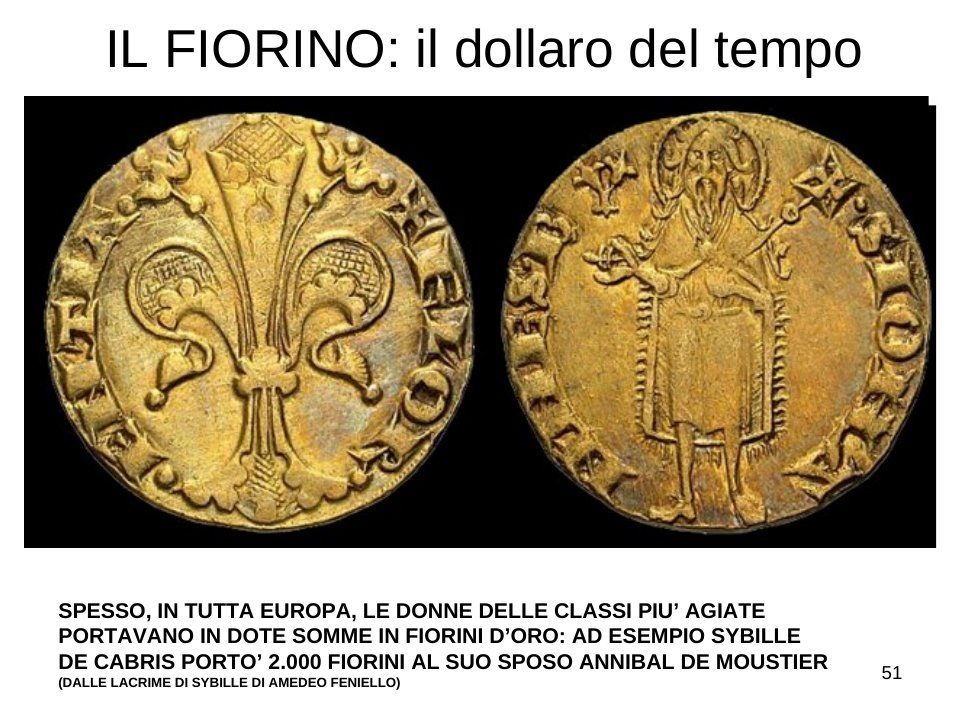{ loading=lazy style="width:59%" }

**FIRENZE E L’ARTE CIVICA**

A Firenze si rappresentò probabilmente la più alta forma di bellezza civica. Vediamo la ricostruzione di questo lavoro in alcuni passi fondamentali, dal lavoro di Maria Monica Donato (studiosa e curatrice di una mostra sul tema).

**GLI SPLENDORI DELL’«ARTE CIVICA» – MARIA MONICA DONATO**

Dice la Donato: in quella Firenze in ascesa, le iperboli epigrafiche poggiavano su successi recenti e concreti, fra i quali il debutto del fiorino d’oro, destinato a propagare davvero per *totum orbem* un’efficace immagine della città.

Com’è noto, il fiorino porta al recto l’arme del giglio, il *Flos* di Florentia – prima e più cara insegna – che si voleva concesso dai fondatori romani: ché Firenze era *tamquam Roma*, in quanto «bellissima e famosissima figlia di Roma» (Dante, *Convivio* I, 3).

Al verso, l’effigie di San Giovanni Battista – primo e più caro patrono – legava inscindibilmente il moderno veicolo della potenza economica della città al «San Giovanni», il Battistero, cuore antico e sacro della sua identità e della sua *Romanitas*.

Il fiorino, il dollaro del tempo: spesso, in tutta Europa, le donne delle classi più agiate portavano in dote somme in fiorini d’oro; ad esempio Sybille de Cabris portò 2.000 fiorini al suo sposo Annibal de Moustier (da Amedeo Feniello, *Le lacrime di Sybille*).

Questa alleanza si risolse in un formidabile potenziamento dell’efficacia comunicativa della pittura politica di Firenze e di Siena: Siena, che nelle iscrizioni dantesche della *Maestà* di Simone Martini (nel Palazzo Pubblico) e del *Buon governo* di Ambrogio Lorenzetti conserva gli esempi più alti di una prassi fiorita su radici fiorentine.

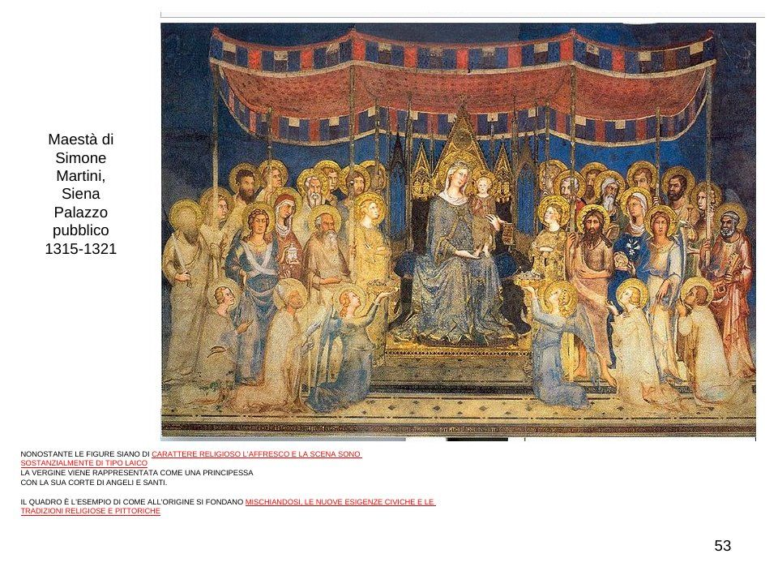{ loading=lazy style="width:59%" }

Simone Martini, *Maestà*, Siena, Palazzo Pubblico, 1315-1321: nonostante le figure siano di carattere religioso, l’affresco e la scena sono sostanzialmente di tipo laico. La Vergine viene rappresentata come una principessa con la sua corte di angeli e santi. Il quadro è l’esempio di come all’origine si fondano, mischiandosi, le nuove esigenze civiche e le tradizioni religiose e pittoriche.

**GLI SPLENDORI DELL’«ARTE CIVICA» – MARIA MONICA DONATO**

Per Firenze, per la ricostruzione dell’arte civica, stiamo ragionando però di immagini che per gran parte non vediamo più: le vicende della storia e del gusto, che a Siena hanno risparmiato una galleria d’arte civica estesa dal primo Trecento agli sgoccioli della Repubblica, a Firenze hanno decimato quanto in parte ancora Giorgio Vasari (tra i responsabili dell’ecatombe di immagini) poteva vedere al Bargello, a Palazzo Vecchio, nelle sedi delle arti e alla Mercanzia.

Alle fatalità e alle mutate esigenze della politica (che già in età protomedicea, e più in epoca ducale, impose riqualificazioni e reinvenzioni di strutture, spazi e decori) si sono aggiunti da un lato i cataclismici sventramenti ottocenteschi, con l’azzeramento del tessuto del centro – incluse parecchie sedi delle arti – e d’altro lato, in singolare intreccio con le demolizioni, gli spesso ben intenzionati ma snaturanti rifacimenti «in stile» fra il XIX e l’inizio del XX secolo.

**L’ARTE CIVICA A FIRENZE**

Ma oltre a quanto detto dalla Donato occorre aggiungere i comportamenti dei Medici, che per affermare il proprio potere trasformarono radicalmente il patrimonio iconografico fiorentino. D’altra parte ogni nuovo potere ha sempre distrutto le insegne del potere di cui ha preso il posto…

Ne restano tuttavia moltissime tracce attraverso disegni originali, citazioni in altre opere che vi fanno riferimento, oggetti strumentali della vita pubblica come registri e sigilli. Alcune sono significative e riguardano i meccanismi elettivi (tipici delle democrazie), che si ricollegano obbligatoriamente al tema della giustizia.

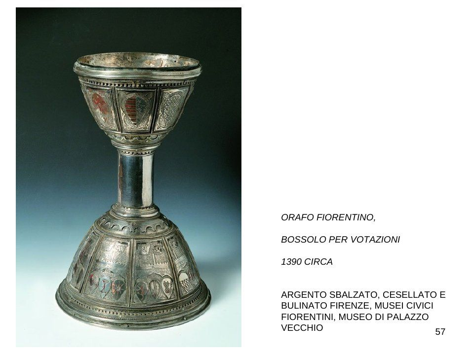{ loading=lazy style="width:47%" }

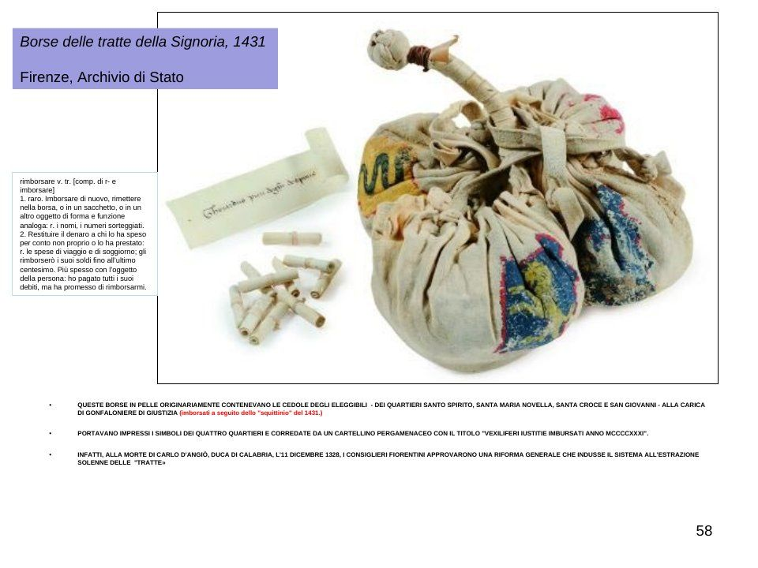{ loading=lazy style="width:47%" }

Orafo fiorentino, *Bossolo per votazioni*, 1390 circa, argento sbalzato, cesellato e bulinato (Firenze, Musei Civici Fiorentini, Museo di Palazzo Vecchio).

*Borse delle tratte della Signoria*, 1431 (Firenze, Archivio di Stato): queste borse in pelle originariamente contenevano le cedole degli eleggibili – dei quartieri di Santo Spirito, Santa Maria Novella, Santa Croce e San Giovanni – alla carica di gonfaloniere di giustizia (imborsati a seguito dello squittinio del 1431). Portavano impressi i simboli dei quattro quartieri ed erano corredate da un cartellino pergamenaceo con il titolo *Vexiliferi iustitie imbursati anno MCCCCXXXI*.

Infatti, dopo la morte di Carlo d’Angiò, duca di Calabria (1328), l’11 dicembre 1328 i consiglieri fiorentini approvarono una riforma generale che indusse il sistema all’estrazione solenne delle «tratte».

1:45:49

Da questo, consentitemi ora di fare un salto lungo settecento anni, e andiamo a riprendere il discorso che avevamo iniziato prima facendo vedere l’immagine di Jeff Koons con Cicciolina; poi magari, se c’è tempo, su quest’altra parte ci rientriamo.

1:46:19

Partiamo da un punto. Abbiamo detto prima che la finanza internazionale in questo momento è uno dei poteri occulti – e non tanto occulti – che animano gli investimenti nell’arte, internazionali; ne abbiamo parlato anche altre volte nelle nostre serate. Ricordiamo che non è nemmeno eletta da nessuno. Si sono criticati, per esempio, gli Stati, che nella storia del Novecento sono stati forieri di guerre mondiali: Luigi Einaudi, già alla fine della Prima guerra mondiale, aveva definito gli Stati «idea feconda di male», perché avevano portato alla Prima guerra mondiale. Però, venuti forse meno con la globalizzazione gli Stati come li avevamo conosciuti negli ultimi duecento anni, si è sostituito un potere del tutto diverso, che potrebbe essere rappresentato da questa definizione, il «narcisismo invidioso neoliberale» del nostro tempo, che era un po’ la definizione trovata da Lacan in questo periodo. E quindi: perché io desidero un oggetto? Non tanto per l’oggetto o per la sua bellezza, ma forse soprattutto perché è desiderato o posseduto da un altro. È questo il punto fondamentale che si è inserito negli ultimi 30-40 anni nel nostro mondo occidentale; e da qui anche il condizionamento degli artisti.

**RIPARTIAMO DALLA PRIMA DOMANDA**

«La finanza internazionale, divenuta un vero potere occulto, ha cercato il sostegno degli artisti. Un sostegno che non poteva più essere manifestato attraverso proclami, ma attraverso strategie più sottili \[…\]; vanificare l’autonomia della critica a totale vantaggio del potere del mercato» (Paparoni).

Il narcisismo invidioso neoliberale del nostro tempo, di questi ultimi venti-trent’anni (che era la tesi di Lacan): desiderio di un oggetto forse non per il suo valore in sé, ma perché è soprattutto desiderato o posseduto da un altro. Anche da qui il condizionamento dell’arte e degli artisti.

**DENARO E ARTE**

Una domanda che possiamo farci è: tutto è racconto del potere di turno? Soprattutto ora, «nel tempo del trionfo della visione»? E il valore è espressione di riconoscimento artistico?

Dopo la visione delle idee sociali dell’arte del committente pubblico, ritorniamo quindi al tema iniziale: l’arte e il suo prezzo, Jeff Koons e gli altri, e l’etica civica dell’arte moderna. Ha senso porsi ancora domande sull’arte come missione civica?

1:48:16

Potremmo dire che tutto è racconto del potere di turno, e l’artista non si emenda da questa condizione: Jeff Koons, che abbiamo visto, è uno dei tanti; e ora rivediamo qualcosa. Ha ancora senso porsi questo tipo di domande? Questo è un artista italiano, Cattelan: quest’opera è *L.O.V.E.*, «amore», del 2010, messa davanti al palazzo della Borsa di Milano. Vedete un dito mozzato – sapete tutti che cosa vuol dire. L.O.V.E. è un acronimo, le iniziali di Libertà, Odio, Vendetta, Eternità; ed è collocata di fronte alla piazza della Borsa – che tra l’altro ora non esiste più come tale, perché prima c’erano le sale delle grida, mentre ora è telematica, e quindi gli operatori in sala praticamente non esistono più. È una mano che vuole fare il saluto fascista, ma ha le dita mozzate: non è una mano con le dita ripiegate, le ha proprio mozzate, se si guarda l’immagine da vicino. Quindi è un dito medio verso chi? Verso il fascismo, o soprattutto verso la finanza, rappresentata dal palazzo della Borsa? E questa si può considerare arte civica?

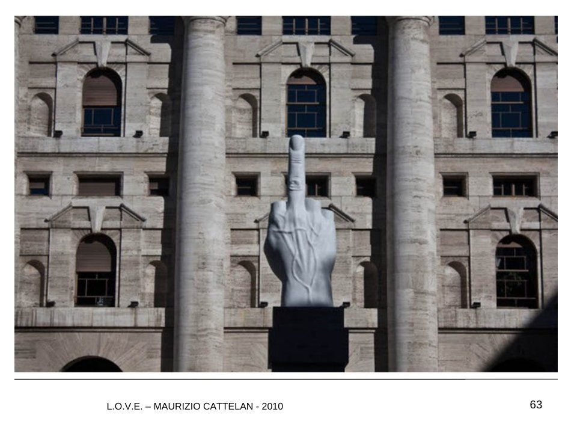{ loading=lazy style="width:59%" }

**L.O.V.E.* (2010) – MAURIZIO CATTELAN**

L.O.V.E. è un acronimo composto da libertà, odio, vendetta, eternità. L’opera è collocata in piazza degli Affari, di fronte alla sede della Borsa di Milano (Palazzo Mezzanotte), ora «vuota» con l’introduzione della borsa telematica. Da notare la collocazione davanti a questo edificio (1932), che ha tutto lo stile fascista.

È una mano che vuole fare il saluto fascista, ma ha le dita mozzate, tranne il medio… dito medio verso il fascismo? E/o soprattutto verso la finanza?

Questa si può considerare arte civica? Ma prima, per aiutarci a capire, vediamo la differenza tra il valore dell’arte dal Trecento alla metà del Novecento (semplificando…) e quello della modernità.

1:50:00

La differenza tra un’opera di oggi e quella più tradizionale sta in due parole: i soggettivisti e gli oggettivisti; i soggettivisti moderni e gli oggettivisti antichi. I filosofi usano forse la parola «immanenti»: per gli oggettivisti le proprietà estetiche risiedono nell’opera, nel suo principio e nel suo fine; se questa è un’opera d’arte, è perché è un oggetto. Invece per l’arte moderna, per i soggettivisti, qualsiasi cosa può essere arte, basta che la si consideri un’opera d’arte: questa è la differenza fondamentale. Da qui il passo è breve: se si legano ai finanziamenti che, come dicevamo, il potere in questo momento decide di fare, si arriva all’esplosione delle quotazioni.

**IL VALORE DELL’ARTE NEL TRECENTO E OGGI**

La differenza tra il valore dell’opera (e/o dell’artista) di oggi e quello dell’opera più tradizionale sta tutta in due parole: soggettivisti (i moderni) e oggettivisti (gli antichi).

Gli antichi sono oggettivisti nell’arte, ossia ritengono che le proprietà estetiche siano immanenti alle opere (cioè che risiedano nell’opera, nel suo principio e nel suo fine).

I moderni sono soggettivisti, e quindi ritengono che le opere siano tali in quanto manifestano lo spirito umano. Questa tendenza, che inizia a scoprirsi con il Romanticismo, diventa realtà con l’arte concettuale del Novecento, secondo la quale qualunque cosa può essere un’opera d’arte, purché una comunità umana, o un gruppo di esperti, o il suo autore, la consideri tale. Questo ci dice perché certe cose sono opere d’arte.

1:51:13

Francis Bacon, 142 milioni: è il record; il precedente era *L’urlo* di Munch, 120 milioni. Oppure Jeff Koons, l’artista che abbiamo visto con Cicciolina: 58 milioni. Sono cifre astronomiche per un’opera d’arte. Queste sono le due opere di cui dicevo prima: di Francis Bacon, i *Tre studi di Lucian Freud*, 142 milioni di dollari. Questa invece è l’opera di Koons, *Balloon Dog*: sono quelli che fanno gli animatori alle feste dei bambini; questo è fatto in un altro modo, è gigantesco, ha un suo perché filosofico dal punto di vista dell’arte. Questi invece erano i record precedenti, due quadri che hanno avuto un valore altissimo: 120 milioni *L’urlo* di Munch, e l’altro, di Richter, 37 milioni.

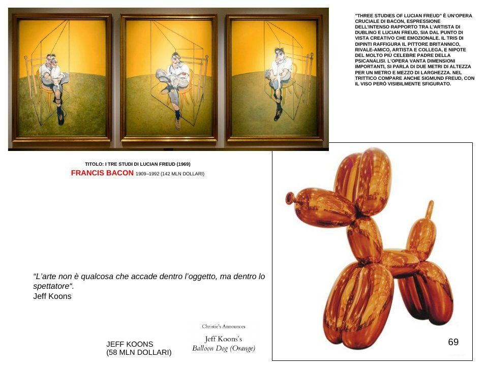{ loading=lazy style="width:59%" }

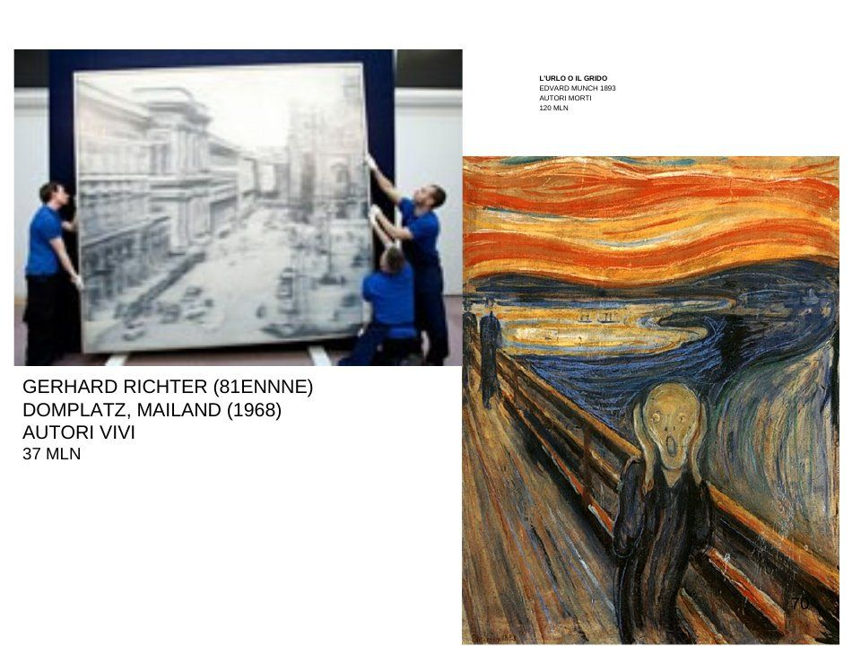{ loading=lazy style="width:59%" }

**ALCUNI ESEMPI (CONTRADDITTORI?)**

Le vendite record di opere (Christie’s, New York): Francis Bacon (142 milioni di dollari; precedente record per gli autori scomparsi: Munch, *L’urlo*, 120 milioni) e Jeff Koons (58 milioni di dollari; precedente record per gli autori viventi: Gerhard Richter, allora ottantunenne, *Domplatz, Mailand* – piazza del Duomo a Milano – del 1968, 37 milioni).

Francis Bacon (1909-1992), *Tre studi di Lucian Freud* (1969): è un’opera cruciale di Bacon, espressione dell’intenso rapporto tra l’artista di Dublino e Lucian Freud, sia dal punto di vista creativo che emozionale. Il trittico raffigura il pittore britannico, rivale-amico, artista e collega, nipote del molto più celebre padre della psicanalisi. L’opera vanta dimensioni importanti: si parla di due metri di altezza per un metro e mezzo di larghezza (per ciascun pannello).

Jeff Koons, *Balloon Dog (Orange)*: «L’arte non è qualcosa che accade dentro l’oggetto, ma dentro lo spettatore» (Jeff Koons).

Edvard Munch, *L’urlo* (o *Il grido*), 1893.

1:52:39

Ecco, vediamo due artisti profondamente diversi, Bacon e Koons: uno è un artista macerato e sofferente, Koons invece è l’artista *glamour*. Se si guarda l’uno e l’altro, sono due opere nettamente diverse, agli opposti; però fanno entrambe parte di un sistema finanziario che ha molto in comune. Questo ci dice che probabilmente l’artista, volente o nolente, fa parte di un percorso, di un gioco che passa anche sopra di lui.

**ALCUNI ESEMPI**

Queste vendite record di opere di Francis Bacon e Jeff Koons hanno conservato un qualcosa di civico? Occorre inoltre considerare la profonda diversità (provocatoriamente si potrebbe usare la parola «morale»?) tra i due artisti: da una parte l’artista più patinato e glamour del nostro tempo (Koons), dall’altra uno tra i pittori più drammatici del XX secolo.

Dunque, in qualche modo, Koons e Bacon rappresentano i poli opposti della sensibilità culturale ed estetica del nostro tempo: il bisogno del superfluo, della cosmesi, di una bellezza piatta e senza increspature; e il senso del tragico, del male di vivere, dell’abisso.

**FRANCIS BACON, UNO TRA I PITTORI PIÙ DRAMMATICI DEL XX SECOLO**

Allievo involontario di Edvard Munch (il cui *Urlo*, nel 2012, era stato battuto, abbiamo visto, per 120 milioni di dollari: era il record precedente). Seguendo la grande tradizione storico-artistica, Bacon usa la pittura come una sonda per investigare gli stati dell’animo, i turbamenti interiori; indaga la follia e la disperazione, e vuole rivelare la solitudine dell’uomo.

Radicato negli inospitali territori della modernità, ritrae le angosce provate dinanzi al vuoto dell’esistenza. Dalle sue opere emergono la medesima ansia e l’inquietudine che incide sui lineamenti dei volti rappresentati, tra costrizioni e deformazioni. L’uomo Lucian Freud nel trittico viene defigurato: è ridotto a «cosa vile», si fa «carnaccia», senz’anima.

1:53:30

Koons, per esempio, deve molto all’Italia, perché la sua fama esplode proprio in Italia, quando sposa Cicciolina e dà vita a quelle opere esposte alla Biennale di Venezia del 1990. Koons è un ragazzo della Pennsylvania, della provincia americana, che all’inizio è stato designato anche come erede di Warhol, ma con un percorso del tutto diverso. Questa è un’altra opera di quella serie che lo ha reso famoso e celebre, *Made in Heaven* – «heaven», paradiso – alla Biennale di Venezia del 1990. Un artista che si permette di dire: «Cicciolina per me è la Vergine eterna, che può cancellare la colpa e la vergogna della vita. In nome di questo è la grande liberatrice». Cioè si fonde il *glamour* internazionale con l’opera d’arte, che è la rappresentazione di un normale atto sessuale di una coppia, seppur famosa come erano loro agli inizi.

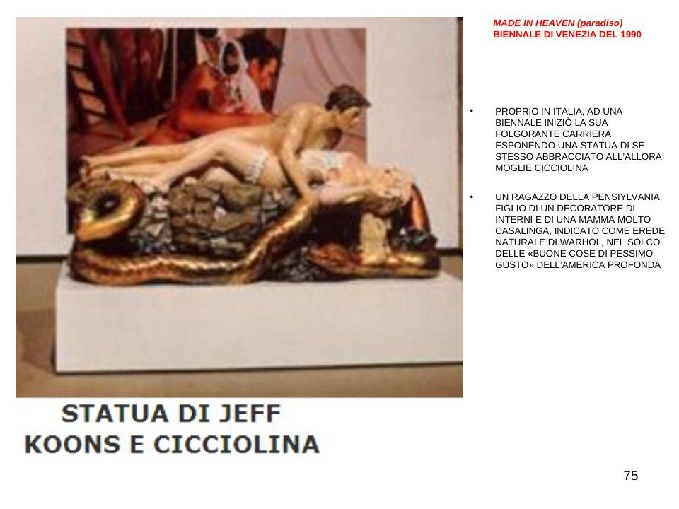{ loading=lazy style="width:47%" }

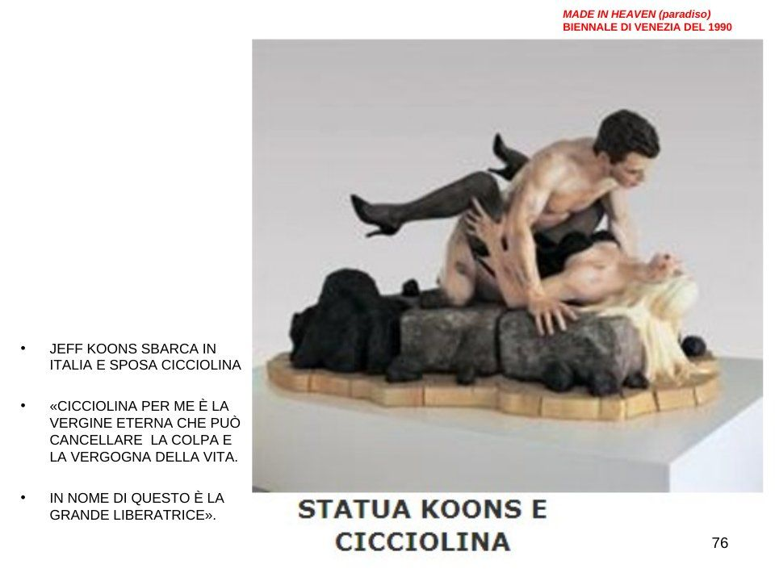{ loading=lazy style="width:47%" }

**JEFF KOONS**

Vediamo invece ora Jeff Koons, che in qualche modo deve molto all’Italia: l’Italia è sempre molto generosa con gli stranieri d’arte, e l’accoppiata Cicciolina-Koons ne è la dimostrazione…

Proprio in Italia, a una Biennale, iniziò la sua folgorante carriera, esponendo una statua di se stesso abbracciato all’allora moglie Cicciolina (*Made in Heaven*, Biennale di Venezia del 1990). Un ragazzo della Pennsylvania, figlio di un decoratore di interni e di una mamma molto casalinga, indicato come erede naturale di Warhol, nel solco delle «buone cose di pessimo gusto» dell’America profonda.

Jeff Koons sbarca in Italia e sposa Cicciolina: «Cicciolina per me è la Vergine eterna che può cancellare la colpa e la vergogna della vita. In nome di questo è la grande liberatrice».

L’artista più patinato e glamour del nostro tempo, che muove dai modelli pop, tende a elaborare una figurazione pubblicitaria, facile, immediata. In sintonia con Oldenburg, Koons ingigantisce forme e proporzioni di oggetti consueti, senza temere il *kitsch*.

Ma, a differenza degli altri allievi di Warhol, non monumentalizza i prodotti di uso quotidiano, ma esalta oggetti inutili: questa è la grande differenza. Per dar vita a sculture come *Balloon Dog*, realizzate grazie a sofisticate tecniche ingegneristiche, che, pur se pesantissime e ingombranti, appaiono leggere, quasi aeree.

1:55:02

Dicevamo prima di Warhol: Koons, rispetto a Warhol, che cosa fa? Esalta oggetti inutili, e questa è la sua innovazione; e non teme il *kitsch*, come dicono i critici: è proprio partendo dal *kitsch* che esalta questi oggetti e li trasforma in opere d’arte con questo valore.

1:55:40

In definitiva, queste opere d’arte chi le compra? Chi sono i Medici di oggi? Nell’arte civica che abbiamo intravisto prima – abbiamo visto il Buono e il Cattivo Governo del Lorenzetti, che sono a Siena –... a Firenze succede un fatto importante: quando finisce l’epoca dei Comuni, quelle opere che abbiamo visto, per esempio del tipo del Lorenzetti, di matrice fiorentina, perché quell’arte nasce a Firenze, a Firenze vengono distrutte. Come hanno fatto vedere all’inizio i talebani, i Medici distruggono tutta l’arte civica precedente: non ne resta quasi più traccia, o poca; ne restano molte tracce negli arredi, nei sigilli, nei registri, ma opere come quella del Lorenzetti a Firenze non esistono quasi più, perché il potere di turno ha fatto man bassa e ha distrutto tutte le opere precedenti, come ci diceva Lorenzo.

1:57:05

In questo momento, invece, i Medici di oggi chi sono? Quest’opera di Bacon che abbiamo visto probabilmente sarà esposta in un casinò di Las Vegas, quindi in un luogo del tutto diverso da quello che ci aspettiamo tradizionalmente; mentre magari l’altra collezione andrà al Metropolitan di New York. Quindi c’è un po’ di tutto da questo punto di vista; però le opere d’arte non hanno più la finalità di essere esposte tradizionalmente nei musei: possono finire nelle case private, come in un casinò, e tutto è livellato. Se questo sia un bene o un male, io non so darmi una risposta; forse Lorenzo... Ti lascio sempre con questa domanda, domande finali.

**IL VALORE E I COMPRATORI**

Ma chi compra oggi queste opere? I «Medici» di oggi sono divisi tra chi compra per sé e chi espone in posti inconsueti. Il trittico di Bacon probabilmente sarà esposto in un casinò di Las Vegas (di proprietà di Steve Wynn), dove si aggiungerà ai Manet, Van Gogh, Matisse, Picasso ecc. Di contro, Leonard Lauder dona al Metropolitan di New York la sua collezione cubista da un miliardo di dollari.

Massimiliano Gioni, curatore della Biennale di Venezia, dice: «Al di là delle quotazioni stratosferiche, queste opere hanno trasformato in modo radicale la storia dell’arte»; «entrambe le opere rappresentano fratture stilistiche importanti, drammatici cambi di paradigma nella storia dell’arte»; «l’opera di Koons in particolare, come per Warhol, apre una riflessione proprio sul capitalismo, sullo spettacolo della merce e sui feticci».

**IL TEMA *FILOSOFICO* DELL’ARTE**

In chiusura, alcune voci in contrappunto, forse critico, con quello che abbiamo visto finora sui prezzi delle quotazioni e sul loro valore, che ci riportano al punto iniziale di un’arte civica e positiva. Citiamone due ad esempio: Ai Weiwei (artista cinese) ed Eugenio Scalfari (fondatore di «la Repubblica»).

1:57:57

Lorenzo Poggi Riprendiamo un attimo il nostro discorso. Abbiamo visto che le immagini costituiscono un elemento fondante. Ma l’artista che fa delle immagini, che fa un’opera, fa qualcosa che ha valore simbolico ma che è anche un oggetto, e come oggetto è sottoposto al mercato. Quindi i due aspetti stanno insieme e spesso si fondono. Cominciamo a fare una considerazione: il nostro è un tempo estremamente affamato di immagini. Mai come in altri tempi si è vista una crescita esponenziale della quantità di immagini che ciascuno ha a disposizione. I collegamenti internet, la possibilità dei media di arrivare a tutti, mettono a disposizione quantità enormi, inusitate, di immagini, quali mai si sarebbero potute vedere. E questo è un fatto fondamentale, che va tenuto presente per giudicare qualcosa del valore delle immagini e del perché di tanti mutamenti: l’enorme disponibilità di immagini.

1:59:39

Poi c’è un altro fatto che dobbiamo tenere presente. Le immagini, proprio perché sono estremamente numerose, servono: servono al mercato. Il primo inserimento, il primo utilizzo delle immagini, proprio perché hanno quella capacità di cui abbiamo detto...

2:00:00

...il potere di sollecitare l’immaginazione e la fantasia, di avere qualcosa in più rispetto alla parola, rispetto al dire: il mostrare ha questa capacità. E quindi le immagini costruiscono una parte della realtà di cui ognuno degli spettatori si sente parte, da cui si sente coinvolto. E quindi il mercato ne approfitta e utilizza l’immagine in modo massiccio, esorbitante, per aumentare il desiderio degli oggetti. Il nostro è quindi il tempo in cui l’estetica non riguarda soltanto l’opera d’arte, la ricerca del bello, dell’apprezzabile, di un’immagine accattivante: riguarda prima di tutto il mercato, gli oggetti comuni di ogni giorno che ci vengono sottoposti. Non c’è scatola di zucchero, di cartone banale, che non sia frutto di una ricerca estetica, e nemmeno la bottiglia di un detersivo. Non parliamo di opere d’arte: parliamo di immagini, di oggetti che hanno alle spalle una ricerca estetica, e che quindi implicano una mutevolezza, una grande quantità nell’apprezzamento delle immagini.

2:02:03

Ormai l’immagine è talmente inflazionata che l’arte non può più avere lo stesso atteggiamento nei confronti dell’immagine. In tutte le epoche che abbiamo visto – Paolo ci ha fatto vedere una serie di cose – quando parlavamo della rappresentazione della Vergine, del volto di Cristo, di immagini acheropite, non dipinte da nessuno ma venute direttamente da Dio; quando parlavamo della giustizia, di immagini che rappresentavano una parte del mondo della realtà, parlavamo di epoche simboliche. Che cosa significa epoca simbolica? Significa che in quel tempo, in quell’epoca, l’immagine è interpretata come immagine, sì, ma si sa a che cosa, a quale realtà l’immagine allude, a che cosa, all’altro, l’immagine si riferisce. L’immagine della Vergine Maria si riferisce a, è simbolo della Vergine Maria: si sa che quella non è la Vergine Maria, ma la si adora, la si venera perché in qualche modo è legata a una relazione con lei. È il simbolo: il mettere insieme, il legare, l’avere una relazione.

2:04:02

Perché ci sia un’epoca simbolica ci vuole una cultura profonda condivisa. Queste sono epoche in cui c’è una differenza di grana culturale – grana più grossa per quanto riguarda il popolo, più raffinata per quanto riguarda gli intellettuali, le classi dirigenti – ma c’è una cultura condivisa, comune. Per cui l’arte simbolica, in questa età simbolica, ha una comprensione: è qualcosa che si condivide.

2:04:42

Il dito lo possiamo interpretare perché più o meno sappiamo qual è il saluto fascista, e perché questo gesto è quello che in tutti gli Stati Uniti d’America sostituisce l’altro gesto, che noi facciamo più grande. Siccome loro sono andati prima in automobile, hanno inventato questo: perché, se qualcuno ti taglia la strada e sei in macchina, come fai? È difficile aprire il finestrino per fare l’altro: così è più facile. Vedete come i mezzi di trasporto implicano un mutamento nella dimensione simbolica. Il gesto della mano ha da sempre avuto una funzione simbolica – alcuni si sono perduti: è una relazione con il mondo, ma una relazione efficace. Perché? Perché c’è una cultura condivisa, nell’epoca simbolica.

2:05:58

Qual è il gesto più infamante che si fa nel Medioevo? Noi abbiamo questo dell’ombrello – vabbè, lo conosciamo. Ma oggi non si fa più quello delle fiche, «fare le fiche». Pensate a Dante, quando parla di Vanni Fucci, il ladro, no? «Al fine de le sue parole il ladro / le mani alzò con amendue le fiche, / gridando: «Togli, Dio, ch’a te le squadro!». / Da indi in qua mi fuor le serpi amiche». Vanni Fucci, il ladro bestemmiatore, ha il culmine della bestemmia, l’imprecazione più grave, nel fare questo gesto a Dio. Un gesto offensivo, simbolico: ci vuole una cultura simbolica. La mano quindi non è solo relazione fattiva con il mondo, è relazione simbolica; quindi l’immagine mantiene questo.

2:07:40

Oggi, nel nostro tempo, questa relazione simbolica è quasi scomparsa, quasi del tutto. L’immagine non si riferisce più a una realtà, a un oggetto: l’immagine porta su un’altra immagine. Nell’età simbolica l’immagine, che è il significante porta su qualcosa che sta sotto, che è il significato. Nel nostro tempo il significato è andato perduto, è andato diluendosi: l’immagine significa perché porta su un’altra immagine, la quale porta su altre immagini ancora; e il complesso globale, enorme, delle immagini costituisce quella che è la realtà.

2:09:00

La guerra la conosciamo attraverso le immagini della guerra trasmesse dai vari mezzi. Che cosa siano i popoli arabi, che cosa sia la primavera araba, l’abbiamo saputo da queste cose; e questo crea la nostra esperienza: una serie di significanti, un po’ di parole, un po’ di professori, un insieme di significanti che porta su altri significanti. Un consumo eccessivo delle immagini, perché le immagini sottoposte al mercato sono sottoposte a un consumo eccessivo: le immagini si cambiano, si mutano, si trasformano, vengono contaminate.

2:10:00

Si trasformano in modo rapidissimo; e questo fa sì che anche l’arte non abbia più quel carattere di visione condivisa, universale, del mondo. Oggi infatti è difficilissimo fare un monumento. Il monumento ricordava qualcosa di condiviso, qualche valore a cui una comunità rispondeva, in cui si riconosceva; è difficilissimo oggi trovare qualche valore condiviso e riconosciuto. Quindi c’è questa carenza di simbolico.

2:10:55

Quindi – brevissimo, se no vi annoio – a una società simbolica si è sostituita una società come? Visiva, visuale, immaginaria. Al simbolico si è sostituito l’immaginario, e l’immaginario porta con sé una consapevolezza – ed è la prima volta nella storia che la si ha: la consapevolezza che ciò che noi costruiamo, ciò che chiamiamo realtà o riferimento alla realtà, è invece una costruzione simbolica, è un sogno. È la consapevolezza di sognare, sapendo di sognare. Sognavano anche quelli che rappresentavano la Madonna o il Volto Santo, no? Però erano convinti di non sognare, di rappresentare una realtà. Oggi invece la consapevolezza è questa: la nostra è la prima epoca che sogna consapevolmente, consapevole di sognare.

2:12:14

E su questo è chiaro che l’arte, nel nostro tempo, ha scelto tre atteggiamenti fondamentali di fronte a questa condizione, allo strapotere del mercato, al prevalere dell’estetica legata alla commercializzazione. Quali sono questi tre atteggiamenti possibili nell’età dell’immaginario, dopo la fine del tempo simbolico? Ci diamo un tono alla cosa. Essenzialmente tre.

2:13:04

Il primo è l’acquiescenza. L’artista si inserisce in questo, guarda quali sono gli elementi residui di simbolismo ancora apprezzabili, rimasti; per cui si fa il dito così, no? Si dirà: «Ma non si capisce ancora troppo». Sì, però è rimasto questo simbolismo. Venne coniato quando, dopo la sconfitta di Azincourt, i francesi costrinsero gli inglesi a reimbarcarsi sulle navi – dopo la guerra dei Cent’anni – e a tornare in patria. E siccome i francesi erano stati sconfitti dagli arcieri inglesi, che avevano l’arco grande, pesante, in grado di lanciare frecce che passavano le corazze – la cavalleria pesante francese era stata sconfitta da questi qui, che erano venuti senza cavalli, perché con le navi si trasportavano male – allora agli arcieri che venivano presi mozzavano le dita con cui si tende l’arco, così che non scagliassero più frecce. Quando, sconfitti, si reimbarcano, gli inglesi fanno il gesto: «Vi abbiamo mozzato il dito?»; ed è rimasto poi nella tradizione anglosassone ed è finito in America, come il gesto che abbiamo visto.

2:14:55

Che c’entra questo? La gente che guarda quell’opera si ricorda di questo e poi lo riferisce? No; ma qualcosa di questo simbolismo è rimasto, l’artista ne approfitta e con questa consapevolezza fa un’opera che in qualche modo riesce a colpire o a far discutere, e si inserisce nel mercato: acquiescenza al mercato, arrivando a questo tipo di compromesso. Quindi il primo atteggiamento è l’acquiescenza al mercato.

2:15:38

Il secondo atteggiamento è quello dell’artista che dice: «Non verrò mai a compromessi con questo. L’arte ha il compito di dare una scossa estetica al mondo; la mia libertà non la metto in gioco: sdegnoso mi astengo, mi isolo, non entro nel mercato».

2:16:18

Terzo atteggiamento: se è possibile, entriamo parzialmente nel mercato, ma ne usciamo anche; approfittiamo delle occasioni che il mercato, che la visualizzazione dell’immagine a livello globale, offre all’arte, e facciamo un’arte che sia a contatto con tutti; costruiamo giochi o costruiamo opere – pensate a un artista come Ai Weiwei, per esempio – opere di questo genere, che arrivano a tutti, che con questo incidono: è uno stare dentro, ma in qualche modo anche giocare e tenersi fuori.

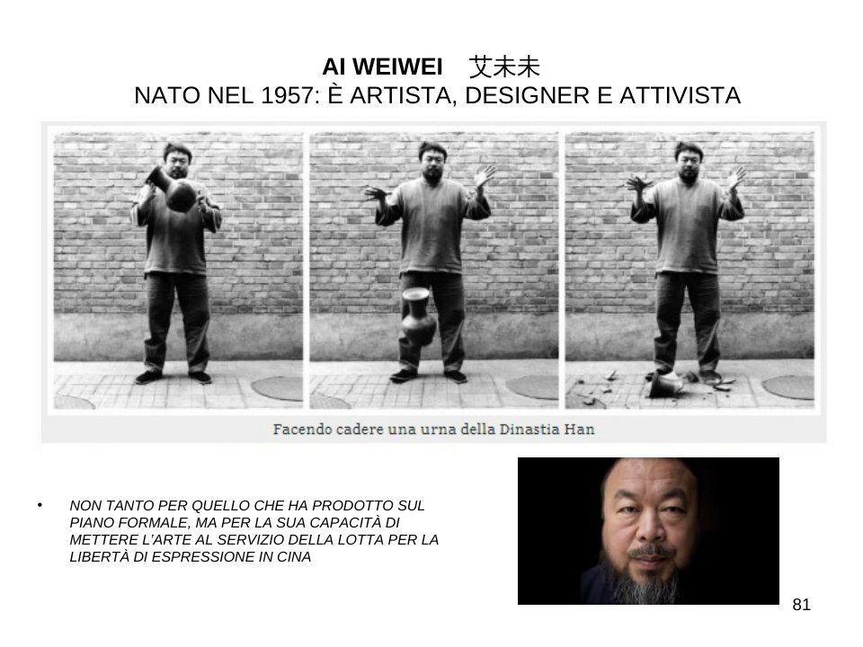{ loading=lazy style="width:47%" }

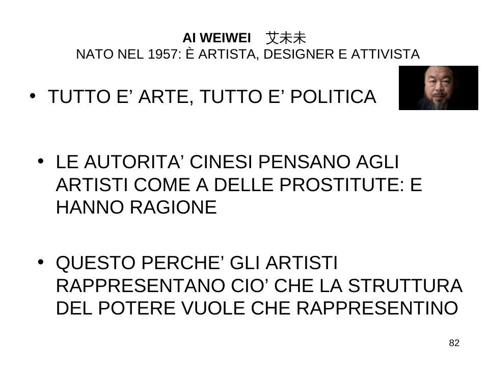{ loading=lazy style="width:47%" }

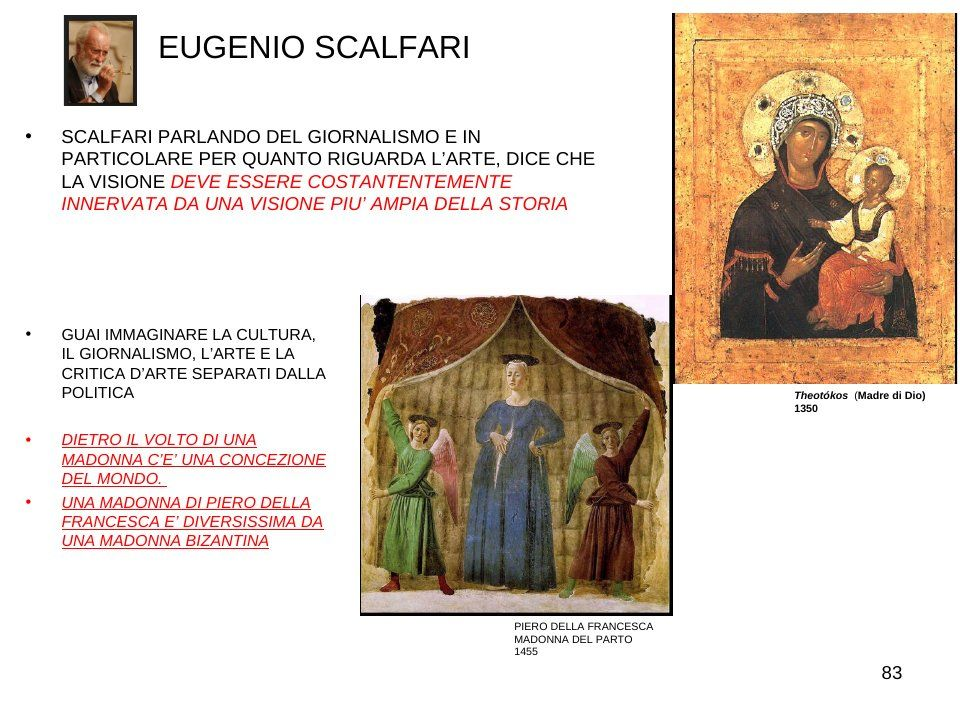{ loading=lazy style="width:59%" }

**AI WEIWEI (艾未未), NATO NEL 1957: È ARTISTA, DESIGNER E ATTIVISTA**

Non tanto per quello che ha prodotto sul piano formale, ma per la sua capacità di mettere l’arte al servizio della lotta per la libertà di espressione in Cina (nell’immagine: *Facendo cadere un’urna della dinastia Han*).

«Tutto è arte, tutto è politica. Le autorità cinesi pensano agli artisti come a delle prostitute: e hanno ragione. Questo perché gli artisti rappresentano ciò che la struttura del potere vuole che rappresentino.»

**EUGENIO SCALFARI**

Scalfari, parlando del giornalismo e in particolare per quanto riguarda l’arte, dice che la visione deve essere costantemente innervata da una visione più ampia della storia: «Guai a immaginare la cultura, il giornalismo, l’arte e la critica d’arte separati dalla politica. Dietro il volto di una Madonna c’è una concezione del mondo. Una Madonna di Piero della Francesca è diversissima da una Madonna bizantina».

Nelle immagini: *Theotókos* (madre di Dio), 1350; Piero della Francesca, *Madonna del Parto*, 1455 circa.
{: .didascalia }

2:17:20

Tre atteggiamenti possibili di fronte a un mondo, questo nostro contemporaneo, in cui tutto muta, e muta molto rapidamente. Questi artisti che Paolo ci faceva vedere costano milioni di dollari adesso, ma può darsi che tra cinque o sei anni non se ne parli più, che non abbiano più queste quotazioni. C’è anche un mutamento profondo di quello che è il mercato. Il nostro è un tempo di mutamento rapido, legato proprio al fatto che un’età delle immagini, dell’immaginazione, è anche un’età estremamente mutevole; per questo riesce molto difficilmente a inventarsi il futuro, perché il futuro ha bisogno di progetti a lungo raggio. Basta, basta, se no diventa difficile. L’argomento delle immagini, vedete, mi sembra abbastanza interessante. Grazie; e io per primo colgo l’occasione per farvi gli auguri di buone feste: mi fa veramente piacere, dopo un po’ di tempo, parlare di questi argomenti. Paolo è bravo, ha tutte le immagini; io spero di non avervi annoiato troppo con tutto questo discorso.

2:18:55

Paolo Marcucci Bene, grazie anche da parte mia, buon Natale a tutti. Facciamo un applauso agli amici del Caffè Centofiori. Arrivederci alla prossima volta, se volete. Buonanotte a tutti.

## Appendice

Le slide proiettate durante l’incontro.

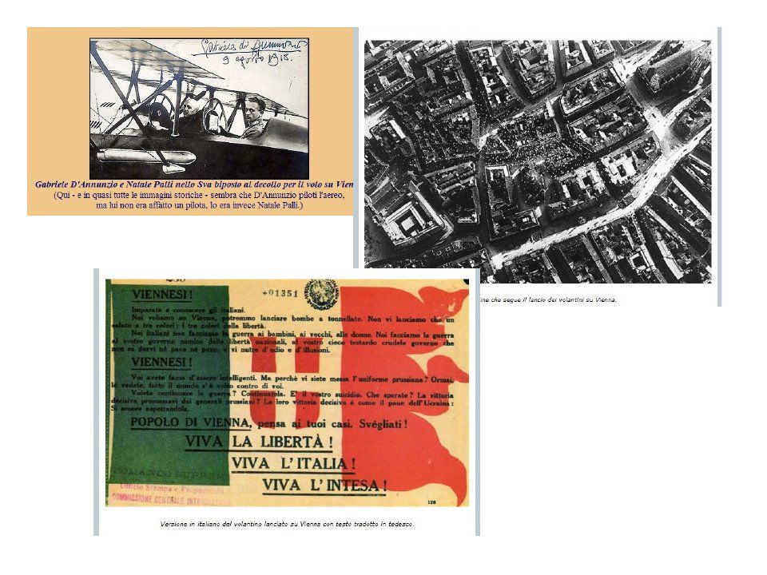{ loading=lazy style="width:47%" }

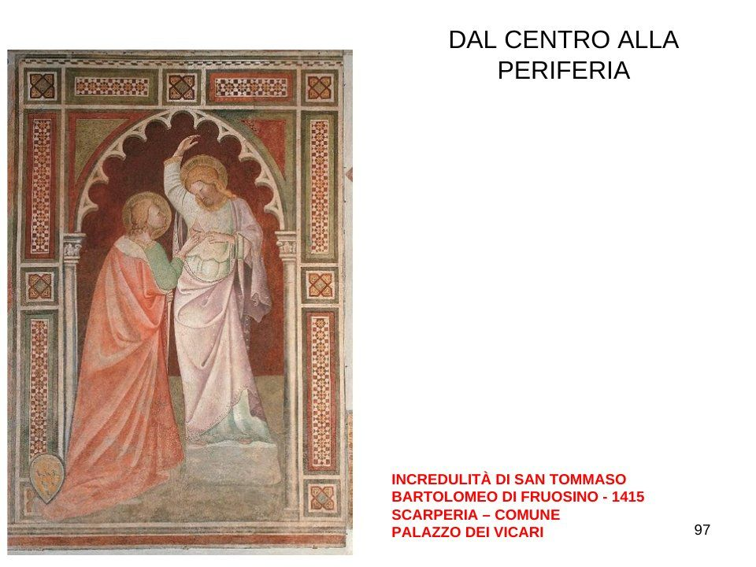{ loading=lazy style="width:47%" }

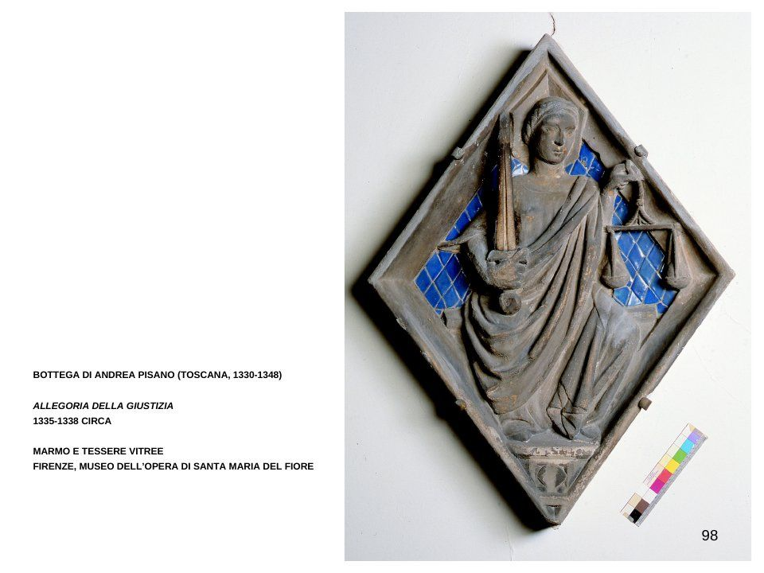{ loading=lazy style="width:47%" }

{ loading=lazy style="width:47%" }

{ loading=lazy style="width:47%" }

{ loading=lazy style="width:47%" }

{ loading=lazy style="width:47%" }

{ loading=lazy style="width:47%" }

{ loading=lazy style="width:47%" }

{ loading=lazy style="width:47%" }

{ loading=lazy style="width:47%" }

{ loading=lazy style="width:47%" }

{ loading=lazy style="width:47%" }

{ loading=lazy style="width:47%" }

{ loading=lazy style="width:47%" }

{ loading=lazy style="width:47%" }

{ loading=lazy style="width:47%" }

{ loading=lazy style="width:47%" }

{ loading=lazy style="width:47%" }

{ loading=lazy style="width:47%" }

{ loading=lazy style="width:47%" }

{ loading=lazy style="width:47%" }

{ loading=lazy style="width:47%" }

{ loading=lazy style="width:47%" }

{ loading=lazy style="width:47%" }

{ loading=lazy style="width:47%" }

{ loading=lazy style="width:47%" }

{ loading=lazy style="width:47%" }

{ loading=lazy style="width:47%" }

{ loading=lazy style="width:47%" }

{ loading=lazy style="width:47%" }

{ loading=lazy style="width:47%" }

{ loading=lazy style="width:47%" }

{ loading=lazy style="width:47%" }

{ loading=lazy style="width:47%" }

{ loading=lazy style="width:47%" }

{ loading=lazy style="width:47%" }

{ loading=lazy style="width:47%" }

{ loading=lazy style="width:47%" }

{ loading=lazy style="width:47%" }

{ loading=lazy style="width:47%" }

{ loading=lazy style="width:47%" }

{ loading=lazy style="width:47%" }

{ loading=lazy style="width:47%" }

{ loading=lazy style="width:47%" }

{ loading=lazy style="width:47%" }

{ loading=lazy style="width:47%" }

{ loading=lazy style="width:47%" }

{ loading=lazy style="width:47%" }

{ loading=lazy style="width:47%" }

{ loading=lazy style="width:47%" }

{ loading=lazy style="width:47%" }

{ loading=lazy style="width:47%" }

{ loading=lazy style="width:47%" }

{ loading=lazy style="width:47%" }

{ loading=lazy style="width:47%" }

{ loading=lazy style="width:47%" }

{ loading=lazy style="width:47%" }

{ loading=lazy style="width:47%" }

{ loading=lazy style="width:47%" }

{ loading=lazy style="width:47%" }

{ loading=lazy style="width:47%" }

{ loading=lazy style="width:47%" }

{ loading=lazy style="width:47%" }

{ loading=lazy style="width:59%" }
