# Buoni e cattivi

Quando i capitali non sono più vizi e i vizi non sono più quelli di una volta

**Data:** 29 gennaio 2015 
**Luogo:** MMAB, Montelupo Fiorentino 
**Incontro con:** Lorenzo Poggi e Paolo Marcucci 
**Ospite:** Daniele Corsini, amministratore delegato di Cabel Holding

**Interventi:** Paolo Marcucci Lorenzo Poggi Daniele Corsini

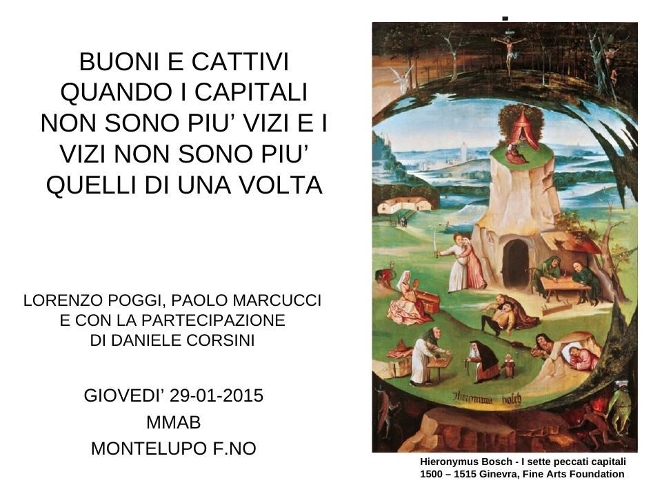{ loading=lazy style="width:49%" }

0:03:37

Paolo Marcucci Allora, buonasera a tutti, grazie di essere venuti e ritornati. Stasera il tema è *Buoni e cattivi. Quando i capitali non sono più vizi e i vizi non sono più quelli di una volta*. I temi principali saranno quindi i buoni e i cattivi, i vizi e le virtù – perché i vizi sono sempre legati alle virtù – e il capitale. Stasera, come vedete, oltre a me e al nostro maestro Lorenzo, abbiamo un ospite: Daniele Corsini, amministratore delegato – non uso la parola CEO, come nella slide – di Cabel Holding. Gli abbiamo dato un tema, il vizio del capitale e i vizi del capitale, che poi illustrerà sicuramente come meglio crede.

**VIZI E VIRTÙ**

Vizi e virtù sono categorie essenziali nelle rappresentazioni cristiane. Definiscono uno sguardo completo sulla realtà terrena e si inscrivono necessariamente all’interno di una prospettiva escatologica, dal momento che l’uomo è giudicato da Dio in funzione dei suoi peccati e delle sue virtù, ricevendo la ricompensa del paradiso o il castigo dell’inferno. (T*reccani*)

Stasera parleremo di questi argomenti (buoni e cattivi, vizi e virtù, capitale e capitali), cercando di affrontarli da prospettive diverse.

0:04:39

Prima di iniziare, due comunicazioni di servizio. La prima è che venerdì 30 gennaio ci sarà qui a Montelupo un’iniziativa per presentare la vita di Bartolomeo Sinibaldi, detto Baccio da Montelupo: interessante, per chi vuole partecipare, venerdì pomeriggio alle 18. La seconda comunicazione è questa: sapete che ogni anno andiamo con *Pensieri a tavola* a fare una o più visite in qualche posto; quest’anno andiamo al Museo del Novecento a Firenze. Abbiamo individuato la data di sabato 14 marzo 2015, alle 15,30 (orario indicativo), per cui, se qualcuno è intenzionato a venire, magari ci lasci l’iscrizione qui alla reception, ai soliti riferimenti della cena, o ce lo faccia sapere, così ci prepariamo a fissare i posti al museo.

0:05:47

Allora cominciamo con il tema di questa serata. Io farò un’introduzione, cercando di introdurre i temi di stasera, e poi lascerò la parola a Corsini e a Poggi per gli opportuni approfondimenti. Tre le parole chiave: «capitale», che deriva appunto da «testa», cioè ciò che è importante nel corpo, ciò che è principale; «vizio», qualcosa da evitare, da schivare, perché è malevolo; e poi «virtù», che invece significa virilità, forza del corpo eccetera.

0:06:40

Vizi e virtù sono spesso legati. Ci fu un famoso film, negli anni Settanta (1976, dell’ungherese Miklós Jancsó), *Vizi privati, pubbliche virtù*; ma da che cosa prendeva spunto? In realtà dalla *Favola delle api, ovvero vizi privati, pubbliche virtù*, un poemetto satirico dell’inglese Bernard de Mandeville, del 1705, dove si criticava la società industriale nascente del tempo: la si criticava sostanzialmente perché nascondeva i vizi, mentre in realtà, sotto sotto, li esaltava, perché i vizi erano il vero motore della società industriale che nasceva. Da qui il titolo *Vizi privati, pubbliche virtù*. Se trasportiamo questa frase a oggi, a me per esempio viene spesso in mente che si può tradurre con quello che è successo ultimamente: privatizzare gli utili e socializzare le perdite. E qui entriamo subito nell’ambito del capitale, dei vizi del capitale; e questo ci fa vedere due cose: il vizio del capitale e il legame tra vizio e virtù.

**VIZI PRIVATI, PUBBLICHE VIRTÙ (FILM, 1976)**

*Vizi privati, pubbliche virtù è* un film del 1976 dell’ungherese Miklós Jancsó, ambientato in una corte imperiale europea dell’Ottocento.

L’amore impossibile narrato nel film è l’ennesima versione dei fatti di Mayerling, cioè della relazione tra Rodolfo d’Asburgo-Lorena e la sua amante, la baronessa Maria Vetsera, conclusa con il doppio suicidio dei protagonisti; secondo alcune fonti (mai confermate) si sarebbe invece trattato di un duplice omicidio, architettato da funzionari della corte dell’imperatore Francesco Giuseppe, padre di Rodolfo, che ne temevano le simpatie filo-ungheresi.

Il film fu presentato al Festival di Cannes del 1976 per l’Italia: non ottenne alcun premio, ma suscitò numerose polemiche. In Italia fu sequestrato due volte; il regista e la sceneggiatrice Giovanna Gagliardo furono condannati in primo grado per oscenità e poi assolti nei gradi successivi di giudizio. Tra le ragioni della censura, alcune scene esplicite interpretate da Laura Betti, il ruolo d’ermafrodita di Thérèse-Ann Savoy e il clima d’orgia che attraversa tutto il film.

**LA FAVOLA DELLE API**

*La favola delle api, ovvero vizi privati, pubbliche virtù* è un poemetto satirico dell’inglese Bernard de Mandeville, del 1705.

L’opera è una rappresentazione critica del tipo di società (basata sullo sviluppo industriale) che si sta creando in Europa, che si presenta come virtuosa nascondendo i suoi vizi: vizi che, paradossalmente, sostiene Mandeville, sono necessari per il benessere collettivo della società.

Basta solo questo accenno a farci capire quanto sia difficile il confine tra vizio e virtù, tra capitale buono e capitale cattivo.

**PRIVATIZZARE GLI UTILI, SOCIALIZZARE LE PERDITE**

«Vizi privati, pubbliche virtù» ci fa pensare alla famosa frase (ripetuta sempre, ma in particolare negli ultimi anni) «Privatizzare gli utili e socializzare le perdite», che è un po’ la stessa cosa.

Quando le cose vanno bene si esalta l’impresa privata e si demonizza lo Stato; quando le cose vanno male si chiama in causa lo Stato perché salvi e rimetta in sesto il capitale.

Ecco, forse questo è un vizio del capitale che il nostro ospite ci potrebbe aiutare a capire.

Il capitale e il suo guadagno (l’usura) non sono più un vizio, ma oggetto, merce di mercato.

0:08:10

Ma quali sono stati storicamente i vizi e le virtù? Su questi temi si sono spesi teologi, filosofi, artisti, e quindi proviamo a fare una carrellata delle interpretazioni che ne sono state date. Innanzitutto i vizi capitali sono desideri non ordinati verso il bene, cioè verso Dio. La tradizione cristiana, da cui tutti proveniamo, ha ripreso gli antichi insegnamenti dei filosofi e li ha tradotti nel modo che conosciamo. Sostanzialmente i vizi capitali non sono i più gravi dei peccati, perché molti vizi capitali sono veniali, però sono all’origine di tutti i peccati successivi. In Occidente è prevalsa la sistemazione settenaria rispetto a quella ottenaria, perché in origine qualcuno sosteneva che i vizi capitali fossero otto invece di sette; e in Occidente ha prevalso questa numerazione settenaria, che viene fatta risalire a San Gregorio Magno. Comunque sia in Occidente sia in Oriente è la superbia a essere individuata come il primo dei vizi capitali, da cui poi dipendono tutti gli altri.

**I VIZI CAPITALI**

*Fonte indicata nella slide: it.cathopedia.org*
{: .didascalia }

I vizi capitali sono desideri non ordinati verso il bene sommo, cioè verso Dio. La tradizione cristiana, che li ha codificati sulla base della sapienza dei filosofi dell’antichità, insegna che sono all’origine di tutti i peccati.

La denominazione di vizi capitali risponde al fatto che essi vengono considerati come abitudine o propensione; quando invece vengono considerati come atti, si parla di peccati capitali. Prima del vizio vi è l’atto peccaminoso: è la ripetizione a creare l’abitudine, e quindi il vizio.

**L’AGGETTIVO «CAPITALI»**

Questi vizi sono detti capitali non perché siano i più gravi dei peccati (alcuni di essi non superano la colpa veniale), ma perché sono origine e guida di molti peccati. L’uso dell’aggettivo «capitali» riprende metaforicamente l’accezione del termine «capo» come colui che presiede e che guida.

La causalità di cui si parla non è però né fisica né morale, ma solo impulsiva e occasionale, a motivo particolarmente, a detta di san Tommaso, del fine: colui che è dominato da qualche vizio capitale è capace di commettere qualunque peccato o delitto pur di soddisfare la sua viziosa passione.

**LE RADICI BIBLICHE E I PRIMI SECOLI**

La Bibbia nomina molte volte i vari vizi, singolarmente o in gruppo, ma sono enunciazioni che precedono ogni sistemazione settenaria o ottenaria.

Un qualche fondamento per la classificazione che diventerà classica può essere stato fornito dai testi Sir 10,13; 1Tm 6,9-10; 1Gv 2,16. E difatti i primi scrittori che tentano la classificazione pongono la superbia come prima fonte universale, sulla base del primo di tali testi, che nella Volgata suona: «*initium omnis peccati est superbia*», «la superbia è l’inizio di tutti i peccati». Dietro la superbia enumerano gli altri sette vizi: la vanagloria, l’avarizia, la lussuria, l’invidia, la gola, l’ira e l’accidia, arrivando al numero otto, che prevale in Oriente.

**IL NUMERO SETTENARIO (OCCIDENTE)**

In Occidente viene seguito San Gregorio Magno, ed è quindi comunemente accettato il numero settenario, sia pure con qualche dissenso. Neanche in Oriente, del resto, erano mancati autori che si attenevano per una ragione o per l’altra al numero sette. In Occidente pertanto i vizi/peccati capitali sono i sette seguenti:

1\. Superbia: il desiderio disordinato di essere superiori agli altri, fino al disprezzo degli ordini e delle leggi.

2\. Avarizia: il desiderio disordinato dei beni temporali.

3\. Lussuria: la dedizione al piacere e al sesso.

4\. Invidia: la tristezza per il bene altrui, percepito come male proprio.

5\. Gola: l’abbandono e l’esagerazione nei piaceri della tavola.

6\. Ira: il desiderio disordinato di vendicare un torto subito.

7\. Accidia: il lasciarsi andare al torpore dell’animo, fino a provare fastidio per le cose spirituali, e in particolare l’abbandono della preghiera e dell’amicizia verso Dio, perché faticosa.

**GLI OTTO VIZI CAPITALI DELL’ORIENTE (CONTRO I SETTE DELL’OCCIDENTE)**

Alcuni autori orientali sostengono con forza l’esistenza di un vizio comune, radice degli altri: la φιλαυτία, *philautía* («amor proprio»).

1\. γαστριμαργία, *gastrimarghía* («gola»)

2\. πορνεία, *porneía* («lussuria»)

3\. φιλαργυρία, *philargyría* («avarizia»)

4\. λύπη, *lýpe* («tristezza»)

5\. ὀργή, *orghé* («ira»)

6\. ἀκηδία, *akedía* («pigrizia», «accidia»)

7\. κενοδοξία, *kenodoxía* («vanagloria»)

8\. ὑπερηφανία, *hyperephanía* («superbia»)

Rispetto all’elenco occidentale si notano subito varie differenze:

– i peccati o vizi sono disposti in ordine diverso;

– sono presenti la vanagloria e la tristezza, assenti nella tradizione occidentale;

– la superbia e la vanagloria appaiono come uno sdoppiamento rispetto all’elenco occidentale;

– non è inclusa l’invidia, anche se essa è certamente compresa, secondo i diversi autori, a volte nell’ὀργή (ira), altre nell’ἀκηδία (accidia).

0:09:51

Allora descriviamo un attimo quelli che sono arrivati fino a noi, che conosciamo tutti: la superbia, l’avarizia, la lussuria, l’invidia, la gola, l’ira e l’accidia. Questi sono i vizi capitali. Se vediamo invece l’Oriente, i vizi diventano otto: alcuni sono simili, altri invece cambiano, perché abbiamo al primo posto la gola, poi la lussuria, l’avarizia, la tristezza, l’ira, l’accidia, la vanagloria e la superbia. Sono leggermente diversi, anche se sicuramente hanno radici comuni tra questi due sistemi, occidentale e orientale.

0:10:35

I filosofi hanno cercato di sistemare i vizi anche dal punto di vista del pensiero. Per esempio San Tommaso divide i beni desiderati dai beni che l’uomo fugge: per esempio, un bene è la propria eccellenza della persona, che dà luogo alla vanagloria; oppure l’attenzione per il proprio corpo, per il cibo e le bevande, dà luogo al vizio della gola, e così via. Questi sono i beni desiderati; un bene che l’uomo rifugge è per esempio il proprio bene spirituale, che trascura, e quindi si trasforma in accidia, e così via. Studi recenti – per esempio quelli della neuropsicologa olandese Margriet Sitskoorn, autrice del saggio *Le passioni del cervello* – hanno visto – forse con un po’ di forzatura – che i sette vizi capitali sono un po’ legati a certe parti anatomiche del cervello: per esempio l’avarizia alle aree cerebrali anteriori, oppure l’ira all’amigdala, e così via. Anche questo è un tema interessante da approfondire.

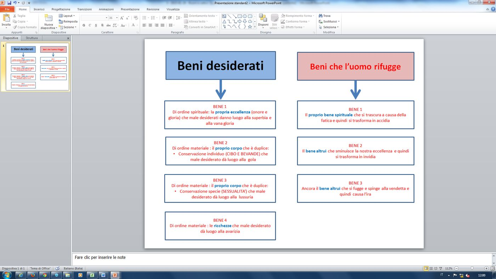{ loading=lazy style="width:77%" }

**IL CERVELLO REGOLA I PECCATI CAPITALI**

Giovanni Papini scriveva che «si può entrare nel regno di Dio anche dal nero portale del peccato».

Ma i peccati capitali oggi? Si presentano laicamente ogni giorno nella società contemporanea; ma, laicamente e scientificamente, poco si sa dei processi che legano i «peccati» alla struttura organica del cervello.

Ma c’è questo legame? Una risposta è stata data da Margriet Sitskoorn, docente di neuropsicologia a Tilburg (Olanda), che nel saggio *Le passioni del cervello* ha mappato le varie aree cerebrali: i «peccati» sarebbero quindi innati, e mediati dalla cultura sociale con cui ci confrontiamo ogni giorno.

Avarizia: aree cerebrali anteriori – la tendenza ad accumulare è un’antica proprietà evolutiva che stimola la gratificazione.

Invidia: corteccia cingolata anteriore dorsale – che si attiva sempre di più al crescere dell’invidia.

Superbia: cooperazione di diverse aree cerebrali – l’immagine superba di sé può arrivare fino alla cosiddetta «sindrome di *hybris*», che comprende atti di incredibile arroganza (più comune tra chi detiene il potere).

Accidia: legame tra la corteccia prefrontale e lo striato.

Ira: amigdala.

Lussuria: aree cerebrali di neurotrasmissione.

Gola: ipotalamo ed equilibrio tra la fame edonistica (che regola il desiderio di mangiare) e il controllo cognitivo (che frena l’appetito irragionevole).

0:12:02

Come dicevo, i vizi si legano spesso alle virtù, e quindi si contrappongono sempre alle virtù, che invece esaltano il comportamento dell’uomo. Vizi e virtù, le buone azioni, i buoni e i cattivi: nella tradizione cristiana le buone azioni ci potranno poi salvare dall’inferno. Però è difficile salvarsi dai vizi, per esempio anche per i santi: c’è una storia bellissima, che ha raccontato Franco Cardini, di san Francesco che, sul letto di morte, volle mangiare il suo dolce preferito, di mandorle e miele, e se lo fece preparare dall’amica romana che lo assisteva, Jacopa de’ Settesoli.

**VIZI CAPITALI E VIRTÙ**

I vizi capitali sono un elenco di inclinazioni, morali e comportamentali, dell’anima umana profonda, chiamati anche peccati capitali; anche se chiamarli «peccati», nella morale filosofica e cristiana, non sarebbe del tutto corretto, perché i vizi sarebbero già causa del peccato, che ne è invece il relativo effetto.

«Capitali» poiché più gravi, principali, e riguardano il profondo della natura dell’uomo.

I vizi (dal latino *vĭtĭum* = mancanza, difetto, ma anche abitudine deviata, storta, fuori dal retto sentiero) distruggono l’anima umana, contrapponendosi alle virtù, che invece la esaltano.

Il concetto di virtù fu introdotto dalla filosofia greca per indicare gli atteggiamenti di fondo della persona valutati come positivi dal giudizio etico.

Le buone azioni ci diranno chi sono i buoni e chi sono i cattivi; le buone azioni ci salveranno dall’inferno e dall’ira divina; le buone azioni e i buoni comportamenti ci salveranno dall’inferno… anche se non è facile, se pensiamo che anche i santi sono caduti in tentazione dei vizi capitali.

0:13:07

Anche sulle virtù, che sono legate ai vizi, ci sono stati studi approfonditi da parte dei teologi della Chiesa. Sappiamo tutti, per sentito dire, che le virtù sono divise tra teologali e cardinali, per esempio, e sono divise secondo l’oggetto: le teologali sono quelle che hanno come oggetto Dio e la sua conoscenza, e quindi la fede, la speranza, la carità; quelle cardinali sono quelle dell’uomo, e quindi la giustizia, la temperanza eccetera. Poi le virtù possono essere classificate secondo l’origine, secondo il fine o secondo il grado: solo per dire che c’è una cultura millenaria che ha insistito su questi temi. Sono temi che hanno attraversato tutta la nostra storia, e quindi le citazioni sono dappertutto, in tutta la nostra cultura occidentale.

0:14:11

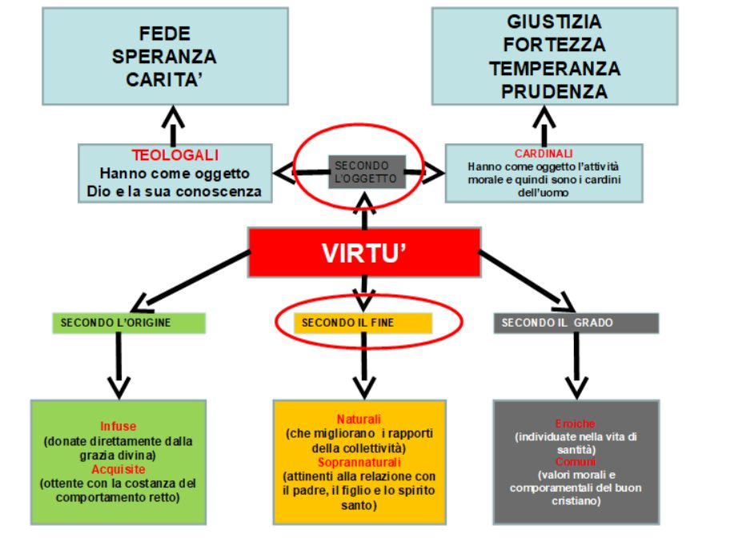{ loading=lazy style="width:76%" }

Questo dipinto del Mantegna forse riassume bene questi temi dei vizi e delle virtù. È un dipinto del 1502 che si chiama *Trionfo della virtù*, oppure *Minerva scaccia i Vizi dal giardino della Virtù*: è un giardino che è stato invaso dai vizi e ridotto a palude. Quelli che ho cerchiato di giallo in questo dipinto sono i vizi; ne cito qualcuno. L’accidia: vedete queste due figure in basso, una vecchia deforme priva di braccia, per l’incapacità di agire, legata con una corda, e quindi l’inerzia; oppure la Venere terrena, questa bella fanciulla al centro del quadro, che è simbolo della lussuria. Questi sono i vizi, e sono scacciati dalle virtù, che in questo caso sono rappresentate da Minerva e da Diana e la Castità, che scacciano i vizi dal giardino. E vedete l’albero di Dafne, su cui sono attorcigliati i cartigli che si rifanno alle virtù cardinali, che stanno in cielo e guidano le virtù nel loro esercizio.

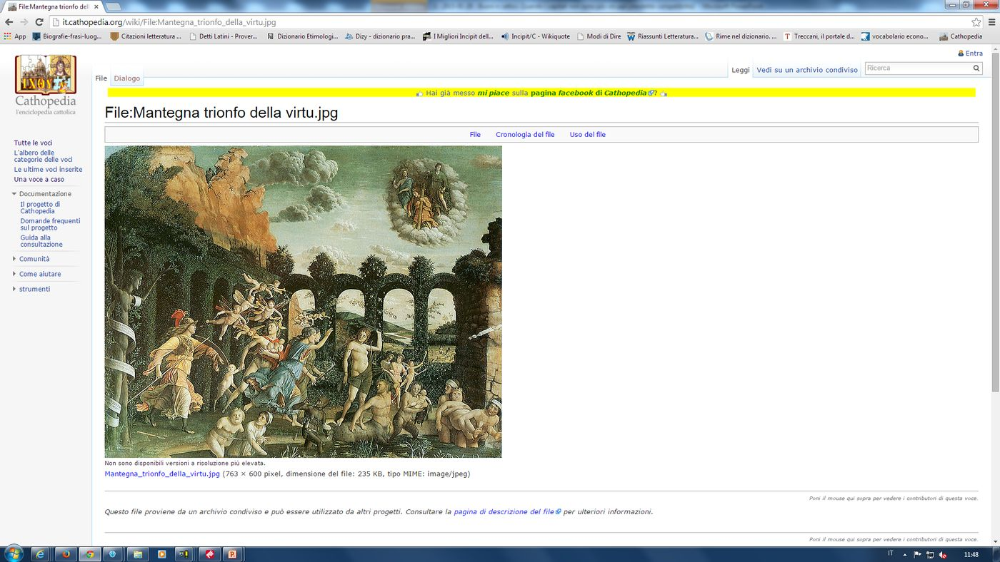{ loading=lazy style="width:64%" }

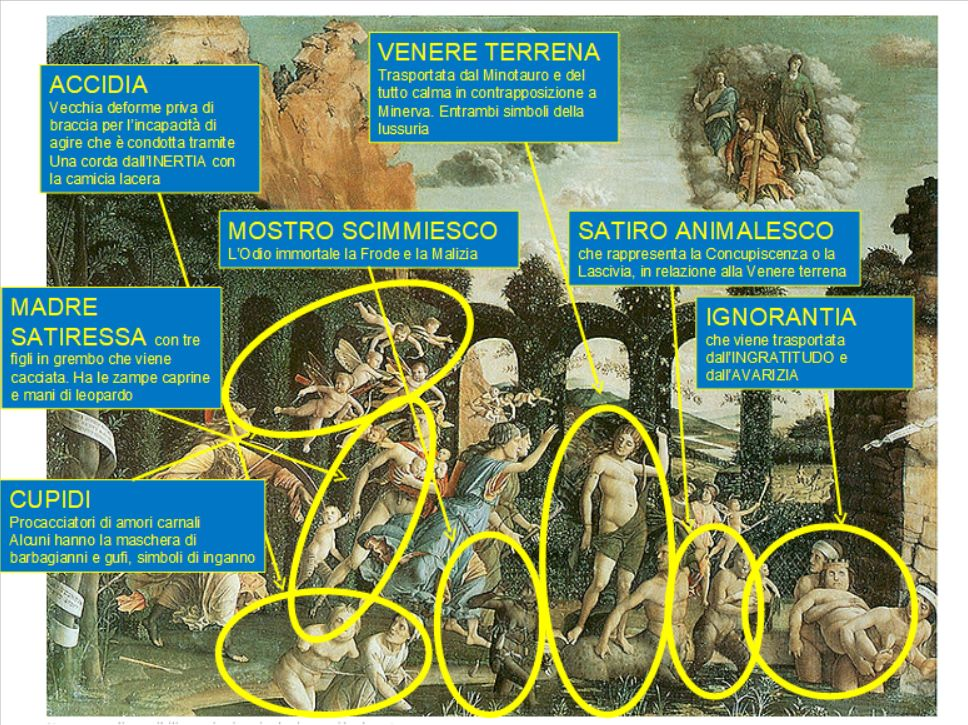{ loading=lazy style="width:50%" }

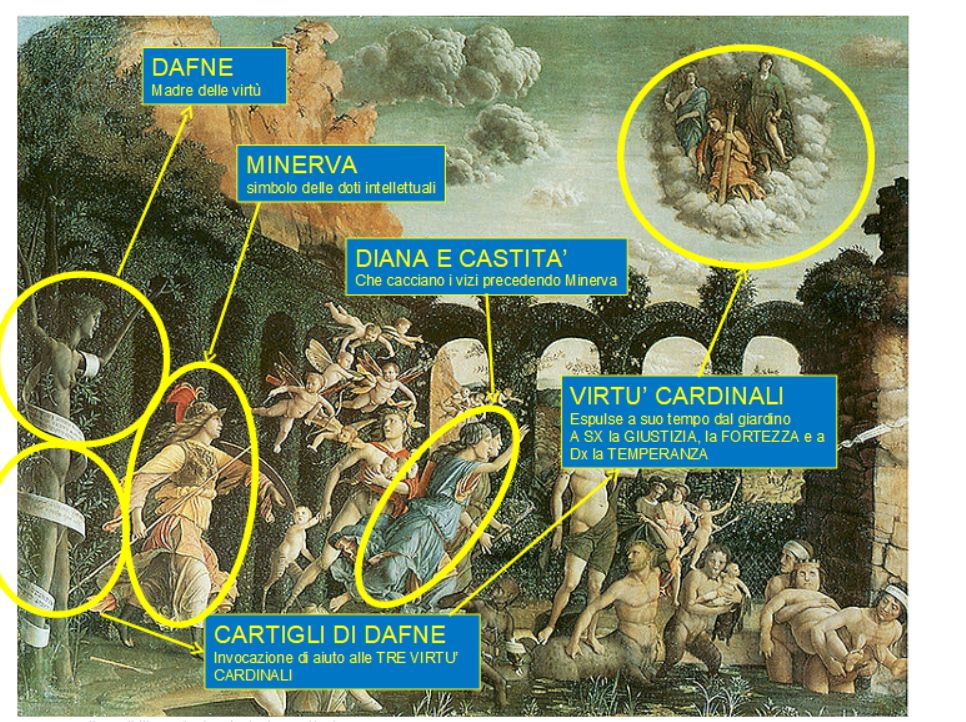{ loading=lazy style="width:49%" }

0:16:05

Dante nell’*Inferno* mette i lussuriosi, i golosi, gli avari eccetera nei vari gironi dell’inferno: questa è una rappresentazione di Sandro Botticelli (la *Mappa dell’Inferno*, 1480-1495). Kurt Weill e Bertolt Brecht hanno fatto *I sette peccati capitali dei piccoli borghesi*, nella loro accezione marxista di quel periodo. È un tema che ricorre spesso, anche nei film: un film a episodi del 1952, *I sette peccati capitali*, in sei episodi di registi italiani e francesi – in questo caso c’erano l’avarizia e l’ira, con Paolo Stoppa ed Eduardo De Filippo –; più recentemente *Seven*, un thriller americano del 1995 di David Fincher, con Brad Pitt, Morgan Freeman e Kevin Spacey, dove c’è un serial killer che uccide secondo i sette vizi capitali.

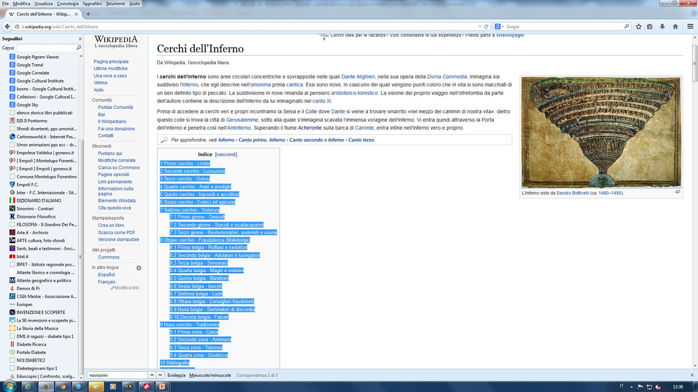{ loading=lazy style="width:48%" }

**I CERCHI DELL’INFERNO**

1 Primo cerchio – Limbo

2 Secondo cerchio – Lussuriosi

3 Terzo cerchio – Golosi

4 Quarto cerchio – Avari e prodighi

5 Quinto cerchio – Iracondi e accidiosi

6 Sesto cerchio – Eretici ed epicurei

7 Settimo cerchio – Violenza

7.1 Primo girone – Omicidi

7.2 Secondo girone – Suicidi e scialacquatori

7.3 Terzo girone – Bestemmiatori, sodomiti e usurai

8 Ottavo cerchio – Fraudolenza (Malebolge)

8.1 Prima bolgia – Ruffiani e seduttori

8.2 Seconda bolgia – Adulatori e lusingatori

8.3 Terza bolgia – Simoniaci

8.4 Quarta bolgia – Maghi e indovini

8.5 Quinta bolgia – Barattieri

8.6 Sesta bolgia – Ipocriti

8.7 Settima bolgia – Ladri

8.8 Ottava bolgia – Consiglieri fraudolenti

8.9 Nona bolgia – Seminatori di discordia

8.10 Decima bolgia – Falsari

9 Nono cerchio – Tradimento

9.1 Prima zona – Caina

9.2 Seconda zona – Antenora

9.3 Terza zona – Tolomea

9.4 Quarta zona – Giudecca

**KURT WEILL E BERTOLT BRECHT**

*I sette peccati capitali* (titolo completo: *I sette peccati capitali dei piccoli borghesi*) è un balletto con canto in sette parti di Kurt Weill, con testo di Bertolt Brecht.

Weill e Brecht scrissero quest’opera entrambi in esilio dalla Germania nazista; scelsero lo stile del balletto per ottenere un’amara ironia, che si riferisse in realtà a una critica sociale spietata.

Questo lavoro fu l’ultima collaborazione dei due artisti.

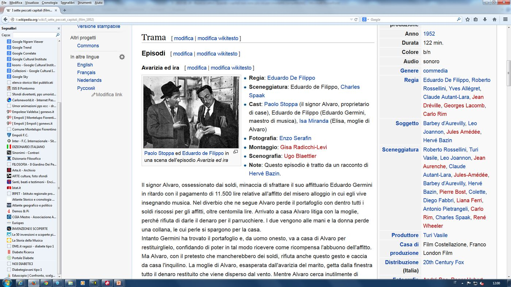{ loading=lazy style="width:38%" }

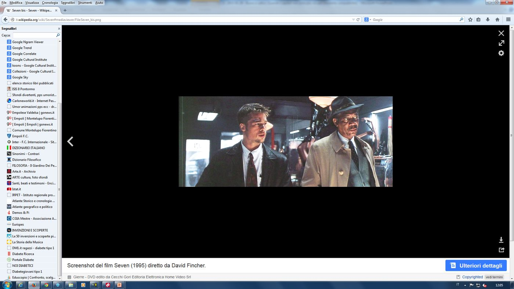{ loading=lazy style="width:58%" }

0:17:09

In questa introduzione finora è mancata una parola che avevo detto all’inizio, cioè il capitale. Il capitale è l’altra parola che lega i vizi al capitale: il capitale può essere a volte virtuoso e a volte vizioso, a seconda del lato della medaglia da cui lo si guarda. In questi giorni è arrivata una notizia – non so se qualcuno di voi l’ha letta –: nella distribuzione della ricchezza nel mondo l’1% delle persone più ricche, contro il 99%, ha superato il 50% della ricchezza mondiale (la notizia è quella del rapporto Oxfam del 19 gennaio 2015, secondo cui l’1% più ricco possedeva il 48% della ricchezza mondiale nel 2014 e avrebbe superato il 50% nel 2016). Significa che l’1% della popolazione possiede il 50% della ricchezza mondiale.

0:18:09

Allora qui lancio la palla al nostro ospite di stasera, e vorrei citare un’intervista di Mario Draghi, presidente della BCE, a *la Repubblica* di qualche giorno fa, in cui c’era un passaggio che mi aveva un po’ colpito, proprio come introduzione al capitale e ai suoi vizi. Draghi racconta in quest’intervista che a metà degli anni Settanta era andato a studiare in America, e aveva un piccolo patrimonio di famiglia, un fondo fiduciario che il padre gli aveva lasciato e che gli aveva consentito di andare a studiare in America. Il giornalista gli fa la domanda: «L’inflazione non ha divorato il patrimonio ereditato da suo padre?». «Non era un grosso patrimonio», risponde Draghi, «però è stato sufficiente a far studiare i tre figli», cioè Draghi e le due sorelle. «Quando tornai per la prima volta in Italia, nel 1976, dell’eredità era rimasto l’equivalente di qualche centinaio di euro. Il giudice tutelare aveva disposto, a garanzia delle mie due sorelle minori, che il denaro fosse investito in buoni del Tesoro a tasso fisso. Così tutto il patrimonio era evaporato.»

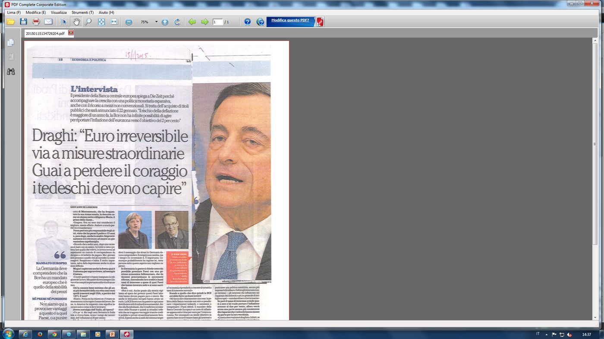{ loading=lazy style="width:37%" }

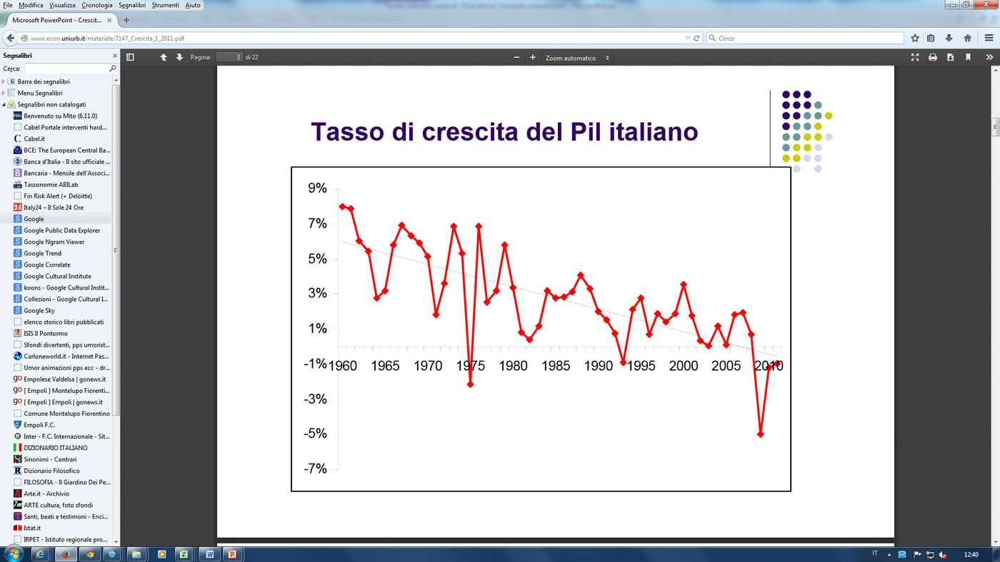{ loading=lazy style="width:37%" }

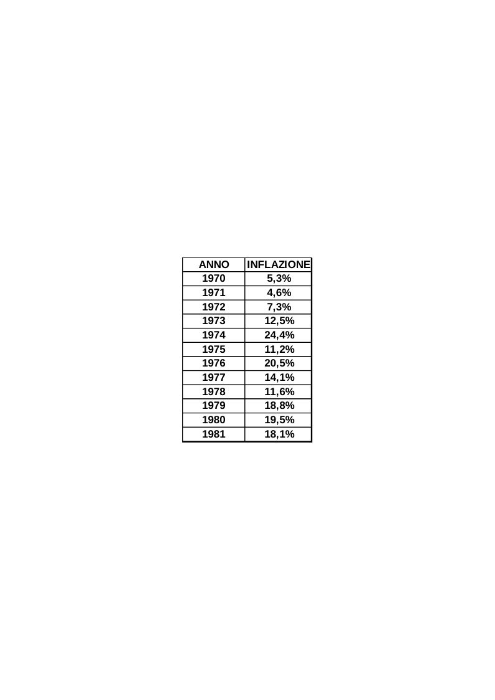{ loading=lazy style="width:30%" }

0:19:49

Questi sono i tassi d’inflazione negli anni Settanta: vedete, si parte con un 5,3% nel 1970, quindi un’inflazione altissima. Il grafico sopra, invece, fa vedere l’andamento del PIL: pur con qualche caduta nel 1975, faccio notare che in quegli anni si andava con un PIL intorno al 7%, rispetto al «meno zero virgola qualcosa» di questo periodo; e questo ci fa un po’ pensare. Però, per il capitale di cui vogliamo parlare stasera, questo è un buon spunto. Perché il giudice tutelare che cosa ha fatto? Virtuosamente voleva salvaguardare il capitale delle sorelle minori. Il capitale, come abbiamo detto prima, è una medaglia a due facce, può essere vizioso o virtuoso: in questo caso la virtù di chi gestiva il fondo si è trasformata in un vizio, perché ha distrutto il capitale. Quindi a volte è difficile capire quando una virtù si trasforma in vizio, e viceversa.

**QUANDO UNA VIRTÙ SI TRASFORMA IN VIZIO**

Il confine tra la virtù e il vizio a volte è labile, e non è facile capire quando qualcosa sia virtù o vizio.

Qui il capitale si dimostra una bestia difficile da governare, se non si ha la flessibilità culturale di capire nei due sensi il passaggio da virtù a vizio, oppure da vizio a virtù.

Con la situazione attuale analizzata da Piketty ne Il capitale nel XXI secolo, dove invece la rendita e l’inflazione sembrano essere tornate all’Ottocento, si sarebbe avuta una realtà dell’eredità diversa…

Inoltre il capitale a sua volta può essere virtuoso o vizioso (investimenti e rendita?…).

0:21:17

L’ultima battuta è questa: sul capitale e sulle forme con cui il capitale esprime tutta la sua potenza, in questo momento ha scritto un libro fondamentale Thomas Piketty, il francese, *Il capitale nel XXI secolo*, e quindi è un argomento all’ordine del giorno. Ma su questo magari sentiamo la parola del nostro ospite. Grazie.

0:21:46

Daniele Corsini Buonasera a tutti, grazie per quest’invito, curioso, carino, interessante. Il tema è complesso: se ho capito bene, vizi e virtù dell’uomo economico, cioè dell’uomo nel rapporto con la ricchezza, con quelli che sono i suoi bisogni materiali e quant’altro; ma non tanto come individuo, quanto come appartenente a un contesto sociale che è basato su certe regole di creazione e di distribuzione della ricchezza. Trasportiamo un po’ questo nel nostro mondo: quali sono le regole di fondo? Cerchiamo di raccontarci qualcosa per richiamare i due termini della discussione, vizi e virtù, della nostra organizzazione socio-economica, che con una parola oggi non si chiama altro che capitalismo: un sistema di produzione che si è ormai affermato \[...\].

0:22:59

Abbiamo un sistema economico che ha riconosciuto in alcuni punti degli aspetti assoluti: le leggi del mercato, la proprietà privata, la ricerca di un risultato economico che non è senza rischio. L’esempio che faceva prima Paolo: se io ho investito la tua eredità nello strumento più solido possibile, il titolo di Stato, però il rendimento, e quello che è successo nel frattempo, l’inflazione, ha fatto sì che quell’investimento si svalutasse... Quindi, come dire, la componente del rischio si associa a quella del rendimento: se vuoi rendere di più devi anche rischiare di più. Questi tre o quattro punti sono un po’ la base di come conosciamo oggi il nostro sistema socio-economico.

0:23:39

Ed è un sistema che, a pensarci, è nato verso la seconda metà del Settecento, quindi ha 250 anni: non ha una vita lunghissima, se si pensa che il genere umano esiste da molto più tempo e che tutta la storia antica è molto più lunga. Quindi parliamo di un periodo relativamente ancora corto, nel quale tuttavia dobbiamo riconoscere da una parte il fatto che questo sistema ha sconfitto tutti i sistemi economici precedenti, che erano poi basati su aspetti viziosi: se si pensa che molti di questi sistemi economici erano basati sulla schiavitù, per esempio, o su un possesso del bene molto fine a se stesso – pensate al latifondo, cioè al solo possesso della terra, che dava diritti ma produceva poco, e ovviamente richiedeva un grande sforzo di lavoro perché ne uscisse quello che serviva per vivere.

0:24:36

Ecco, nel sistema capitalista vediamo qualcosa che ha liberato energia, ed è stato talmente vitale da creare una ricchezza sempre maggiore, un’innovazione completamente sconosciuta ai nostri nonni, che ha cambiato radicalmente la nostra vita. Questo è un punto essenziale. Pensate che l’elogio del capitalismo più straordinario che sia stato scritto l’ha scritto Marx, cioè il nemico del capitalismo, nel *Manifesto del Partito comunista*, del 1848: un elogio sperticato del capitalismo, come di una forza che ha liberato energia. Poi di questa energia si è cominciato a vedere gli aspetti negativi, a criticarla e quant’altro; ma è come se si fosse liberata una sorta di terremoto, forze compresse da secoli, che hanno fatto dell’uomo il padrone di una capacità di produrre e di un’efficienza molto più forti. Quindi questa è una virtù: se andiamo a cercare una virtù di questo sistema, è senza dubbio la sua capacità di crescere in maniera così radicale, completamente sconosciuta ai secoli precedenti, al Seicento, al Settecento.

0:25:54

Poi si cominciano a fare delle domande – più o meno semplici, ma sono tutte del genere –: quali sono i vizi di quest’organizzazione? E dov’è, in due parole, il vizio a cui spesso facciamo riferimento? Questo sistema non è in grado di autoregolarsi: ha degli eccessi, ha delle forme che generano degli svantaggi per la parte più debole; per il fatto che c’è una forte innovazione, chi rimane indietro non sa come arrangiarsi; non riesce a distribuire bene la ricchezza. Cioè in certi momenti della sua storia è stato molto virtuoso nel produrre, ma non è stato altrettanto virtuoso nella distribuzione di questa ricchezza: come diceva Paolo, oggi si dice che l’1% della popolazione mondiale possiede il 50% di tutta la ricchezza.

0:26:48

E su questo vizio si è cominciato a dire in maniera sempre più forte: non è un sistema in grado di darsi delle regole, di rispettarle e di assicurare la sua durata nel tempo. Allora, se si parla di virtù, sì, è nato lì; ma contiene in sé qualcosa di negativo che alla fine lo porterà alla distruzione: una malattia autoimmune, si direbbe in termini medici, del capitalismo, che, attraverso questi grossi scossoni, che sono comunque fonte di grandi disagi, è in ogni caso destinato a una morte sicura; c’è dentro di sé un baco, un germe, qualcosa che lo distrugge. E l’attenzione di chi studia questi fenomeni è tornata a concentrarsi su quest’aspetto. Quest’aspetto lo rappresenta Marx: Marx diceva che il capitalismo ha questi vizi ed è comunque destinato a morire, perché dentro di sé ha un modo di produrre che uccide se stesso; in due parole, aumentando lo sfruttamento del lavoro alla fine uccide la base stessa che gli consente di estrarre valore e di rigenerarsi.

0:28:07

Oggi questo ragionamento è tornato in auge con una riflessione di Piketty: per un’unità di PIL – il famoso PIL – di quanto capitale abbiamo bisogno? E si comincia a scoprire che il capitale accumulato è molto alto. Avete sentito come in Italia si dice: «Ma insomma, avete un grandissimo debito»; e poi qualcuno risponde: «Ma noi abbiamo anche una grande ricchezza». Quindi, come se fossimo un’azienda, da una parte abbiamo una ricchezza: che ne so, il patrimonio immobiliare delle famiglie italiane, la seconda casa, la terza casa, segno di grande ricchezza. Ora, questi aspetti – come nel tempo si è formata la ricchezza – ci fanno dire: è una ricchezza produttiva? È una ricchezza, per quanto grande, che riesce a produrre quel reddito annuale? Oltre la ricchezza, conta il reddito che essa genera, e che serve poi per vivere.

0:29:15

E su questo si comincia a dire che è una storia ciclica, perché il capitalismo ha un altro vizio: ha degli eccessi fortissimi, quindi crea le bolle speculative, crea questi grandi spostamenti di ricchezza; ma c’è anche un altro vizio: a un certo punto si ferma, come se entrasse in depressione – uso un po’ questi termini psicologici – cioè non riesce ad avere quell’appetito per il rischio che fa dire «io investo, accetto il rischio, attendo il risultato, il reddito», e che quindi fa aumentare l’attività; si ferma, non investe più. Questa è la storia che si vede in questi duecento anni: a momenti di grande prosperità, di grande sviluppo, seguono dei momenti di stasi.

0:30:00

Per esempio la crisi del ’29, quando la produzione diminuì di più di un quarto: una cosa enorme, se pensiamo al nostro PIL, come se oggi fosse 100 e scendesse a 75; una cosa che non è mai più esistita. In quegli anni ebbe una dimensione enorme e generò disoccupazione in maniera completamente nuova. Quella fu chiamata la Grande depressione, proprio perché l’attività cambia in maniera fortissima e non ci sono più posti di lavoro, perché poi questa è la misura finale della salute di un sistema. Oggi noi parliamo di Grande recessione – non so se l’avete sentito –, cioè di un periodo molto lungo in cui non si cresce più: magari non si è avuto il crollo di quegli anni, magari il PIL cresce dello 0,1 o diminuisce dello 0... ma è una stasi, che ovviamente riduce la capacità di creare posti di lavoro: il problema anche delle generazioni più giovani è che sono ormai al 30-35% di disoccupazione. Perché si attenua questa spinta a investire? Perché la parola chiave del capitalismo è investire: prendere il rischio, poi avere un risultato, magari dividerlo in maniera iniqua, ma avere un risultato. Quando questo sviluppo non c’è più, si ha una stasi.

0:31:31

Ecco, la nostra generazione – apparteniamo un po’ tutti alla stessa generazione – non ha mai conosciuto, per esempio, prezzi che tornano indietro: noi siamo stati la generazione dei prezzi in crescita, dell’inflazione, o di una crescita magari un po’ meno forte, che comunque ha accompagnato la nostra generazione. Noi non conosciamo che cosa successe negli anni Venti, quando i prezzi crollavano – forse i nonni ce l’hanno raccontato – ed è una situazione che non è simmetrica. «I prezzi crescono, i prezzi scendono: se scendono è meglio», si diceva. Assolutamente no: la deflazione è un male assoluto, è un vizio assoluto del capitalismo. Perché la deflazione genera deflazione: i prezzi scendono, e se ognuno si mette in testa che questo, che oggi costa 100 euro, domani costerà 90, aspetta domani a comprarlo, e intanto non lo vende; il giorno dopo dice: «Se è sceso di 10, scenderà di altri 10», e rallenta tutta la domanda di consumo. Quindi la deflazione genera una spirale sempre più negativa.

0:32:46

Questo è il punto che volevo dire in queste riflessioni di fondo, usando questa metafora del vizio: di questo vizio dobbiamo avere paura, sia perché non lo conosciamo, sia perché ha effetti fortemente distorsivi sul piano sociale. Ripeto: dell’inflazione possiamo non avere paura, è un meccanismo che comunque genera ricchezza – magari la ricchezza non viene distribuita bene: aumentano i prezzi, aumenta la moneta, aumentano gli stipendi, qualcuno rimane indietro, qualcuno va avanti –, ma è un meccanismo che consente di salvaguardarsi meglio, soprattutto se non si va a un’inflazione eccessiva. Quindi i periodi con prezzi tra il 5 e il 10%, intorno al 5%, sono comunque stati sostenibili. Ma la diminuzione dei prezzi, parlando di vizi, è un’altra cosa: genera ulteriore deflazione, quindi ulteriore perdita di capacità produttiva, ulteriore perdita di posti di lavoro, e quindi è un avvitamento.

0:33:47

Allora, se si dice in sintesi qual è un vizio assoluto del modello, oggi di questo vizio dobbiamo obiettivamente avere paura. E tutte le attività sono volte a creare un po’ di inflazione: ci prova Draghi, mettiamo dentro la macchina un po’ di quattrini in più e creiamo un aumento dei prezzi. Perché, se aumentano i prezzi, ognuno anticipa la domanda: se lei pensa che questo, che oggi costa 100, domani andrà a 110, lo compra oggi; e comprandolo oggi c’è la domanda, e la spirale diventa virtuosa. Va bene, non voglio andare oltre su questo: vediamoli come vizi, però di natura sociale, non attribuibili a nessuno di noi in particolare.

0:34:42

Lorenzo Poggi Grazie. A questo punto proviamo a tirare qualche conclusione di tutti i temi che abbiamo gettato sul piatto di questa nostra tavola. Il capitalismo precedente era fondato soprattutto sull’economia di fabbrica: c’erano dei manager, che magari erano gli stessi padroni della fabbrica, e si dovevano confrontare con gli amministrati, con le limitazioni reali. C’era un rapporto – non dico con il punto di vista economico in generale –, ma c’era un rapporto con gli uomini, con la società, con le esigenze dell’economia, non della sola finanza. E questo introduceva in qualche modo un limite a quello che era il potere.

0:36:10

Oggi invece uno dei caratteri più evidenti è la finanziarizzazione del capitale: e non solo la finanziarizzazione, ma l’estrema libertà, l’essere svincolato da qualsiasi tipo di controllo. È estremamente difficile, in una condizione del genere, dove la finanza è globalizzata, riuscire a controllarla; e quindi il sistema, spersonalizzato, dal punto di vista della valutazione di vizio e virtù diventa qualcosa di assoluto, di incontestabile. Perché? Perché viene vissuto come una legge di natura, come qualcosa che non è frutto delle scelte umane, ma quasi l’essere naturale delle cose, rispetto al quale non è più possibile nessuna trasformazione. Lo abbiamo visto con la crisi: tutto quello che si è fatto è stato semmai un salvataggio. Quelli che in fondo rischiavano, e dovevano rischiare, non hanno rischiato niente, perché sono stati in qualche modo risarciti dagli Stati. Se qualcuno è sfuggito alla legge del mercato, sono proprio quelli che il mercato lo controllavano e lo condizionavano. E quindi questo è un vizio.

0:38:19

Ma ora tocchiamo il tema in generale: quando parliamo di virtù dobbiamo parlare di limite, perché, se non c’è un limite, se non c’è un termine dentro il quale c’è la virtù, non ci può essere nemmeno lo sconfinamento oltre il termine, al di là del quale c’è il vizio. Quello che manca – ed è un elemento evidente a tutti – nella ricerca del profitto è proprio il limite. Quando mai si porrà un limite al continuo incremento del profitto, dell’economia, all’aumento della produzione e della ricchezza? Un limite dovrebbe essere costituito dalle risorse del pianeta, no? Ma sopporta il nostro pianeta un aumento così massiccio dello sfruttamento? E fino a che punto? Ma se ponessimo dei limiti all’incremento continuo, alla moltiplicazione della produzione, metteremmo in discussione il sistema capitalistico. E il capitalismo non può avere limiti, perché, se c’è qualcuno che gli dà dei limiti, evidentemente non è più capitalismo: diventa un’altra cosa.

0:39:53

Questo è un aspetto, e vale per il sistema, per i massimi sistemi, ma vale anche per gli uomini. I vizi erano vizi quando c’era una natura: chi andava oltre, chi varcava il suo limite. Achille è un eroe tragico perché va oltre i limiti che gli sono prescritti. Aristotele dice che la virtù è il giusto mezzo: se si va oltre, si sfora la forma. C’è l’idea di natura, c’è l’idea di limite, e quindi ci può essere l’idea di vizio. Ma quello che sta venendo meno proprio nel nostro tempo è l’esistenza di un limite. Pensiamo: c’è un limite al consumo? O il consumo è comunque una virtù? Anzi, parlavamo prima del fatto che bisogna rilanciare i consumi, no? E abbiamo uno dei settori in cui l’Italia ha una grande importanza, quello della moda, per esempio, che è un consumo che non riguarda la soddisfazione di bisogni essenziali, non è legato in nessun modo a una natura umana che ne abbia bisogno, ma è che cosa? È un incremento continuo del desiderio, attraverso una continua trasformazione e un consumo di forme, un consumo eccessivo di forme, dove nulla rimane stabile.

0:41:59

E dove nulla rimane stabile, tutto è evanescente, è difficile dire chi siamo: perché noi ci relazioniamo a qualcosa, e di fronte a ciò che rimane assumiamo la nostra identità; ciò che rimane ci si contrappone, ci costringe a definirci. Ma siamo di fronte a qualcosa che muta, e muta così rapidamente che non resta che mantenere il desiderio, un desiderio che di volta in volta non fa altro che soffermarsi momentaneamente su un oggetto, senza però mai trovare una finalità, un assestamento. È difficile. Il cristianesimo è una religione del sacrificio: la rinuncia, il sacrificio sono fondamentali; ma una filosofia come quella che regge la religione cristiana è in netta contraddizione con quella che è la filosofia del consumo del nostro tempo, che invece dice che il desiderio deve in qualche modo realizzarsi, deve realizzarsi attraverso qualcosa che passa attraverso l’economia.

0:43:44

La commercializzazione è diventata – perché sennò non sarebbe interessante per il sistema – tale che molti aspetti della vita e dell’esistenza dell’uomo, come dicevamo, divengono esteriorizzati, oggettivati, e diventano oggetto economico di consumo. È una progressiva commercializzazione, una trasformazione in oggetto economico di parti dell’atteggiamento della persona: quello che era un atteggiamento personale, il carattere della persona – la persona affabile, disponibile a parlare con gli altri, simpatica – viene commercializzato, entra nel curriculum di chi si presenta per fare un determinato lavoro, diventa un elemento distinto dalla persona. Pensate a quella che era l’emozione personale, quella che determinava la vita: la bellezza, l’amore per le cose, gli entusiasmi; tutte queste emozioni e questi sentimenti non rientrano più nel gioco, se non quelli che sono riusciti a diventare un elemento commercializzabile.

0:45:33

Anche il sesso è diventato un elemento commercializzabile; anzi, non c’è più distinzione sessuale. Racconto un aneddoto: ero in macchina e c’era un signore che mi disse: «Che bellezza quando il nudo di donna lo facevano ancora le femmine». Sembra una battuta, ma se ci pensate significa che in fondo anche un aspetto così profondo è diventato qualcosa di gestito dalla scienza, un momento di commercio. Non c’è più identità, nemmeno identità sessuale. Il discorso sull’identità, per me, si deve confrontare con una caratterizzazione sessuale che diventa sempre meno un elemento distintivo: si può scegliere il proprio sesso, e quindi è diventata qualcosa che non è più legata alla natura.

0:47:37

È un elemento per dirvi – parliamo sempre della lussuria – che quello della lussuria era un vizio estremamente grave. Perché? Perché portava il corpo fino a quell’esperienza di abbandono della coscienza dell’io, nel momento dell’unione sessuale, in cui l’io perdeva il controllo di sé; e quindi era la porta aperta, il varco che ti portava verso lo sconosciuto, il non controllato, il sacro: qualcosa che ti collegava a ciò da cui anche Dio era provenuto; ma lo faceva con il corpo, con qualcosa che non era lo spirito, e quindi era un cammino estremamente grave. Ora invece non è più tutto questo: gli uomini, nella loro realtà e nella loro vita, sono ormai capitale umano. Che cosa vogliamo dire? Che, se esistono, se vivono, se hanno una dimensione, ce l’hanno perché sono una parte del sistema.

0:49:09

Hegel parlava della contrapposizione delle volontà, nella *Fenomenologia dello spirito*: la volontà del signore e la volontà del servo. Marx coglie il tema a questo punto \[...\]. Che cosa si sta perdendo, io penso, nei mutamenti del nostro tempo? Si sta perdendo proprio quest’identità umana, questo carattere fondamentale dell’essere scelta: non scegliere solo per la funzionalità, solo per la riuscita, ma scegliere anche per la soddisfazione, per la bellezza, per la riuscita del desiderio, per dare senso all’esistenza, senso e fine. Perché posso essere liberissimo di scegliere – mai come oggi ci sono di fronte a me innumerevoli possibilità di scelta, di oggetti e di soddisfazione dei miei desideri; ma, se non so perché devo scegliere, a quale fine, per realizzare quale fine definitivo che non sia quello dell’immediata soddisfazione di un desiderio quasi zero, sarà difficilissimo mantenere il desiderio per evitare la noia, figlia del nostro tempo. Grazie.

\[PAUSA\]
{: .nota }

1:35:20

Paolo Marcucci Iniziamo la parte finale. Permettetemi di ringraziare il Caffè Centofiori per la cena. Grazie.

1:35:50

In quest’ultima parte vorrei parlare un po’ dell’avarizia. Abbiamo visto che i temi, i vizi capitali, sono tanti: per ogni tema ci vorrebbe quasi una serata per approfondirlo. Però vorrei parlare dell’avarizia per un paio di motivi. Prima di tutto perché stasera è stato citato molte volte Marx, e sull’avarizia Marx ha scritto delle note importanti. In secondo luogo perché l’avarizia mi consente in qualche modo di introdurre un tema che poi affronteremo a marzo, quello della rivoluzione: se oggi sia possibile realizzare ancora una possibile rivoluzione. Sono temi un po’ legati fra loro e legati al capitale.

1:36:46

«Il denaro non è soltanto un oggetto della smania di arricchimento, ne è l’oggetto. Questa smania è essenzialmente *auri sacra fames*.» (Marx cita qui Virgilio, *Eneide*, III, 57: «esecranda fame dell’oro».) L’avarizia congela il tesoro, i soldi, e non permette al denaro di essere il mezzo principe della circolazione del sistema. C’è chi dice che l’avarizia è il più stupido dei vizi capitali, perché il denaro accumulato non viene speso, e quindi il potere alla fine non si può nemmeno esercitare. L’avaro sacrifica ogni cosa in una vita quasi ascetica, perché non spende niente, non fa niente, perché trattiene il denaro immobilizzato.

**AVARIZIA**

Vorrei usare Karl Marx come introduzione a questo tema, anche perché l’avarizia consente una prima, piccola introduzione alla serata sulla rivoluzione (che sarà a marzo 2015).

«Il denaro non è soltanto *un* oggetto della smania di arricchimento, ne è *l’*oggetto. Questa smania è essenzialmente *auri sacra fames*.»

(La locuzione latina *quid non mortalia pectora cogis, / auri sacra fames* è un verso di Virgilio, Eneide, III, 56-57, che significa «a cosa non spingi i petti mortali, miserabile cupidigia dell’oro». Il verso gioca sul significato di *sacra*, che, malgrado l’assonanza con l’accezione più diffusa, vuol dire anche «esecrabile»: il termine è infatti ambivalente, nei suoi due sensi di «orrido» e di «puro».)

L’avarizia fissa il tesoro, non consentendo al denaro di diventare mezzo di circolazione.

1:37:50

A volte qualcuno ha confuso forse l’avarizia con la parsimonia, o con il giusto utilizzo del denaro. Qualcuno ha usato come emblema del nostro tempo, del nostro sistema, Enrico Cuccia. Enrico Cuccia (1907-2000), presidente di Mediobanca, è stato il banchiere per eccellenza del capitalismo italiano, e di quest’avarizia qualcuno ha parlato; ma secondo me forse non lo era: era più una forma di vita che si avvicinava all’ascesi. Enrico Cuccia, nella grande opera che ha fatto in cinquant’anni per sostenere il sistema capitalistico italiano, era uno che viveva in modo modesto. Mi ricordo un intervento di Massimo Giannini (*la Repubblica*, 18 luglio 2011), che raccontava lo stile di vita di questo importantissimo personaggio della nostra storia economica, e diceva che la visita al suo ufficio milanese andrebbe inclusa nei programmi scolastici: perché è uno stanzone disadorno, con i muri un po’ ingialliti, quasi come la cella di un monaco, una seggiola e pochi altri arredi. Quindi l’uomo che ha mosso più denaro in tutto il sistema capitalistico italiano degli ultimi cinquant’anni aveva uno stile di vita molto parco, ascetico. L’ascetico e l’avaro sono vicini, però c’è una notevole differenza, dovuta all’utilizzo e all’investimento del denaro.

**AVARIZIA**

C’è chi dice che l’avarizia è forse il più stupido dei vizi capitali, perché il denaro accumulato dall’avaro consentirebbe l’acquisto di tutto, ma questo potere non deve essere esercitato, perché sennò non si hanno più il denaro e il potere connesso al denaro.

Il denaro quindi non è un mezzo per raggiungere un fine, ma il fine stesso, al quale l’avaro sacrifica ogni soddisfazione dei beni, in una vita quasi ascetica.

Enrico Cuccia, ad esempio, che ha gestito la finanza del capitalismo italiano per cinquant’anni, da questo punto di vista era l’emblema vivente.

**ENRICO CUCCIA**

(Roma, 24 novembre 1907 – Milano, 23 giugno 2000) è stato un banchiere italiano, tra i più importanti della seconda metà del Novecento, presidente di Mediobanca. Rappresenta una delle figure di spicco della scena economico-finanziaria italiana del XX secolo: un genio della finanza e del capitalismo domestico, che, senza capitali, è riuscito a tenere in piedi un sistema per quarant’anni.

**IL RIGORE E LA LEZIONE DI CUCCIA**

Giannini contrappone l’ostentazione di ricchezza delle «caste» politico-economiche italiane al rigore di Enrico Cuccia, simbolo di un capitalismo asfittico e autoreferenziale, ma anche di uno stile di vita «non sobrio: penitenziale». Il suo ufficio milanese in Mediobanca è uno stanzone disadorno, con i muri un po’ ingialliti, come la cella di un monaco: una seggiola senza braccioli, una scrivania di legno povero, un tavolo per le riunioni, nessun tappeto né quadro, salvo una pianta antica di Milano. Lì sono transitati affari per migliaia di miliardi, eppure Cuccia non ha mai tenuto un centesimo per sé; e la visita a quell’ufficio, conclude Giannini, «andrebbe inclusa nei programmi scolastici».

1:39:57

Marx dice, commentando Shakespeare e Goethe: «Ciò che mediante il denaro è a mia disposizione, ciò che io posso pagare, ciò che il denaro può comprare, quello sono io stesso, il possessore del denaro medesimo. Quanto grande è il potere del denaro, tanto grande è il mio potere». La proprietà privata non è finalizzata all’uso, ma al possesso, perché l’avaro vuole possedere i beni che ha. Tutto il contrario, ad esempio, della rivoluzione, che ha l’obiettivo opposto: la proprietà privata sarebbe stata abolita e i beni sarebbero stati usati secondo i bisogni e le necessità. La famosa frase di Louis Blanc, il francese che aveva ispirato i moti del 1848 in Francia, la famosa formula: «A ciascuno secondo i suoi bisogni, da ciascuno secondo le sue capacità». Quindi va tutto contro l’avaro.

**AVARIZIA**

Marx, commentando Shakespeare e Goethe, dice: «Ciò che mediante il denaro è a mia disposizione, ciò che io posso pagare, ciò che il denaro può comprare, quello sono io stesso, il possessore del denaro medesimo. Quanto grande è il potere del denaro, tanto grande è il mio potere. Le caratteristiche del denaro sono le mie stesse caratteristiche e le mie forze essenziali, cioè sono le caratteristiche e le forze essenziali del suo possessore».

Marx accosta così l’avaro al capitalista, per il quale l’avere è il fondamento del suo essere e della sua identità: «io sono ciò che ho».

Per l’avaro/capitalista la proprietà privata (dal latino *privare*, che significa portare via agli altri) non è finalizzata all’uso, ma al contrario al possesso.

Le rivoluzioni, la rivoluzione, avranno invece l’obiettivo opposto, pensando a una società dove la proprietà privata sarebbe stata abolita e i beni sarebbero stati usati secondo i bisogni e le necessità.

1:41:13

Però perché l’avaro arriva ad accumulare e a portare per questo una vita di rinunce? Perché l’avaro sostanzialmente non vuole esprimersi nel potere che si esercita in quel momento, ma in un potere un po’ più raffinato, cioè un potere che rimanda al futuro e che può essere esercitato in qualsiasi momento: e l’avaro gode di questa possibilità. Questo è un dipinto del fiammingo Jan Provost, dei primi del Cinquecento, *L’avaro e la morte*. Perché? Perché si vede l’avaro, il banchiere, il mercante – figura di cui abbiamo parlato spesso nelle nostre serate –, che riceve dalla morte il saldo del debito. Si vede un giovane alle spalle della morte – si capisce che è morto perché è avvolto in un sudario –, e la morte paga il suo debito. L’avaro in questo momento si tranquillizza, perché ha di nuovo comprato il futuro, cioè riscuote il denaro che gli permette di proiettare il capitale verso il futuro, che è il tratto tipico dell’atteggiamento dell’avaro.

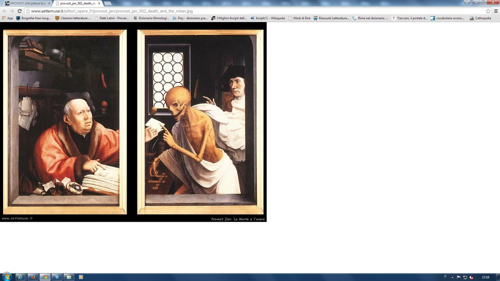{ loading=lazy style="width:65%" }

**AVARIZIA**

Ma, lasciando perdere l’accostamento con il capitalista ottocentesco, e tornando al concetto di avaro, ci possiamo anche chiedere che cosa spinga l’uomo ad accumulare denaro da non utilizzare. Da quale angoscia scappa, per rendere sopportabile una vita di rinuncia e di ascesi?

L’avaro ha terrore del futuro, e si garantisce scegliendo un potere che non si esprime nel presente: gli preferisce un potere più raffinato, che non viene esercitato nel presente, ma che può essere esercitato nel futuro, in qualsiasi momento.

**JAN PROVOST, L’AVARO E LA MORTE**

Il fiammingo Jan Provost, ai primi del Cinquecento, dipinge *L’avaro e la morte*, dal forte significato. Il soggetto ruota intorno al giovane accigliato, col cappello nero, sulla destra, che indica il foglietto tenuto in mano dalla morte, che inizia con «*ic ian lanckart…*»: si tratta del committente dell’opera, ormai defunto (lo si capisce perché ha addosso il sudario della morte). La morte è giunta a pagare il debito lasciato insoluto dal giovane, mentre il banchiere, che non si sgomenta minimamente davanti a essa, si limita a controllare scrupolosamente nel suo libro contabile l’ammontare del proprio credito e restituisce la lettera di cambio.

Il tutto si svolge tranquillamente all’interno della bottega del banchiere, preziosamente vestito con una sopravveste rossa imbottita di pelliccia, tra sacchetti di denaro e foglietti scritti sparsi per l’ambiente, a significare che davanti al denaro e all’interesse il banchiere non guarda in faccia nessuno.

L’avaro è tranquillo perché ha di nuovo comprato il futuro.

Di questa possibilità gode l’avaro, e la protrae fino alla morte.

È una morte disperata, non solo perché è costretto a separarsi dal suo denaro, ma perché è costretto a separarsi dal futuro, per garantirsi il quale ha accumulato denaro per tutta la vita.

L’avaro sostanzialmente non accetta la condizione di mortale, che è propria dell’uomo e delle creature viventi, e per questo il suo vizio è davvero un «vizio capitale».

Il denaro sviluppa un sentimento di potenza assoluto, e l’avarizia è una forma della volontà di potenza che, per mantenersi, non deve mai esercitarsi.

1:43:04

L’avaro alla fine muore disperato. Perché? Perché non riesce a separarsi da questo futuro e non accetta la propria morte; e per questo l’avarizia è un peccato mortale: l’avaro non accetta di essere mortale, perché si proietta sempre verso il futuro. Questo è il grande peccato dell’avaro. L’avarizia, si può dire, è una volontà di potenza che, per mantenersi, non deve mai esercitarsi. C’è una bellissima battuta in questo senso, in assonanza con il tema dell’avarizia, in Una ballata del mare salato di Hugo Pratt (1927-1995), dove c’è Corto Maltese che parla con il Monaco, una figura misteriosa, e uno dice che il potere lo si ha finché non si è costretti a esercitarlo. Così anche l’avaro: il potere ce l’ha perché non è costretto a esercitarlo e a spendere in quel momento il denaro, ma rimanda a un futuro.

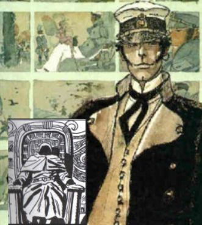{ loading=lazy style="width:30%" }

**UNA BALLATA DEL MARE SALATO – HUGO PRATT (1927-1995)**

DIALOGO CON IL MONACO: «UNO IL POTERE CE L’HA FINCHÉ NON È COSTRETTO AD ESERCITARLO».

1:44:19

Questo futuro Marx, parlando dell’avaro, lo critica, perché non è la vita che la rivoluzione sogna. Dice: «Rinuncia a se stessi, rinuncia alla vita e a tutti i bisogni umani. Quanto meno mangi, bevi, compri libri, vai a teatro, al ballo e all’osteria, quanto meno pensi, ami, fai teorie, canti, dipingi, verseggi eccetera, tanto più risparmi, tanto più grande diventa il tuo tesoro, che né i tarli né la polvere possono consumare, il tuo capitale». L’avarizia, secondo il mio parere, era il tema che si legava bene a come abbiamo impostato la serata, parlando del capitale e dei vizi del capitale, e quindi ho ritenuto che fosse il caso di approfondirlo. Sull’avarizia e sul capitale magari ora lascio la palla al nostro ospite, Corsini, per il suo approfondimento e le sue conclusioni sul tema che ha introdotto prima.

**AVARIZIA**

Ma questa, possiamo dire, non è vita… non è la vita nuova che il rivoluzionario ha in mente.

*«Rinuncia a se stessi, rinuncia alla vita e a tutti i bisogni umani. Quanto meno mangi, bevi, compri libri, vai a teatro, al ballo e all’osteria, quanto meno pensi, ami, fai teorie, canti, dipingi, verseggi eccetera, tanto più risparmi, tanto più grande diventa il tuo tesoro, che né i tarli né la polvere possono consumare, il tuo capitale. Quanto meno tu sei, quanto meno realizzi la tua vita, tanto più hai; quanto più grande è la tua vita alienata, tanto più accumuli del tuo essere estraniato. Tutto ciò che l’economia ti porta via di vita e di umanità, te lo restituisce in denaro e ricchezza, e tutto ciò che tu non puoi, può il tuo denaro. Esso può mangiare, bere, andare a teatro e al ballo, se la intende con l’arte, con la cultura, con le curiosità storiche, col potere politico, può viaggiare; può insomma impadronirsi per te di tutto questo; può tutto comprare: esso è il vero e proprio potere. Così tutte le passioni e tutte le attività devono ridursi all’avidità di denaro.»* (Marx)

Ma questa non-vita, e proprio lo sforzo messo in atto per esorcizzare la morte, ha un effetto paradossale: quello di anticiparla e di diffonderla su tutto l’arco della vita.

1:45:52

Daniele Corsini Ci siamo detti prima che questa parola, avarizia, si traduce in comportamenti più sociali: dal mio punto di vista non è tanto il comportamento di un singolo, quanto il fatto che troviamo un concetto simile di avarizia nei comportamenti più generali. Quindi, pensando sempre al modello, dove troviamo l’equivalente dell’avarizia? Lo troviamo laddove viene a cadere questo spirito d’iniziativa, questa volontà di rischiare, di investire, di creare nuova ricchezza, e invece ciò che si è accumulato rappresenta il proprio punto d’arrivo. Parlo di una classe sociale, una classe sociale che magari è cresciuta perché ha avuto la possibilità di investire, di rischiare, e a un certo punto dice: «Quello che ho messo da parte adesso me lo godo, ma non lo rimetto più in circolazione».

1:46:50

Queste cose, dette in maniera – scusate – abbastanza semplificata, nella storia si vedono: questi atteggiamenti, chiamiamoli di avarizia, di classi intere, che a un certo punto si ritirano dalle attività e si mettono a fare, si dice, i *rentier*, cioè vivono di rendita. Se pensate alla Repubblica di Venezia, che crebbe con i suoi commerci marittimi e con le colonie, e che quindi creò ricchezza – capitalismo mercantile, si chiamava: comprava, non si curava se comprava dai turchi e vendeva ai cristiani o viceversa –, aveva uno spirito mercantile molto attivo. Quando cominciò la crisi di Venezia, che cosa fece la grande borghesia mercantile? Cominciò a farsi costruire le ville nell’entroterra del Veneto, le grandi ville palladiane del Cinquecento-Seicento, che erano affermazioni di quello che avevano raggiunto. Anche i palazzi di Venezia, sul Canal Grande, erano il simbolo, perché lì c’era stata una famiglia di grande storia, di grande ricchezza. Quando la città cominciava ad andare in crisi, perché i suoi mercati cominciavano a declinare, molte di queste famiglie si costruivano queste grandi dimore, chiamando il più grande architetto del tempo: non c’era più quella ricchezza che veniva sempre rimessa in circolo, ma si cristallizzava: «Voglio godermi in modo sicuro tutto ciò a cui sono arrivato». E da quel momento comincia un’altra storia: la storia di chi voleva soltanto godere del bene.

1:48:34

Una cosa del genere è successa nel tardo Ottocento in Inghilterra. L’Inghilterra, un po’ come era successo a Venezia, era cresciuta grazie al colonialismo, che aveva la sua portata più vera nel subcontinente indiano, fonte di ricchezza estrema, e che aveva consentito agli inglesi di diventare la prima potenza del mondo nel tardo Ottocento. Beh, anche lì ci fu una borghesia che, da mercantile e industriale, si trasformò in un’aristocrazia: anche loro si fecero grandi proprietari immobiliari – quando andiamo in Inghilterra troviamo queste grandi ville con grandi estensioni di terra. In queste cose, come dicevo prima, sono venuti meno gli «spiriti animali» del capitalista, cioè quella sua voglia di crescere, di arricchirsi, ma anche di rischiare: a un certo punto si affloscia e dice: «No, io ormai sono arrivato, voglio sedere e godermi questo». Quando diventa il comportamento di una classe dirigente, la stasi di cui dicevo prima rappresenta qualcosa che comincia: la manifestazione dell’avarizia dell’individuo diventa la manifestazione dell’avarizia di un’intera classe. Non si investe più, non si creano più posti di lavoro, non si rischia più.

1:50:00

Quindi nello scontro sociale ci sono tre fattori: il profitto, il salario e la rendita. Il profitto è del capitalista che investe; il salario è la parte che va al lavoro; e la rendita è quella di chi alla fine vuole godere senza più rischiare. Quando salta l’equilibrio tra queste forze, e una di queste, soprattutto la rendita, si afferma, questo diventa un fattore attraverso il quale la ricchezza non cresce più. Oggi c’è qualcuno che ha cominciato a misurare questa quantità e a vedere se, nel rapporto con quello che dicevo prima, con il nostro reddito, questa ricchezza ha creato una disarmonia. Dice: nella storia il rapporto è sempre stato questo – perché non ci sono formule precise, si va a vedere che cosa è successo nella storia, e bene o male la regola è questa.

1:51:15

Ho portato due piccole rappresentazioni, abbastanza facili. Questa – vedetela come un disegno – mostra come si è mosso, nella storia del capitalismo, il rapporto tra la ricchezza e il reddito. È partito, vedete a sinistra, dal fondo, mi sembra intorno al 600%: quindi la ricchezza valeva sei volte il reddito annuo. Se io misuro la ricchezza di un Paese e la rapporto a quanto produce ogni anno, questo numero è intorno a sei. Poi a un certo punto – e nel patrimonio ci sta tutto: la casa al mare, la fabbrica, il mobilio, ci sta tutto – c’è il periodo peggiore, quello delle guerre, dove si distrugge ricchezza; e distruggendo ricchezza si va sotto un certo rapporto. Dalla guerra comincia a salire il lavoro, e sono gli anni chiamati i più virtuosi del capitalismo: trent’anni, dal ’45 al ’75, i «trenta gloriosi», in cui si comincia a crescere – il nostro famoso miracolo italiano, per esempio, ma anche negli altri Paesi – e si è in grado di assicurare un’equa distribuzione del reddito: non si creano grandi differenze. Quindi è un meccanismo virtuoso – torna questo concetto della virtù, no? Si comincia a creare ricchezza, ma si è abbastanza bravi a distribuirla, tra salario e profitto.

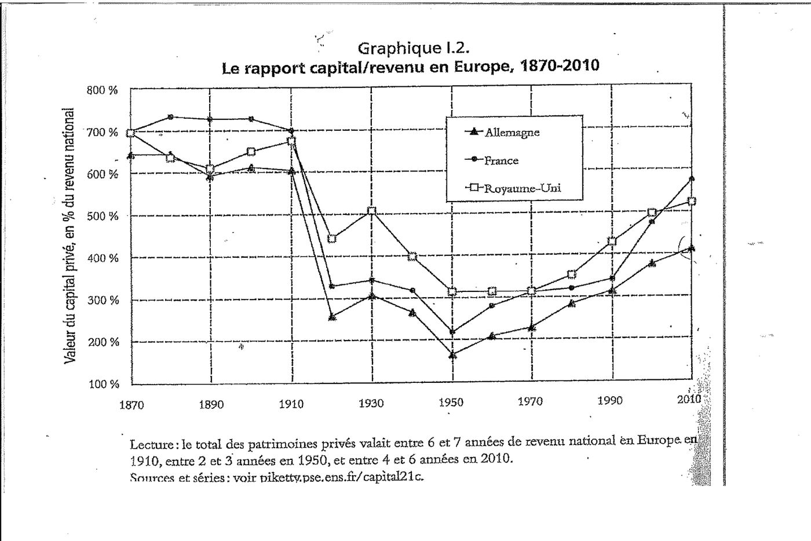{ loading=lazy style="width:49%" }

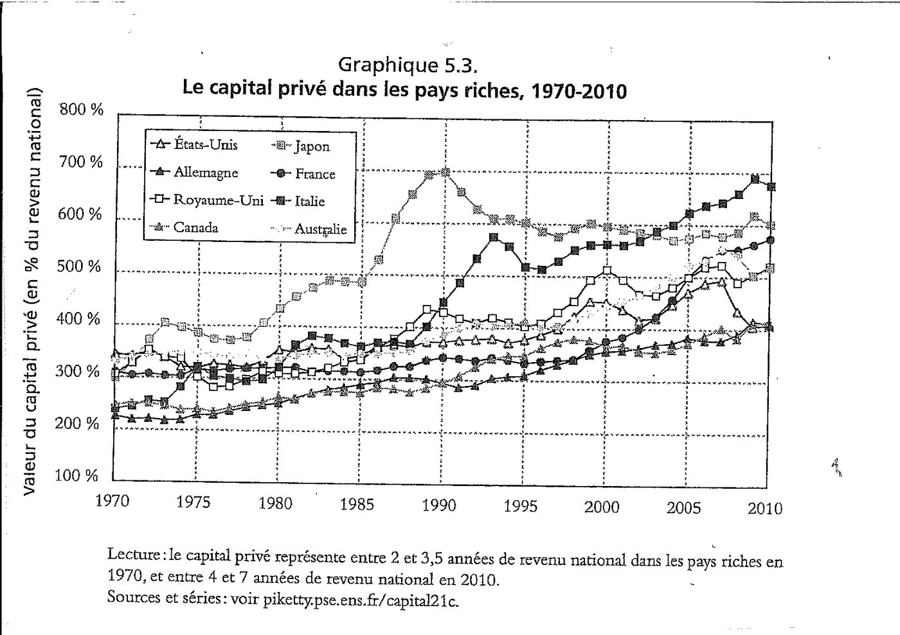{ loading=lazy style="width:54%" }

1:53:15

Questa cosa può invece cambiare. Se guardiamo l’altro grafico, dove siamo noi, misurati attraverso questo rapporto tra ricchezza e reddito – non so se sono chiaro –, il Paese più in alto di tutti è l’Italia: noi oggi siamo, si dice, a un rapporto tra ricchezza e reddito intorno a 700-800%; nel grafico l’Italia è intorno al 680% nel 2010; gli altri Paesi stanno tutti più in basso; il più basso di tutti, a 400, è la Germania. La Germania è molto più efficiente, cioè con meno ricchezza riesce a produrre più reddito.

1:54:24

Daniele Corsini La stessa cosa si racconta in modo diverso, ma si vede. Allora noi siamo come se fossimo diventati dei *rentier*, come i veneziani e come gli inglesi, e avessimo dato peso a una ricchezza, sia individuale sia collettiva: perché in questa ricchezza ci sono gli immobili, c’è la finanza, c’è la ricchezza degli stabilimenti industriali, quanto valgono gli stabilimenti industriali; è una somma di tutto quello che è ricchezza. Ecco perché gli altri ci dicono: «Eh, amici...». E poi non si può pensare di essere i più ricchi di tutti e avere il debito pubblico più alto di tutti: c’è qualcosa che non va. Quindi, quando ci lamentiamo, dobbiamo anche capire le nostre responsabilità.

1:55:22

È come se avessimo un capitale ozioso, cioè un capitale che non produce: ce n’è troppo, e chi è in possesso di questo capitale gode di una posizione di rendita, cioè, stando fermo, mediamente – si dice – gli rende tra il 4 e il 5% all’anno. È un modello, mi raccomando, non è identificato in una persona, ma in un modello complessivo. E quindi alla fine la rendita, che è già alta, aumenta ancora di più, perché il tasso di crescita del reddito invece è bassissimo, no? Il reddito non cresce, è fermo; e viceversa da una parte della distribuzione cresce la ricchezza: se ho investito nei mattoni, per esempio, nel tempo mi cresce – facciamo finta che i prezzi siano fermi –; oppure, che ne so, se investo in attività finanziarie e so investire – non certo se metto un po’ di risparmi in banca e mi prendono anche le spese –, se investo in maniera più oculata ho un rendimento, magari del 4-5%: in questa maniera aumenta la mia ricchezza, ma non investo in termini di creazione di nuova ricchezza. Questa è un po’ la storia che oggi dobbiamo raccontarci: la storia di un Paese che da una parte dice di stare male, che è troppo indebitato, ma dall’altra ha accumulato tanto.

1:57:00

Paolo Marcucci Grazie mille. Diamo la parola a Lorenzo per le conclusioni, come storico della filosofia che dovrà mettere insieme le nostre tesi.

1:57:30

Lorenzo Poggi Le produzioni industriali vanno sempre più verso prodotti che non sono più i prodotti classici dell’economia del passato, prodotti molto differenti da quelli del passato. Per cui, per avere occasioni d’investimento in un Paese, bisogna avere anche la possibilità di rispondere con l’innovazione, con qualcosa che sia innovativo rispetto all’esistente. È l’innovazione che rende, è l’innovazione che spinge a smobilitare il capitale e a investire, a capitalizzare; ci si rimette in gioco quando si ha la percezione che ne valga la pena, che c’è un prodotto innovativo, qualcosa che ha un mercato. Questo è uno dei punti focali.

1:59:00

Perché da una parte abbiamo un sistema che è uniforme, che tende a uniformare, a ridurre i consumi a qualcosa che è uguale per tutti. Pensate al cibo. Io, se dovessi scegliere un vizio – a parte quello dello studio, ma non lo chiamiamo vizio, lasciamo stare –, mi piacerebbe fare questo discorso sulla gola, perché è un discorso che abbiamo fatto anche a tavola. Ecco, se pensate al vizio della gola, come può essere oggi? La nostra società tende all’uniformità: i prodotti devono essere il più possibile uniformati, tutti uguali, perché così il supermercato riesce a vendere, a fare il mercato; se differenziamo troppo è difficile. Quindi da una parte abbiamo bisogno di innovazione, e dall’altra, nelle abitudini delle persone, c’è sempre più uniformità. Da noi ancora non sono così diffuse, ma ci sono le zuppe già fatte e congelate, che basta scongelare: «Che mangi?». «Boh, ’sta roba che non si sa che cosa c’è dentro.»

2:01:00

L’innovazione oggi non può essere perseguita se non attraverso una riscoperta di quelli che sono i valori profondi, autentici. Pensate al cibo, che è diventato qualcosa di tecnologico: non si mangia più senza aver letto tutte le etichette; abbiamo delle patologie legate al cibo per cui mezzo cucchiaino d’olio porta nell’organismo una quantità di grassi che, nella mente di chi lo prende, è un avvelenamento. Quindi arriviamo a questo tipo di eccessi, per cui il peccato di gola è diventato un peccato difficilissimo, quasi inesistente. Ci sono anche i biscottini di pasta frolla e i cioccolatini del pomeriggio, i baci di dama della cioccolateria di Montelupo... Ma è diventato qualcosa di estremamente legato all’uniformità.

2:03:12

Il cibo invece, come sappiamo, quando lavora come eccesso, in questo senso, era legato a qualcosa di più. I tecnici dicono che riguarda la parte più antica e profonda del nostro cervello: non quella delle attività razionali, ma quella più profonda, quella che riguarda il piacere, una relazione con l’esistenza, e che si carica di che cosa? Si carica delle emozioni, si carica del dare una finalità all’esistenza, del dare significato a ciò che facciamo; per cui il cibo diventa insieme un impegno. Non c’è chi non si premi mangiando un barattolo di Nutella da mezzo chilo: per consolarsi basta una Nutella e un cucchiaio. E il cibo è anche ricordo: non c’è genovese che abiti in Australia che non cerchi il sapore di un pesto di casa sua; e nessuno che abbia abitato nel Salento, o in qualsiasi parte del mondo, potrà non ricordare la zuppa di fagioli, cozze e calamari.

2:05:00

E questo stesso aspetto vale per le immagini. Se apprezziamo qualcosa, è perché in essa individuiamo, non tanto il segno di una moda, ma una nostra emozione: e quindi quella cosa si vende perché quell’oggetto si lega non tanto all’uniformità del consumo, ma alla capacità di concretizzare una nostra emozione in qualcosa di visibile, qualcosa che riguarda il profondo della nostra esistenza. Ed è questo che dovremmo di nuovo proporre: questo dovrebbe essere il tema dello sviluppo, che non è soltanto consumo, ma qualcosa di più, perché è relazione con il mondo, condivisa; e condivisa vuol dire che ci mette in relazione: non solo la parte profonda del cervello, ma anche la corteccia; si mette insieme l’intelletto con quest’aspetto.

2:06:30

E a tavola, come dicevamo, si costruiscono le relazioni tra le persone: la tavola è insieme il fondamento della relazione sociale e del suo significato. Anche Cristo, quando risorge, si mette a tavola, alla destra del Padre. Perché la tavola ha un’importanza fondamentale. C’era, nel Medioevo, la Tavola rotonda... Quindi è questo insieme, ed è insieme anche l’altra cosa. È questo l’aspetto di cui il nostro mondo, la nostra contemporaneità, è carente, e che io penso non solo dobbiamo recuperare, ma recuperare attraverso l’arte, attraverso questa relazione con la parte più profonda di noi. In fondo noi qui, modestamente, stando a tavola, abbiamo tentato di mettere insieme il pensiero con la parte profonda, perché sulla tavola si stabiliscono certe relazioni: non per nulla si fanno discorsi a tavola.

2:08:00

È fondamentale quest’aspetto che abbiamo messo in evidenza; ma penso che l’innovazione oggi avvenga proprio attraverso una rivalutazione di questi aspetti dell’umanità, di questa parte più profonda, che è comune, condivisibile. Finisco, se me lo ricordo, con una poesia di Giuseppe Gioachino Belli.

2:08:30

\[Poggi recita a memoria un sonetto romanesco del Belli sull’uso di forchetta, cucchiaio e coltello a tavola.\]
{: .nota }

2:10:00

Paolo Marcucci In fondo vi saluto: buonanotte a tutti, e, se volete, ci rivediamo il 26 febbraio; il tema è il diavolo. Buonanotte a tutti, grazie.

**IL VIZIO PIÙ ANTICO DEL MONDO… (IL PETTEGOLEZZO)**

Nel saggio *Gossip. Dalla Mesopotamia a Dagospia*, Paolo Pedote ricostruisce, sulla base di fonti storiche e letterarie, la storia del pettegolezzo: dalle iscrizioni erotiche e diffamatorie di Pompei e dei muri di ville e palestre romane, «il primo “blog erotico” della storia», alle maldicenze raccolte dagli storiografi antichi (Svetonio, Plutarco, Tacito), fino a Dante, Machiavelli e Proust. Il primo calunniatore della storia fu Satana; perfino Giulio Cesare era deriso dai suoi soldati. La delazione sessuale è la più diffusa, specie nei confronti dei potenti di turno, ma non risparmia i filosofi.

«Anche se mai nessuno ha pensato di annoverarlo tra quelli capitali, il gossip è senz’altro uno dei vizi più antichi e diffusi al mondo.»

## Appendice

Le slide proiettate durante l’incontro.

**I NUOVI VIZI CAPITALI?**

Ci sono alcune proposte di elencazione di nuovi vizi (Galimberti e altri).

Secondo Galimberti, a differenza dei vizi capitali, i nuovi vizi non sono più una deviazione, una caratteristica o una malattia della personalità di un individuo, ma piuttosto tendenze collettive, a cui un individuo non può opporre una resistenza individuale: consumismo, conformismo, spudoratezza, sessomania, sociopatia, diniego, vuoto.

**LE NUOVE FORME DEL PECCATO SOCIALE: I NUOVI VIZI CAPITALI DELLA CHIESA**

*Sintesi del testo della slide*

Sulle pagine dell’«Osservatore Romano» sono stati indicati i peccati del nuovo millennio: «manipolazioni genetiche, esperimenti sulla persona, inquinamento ambientale, droga, ingiustizia sociale, sperequazioni sociali, causare povertà, ricchezza eccessiva». Secondo padre Germano Policante e Sergio Tramma (Varese), accanto ai sette vizi capitali tradizionali – accidia, avarizia, gola, invidia, ira, lussuria, superbia – emergono oggi dalla società contemporanea altri «vizi capitali», frutto delle mutate condizioni economiche e culturali: indifferenza, maleducazione e aggressività.

**UN LIBRO SUI «VIZI DI ULTIMA GENERAZIONE»**

Secondo un’indagine Astraricerche / «Messaggero di sant’Antonio», gli italiani sono affetti, in ordine decrescente, da:

1\. Maleducazione e arroganza

2\. Individualismo e consumismo

3\. Indifferenza e irresponsabilità

4\. Disonestà e corruzione

5\. Scarso rispetto per la natura e l’ambiente

6\. Dipendenza da sostanze

7\. Carrierismo e competizione senza regole e freni

8\. Immaturità e infantilismo

9\. Intolleranza e fondamentalismo

