# Il diavolo

L’immagine del male

**Data:** 26 febbraio 2015 
**Luogo:** MMAB, Museo della Ceramica, Montelupo Fiorentino 
**Incontro con:** Lorenzo Poggi e Paolo Marcucci

**Interventi:** Paolo Marcucci Lorenzo Poggi Pubblico

0:01:16

Paolo Marcucci Buonasera. In fondo si sente? Perfetto. Buonasera a tutti, grazie di essere qua stasera, in questa giornata fredda e ventosa. Allora, stasera l’argomento, come sapete, è il diavolo e l’immagine del male. Però, prima di iniziare, volevo farvi una comunicazione di servizio: come avevamo detto la scorsa settimana, sabato 14 marzo facciamo la visita al Museo del Novecento a Firenze, e l’appuntamento sarebbe alle 15.30, lì davanti al museo in piazza Santa Maria Novella 10. Quindi chi vuol venire magari si prenota lì al banco, e il biglietto lo facciamo quando siamo lì, perché mi hanno detto che non c’è bisogno di prenotare; però c’è necessità di prenotare le cuffie e gli auricolari, siccome poi Lorenzo ci farà da guida, e quindi c’è bisogno di sapere esattamente chi vuol venire. Per questo vi chiedo di iscrivervi, per chi fosse interessato.

0:02:51

Iniziamo con l’argomento di stasera. Tutti noi sappiamo che il diavolo esiste: c’è, lo sappiamo, è una vita che ce lo raccontano. Il diavolo esiste, anche perché sennò non potrebbero succedere alcune cose. Questo è papa Francesco, al primo volo delle colombe della pace dalla finestra dell’Angelus. Forse qualcuno di voi l’avrà visto: appena le colombe sono state liberate è arrivato un corvo, anzi un paio di corvi, che se le sono prese e mangiate. Questa potrebbe essere sicuramente una dimostrazione dell’esistenza del demonio, perché il demonio approfitta delle tentazioni e delle occasioni: quale migliore occasione per mettere in cattiva luce il papa, emblema di Dio in terra? E poi, si sa, si nasconde nei dettagli.

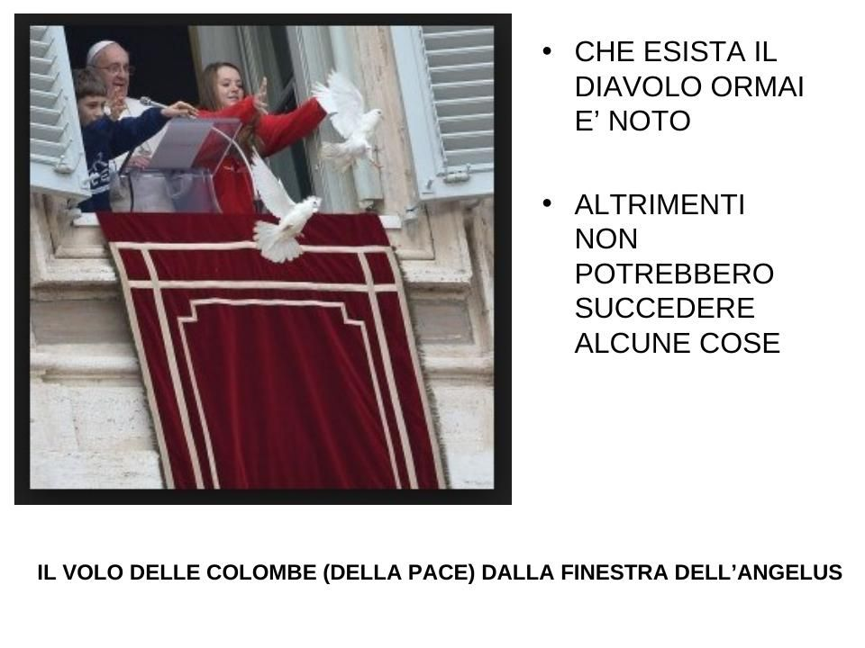{ loading=lazy style="width:47%" }

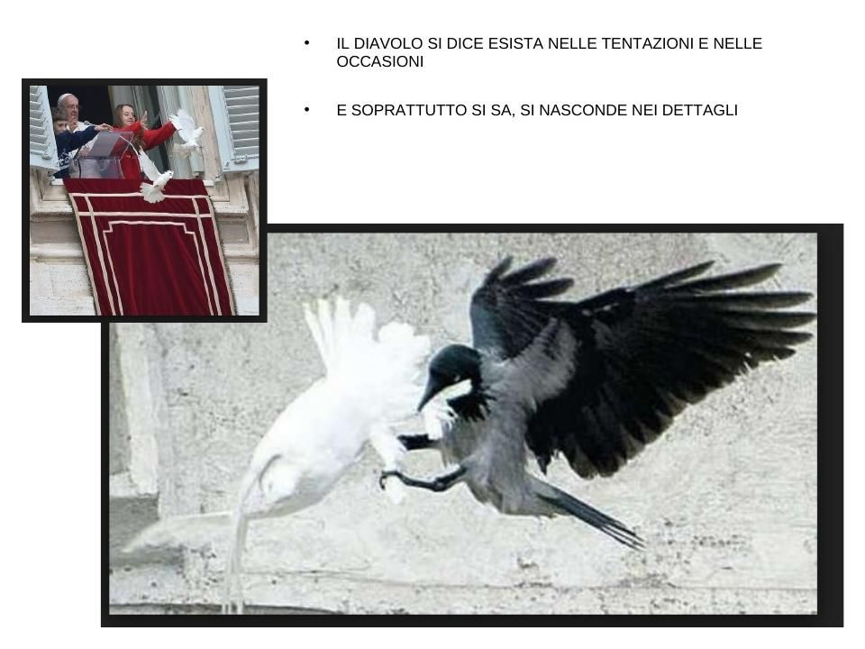{ loading=lazy style="width:47%" }

0:04:00

Però nei dettagli si nasconde anche il bene che combatte il male. Questa, per esempio, è la Sacra di San Michele, un’abbazia dei secoli XI-XII che è in Piemonte, in Val di Susa, dove passa la TAV. Anche nei dettagli di questa abbazia, per come è stata costruita, il bene combatte il diavolo e il male. Per esempio, si vede il disprezzo della vita terrena di chi l’ha costruita per accogliere la vita monastica, nella sua posizione isolata rispetto alla valle; poi il materiale di costruzione, che allude un po’ all’organicità e alla capacità della fede di riunire tutti gli uomini; poi la posizione in cima a un monte, che indica naturalmente la vicinanza a Dio: siamo più vicini a Dio. Ma la cosa più interessante è forse l’orientamento dell’abbazia verso est, dove nasce il sole, che esprime quindi la vittoria della luce sul buio, del bene sul male, dell’eternità sulla morte e soprattutto di Dio sul diavolo. La posizione di quest’abbazia voleva dire questo.

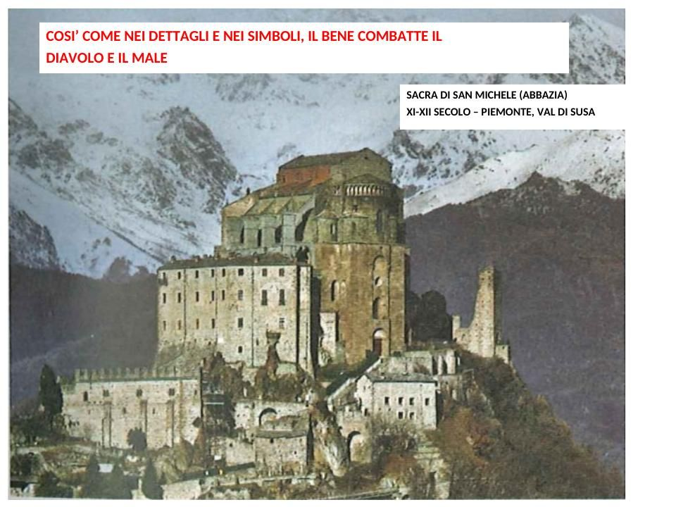{ loading=lazy style="width:47%" }

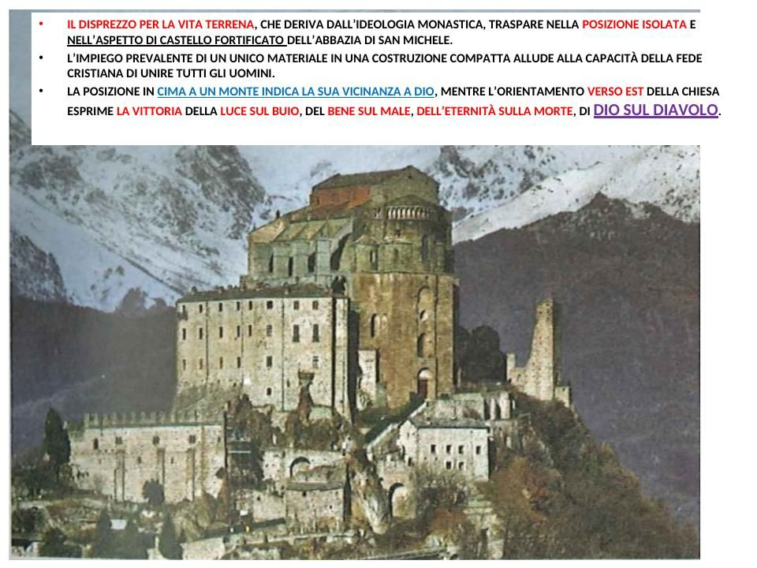{ loading=lazy style="width:47%" }

0:05:36

Ma chi è il diavolo? Il diavolo ha molti nomi. «Diavolo» deriva dal latino *diabolus*, che a sua volta deriva dal greco *diàbolos*, e significa «colui che divide» (dal greco *diaballo*, «separare»); oppure Satana (in ebraico *Satan*, in greco *Satanàs*, in latino *Satanas*, in aramaico *Satana*), che vuol dire «avversario», «accusatore»; oppure Lucifero, che significa «portatore di luce», dal latino *lux*, luce, e *ferre*, portare: quindi Lucifero, portatore di luce.

0:06:08

Ma quando nasce il diavolo? Perlomeno il diavolo che conosciamo più comunemente noi nasce dalla ribellione degli angeli: i diavoli un tempo erano angeli, prima di precipitare verso l’inferno. Da qui la caduta degli angeli ribelli. C’è un quadro bellissimo, la *Caduta degli angeli ribelli* di Pieter Bruegel il Vecchio, del 1562, e in questo quadro, di influenza boschiana, si vede tutta questa battaglia che si svolge in cielo: al centro della scena c’è san Michele Arcangelo che combatte il male, e poi tutti i demoni.

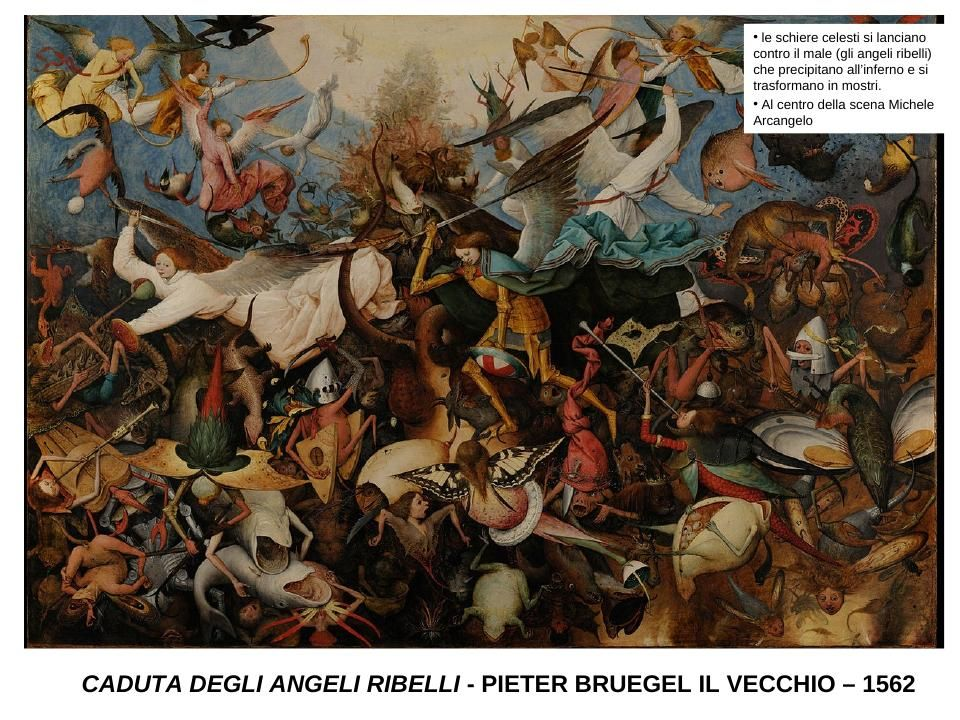{ loading=lazy style="width:59%" }

0:07:00

Però c’è il fascino, la bellezza: l’angelo caduto, se ci pensate, già dal nome stesso è affascinante, è una figura bella. Ho scelto quest’immagine perché rappresentava appunto quest’idea dell’angelo caduto: questo è Lucifero, una rappresentazione nella cattedrale di San Paolo a Liegi, in Belgio. Si dice che la creazione fu governata dagli angeli, che collaborarono con Dio; un angelo fu messo come custode alla porta del paradiso terrestre, per impedire ai banditi di entrarvi di nuovo (Genesi 3,24) – c’era già a quei tempi chi si preoccupava di non farli entrare. Il nome evoca grandezza, nell’angelo che sta accanto a Dio, e poi nella caduta e nel precipitare. Se vedete, questa è un’immagine bella, anche malinconica, che richiama un po’ la rovina della caduta: è una visione forse anche romantica.

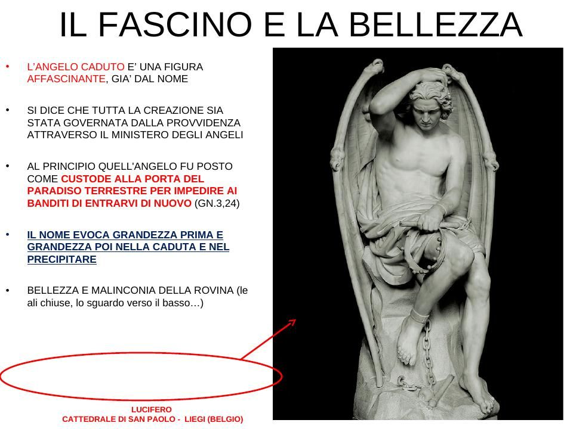{ loading=lazy style="width:59%" }

0:08:15

Ma il diavolo ha sempre fatto simpatia. Una canzone, un pezzo dei Rolling Stones, forse uno dei più famosi: *Sympathy for the Devil*, del 1968, il pezzo d’apertura dell’album *Beggars Banquet*. Oppure l’elogio del diavolo che ne ha fatto Bakunin, il rivoluzionario – ed è il tema di cui parleremo il prossimo mese, che sarà appunto la rivoluzione: «Il maligno rappresenta la ribellione satanica contro l’autorità divina, ribellione nella quale vediamo il germe fecondo di tutte le emancipazioni umane, la Rivoluzione. \[...\] Satana è l’eterno ribelle, il primo libero pensatore ed emancipatore dei mondi. \[...\] Imprime sulla sua fronte il suggello della libertà e dell’umanità, spronandolo a disobbedire e a mangiare il frutto della conoscenza». Questa è l’interpretazione che un rivoluzionario dà della figura di Lucifero e del diavolo.

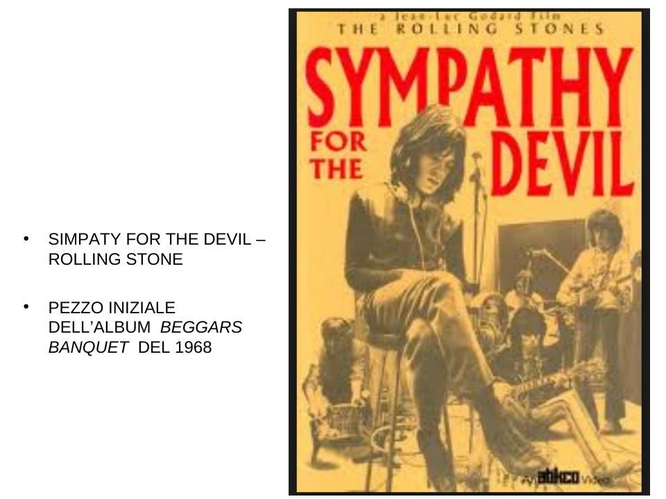{ loading=lazy style="width:32%" }

**ELOGIO DEL DIAVOLO**

Mikhail Bakunin (1814-1876) scriveva: «Il maligno rappresenta la ribellione satanica contro l’autorità divina, ribellione nella quale vediamo il germe fecondo di tutte le emancipazioni umane, la Rivoluzione. I socialisti si riconoscono l’un l’altro con le parole: “Nel nome di Colui al quale è stata commessa una grande ingiustizia”. Satana è l’eterno ribelle, il primo libero pensatore ed emancipatore dei mondi. Egli fa sì che l’uomo si vergogni della sua bestiale ignoranza e obbedienza; lo emancipa, imprime sulla sua fronte il suggello della libertà e dell’umanità, spronandolo a disobbedire e a mangiare il frutto della conoscenza. In questa rivoluzione dovremo risvegliare il diavolo nelle persone, dovremo attizzare in loro le più basse passioni. La nostra missione è distruggere, non edificare. La passione per la distruzione è una passione creativa».

I rivoluzionari amano il diavolo… (tema della prossima serata).

0:09:28

Però è stata trattata anche diversamente dagli studiosi del cattolicesimo. Isaia dice, rivolgendosi a Lucifero: «Come sei caduto dai cieli, astro del mattino, figlio dell’aurora?» – la grandezza di prima – «Come sei stato gettato a terra, tu che vassallavi tutte le nazioni? \[...\] Eccoti caduto nello Sheol», il regno dei morti, «nelle profondità dell’abisso!».

**STORIA DELLA RIBELLIONE DELL’ANGELO PIÙ BELLO: LUCIFERO**

Isaia (cap. 14) parla di Lucifero, l’angelo più eminente per il suo splendore, la sua intelligenza e la sua potenza: «Come sei caduto dai Cieli, astro del mattino, figlio dell’Aurora? Come sei stato gettato per terra, tu che vassallavi tutte le Nazioni, tu che dicevi nel tuo cuore: io scalerò i Cieli; al di sopra delle stelle di Dio erigerò il mio trono… Io rassomiglierò all’Altissimo. Come! Eccoti caduto nello Sheol (il regno dei morti), nelle profondità dell’abisso!…»

0:10:00

Ci sono diverse interpretazioni. Una va proprio nella direzione che dicevo prima, e attribuisce a Lucifero la volontà addirittura di detronizzare Dio. Però Tommaso d’Aquino dice che non è possibile, perché non si può ammettere un progetto così folle: lui, che era stato creato da Dio, non poteva pensare questo. Un’altra interpretazione è che, conosciuta la volontà di Dio di farsi uomo, di scendere sulla terra, Lucifero abbia rifiutato di servire un Dio che si fosse abbassato a un livello più basso, al livello dell’uomo. Altri interpretano la figura di Lucifero come faceva prima il rivoluzionario, come colui che aveva portato agli uomini il libero arbitrio.

**STORIA DELLA RIBELLIONE DELL’ANGELO PIÙ BELLO: LUCIFERO**

Alcune interpretazioni della Bibbia sembrano attribuire a Lucifero l’intenzione di detronizzare Dio, ma – ed è San Tommaso d’Aquino che fa notare la cosa – non si può ammettere che un progetto così folle, così insensato, abbia potuto germogliare in un’intelligenza così viva che conosceva Dio intuitivamente secondo il modo di percezione proprio ai puri spiriti.

Sembra piuttosto che avendo conosciuto il disegno di Dio di assumere una natura umana inferiore alla natura angelica, Lucifero abbia rifiutato di servire un Dio che si abbasserebbe al di sotto di lui.

Lucifero sarebbe il «diavolo» in senso letterale («colui che divide»), il quale opera per risvegliare nell’uomo il suo libero arbitrio, conducendolo però in tal modo a esaltare la sua superbia e il suo egoismo.

Solo dal Medioevo il diavolo assume le forme che noi conosciamo di più. Prima del Mille l’immagine era di un diavoletto, folletto, spirito maligno, essere spregevole. Solo dopo l’XI secolo diventa un essere mostruoso.

Il Lucifero dantesco, confitto nell’inferno, con le sue tre bocche maciulla tre celebri traditori (Giuda, Bruto e Cassio), ma le sei pesanti ali di pipistrello, simbolo di tenebre e di cecità, flagellano l’aria gelata, impotenti a volare. Questo Lucifero è più ripugnante che terrificante in linea con la tradizione scolastica che nega un’esistenza autonoma del male, giacché il male dipende in ultima analisi dal bene, essendo Dio creatore dell’intero universo.

Satana è pura materia, è un verme, un mostro, la negazione della verità e dello spirito, perciò simbolo del nulla. Lucifero divora le sue prede umane piangendo lacrime di rabbia impotente (come si vede ad esempio nell’immagine successiva, dagli affreschi del camposanto di Pisa).

0:10:55

Però il diavolo ha assunto diverse forme rappresentative. Fino all’anno Mille il male naturalmente esisteva, però il diavolo veniva rappresentato con figure di diavoletto, di folletto, di spirito maligno; non aveva quelle caratteristiche che prende poi dall’anno Mille in poi. Dante appunto nell’*Inferno* lo tratteggia proprio in questo modo – ora vediamo un’immagine: divora i tre traditori, però è impotente a volare. Questo perché nell’interpretazione che si dà in quel periodo il male non può esistere indipendentemente, come scelta autonoma: prima che Dio creasse il mondo il male non c’era, e quindi non può avere un’esistenza autonoma. E Satana è rappresentato come pura materia, e molte volte piange lacrime di rabbia impotente.

0:12:19

C’è un affresco a Pisa, al Camposanto monumentale: questo è un particolare del *Giudizio universale* del Maestro del Trionfo della Morte (1360-1370), il particolare del demonio. Forse non si vede tanto bene l’immagine, però va nella direzione che dicevo prima.

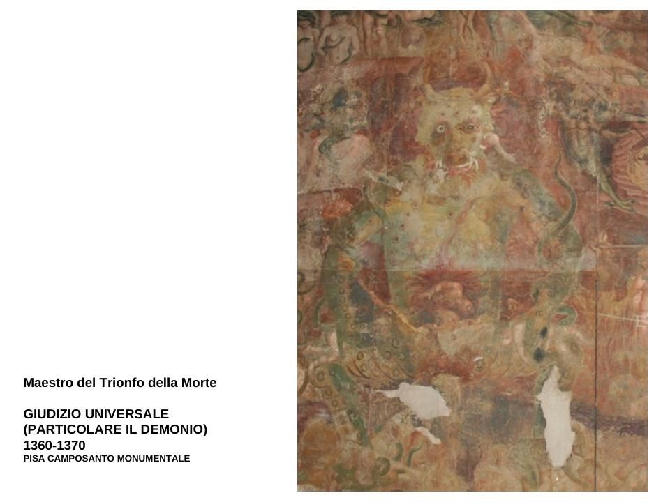{ loading=lazy style="width:51%" }

0:12:45

Questo invece è un Lucifero della fine dell’Ottocento – inizio del Novecento: è il «Lucifero» (1890) di Franz von Stuck, un pittore tedesco, maestro di Kandinsky e di Klee. Questo Lucifero potremmo benissimo essere noi: è un uomo moderno, per lo sguardo, per l’atteggiamento potrebbe essere benissimo uno di noi. E questo dimostra come la rappresentazione del demonio cambi al mutare del tempo. Anche questo è un dipinto di fine Ottocento, quando c’è un cambiamento anche nell’arte di rappresentare le emozioni: e qui il demonio non si vede. Questo è il *Cristo nel deserto* (1872) di Ivan Kramskoj: Gesù nel deserto, da solo, forse perché il demonio è già dentro di noi e quindi non c’è bisogno di rappresentarlo: è il Cristo tentato, come si dice, perché il demonio è il tentatore per eccellenza. Queste ultime due opere che abbiamo visto sono ora esposte a una mostra a Rovigo, *Il demone della modernità. Pittori visionari all’alba del secolo breve*, per chi fosse interessato.

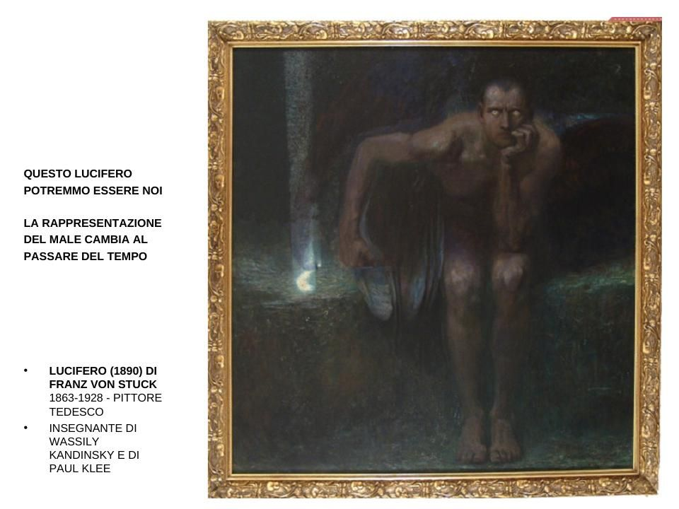{ loading=lazy style="width:47%" }

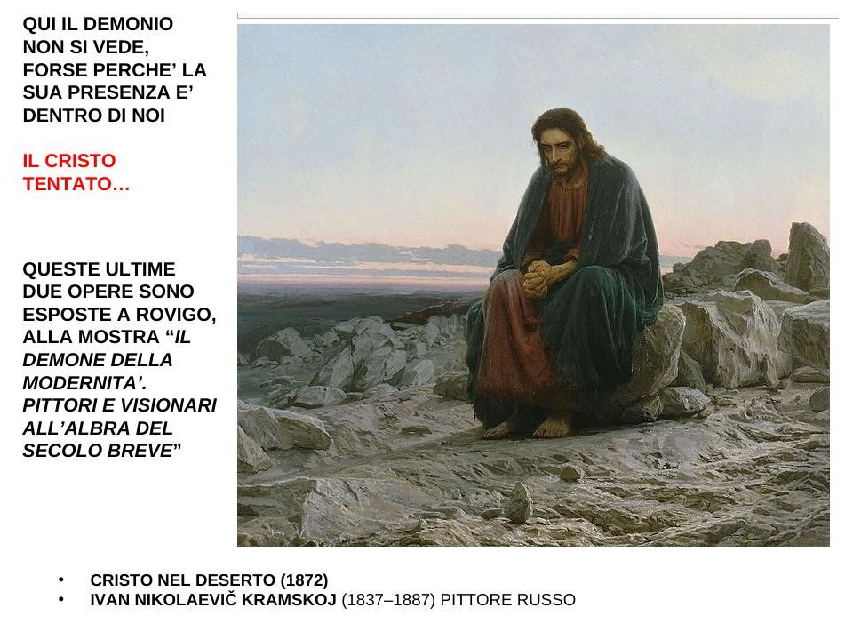{ loading=lazy style="width:47%" }

0:14:02

Ma torniamo alla battaglia in cielo, quella che abbiamo visto nella caduta degli angeli ribelli. Giovanni racconta questa battaglia e dice: «Allora una lotta si svolse nel cielo: Michele e i suoi angeli combatterono il dragone. E il dragone rispose, appoggiato dai suoi angeli, ma essi furono sconfitti e furono cacciati dal cielo». Questa è un’altra interpretazione della battaglia che si è svolta in cielo, della ribellione degli angeli: è di Luca Giordano (1666), «San Michele sconfigge gli angeli ribelli». Vedete la differenza rispetto al quadro di Bruegel che abbiamo visto prima: se ci fate caso, qui si vedono già tutte le caratteristiche – che credo ci racconterà anche Lorenzo –: basta guardare le ali. Queste sono le ali tipiche dell’angelo e queste sono già le ali tipiche del diavolo: Lucifero, mentre cade, è già un diavolo, perché ha le ali di pipistrello.

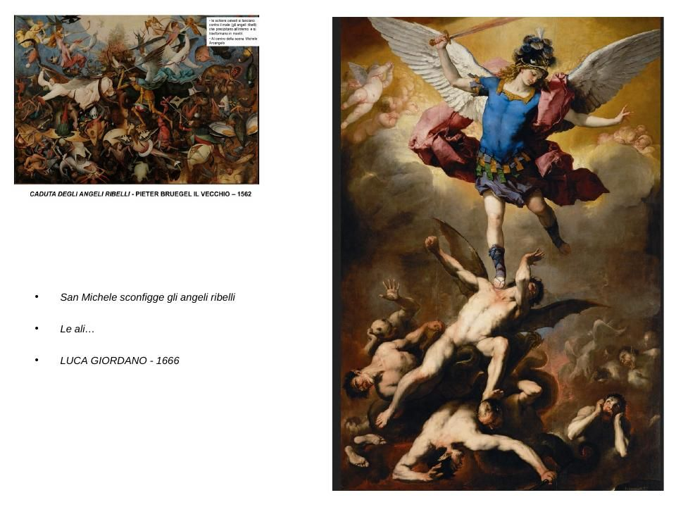{ loading=lazy style="width:59%" }

0:15:15

E continua la battaglia: «Lo si gettò dunque, l’enorme dragone, \[...\] il diavolo, il Satana, \[...\] il seduttore del mondo intero, lo si gettò sulla terra, e i suoi angeli furono gettati con lui». E questa fu la fine tragica del ribelle e dei suoi angeli. Si vede bene questa caduta in questo dipinto di Doré per il *Paradiso perduto* di John Milton, che ci dà proprio l’idea della battaglia avvenuta in cielo: mentre Lucifero sprofonda verso la terra, vedete la terra, con la sua sfericità, che sta accogliendo la caduta dell’angelo ribelle.

**STORIA DELLA RIBELLIONE DELL’ANGELO PIÙ BELLO: LUCIFERO**

La battaglia in cielo: «Lo si gettò dunque, l’enorme dragone, l’antico serpente, il diavolo o il satana come lo si chiama, il seduttore del mondo intero, lo si gettò sulla terra e i suoi angeli furono gettati con lui…» (Ap 12,7-9).

Questa fu la fine tragica del ribelle e dei suoi angeli. Essi divennero i demoni. Essi gioivano della visione di Dio, vivevano nell’eternità: si fissarono dunque, per l’eternità, in questo rifiuto cosciente, libero e deliberato, dell’amicizia di Dio.

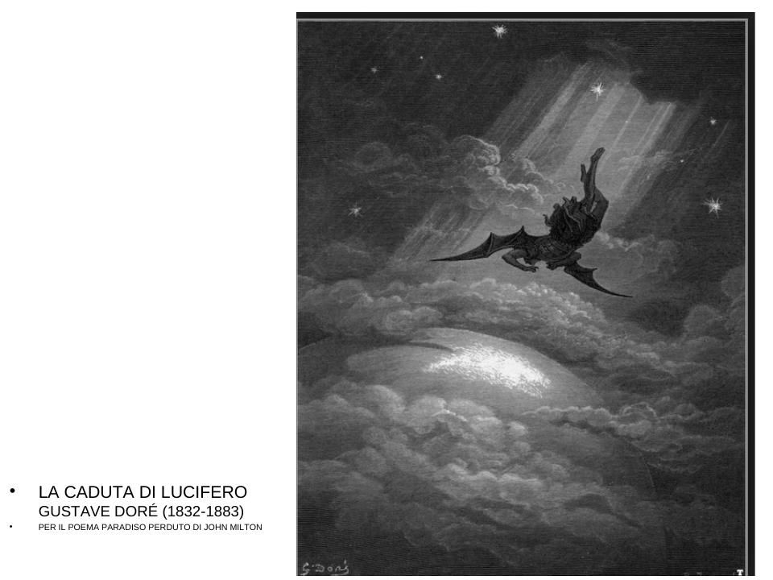{ loading=lazy style="width:54%" }

0:16:08

Che cosa successe quando arrivò sulla terra? L’impatto fu così forte che... che cosa successe? Successe che nacque l’inferno. L’inferno nasce dalla caduta di Lucifero, perché la terra, sprofondando sotto il peso della caduta dell’angelo ribelle, forma l’inferno. Questa è una rappresentazione classica dell’inferno, e vedete che al centro della terra, sul fondo, c’è Lucifero, perché è stato conficcato al centro della terra e al centro del mondo – la terra è sempre al centro del mondo – e quindi nel punto più lontano rispetto alla posizione di Dio, nel punto più profondo. E che cosa è avvenuto contemporaneamente? Si è creato l’inferno, e l’inferno che cosa fa? Accoglie il male che c’è nel mondo. Quindi con un gesto solo Dio ha sconfitto Lucifero e ha creato allo stesso tempo l’inferno dove mettere tutto il male e i peccati del mondo, i peccati dell’uomo.

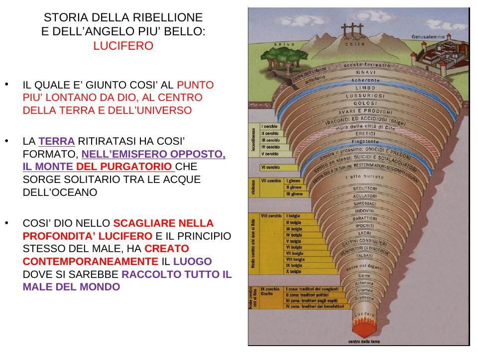{ loading=lazy style="width:59%" }

0:17:22

Lorenzo Poggi Visto che ci siamo, facciamo un po’ di geografia dell’aldilà: è interessante. Qui c’è Lucifero, con le tre teste, che sta divorando i traditori. Ed è interessante, perché è una bella nota di geografia medievale: Dante scende perché deve arrivare dall’altra parte, per risalire al purgatorio, che è dall’altra parte della terra. Qui siamo al centro della terra, sotto Gerusalemme; la caduta di Lucifero ha fatto emergere dall’altra parte, per estroflessione, la collina del purgatorio, che è l’estroflessione dell’inferno – quando si dice la programmazione dei lavori, come una volta: Dio, quando lavora, fa tutto in un colpo solo, ha sistemato tutto – e ha fatto la collina del purgatorio agli antipodi rispetto a Gerusalemme.

0:18:26

Come ci arriva? Comincia ad attaccarsi ai peli delle gambe del diavolo – anzi è Virgilio che lo porta, perché tanto è anche molto agile: si fa portare sulle spalle da Virgilio. A un certo punto, quando partono, lasciano il centro e vanno verso l’altra parte, Satana non è più con la testa di sopra e le gambe di sotto, ma con le gambe di sopra e la testa di sotto; e allora Virgilio si deve arrampicare: diventa una scala a peli, «di vello in vello», lo porta fino al sentiero, e poi, percorso il sentiero, lo porterà alla spiaggia del purgatorio.

0:19:18

Era interessante capire anche un po’ di geografia dell’aldilà. Però ecco, questo è interessante: l’inferno ha un luogo, Satana è in un posto, il male è reale. Questo è un elemento concreto nella mentalità antica, medievale, ma fino a non molto tempo fa vicino a noi. Io penso che, se si volesse leggere la nostra contemporaneità pensando a questo, non troveremmo più nulla di simile: da noi il male non è più personificato. Ci sono varie cose che vanno male, ma non c’è più il male, la sua personificazione; e anche il bene è molto evanescente, perché non è così facilmente oggettivabile. Non si può più leggere in questo modo.

0:20:23

Paolo Marcucci Ma il diavolo e il male hanno anche una codifica numerica, che è il 666. I numeri li volevo introdurre come parte finale di questa prima parte proprio perché poi nella seconda parte parleremo anche di economia, di Mario Draghi – Draghi, il dragone, il diavolo – e di patti con il diavolo. Nella Bibbia il 3 è il numero perfetto, che rappresenta la Trinità. Il 333 indicato una volta, cioè per uno, esprime il mistero dell’unità di Dio; il 333 indicato due volte indica le due nature, quella divina e quella umana; il 333 per tre volte, cioè per tre, 999, indica il mistero delle tre persone divine, distinte e una sola. E quindi il 999 è il numero più sacro, il 3 scritto tre volte per tre. Qual è allora il numero del male? È il 666. Perché? Perché è il rovesciamento del 999. San Giovanni dice (Apocalisse 13,18): «Qui sta la sapienza. Chi ha intendimento conti il numero della bestia, poiché è numero d’uomo; e il suo numero è 666».

0:21:59

Su questo punto, nel 2013 mi pare, o nel 2012, c’è stata una dichiarazione di papa Benedetto proprio sul 666: papa Benedetto sembra abbia dichiarato che «Satana è un numero, 666, e rende numeri». Che cosa abbia voluto dire io non lo so; però, se perdete cinque minuti e andate sul web a cercare quest’affermazione, troverete tutte le caricature fatte con questa foto del papa. Vedete, ha un aspetto un po’ luciferino, ce l’ha un po’ quest’espressione di papa Benedetto. E quindi, su questa storia dei numeri, magari lascio la parola a Lorenzo per la sua introduzione.

0:22:59

Lorenzo Poggi Grazie. Il numero è una cosa estremamente importante, perché nell’antichità da una parte ha un valore ontologico, cioè è una parte dell’esistente, e l’ordine dei numeri è la scoperta dell’ordine del mondo: per Pitagora il numero è ancora questo. Nella modernità il numero diventa soltanto relazione, non è più un pezzo dell’esistente; come il punto geometrico, che è solo un punto geometrico, esistente nel linguaggio della geometria, mentre nell’antichità il punto geometrico è anche una parte dell’esistente – e di lì tutti i problemi che vengono fuori.

0:23:52

Quindi che cosa vuol dire che «rende numeri»? Rende qualche cosa sottoponibile alla mente, come se il mondo fosse qualche cosa di comprensibile nella sua totalità. Satana con la sua tentazione induce a questo l’uomo. Quando dice a Eva di mangiare il frutto, le fa una promessa: «Mangiate di questo frutto, *eritis sicut dii*», sarete come Dio, avrete la conoscenza, cioè conoscerete le cose e quindi comanderete sulle cose; conoscendole sarete Dio, acquisirete la possibilità di comandare il mondo. E infatti Satana è il signore di questo mondo, perché domina la città terrena, che si contrappone alla *Civitas Dei*, la città celeste, che è quella di Dio.

0:25:14

Ecco perché il numero rende simili a Satana: perché è l’illusione di poter controllare la natura, di poterla conoscere e dominare. È l’accusa che veniva fatta alla scienza moderna quando sorge, l’accusa fatta a Galileo, che aveva osato dire che quando le cose si conoscono secondo quantità e relazione numerica, secondo il paradigma logico delle matematiche, le conosciamo nello stesso modo in cui le conosce la mente divina: cioè che l’uomo con la sua capacità intellettiva arriva a conoscere le cose del mondo come Dio. San Roberto Bellarmino dice: questa è eresia, è ispirazione del diavolo; e lo condanna, come sapete.

0:26:15

Intervento dal pubblico Scusi, professore, c’è un passaggio che non mi è ben chiaro. Se ho capito bene – ho preso anche appunti – quando lei ha detto, a proposito di questo discorso di papa Benedetto, «Satana è un numero e rende numeri», ha detto a un certo punto che è l’illusione di conoscere la natura e dominarla. Allora lui avrebbe condannato un’altra volta Galileo Galilei?

0:26:50

Lorenzo Poggi Beh, insomma, quando mai è stato assolto, Galileo? Assolto per modo di dire \[...\]. Credo che nessuno oggi possa dire... Sì, c’è qualcuno che lo ha detto, ma quelli ormai sono un po’ al limite; sennò nessuno oserebbe mai, ormai. Galileo non è quello... cioè, Galileo è anche quello, ma non è quello. Il fondamento della sua scienza, dice Galileo, è che, se noi conosciamo le cose secondo quantità e secondo relazione matematica, quando la conoscenza è di questo tipo, «*intensive*», la conoscenza umana è uguale alla conoscenza divina. Fa un discorso molto bello: dice che il conoscere si può pigliare in due modi. «Estensive», estensivamente, per quanto riguarda il numero delle cose conosciute: e in questo la conoscenza umana è nulla rispetto alla conoscenza divina, che sa tutte le cose ed è infinita. Ma il conoscere, dice Galileo, si può prendere anche «*intensive*», cioè per quanto bene si può conoscere una cosa; e quando noi una cosa la conosciamo secondo la necessità delle relazioni matematiche, oltre la quale non c’è maggiore certezza che si possa chiedere, allora «io dico che la conoscenza umana è uguale alla conoscenza divina». Figuriamoci se Roberto Bellarmino... questo afferma addirittura che la conoscenza umana è pari a quella divina: è questo che si gioca.

0:28:56

Ma facciamo questo discorso sul diavolo. Nel Medioevo pensate a tutti i teologi che a un certo punto dicono che i filosofi che hanno introdotto Aristotele, la fisica di Aristotele, e che spiegano certe cose del mondo secondo la visione fisica di Aristotele, sono emissari del diavolo. C’è addirittura un grande mistico, Pietro Lombardo, che lo dice di chi ha introdotto la scienza aristotelica, la fisica di Aristotele, rimasta sconosciuta fino alla metà del Duecento. Sono gli arabi di Spagna, Averroè in testa, ma ci sono anche al-Kindi, al-Farabi, al-Ghazali eccetera, che reintroducono lo studio della fisica di Aristotele. Il Medioevo fino ad allora conosce soprattutto la logica, ma non la fisica. La fisica viene reintrodotta, e sembra che Aristotele, nello spiegare i fatti fisici, abbia ragione; i professori della Sorbona la insegnano, e si dice che è contraria alla tradizione della Chiesa, ma non si sa che cosa rispondere, perché quello che dice Aristotele sembra così plausibile.

0:30:36

E Pietro Lombardo dice che quest’ansia di sapere, quest’ansia di conoscenza – Paolo citava Bakunin, e Bakunin la prende da questo punto di vista – ha introdotto che cosa? La superbia dell’uomo di poter conoscere e controllare la natura attraverso le matematiche e la scienza. Pietro Lombardo dice che i tomisti – poi sarà Tommaso d’Aquino a conciliare e reintrodurre Aristotele e renderlo addirittura insegnabile nelle scuole – sono come le locuste che appaiono come piaga mandata agli uomini: è il giorno dell’Apocalisse, siamo lì, è la fine del mondo. Questi erano sempre lì a dire la fine del mondo, appena succedeva qualcosa: ci siamo! Quindi, da questo punto di vista, il diavolo è anche questo.

0:32:08

Cartesio... Pensate, il diavolo nell’età moderna. Torme di diavoli: dove stanno? Abitano uno spazio intermedio fra la terra e il cielo, una specie di *aer caliginosus*, perché, se fossero sulla terra, sarebbero troppo forti e l’uomo non riuscirebbe a reggere la loro tentazione. Fortunatamente sono creature di spirito e abitano questa zona intermedia, ma vengono anche sulla terra e hanno commercio con gli uomini. Perché poi bisogna spiegare una serie di cose: se questi sono il male, come fanno ad avere commercio con gli uomini? In molti modi – stiamo attenti: seducono gli uomini, ma non possono comandare alla loro anima, solo Dio può fare questo. Il diavolo ha la possibilità di intervenire sui sensi degli uomini, sulla loro sensibilità, di far loro apparire cose che non ci sono, di far loro sentire con il tatto o vedere con la vista oggetti che non sono presenti: cioè inganna i sensi, fa apparire cose che non esistono, allucinazioni; ma non può intervenire sul libero arbitrio, sulla libertà, sull’anima, altrimenti la sua potenza sarebbe troppo superiore. In questo è tentatore: fa apparire e tenta, ti porta verso il peccato.

0:34:13

Per questo il mio prete, quando andavo a prepararmi per la prima comunione – mi hanno preparato a lungo, lo posso dire – mi diceva: «Attenzione, ragazzi, mi raccomando, il Padre nostro prima di andare a letto». Perché «*libera nos a malo*» non è «dal male», cioè dal mal di gola o dal mal di piedi: è «dal maligno», perché è lui che poi vi tenta la notte, e vi toccate dove non vi dovete toccare. E lì scopriamo il discorso di queste immagini che ci facevano venire in mente – l’immagine della nostra compagna di scuola che si chiamava Gabriella, che era in bella età, insomma: erano gli inganni dei sensi. Non so se avevano ragione i preti, se c’era il maligno, ma comunque, capite? È con l’inganno che interviene il maligno.

0:35:31

E qui c’è anche un’altra cosina. Se il maligno è spirito – attenzione, risolviamo un grosso problema teologico fondamentale – come fa a esserci il male, a tentare gli uomini, in un mondo creato da Dio e retto da Dio nella sua provvidenza? La Bibbia ce lo dice in un momento: perché Dio lo consente. Libro di Giobbe: il Satana va da Dio e gli dice: «Vedi Giobbe, com’è fedele a te, com’è uomo di fede? Per forza: gli va tutto bene, ha fatto soldi, ha una bella casa, figlioli. Lo sai che, se le cose cominciano ad andargli male, comincia a tirare i moccoli?» – no, non dice così, ma insomma – «vedrai che cambia idea». Allora Yahweh gli dà la possibilità – ve lo riassumo rapidamente – di tentare Giobbe.

0:36:47

E a Giobbe comincia a venire giù una serie di disgrazie, non vi dico: si ritrova le pustole addosso, sta sul letame a grattarsi la rogna con un coccio eccetera; gli muoiono i figlioli, gli muoiono le pecore, gli muoiono le mucche. E gli amici vanno a trovarlo e gli dicono: «Ma a te, gli avrai fatto qualche sgarbo, a Dio, e di quelli seri: guarda come ti tratta!». Devi aver commesso qualche peccataccio, di quelli duri veramente. E si mettono lì a esaminare la sua condotta – «ma quella volta che ha esagerato, che ne ha dette due o tre, gliel’ha fatta pagare: sarà quello?» –, però esaminano, ma non c’è nulla nella condotta di Giobbe che possa aver provocato questo. Alla fine Giobbe mantiene comunque sempre la fede, e alla fine Yahweh lo ricompensa, gli ridà tutto quello che gli aveva tolto eccetera.

0:38:04

E Giobbe chiede a Yahweh: perché il male? Perché ho sofferto tanto, perché mi sono capitate tutte queste cose? E Yahweh gli risponde: «Dov’eri tu quando io ponevo le fondamenta della terra? Dov’eri tu quando ho ordinato i cieli che ci stanno sopra la testa?». Che risposta gli dà? Gli dice: queste domande non le puoi fare, perché tu non sei Dio, sei una creatura, e quindi non ti puoi mettere in mente di interrogare razionalmente l’operato divino sul rapporto di giustizia. Il sacro è tale perché Dio è insondabile, e non puoi permetterti di volerlo giudicare con il tenue metro della tua giustizia e della tua intelligenza.

0:39:24

Questo Dio non è però il Dio che è andato sviluppandosi nella teologia e nella tradizione successiva. Ci sono due aspetti, ma soprattutto l’aspetto razionale: la razionalità governa Dio, che è giusto nel senso che si comporta secondo ragione, e il mistero ha sempre meno spazio.

0:39:54

Satana è quello che spinge a dire... non c’è spazio per il sacro, non c’è spazio per il mistero: l’uomo deve conoscere tutto, a lui tocca la supremazia della mente, e quindi riduciamo tutto a misura, a conoscenza, a numero, perché tutto questo è spazio legittimo nostro nel mondo. Ma ormai questo non è sentito come male.

0:40:31

Pensate che Cartesio introduce il genio maligno, di nuovo il diavolo – guardate, all’origine della scienza, della conoscenza moderna. Dice: se io penso che tutto ciò che è chiaro e distinto sia vero... ma ci potrebbe anche essere un genio maligno, «*genium aliquem malignum*», che mi fa apparire ciò che non è; e quindi ciò che a me appare reale potrebbe non avere nessuna realtà, potrebbe non essere più vero delle immagini che mi appaiono durante il sonno, se invece di Dio mi avesse fatto, e mi avesse in suo potere, un demonio ingannatore. Quindi il genio maligno, il demonio ingannatore, compare all’origine della conoscenza moderna, in Cartesio, nelle *Meditazioni metafisiche*, nel momento in cui lui deve stabilire la verità di ciò che è chiaro e distinto all’interno dell’autoconsapevolezza dell’io.

0:41:51

Quindi, come vedete, anche qui il diavolo è sempre presente: è sempre una figura eccezionale, che domina il nostro modo di intendere il mondo e la conoscenza in Occidente, e ha animato tutta la realtà del mondo. Machiavelli è stato visto come figlio del diavolo; Federico II era l’Anticristo; il papa è stato l’Anticristo, così ha detto Lutero; ma Lutero è stato l’Anticristo, così ha detto Leone X, e il papa successivo. Il diavolo serve: abbiamo bisogno di personificare il male. Vi dicevo: oggi non è più tanto così. Poi parleremo dei diavoli oggi, e mi piacerebbe parlarvi anche di un’altra cosa, perché vi ho portato anche un documento, uno scritto del diavolo: poi lo vediamo, c’è uno scritto del diavolo.

0:42:54

E poi dobbiamo risolvere un problema: il diavolo, se è spirito, come fa a fare l’amore? Perché ci sono un mucchio di donne rimaste incinte perché hanno avuto rapporti con il diavolo. Questo è un problema. \[Rivolto a Paolo Marcucci\] Dimmi, perché non so quanto tempo ho: mi lascio portare. È un problema, perché il diavolo non è un animale, come gli animali: il diavolo è uno spirito.

0:43:44

Paolo Marcucci Però questo problema è stato sollevato anche quando c’era l’Inquisizione.

0:43:51

Lorenzo Poggi Ah, direi che è uno dei problemi fondamentali dell’Inquisizione: i diavoli andavano in giro, e insomma, se rimangono incinte queste donne, le si mandano sul rogo, perché erano peccatrici.

0:44:05

Paolo Marcucci Certo, le streghe, il sabba.

0:44:08

Lorenzo Poggi Certo. Ora tenteremo anche di capire. L’Inquisizione serve a questo, a sconfiggere il maligno; e il diavolo ci vuole, ma è tutto ordinato così. Abbiamo visto San Michele Arcangelo: San Michele Arcangelo è a capo delle milizie celesti, comanda – potremmo dire – i carabinieri; infatti comanda tutti gli squadroni dei cherubini: non si chiamano carabinieri, ma cherubinieri, siamo lì, hanno le strisce rosse sui pantaloni. E quindi, quando si presenta il male... Notate anche una cosa, nei pittori – Paolo ci ha fatto vedere le immagini: San Michele, quando sconfigge il diavolo, non ci si impegna più di tanto. Lo calpesta con i piedi, ma lui trionfa, perché è chiaro che lui, che personifica la forza di Dio, non può farsi impegnare da una creatura, per quanto maligna: per cui il diavolo è sconfitto senza troppo sforzo, non è un nemico che deve essere battuto con un grande impegno. È un ingannatore.

0:45:41

E poi San Michele è quello che protegge le anime, e le pesa. Abbiamo visto la Sacra di San Michele; ma tutti i posti dove San Michele ha un culto particolare, dove è apparso agli uomini, sono su alture. Monte Sant’Angelo, nel Gargano: avete presente? Se qualcuno ci arriva, quando si avvicina a Monte Sant’Angelo vede in cima allo spuntone di roccia la grotta dove apparve San Michele, in cima allo spuntone, sempre sulla montagna. La Sacra di San Michele l’abbiamo vista; tutti conoscono Mont-Saint-Michel, sul mare: si trova nel mare, sul monte. Vola, è l’aviazione, e quindi ha i campi d’atterraggio su tutte le alture, sui punti più alti, e protegge le anime. È una divinità – San Michele psicopompo, si dice: accompagna le anime, anche agli inferi; ha sostituito Mercurio, i demoni etruschi e il dio Anubi degli Egizi – ma non facciamo religioni comparate. Quindi San Michele custodisce le anime, le preserva, le protegge dalle tentazioni diaboliche e sconfigge il diavolo.

0:47:35

È lui che caccia dal paradiso terrestre Adamo ed Eva, messo sempre in funzione di ordine pubblico e polizia, no? Questi l’hanno fatta, li hanno buttati fuori: San Michele, la spada, spada in alto, «fuori tutti e due, anche te!», e si dice che li abbia presi precisi, proprio di dietro, qui, con la spada: per questo abbiamo il sedere diviso in due mele. Ancora ce lo portiamo dietro, il colpo di spada di San Michele, che ci ricorda tutti i segni che ci portiamo dietro nel corpo. Bene, poi riprendiamo, perché dobbiamo capire come fanno a fare l’amore: c’è un problema grosso.

\[PAUSA\]
{: .nota }

1:33:10

Paolo Marcucci Bene, riprendiamo l’ultima parte di questa serata. Permettetemi di fare un applauso al Caffè Centofiori per la cena. Grazie.

1:33:37

Allora, abbiamo parlato del diavolo in tutta la prima parte. Qualcuno ha associato Mario Draghi, che sapete essere il presidente della BCE, in questi giorni sotto tutti i riflettori per la vicenda della Grecia, con i prestiti da dare o non dare alla Grecia: molti commentatori hanno associato Mario Draghi al diavolo – ho usato un’immagine, «Draghi satanici», per esasperare un po’ il concetto –, per la politica monetaria annunciata finora, e non molto realizzata, che tecnicamente chiamano *quantitative easing*. Ma che cos’è questo *quantitative easing*? Sostanzialmente, Mario Draghi ha annunciato che avrebbe acquistato mille miliardi di euro in titoli. Che cosa significa? Significa che la banca centrale, in questo caso la BCE, acquista sui mercati vari titoli – titoli di Stato, titoli di aziende private, obbligazioni, comunque i titoli che esistono e circolano sul mercato – e li compra.

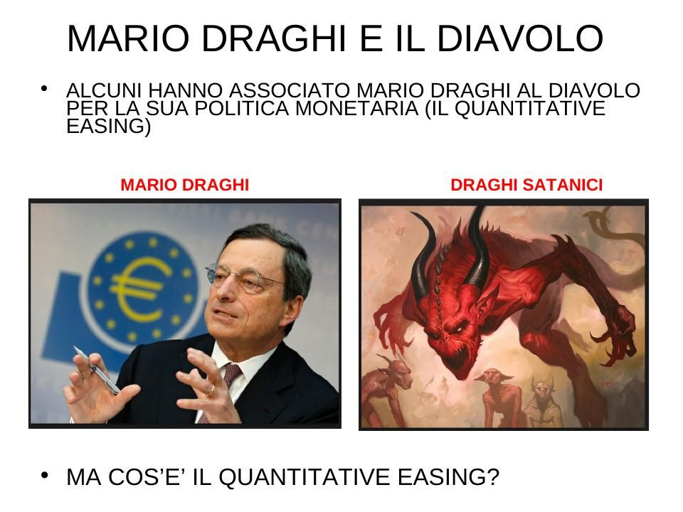{ loading=lazy style="width:59%" }

1:35:15

Li compra per quale motivo? Con lo scopo di incentivare la crescita economica. Sappiamo che la crisi iniziata nel 2007-2008, ancora oggi, a sei-sette anni di distanza, permane, e quindi questo è un tentativo di incentivare di nuovo la crescita economica. Ma che cosa significa? Significa che si crea denaro: non essendo più le banche dei singoli Stati a poter stampare moneta, la stampa la BCE. E in questo caso stampa moneta perché, per acquistare questi titoli sul mercato, deve pagare con euro: questo significa creare moneta, e creare moneta, sappiamo, significa creare denaro. E il denaro che cos’è? Storicamente è lo sterco del diavolo: per questo Draghi viene associato al diavolo.

\[Rivolto a Lorenzo Poggi\] Gli dai una tua lettura?

1:36:28

Lorenzo Poggi Sì, sì, perché... Specifichiamo meglio, rapidissimamente. Il diavolo, abbiamo visto, gioca sulle percezioni, sulle illusioni: stampare denaro non vuol dire aver prodotto più ricchezza, vuol dire semplicemente aumentare il circolante; e c’è una relazione: anche il denaro in fondo è soggetto a un mercato, più ce n’è e meno vale, e crea inflazione. Il punto è fondamentale, perché il diavolo crea illusioni, così come una maggiore quantità di circolante crea l’illusione della maggiore ricchezza: si può stampare moneta finché si vuole, ma vale sempre meno dal punto di vista del valore.

1:37:31

Due cose ancora. Per l’uomo del Medioevo il denaro è un’astrazione rispetto alla concretezza della relazione di lavoro con la natura. Il denaro non è una dipendenza dell’uomo dall’uomo, come nell’economia feudale, dove uno è «uomo di» qualcuno e la sua relazione di lavoro è una relazione tra persone: lui è il feudatario. Con il denaro la relazione è tutta astratta, mediata, illusoria, legata all’esistenza di un valore presupposto, che è quello della moneta, del denaro: non c’è più la sostanza, ma c’è soltanto il numero e l’illusione. Ecco perché è «*stercus diaboli*».

1:38:24

E chi ce l’ha gioca sul tempo: non lavora, non interviene sulla natura, dà una quantità di denaro e ne pretende una quantità maggiore dopo un certo periodo di tempo, un anno, due mesi. Il tempo ha fatto sì che i suoi denari crescessero, figliassero, perché li ha utilizzati per sollecitare i desideri degli altri uomini, per dar loro l’illusione di poterli realizzare: si è messo dalla parte dell’istinto e del diavolo. Ha utilizzato così il tempo che Dio ha dato agli uomini per perfezionarsi in attesa della fine, in attesa dell’avvento del regno di Dio – tempo di perfezionamento nella carità, nella solidarietà, nell’amore per il prossimo, e lo sfrutta a proprio tornaconto, per far crescere senza lavoro il denaro. Quindi non tempo di salvezza, ma tempo di dannazione. Dice Adalberone di Laon: se contro questi non gridassero gli uomini, griderebbero le piante, le pietre, gli animali, perché sfruttano il tempo, dono di Dio, per incentivare la loro avarizia. Volevo chiarirlo: siamo nell’890 dopo Cristo, con Adalberone, ma quest’idea attraversa tutta la Chiesa: san Tommaso dovrà arrampicarsi sugli specchi per dimostrare ai mercanti che in qualche modo avevano anche ragione, se pretendevano un guadagno: lì si sente il sudore del filosofo, ogni tanto si sente, ha fatto una sudata tremenda per arrivarci. Scusate l’interruzione, ma non si capiva perché il denaro fosse *stercus diaboli*.

1:40:41

Paolo Marcucci Grazie. Lorenzo, nel suo primo intervento, si è messo nei panni di San Michele; in questo caso della Merkel, perché la Merkel quell’affermazione sull’inflazione l’avrebbe adottata subito – infatti ora ci arriviamo.

1:41:10

Dicevo, appunto: Draghi in questo caso crea denaro, sterco del diavolo; ma l’ha già creato negli anni scorsi, nella punta più acuta della crisi, nel 2010-2011. Questo è il bilancio della BCE: come vedete oggi è più basso rispetto alla punta più alta, quindi vuol dire che negli ultimi due anni c’è stato un abbassamento di questi acquisti; però il livello attuale è molto più alto rispetto all’inizio, a prima della crisi del 2007. Quindi la Banca centrale fa già queste operazioni, ma quello che ha annunciato è che il grafico salirà ancora di più.

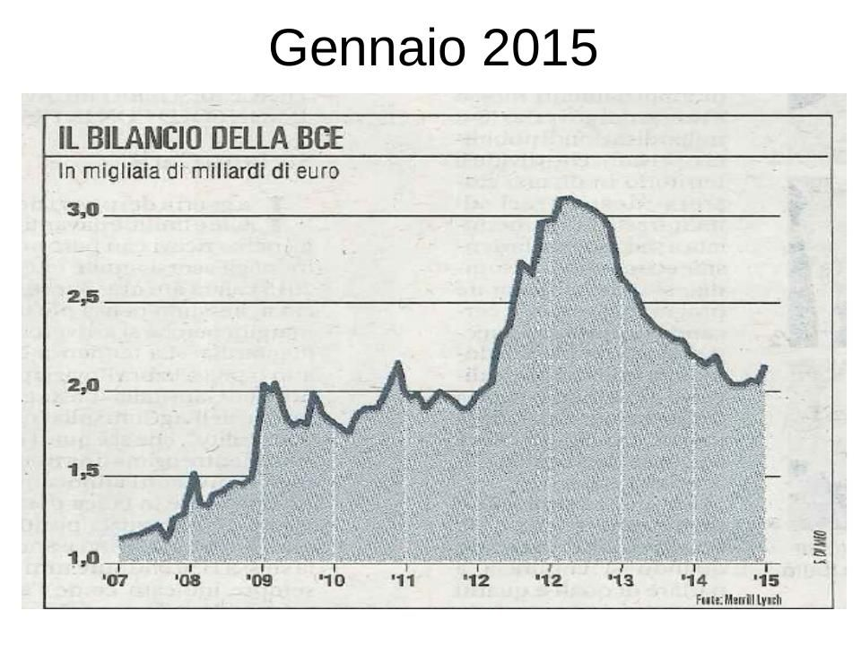{ loading=lazy style="width:48%" }

1:42:04

Non ho resistito a mettere anche questa slide, per la polemica che c’è in questo periodo tra la Grecia e l’Europa sui possibili ed eventuali rifinanziamenti alla Grecia. Questa è una tabella che ha pubblicato l’OCSE il 21 febbraio 2015, e che poi è stata ritirata, anche con qualche imbarazzo, perché sostanzialmente mette in relazione queste famose riforme, di cui ogni giorno si sente parlare sui giornali e in televisione, con la crescita, nel periodo 2007-2014: chi ha fatto più riforme, cosiddette riforme, sono anche quei Paesi che hanno avuto più problemi. La Germania è una delle ultime. Quindi queste decantate riforme non sempre hanno gli effetti che si pensa possano avere.

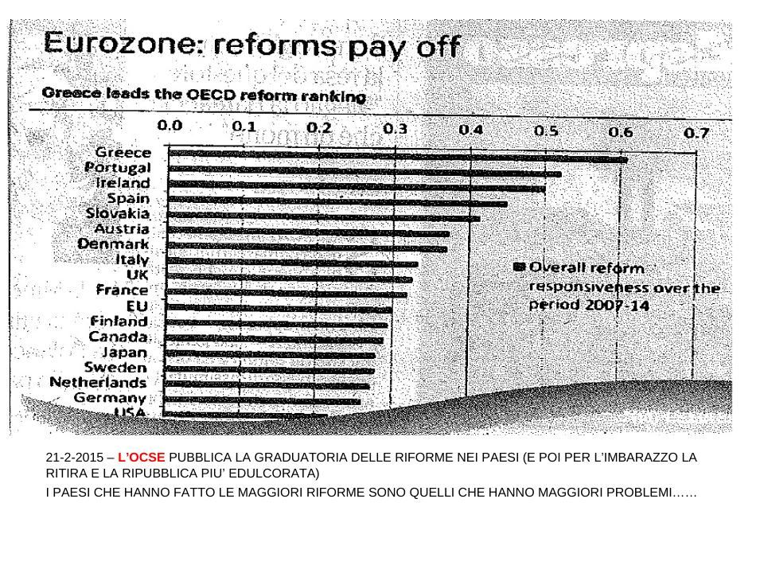{ loading=lazy style="width:51%" }

1:42:57

Ma perché Draghi viene accostato al diavolo? Per la creazione di denaro; ma c’è un precedente, un riferimento storico: Goethe nel *Faust* fa consigliare da Mefistofele a un re che era in difficoltà di bilancio di stampare moneta. Tra l’altro Goethe era stato lui stesso, per un brevissimo periodo, ministro delle Finanze in Sassonia. E qui partono le interpretazioni di questo consiglio mefistofelico di stampare moneta. La prima è quella a cui si riferiva un po’ Lorenzo prima: chi stampa moneta sostanzialmente produce inflazione; l’altra la vediamo tra un attimo. Però già il fatto che ci sia questo precedente di Goethe e del *Faust* – e il Faust, come leggenda, va ancora più indietro nel tempo – non ci deve far stupire che i tedeschi abbiano questa impostazione sullo stampare moneta, perché questo timore l’hanno sempre avuto, e il *Faust* sta lì a dimostrarlo.

**PERCHÉ DRAGHI VIENE ACCOSTATO AL DIAVOLO?**

Quando nel *Faust* di Goethe un diavolo assai scaltro come Mefistofele incontra il re alle prese con difficoltà di bilancio, il suo consiglio consiste proprio nell’usare la leva monetaria, creando moneta e ricchezza dal nulla.

Curioso, per la simbologia faustiana, sapere che Goethe aveva già illustrato una simile ricetta quando era ministro delle finanze-banchiere centrale, ruolo che ricoprì durante il periodo pre-napoleonico nel ducato di Sassonia-Weimar.

Nel primo atto della seconda parte del *Faust*, Goethe fa assistere il lettore a una seduta del consiglio di stato, nella sala del trono del palazzo imperiale, durante la quale viene dipinta una situazione di crisi: bilanci che non quadrano, indebitamento insopportabile, sconcerto generale (ricorda qualcosa…?). L’imperatore, però, taglia corto: «Mancano i soldi? E allora che cosa aspettate a fabbricarne?» (Mario Deaglio).

1:44:40

L’interpretazione tedesca è questa: chi stampa moneta produce inflazione (come già nel Settecento aveva messo in evidenza Richard Cantillon, ogni espansione della moneta arricchisce alcuni e ne impoverisce altri). Perché? I primi che hanno in mano il denaro ne traggono beneficio, una maggiore ricchezza, ma poi il denaro subisce l’inflazione, cioè ci vogliono più denari per comprare le stesse cose. Questo è il concetto di fondo tedesco, che in questo momento è quello che ha adottato l’Europa, ma non quello che hanno adottato altre zone del mondo: creare denaro è fare il patto con il diavolo.

1:45:14

L’altra interpretazione vede invece il diavolo proprio nella politica che la cosiddetta Troika – la BCE, il Fondo monetario e la Commissione europea – ha imposto ai Paesi come la Grecia, ma anche all’Italia, alla Francia, alla Spagna, al Portogallo, all’Irlanda: il diavolo è proprio questa interpretazione della materia economica. E questi invece propugnano la stampa di moneta proprio per uscire dalla crisi. Uno di questi, per esempio, un editore ed economista italiano, Elido Fazi, propone il patto con il diavolo, stampare moneta per uscire dalla crisi: dice che Goethe diventa una sorta di anima salvifica per i problemi del mondo e dell’Italia. Certo, la ricetta di Mefistofele è stata adottata dagli Stati Uniti, dall’\[Inghilterra\] e dal Giappone. I primi che hanno adottato politiche di stampa di moneta sono stati gli americani, molto pragmatici come sempre, al di là delle ideologie di mercato: per uscire dalla crisi – e ne sono usciti – hanno stampato moneta per quattro-cinque anni; la Fed ha avuto bilanci enormi rispetto all’Europa. Questa, per esempio, è la stazza delle banche centrali in questo momento: la BCE è quella con il rapporto di attivi più basso rispetto a tutte le altre zone del mondo; la banca giapponese è una delle più alte, così come quella svizzera. Quindi ci sono diverse interpretazioni dello stampare moneta: chi la vede come il diavolo e chi invece la ritiene l’unica via d’uscita da questa crisi economica.

**PERCHÉ DRAGHI VIENE ACCOSTATO AL DIAVOLO?**

L’altra interpretazione vede invece il diavolo proprio nelle politiche fin qui adottate dalla Troika (anche se il FMI sta cambiando idea e politica negli ultimi tempi).

Sentiamo uno come Elido Fazi: «Invincibile Mefistofele, protagonista del *Faust* di Goethe. In questo capolavoro completato da Goethe negli ultimi anni di vita, citato spesso ma in realtà ben poco conosciuto (perfino dai suoi presunti lettori, come il presidente della banca centrale tedesca Jens Weidmann, travisatore, a detta di Fazi, del suo autentico, stupefacente messaggio)… lo zampino del diavolo forse sì, il quale al giorno d’oggi apprezzerebbe senz’altro le iniziative economiche della cosiddetta Troika Neo-Keynesiana (Stati Uniti, Inghilterra, Giappone), molto meno l’austerità tedesca e della Banca Centrale Europea. Mefistofele, infine, se lo si ascolta con attenzione, non è tanto simile a un diavolo tentatore, quanto a un economista eretico: somiglia molto a John Maynard Keynes».

*Nelle slide successive: l’articolo «Il patto col diavolo: stampare moneta per uscire dalla crisi» (5 maggio 2014) e il grafico «La stazza delle banche centrali» (gennaio 2015).*
{: .didascalia }

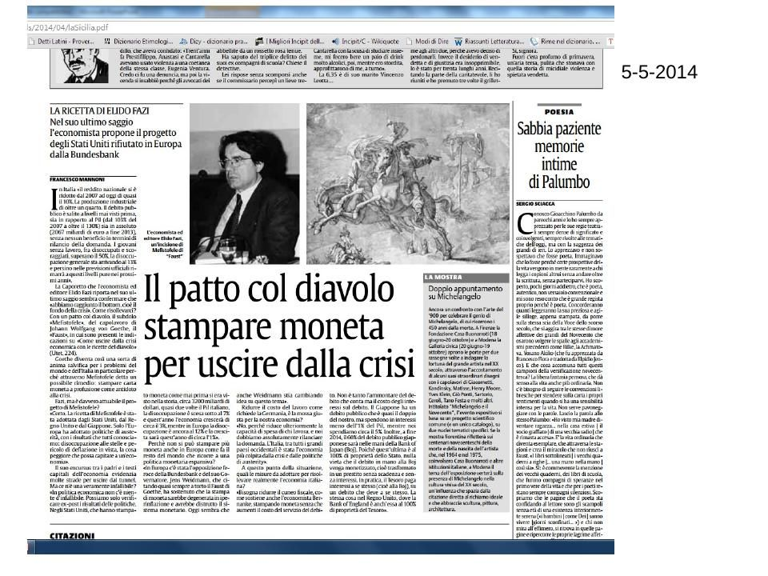{ loading=lazy style="width:47%" }

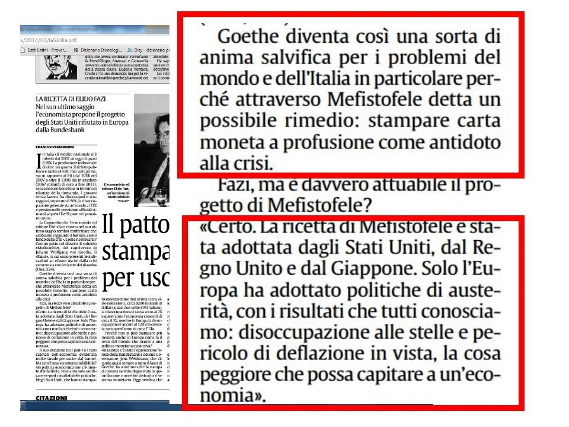{ loading=lazy style="width:47%" }

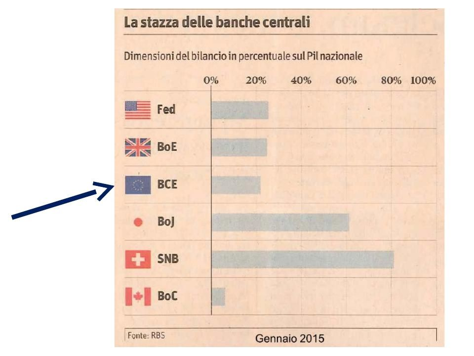{ loading=lazy style="width:56%" }

1:47:14

Però il *Faust* ci porta anche a un altro tema che mi piaceva affrontare in questa serata, il patto con il diavolo: il Faust è il patto che si fa con il diavolo. E per raccontare il patto con il diavolo ci sono tante storie – ci diceva Lorenzo che questa concezione del diavolo attraversa tutti i secoli –, quindi ce ne sono tante; una che mi è parsa molto interessante da raccontare stasera è quella di Gerberto. Per raccontarla bisogna andare prima a Roma, al Laterano. Il Laterano è stato la sede dei papi fino alla partenza per Avignone, quindi fino al 1305; poi, quando sono tornati da Avignone, hanno scelto invece il Vaticano come sede del papato; però è un’istituzione importante.

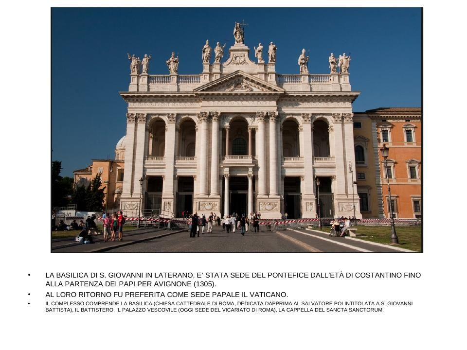{ loading=lazy style="width:59%" }

1:48:27

Ma vediamo il patto con il diavolo. Innanzitutto, nella letteratura c’è il patto con il diavolo degli esseri umani e quello degli esseri non umani. I non umani sono quelli, per esempio, che hanno portato alla leggenda del conte Dracula, oppure i dibbuk della tradizione ebraica: cioè esseri che magari da umani si sono trasformati, ma non sono più umani. Quello che interessa dal punto di vista del patto con il diavolo è invece l’umano, perché chi sottoscrive il patto con il diavolo deve averne coscienza, deve avere lo spirito libero di agire e di stipulare questo patto. Il patto vergognoso, il *turpe foedus*, può avere due nature: una è la tentazione da parte del diavolo – si sa, il diavolo approfitta di ogni occasione per tentare l’uomo; l’altra è l’invocazione da parte di un essere umano, magari perché è disperato. Però tutti e due questi tipi devono avere una certa struttura, una sequenza narrativa; naturalmente poi, in letteratura, alcuni vanno a buon fine e altri no.

**IL PATTO CON IL DIAVOLO NELLE LETTERATURE MEDIEVALI**

Una prima distinzione tra chi intrattenga un qualche rapporto specifico col diavolo va fatta tra esseri umani ed esseri non umani (demoniaci).

Ma i non umani, pur essendo assimilabili al demonio stesso, sono spesso frutto della trasformazione d’un essere umano totalmente votato al male (come i *dibbuk* della tradizione ebraica o come il principe valacco Vlad Tepeș, l’impalatore, che diventa il Conte Dracula) o anche d’un innocente che viene a contatto col male (come i vari personaggi vampirizzati dallo stesso Dracula, secondo la fantasia di Bram Stoker e seguaci).

Quelli più interessanti per il nostro discorso di stasera sono invece gli umani, i soli in grado di stipulare un vero patto con Satana.

Ma perché s’abbia un patto inequivoco, occorre che l’essere umano sottoscrittore agisca in piena coscienza, che sia dunque colpevole, pur se a volte ha delle speciali attenuanti (soprattutto la devozione alla Madonna) che possono salvarlo dall’«etterno essilio» (Dante) e reintegrarlo nella grazia di Dio.

L’*impium* (malvagio) o *turpe foedus* (patto vergognoso) si manifesta in genere come l’esito di due circostanze: o d’una tentazione da parte del diavolo, o d’un’invocazione d’un essere umano disperato. Ma come non tutte le invocazioni sortiscono un patto diabolico, così neppure tutte le seduzioni portano l’uomo a cadere nelle mani di Satana.

I racconti che rappresentano il *patto* col diavolo devono contenere una sequenza narrativa che sviluppi in modo esplicito appunto tale patto.

(Alfonso d’Agostino, *Il patto col diavolo nelle letterature medievali*)

1:49:52

La storia che volevo raccontare è quella di Gerberto, che non è altro che papa Silvestro II. Papa Silvestro II, il 139° papa della Chiesa cattolica, nasce in Francia, ad Aurillac, nel 950 circa e muore a Roma il 12 maggio 1003 (papa dal 999). Fu anche un uomo di conoscenza, di scienza, perché aveva studiato matematica in Spagna, e introdusse in Italia conoscenze di aritmetica e astronomia; e la sua vicenda è stata studiata più di una volta.

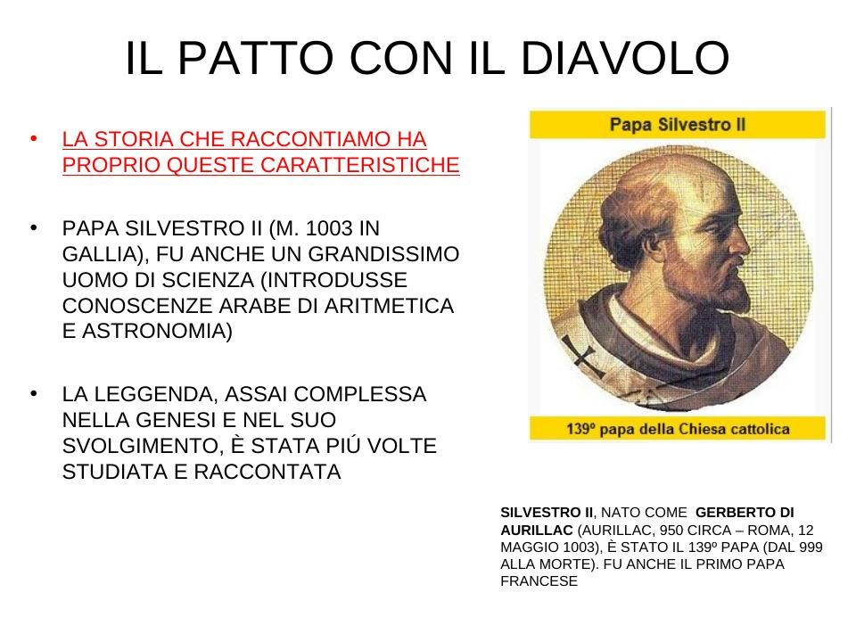{ loading=lazy style="width:59%" }

1:50:38

Allora, che cosa fece Gerberto? Fu monaco all’abbazia di Fleury; una volta lasciato il monastero, che cosa fece? Fece il patto con il diavolo. Narra la leggenda che questo diavolo si chiamasse Meridiana e fosse una donna, una bella donna, perché sembra che Gerberto fosse molto sensibile al fascino femminile; e quindi il diavolo, attraverso queste sembianze, fece l’accordo con lui. Già questo ci dice che un futuro papa che fa il patto con il diavolo non ci lascia molte speranze, se la prendiamo alla lettera: il mondo è complicato, lo sappiamo, però che uno che tra un po’ sarà papa faccia il patto con il diavolo per diventare papa è interessante da questo punto di vista.

1:51:38

Si dice che parlasse spesso con il diavolo delle proprie aspirazioni, e viene anche rappresentato spesso così, papa Silvestro II che parla con il diavolo, in questa rappresentazione medievale. È molto ambizioso, esige che il diavolo gli dia tutto quello che desidera: passa dall’arcivescovato di Reims all’arcivescovato di Ravenna, finché non arriva alla nomina suprema della Chiesa, a papa. Divenuto papa, pretende, in un colloquio con il diavolo, di sapere quanto durerà la sua potestà universale. A questo punto il diavolo che cosa fa? Gli risponde: «Durerai finché non celebrerai messa in Gerusalemme». E a quel punto che succede? Papa Silvestro II se la ride, perché dice: «Io a Gerusalemme non ci andrò mai in vita mia, quel viaggio non lo farò mai».

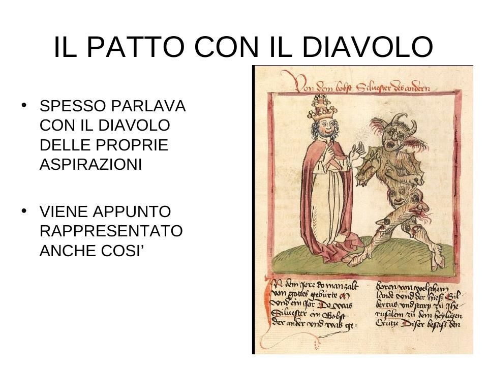{ loading=lazy style="width:30%" }

1:52:52

E invece che cosa succede? Nel corso del tempo celebra una messa di Quaresima presso Santa Croce in Gerusalemme, a Roma, nel circondario del Laterano. E lì arriva la morte («*cum strepitum daemonum sensisset, sensit mortem adesse, et suspirans ingemuit*»: quando udì lo strepito dei demoni, sentì che la morte era vicina e gemette sospirando), perché il diavolo si era preso gioco di lui con un gioco di parole, e lui non era stato abile a capire l’astuzia del diavolo: aveva fatto studi matematici in Spagna, ma la matematica non gli basta a capire questo giochetto del diavolo.

1:53:30

E qui il racconto della leggenda di papa Silvestro II ha un finale anche truculento. Perché, nonostante avesse fatto questo patto con il diavolo e fosse quindi un uomo scellerato, aveva anche timore di Dio; e allora prima di morire rivela in pubblico tutti i suoi misfatti e chiede, per punizione, che il suo corpo sia fatto a pezzi. E così avviene: lui aveva prestato giuramento al diavolo e, da buon cristiano, ritiene di dover pagare. Il tronco smembrato fu messo su un carro e sepolto là dove la corsa dei cavalli si fosse fermata: i cavalli si fermano proprio al Laterano, dove è sepolto papa Silvestro II: il luogo fu scelto «in signum misericordie consecute», in segno della misericordia ottenuta, e secondo la leggenda «sepulcrum ipsius tam ex tumultu ossium quam ex sudore presagium est morituri pape», il suo sepolcro, con il rumore delle ossa e con il sudore, annuncia la morte del papa. E questa è la storia del patto con il diavolo di uno dei papi di Roma. Ti lascio la parola, grazie.

1:54:38

Lorenzo Poggi Le storie sono sempre così: il diavolo è stato spesso ingannato, con questi giochi di parole; non sempre riesce a ingannare, qualche volta è ingannato, e la furberia popolare riesce a superare anche quella del diavolo. I patti con il diavolo sono moltissimi.

1:54:54

Allora, intanto riprendiamo il nostro discorso: come fa il diavolo a unirsi alle donne, come fa ad avere rapporti, visto che è spirito eccetera eccetera? Assume le sembianze, il corpo: assume un corpo che fa apparire, che fa percepire a chi gli sta intorno. E come fa a mettere incinta una donna? Perché per lui non funziona secondo la dinamica animale. I teologi l’hanno risolta in questo modo: il diavolo prende le sembianze di una donna, diventa diavolo succubo e fa l’amore con un uomo, e mantiene il seme; poi da diavolo succubo si trasforma in diavolo maschio, incubo, va con la donna e trasmette a lei il seme che ha preso dal rapporto precedente. Come vedete, tutto il discorso sui donatori, sulla materia, nel Medioevo lo sapevano da un pezzo: lo faceva il diavolo, ma era diffusissimo. Non abbiamo inventato niente: la donazione dello sperma è una cosa così. Però di suo il diavolo non ci mette nulla, è sempre una trasmissione di questo genere; e sollecita così i sensi, abbiamo detto.

1:56:50

E ha anche degli attributi femminili: in un momento soltanto è stato raffigurato il diavolo quasi con un elemento femminile, istintivo, legato alla terra. È una raffigurazione molto antica del diavolo incinto: ve l’ho portata perché è molto bella. Guardate, eccolo là: questa è la controfacciata a mosaico della basilica di Torcello, a Venezia, che rappresenta la fine del mondo, l’Apocalisse; ed è il momento in cui, alla fine del mondo, si sta per generare l’Anticristo, che sarà il momento precedente la fine di tutto, la risalita sulla terra del demonio a spartirsi le genti con il Messia; e sarà la fine di tutto. E lì vedete il diavolo, Satana, seduto, palesemente incinto, un po’ stanco, un po’ affaticato dalla gravidanza: si è messo a sedere nell’inferno, e dietro ci sono le anime dannate, a esemplificare la cosa. È molto antico questo mosaico, molto bello, e rappresenta la fine.

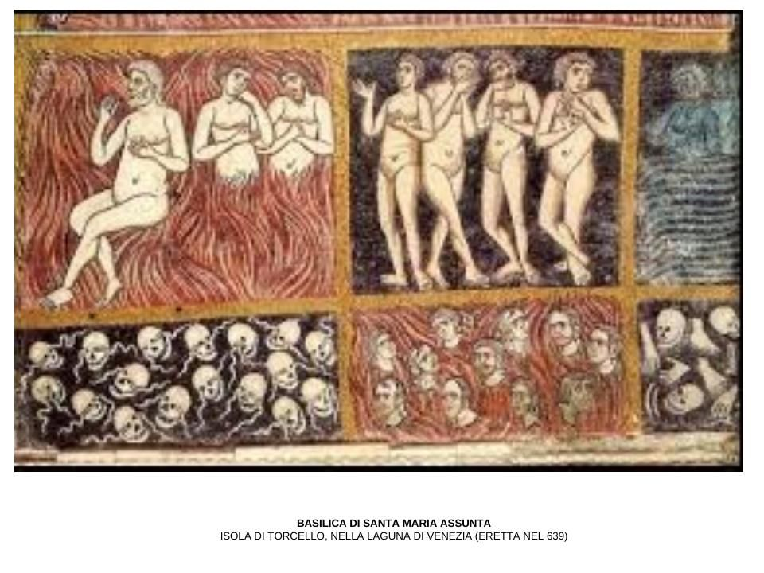{ loading=lazy style="width:59%" }

1:58:38

Quindi l’Anticristo. L’Anticristo è una figura importante: come la Vergine Maria ha incarnato Dio, così il diavolo incarna colui che si contrappone all’incarnazione di Dio, l’Anticristo. È un parallelismo che quasi riproduce una dualità delle religioni. Ci saranno religioni dualistiche – gli albigesi –, però sentite come emissarie e propagandiste di Satana, e sterminate nella Francia: 20.000 morti passati a fil di spada. Perché? Perché personificazioni, predicatori, propagandisti del demonio: così dice papa Innocenzo III. Noi ci scherziamo un po’ sopra, ma per queste cose sono state fatte fuori moltissime persone.

1:59:35

Simon de Montfort, quando espugna Tolosa – siamo sempre nella Francia degli albigesi – a Tolosa trova quelli che non erano scappati: gli albigesi, quando hanno visto che la città stava per cadere, se ne sono andati, e quelli che sono rimasti erano quelli che si ritenevano cattolici, non albigesi: «Questi tanto ci liberano». Questi invadono la città, fanno fuori un po’ di gente, poi i comandanti vanno da Simon de Montfort e dicono: «Questi dicono che non sono albigesi; non sappiamo se fingono oppure no: che facciamo?». E Montfort risponde: «Ammazzateli tutti: noi non lo possiamo sapere, Dio, che vede tutto, farà le sue scelte». Come si fa a sapere? Intanto li ammazzate, e poi ci penserà il Padre Eterno. Quindi capite se il nome dell’Anticristo è servito.

2:00:57

L’Anticristo è quello che compare nel momento che precede la fine del mondo; quindi di volta in volta \[qualcuno\] è stato accusato di essere l’Anticristo: per il papa era il diavolaccio Martin Lutero, e Lutero lo diceva del papa, reciprocamente, e così via. L’Anticristo è fondamentale nella storia della Chiesa. Il Belli dice in un sonetto: «Quanno ar monno saranno terminate / le cose che ha creato Gesù Cristo, / allora vierà fòri l’Anticristo / a parlà a le gente radunate. / Vierà co’ ’na faccia \[...\], / er corpo da gigante e l’occhio tristo; / e pe’ un caso che nun s’è mai visto / nascerà da ’na monica e da un frate. / E pe’ combatte co’ ’sta brutta arpia / uscirà da la buscia de San Paolo, / doppo tanti mil’anni, Enocchelia».

2:02:06

Ora, se quello era nato dall’unione sacrilega di una monaca e di un frate, Enocchelia, che combatte contro di lui, è nato dalla fusione dei nomi del profeta Enoch e del profeta Elia: una fusione strana anche quella, che in romanesco si chiama Enocchelia. Quindi uscirà dalla buca di San Paolo – se qualcuno di voi va a Roma può andare ancora a vedere la buca di San Paolo, vicino alla basilica di San Paolo fuori le mura: di lì uscirà, secondo la tradizione, Enocchelia, dopo tanti mila anni. E uscirà fuori dall’inferno il diavolo, a spartirsi le genti con il Messia, e resterà il mondo per seme di cavolo, perché ormai sarà finito tutto. Quindi l’Anticristo è fondamentale.

2:03:00

Parliamo di patti: vi ho portato in anteprima un patto, quello fatto da un generale, comandante delle armate sataniche. Non è una persona, ma uno dei generali che stanno intorno al trono \[di Satana\]: se lo possiamo mettere... Questo è il contratto che ha fatto un diavolaccio, questo generale; e lui impegna nel patto anche tutti i suoi luogotenenti. È uno dello stato maggiore di Satana, si chiama Asmodeo. Eccolo qua: Asmodeo è in francese; non è che sia un diavolo francese, parla francese perché scrive con la mano di una suora indemoniata. Indemoniata perché l’ha indemoniata attraverso uno che faceva il suo confessore: questo signore si chiamava Urbain Grandier, prete di Loudun, confessore delle orsoline di Loudun.

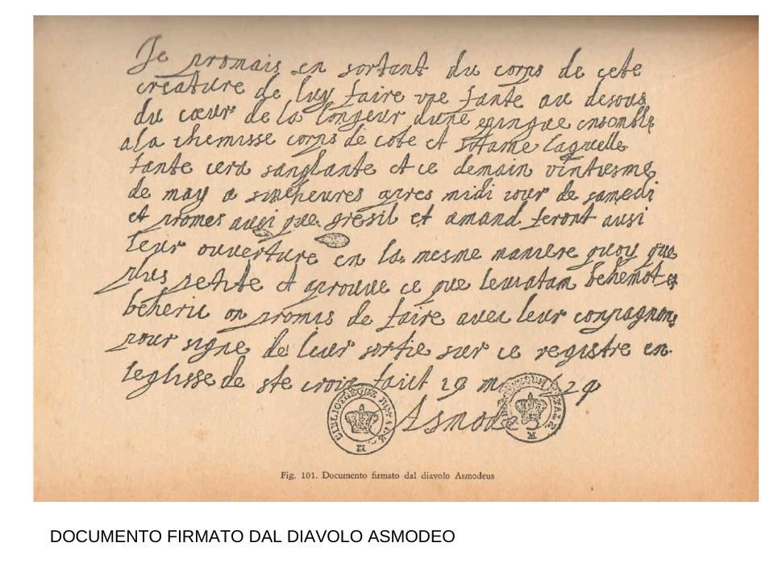{ loading=lazy style="width:44%" }

2:04:14

Aveva qualche precedente: aveva messo incinta una ragazzina di quindici anni, figlia di un magistrato. Poi aveva detto: perché non fare il confessore delle orsoline di Loudun? E lì aveva trovato la superiora delle orsoline di Loudun, una signora molto piacente, e lui, che è ispirato dal diavolo, indemonia anche lei. Si chiama Jeanne des Anges, Giovanna degli Angeli – gli angeli, quelli neri, insomma. E non solo lei: con lei anche tutte le altre; ognuna delle orsoline aveva il suo diavolo, e così via. Viene finalmente l’esorcista, e l’esorcista li caccia tutti. E chi ce lo dice? Perché il diavolo, quando esce, lascia la dichiarazione: sconfitto... Leggete le prime righe: «Io prometto, uscendo dal corpo di questa creatura, di farle una ferita della lunghezza di uno spillo («de la longueur d’une épingle») sotto il cuore», che sanguinerà, macchierà la camicia eccetera; «e così faranno parimenti». Dice anche l’ora in cui avviene questo, perché sennò che contratto fate? Dite l’ora, dite il giorno, in modo che poi l’esorcista va a dire: «Io l’ho cacciato». Carta canta. Perché qualcuno potrebbe anche dubitare che non fosse vero: c’è il documento. E infine: «Fatto il 19 maggio 1629», firmato «Asmodeo».

2:06:53

Ecco, abbiamo visto finalmente uno scritto del diavolo: questa gente che dice che non c’è, che cos’è questa storia? È molto chiaro. La monaca, l’orsolina, che era poi la badessa delle orsoline di Loudun, viene liberata; per liberarla, Grandier fa una brutta fine, orribile: l’Inquisizione lo riconosce colpevole, e l’Inquisizione aveva dei metodi al cui confronto quelli di oggi fanno ridere, sono dei ragazzini. Comunque è eliminato. E la ritroveremo, così, per la storia, questa signora Jeanne des Anges – amante, insomma, aveva anche lei dei precedenti; d’altra parte una si faceva suora anche per avere un po’ di libertà sessuale, perché, se una si sposa, poi c’è il marito che sta attento, mentre se una fa la badessa è tutto un altro giro.

2:08:13

E dunque, dicevo, finirà addirittura per essere chiamata – l’ho citata anche per questo – da Anna d’Austria, madre di Luigi XIV, il Re Sole. Anna d’Austria aveva avuto una gravidanza abbastanza difficile, e i medici dicevano che avrebbe avuto un parto travagliato; e lei chiamò una che di parti se ne intendeva – aveva avuto, dicono i maligni, qualche gravidanza, e poi, sapete come andavano le cose, qualche trucchetto, qualche abortino: queste cose succedevano alle badesse – e la chiamò ad assistere al parto. Perché? Perché Jeanne des Anges era stata liberata grazie alla camicia di San Giuseppe: sognò la notte, sotto l’influsso dell’esorcista, che la liberava San Giuseppe, e San Giuseppe le dava un unguento da cospargersi sul corpo, che la liberava da ogni appetito sessuale, quindi anche dal diavolo che l’aveva invasa. Lei si cosparse il corpo di questo unguento, che rimase impregnato nella camicia; e dopo anni, tre o quattro anni, va da Anna d’Austria e le dà la camicia impregnata dell’unguento di San Giuseppe. Anna d’Austria partorisce felicemente, il figlio scivola fuori con l’unguento, una bellezza, e sarà Luigi XIV, con un grande destino, un grande futuro di gran regnante, con l’aiuto anche di Satana – perché in qualche modo c’era lui, anche se San Giuseppe aveva dato l’unguento.

2:10:27

Dicevo, è interessante. Un’altra cosa che voglio dire: perché i diavoli, che dovrebbero essere neri, sono rappresentati in gran parte rossi? È anche una questione economica. Voi sapete, c’è una storia dei colori – se l’anno prossimo saremo ancora a fare queste cose, mi piacerebbe fare un discorso sui colori, sul colore come qualcosa che condiziona la nostra esistenza e ha condizionato la nostra storia. I diavoli del Medioevo hanno colori indecisi, perché per l’uomo medievale il colore brutto è il colore indeciso. Per noi il rosa è un bellissimo colore; per l’uomo del Medioevo è un rosso povero: uno non aveva abbastanza quattrini per comprarsi il rosso, l’hanno annacquato troppo ed è venuto un rosa. Noi del grigio diciamo «un bellissimo colore grigio»; no, per il Medioevo è un nero annacquato, da poveri, il bigio. I colori a mezze tinte sono per l’uomo del Medioevo qualcosa di povero, e quindi lo si dà al diavolo.

2:11:41

Però il diavolo ha due colori intensi, che sono i suoi: il rosso del fuoco, dell’inferno, e il nero. Ma il rosso è il colore del trionfo, è il colore della nobiltà: la nobiltà romana ha la toga, la toga pretesta, che è rossa; il rosso è il colore della nobiltà e del potere. Cristo, nelle prime rappresentazioni sulla croce, ha la parte coperta fatta con dei panneggi ricamati, ma rossi di fondo; poi neri o di un altro colore, ma per primo rosso. Il rosso è il colore della nobiltà, e sarà così per la porpora.

2:12:35

A poco a poco, però, si afferma in Occidente il nero come colore nobile: la nobiltà è nera, ha il mantello nero, più *foncé*, più nero e più importante; i poveri hanno il bigio. Allora il diavolo, che era nero, comincia a essere rappresentato rosso: \[lo vogliono\] i tintori che tingono di nero, e fanno la concorrenza a quelli che con la robbia tingono di rosso; il rosso è un coloraccio, è il colore del diavolo, dell’inferno, mentre il nero è il colore della nobiltà, fino a noi. Anche da noi gli oggetti importanti una volta erano neri: la macchina fotografica non poteva essere che nera, il binocolo non poteva essere che nero, l’abito, quando era un abito scuro, non poteva essere che nero: era il colore della nobiltà, mentre il rosso era anticamente il colore della nobiltà. Quindi il diavolo passa dal nero – doveva essere nero perché volge le spalle alla luce della verità, e quindi è nell’ombra e nelle tenebre – al rosso, per quelli che coloravano con la robbia: per quelli che tingevano è meglio metterlo rosso, il colore del diavolo, non si impara.

2:14:13

Un’ultima cosa, perché vi volevo far vedere il diavolo oggi. Abbiamo il diavolo ancora oggi, eccolo qua, lo ritroviamo – l’avete visto chissà quante volte nella pubblicità della Neo Borocillina: «Al diavolo il mal di gola». Non sappiamo più dove sia personificabile il male; uno dice: cavolo, c’è il mal di gola: eccolo il mal di gola, personificato in questo nostro mondo, dove le immagini non sono più simboliche, dicevamo, ma sono semplicemente immagini che rimandano ad altre immagini. Vedete? Ecco questi diavoli, questi diavolacci, che hanno cose per colpire, hanno guantoni e un po’ anche forchette, zampe di capra, insomma un po’ animali e un po’ no. Che cosa sono? Sono un po’ il riassunto dell’iconografia del diavolo, ma ormai priva di riferimento simbolico. Potremmo dire: siamo in un mondo di significanti che hanno perso il significato; ma su questo non possiamo andare oltre.

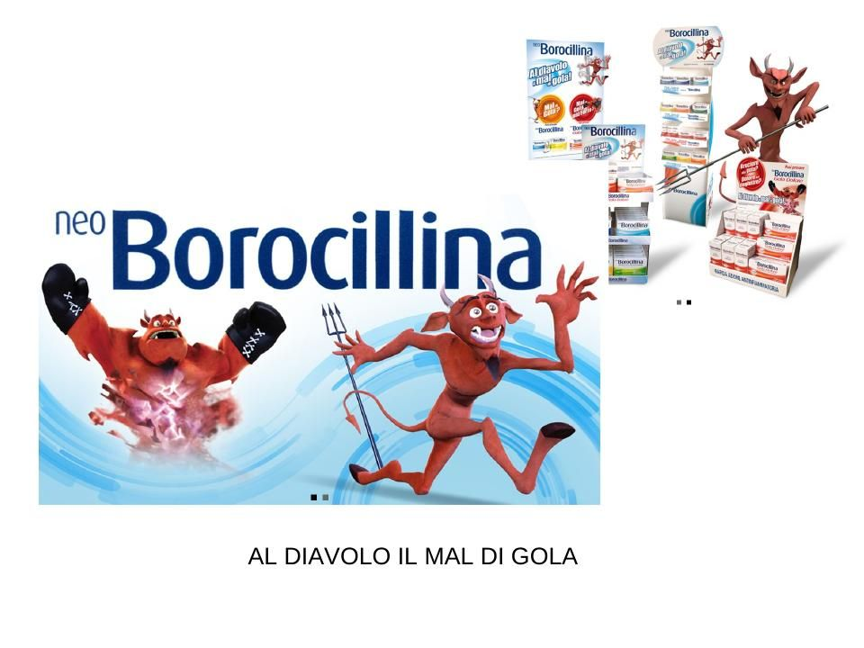{ loading=lazy style="width:59%" }

2:15:36

E poi ce n’è un altro, ormai vediamocelo, questo è bellissimo, l’avete visto chissà quante volte: la pubblicità di Altroconsumo, «Altroconsumo ne sa una più del diavolo». Il diavolo è diventato uno che sa poco, lo vedete? Ed è un signore simpatico, un papà cicciottello, un po’ grasso. Un po’ grasso perché? Perché il diavolo si lascia andare agli istinti, non si controlla, è uno che non fa diete. Sennò che diavolo sarebbe? Non lascia il controllo alla razionalità, al cervello, alla dieta, al bio, alla brioche senza zucchero, senza burro, senza grassi, senza brioche, dove non c’è nulla e costa il doppio di quella dove c’è tutto, in modo che uno mangia e non mangia. Insomma, bio e Dio ormai sono coniugati insieme nel nostro mondo. E lui invece si è lasciato un po’ andare: qualche spaghetto alla carbonara, lo vedete, qualche penna all’arrabbiata; è diventato un diavolo un po’ grasso, che si lascia trascinare dagli istinti. E ha un po’ di cornetti qua e là, ma questo capita nelle migliori famiglie, come diceva un mio amico argentino, che diceva: «Io sono argentino da parte di mia madre e campigiano da parte di un amico del mio babbo».

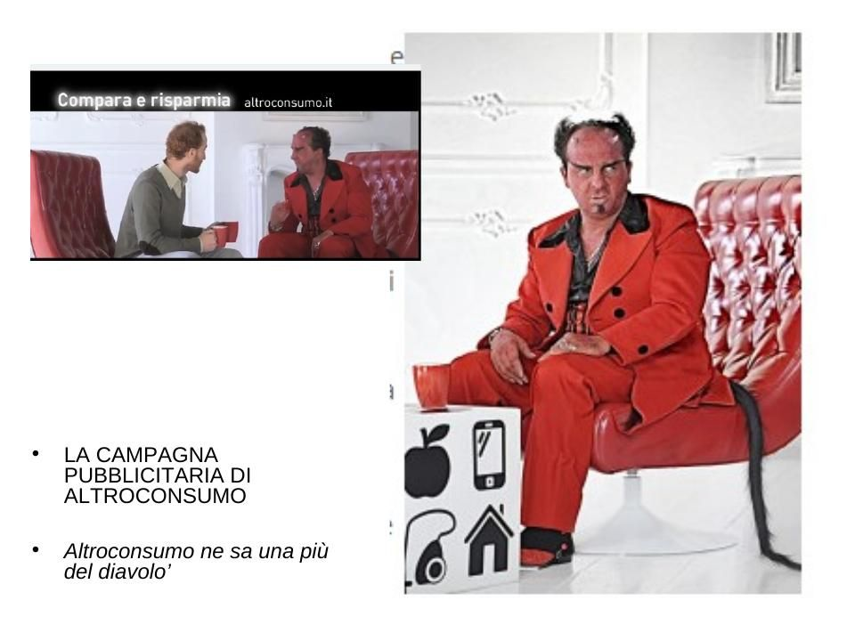{ loading=lazy style="width:59%" }

2:17:57

Quindi questa è ormai l’immagine del maligno, lo vedete: è una persona apprezzabile, che ha perduto quel carattere di personificazione del male. Forse abbiamo perduto anche proprio una contrapposizione così netta tra bene e male, per cui la distinzione è diventata difficile. Vi ringrazio, terminiamo qui.

2:18:30

Paolo Marcucci Grazie di essere venuti stasera. Vi do appuntamento alla prossima volta, se ne avete voglia. Ripeto, per chi volesse venire il 14 a Firenze alla visita del Museo del Novecento: iscrivetevi, perché è fondamentale per le cuffie, per le radioguide. Buonanotte a tutti, grazie.

## Appendice

Le slide proiettate durante l’incontro.

**I DOCUMENTI DEL CONCILIO VATICANO II CHE PARLANO DI SATANA**

Il Concilio Vaticano II non ha omesso di mettere in guardia contro l’attività del diavolo, richiamando con efficacia il costante insegnamento della Chiesa. Il testo più forte è sicuramente GS 37 (di cui si fa menzione chiara ed esplicita nei nn. 2851-2852-2853-2854 del CCC). Ma occorre anche leggere GS 2, GS 13, GS 22, SC 6, AG 3, AG 9, AG 14, LG 5, LG 16, LG 35, LG 48, LG 63, DH 11.

«Tutta intera la storia umana è infatti pervasa da una lotta tremenda contro le potenze delle tenebre; lotta cominciata fin dall’origine del mondo, che durerà, come dice il Signore, fino all’ultimo giorno. Inserito in questa battaglia, l’uomo deve combattere senza soste per poter restare unito al bene» (*Gaudium et spes*, 37).

**LE ARMI CONTRO IL DEMONIO**

La Chiesa, in relazione con le Sacre Scritture, nelle quali Gesù spesso libera le anime dal demonio, ci insegna come debellare questa forza satanica:

Con il battesimo, con il quale l’uomo è iniziato al cristianesimo e liberato dalle forze del male e dal peccato originale. Con ciò non è possibile evitare il peccato durante la vita terrena, infatti in virtù del libero arbitrio donato da Dio, l’umanità è libera di scegliere come condurre la propria vita (CCC 1237-1731).

Con le virtù, in particolare la fortezza che assicura la fermezza e la costanza nella ricerca del bene. Essa rafforza la decisione di resistere alle tentazioni e di superare gli ostacoli nella vita morale. La virtù della fortezza rende capaci di vincere la paura, perfino della morte, e di affrontare la prova e le persecuzioni.

Con la preghiera, vera e propria arma contro l’influsso maligno.

Con la partecipazione liturgica e l’accostamento continuo ai sacramenti come l’eucaristia e la confessione. Quest’ultima, in particolare, è la più temuta dal demonio in quanto vanifica e neutralizza tutto il suo lavoro di tentazione al peccato.

Con il digiuno. Una vita sobria e non inquinata dai vizi rende l’uomo meno vulnerabile all’influsso di Satana.

Con l’esorcismo. Contro le possessioni, i malefici e le tentazioni sataniche la Chiesa offre questo magistero tramandatoci da Gesù in particolare in Mt 10,8: «Guarite gli infermi, risuscitate i morti, purificate i lebbrosi, scacciate i demoni. Gratuitamente avete ricevuto, gratuitamente date».

**STORIA DELLA RIBELLIONE DELL’ANGELO PIÙ BELLO: LUCIFERO**

Altri invece interpretano la cosa anche distinguendo le due figure di Lucifero e di Satana.

Lucifero sarebbe cioè il tentatore per eccellenza che agisce nell’interiorità dell’uomo per destarvi passioni malsane (la superbia e l’egoismo).

Mentre Satana è una potenza più antica identificabile piuttosto con Arimane o Mefistofele, che cerca di degradare l’uomo trascinandolo nella materialità e inducendolo a riconoscersi soltanto nella natura e negli aspetti più bassi della creazione.

