# C’è ancora posto per l’utopia e per la rivoluzione?

**Data:** 26 marzo 2015 
**Luogo:** MMAB, Museo della Ceramica, Montelupo Fiorentino 
**Incontro con:** Lorenzo Poggi e Paolo Marcucci

**Interventi:** Paolo Marcucci Lorenzo Poggi

{ loading=lazy style="width:48%" }

0:05:46

Paolo Marcucci Grazie di essere venuti. Iniziamo la serata di stasera. Volevamo, come abbiamo fatto l’anno scorso, far circolare nella pausa – anzi, nelle pause – questo elenco di titoli: abbiamo provato a buttare giù qualcosa per il prossimo anno. Naturalmente c’è posto anche per vostre proposte, e nelle ultime due serate di quest’anno faremo la classifica di quelli che hanno ottenuto più preferenze, che saranno poi i temi che proporremo l’anno prossimo. Lorenzo, vuoi anticipare due parole su questi temi?

0:06:44

Lorenzo Poggi Sì. Dunque, vi anticipo: abbiamo fatto dieci titoli, dieci possibili tematiche, che vedete scritte. Rapidamente. La prima: «Paure e manie degli italiani», accentuate, come dire, da due fattori. Il primo è che è venuto meno quello che era la prospettiva sicura e il conforto della religione: la religione è sempre più qualcosa che riguarda la carità, la relazione con gli altri, e sempre meno qualcosa di sacro che va al di là, che rassicura come mistero; quindi questo elemento consolatorio ha ormai scarsa presa, e questo aumenta l’angoscia. L’altro elemento, se ci pensate, è l’incontrollabilità, in fondo, delle condizioni di vita: condizioni di vita che apparivano controllabili, in qualche modo comprensibili, diventano invece sempre più lontane, sempre più difficilmente controllabili. Quello che era visto come uno sviluppo sicuro – pensate alla delusione dell’America nella crisi attuale –... E quindi queste incertezze aumentano, e ci sembrava opportuno interrogarci su paure, manie, angosce attuali del carattere del nostro popolo.

0:08:36

La seconda è «La percezione del colore tra storia simbolica e innovazioni tecniche». Questa è una cosa nuova, ma particolarmente interessante, perché il colore è parte integrante, fondamentale della nostra esistenza e della nostra vita: ha un valore simbolico, ma è anche qualcosa che si gestisce con le emozioni, e ci sono fortissime innovazioni tecniche. Una cosa sola, poi passiamo all’altra: pensate che noi siamo abituati a vedere colori metallizzati – quasi tutte le automobili, anche se sono nere o bianche, ormai sono metallizzate ; nell’antichità, nel Medioevo, l’unico colore metallizzato esistente era quello degli insetti, se ci pensate: era l’unico colore metallizzato visibile. E quindi pensate alla diversità, alla trasformazione della percezione. Comunque il discorso sul colore credo si spieghi da sé.

0:09:46

Poi abbiamo un discorso sull’arte – qui abbiamo già lavorato un po’ sul titolo: «Dall’originale all’orinale», breve, dell’arte a cavallo di due secoli. Cioè: dall’opera che vale perché è fatta dall’artista, perché l’artista in essa si esprime, e quindi ha valore perché originale, all’orinale, il famoso orinatoio di Duchamp, cioè un oggetto che non è più fatto dall’artista ma è preso dalla realtà. In questo breve viaggio a cavallo di due secoli vedremo se riusciremo a chiarire questa cosa.

0:10:28

«Fedeltà e tradimento nella vita amorosa»: qui non commenterei, perché credo che si capisca che cosa sia; vedremo di darne una dimensione filosofica, se ci riusciamo. «L’Europa che verrà»: anche questo credo che non abbia bisogno di essere commentato; proveremo insieme a fare delle illazioni sui caratteri del tempo presente e sui possibili, prevedibili sviluppi futuri.

0:11:00

Il sesto è «L’ospite inquietante». «L’ospite inquietante» è la definizione che Nietzsche dà del nichilismo: questo ospite inquietante che si aggira è inquietante perché porta l’inquietudine dell’incertezza, del dubbio, la fine di quelli che erano i riferimenti sicuri, dei valori che invece non danno più affidamento e stanno scomparendo. Quindi vedremo questo aspetto.

0:11:42

«La storia dell’anima»: il fatto che l’uomo si sia dotato di un’anima e che questa in qualche modo si relazioni con il corpo, che ci sia questo dualismo che compone l’essere umano, ha una lunghissima storia nel pensiero e nella filosofia che caratterizzano la nostra cultura. Proviamo insieme a ripercorrerne i punti essenziali, a capire. Pensate che in Cartesio l’anima diventa l’elemento nel quale si comprende e trova definizione tutto il resto del mondo; fino a lui, fino a Cartesio, l’anima era sempre stata qualcosa di definito in sé, che abitava qualcosa di diverso. Solo un accenno: pensate a che cos’è l’anima. Con questa storia dell’anima proveremo a ripercorrere certi elementi salienti della nostra cultura.

0:12:47

La sto facendo troppo lunga, rapidamente. «Filosofia dell’ignoranza»: questo è un po’ difficile, e per semplificarlo mi sa che l’ho reso più difficile. Quando conosciamo, sentiamo che c’è altro da conoscere; ma come sappiamo che c’è altro, se non lo conosciamo? Da qui il problema, detto in termini tecnici: ci appoggiamo a un realismo epistemico o ci accontentiamo di un realismo metafisico? Non ditelo in giro, se no dicono: «Ma questo che dice?». Vabbè, era così, perché a volte i linguaggi diventano anche un po’ criptici. Comunque proveremo a fare questo discorso.

0:14:02

«L’esistenza tra pubblicità e spettacolo»: credo che questo sia un tema attualissimo. Ciò che noi facciamo, in fondo, è metterci in vetrina. Una delle ultime cose è fare il *selfie* e metterlo subito sui social: ci si mette subito in vetrina appena abbiamo una nuova immagine di noi, e mi «vetrinizzo» qualche volta anche mentre faccio delle cose che non sarebbe proprio bene mettere in vetrina; ma ormai è così. Anche l’intimo non è più intimo, perché è diventato roba da vetrina: qualche tempo fa vennero di moda dei pantaloni che facevano vedere quello che di solito si era sempre tenuto dentro i pantaloni, le mutande, che naturalmente dovevano essere firmate, perché si facevano vedere. Quindi c’è nel nostro tempo una vetrinizzazione di ciò che invece è intimo. Vabbè, parleremo della vetrina.

0:15:09

E l’ultima: «Che cos’è la moda?». Anche qui, pensate, la moda che cos’è? È stato fatto un calcolo – perché ci sono delle ricerche accuratissime – secondo cui ogni quarant’anni le gonne delle signore raggiungono la posizione che avevano quarant’anni prima: quindi, se partiamo dalla gonna lunga, dopo quarant’anni riarriviamo alla gonna lunga. È stato fatto uno studio accurato; vi dico soltanto questo, poi ne parleremo. Allora tocca a voi: scegliete e fate anche altre proposte.

0:15:49

Paolo Marcucci Le scelte sono naturalmente fino a un massimo di sette, che è il numero delle nostre serate annuali. Detto questo, partiamo con l’argomento di stasera, con la mia prima parte. Il tema di stasera, la rivoluzione e l’utopia, si può affrontare da molti punti di vista: si usa il termine «rivoluzione» in molti contesti, rivoluzione nell’arte, nella medicina eccetera. Faremo una breve storia delle rivoluzioni e poi, in questa prima parte, ci focalizzeremo sul periodo italiano dagli anni Cinquanta agli anni Settanta, in cui c’è stato il periodo massimo della rivoluzione; da qui anche l’immagine iniziale del frontespizio, con l’eskimo, con cui Lorenzo si è presentato stasera: l’eskimo originale di quel tempo.

**RIVOLUZIONE E UTOPIA**

Il tema è vasto e si può affrontare da molti punti di vista.

Si usa il termine *rivoluzione* in molti contesti: rivoluzione nell’arte, prodotto rivoluzionario nella medicina, ecc.

Faremo una brevissima storia delle rivoluzioni e una focalizzazione sul tema della rivoluzione degli anni Sessanta/Settanta e delle implicazioni economiche, sociali e politiche di oggi.

0:17:08

L’etimologia della parola «rivoluzione» viene da «rivoltare», «rivolgere»: significa sostanzialmente sollevazione di un popolo per sconvolgere l’ordine costituito. Il termine ha anche un’accezione un po’ ambigua, perché può essere positivo o negativo: cioè un nuovo ordinamento, una porta sull’avvenire, oppure, al contrario, il crollo, il rovesciamento, dal punto di vista di chi ha il potere in quel momento. Quindi è un termine che si può interpretare in due modi. I rivoluzionari che cosa dicono? Sostanzialmente una cosa sola, che era un po’ il motto del ’68: «Vogliamo il mondo, questo mondo, e lo vogliamo ora». La rivoluzione è anche uno slancio verso il futuro, una proiezione per quello che sarà dopo di noi, e forse anche un riscatto del passato. I rivoluzionari non vogliono più aspettare un domani, un aldilà: vogliono il mondo in quel momento.

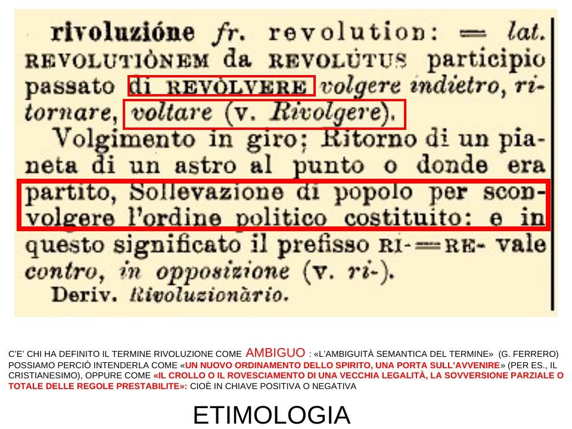{ loading=lazy style="width:59%" }

**ETIMOLOGIA**

C’è chi ha definito il termine Rivoluzione come ambiguo: «L’ambiguità semantica del termine» (G. Ferrero). Possiamo perciò intenderla come «un nuovo ordinamento dello spirito, una porta sull’avvenire» (per es. il cristianesimo), oppure come «il crollo o il rovesciamento di una vecchia legalità, la sovversione parziale o totale delle regole prestabilite»: cioè in chiave positiva o negativa.

**RIVOLUZIONE**

I rivoluzionari in sostanza ricalcano tutti il motto del Sessantotto: *vogliamo il mondo e lo vogliamo ora*…

La rivoluzione è immaginare un futuro condiviso, una proiezione per un dopo di noi, per una storia che riscatti il passato.

I rivoluzionari non possono più aspettare le promesse, non hanno più pazienza e non accetteranno più solo la ricompensa dell’Aldilà.

0:18:16

Entriamo nella parte geopolitica. Le prime rivoluzioni nel mondo occidentale sono state quelle liberali borghesi. Le due rivoluzioni inglesi, la prima del 1642 e la seconda del 1688, in cui vennero sconfitti sostanzialmente i monarchici e si diede vita al primo Parlamento del mondo occidentale: questa è la prima rivoluzione, quella inglese, liberale. La Rivoluzione americana, in cui tredici Stati si ribellarono al dominio inglese sull’America e formarono il primo nucleo di Stati che sarebbero poi diventati gli Stati Uniti d’America. La Rivoluzione francese, per antonomasia l’inizio della nostra età contemporanea: è la nascita della borghesia che prende il potere al posto dell’aristocrazia, con la proclamazione dei diritti dell’uomo eccetera.

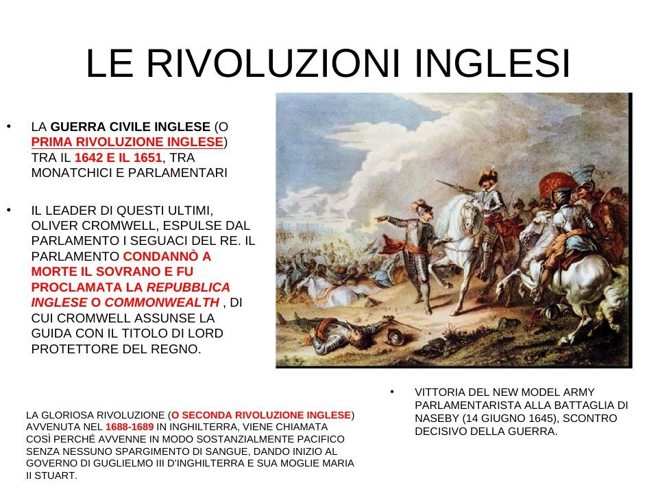{ loading=lazy style="width:59%" }

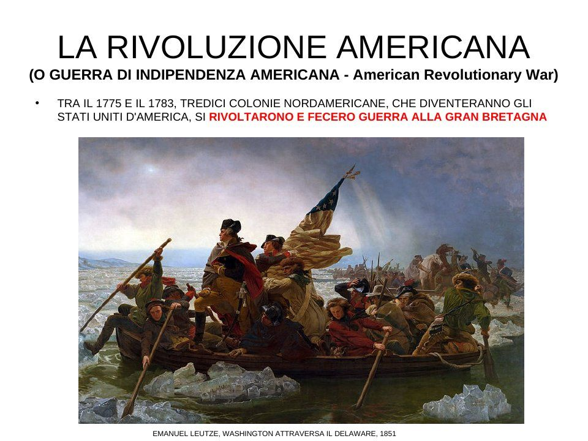{ loading=lazy style="width:47%" }

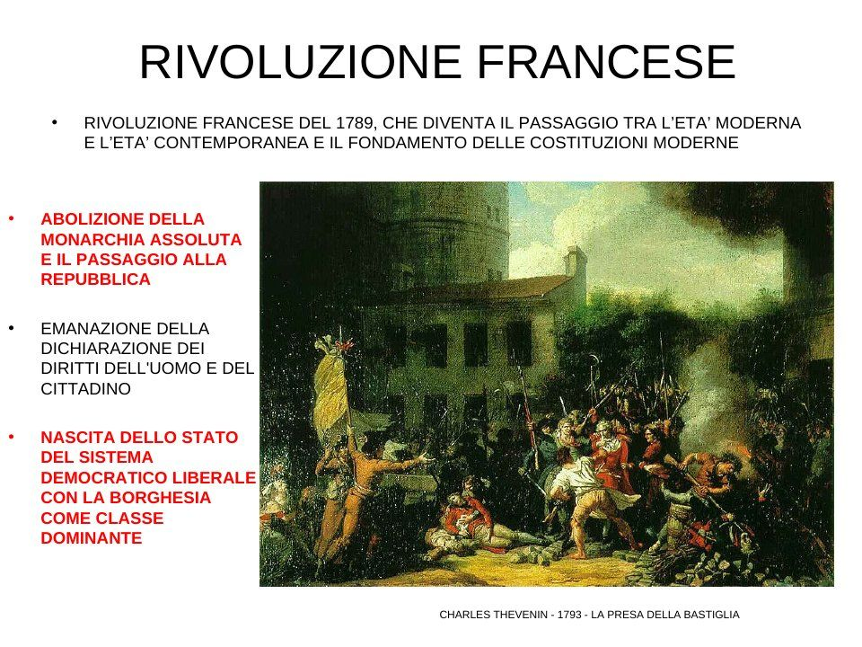{ loading=lazy style="width:47%" }

**RIVOLUZIONI LIBERALI BORGHESI**

**Le rivoluzioni inglesi**

La guerra civile inglese (o prima rivoluzione inglese), tra il 1642 e il 1651, tra monarchici e parlamentari.

Il leader di questi ultimi, Oliver Cromwell, espulse dal Parlamento i seguaci del re. Il Parlamento condannò a morte il sovrano e fu proclamata la Repubblica inglese o Commonwealth, di cui Cromwell assunse la guida con il titolo di Lord Protettore.

Vittoria del *New Model Army* parlamentarista alla battaglia di Naseby (14 giugno 1645), scontro decisivo della guerra.

La Gloriosa rivoluzione (o seconda rivoluzione inglese), avvenuta nel 1688-1689 in Inghilterra, è chiamata così perché avvenne in modo sostanzialmente pacifico, senza spargimento di sangue, dando inizio al regno di Guglielmo III d’Inghilterra e di sua moglie Maria II Stuart.

**La Rivoluzione americana (o Guerra d’indipendenza americana – *American Revolutionary War*)**

Tra il 1775 e il 1783 tredici colonie nordamericane, che diventeranno gli Stati Uniti d’America, si rivoltarono e fecero guerra alla Gran Bretagna.

Emanuel Leutze, *Washington attraversa il Delaware*, 1851.

**Rivoluzione francese**

La Rivoluzione francese del 1789 diventa il passaggio tra l’età moderna e l’età contemporanea e il fondamento delle costituzioni moderne:

Abolizione della monarchia assoluta e passaggio alla repubblica; emanazione della Dichiarazione dei diritti dell’uomo e del cittadino; nascita dello Stato del sistema democratico liberale, con la borghesia come classe dominante.

Charles Thévenin, *La presa della Bastiglia*, 1793.

0:19:18

Prima delle rivoluzioni socialiste, però, nasce tutta una cultura che porterà poi allo svolgersi delle rivoluzioni socialiste, cioè la cultura dei lavoratori. Il primo momento è il 1848, con la pubblicazione del *Manifesto del Partito Comunista* di Marx ed Engels, che era stato commissionato dalla Lega dei Comunisti. «Uno spettro si aggira per l’Europa: lo spettro del comunismo», lo sappiamo tutti; e finisce con «Proletari di tutti i paesi, unitevi!».

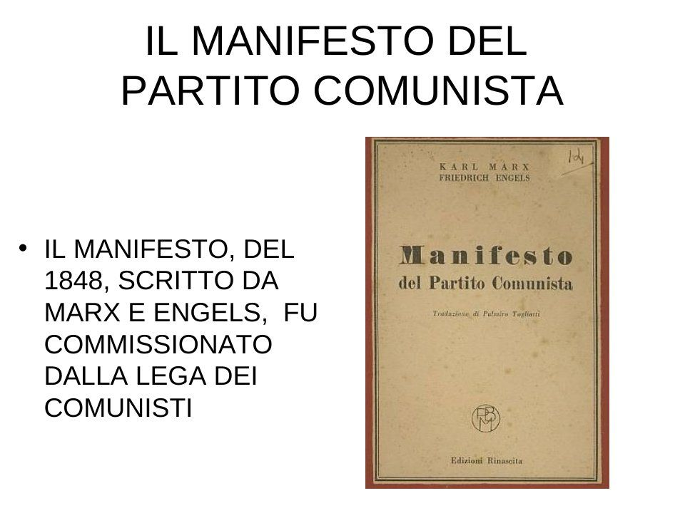{ loading=lazy style="width:30%" }

**IL MANIFESTO DEL PARTITO COMUNISTA**

Il *Manifesto*, del 1848, scritto da Marx ed Engels, fu commissionato dalla Lega dei Comunisti.

«Uno spettro si aggira per l’Europa: lo spettro del comunismo. Tutte le potenze della vecchia Europa si sono coalizzate in una sacra caccia alle streghe contro questo spettro: il papa e lo zar, Metternich e Guizot, radicali francesi e poliziotti tedeschi. È ormai tempo che i comunisti espongano apertamente in faccia a tutto il mondo il loro modo di vedere, i loro fini, le loro tendenze, e che contrappongano alla favola dello spettro del comunismo un manifesto del partito stesso.»

Finisce con la frase: «Proletari di tutti i paesi, unitevi!»

**FAMOSI I DIECI PUNTI (APPLICABILI SECONDO LE CIRCOSTANZE E DA PAESE A PAESE)**

1\. Espropriazione della proprietà fondiaria e impiego della rendita fondiaria per le spese dello Stato.

2\. Imposta fortemente progressiva.

3\. Abolizione del diritto di successione.

4\. Confisca della proprietà di tutti gli emigrati e ribelli.

5\. Accentramento del credito in mano dello Stato mediante una banca nazionale con capitale dello Stato e monopolio esclusivo.

6\. Accentramento di tutti i mezzi di trasporto in mano allo Stato.

7\. Moltiplicazione delle fabbriche nazionali, degli strumenti di produzione, dissodamento e miglioramento dei terreni secondo un piano collettivo.

8\. Eguale obbligo di lavoro per tutti, costituzione di eserciti industriali, specialmente per l’agricoltura.

9\. Unificazione dell’esercizio dell’agricoltura e dell’industria, misure atte a eliminare gradualmente l’antagonismo fra città e campagna.

10\. Istruzione pubblica e gratuita di tutti i fanciulli. Eliminazione del lavoro dei fanciulli nelle fabbriche nella sua forma attuale. Combinazione dell’istruzione con la produzione materiale.

0:20:00

Nel *Manifesto* sono famosi i dieci punti, che sono importanti perché verranno ricordati spesso nella storia anche dai non comunisti: l’espropriazione della proprietà fondiaria, l’imposta fortemente progressiva, l’abolizione del diritto di successione... non sto a leggerli tutti. «Proletari di tutti i paesi, unitevi»: nasce l’Internazionale del 1864, conosciuta come Prima Internazionale. L’idea è che i popoli, indipendentemente dall’etnia e dalla religione, hanno sostanzialmente gli stessi problemi e quindi si devono unire tutti insieme per risolvere i problemi dei lavoratori: questo è lo scopo principale.

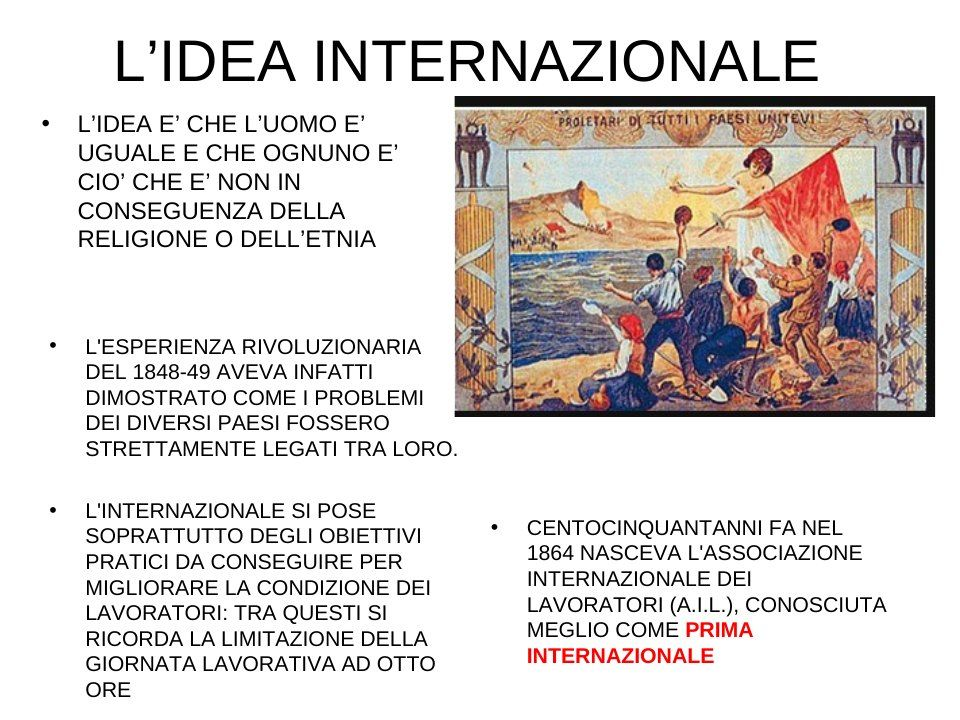{ loading=lazy style="width:59%" }

**L’IDEA INTERNAZIONALE**

L’idea è che gli uomini sono uguali e che ognuno è ciò che è non in conseguenza della religione o dell’etnia.

L’esperienza rivoluzionaria del 1848-49 aveva infatti dimostrato come i problemi dei diversi paesi fossero strettamente legati tra loro.

Centocinquant’anni fa, nel 1864, nasceva l’Associazione internazionale dei lavoratori (A.I.L.), conosciuta meglio come Prima Internazionale.

L’Internazionale si pose soprattutto degli obiettivi pratici da conseguire per migliorare la condizione dei lavoratori: tra questi si ricorda la limitazione della giornata lavorativa a otto ore.

0:20:51

Nascono i sindacati. In Italia la FIOM è il primo: nasce a Livorno – nasce tutto a Livorno, il Partito Comunista, la FIOM; chissà che cosa nasce ora a Livorno – il 6 giugno 1901. La FIOM darà poi vita alla CGIL, ma prima nasce la FIOM. Tra l’altro fu il primo sindacato a firmare un contratto collettivo – prima i contratti collettivi non esistevano : la FIOM firma il contratto collettivo il 3 dicembre 1906 con la fabbrica di automobili Itala di Torino.

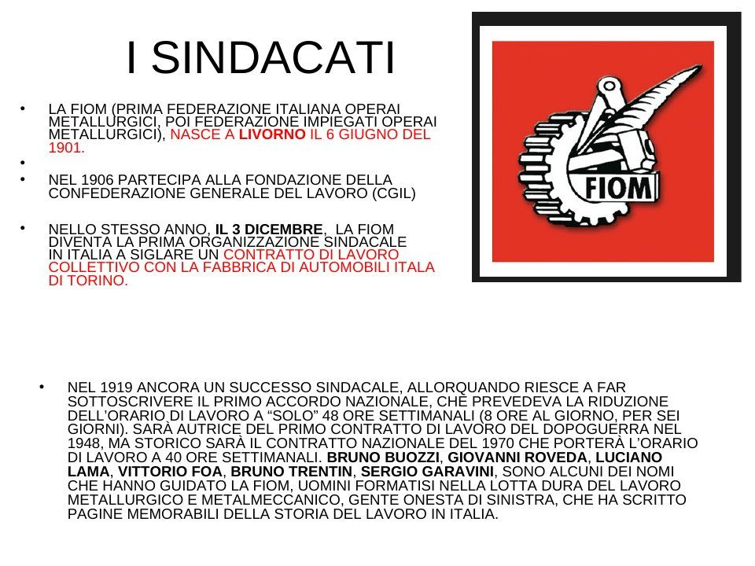{ loading=lazy style="width:59%" }

**I SINDACATI**

La FIOM (prima Federazione italiana operai metallurgici, poi Federazione impiegati operai metallurgici) nasce a Livorno il 6 giugno 1901.

Nel 1906 partecipa alla fondazione della Confederazione generale del lavoro (CGDL, da cui poi la CGIL).

Nello stesso anno, il 3 dicembre, la FIOM diventa la prima organizzazione sindacale in Italia a siglare un contratto di lavoro collettivo, con la fabbrica di automobili Itala di Torino.

Nel 1919 ancora un successo sindacale, allorquando riesce a far sottoscrivere il primo accordo nazionale, che prevedeva la riduzione dell’orario di lavoro a «solo» 48 ore settimanali (8 ore al giorno, per sei giorni). Sarà autrice del primo contratto di lavoro del dopoguerra nel 1948, ma storico sarà il contratto nazionale del 1970, che porterà l’orario di lavoro a 40 ore settimanali.

Bruno Buozzi, Giovanni Roveda, Luciano Lama, Vittorio Foa, Bruno Trentin, Sergio Garavini sono alcuni dei nomi che hanno guidato la FIOM: uomini formatisi nella lotta dura del lavoro metallurgico e metalmeccanico, gente onesta di sinistra, che ha scritto pagine memorabili della storia del lavoro in Italia.

0:21:33

Nel 1924 nasce «l’Unità». Che cosa vuol dire che nasce «l’Unità»? Non è soltanto un quotidiano: vuol dire che fino a quel momento i lavoratori non avevano avuto una voce intellettuale che li rappresentasse. Il «Corriere della Sera», che era il giornale del tempo, era espressione di un mondo capitalista che lo finanziava – naturalmente è così, è l’ordine delle cose ; e quindi i lavoratori, autotassandosi, fondano un loro giornale, affinché si possano dire e rappresentare anche le loro esigenze. Questo è lo spirito della nascita dell’«Unità».

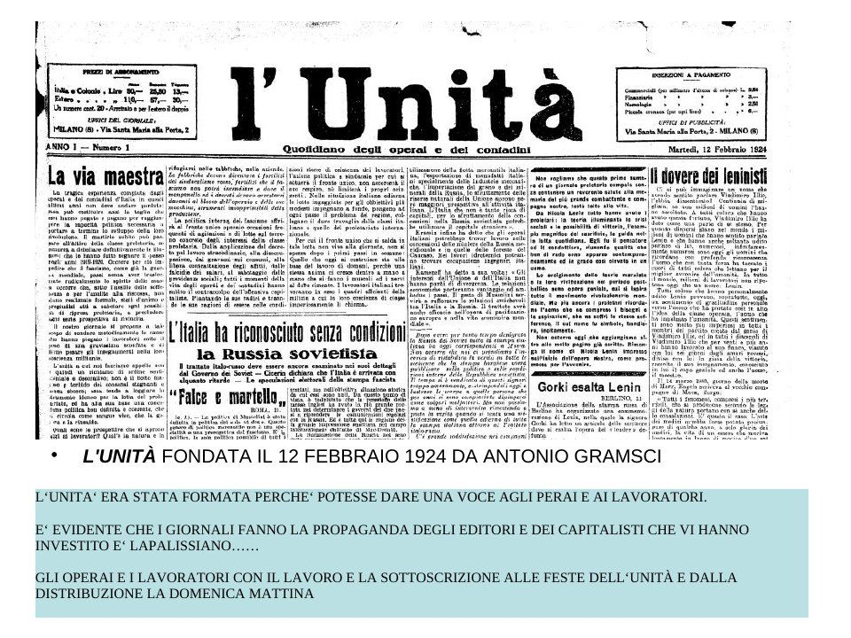{ loading=lazy style="width:59%" }

**«L’UNITÀ», FONDATA IL 12 FEBBRAIO 1924 DA ANTONIO GRAMSCI**

«L’Unità» era stata fondata perché potesse dare una voce agli operai e ai lavoratori.

È evidente, è lapalissiano, che i giornali fanno la propaganda degli editori e dei capitalisti che vi hanno investito…

Gli operai e i lavoratori la sostenevano con il lavoro, con la sottoscrizione alle feste dell’Unità e con la diffusione la domenica mattina.

0:22:17

Le case del popolo nascono alla fine dell’Ottocento e si diffondono nel Novecento, nei primi anni del Novecento. Ho messo qui un’immagine della casa del popolo tratta da *Berlinguer ti voglio bene* di Giuseppe Bertolucci, del 1977, con Roberto Benigni. Per chi ha frequentato un po’ le case del popolo, erano un po’ scuole di vita, se si può dire, anche di democrazia; se vi ricordate, alcune scene di questo film le rappresentano bene.

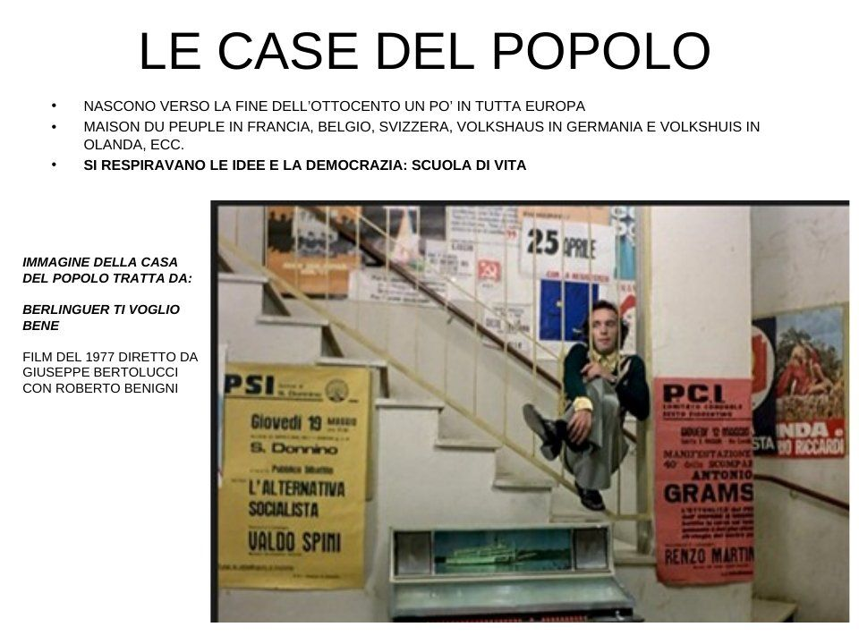{ loading=lazy style="width:59%" }

**LE CASE DEL POPOLO**

Nascono verso la fine dell’Ottocento un po’ in tutta Europa: *Maison du Peuple* in Francia, Belgio, Svizzera, *Volkshaus* in Germania e *Volkshuis* in Olanda, ecc.

Si respiravano le idee e la democrazia: scuola di vita.

Immagine della casa del popolo tratta da *Berlinguer ti voglio bene*, film del 1977 diretto da Giuseppe Bertolucci, con Roberto Benigni.

0:22:50

Tutto questo aveva preparato il terreno, anche a livello internazionale, perché si sviluppassero le rivoluzioni socialiste. E avviene proprio questo: la Rivoluzione russa del 1917, in cui contro lo zar si proclama la Repubblica socialista; la Rivoluzione cinese, in cui nel 1949 Mao Zedong prende il potere insieme al popolo nella Cina millenaria – se ci pensate, è una rivoluzione enorme – a cui seguirà poi la Rivoluzione culturale: sarebbe da fare un discorso molto particolare su questo tipo di rivoluzione, ma non c’è tempo, magari un’altra volta. La Rivoluzione cubana, del 1953, che si conclude sostanzialmente nel 1959 con la fuga di Batista e la presa del potere da parte di Fidel Castro e Che Guevara. Fidel Castro nel 1953 fu arrestato, e fu allora che pronunciò la frase famosa, durante il processo: «La storia mi assolverà». Questa è l’immagine di Che Guevara e Fidel Castro in quel periodo.

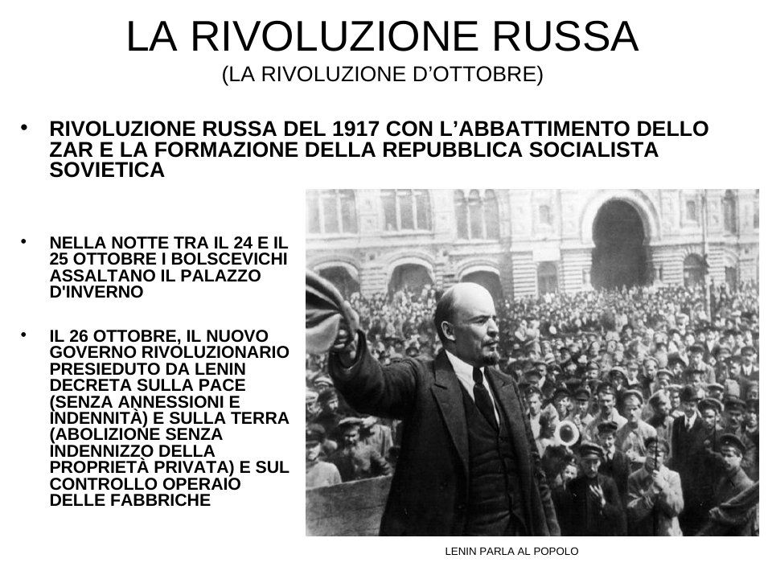{ loading=lazy style="width:47%" }

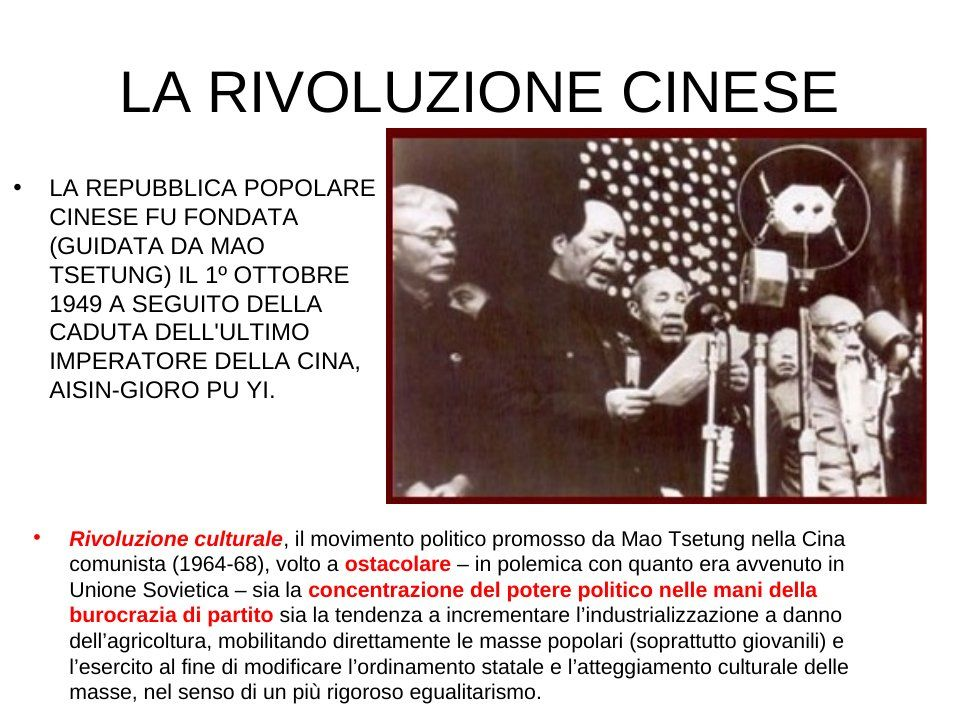{ loading=lazy style="width:47%" }

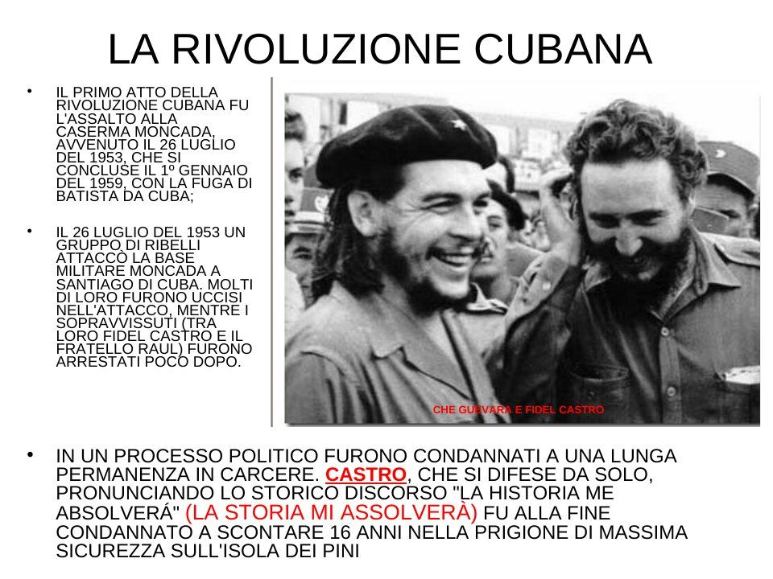{ loading=lazy style="width:59%" }

**RIVOLUZIONI SOCIALISTE**

**La Rivoluzione russa (la Rivoluzione d’ottobre)**

Rivoluzione russa del 1917, con l’abbattimento dello zar e la formazione della Repubblica socialista sovietica.

Nella notte tra il 24 e il 25 ottobre i bolscevichi assaltano il Palazzo d’Inverno.

Il 26 ottobre il nuovo governo rivoluzionario presieduto da Lenin emana i decreti sulla pace (senza annessioni e indennità), sulla terra (abolizione senza indennizzo della proprietà privata) e sul controllo operaio delle fabbriche.

**La Rivoluzione cinese**

La Repubblica popolare cinese, guidata da Mao Zedong (Mao Tse-tung), fu fondata il 1º ottobre 1949, al termine della guerra civile (l’ultimo imperatore della Cina, Aisin-Gioro Pu Yi, aveva abdicato nel 1912).

Rivoluzione culturale: il movimento politico promosso da Mao Zedong nella Cina comunista (dal 1966), volto a ostacolare – in polemica con quanto era avvenuto in Unione Sovietica – sia la concentrazione del potere politico nelle mani della burocrazia di partito, sia la tendenza a incrementare l’industrializzazione a danno dell’agricoltura, mobilitando direttamente le masse popolari (soprattutto giovanili) e l’esercito al fine di modificare l’ordinamento statale e l’atteggiamento culturale delle masse, nel senso di un più rigoroso egualitarismo.

**La Rivoluzione cubana**

Il primo atto della Rivoluzione cubana fu l’assalto alla caserma Moncada, avvenuto il 26 luglio 1953; la rivoluzione si concluse il 1º gennaio 1959, con la fuga di Batista da Cuba.

Il 26 luglio 1953 un gruppo di ribelli attaccò la caserma Moncada a Santiago de Cuba. Molti di loro furono uccisi nell’attacco, mentre i sopravvissuti (tra loro Fidel Castro e il fratello Raúl) furono arrestati poco dopo.

In un processo politico furono condannati a una lunga permanenza in carcere. Castro, che si difese da solo pronunciando lo storico discorso La historia me *absolverá* (La storia mi assolverà), fu alla fine condannato a scontare 15 anni nella prigione di massima sicurezza sull’Isola dei Pini.

0:24:28

Queste rivoluzioni che abbiamo passato brevemente in rassegna ci fanno vedere come si muove la storia. Perché la storia si muove: ci sembra che sia sempre tutto uguale, ma non è così, perché la storia produce eventi. Abbiamo visto le rivoluzioni liberali, le rivoluzioni socialiste; se ci mettiamo in mezzo, fino alla metà del secolo scorso, le due guerre mondiali, vediamo che la storia, quando si muove, si muove, e si muove anche in fretta.

**La Storia (con la «S» maiuscola)**

Quando si muove la storia…

A volte sembra che il mondo sia sempre fermo e rimanga lo stesso.

Ma non è così: basta aggiungere alle quattro rivoluzioni citate le due guerre mondiali (1914-1918 e 1939-1945) e si ha subito il senso profondo dei movimenti storici di fondo, ininterrotti.

Ma le rivoluzioni socialiste quale *ordine sociale* volevano abbattere?

0:25:01

Ma le rivoluzioni socialiste quale ordine volevano abbattere? Perché rivoluzione, abbiamo visto, significa rivoltare, abbattere lo stato precedente. Questa è una rappresentazione di inizio Novecento del sistema capitalistico: vedete, c’è una base piuttosto ampia che regge tutta la costruzione economica che c’è sopra, con i militari, i sacerdoti eccetera. Questa invece è una rappresentazione un po’ più moderna di questa piramide: vedete, la base si è un po’ ristretta, perché c’è una classe media più ampia rispetto al passato. Qui è scritto in inglese, l’ho un po’ tradotto, ma vuol dire questo: quando quelli in cima guardano sotto vedono merda – scusate la parola ; quando quelli sotto guardano sopra vedono solo stronzi – scusate di nuovo la parola – sostanzialmente.

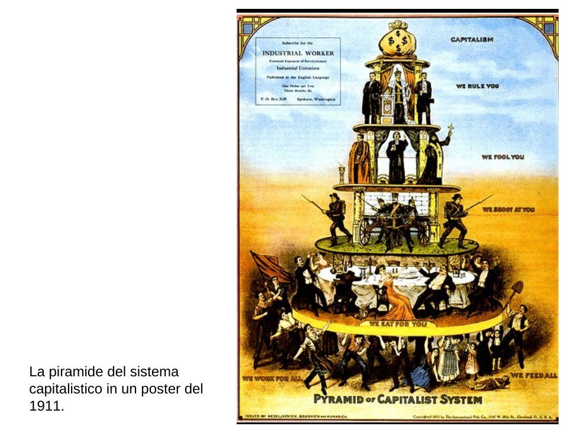{ loading=lazy style="width:47%" }

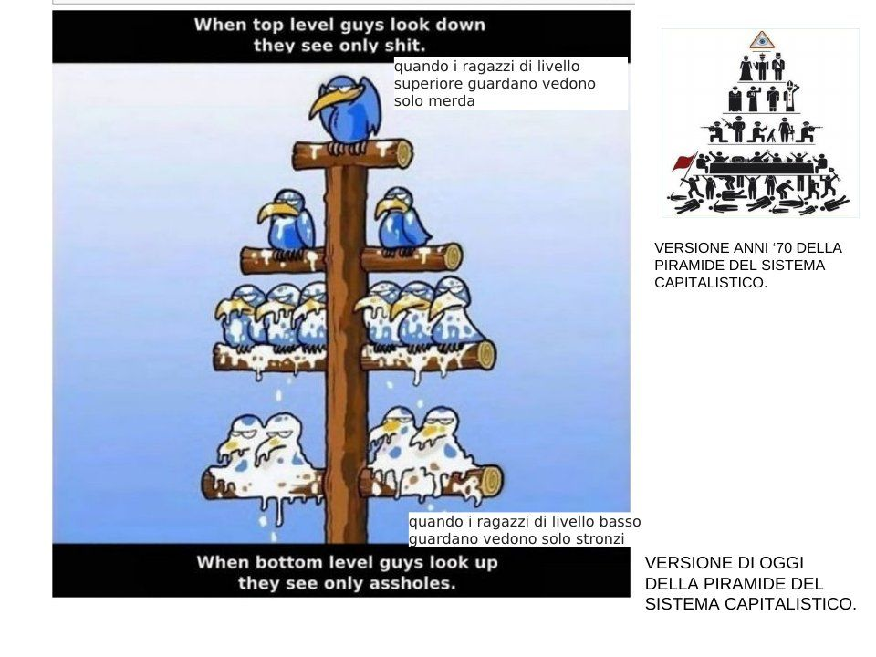{ loading=lazy style="width:47%" }

0:26:10

Lorenzo Poggi È un’immagine bellissima. A proposito, visto che ormai abbiamo cominciato con queste parole: vi ricordate la famosa frase del ’68, che era un proclama? «Quando la merda avrà valore, i poveri nasceranno senza culo».

0:26:31

Paolo Marcucci Ma il sistema capitalistico su che cosa si basa? Su che cosa si basava e su che cosa si basa oggi? Diritto di proprietà; esistenza del capitale, da cui il nome; ricorso da parte dell’imprenditore all’acquisto della forza lavoro dell’essere umano, e quindi il salariato; e organizzazione del mercato dove vendere le merci. Queste sono le condizioni con cui si sviluppa il capitalismo.

**SISTEMA CAPITALISTICO**

Il sistema capitalistico si basa su alcuni principali fattori:

1) la rinascita del diritto di proprietà;

2) l’esistenza di un capitale: l’insieme dei mezzi di produzione necessari all’attività d’impresa, in macchinari e in denaro, di cui un proprietario dispone liberamente per investirlo e trarne profitto;

3) il ricorso, da parte dell’imprenditore, a lavoratori che in cambio delle attività svolte percepiscono un salario. Nel capitalismo la capacità dell’uomo di lavorare diviene una merce che deve potersi offrire liberamente sul mercato; al contrario, nei sistemi pre-capitalisti il lavoro era in genere forzato o rigidamente regolamentato;

4) l’organizzazione della produzione per il mercato e per la vendita. La parola mercato non indica un luogo fisico dove si scambiano le merci ma, in senso figurato, il volume delle richieste di merci da parte di possibili acquirenti e delle merci messe in vendita e scambiate in una certa area, anche molto estesa;

5) l’importanza crescente dell’industria e della meccanizzazione.

Idee che circolavano nella matrice europea e che sono state ideologizzate principalmente nel Settecento.

0:27:02

Da dove nasce il capitalismo? Nasce nel Settecento, si forma ideologicamente nel Settecento, e viene messo in letteratura, in teoria economica; viene rappresentato spesso con questo episodio. Ci spostiamo in Francia: c’è un incontro tra Colbert, che era il ministro delle finanze di quel periodo, e un commerciante, Le Gendre. Il ministro, che era in «visita pastorale», gli chiede: «Che cosa posso fare per voi?». Il commerciante risponde: «Che cosa potete fare per noi? Lasciarci fare»: *laissez-faire*. Il *laissez-faire* è il motto del capitalismo, che nasce appunto nel Settecento in Francia.

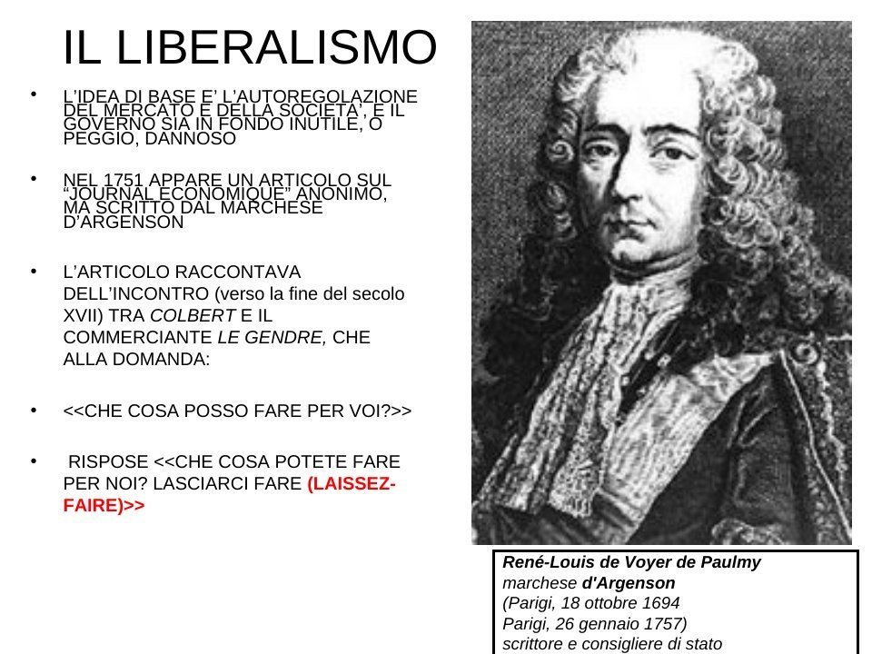{ loading=lazy style="width:59%" }

**IL LIBERALISMO**

L’idea di base è l’autoregolazione del mercato e della società, per cui il governo è in fondo inutile, o peggio, dannoso.

Nel 1751 appare sul *Journal Œconomique* un articolo anonimo, ma scritto dal marchese d’Argenson (René-Louis de Voyer de Paulmy, Parigi, 18 ottobre 1694 – Parigi, 26 gennaio 1757, scrittore e consigliere di Stato).

L’articolo raccontava dell’incontro (verso la fine del secolo XVII) tra Colbert e il commerciante Le Gendre, che alla domanda «Che cosa posso fare per voi?» rispose: «Che cosa potete fare per noi? Lasciarci fare (*laissez-faire*)».

0:28:03

Questa era la premessa. Per tutto il Novecento la domanda popolare era questa: a che cosa ci si può riferire, al modello liberale capitalistico o al modello socialista? Abbiamo visto che c’erano state sia le rivoluzioni socialiste sia quelle liberali, e questo è durato per quasi tutto il Novecento. Gli anni della rivoluzione: cito il ’68, il femminismo, il ’77, l’episodio delle Brigate Rosse, gli autonomi, Lotta Continua eccetera.

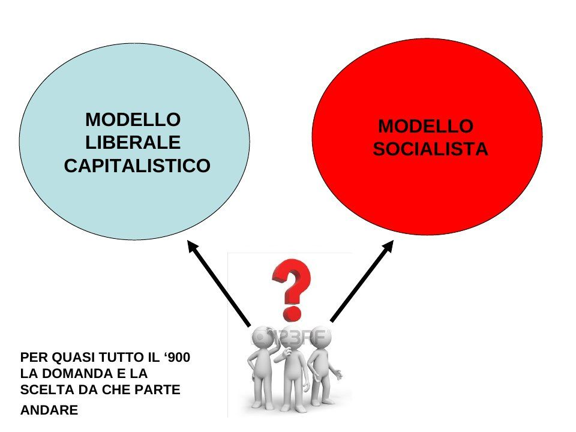{ loading=lazy style="width:59%" }

**GLI ANNI DELLA «RIVOLUZIONE»**

In Italia, ma in tutta Europa, gli anni della *rivoluzione sono stati quelli dalla metà degli anni* Sessanta fino alla fine degli anni Settanta: il ’68, il femminismo, il ’77, le Brigate Rosse, gli autonomi, Lotta Continua.

Se esiste un simbolo di tutto quel periodo, è sicuramente un capo di abbigliamento.

0:28:47

Perché ho messo l’eskimo all’inizio come simbolo di questo periodo? Vedete, questa è una fotografia del ’68, con questi ragazzi che indossano l’eskimo. L’eskimo è ricordato anche da una famosa canzone di Guccini: «Portavo allora un eskimo innocente / dettato solo dalla povertà... / e tu lo porteresti e non puoi più», eccetera.

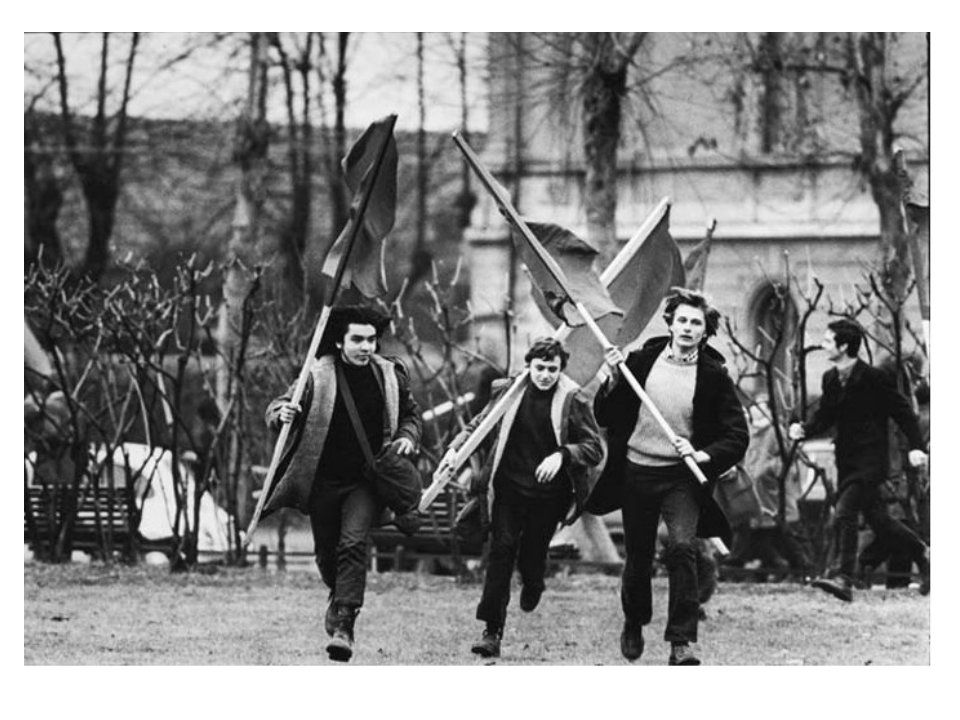{ loading=lazy style="width:47%" }

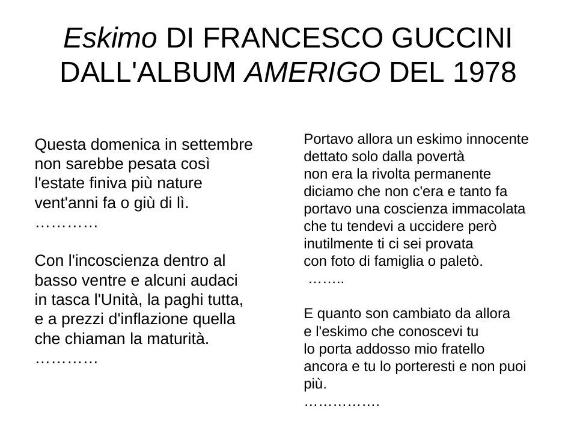{ loading=lazy style="width:47%" }

0:29:11

Questo discorso dell’eskimo mi è venuto in mente l’anno scorso, quando sono andato a un incontro al Museo del Tessuto di Prato – era solo la sede, perché si parlava di economia dei distretti industriali : nella sala accanto c’era quest’eskimo. Allora mi è venuta l’idea, perché avevamo già programmato i titoli per l’anno successivo, e gli ho fatto la foto: era questo. L’eskimo è un po’ il simbolo di quel periodo, abbiamo detto; però dietro l’eskimo, che è storia sociale, c’è anche la storia economica, perché quei ragazzi che si mettevano l’eskimo e andavano in giro tutti con l’eskimo... qualcuno li doveva produrre, e li producevano a Prato.

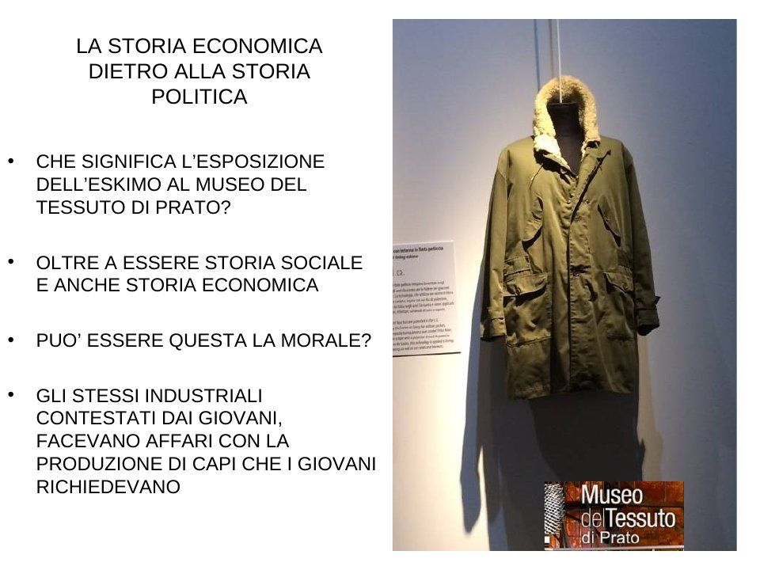{ loading=lazy style="width:30%" }

**La storia economica dietro alla storia politica**

Che significa l’esposizione dell’eskimo al Museo del Tessuto di Prato?

Oltre a essere storia sociale, è anche storia economica.

Può essere questa la morale? Gli stessi industriali contestati dai giovani facevano affari con la produzione dei capi che i giovani richiedevano.

0:30:00

Quindi gli industriali che venivano contestati dai ragazzi in realtà si arricchivano con la vendita dell’eskimo; e questo mi era sembrato un elemento interessante da portare stasera qui a rappresentarci. È uno dei punti fondamentali, questo tra il consumismo e la rivoluzione. C’è stato il boom economico: questa è un’immagine forse un po’ sfocata, non si vede bene, però si vede la 500 con cui si va a fare merenda, il picnic fuori. Era una cosa che i nostri genitori non si potevano certo permettere e che da lì in avanti invece cominciano a permettersi; e quindi c’è questa diatriba tra il consumismo e la rivoluzione.

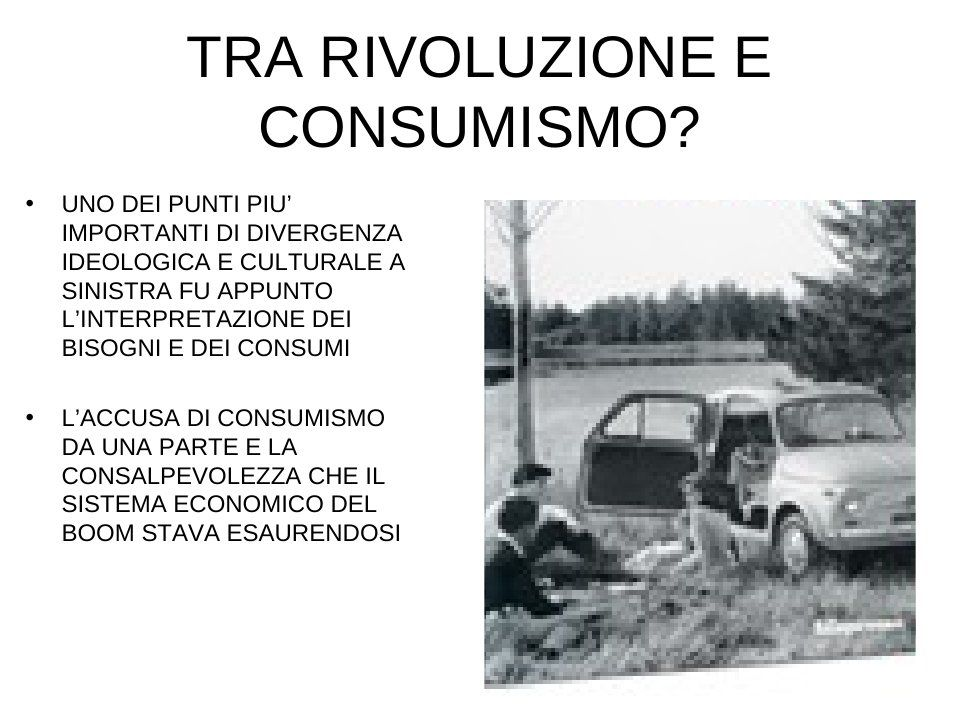{ loading=lazy style="width:59%" }

**TRA RIVOLUZIONE E CONSUMISMO?**

Uno dei punti più importanti di divergenza ideologica e culturale a sinistra fu appunto l’interpretazione dei bisogni e dei consumi:

L’accusa di consumismo da una parte, e la consapevolezza che il sistema economico del boom stava esaurendosi.

0:30:56

Negli anni Settanta, infatti, c’è questa contrapposizione tra la linea del Partito Comunista di quel periodo e i ragazzi del ’68 e del ’77, che erano più incentrati sul «soddisfacimento dei bisogni e l’affermazione dei desideri»: questo era un po’ lo slogan. Vi ricordate la famosa contestazione fatta a Lama nel febbraio del ’77, all’Università di Roma, quando fu assaltato sul palco da parte degli autonomi: questa era un po’ tutta la contrapposizione di quel periodo. Famosa poi, il 7 dicembre del ’68, la contestazione alla Scala, che si lega anche alla canzone *Contessa* di Paolo Pietrangeli, se vi ricordate, famosa in quel periodo.

**TRA RIVOLUZIONE E CONSUMISMO?**

I giovani erano cresciuti in questa «promessa» (un benessere sempre maggiore e per tutti), e la consapevolezza che non sarebbe stata mantenuta (dal 1973 al 1977 la disoccupazione giovanile assunse cifre molto alte)…

Mentre Berlinguer proponeva la linea dell’austerità e Lama (oggetto nel febbraio del ’77 di una contestazione violenta all’Università di Roma) dichiarava la disponibilità dei lavoratori a una politica di sacrifici, il movimento del ’77 proponeva una linea inconsapevolmente consumista (?).

Criticava il sistema, accusava il capitalismo di avere fabbricato la crisi, ma soprattutto contestava la linea dei sacrifici e dell’austerità, contrapponendo a essa «il soddisfacimento dei bisogni e l’affermazione dei desideri».

Cambiare veramente la vita? Migliorare le condizioni economiche non era più il solo obiettivo.

All’etica del lavoro in cui si erano formati i militanti del PCI, quei giovani contrapponevano provocatoriamente una sorta di diritto all’ozio.

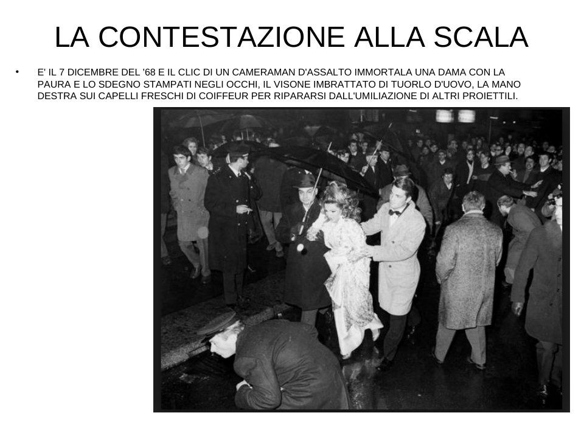{ loading=lazy style="width:47%" }

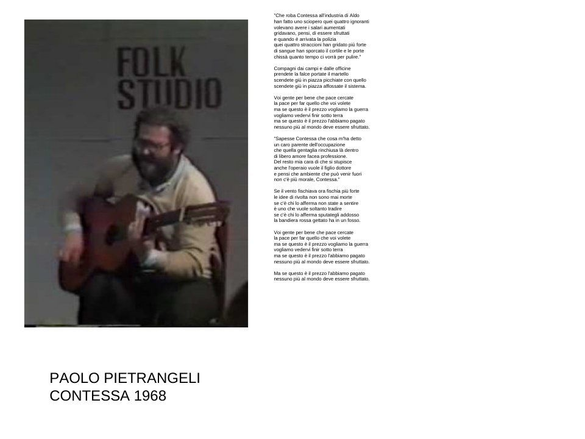{ loading=lazy style="width:47%" }

**LA CONTESTAZIONE ALLA SCALA**

È il 7 dicembre del ’68, e il clic di un cameraman d’assalto immortala una dama con la paura e lo sdegno stampati negli occhi, il visone imbrattato di tuorlo d’uovo, la mano destra sui capelli freschi di *coiffeur* per ripararsi dall’umiliazione di altri proiettili.

0:31:48

Poi la rivoluzione naturalmente non fu fatta, e la scelta fu quella di restare all’interno del sistema occidentale; però quei trenta, venticinque anni di lotte hanno lasciato un’eredità sociale e culturale molto importante, di cui a volte ora non ci rendiamo conto, ma che è fondamentale. L’elenco così, di passaggio: il diritto del lavoro, compreso l’articolo 18; la riforma del diritto di famiglia; il diritto allo studio e la scuola per tutti; amministrazioni locali funzionanti e oneste, dove i casi di corruzione in quel periodo, nelle regioni con certe caratteristiche, erano davvero rari, rarissimi. Il divorzio: la legge del 1970 e il referendum del 1974, che vota per il mantenimento della legge.

**I FRUTTI DOLCI DELLA RIVOLUZIONE**

La rivoluzione non fu fatta, e la scelta fu quella di rimanere dentro il sistema occidentale.

Però quei vent’anni lasciarono dei frutti dolci che ancora oggi stiamo mangiando: una grande eredità, di cui ci rendiamo poco conto, ottenuta dalle grandi lotte degli operai e dei lavoratori, degli studenti, delle donne.

Il diritto del lavoro (art. 18 ecc.); la riforma del diritto di famiglia; il diritto allo studio e la scuola per tutti; amministrazioni locali funzionanti e oneste (dove la corruzione era davvero ferma ad alcuni episodi)…

Diritti civili: divorzio (1970 la legge, 1974 il referendum), aborto.

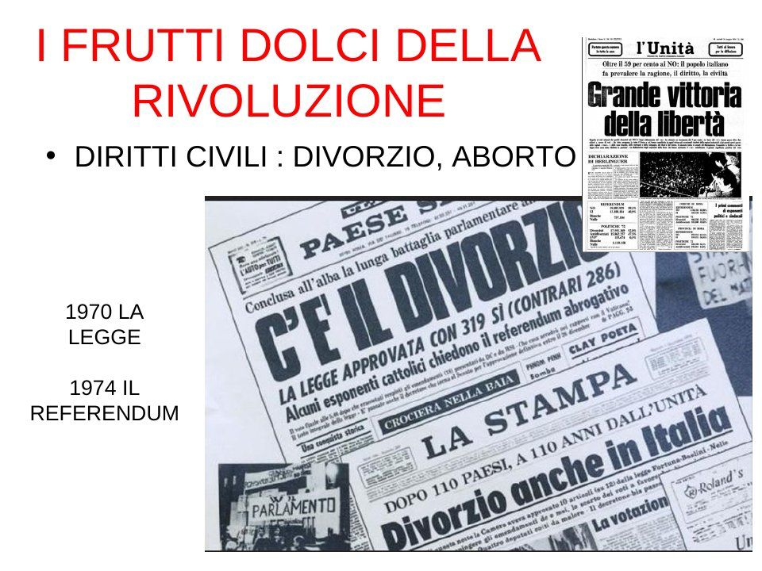{ loading=lazy style="width:59%" }

0:32:50

La rivoluzione delle donne: questa è un’immagine di quegli anni in cui si vede il simbolo del triangolo delle donne. C’è una rivoluzione culturale e sociale, non solo per le donne, ma naturalmente – essendo le donne il 50% della popolazione – di conseguenza anche per gli uomini. *Porci con le ali*: qualcuno forse se lo ricorda, circolava nelle scuole, si passava di mano in mano, perché rappresentava la liberazione da questo punto di vista, la libertà sessuale e anche politica; è un punto importante della liberazione di quel periodo. L’aborto: dopo la legge 194 del 22 maggio 1978, nel 1981 c’è il referendum – siamo già al 1981 – prevalgono i no e rimane la legge sull’aborto.

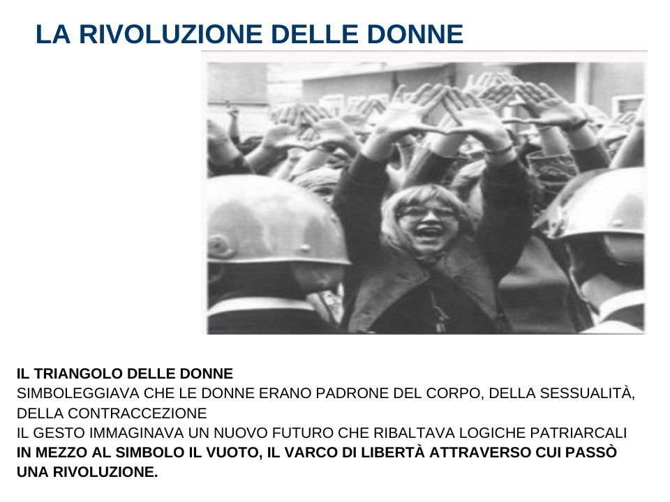{ loading=lazy style="width:59%" }

**LA RIVOLUZIONE DELLE DONNE**

Il triangolo delle donne simboleggiava che le donne erano padrone del corpo, della sessualità, della contraccezione.

Il gesto immaginava un nuovo futuro che ribaltava logiche patriarcali.

In mezzo al simbolo il vuoto, il varco di libertà attraverso cui passò una rivoluzione.

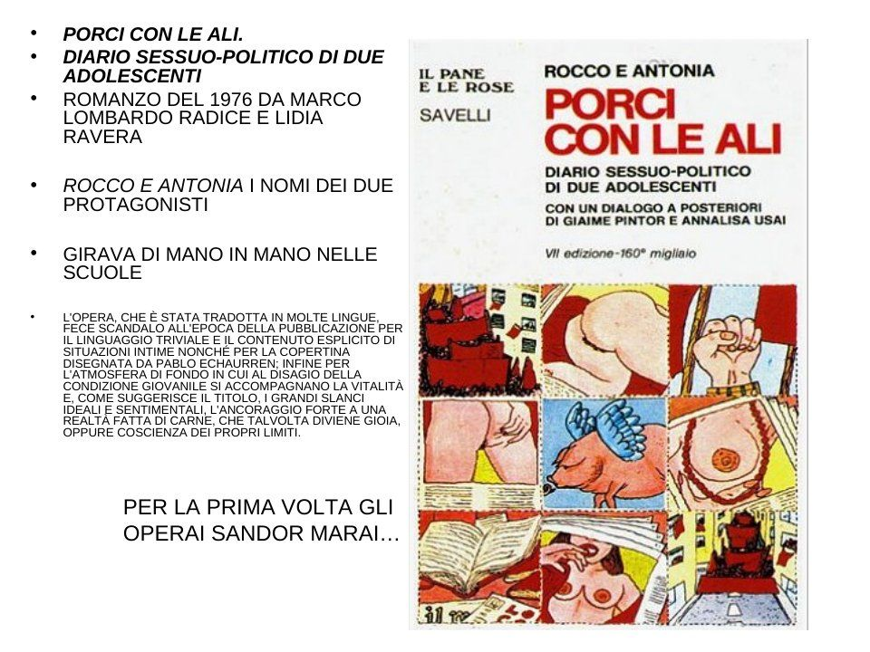{ loading=lazy style="width:47%" }

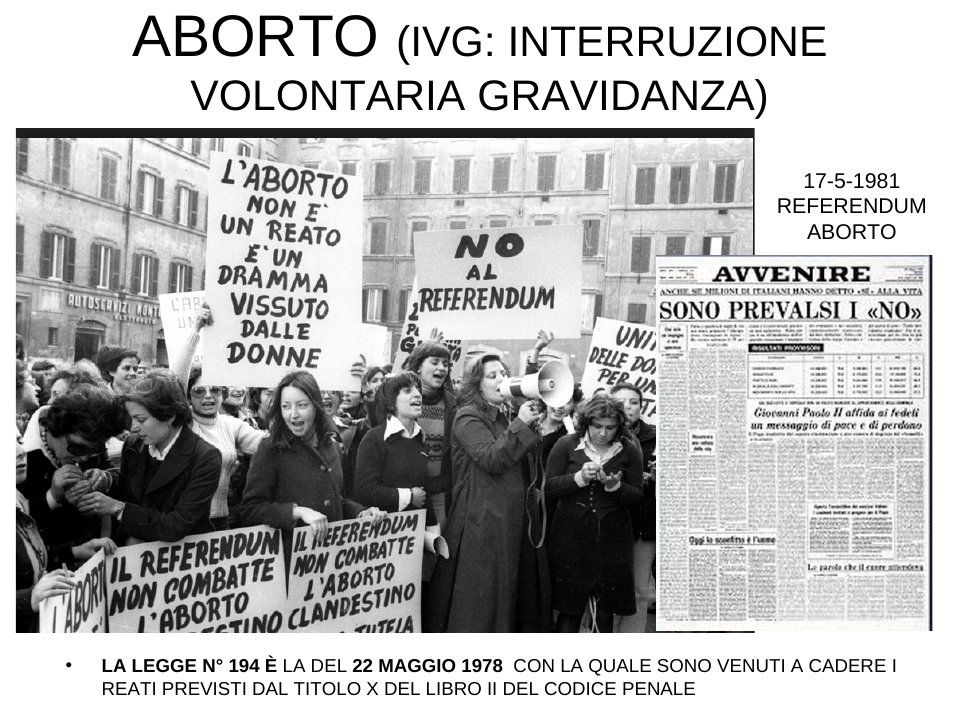{ loading=lazy style="width:47%" }

**PORCI CON LE ALI. DIARIO SESSUO-POLITICO DI DUE ADOLESCENTI**

Romanzo del 1976 di Marco Lombardo Radice e Lidia Ravera; Rocco e Antonia sono i nomi dei due protagonisti. Girava di mano in mano nelle scuole.

L’opera, che è stata tradotta in molte lingue, fece scandalo all’epoca della pubblicazione per il linguaggio triviale e il contenuto esplicito di situazioni intime, nonché per la copertina disegnata da Pablo Echaurren; infine per l’atmosfera di fondo, in cui al disagio della condizione giovanile si accompagnano la vitalità e, come suggerisce il titolo, i grandi slanci ideali e sentimentali, l’ancoraggio forte a una realtà fatta di carne, che talvolta diviene gioia, oppure coscienza dei propri limiti.

**ABORTO (IVG: INTERRUZIONE VOLONTARIA DI GRAVIDANZA)**

La legge n. 194 è quella del 22 maggio 1978, con la quale sono venuti a cadere i reati previsti dal titolo X del libro II del Codice penale.

17 maggio 1981: referendum sull’aborto.

0:33:53

Sono un po’ gli ultimi fuochi di quel mondo. Questa è la famosa fotografia in cui si vede Benigni che prende in braccio Berlinguer (Roma, Pincio, 17 giugno 1983). In quel periodo c’è anche la canzone di Gaber, *Qualcuno era comunista*: «Qualcuno era comunista perché la rivoluzione oggi no, domani forse, ma dopodomani sicuramente». È un po’ questo; un periodo che poi naturalmente si conclude con la morte di Berlinguer, l’11 giugno 1984.

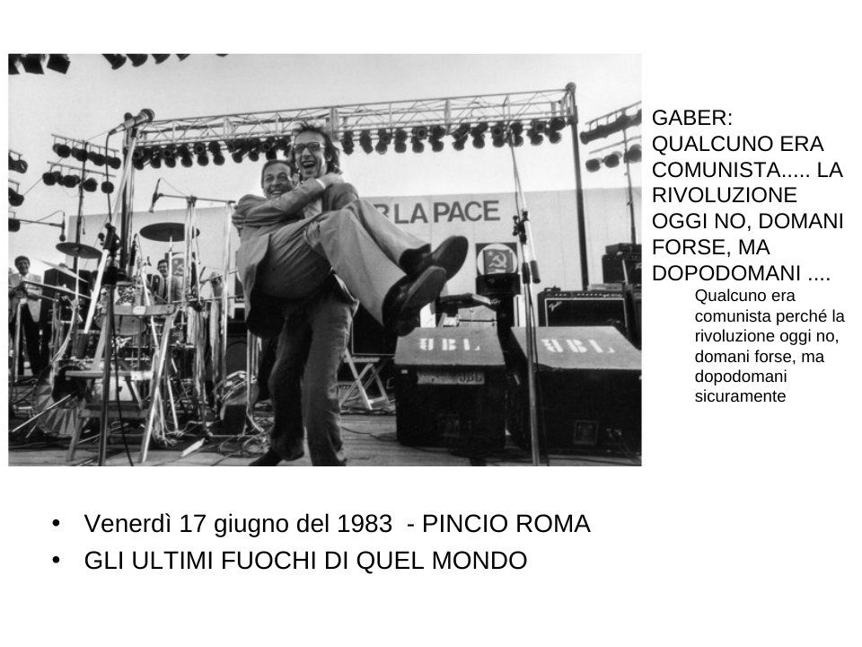{ loading=lazy style="width:47%" }

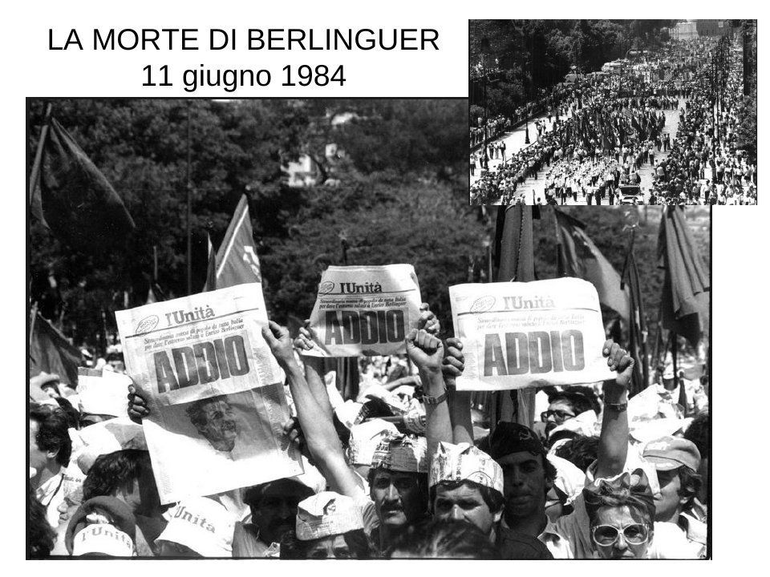{ loading=lazy style="width:47%" }

0:34:29

Nella seconda parte affronteremo tutte le questioni economiche, sociali e politiche di quel liberalismo e di quel capitalismo; però questo ci serviva come introduzione, per capire che cosa la rivoluzione avesse voluto esprimere e a che cosa si fosse voluta contrapporre, con che cosa si fosse cimentata. Su questo ti darei la parola per la tua parte.

0:34:59

Lorenzo Poggi Abbiamo seguito Paolo in questo bellissimo discorso, toccando i punti salienti. Facciamo una considerazione: ripartiamo da dove è partito, ripartiamo da Marx, dal vecchio Marx, che diceva una cosa fondamentale agli operai: «Proletari di tutto il mondo, unitevi». In fondo che cosa vuol dire? Vuol dire che, se il lavoro deve diventare un elemento fondante nella storia, bisogna che chi porta il lavoro, il lavoratore, lo imponga; e lo imponga con la lotta, con gli scioperi, con il rischio di fare scioperi a oltranza e arrivare a non poter mangiare, ma tentando di affermare il proprio potere politico e di diventare attore della storia; se no la storia la faranno gli altri. Quindi Marx diceva «unitevi», perché se non vi unite e non riuscite a imporvi rimarrete sempre ai margini della storia: dovete imporvi, e per imporsi occorre l’unità e occorre lottare. Contro chi? Contro l’avversario, contro chi detiene il capitale e ha invece interesse a fare del lavoro una variabile dipendente, soggetta soltanto alle regole del mercato, e quindi, valendosi dell’esercito industriale di riserva – i disoccupati, tantissimi – ad abbassare al minimo il costo del lavoro, i salari.

0:37:12

Quindi il ragionamento era molto semplice: non uscire dal capitale – Marx non parla di rivoluzione in questo senso – ma trovare all’interno stesso della struttura capitalista l’elemento che in qualche modo la mette in crisi, che mette in crisi il principio fondante del capitale, la massimizzazione del profitto, facendolo dipendere da altre variabili, che non sono soltanto economiche ma – come potremmo chiamarle? – umanistiche, politiche, chiamiamole come ci pare, ma non certo di mercato.

0:38:03

Quindi la rivoluzione, da quel momento in poi... Hegel l’aveva teorizzata – faccio due minuti soltanto, un po’ di professione. Hegel l’aveva già teorizzata nella *Fenomenologia dello spirito*, dove aveva parlato dello scontro servo-signore, della lotta tra signoria e servitù per il riconoscimento: lo scontro tra due volontà, la volontà del servo e quella del padrone. Riusciva vittorioso il padrone, però poi la relazione con il mondo la gestiva il servo, ed era il servo a portare avanti lo sviluppo dello spirito. Marx rilegge questo discorso di Hegel e lo traduce in termini economici: due volontà, la volontà incarnata dal capitale e dal capitalista e la volontà del proletario, dell’operaio, di far valere quello che è l’elemento portante della sua vita, il lavoro.

0:39:12

Abbiamo visto – lo vedremo anche con Paolo – che abbiamo una Repubblica fondata sul lavoro, quindi il lavoro come elemento fondamentale. Di questo oggi credo sia rimasto molto poco, quasi nulla, se ci pensate un attimo: il lavoro non solo è difficile da trovare, ma difficilmente riesce anche a spuntare qualcosa che lo faccia diventare un elemento che si contrappone alla legge del mercato e al profitto. È diventato un elemento dipendente.

0:40:00

Si chiama «capitale umano». C’è una reminiscenza classica, se ci possiamo scherzare un po’. Al tempo dei Romani, quando c’era la schiavitù, c’erano i notai che registravano l’eredità, e nelle cose ereditate c’erano gli *instrumenta* *sine voce*, che erano gli aratri, e poi gli *instrumenta* *cum voce*, che erano gli schiavi: erano tutti pezzi che servivano per lavorare la proprietà terriera. Io dico che ci sono tuttora quelli *cum voce* e quelli *sine voce*: c’è il capitale finanziario e c’è il capitale umano, ma sempre capitale. Quindi è un elemento estremamente interessante, questo della riduzione a merce, e quindi della riduzione a elemento dipendente; ma su questo torneremo, perché capite che è un elemento fondante del nostro discorso.

0:41:15

Marx dice che con la rivoluzione, cioè se si riuscirà a scardinare quello che è stato messo in atto dalla borghesia capitalista e i lavoratori riusciranno ad affermare un mutamento, riusciranno anche a riscattarsi dall’alienazione. L’alienazione consiste – qui siamo nei *Manoscritti economico-filosofici* del ’44; lo dico, se no che figura ci faccio: c’è la filosofia e poi non abbiamo riferimenti –... Dicevo: lì precisamente dice che cosa vuol dire alienazione. Vuol dire, dice Marx, che il lavoro è un’attività prettamente umana: l’uomo con il lavoro si relaziona al mondo e per mezzo di questo soddisfa i suoi bisogni e in qualche modo realizza anche i suoi desideri, si guadagna la propria vita; vive come uomo con il lavoro.

0:42:34

Ma quando il lavoro diventa una parte del capitale, e quindi una merce sottoposta alle leggi del mercato, perde questa natura umana e diventa qualcosa di alienante. Perché? Perché l’operaio non vive come essere umano, cioè come chi si relaziona in modo costruttivo, creativo con il mondo per realizzare i propri disegni e concretizzare in oggetti, con il lavoro, i desideri e i bisogni. No: lo fa quando non lavora. Quando lavora è asservito alla macchina. Quindi, dice Marx, nel tempo che dovrebbe essere il tempo di realizzazione della caratteristica umana, l’operaio dipende da un altro, dipende dalla macchina, è poco più che un pezzo della macchina.

0:43:39

Nella parte, invece, che è il suo tempo libero – perché il tempo impiegato in quel modo gli serve per pagarsi il tempo libero – mangia, abita una casa, magari fa anche l’amore e ha dei figli, che vanno a ingrossare le file del proletariato futuro; e infatti la caratteristica dell’essere proletario è avere come proprietà i figli, la prole. E quindi, dice Marx: fare figli, dormire, mangiare, abitare lo fanno anche gli animali; non sono solo funzioni umane, sono anche funzioni animali: anche gli animali si nutrono. Quindi l’uomo che cosa fa? Quando dovrebbe essere umano, e relazionarsi al mondo con il lavoro e trasformarlo per soddisfare i propri bisogni e i propri desideri, è poco più di un animale, perché dipende da altri, non è libero, dipende da qualcosa che si chiama mercato. E quando invece è libero, è libero solo di esplicare le sue funzioni, ma quelle sono funzioni animali. Per questo è alienato. Dovrà riscattarsi da questo, e si riscatterà quando imporrà al mercato, con la propria forza contrattuale, le esigenze umane.

0:45:26

E qui c’è il vecchio Marx, con tutti i discorsi che sappiamo. Capite che questo oggi non ha nessun significato. Nel ’68 ne parlavamo, ci andammo vicini: c’era un po’ di rivoluzione nell’aria. C’era rivoluzione perché gli americani si rifiutavano di andare nel Vietnam, perché erano stufi di fare la guerra; gli Stati Uniti mandavano i soldati – sapete come – per pochi mesi, per cui era una guerra moltiplicata all’infinito, e moltissimi andavano in guerra. Si andò vicini alla rivoluzione perché nelle università, in tutte le parti del mondo, c’erano rivolte studentesche; ma si andò vicini alla rivoluzione per cose che in fondo erano marginali rispetto a quelle che capitano oggi: per avere più libertà, più libertà di comportamento. Le donne si battevano per essere riconosciute, indipendenti, per avere anche più libertà sessuale, per eliminare l’autorità di qualche persona autoritaria, e non autorevole, che era al potere.

0:46:55

Ma sono cose da poco rispetto a quello che subiscono i giovani oggi, se ci si pensa, che hanno 600 euro al mese con un contratto co.co.pro., che dura non si sa nemmeno quanto, e non hanno prospettive di futuro. Ma non è solo questo, è qualcosa di più profondo: questo mina due elementi fondanti dell’essere della società. La prospettiva storica, cioè il fatto che la storia abbia una linea, uno svolgimento, e che il presente prepari un futuro; e mina un altro aspetto, quello di programmare la propria condotta secondo una prospettiva lunga di preparazione al futuro. Per cui spesso e volentieri vediamo che uno dei problemi dei ragazzi è proprio quello di cogliere quello che c’è immediatamente da cogliere e godere, senza pensare alle conseguenze. Perché? Perché non ci sono più prospettive, perché non resta altro che l’immediatezza del presente, la soddisfazione immediata, perché gli abbiamo chiuso il futuro.

0:48:24

Non è che il futuro sia chiuso: è che manca questo tipo di prospettiva, che è venuta meno; e venendo meno questo tipo di prospettiva, viene meno la speranza nella rivoluzione. Perché la rivoluzione che cos’è? È partire dalle condizioni esistenti per procurare da lì un futuro migliore: è la nostra visione della storia, quella che ha come precedente la visione giudaico-cristiana del tempo, la linea del tempo.

0:49:17

È venuto meno il concetto di una volontà contraria alla mia. Perché i giovani non si ribellano? Perché non fanno proteste come nel ’68, quando si facevano in fondo per la libertà sessuale – sì, cose importantissime, ma rispetto a queste direi abbastanza marginali? Perché non c’è più l’idea umanistica di una volontà che si contrappone alla tua: l’operaio non se la prende più con il padrone, perché il padrone lo...

0:50:00

...lo sente come sottoposto, lui stesso, a un’altra forza, che è quella del mercato: una forza anonima, che non ha più la faccia di una persona. E siccome è anonima e lontana – lontana come identificazione, ma vicinissima negli effetti – ribellarsi, fare la rivoluzione, diventa difficile. Abbiamo ucciso l’umanesimo, in questo senso, e quindi non abbiamo più un nemico da combattere: abbiamo quasi una natura, un destino. Il mercato, che non è nessuno, ma che impone a tutti le sue leggi ineluttabili, che non hanno nulla a che vedere con l’umanità, con le prospettive, con la capacità di trasformare il presente per fare un futuro più degno di essere vissuto. Mi fermo, perché vi sto facendo un discorso lunghissimo, non adatto alla cena.

\[PAUSA\]
{: .nota }

1:31:15

Paolo Marcucci Bene, iniziamo con l’ultima parte. Consentitemi di fare un ringraziamento agli amici del Caffè Centofiori. Grazie.

1:31:52

Allora, ripartiamo, riprendiamo il discorso partendo dal titolo: «C’è ancora posto per l’utopia e per la rivoluzione?». Questo era il tema di stasera. La risposta sicuramente può essere sì e no, e ora cercheremo un po’ di spiegarlo. Fukuyama nel 1989 fece uscire un saggio, *The End of History*, cioè *La fine della storia*, in cui diceva sostanzialmente che la storia come l’abbiamo vista prima, la storia con la «S» maiuscola, era finita con la vittoria del capitalismo liberaldemocratico sul comunismo. E su questo non ci sono dubbi, perché è andata effettivamente così, quasi in tutto il mondo. Dei due schemi che abbiamo visto all’inizio, della scelta che aveva attraversato tutto il Novecento, uno è completamente cancellato dalle aspettative popolari: il modello socialista non esiste più nell’immaginario, è rimasto solo il modello liberale capitalistico.

**C’È ANCORA POSTO PER L’UTOPIA E PER LA RIVOLUZIONE?**

Partiamo dalla domanda della serata di stasera. La risposta può essere sì e no.

Fukuyama, con il saggio *The End of History?* (*La fine della storia*) del 1989, diceva che la storia era finita con la vittoria del capitalismo liberaldemocratico sul comunismo.

E su questa vittoria non ci sono ombre di dubbio.

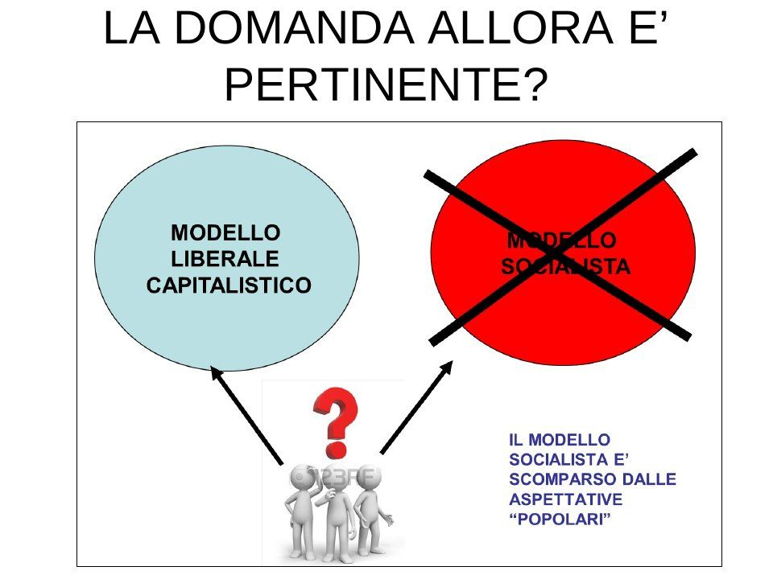{ loading=lazy style="width:59%" }

1:33:13

Questo è il perimetro del modello liberale capitalistico, ed è diventato l’unico perimetro della nostra ideologia: qui non si tratta più di creare un mondo nuovo, un uomo nuovo; si tratta solo di gestire al meglio la società all’interno di questo perimetro. Le regole e i principi fondamentali sono quelli del capitalismo liberale: tutto si svolge all’interno di questo cerchio. Questo comporta anche dei rischi – ora lo vedremo – perché un solo modello di riferimento porta dei rischi; e questo nonostante in Europa, per esempio, si sia costruito un tipo di società di circa mezzo miliardo di persone, tra le più ricche del pianeta. Però il modello liberale che si sta imponendo comporta dei pericoli; vediamo un po’ quali.

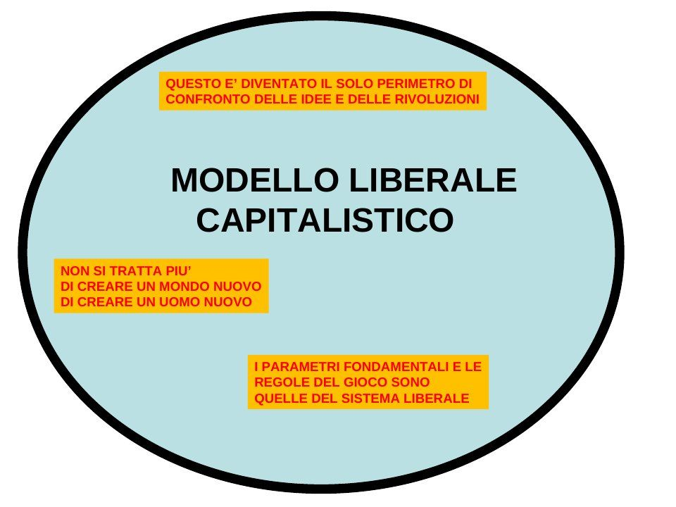{ loading=lazy style="width:50%" }

**LA DOMANDA ALLORA È PERTINENTE?**

In attesa che nasca qualcosa che possa (ri)portare le idee oltre il solo perimetro del modello liberale,

vediamo la battaglia (in questo perimetro) tra utopie diverse e concetti rivoluzionari diversi…

E che rischi corriamo…

Nonostante l’Europa che abbiamo costruito sia un paese di circa mezzo miliardo di persone, istruite ed evolute, mediamente ricche (al confronto con le altre parti del mondo).

1:34:22

Intanto, questa è una fotografia che ho fatto passando in macchina a Firenze, a febbraio: su un muro c’era questa scritta, «Ognuno per sé, miseria per tutti». Qualcuno comincia probabilmente a farsi qualche domanda; sociologicamente mi pareva interessante farvela vedere.

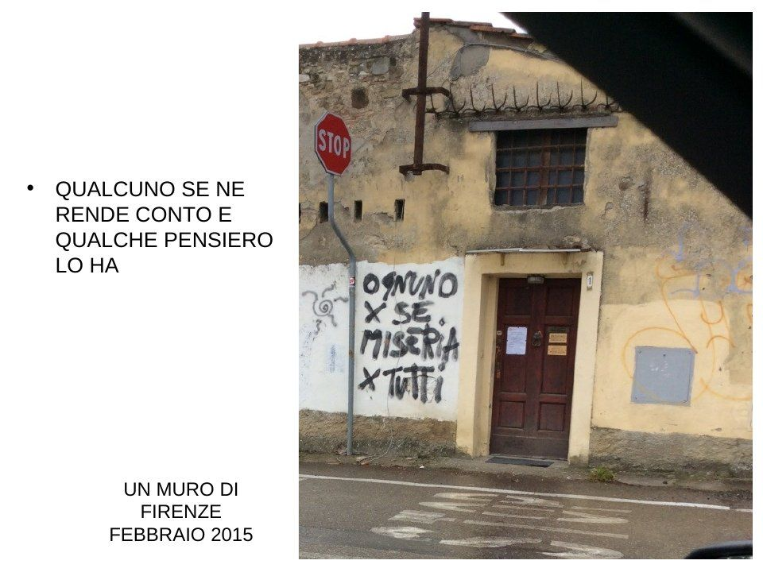{ loading=lazy style="width:30%" }

1:34:45

Diceva prima Lorenzo che il lavoro è diventato il principio cardine su cui si basa la nostra esistenza: non è più un mezzo per poter vivere, ma è diventato il fine stesso. Lorenzo citava prima la Costituzione italiana, l’articolo 1: «L’Italia è una Repubblica democratica, fondata sul lavoro». Interessante un aneddoto su questo. Sapete che la Costituzione italiana fu oggetto di discussioni lunghissime tra l’area comunista e quella democristiana, tanto per capirsi; e chi trovò la soluzione per il primo articolo fu Fanfani, perché l’articolo 1 era declinato «fondata sui lavoratori», e questo era troppo di matrice sovietica. Allora Fanfani trovò questa soluzione, «fondata sul lavoro», che è un po’ più morbida rispetto a «lavoratori».

**LA RIVOLUZIONE DEL LAVORO**

Il lavoro oggi è diventato quasi come il fine della vita: l’autorealizzazione nella nostra società passa solo attraverso il lavoro.

Costituzione italiana «fondata sul lavoro» – da riscrivere «fondata sul capitale»? (La sintesi di Fanfani: «Fondata sui lavoratori» era troppo simile alla formula dell’URSS.)

Art. 1: *L’Italia è una Repubblica democratica, fondata sul lavoro. La sovranità appartiene al popolo, che la esercita nelle forme e nei limiti della Costituzione.*

E per questo è diventato l’obiettivo principale delle «riforme» degli ultimi vent’anni.

Il contratto collettivo nazionale di lavoro (CCNL) è stato progressivamente svuotato e ha perso la sua funzione storica, che sta nel difendere la quota salari sul PIL, cioè la parte di reddito che va ai lavoratori rispetto a quella che va ai profitti e alle rendite finanziarie e immobiliari.

1:35:57

Però il lavoro in questi anni, da quando è finita l’epoca rivoluzionaria, è stato molto ridimensionato nelle proprie aspettative. Lo si vede bene da un grafico – questo è del professor Alberto Bagnai – che mostra gli Stati Uniti, l’Italia e la Germania: si vede che dalla metà degli anni Settanta tutto continua a declinare. Che cos’è? È la percentuale della quota dei salari sul prodotto interno lordo, cioè la percentuale sul totale di un Paese, fatto 100: dalla metà degli anni Settanta in tutti i Paesi è in continua discesa, in Italia in maniera particolare – è la linea verde. Al di là di tanti discorsi, la sostanza è questa.

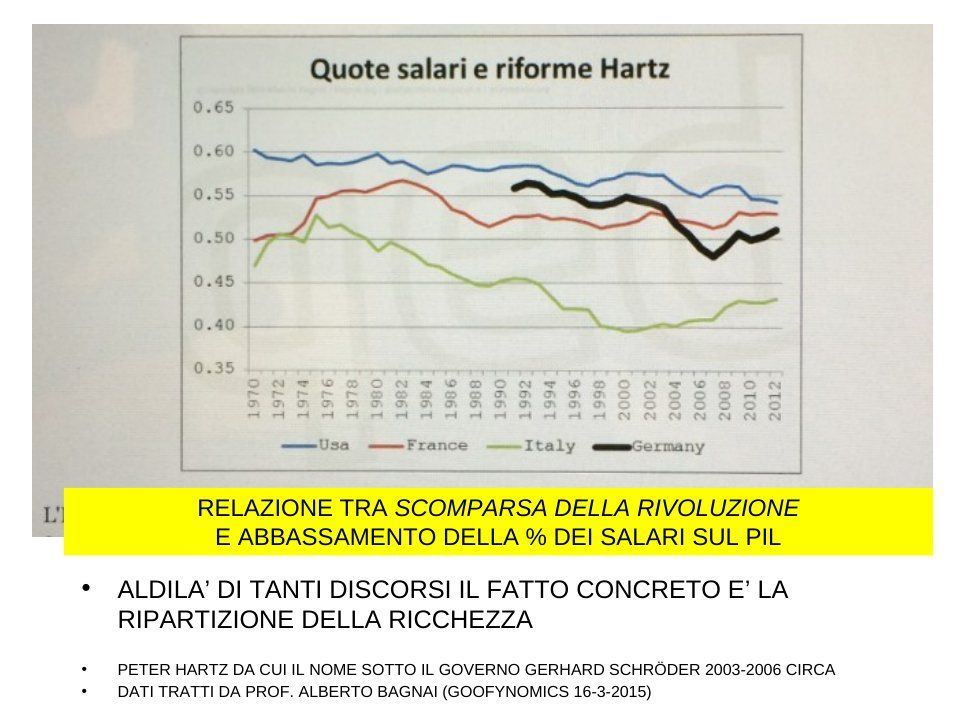{ loading=lazy style="width:52%" }

**AL DI LÀ DI TANTI DISCORSI, IL FATTO CONCRETO È LA RIPARTIZIONE DELLA RICCHEZZA**

Relazione tra scomparsa della rivoluzione e abbassamento della quota dei salari sul PIL (grafico «quote salari e riforme Hartz»: le riforme prendono il nome da Peter Hartz, sotto il governo di Gerhard Schröder, 2003-2005 circa).

Dati tratti dal prof. Alberto Bagnai (*Goofynomics*, 16-3-2015).

1:37:15

La rivoluzione capitalistica. Abbiamo detto che il capitalismo ha vinto rispetto al modello socialista che gli si contrapponeva, e questo perché si è dimostrato molto flessibile, anche rispetto alla sua stessa natura, a come era nato. I modelli, principalmente, in tutto l’Ottocento e il Novecento sono questi: liberale, socialdemocratico e conservatore; tre elementi, tre accezioni dello stesso modello. Questo è un po’ lo schema che lo rappresenta (Web Learning, Università di Napoli Federico II): abbiamo il modello conservatore, tipico della Germania, con una variante familista in Italia e in Spagna; il modello liberale degli Stati Uniti, con una variante leggermente diversa in Inghilterra; e il modello socialdemocratico dei Paesi scandinavi, Svezia eccetera. Tutti e tre questi modelli, però, hanno un’identità comune, che è quella dei principi liberali.

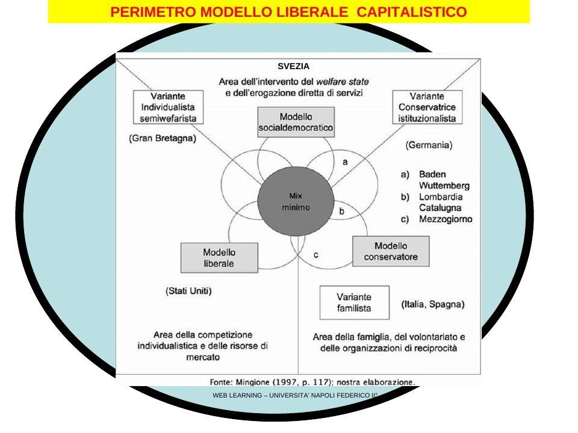{ loading=lazy style="width:53%" }

1:38:23

Allora, che cosa è successo negli ultimi quindici-vent’anni? Che si sono affacciati nel mondo modelli liberali diversi. Il primo è quello, per esempio, della Russia di Putin: la Russia ora si pone come concorrente dell’Occidente – pensiamo alle questioni di adesso sull’Ucraina, per esempio, o agli approcci che sta avendo in questo momento con la Grecia, nel caso ci fosse un’uscita della Grecia dall’euro, speriamo di no – e quindi si propone come alternativa. Ma che cosa vuol dire? Vuol dire che il modello capitalistico della Russia qualcuno l’ha definito «democratura», l’incrocio tra democrazia e dittatura: cioè sostanzialmente si dice al popolo «io vi garantisco sicurezza e stabilità, e voi lasciate perdere i temi politici». Questa è un po’ la sintesi di questa natura.

**UN PERICOLO SI AGGIRA IN OCCIDENTE… E NEL MONDO**

**Il modello russo di Putin degli ultimi 15 anni**

Agli esordi la Russia di Putin aspirava a essere riconosciuta come soggetto indipendente nell’insieme occidentale (quindi contro Cina e Islam).

Oggi si sente nuovamente, e si offre, come polo autonomo e sovrano contrapposto all’Occidente.

Gli accordi con Cina, Turchia, Ungheria, Iran (i nemici di ieri…) vanno in questa direzione; così gli approcci di oggi con la Grecia…

Il modello di governo adottato da questi paesi (Russia, Ungheria, Turchia), quindi nel cuore dell’Europa, è stato definito *democratura*: l’incrocio tra democrazia e dittatura.

Il modello è quello proposto da Putin al suo popolo: «Io vi garantisco sicurezza, stabilità e (relativo) benessere, e voi lasciate la politica a me».

Le decisioni sono prese da un gruppo ristretto intorno al premier (nel caso russo, nella dacia di Putin…), e il Parlamento e il governo stesso sono in secondo piano.

1:39:38

L’esempio della Grecia di questo periodo, se ci avete fatto caso nelle cronache riportate dai giornali, è quello del conflitto tra il ministro delle finanze tedesco, Wolfgang Schäuble, e quello greco, Yanis Varoufakis.

1:40:00

Che cosa ha fatto la Grecia? Ha votato democraticamente per Tsipras, per un certo programma: cambiare le politiche nei rapporti con l’Europa. Poi potrebbe riuscirci o non riuscirci, questo è un altro problema. Schäuble che cosa gli ha detto? «Voi siete in un programma, il programma stabilito dall’Europa, e le elezioni non cambiano il programma»: cioè un’entità superiore al popolo sovrano. Che abbia torto o ragione – non entro qui nel merito della questione greca – dal punto di vista democratico questo è importante.

**L’ESEMPIO DEL CASO GRECIA**

Al di là delle opinioni in merito al caso Grecia, devono far riflettere in chiave democratica le opinioni e le frasi dette.

In particolare quella di Wolfgang Schäuble al ministro greco Yanis Varoufakis: «Voi siete in un programma. Le elezioni non cambiano il programma».

Il mandato popolare ricevuto dalle elezioni aveva proprio questo contenuto: rinegoziare gli accordi con l’Europa.

Poi ci possono riuscire o meno: ma è interessante il concetto antidemocratico.

Uno dei primi a fare questa riflessione e a parlarne in pubblico mi pare sia stato Tremonti: il sentiero è già tracciato dai trattati europei, e il margine di manovra locale è solo sui dettagli.

1:40:46

Questo discorso l’aveva già fatto, mi pare, Tremonti, una decina, dodici-tredici anni fa, quando diceva sostanzialmente che nel percorso dei governi europei – ma anche un po’ occidentali, europei in particolare – il margine di scelta di un governo, che sia di sinistra o di destra, è veramente poco, perché le regole sono già state fissate all’interno di quel modello liberale di cui dicevamo prima: in Europa, per esempio, dalla BCE, dalla Commissione europea eccetera. E quindi le possibilità di intervento sono ridotte a poco.

1:41:31

È morto due giorni fa proprio Lee Kuan Yew, colui che ha inventato – tra virgolette – il capitalismo a Singapore, il «capitalismo dal volto asiatico»: è un capitalismo che si avvicina molto a quello di Putin e che, guarda caso, è stato preso come esempio dalla Cina di Deng Xiaoping, che l’ha detto quando partirono le riforme del capitalismo di Stato, di quella che è diventata ora la Cina: l’ha preso come modello di riferimento. Allo schema di prima si sono aggiunti negli ultimi vent’anni altri tre modelli: il modello cinese-asiatico, il modello russo e il modello turco, perché anche il modello turco va proprio in questa direzione.

**UN PERICOLO SI AGGIRA IN OCCIDENTE… E NEL MONDO: I MODELLI ASIATICI**

Lee Kuan Yew, il leader di Singapore, ha inventato e realizzato il cosiddetto «capitalismo dal volto asiatico».

Il virus di questo capitalismo autoritario si sta diffondendo, lento ma inesorabile, in tutto il mondo.

Deng Xiaoping, prima di avviare le sue riforme, era stato a Singapore e l’aveva espressamente elogiato come modello di riferimento per la Cina.

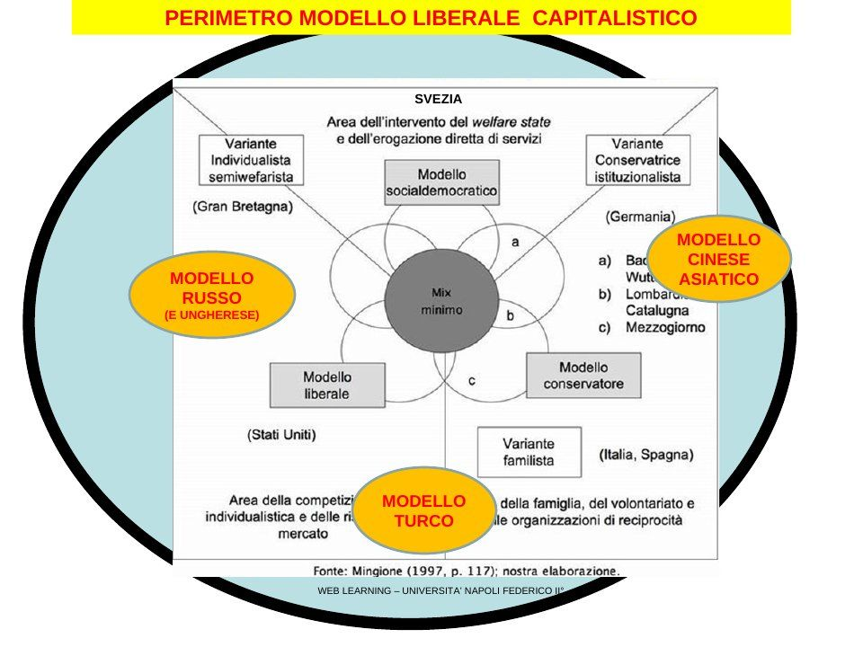{ loading=lazy style="width:59%" }

1:42:25

Che cosa è successo? Sostanzialmente che il legame che negli ultimi 200-250 anni ha unito lo Stato liberale, il capitalismo e la democrazia si sta interrompendo. Questa è la frattura interessante, e pericolosa, dal punto di vista filosofico e intellettuale: capitalismo e democrazia per 250 anni hanno viaggiato in parallelo, e ora non è più così certo. Quindi c’è questo pericolo che si sta profilando.

**UN PERICOLO SI AGGIRA IN OCCIDENTE… E NEL MONDO**

Il legame ormai rotto tra la democrazia e l’economia di mercato.

Strade separate: il capitalismo si è adattato facilmente a regimi autoritari e a culture profondamente diverse da quella occidentale, dimostrandosi così ben più esportabile dei modelli politici.

Quello che per due secoli è stato il legame, il patto sociale, si è rotto…

Questo cambiamento ha un significato storico e mondiale: fino a oggi il capitalismo sembrava essere inestricabilmente associato alla democrazia (non sono certo mancati casi di dittatura… il Cile… ma il senso generale era quello).

1:43:00

Oltre a questo c’è un altro problema, di carattere economico, perché dopo duecento anni di crescita quasi ininterrotta del capitalismo si sta delineando una «stagnazione secolare». Questo termine l’ha rilanciato Larry Summers, un economista americano; qualcuno ci aveva pensato dopo la crisi del 1929 in America. Sostanzialmente noi ci siamo abituati a crescere, come economia, dagli anni Settanta – quelli di cui diceva prima Lorenzo: tra i problemi dei giovani d’oggi e quelli che avevano da questo punto di vista negli anni Settanta ci corre tanto – perché prima eravamo abituati a crescere a tassi di PIL del 4, 5, 6, a volte anche 7%, i tassi cinesi di oggi, sostanzialmente. Invece ora c’è la stagnazione secolare: se guardate il telegiornale la sera, quando danno le previsioni dell’Istat o del governo, 0,01... Questo significa, in termini di lungo periodo, stagnazione secolare: vuol dire che l’economia non cresce più.

**SIAMO IN UNA «STAGNAZIONE SECOLARE»? CONFRONTO TRA GLI ECONOMISTI – GIUGNO 2014**

Fa proseliti sempre più illustri la teoria secondo cui siamo entrati in una «stagnazione secolare». L’ultimo è il premio Nobel Paul Krugman, che ha dedicato una serie di commenti sul suo blog a questa tesi.

La teoria della stagnazione secolare, Larry Summers l’ha esposta in un discorso al Fondo Monetario Internazionale nell’autunno scorso. Da allora ha polarizzato l’attenzione e ha generato un vortice di commenti, elaborazioni, approfondimenti. Un’ottima sintesi del dibattito la fornisce Edward Hugh sul suo blog *A Fistful of Euros*, cominciando col ricordare che la teoria della stagnazione secolare ha avuto dei padri illustri: John Maynard Keynes negli anni Trenta, poi il premio Nobel svedese Gunnar Myrdal negli anni Sessanta.

Il punto di partenza comune è l’osservazione che il capitalismo ebbe tre motori di crescita dalla Rivoluzione industriale inglese in poi: crescita economica, crescita demografica, accelerazione del progresso tecnico. La crescita economica non sarebbe stata così diffusa e vigorosa, o forse non ci sarebbe stata affatto, senza il contributo di una popolazione in aumento e del flusso di innovazioni tecnologiche che migliorano la produttività.

Ora il mondo intero è di fronte a una «transizione demografica», come la definisce Krugman riprendendo un termine in voga tra gli specialisti. La caduta della natalità non è più soltanto un fenomeno tipico dei paesi ricchi ad antica industrializzazione. Il rallentamento demografico si estende ormai dal nord al sud, dall’Occidente all’Oriente, coinvolgendo un gigante come la Cina. Perfino nelle economie emergenti, o ex emergenti, non si può dare per scontato che la denatalità si fermi sulla soglia del «quoziente di sostituzione», il numero di 2,1 figli in media per ogni donna, che garantisce la stabilità della popolazione.

Krugman usa una metafora: le nostre economie e i nostri sistemi sociali sono strutturati come delle biciclette; se si fermano, perdiamo l’equilibrio e cadiamo. La risposta al declino demografico va cercata sia sul fronte del progresso tecnologico, sia in una diversa organizzazione sociale.

(Federico Rampini, 14 giugno 2014)

1:44:25

Perché? Krugman, economista americano, ha usato una metafora: dice che il sistema capitalistico assomiglia alla bicicletta, deve sempre andare; nel momento in cui non va, non avendo le rotelle, cade. Quindi deve sempre andare, con due elementi fondamentali: la crescita demografica, cioè la popolazione, e l’incremento della produttività, cioè la tecnica applicata all’industria per produrre sempre di più. Sono questi i due motori fondamentali dello sviluppo economico, e anche questo si è interrotto.

1:45:13

Uno studio in questa direzione l’ha fornito anche la nostra Banca d’Italia, a settembre dell’anno scorso (settembre 2014), e dice che da trent’anni – cioè sostanzialmente dalla fine degli anni della rivoluzione; si riparte sempre da quel punto lì – c’è un reddito stagnante, in termini reali, per il 99% delle famiglie, quelle che non fanno parte dell’1% più ricco della popolazione.

**STUDIO SULLA STAGNAZIONE SECOLARE – BANCA D’ITALIA, SETTEMBRE 2014**

Alcuni studi recenti ipotizzano che l’economia statunitense possa tornare a una fase di stagnazione secolare.

Altri lavori aggiungono che anche la produttività potrebbe decelerare bruscamente, e notano che il PIL pro capite, essendo una misura riferita alla famiglia media, trascura il fatto che il reddito stia già stagnando da circa 30 anni per il 99% delle famiglie (quelle il cui reddito è inferiore al 99° percentile nella distribuzione del reddito).

Il lavoro tenta di mostrare come congetture pessimistiche siano state formulate in passato dopo tutte le recessioni più profonde. Tali congetture si sono poi dimostrate fallaci non perché costruite sulla base di teorie erronee o dati incompleti, né per le difficoltà di prevedere l’introduzione di nuove tecnologie, ma perché avevano sottovalutato le potenzialità delle tecnologie già esistenti.

1:45:51

Nel dibattito internazionale del 2014 irrompe uno studio importantissimo, quello di Thomas Piketty, l’economista francese che pubblica in America questo studio, *Il capitale nel XXI secolo*. Sostanzialmente Piketty sostiene che la struttura sociale ed economica della nostra società sta ritornando ai livelli dell’Ottocento; quindi tutte quelle battaglie che abbiamo visto prima si stanno disperdendo, perché quando l’economia è stagnante prevale la rendita finanziaria – prevale quando l’economia non cresce più – e quindi viene privilegiato non chi lavora, ma chi possiede patrimoni e capitali. L’aspetto interessante di questo studio di Piketty è che contano molto le ricchezze ereditarie: ora non è più il tempo in cui si formano i grandi patrimoni, ma contano molto le ricchezze che si ricevono, proprio perché l’economia da questo punto di vista è quasi ferma – 0,0 è la crescita annua – e questo ci riporta all’economia dell’Ottocento.

**THOMAS PIKETTY – *IL CAPITALE NEL XXI SECOLO**

Nel confronto di idee irrompe a metà anno la pubblicazione de Il capitale nel *XXI secolo* di Thomas Piketty.

La tesi fondamentale è che l’economia e la società occidentale stanno tornando alla struttura dell’Ottocento.

Una causa delle diseguaglianze odierne sta nel fatto che un’élite – prevalentemente di top manager – ha «fatto secessione» dal resto della società, si è conquistata il potere di fissare i propri stipendi in modo autonomo, senza alcun collegamento con la propria produttività. Il secondo fattore è perfino più importante: quando la crescita economica e demografica ristagna, prende il sopravvento la rendita finanziaria; automaticamente chi ha patrimoni accumulati diventa sempre più ricco e distanzia il resto.

Europa e Giappone sono due esempi illuminanti per capire come si crea una società «patrimoniale», dove contano le ricchezze ereditarie: bassa natalità e bassa crescita economica rendono prevalenti le ricchezze già accumulate.

Questa sta diventando la regola nel mondo intero. La chiave di tutto sta nel rapporto tra due variabili: da una parte il rendimento netto del capitale, dall’altra la crescita economica (a sua volta legata anche a quella demografica).

Se il rendimento del capitale supera la crescita economica, come sta accadendo, ecco che il XXI secolo assomiglia sempre di più all’Ottocento: si va verso delle società oligarchiche.

(Federico Rampini, «la Repubblica», 18 aprile 2014)

1:47:23

Quello che è importante e interessante stasera per il tema della rivoluzione e dell’utopia è che noi – credo la stragrande maggioranza di questa sala – abbiamo vissuto nei trent’anni d’oro dell’economia. Forse non ci rendiamo conto di questa nostra grande fortuna, per non usare un’altra parola che inizia con «c» e finisce con «o»: è il «trentennio dorato», gli anni che vanno dal ’50 all’80, in cui si sono fuse crescita economica e libertà civili e democratiche. Questo noi ora lo stiamo perdendo, e andiamo sempre più verso una disuguaglianza massima; poi lo vediamo.

**THOMAS PIKETTY – *IL CAPITALE NEL XXI SECOLO**

L’eccezione, l’anomalia più importante, l’abbiamo avuta per un lungo periodo del Novecento, dopo le due guerre mondiali, e in particolare nel «trentennio dorato» che va dalla ricostruzione postbellica agli anni Settanta (il ’68).

Le diseguaglianze diminuirono sia per la forte crescita economica e demografica, sia per gli aumenti nella tassazione dei ricchi.

(Federico Rampini, «la Repubblica», 18 aprile 2014)

1:48:18

È interessante che lo studio di Piketty si soffermi sui Paesi che avevano più dati a disposizione, cioè l’America, la Francia e l’Inghilterra; un po’ meno l’Italia, solo dal dopoguerra in avanti. Vi ricordate quando abbiamo visto all’inizio il *Manifesto del Partito Comunista*, con quei dieci punti? Uno dei punti fondamentali era la tassazione progressiva. L’America è stato il primo Paese civile, liberale, democratico a imporre questa regola: il primo Paese a imporre l’imposta progressiva, per cui man mano che il reddito aumenta le tasse devono essere più alte rispetto agli scaglioni più bassi. È l’America che ha inventato questo meccanismo – sembra paradossale oggi, ma è così – e l’ha esportato in Germania e in Giappone, le due potenze che hanno perso la Seconda guerra mondiale: l’America, da vincitrice, ha imposto loro l’imposta progressiva, che non esisteva, come segno di civiltà. Pensate un po’ a che cosa voglia dire questa informazione.

**THOMAS PIKETTY – *IL CAPITALE NEL XXI SECOLO**

Ci furono prelievi fiscali straordinari sui patrimoni, spesso legati allo sforzo bellico. E ci fu un forte aumento della tassazione progressiva sui redditi, a partire dagli Stati Uniti.

Oggi può stupire, ma fu l’America a inventare una patrimoniale progressiva, con questa giustificazione: non voleva diventare una società ineguale come quella europea.

Gli americani, dopo la Seconda guerra mondiale, esportarono la loro elevata tassazione nelle due potenze sconfitte, Germania e Giappone, come un segno distintivo di civiltà.

Joseph Stiglitz: «Molti di noi studiarono all’università proprio nel trentennio magico, l’età dell’oro della crescita, e abbiamo finito per credere che quello fosse lo stato naturale. È importante l’attenzione che Piketty rivolge all’eredità come fonte di diseguaglianze. La successione ereditaria riguarda il capitale finanziario, immobiliare, e anche il capitale umano, visto l’accesso sempre più ineguale all’istruzione di alto livello. Noi qui in America crediamo di vivere in una società meritocratica per eccellenza, invece stiamo diventando una società di tipo ereditario, con una mobilità sociale perfino inferiore ad alcune nazioni europee».

Piketty: «Non siamo giunti alla fine di questo processo di divaricazione. Le diseguaglianze cresceranno ancora, rendendoci simili alla Francia pre-rivoluzionaria, dove i nobili rappresentavano l’1% della popolazione».

«È decisiva l’importanza dell’apparato di persuasione, con cui i privilegiati possono rendere la diseguaglianza accettabile, o inevitabile».

«Il XX secolo, per invertire la tendenza alle diseguaglianze e imporre un cambiamento di direzione, ebbe bisogno di due guerre mondiali».

Piketty un rivoluzionario? Niente affatto: è un liberale che crede nei principi del liberalismo, e quindi è dentro il perimetro che abbiamo visto prima.

«Credo nel capitalismo, nei mercati aperti e nella proprietà privata. Mi considero liberale e penso che la proprietà privata sia parte della nostra libertà personale. Ma credo anche nell’importanza delle leggi e nella necessità della tassazione progressiva del capitale. Sono radicale su due cose: nell’essere liberale sui diritti di proprietà e nel credere nella forza della tassazione progressiva.»

(Federico Rampini, «la Repubblica», 18 aprile 2014)

1:49:40

Stiglitz, un altro economista famoso in America, dice: «Noi tutti abbiamo studiato nel trentennio d’oro e abbiamo finito per credere che quello fosse lo stato naturale». Non è così: quel periodo è stato un periodo...

1:50:00

...un periodo eccezionale, che probabilmente ci dobbiamo anche dimenticare, se non ci inventiamo qualcos’altro. L’America si sta interrogando su questo. Piketty dice che le disuguaglianze cresceranno ancora, se questa è la tendenza, e che si ritornerà all’Ottocento, con i nobili che erano l’1% della popolazione.

1:50:32

Vediamo qualche dato. Prima, però: uno, leggendo Piketty, potrebbe dire «ma Piketty è un rivoluzionario?». No, non è un rivoluzionario: Piketty è un liberale, un liberale del sistema capitalistico. Lui dice esattamente – da quello che abbiamo detto prima sembrerebbe un rivoluzionario : «Credo nel capitalismo, nei mercati aperti e nella proprietà privata. Mi considero liberale e penso che la proprietà privata sia parte della nostra libertà personale»; mentre il *Manifesto del Partito Comunista* diceva che ci vuole la statalizzazione dei mezzi, delle banche eccetera.

1:51:11

Guardiamo i dati che ha messo insieme Piketty: il rapporto tra capitale e reddito. Nel 1870 il capitale era sette volte il reddito; il punto più basso è quello del dopoguerra, naturalmente anche per gli effetti della guerra; però nel 1970, negli anni della rivoluzione, per rimanere nel tema di stasera, siamo ancora a livelli bassi. Dal 1970 in poi il grafico si impenna: vedete, siamo quasi ritornati ai livelli di fine Ottocento. Questo è fondamentale.

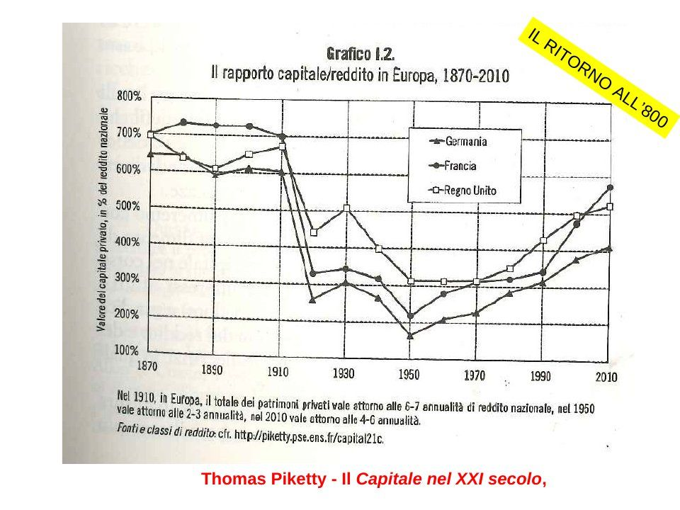{ loading=lazy style="width:59%" }

1:52:16

Poi c’è un’altra tendenza macroeconomica di fondo, che è il ritorno dell’Asia. Se vedete, nella parte finale – il totale fa sempre 100 – intorno al 2012 siamo ritornati come nel Settecento, quando l’Europa era poca cosa rispetto al resto. L’Asia sta ritornando: la Cina in questo momento ha comprato la Pirelli, lo sapete anche voi, ha un sacco di investimenti; il capitalismo di Stato cinese, che è partito dall’essere comunista, sta conquistando ora i mercati internazionali. L’Asia sta tornando. Se si guarda anche alla popolazione, si vede che l’Europa è in declino: è l’ultimo pezzettino in fondo, e il nostro peso è sempre più basso.

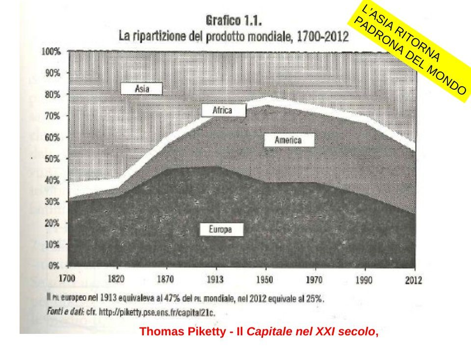{ loading=lazy style="width:47%" }

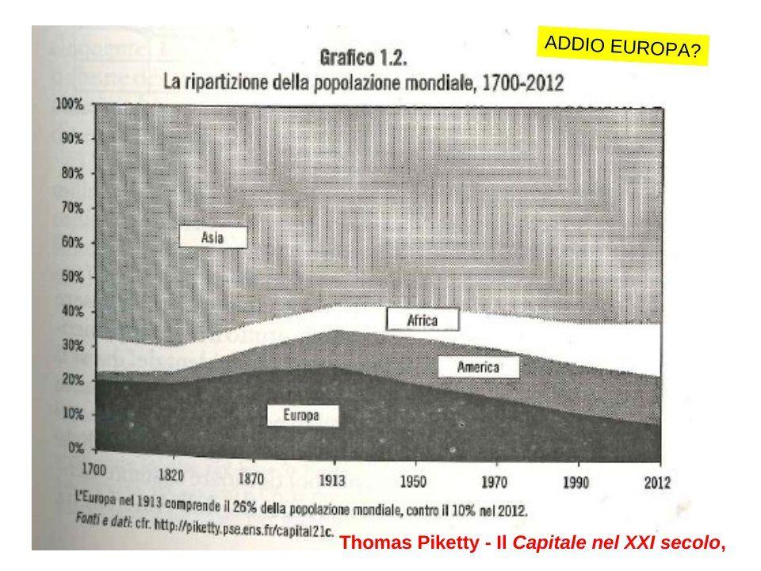{ loading=lazy style="width:47%" }

1:53:06

Per finire questa parte: ci sono oggi dei rivoluzionari? C’è qualche idea rivoluzionaria? Secondo me sì, qualche idea interessante c’è – sto parlando di idee e non di accordi geopolitici, che sono un’altra cosa ; però bisogna andare in America, e mi riallaccio a quello che ho detto prima. Prima di arrivare in America, però, permettetemi di tornare un attimo al Museo del Novecento di Firenze, dove siamo andati dieci giorni fa con chi di voi era presente. Nell’ultima sala, che abbiamo passato un po’ di corsa, c’erano in fondo le riviste fiorentine del primo Novecento – «Lacerba», «La Voce», «Leonardo» : c’era questa parete con tutte le riviste fiorentine attaccate.

**I RIVOLUZIONARI OGGI**

Chi sono oggi i rivoluzionari? Ci sono alcune idee rivoluzionarie?

Secondo il mio punto di osservazione ci sono elementi interessanti in America (stiamo parlando di idee, e non di accordi geopolitici, che sono di altra natura).

Ma prima di arrivarci andiamo al Museo Novecento di Firenze.

1:54:10

Le riviste fiorentine si rifacevano prevalentemente al pragmatismo americano: la filosofia delle riviste fiorentine era quella di prendere come esempio non il ragionamento di per sé, ma la risoluzione dei problemi. C’è una corrente filosofica che è il pragmatismo americano, e le riviste fiorentine dei primi del Novecento si rifacevano a questa corrente. Mi è venuto in mente questo per vedere se ci sono elementi positivi nel panorama delle idee in questo momento, soprattutto da un punto di vista sociale ed economico; e secondo me qualche idea c’è, e anche interessante, rispetto alla stagnazione che magari vediamo qui da noi, in Europa.

**IL PRAGMATISMO AMERICANO**

Gli intellettuali di «Leonardo» (1903-1907), nei primi anni del secolo, posero grande attenzione a una corrente filosofica, il pragmatismo, non solo per ragioni squisitamente culturali, ma perché il pragmatismo poneva delle problematiche e un metodo di interpretazione della realtà che erano giudicati assai utili per svecchiare la cultura italiana e per contribuire a un’analisi più efficace dei problemi della società italiana del tempo. I redattori di «Leonardo» (Giovanni Papini, lo stesso Prezzolini, Adolfo De Karolis, Giuseppe A. Borgese, Giovanni Vailati, Mario Calderoni, Giovanni Amendola e altri) si gettarono a capofitto nella diffusione della filosofia pragmatista di provenienza americana, dedicandovi numerosi articoli, organizzando convegni, favorendo la traduzione delle più importanti opere di Charles Sanders Peirce e di William James, fondando associazioni per la diffusione del pragmatismo.

Che cosa vedevano i leonardiani nel pragmatismo americano? Calderoni sosteneva che esso rappresentava un’iniezione di buon senso nella filosofia professionale dei filosofi europei. Il filosofo di professione era un retaggio del passato: occorreva una capacità di sperimentazione da cui soltanto potevano scaturire idee chiare.

Sulla breve vicenda di «Leonardo» cfr. Paolo Casini, *Alle origini del Novecento. «Leonardo», 1903-1907*, Bologna, il Mulino, 2002. – Giuliano il Sofista \[Giuseppe Prezzolini\], *Le varietà del pragmatismo (risposta a Mario Calderoni)*, in «Leonardo», II, 3, novembre 1904, seconda serie, p. 8.

1:55:15

C’è stato un incontro a New York, a marzo 2015 («What’s wrong with the economy»), a cui hanno partecipato tutti i maggiori economisti mondiali, più il Fondo Monetario, che è una delle componenti della cosiddetta troika; hanno partecipato Citibank, rappresentanti della Banca d’Inghilterra, poi la Federal Reserve americana, riprendendo il tema della stagnazione secolare di cui abbiamo detto prima. Quello che è interessante è che, come abbiamo detto, i motori del sistema capitalistico sono due: la crescita demografica e la produttività industriale, o dell’economia. La crescita demografica si è un po’ fermata in tutto il mondo – la Cina ha già raggiunto il punto di non ritorno da questo punto di vista – e la produttività si è fermata perché le produzioni non sono più così innovative come ci si aspettava.

**LO SPETTRO DELLA STAGNAZIONE SECOLARE E IL PRAGMATISMO AMERICANO**

Siamo nel cuore di un’economia che cresce da 6 anni. Ha creato 15 milioni di posti di lavoro. Ha ridotto la disoccupazione al 5,5%. E ben presto dovrà alzare i suoi tassi d’interesse a conferma della cessata emergenza. Eppure proprio qui a New York si è tenuto un summit con premi Nobel e guru dal mondo intero sulla «stagnazione secolare» che incombe.

Uno scenario da incubo, «certamente ancora più plausibile per l’Europa» secondo l’economista Paul Krugman, ma che anche in America è all’ordine del giorno. E si collega con quello che la Federal Reserve decide in queste ore (l’annuncio sarà dato domani): a quando fissare l’inizio di una risalita del costo del denaro. Vista da qualunque altra parte del mondo – dall’eurozona o dalla Russia, dal Brasile e ora perfino dalla Cina – l’economia americana sembra scoppiare di salute: l’unica locomotiva in grado di trainare la ripresa mondiale. Vista da vicino, è meno esaltante.

*What’s wrong with the economy*, che cosa non funziona nell’economia: è la conferenza che ha riunito esperti da tutto il mondo sotto l’egida della «New York Review of Books» e della New York University. Al centro: la stagnazione secolare, un termine coniato per la prima volta nel 1938 da Alvin Hansen, quando l’economia mondiale era intrappolata nella Grande depressione. A rilanciare questo termine è stato di recente l’economista di Harvard Larry Summers, già consigliere di Bill Clinton e di Barack Obama. E ora tutti lo riprendono: il Fondo Monetario Internazionale, la Banca d’Inghilterra, l’ufficio studi di Citibank, una delle maggiori banche di Wall Street.

Nella versione aggiornata, si tratta di questo: l’economia capitalistica ha bisogno di due motori propulsivi per crescere, la demografia e la tecnologia. La storia del capitalismo moderno è una combinazione di questi fattori: una popolazione crescente allarga le dimensioni del mercato per prodotti e servizi; un flusso di invenzioni e innovazioni aumenta la produttività del lavoro umano.

Che fanno ora questi due motori? La demografia si rovescia, da fattore propulsivo a elemento frenante. Nei paesi sviluppati aumenta la quota di anziani che escono dall’età lavorativa. Nei paesi emergenti la natalità si riduce velocemente – con rare eccezioni – e il più grosso di tutti, cioè la Cina, ha già imboccato la strada dell’invecchiamento demografico.

Un segnale di stagnazione secolare viene proprio dai tassi d’interesse. Crescita debole più deflazione (prezzi immobili o addirittura in calo, come per il petrolio) hanno costretto le banche centrali a sfoderare terapie eccezionali. La prima fu la Federal Reserve, che già sei anni fa cominciò a stampare moneta per acquistare bond (4.500 miliardi di dollari), inondare l’economia reale di liquidità, ridurre il costo del credito, rianimare gli investimenti.

A qualcosa è servito, visto che il PIL USA cresce dall’estate del 2009. Ma perfino qui in America, *ground zero* di questo esperimento monetario eccezionale, c’è qualcosa che non va: al di là della disoccupazione ufficiale, c’è tanta disoccupazione nascosta (11% della forza lavoro se si cumulano i dati); i salari sono quasi fermi; il potere d’acquisto delle famiglie ristagna.

Nel summit newyorchese si sono alternati esperti come Lord Skidelsky, Gerald Epstein, Benjamin Friedman, David Colander, i Nobel Edmund Phelps e Krugman. Il Fondo Monetario, sposando le tesi di Thomas Piketty, afferma un nesso tra stagnazione e diseguaglianze: la ricchezza mal distribuita, concentrata in una minoranza della popolazione, non alimenta più i consumi.

Alcuni settori – in America la sanità – prelevano rendite parassitarie che comprimono il reddito disponibile della *middle class*. Il tasso zero crea bolle speculative che mascherano questi problemi strutturali.

Jacob Hacker di Yale, il teorico della società *winner-take-all* (dove le élite fanno incetta dei frutti della crescita), elenca una serie di antidoti alle diseguaglianze: «Rilanciare i diritti sindacali nel settore privato. Recuperare una fiscalità progressiva sui patrimoni».

E soprattutto la nuova parola d’ordine: *pre-distribution*. Pre-distribuzione anziché redistribuzione. Non basta più intervenire *ex post* con le tasse per attenuare le diseguaglianze (la vecchia politica redistributiva): occorre garantire a priori un accesso eguale per tutti all’istruzione di alta qualità (pre-distribuzione).

Il nobel Edmund Phelps aggiunge un’altra preoccupazione: «L’innovazione tecnologica non si trasmette più come una volta negli aumenti di produttività del lavoro. Crediamo di vivere in un’epoca prodigiosamente innovativa, ma i gadget sfornati dalla Silicon Valley non stanno aumentando la produttività umana ai ritmi che erano tipici degli anni Sessanta». E se non riparte la produttività, c’è un altro freno alla ripresa delle buste paga.

Privata dei due motori fondamentali della crescita, l’economia può contare solo sulla pompa monetaria delle banche centrali? Domani Janet Yellen dovrà dirci se davvero l’America può considerarsi «guarita», almeno secondo la Fed, e rientrare nel territorio familiare dove il denaro rende qualcosa.

(Federico Rampini, «la Repubblica», martedì 17 marzo 2015)

1:56:40

L’America è stata il primo Paese occidentale, negli ultimi vent’anni, a stampare moneta: ne ha stampati 4.500 miliardi di dollari; la BCE ha iniziato ora con un programma di 1.500 miliardi, quindi l’America ha speso tre volte quello che pensiamo di spendere noi in Europa. Al di là di questo, in America c’è stato effettivamente un cambiamento nell’economia: per esempio hanno diminuito la disoccupazione, non c’è più la crisi come c’è da noi in Europa; però i salari sono fermi, il potere d’acquisto delle famiglie è fermo anche in America, e se si vanno a leggere i dati della disoccupazione includendo gli inattivi, pur essendo inferiori a quelli europei, sono sempre all’11%.

1:57:41

Che soluzione propongono i pragmatisti americani? Innanzitutto il Fondo Monetario – udite, udite – ha riconosciuto che c’è un nesso importante tra la stagnazione secolare, la stagnazione dei consumi e la concentrazione delle ricchezze in poche mani. Questo è già il primo punto di partenza: non lo dice un comunista, lo dice il Fondo Monetario Internazionale. Jacob Hacker, di Yale, dice che occorre ristabilire, recuperare una fiscalità progressiva sul patrimonio: era quello che diceva il *Manifesto del Partito Comunista* che abbiamo visto, nel 1848. La fiscalità deve essere proporzionata al reddito: più aumenta il reddito, più ci deve essere fiscalità. Lo dicono gli economisti, i capitalisti americani, che si rendono conto che i problemi di oggi vanno risolti pragmaticamente: non si può sempre e solo tagliare eccetera, soprattutto nei confronti del lavoro.

1:59:02

E la nuova parola è «pre-distribution». Il nostro sistema, quello europeo, occidentale, che cosa fa? Lo Stato, quando paghiamo le tasse, intermedia la fiscalità per poi redistribuire questi introiti a chi ne ha più bisogno: ognuno di noi paga qualcosa in base al reddito che ha e poi lo Stato fa l’assistenza; lo Stato si mette in mezzo per sopperire a quelle diversità sociali che tutte le economie hanno. In questa proposta dei pragmatisti americani si dice che va fatto a monte: per esempio la scuola, l’alta formazione, che crea poi la disparità sociale, perché chi frequenta le scuole migliori avrà i posti migliori...

2:00:00

...le migliori, che costano molto, saranno sempre solo per i più ricchi rispetto ai più poveri, e non c’è ricambio: l’ascensore sociale si è bloccato. Quindi occorre intervenire prima, a monte: questa è la pre-distribuzione. Questo per dire che qualche idea rivoluzionaria all’interno del perimetro liberale capitalistico effettivamente c’è, e in questo momento mi pare che sia concentrata soprattutto nella parte americana.

2:00:36

Lorenzo Poggi L’analisi di Paolo mi sembra un tantino pessimista, perché non siamo ben sicuri. L’America ha un debito pari a tre volte la sua ricchezza, e questo debito è nelle mani della Cina, perché è la Cina che ha acquistato il debito americano; per cui il capitalismo cinese, il più spietato esistente oggi, potrebbe mettere in ginocchio dall’oggi al domani gli Stati Uniti senza colpo ferire. Quindi lo spostamento del baricentro mondiale dall’Europa all’Asia, come diceva prima Paolo, è evidente.

2:01:34

Il capitalismo orientale, il capitalismo cinese, dal punto di vista umanistico, per capirci – cioè di quello che, come dicevamo, nella nostra storia dovrebbe essere promozione della democrazia, cioè un modo economico per soddisfare i bisogni e quindi dare sviluppo all’umanità, un capitalismo che è fondamento di civiltà e di democrazia in questo senso – quello cinese è veramente, da questo punto di vista, la negazione di tutto questo. Pensate: è fatto anche della vita della gente che non respira nelle città; ma questo fa parte del gioco. Quello più spietato è anche quello che funziona meglio e che ha maggior peso economico.

2:02:49

Quindi io penso – e avvio con voi una riflessione molto tranquilla, dopo cena – che un tentativo di chiarire, di risolvere il problema sia capire quale peso possa avere ancora questa dimensione umanistica, umana, nelle vicende dell’economia, nelle vicende del nostro tempo, e quindi anche nel titolo della rivoluzione, cioè del mutamento in senso positivo: perché la rivoluzione viene sempre fatta per migliorare, per far venire un futuro migliore del presente.

2:03:28

E poi anche in un altro senso, cioè nel senso dell’utopia. Capite che cos’è l’utopia: o è un pensiero che non ha nessuno spazio, perché è veramente fuori da ogni possibilità pragmatica di realizzarsi, oppure è una proposta che ha delle possibilità pragmatiche, magari razionalizzata all’estremo, estremizzata, ma che è un punto di riferimento. Come lo sono state tante utopie politiche nei secoli passati, da quella di Tommaso Moro alla *Città del Sole* di Campanella eccetera: prospettive possibili.

2:04:14

Ma perché ci sia spazio per l’innovazione, per la rivoluzione e per l’utopia, bisogna che il fattore umano, l’uomo, come esistenza e come scelta, abbia ancora una funzione e un peso nell’economia, nella realtà; e invece notiamo purtroppo che ne ha sempre meno. Una volta avevamo un ministro che diceva che con la cultura non si mangia: questo voleva dire che la cultura aveva valore solo se era funzionale all’economia.

2:05:01

Pensate al destino della filosofia, terribile: la filosofia non serve a nulla, va bene? Che cos’è la filosofia? «È quella cosa con la quale o senza la quale tutto rimane tale e quale»: per cui non serve a niente, è una delle espressioni più inutili, e quindi antieconomiche, esistenti. Il mondo occidentale ci si è baloccato con questo prodotto per anni. Io ci provo, insomma: ci si balocca anche così, dopo cena, però ci si balocca, è chiaro.

2:05:45

Quindi in fondo, se ci pensate, questa disumanizzazione, un po’ derivata dalla vecchia alienazione che abbiamo visto nel vecchio Marx, attraversa profondamente il nostro tempo. Perché ciò che ha valore... Guardate che anche i nostri ministri, magari ministri che hanno a che fare con la cultura, quando la promuovono dicono che serve: «Sì, serve soprattutto perché rilancia l’immagine del Paese, che porta turismo». Li sentite tutti così. Ma mai una volta che si dica: «Serve perché?». Serve perché promuove l’umanità, e l’umanità promossa serve a dare all’esistenza e alla comprensione dell’oggi una dimensione che ha senso. Che vuol dire «che ha senso»? Non che serve, ma che ha senso, è ordinata. Ordinata perché? Perché dà uno scopo all’esistenza, le dà dimensione: non è solo un’accettazione di ciò che è o semplicemente una soddisfazione di bisogni, è un dare significato.

2:07:18

Kierkegaard diceva che a un certo punto sprofonda nella noia e va verso il suicidio, perché amare tutte le donne senza che l’amore sia il punto di arrivo di una scelta, di una proposta di vita, di un’aspettativa di corrispondenza, porta alla noia. Non c’è godimento vero se non all’interno di un progetto; e il progetto non può essere solo «se mi serve o non mi serve», «se è utile o non è utile», «se è economico o non è economico»: non può essere solo quello. E queste dimensioni dell’esistenza vengono a poco a poco corrose, erose; rientrano sempre di più nella strumentalità della merce.

2:08:29

Parlavamo prima del ’68, quando le ragazze, liberandosi della schiavitù del consumismo – io sentivo le mie amiche, ne parlavano – dicevano: «Non compriamo più i vestiti di moda, andiamo in soffitta e mettiamoci la gonna rattoppata della nonna». E vennero fuori con la gonna lunga rattoppata della nonna. Un po’ la polizia le bastonò, le buttò fuori; dopo smisero di bastonarle, perché la moda faceva le gonne già rattoppate. È normale che i nostri figli – mio figlio l’ha fatto – comprino i jeans già rotti, già consumati. Mio figlio mi ha preso un paio di jeans che avevo e che adoperavo per imbiancare casa. Ha detto: «Ma scherzi? Li hai visti, così originali, con questo bello strappo qua, e anche un po’ di bianco?». No, non scherzo, guardateli. Che cosa vuol dire? Vuol dire che...

2:10:00

...ciò che è dimensione, scelta estetica, personale, diventa immediatamente questo. Avremo spazio per dire, se qualcuno vuole, che cos’è la moda, la vetrina. Però questo elemento è fondante, fondamentale, anche da un altro punto di vista: se queste dimensioni non sono più promosse, non sono più sentite come dimensioni aventi valore – non valore commerciale, ma come qualcosa di dignitoso, di degno dell’umanità – questo porta a un ritrarsi di tutto ciò che è umano, con la prevalenza della dimensione del capitalismo che conta, quello delle 400 famiglie che di fatto detengono gran parte, quasi la metà, delle finanze che circolano nel mondo. Capite a che punto è arrivata la dimensione del potere finanziario: sono loro che comandano l’economia.

2:11:33

Questo mercato, che è nessuno, che non ha faccia, lo comandano non direttamente, ma attraverso quelli che sono gli organi preposti, la Banca Mondiale, il Fondo Monetario Internazionale e così via. Non sono persone: sono qualcosa che sfugge alla dimensione della persona, tanto che non ha più dimensioni umane e personali. Guardate che non si sente più parlare nemmeno di capitalismo – a parte stasera: Paolo l’ha rammentato un mucchio di volte, il capitalismo – ma nessuno parla più di capitalismo, si parla di economia. Se uno parla di capitalismo già si colloca un po’ a sinistra, perché dire «capitalismo» è come se ci fosse un’altra ipotesi possibile di organizzazione economica; e non si dice: «Ma scherziamo davvero?». Nessuno parla d’altro.

2:12:34

Ma quando nel nostro mondo occidentale si afferma la democrazia, parliamo di partecipazione. Democrazia che cosa vuol dire? Vuol dire che l’individuo – una testa, un voto – decide, vota e sceglie la direzione politica del Paese di cui fa parte: contribuisce. Beh, intanto in un primo momento si disse: quelli che non hanno quattrini non decidono. Già dalla Rivoluzione inglese: nell’esercito di Cromwell c’erano i livellatori, e i livellatori dicevano: «No, no, tutti devono votare: tutti hanno una vita da vivere in questo Paese e tutti devono votare per le decisioni politiche che vengono prese». Fecero tutti i discorsi, i dibattiti – lo sapete dalla scuola – a Putney, e venne fuori: «No, è troppo facile: votano quelli che hanno un interesse stabile». «Stabile» vuol dire che pagano un tot di tasse; se no, capite, il suffragio universale in Italia quando arriva? Quindi, per essere veramente cittadino, devi partecipare con i soldi, se no che cittadino sei? È un discorso estremamente interessante.

2:14:18

Ma oggi la democrazia è essa stessa aggredita, e quindi è difficile pensare a una rivoluzione come a un mutamento politico che dia maggiore spazio e partecipazione all’uomo, all’individuo, perché lo spazio politico di per sé è molto ridotto: i politici decidono in accordo con quelli che sono i dettati della BCE, della troika, del mercato; semmai hanno la possibilità, più o meno, di aggiustare e amministrare, ma non di mutare le condizioni. Quindi chi vota, chi partecipa democraticamente alle elezioni del potere politico nel proprio Paese, sa che questo potere politico ha dei limiti, è limitato. Più di quando Marx diceva agli operai: «Se volete contare dovete imporvi, far valere il vostro lavoro e quindi acquistare potere economico rispetto al capitale e, di conseguenza, anche potere politico». Quindi, meno dimensione umana in questo.

2:15:54

Un altro elemento che insidia la democrazia, legato al carattere dello sviluppo del nostro tempo, è il fatto che le questioni sulle quali si è chiamati a prendere decisioni politiche sono spesso ad alto contenuto tecnico, e per essere comprese avrebbero bisogno di conoscenze molto elevate, che la gente comune di solito non ha e che alla gente comune di solito non si forniscono. Qui entriamo in un altro campo, ma voi sapete che i mezzi di informazione non si permetterebbero mai di dare veramente delle informazioni: hanno prima di tutto in vista lo spettacolo. Se guardate anche le trasmissioni più serie, quelle che mettono a confronto opinioni politiche, dalla faccia di chi c’è sapete già quello che diranno. È atteso lo scontro, perché lo scontro fa spettacolo: se si tirano dietro qualcosa, lo share aumenta; per cui il conduttore deve saper equilibrare, in modo da portare lo scontro fino a un certo punto. Certi personaggi, critici d’arte eccetera, sono invitati sia per la loro conoscenza, ma anche perché hanno un vigore – volete mettere? : quindi è quello che conta, non il contenuto. La nostra è veramente la società dello spettacolo.

2:17:51

Se quello è il modo di informare... Parlavamo prima dei social. Ma guardate, questa non è una critica: io apprezzo moltissimo queste cose – stiamo attenti, se no ci faccio la figura del vecchio, e non è vero, sono giovanissimo, a me piacciono queste cose ; è solo che le condizioni sono queste. E quindi, quando io voto e non riesco a essere informato, non voto più pensando di essere in grado di dare un voto consapevole e informato, ma voto perché quello mi è più simpatico o meno, o per fede di partito – posso sempre farlo, «io voto così» – ma è la stessa cosa. Quindi anche questo sta venendo meno, per questi due punti.

2:19:03

E io inviterei anche a riflettere su un ultimo punto, che però per me è fondamentale. Tanto siamo alla fine. La produzione industriale oggi ha un carattere diverso da quello che ha avuto nei decenni passati. Il superamento dell’industria keynesiana, dell’industria fordista, è oggettivo: non c’è più la catena di montaggio, a un certo punto non ci sono più nemmeno i robot in un certo modo; ci sono altri modi di produrre, e l’innovazione viene soprattutto come innovazione tecnologica legata alle nuove discipline informatiche, dall’applicazione dei nuovi strumenti di comunicazione e di comunicazione tra pensiero e macchina.

2:20:01

Questi nuovi strumenti avrebbero bisogno, più che in passato, di creatività, di innovazione, perché per quanto riguarda la produzione, quella va calando. Nei tempi passati l’innovazione tecnologica dell’industria portò in un primo momento al licenziamento di tanti lavoratori manuali – per cui c’erano anche quelli che distruggevano le macchine, i luddisti – ma poi portò a un incremento e quindi a nuove assunzioni. Oggi invece lo sviluppo tecnologico porta a una riduzione: non si era mai sentito dire che in banca ci sono troppi impiegati, che alla posta ce ne sono troppi; ed è solo un esempio minimo di quello che sta succedendo. L’innovazione porta a una riduzione, e non è vero che i posti in più creati dal nuovo lavoro creativo compensino quelli perduti: c’è una differenza, ci sono degli studi.

2:21:29

E quindi questo porta di nuovo a quella perdita di valore del lavoro di cui abbiamo detto prima. Quindi: o questo si risolve in maggior tempo libero, e quindi in maggiore disponibilità all’espansione di quelle capacità umane che sono anche la base per la nuova creatività – e quindi quelle non commercializzabili, quelle che riguardano il senso della vita, l’arte, la filosofia anche, la musica – nell’occuparsi di quelle che sono le nuove capacità umane e nel tradurle in miglioramento dell’esistenza per tutti; oppure riduciamo, e avremo una povertà sempre più diffusa e una concentrazione sempre maggiore della ricchezza. Tanto che siamo arrivati a caratteri che c’erano una volta nel Medioevo: i poveri che vengono fatti sopravvivere dalle istituzioni caritative, il calderone di Altopascio, nel quale tutti vanno e buttano dentro qualcosa in modo che ci sia zuppa per tutti; la tessera che viene data a quelli che non hanno un reddito sufficiente, per un massimo di un certo numero di euro al mese di spesa gratis... Un pezzo di Medioevo che ritorna anche nel nostro tempo.

2:23:08

C’è spazio per l’utopia e la creatività? Forse c’è spazio, se riusciamo a superare questo passaggio. L’Occidente ha ancora caratteri tecnologici elevati e può ancora contrapporsi all’Oriente; ma se lo fa mantenendo la propria posizione dovrà chiudersi, perché finora un quinto dell’umanità – quello di cui fortunatamente facciamo parte, il nostro – ha vissuto a spese degli altri quattro quinti. E quando la finanza è globalizzata e il mondo è globalizzato, la nostra società non regge se continua a non valorizzare certi aspetti.

2:24:13

I giovani: i giovani danno il loro meglio e sono il meglio dell’umanità. Dai 15 ai 30 anni abbiamo il meglio che possiamo essere e dare al mondo, all’umanità; e dai 15 ai 30 anni i nostri giovani sono ridotti in condizione precaria. I precari, in latino, erano quelli in ginocchio, che pregavano in qualche modo il *patronus* di fargli avere il fagottello con la roba da mangiare o qualcosa. Stiamo sprecando la parte migliore di noi stessi: da loro dovrebbero venire l’innovazione, la rivoluzione, e li abbiamo ridotti quasi a zero. Un sistema così credo che difficilmente si regga.

2:25:10

Non siamo troppo ottimisti, però lo spazio per la rivoluzione credo si sia molto ridotto. Questo non è colpa di nessuno: quando ci rivolgiamo a qualcuno, lo troviamo come funzione del sistema. E così non scoppia: manca l’atto di volontà a cui Hegel faceva risalire – e poi Marx lo riprese – il concetto di rivoluzione. Mi fermo qui, basta: mi sembra che per una sera sia anche troppo. Comunque riprenderemo questi argomenti: vedete, nei titoli ci sono delle precisazioni.

2:26:12

Paolo Marcucci Grazie, diciamo. Grazie a voi di essere venuti. Se volete, il prossimo appuntamento è il 23 aprile, quando parleremo della pop art. Grazie, buonanotte a tutti.

## Appendice

Le slide proiettate durante l’incontro.

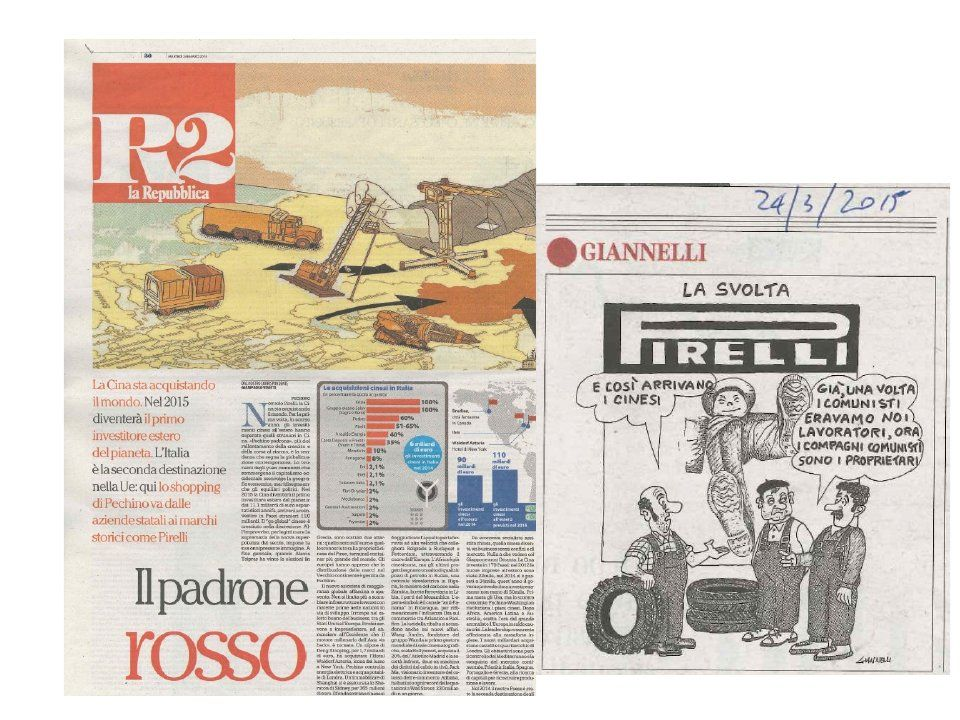{ loading=lazy style="width:47%" }

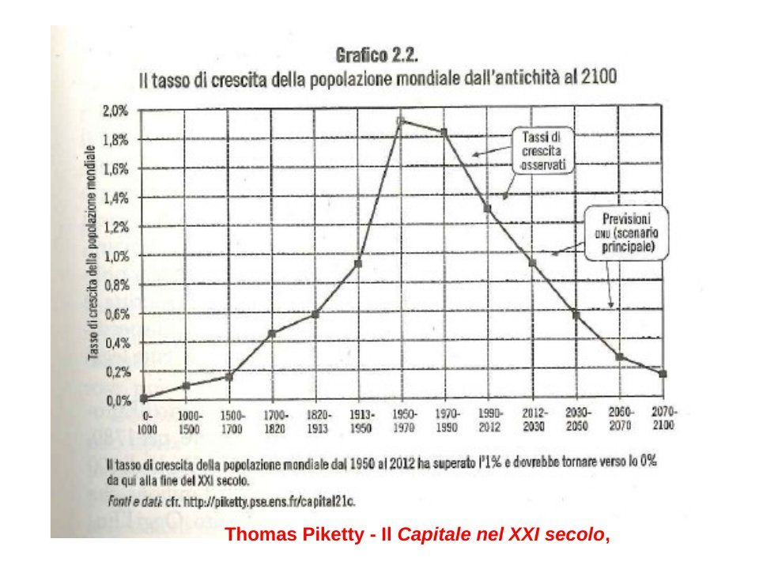{ loading=lazy style="width:47%" }

**SISTEMA CAPITALISTICO**

Quando si parla di un sistema economico-sociale ci si riferisce a un insieme di rapporti sociali, di metodi di lavoro, di modi di produrre, di mezzi tecnici, di istituzioni politiche, di ordinamenti giuridici, di valori etici che costituiscono l’organizzazione di una certa area geografica in un certo periodo storico.

Il capitalismo come sistema economico-sociale si è affermato in Europa attraverso una serie di rotture successive del sistema feudale. Quest’ultimo è entrato in crisi lentamente, con tempi diversi a seconda delle varie aree geografiche. Per un periodo piuttosto lungo, tra il XVI e il XIX secolo, le strutture del vecchio ordine hanno continuato a persistere accanto alle forze che spingevano nel senso di una modernizzazione dell’economia e della società.

Il termine capitalismo può riferirsi in genere a diverse accezioni di pratiche economiche, istituzionalizzate in Europa tra il XIV e il XV secolo (come dimostrato magistralmente da Giovanni Arrighi), che coinvolgono in particolar modo il diritto, da parte di individui e gruppi di individui che agiscono come «persone giuridiche» (o società), di comprare e vendere beni capitali (compresi la terra e il lavoro) in un libero mercato (libero dal controllo statale).

**IL LIBERALISMO**

Il principio della limitazione esterna della ragion di Stato in termini di diritto viene sostituito nel XVIII secolo: al suo posto viene introdotto il principio di limitazione interna (*si governa troppo*).

La separazione tra società civile e Stato, che il liberalismo afferma come proprio obiettivo strategico, è il passaggio decisivo per spostare sulle dinamiche di autoregolazione del mercato il baricentro dello scambio politico.

Nasce così *la mano invisibile* di Adam Smith (il famoso macellaio).

**LA PROFEZIA DI TOM WOLFE: «SONO NATI I RADICAL CHIC»**

New York, 1970. Un party dai Bernstein per sostenere le Pantere Nere. Un cronista d’eccezione inventa un celebre neologismo. Tornano in libreria i «rivoluzionari da salotto».

L’intuizione di Walter Benjamin è spesso valida: «Ogni ascesa del fascismo testimonia di una rivoluzione fallita».

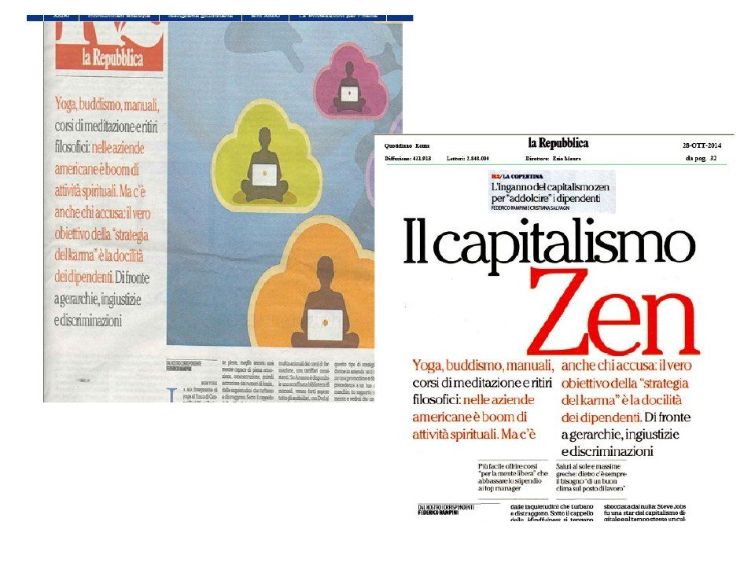{ loading=lazy style="width:59%" }

**ANCHE QUESTO NEL SENSO DELLA «RIVOLUZIONE» ALL’INTERNO DEL SISTEMA CAPITALISTICO**

Mariana Mazzucato: «La grande menzogna del mercato che vince e dello Stato che perde».

L’impresa privata è considerata da tutti una forza innovativa, mentre lo Stato è bollato come una forza inerziale, troppo grosso e pesante per fungere da motore dinamico. Lo scopo del libro che avete tra le mani è smontare questo mito.

Chi è l’imprenditore più audace, l’innovatore più prolifico? Chi finanzia la ricerca che produce le tecnologie più rivoluzionarie? Qual è il motore dinamico di settori come la green economy, le telecomunicazioni, le nanotecnologie, la farmaceutica? Lo Stato. È lo Stato, nelle economie più avanzate, a farsi carico del rischio d’investimento iniziale all’origine delle nuove tecnologie. È lo Stato, attraverso fondi decentralizzati, a finanziare ampiamente lo sviluppo di nuovi prodotti fino alla commercializzazione. E ancora: è lo Stato il creatore di tecnologie rivoluzionarie come quelle che rendono l’iPhone così «smart»: internet, touch screen e gps. Ed è lo Stato a giocare il ruolo più importante nel finanziare la rivoluzione verde delle energie alternative. Ma se lo Stato è il maggior innovatore, perché allora tutti i profitti provenienti da un rischio collettivo finiscono ai privati?

«Per molti, lo Stato imprenditore è una contraddizione in termini. Per Mariana Mazzucato è una realtà e una condizione di prosperità futura. È arrivato il tempo di questo libro.» (Dani Rodrik, Harvard University)

«Uno dei libri di economia più incisivi degli ultimi anni.» (Jeff Madrick, «New York Review of Books»)

«L’economia tradizionale propone modelli astratti; la dottrina convenzionale continua a sostenere che la chiave è nell’imprenditoria privata. Mariana Mazzucato afferma invece che la prima è inutile e la seconda insufficiente. Un libro brillante.» (Martin Wolf, «Financial Times»)

«Lo scopo, come dice Mariana Mazzucato, è che lo Stato e il settore privato assumano insieme i rischi della ricerca e godano insieme dei benefici.» (Teresa Tritch, «New York Times»)

«Molti governi si interrogano su come incrementare la produttività e l’innovazione. Questo libro fornisce le linee guida per individuare le politiche industriali più efficaci.» (Robert Wade, London School of Economics)

«*Lo Stato innovatore* dimostra punto per punto quanto pensare per convenzioni sia ottuso.» (Christopher Dickey, «Newsweek»)

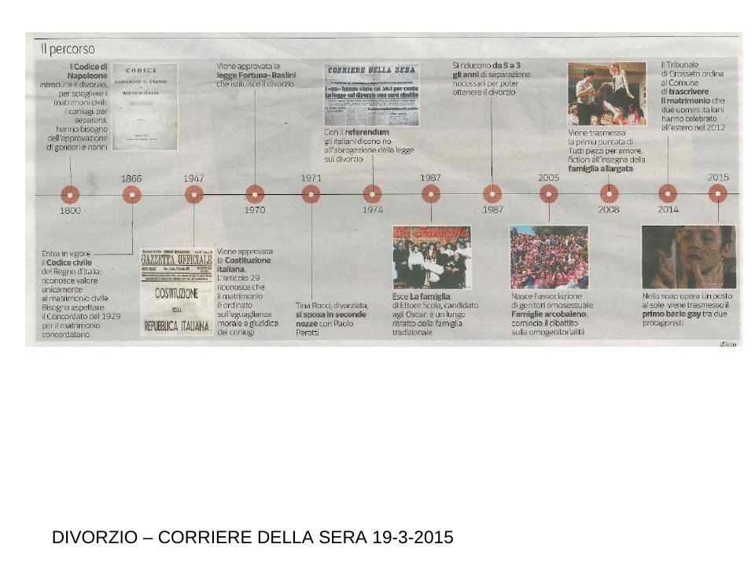{ loading=lazy style="width:59%" }
