# Che cos’è la pop art?

**Data:** 23 aprile 2015 
**Luogo:** MMAB, Museo della Ceramica, Montelupo Fiorentino 
**Incontro con:** Lorenzo Poggi e Paolo Marcucci

**Interventi:** Paolo Marcucci Lorenzo Poggi

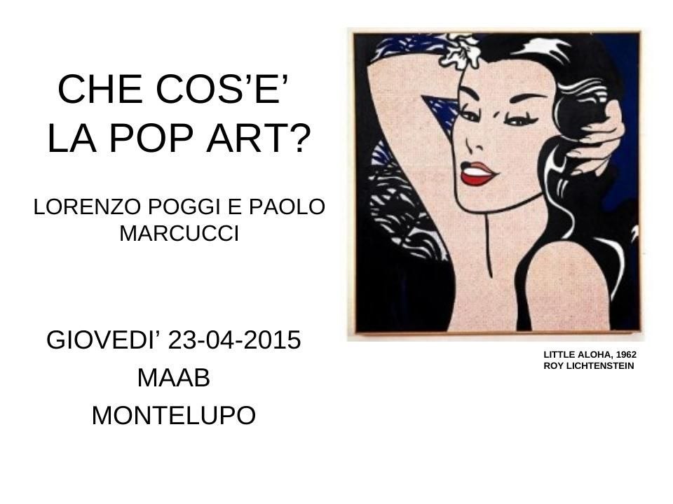{ loading=lazy style="width:43%" }

0:09:51

Paolo Marcucci Buonasera, buonasera. Grazie, grazie di essere venuti. Stasera l’argomento, come avrete visto e sapete sicuramente, è la pop art; vedremo di rappresentare questo fenomeno artistico dal nostro punto di vista, che è anche quello della speculazione filosofica, economica e socioeconomica.

0:10:23

La pop art è un movimento che nasce alla metà degli anni Cinquanta in Inghilterra e si sviluppa maggiormente in America. Non vuol dire arte popolare: al contrario, vuol dire sostanzialmente che è un prodotto di massa, e quindi gioca sulla serialità della riproduzione. È prevalentemente urbana e nasce insieme alla cosiddetta società dei consumi. Prima di andare a vedere delle opere d’arte, approfondiamo un po’ questo aspetto, che ci permette di cogliere appieno il movimento della pop art.

0:11:07

Abbiamo detto che nasce alla metà degli anni Cinquanta; e alla metà degli anni Cinquanta, non a caso, esce un saggio di Roland Barthes, *Miti d’oggi*, in cui si comincia effettivamente ad analizzare la società dei consumi che sta nascendo, che si sta evolvendo dalla fine della Seconda guerra mondiale. Non a caso in un’edizione successiva alla prima, che è del 1957, esce una ristampa che mette in copertina l’opera di Warhol con la famosa zuppa: perché *Miti d’oggi* analizza proprio la società dei consumi e il modo di rappresentare le merci, i consumi della società capitalista che si sta affermando.

0:12:12

Abbiamo detto che nasce in Inghilterra alla metà degli anni Cinquanta; e il termine «pop» è preso anche dalla pubblicità, dal contesto commerciale. Per esempio, qui ho messo delle pinze: il termine «pop» in questo caso vuol dire pinze; ma viene usato anche, per esempio, «Pop-Pops» per i dolciumi, o «Pop» per i materiali idraulici. È il contesto commerciale quello in cui il termine «pop» comincia a emergere. In questo periodo nasce naturalmente anche la pop music, dai Beatles in avanti. Forse qualcuno di voi si ricorda la famosa trasmissione radiofonica *Top of the Pops*, oppure questa di Billboard, *Top Pop Hits*: tutte le canzoni popolari in questo senso.

**BREVE STORIA DEL TERMINE «POP ART»**

1\. DEFINIZIONE

Il Random House Dictionary of the English Language definisce la pop art «uno stile, specialmente della pittura figurativa, sviluppatosi negli Stati Uniti e che ebbe corso all’inizio degli anni Sessanta, caratterizzato principalmente dall’ingrandimento di forme e immagini derivate da generi di arte commerciale come le strips di comics e i manifesti pubblicitari».

In realtà, il termine pop art è stato proposto nel contesto culturale inglese da Fiedler e Banham nel 1955 con un esplicito riferimento ai fenomeni della comunicazione di massa, quali i fumetti, i rotocalchi, la televisione, il cinema, fino ai prodotti industriali di più largo consumo.

Molti titoli commerciali, regolarmente brevettati, avevano adottato il termine pop, ad esempio pops (pinze), pop’s (biancheria intima per uomo), pop-pops (dolciumi), pop (materiali idraulici).

0:13:23

Ma qual è il contesto sociale da cui nasce la pop art? Si passa dalla società del risparmio, che c’era fino alla Seconda guerra mondiale; con il boom economico cambia tutto, si passa dalla società del risparmio a quella dello spreco e del consumo. È in questo contesto che nasce la pop art: il binomio tra produzione e consumo si ribalta a favore del secondo termine, e quindi il consumo prende il posto preminente rispetto alla produzione e al risparmio. Questa è la società dei consumi.

**BREVE STORIA DEL TERMINE «POP ART»**

2\. IL CONTESTO SOCIALE

La pop art nasce e si sviluppa in un contesto sociale fortemente condizionato dalla produzione in serie e dai consumi di massa. Si tratta di un contesto socioeconomico che segna l’avvento di una «società opulenta», in cui alla psicologia del risparmio e del produrre si sostituisce la psicologia dello spreco e del consumo.

In questo tipo di società si verifica cioè un’inversione del rapporto produzione-consumo a favore del secondo termine del binomio, nel senso che questo non si limita più a costituire un polo di riferimento della produzione, ma diventa lo scopo ultimo di tutta la struttura sociale, orientando verso la propria finalità il processo economico e le aspirazioni fondamentali dei singoli individui.

Questo mutamento profondo della struttura sociale nei paesi industrialmente avanzati è stato osservato e indagato, soprattutto per quanto riguarda gli Stati Uniti, dagli scrittori, critici e saggisti newyorchesi di formazione marxista che si erano ritrovati intorno alla «Partisan Review» o appartenevano al gruppo pacifista della rivista «Politics» e successivamente erano confluiti intorno a «Encounter» e a «Commentary». I più significativi esponenti di questa intellighenzia furono H. Arendt e D. Bell, O. Handlin, I. Kristol, D. Riesman e D. Macdonald (V. Calamandrei, 1974).

0:14:13

I primi a tracciare questo cambiamento della società sono in America, sulle pagine di una rivista, «Partisan Review» – l’ho messa per curiosità, questo è un numero del 1943 – una rivista fondata da ebrei americani, su cui poi scriveranno tutti i maggiori intellettuali americani, e anche europei, del tempo: per l’Italia ci ha scritto Moravia; ci scrivono autori come Hannah Arendt, Mary McCarthy. È quindi una rivista importantissima, che coglie questo fenomeno di cui dicevo.

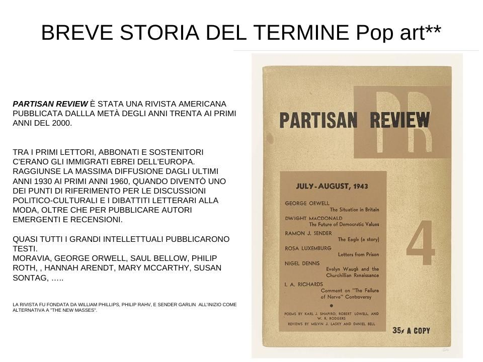{ loading=lazy style="width:30%" }

**PARTISAN REVIEW**

La Partisan Review è stata una rivista americana pubblicata dalla metà degli anni Trenta ai primi anni del Duemila. La rivista fu fondata da William Phillips, Philip Rahv e Sender Garlin, all’inizio come alternativa a *The New Masses*.

Tra i primi lettori, abbonati e sostenitori c’erano gli immigrati ebrei dell’Europa. Raggiunse la massima diffusione dagli ultimi anni Trenta ai primi anni Sessanta, quando diventò uno dei punti di riferimento per le discussioni politico-culturali e i dibattiti letterari alla moda, oltre che per pubblicare autori emergenti e recensioni.

Quasi tutti i grandi intellettuali vi pubblicarono testi: Moravia, George Orwell, Saul Bellow, Philip Roth, Hannah Arendt, Mary McCarthy, Susan Sontag…

0:15:01

Un altro elemento importante per capire come nasce la pop art è un sociologo americano, Riesman, che nel 1950 pubblica un libro intitolato *The Lonely Crowd*, cioè *La folla solitaria*. *La folla solitaria* analizza la società americana e individua tre tipi di personalità dell’uomo di quel tempo: quella diretta dalla tradizione, quella autodiretta e quella eterodiretta, che è quella che ci interessa di più. La prima, quella diretta dalla tradizione, è quella tipica del Medioevo, in cui la tradizione e il lavoro erano quelli che definiva e delineava il padre. La seconda è quella del Rinascimento, in cui l’uomo è più libero, e quindi autodiretto, cioè dotato di autocoscienza. La terza, quella della società dei consumi che nasce, è quella che lui chiama eterodiretta, in un’America che, come lui osservava, stava diventando civiltà dei consumi: un uomo che cerca l’approvazione degli altri, vuole essere uguale agli altri e nello stesso tempo a volte si sente solo. Da qui appunto *The Lonely Crowd*, *La folla solitaria*.

**BREVE STORIA DEL TERMINE «POP ART»**

2\. IL CONTESTO SOCIALE (II)

Il retroterra culturale nel quale nasce la pop art viene individuato bene da David Riesman (1909-2002), sociologo americano, nel libro *The Lonely Crowd* (*La folla solitaria*, 1950), dove fissava tre identità riscontrabili in diverse fasi storiche. Egli distinse personalità «dirette dalla tradizione», «autodirette» ed «eterodirette».

1\. Le prime, in cui i figli seguono il sentiero dei padri, sono tipiche – scrive – di una società piuttosto immobile dove il lavoro è pura fatica, tipo il Medioevo.

2\. Le seconde si impongono in una società più mobile, dove compaiono le prime tecnologie (Rinascimento, Riforma protestante): allora il singolo trova in se stesso la propria bussola e i propri obiettivi.

3\. L’uomo eterodiretto, guidato cioè dall’esterno, era l’uomo che Riesman vedeva emergere allora, in quell’America che stava divenendo civiltà di consumi e di organizzazione di massa: un uomo che cerca l’approvazione degli altri e di essere «come gli altri», un uomo dunque inseguito dal senso di solitudine e d’ansia per paura di non essere accettato (mentre il fallimento, per i primi due caratteri, si configurava rispettivamente come vergogna e come colpa).

In questa scia si colloca Zygmunt Bauman con *La solitudine del cittadino globale*: l’uomo che, nelle nuove incertezze di un mondo liberista e senza confini, non trova più un luogo pubblico, una politica, dove tradurre i disagi personali in progetto sociale.

0:16:30

E che cos’è questo? È un richiamo al famoso racconto di Edgar Allan Poe, *L’uomo della folla*. Questa è un’immagine tratta da un film su *L’uomo della folla* di Edgar Allan Poe: questa persona che, osservando la folla, procede «con fare inquieto, gesticolando e parlando tra sé, come se si sentisse sola proprio a causa della folla». Riesman riprende il concetto della folla di Edgar Allan Poe e ci costruisce sopra il saggio di cui vi dicevo.

**L’UOMO DELLA FOLLA**

*L’uomo della folla* (The Man of the Crowd) è un racconto di Edgar Allan Poe pubblicato nel 1840. Si apre a Londra «sul finire di una sera autunnale». Attraverso la vetrata del caffè in cui è seduto, il protagonista vede sfilare la grande massa – la «calca» – in decine di categorie sociali che anticipano quelle della società moderna e dei consumi da cui originerà la pop art.

All’inizio del racconto Poe descrive degli impiegati – dei dannati – che procedono «con fare inquieto, gesticolando e parlando tra sé, come se si sentissero soli proprio a causa della folla». Dunque una contraddizione, un’ambiguità: da una parte gli uomini moderni hanno bisogno della folla; dall’altra, quando vi si immergono, si sentono ancora più soli, più estranei a se stessi. È questa contraddizione a interessare Riesman.

Con *La folla solitaria* (1950) David Riesman (americano, docente a Harvard) fissa nel titolo l’ambiguità del racconto di Poe.

0:17:18

Una citazione: proprio in questo periodo è uscito il numero che chiude la serie di Ken Parker. Che c’entra? Non c’entra con la pop art, o c’entra in parte, essendo la pop art nata anche dai fumetti; però c’è un punto della storia di Ken Parker in cui il protagonista si ritrova a Boston: lui, uomo della campagna, si ritrova in città, e in città si ritrova solo, e dice – questa è la citazione: «In una città un uomo solo è veramente solo». Ci si rifà al concetto di cui dicevo prima, di Riesman, della folla solitaria.

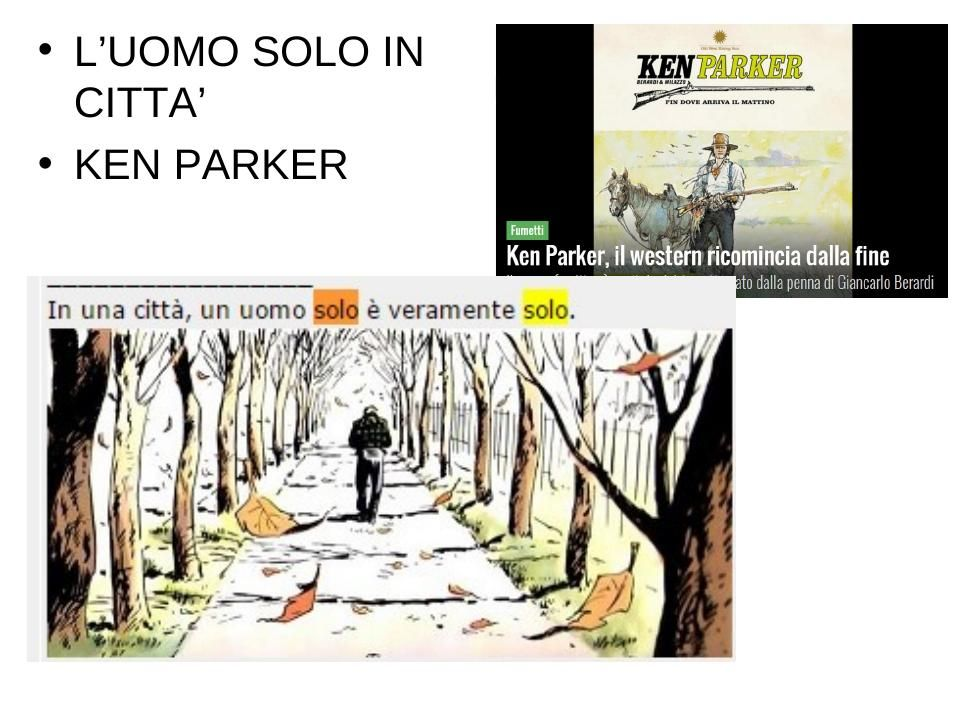{ loading=lazy style="width:44%" }

0:18:14

Quindi l’artista della pop art ormai è uno della folla, della società di massa: anche l’artista ormai è uno della folla ed è costretto ad assumere e accettare questo confronto. La circolazione sociale e il mercato costituiscono – poi lo vedremo – aspetti già interni all’opera d’arte stessa. Ad essere rappresentati non sono gli oggetti di natura, quelli che si trovano in natura; ma, essendo la società dei consumi, della produzione di massa, sono gli oggetti usciti dalla fabbrica, fabbricati per essere venduti: questo è il tratto tipico della pop art. Bonito Oliva dice che la città è lo spazio, l’alveo naturale dell’American dream – della pop art – inteso come «sogno permanente di opulenza e di stordimento organizzato dalla merce». Ritorna sempre il concetto di merce: la pop art utilizza la merce uscita dalle catene di produzione per essere venduta nei supermercati, e questo è il suo tratto distintivo.

**BREVE STORIA DEL TERMINE «POP ART»**

2\. IL CONTESTO SOCIALE (III)

A. Boatto ha colto bene questo nodo centrale della pop art quando scrive che «la circolazione sociale e il mercato costituiscono già aspetti interni dell’opera».

L’artista è ormai uno della folla ed è costretto ad accettare il confronto con l’ambiente.

Si tratta di una posizione che in parte accetta la condizione eterodiretta propria della società opulenta, che in qualche modo è sorretta da un’ideologia fortemente connotata in senso individualistico, anarchico persino, in quanto pone la possibilità di un riscatto della banalità e del cattivo gusto sul piano stesso del consumo e non al livello pianificante della produzione.

*(Testo tratto da Filiberto Menna)*

**LA POP ART**

«La città è lo spazio, l’alveo naturale dell’*American dream*, inteso come sogno permanente di opulenza e di stordimento organizzato dalla merce» (Bonito Oliva, 1981).

Ma a essere rappresentati non sono gli oggetti appartenenti a uno stato di natura, ma quelli usciti dal ciclo produttivo dell’uomo, definiti oggetti-cultura: oggetti non «trovati» o «raccolti», ma volutamente fabbricati per soddisfare fabbisogni di massa, le merci appunto.

L’arte diventa quindi nel movimento pop *pura rappresentazione neutra* (né celebrazione né rifiuto) dello stesso *American dream*.

La pop art rappresenta con brutale candore l’inevitabile *compromissione* dell’arte con la totalizzante e totalitaria società dei consumi, che crede nella propria mitologia e quindi è in qualche modo senza prospettiva critica su se stessa.

Secondo tanti critici, ad esempio, Warhol non ha mai avuto la volontà di criticare o di opporsi all’industria culturale generata dal capitalismo; anzi, ha tentato di sfruttarne le dinamiche spirituali per accrescere la propria fama e il proprio successo.

0:19:35

Una domanda che mi sono fatto è questa. Secondo Renato Barilli, un critico italiano famosissimo, questi sono i quattro Paesi in cui la pop art si è sviluppata maggiormente: l’America, che poi andremo a vedere; l’Inghilterra, di cui abbiamo accennato...

0:20:00

...poi c’è la Francia, e l’Italia. Gli altri Paesi hanno avuto sì la pop art – si è sviluppata in tutto il mondo occidentale – ma non hanno avuto una tradizione di un certo spessore (secondo Barilli sono scarsi i contributi di altre aree nazionali, come la tedesca e la spagnola, con l’eccezione dello svedese Öyvind Fahlström, attivo però negli Stati Uniti). Quindi in questa rappresentazione geografica i pallini indicano un po’ dove la pop art ha avuto lo sviluppo maggiore. E se Barilli ha ragione – questa è una domanda che magari giro al nostro professore – quali potrebbero essere gli elementi che hanno portato a questo? Per l’Italia e la Francia forse i movimenti pittorici precedenti, oppure la moda; per l’Inghilterra e l’America sicuramente lo sviluppo del capitalismo liberale tipico dei Paesi anglosassoni.

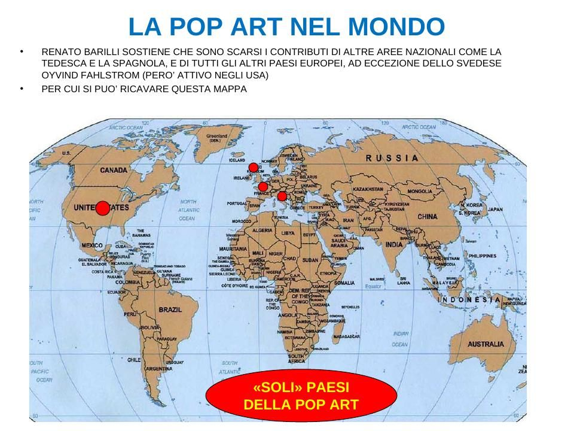{ loading=lazy style="width:59%" }

0:21:03

Prima di arrivare a vedere qualche opera d’arte, c’è un altro elemento, a mio modo di vedere importantissimo, per capire meglio la pop art. Sto facendo questa premessa un po’ come quando siamo andati al Museo del Novecento a Firenze e Lorenzo ha fatto la premessa per capire le opere che abbiamo visto: altrimenti non si riesce a cogliere fino in fondo la particolarità delle opere che vedremo tra un po’. Cioè la differenza tra concezione primaria e secondaria, sia dal punto di vista dell’economia, sia, come in questo caso, dal punto di vista della psicoanalisi di Freud. Primari sono i bisogni primari dell’uomo – questa è la scala di Maslow: i primi sono quelli fisiologici, poi la sicurezza e così via. La pop art nasce in questo contesto, in cui bisogna distinguere tra bisogni primari e secondari. In un primo momento, nella pop art, non c’è una distinzione netta tra la primarietà e la secondarietà dell’opera d’arte: questi due elementi si confondono; la pop art nasce in questo momento, con lo sviluppo più evoluto della parte secondaria rispetto a quella primaria.

**INTRODUZIONE ALLA POP ART**

Prima di vedere però le opere occorre fare un’altra premessa che credo sia fondamentale: e cioè la differenza tra primario e secondario.

Dice Freud che gli impulsi «primari» sono quelli rivolti a conseguire i piaceri della *libido*, mentre i valori «secondari» sono quelli che tengono conto del principio di realtà, vale a dire dell’intervento della civiltà, del lavoro (… e dell’industria).

In questa chiave il mondo ci appare (e a maggior ragione negli anni Sessanta) articolato in un panorama urbano-merceologico di oggetti e beni di consumo, con incertezza di confine tra fase primaria e secondaria.

*(Nella slide: la piramide dei bisogni di Maslow, 1954.)*

0:22:36

E questo, va detto, «popolare» non va inteso come cultura popolare in senso tradizionale: nasce, come abbiamo detto, dalla serialità della produzione di massa. Entra anche il cattivo gusto, se volete, il *kitsch*. Allora, questo che cos’è? È *kitsch* o opera d’arte? Ci sono state diverse polemiche sulle bancarelle nelle nostre città d’arte: questo è un caso di Pisa. Vedete la Torre di Pisa messa come fallo nella mutanda, che si vende sotto la Torre di Pisa. Questa potrebbe essere una genialità della cultura pop, perché il *kitsch* è anche un elemento importante nella pop art. Oldenburg, per esempio, artista americano, in tutta la sua opera non si allontana quasi mai da questo confine tra primarietà e secondarietà, come invece faranno altri artisti.

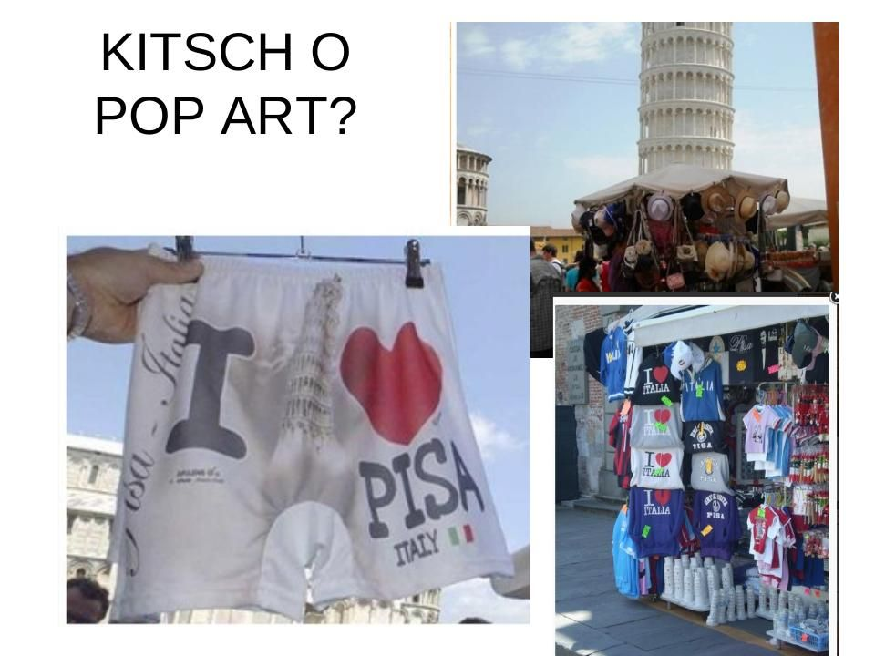{ loading=lazy style="width:41%" }

**INTRODUZIONE ALLA POP ART**

Il polo della *secondarietà* nella pop art via via prevale, con l’attenzione calamitata dall’oggetto singolo e individuale.

Come abbiamo già detto, nulla a che fare con il concetto di «popolare» inteso come regressione a forme d’arte e di cultura arretrate (che le classi e le élite dominanti lascerebbero subito a quelle subalterne).

E questo anche se questi oggetti «popolari» sono perlopiù di cattivo gusto, o di gusto medio, e spesso rientrano nel *kitsch* (termine sinonimo, visto che si intende l’oggetto di cattivo gusto prodotto con mezzi industriali).

Il proposito della pop art non è tuttavia quello di esprimere il disdegno o l’ironia di un’élite intellettuale nei confronti di questi oggetti *kitsch*, ma al contrario di riconoscerne il valore positivo di elementi comunque esistenti nel nostro panorama urbano, conferendo loro una nuova dignità estetica.

Oldenburg (siamo in America), ad esempio, cerca di mantenere visibili e ostentati tutti i possibili collegamenti tra la secondarietà degli oggetti e la primarietà della materia di cui sono fatti (materia che non è spenta e inanimata, ma vulcanicamente accesa).

Oldenburg capisce in questo concetto che la buccia «fatta» e chiusa delle «merci» e dei beni di consumo ha pure una sua ragione di essere, una sua dignità e bellezza da salvare.

0:23:59

Ora andiamo a vedere un po’ di opere d’arte, e cominciamo dall’America, perché è il Paese più importante, quello che ha espresso probabilmente – non so se poi Lorenzo è d’accordo su questo – la pop art; quindi ci serve come pietra di paragone, per poter confrontare anche i movimenti europei – italiani, e, come abbiamo visto, francesi e inglesi – dopo. Vediamo quindi qualcosa della pop art americana.

0:24:33

Allora, questo è Oldenburg, *The Store*, presentato per la prima volta nel 1961 a New York. Sono oggetti, vedete, prodotti merceologici qualsiasi: un tavolino, una carta, una sedia, delle stoffe, un lampadario. E questo che cos’è? Il prodotto merceologico è l’aspetto secondario dell’opera d’arte; però in Oldenburg è viva anche la materia: infatti questi oggetti sono fatti di materia, fili di ferro, vernici, vedete? E quindi rimandano invece alla primarietà della natura. Oldenburg gioca sempre su questo aspetto.

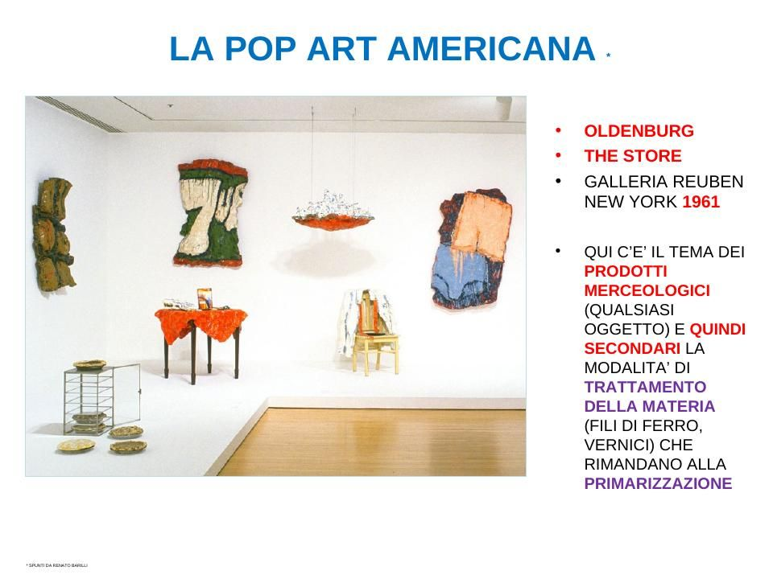{ loading=lazy style="width:41%" }

0:25:22

Si vede bene in quest’opera, che forse è una delle sue più famose, il *Fornello a gas* del 1962. È un fornello a gas tipico americano, non ha nulla di particolare da questo punto di vista, ma è l’idea concettuale che ci sta dietro: è la banalità dell’oggetto. Però Oldenburg non si limita a prendere l’immagine, ma ricostruisce materialmente l’oggetto: l’oggetto viene ricostruito da Oldenburg, che ricrea esattamente quel tipo di fornello a gas, e quindi non si stacca mai del tutto dalla materia e dalla primarietà a cui accennavo prima.

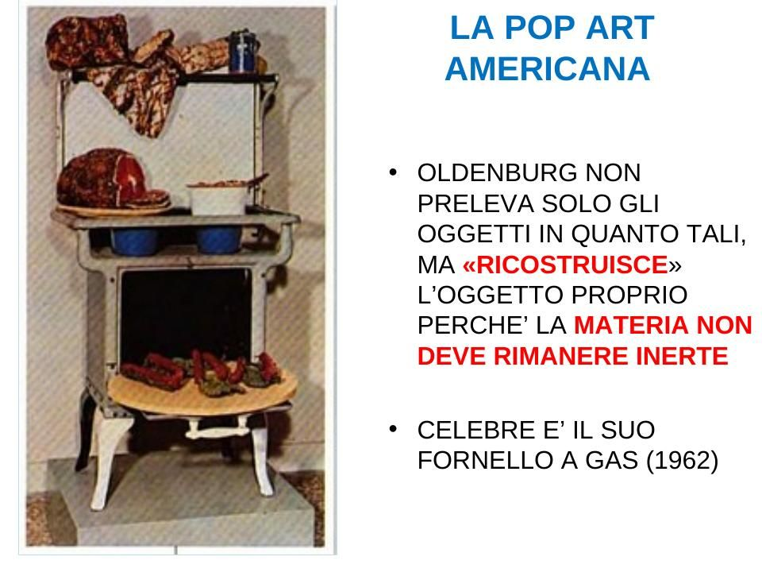{ loading=lazy style="width:30%" }

0:26:15

Questa è un’opera di un’altra serie, in cui usa la tecnica della *softness*, cioè dello svuotare gli oggetti: in questo caso è il Maggiolino giallo, che viene svuotato e sembra prosciugato. Un’altra tecnica che usa Oldenburg è quella della *hardness*, con cui fa degli oggetti giganti, enormi: in questo caso è una borsa del ghiaccio, *Ice Bag*, del 1969. Sono tutte tecniche di Oldenburg.

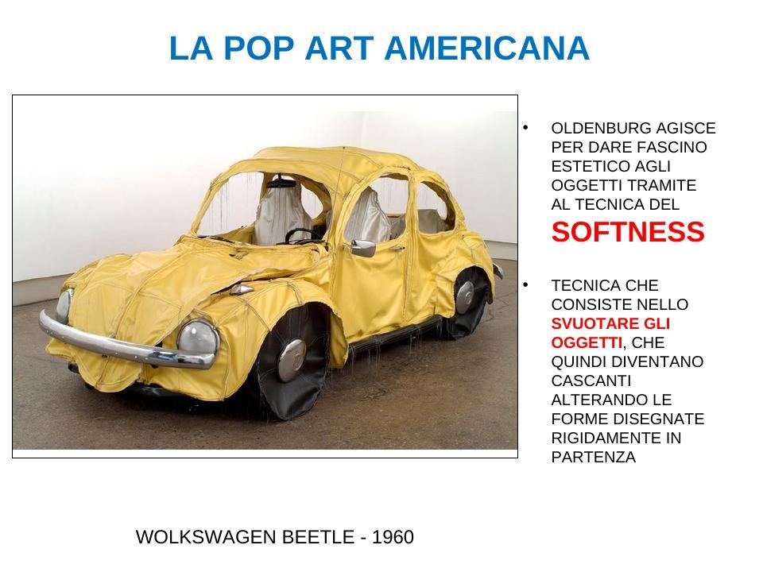{ loading=lazy style="width:32%" }

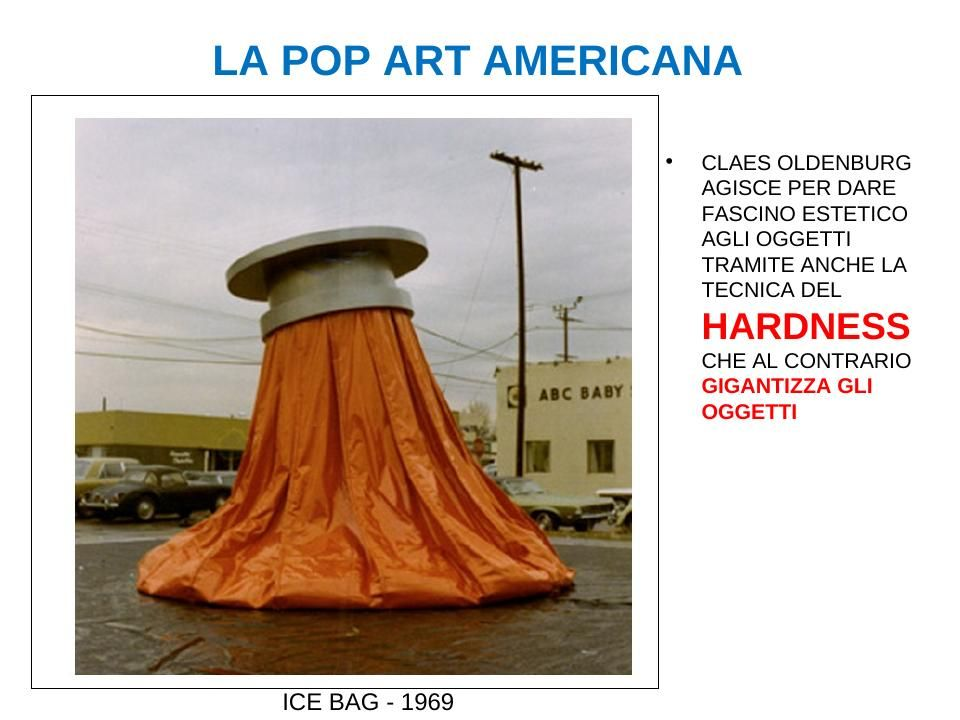{ loading=lazy style="width:30%" }

0:26:54

Passiamo ora a Lichtenstein, e vedremo che, a differenza di Oldenburg, privilegia la secondarietà, e quindi si stacca da quel solco tracciato per primo da Oldenburg. Lichtenstein quasi nasconde la propria mano, dice Barilli – a me è venuta in mente la mano invisibile di Adam Smith, alla nascita del capitalismo: cioè prende gli oggetti e le immagini della società dei consumi e li porta a espressione artistica. Questa, per esempio, è *Ragazza con palla*, del 1961. Barilli diceva che è la quintessenza della banalità – e se la guardiamo bene forse ha anche ragione – e paragona la contemplazione che si ha di fronte a quest’opera alla contemplazione delle macchie sul muro: i capelli ondulati, la palla, il costume da bagno eccetera.

**LA POP ART AMERICANA**

Roy Lichtenstein rappresenta invece l’altra faccia della pop art, quella dedita interamente alla secondarietà.

L’atteggiamento è quindi di assoluta passività verso le forme secondarie della civiltà delle immagini e le icone ottenute con i *mass media*.

La sua più grande preoccupazione è rivolta a nascondere la propria mano, quasi a impedirle di intervenire allo scoperto e in nome dell’autenticità (la mano invisibile di Adam Smith).

La tecnica di Roy Lichtenstein è l’ingrandimento tramite inflazione interna.

La stilizzazione non è più proprietà dell’avanguardia o dell’«alta cultura» che può elevare l’immagine: essendo ormai dominio di tutti, all’artista non resta altro che constatarlo e tentare di attingere un residuo margine di bellezza solo attraverso la dilatazione ottica e l’evidenziazione macroscopica.

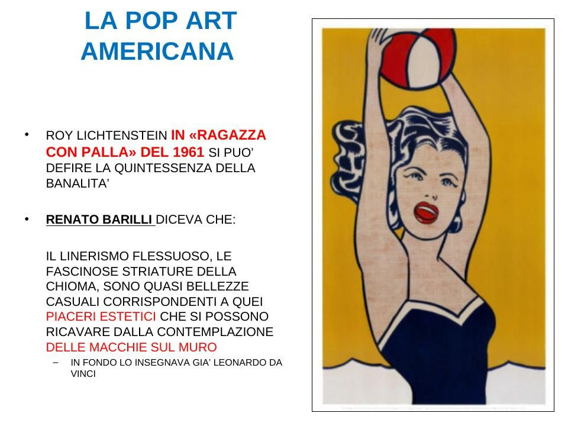{ loading=lazy style="width:30%" }

0:28:19

Renato Barilli paragona la visione di questo quadro alle macchie sul muro, come aveva fatto anche Leonardo da Vinci osservando le macchie sui muri. Dice Leonardo nel *Libro di pittura*: «E questa è se tu riguarderai in alcuni muri imbrattati di varie macchie o in pietre di vari misti. Se avrai a invenzionare qualche sito, potrai lì vedere similitudini di diversi paesi, ornati di montagne, fiumi, sassi, alberi, pianure grandi, valli e colli in diversi modi». Cioè la macchia sul muro, come in quel caso della *Ragazza con palla*, ci fa sognare cose che vanno anche oltre l’opera d’arte.

**LEONARDO DA VINCI, *LIBRO DI PITTURA**

*Testo sulle macchie, Codice Vaticano Urbinate lat. 1270, f. 35v (cap. 66)*

«Non resterò di mettere fra questi precetti una nuova invenzione di speculazione, la quale, benché paia piccola e quasi degna di riso, nondimeno è di grande utilità a destare l’ingegno a varie invenzioni. E questa è se tu riguarderai in alcuni muri imbrattati di varie macchie o in pietre di vari misti. Se avrai a invenzionare qualche sito, potrai lì vedere similitudini di diversi paesi, ornati di montagne, fiumi, sassi, alberi, pianure grandi, valli e colli in diversi modi; ancora vi potrai vedere diverse battaglie ed atti pronti di figure strane, arie di volti ed abiti ed infinite cose…»

0:29:10

Questa è per far vedere la differenza tra Lichtenstein e Oldenburg: Lichtenstein, con la bistecca a sinistra, del 1962, e la carne rappresentata invece da Oldenburg. Vedete, Lichtenstein dà l’immagine della bistecca, del filetto: questa è un’opera famosissima. Quella di Oldenburg è del 1964: lo stesso tema lo tratta in maniera diametralmente opposta, e qui si vede bene la differenza tra secondarietà e primarietà. Oldenburg è sempre legato alla primarietà, infatti ricostruisce il banco...

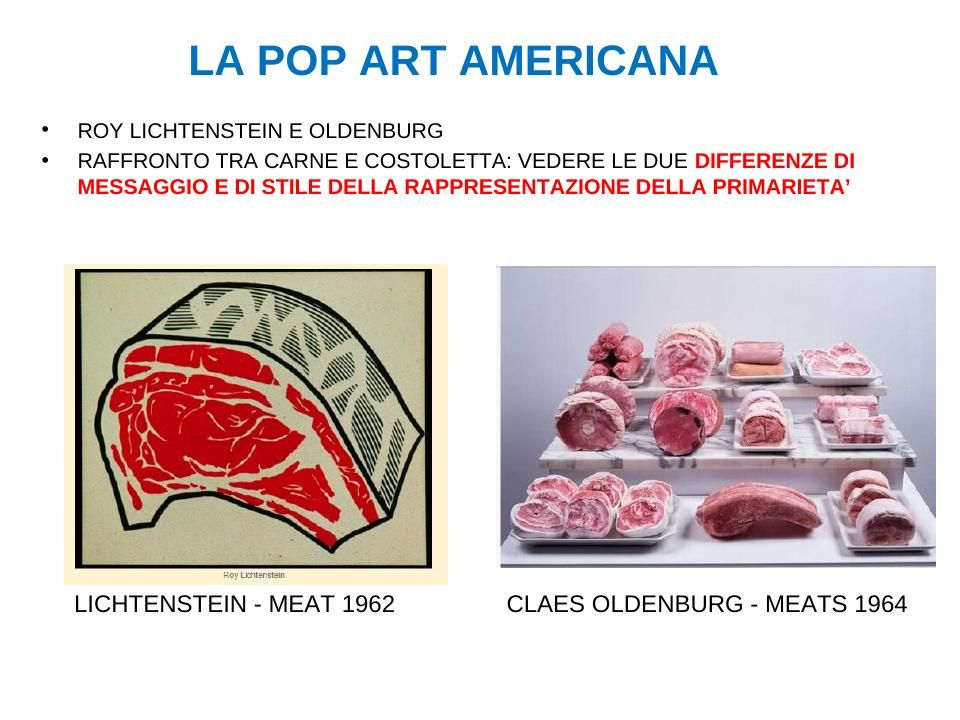{ loading=lazy style="width:59%" }

0:30:00

...del macellaio, con tutti i pezzi di carne ben esposti. Vedete? C’è una differenza abissale tra le due tecniche, pur rappresentando la stessa cosa, cioè la carne.

0:30:13

Lichtenstein utilizza le immagini anche in grande. Questo è l’occhio, un particolare abbastanza famoso che abbiamo visto in tante parti. A volte ha fatto anche una serie di tentativi di staccarsi in qualche modo dalla cultura bassa dell’immagine seriale e delle merci, per rappresentare opere che invece hanno in partenza qualcosa di alto, di cultura alta, ben sapendo però che nell’epoca dei mass media, appena un’opera d’arte, un’immagine, viene messa nel circuito dei mass media, diventa nello stesso momento arte popolare, e quindi pop art. E quindi parte, per esempio, da questo quadro di Picasso e lo reinterpreta a suo modo: questo è *Dora Maar* del 1941 di Picasso, e a sinistra c’è invece l’interpretazione, *Donna con cappello fiorito*, del 1963, di Lichtenstein.

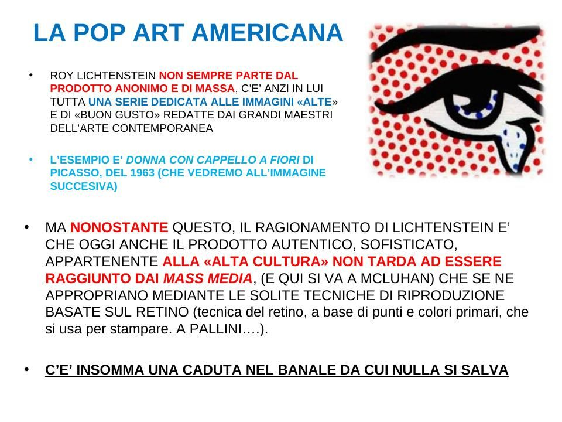{ loading=lazy style="width:30%" }

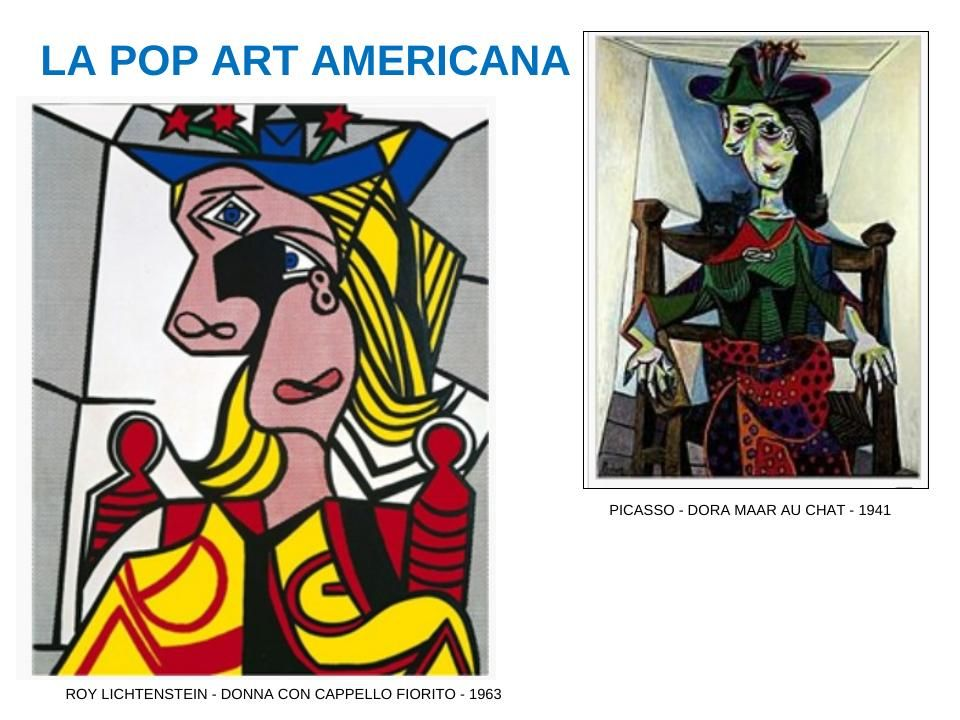{ loading=lazy style="width:47%" }

**LA POP ART AMERICANA**

Roy Lichtenstein non sempre parte dal prodotto anonimo e di massa: c’è anzi in lui tutta una serie dedicata alle immagini «alte» e di «buon gusto» redatte dai grandi maestri dell’arte contemporanea.

L’esempio è *Donna con cappello fiorito*, del 1963, da Picasso (che vedremo nell’immagine successiva).

Ma, nonostante questo, il ragionamento di Lichtenstein è che oggi anche il prodotto autentico, sofisticato, appartenente all’«alta cultura» non tarda ad essere raggiunto dai *mass media* (e qui si va a McLuhan), che se ne appropriano mediante le solite tecniche di riproduzione basate sul retino (tecnica di stampa a base di punti e colori primari: a pallini…).

C’è insomma una caduta nel banale da cui nulla si salva.

0:31:28

L’altro totem della pop art americana è sicuramente Andy Warhol. Ho preso l’immagine forse più famosa di Andy Warhol: qui lui prende la banalità, un oggetto, e ne fa un mito, un mito d’oggi, come aveva intuito anche Roland Barthes, come abbiamo visto. Andy Warhol non fa gigantografie: lavora forse più sul rimpicciolimento dell’immagine. Questa è un’altra opera importante, famosa, di Andy Warhol – un Andy Warhol giovanissimo, qui – «Brillo»; e qui è interessante la domanda che ci si è fatti tanto – se l’era posta il filosofo Arthur Danto – e che mi faccio anch’io, sinceramente: perché quest’oggetto banale poteva essere considerato arte? Perché quell’oggetto lì, in questo caso Brillo, era più degno di essere considerato arte di un altro accanto, di questo bicchiere esposto nello stesso supermercato? Questa è una domanda che magari giro a Lorenzo, a cui cedo la parola.

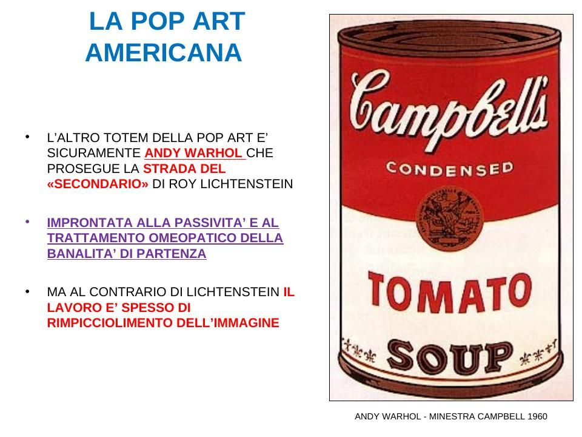{ loading=lazy style="width:30%" }

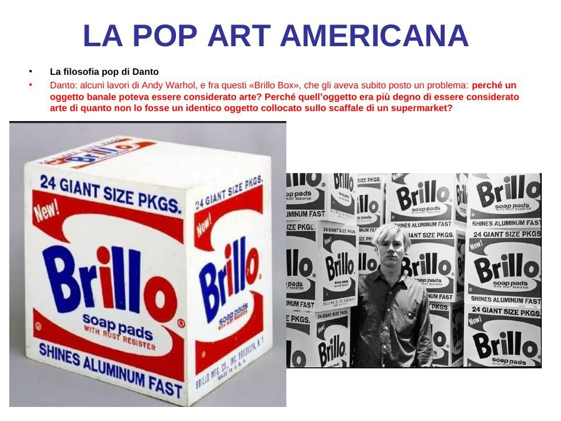{ loading=lazy style="width:47%" }

0:33:08

Lorenzo Poggi Partiamo da una considerazione molto semplice. L’arte ha avuto una funzione fondamentale come strumento di conoscenza. Noi, per ragioni storiche ovvie, siamo portati a considerarla soprattutto da un punto di vista estetico; però l’estetico separato dall’arte in genere è un fatto accaduto molto recentemente, diciamo tra la metà del Seicento e il Settecento. L’arte è sempre stata insieme conoscenza, etica e anche estetica; la separazione avviene successivamente. È conoscenza perché le forme della bellezza non erano solo forme estetiche: erano anche rappresentazioni simboliche dell’ordine del cosmo, erano anche rappresentazioni etiche dell’equilibrio che reggeva anche il comportamento umano, che era giusto quando era equilibrato.

0:34:34

E quindi da sempre l’arte aveva funzioni differenti, non solo estetiche. Pensate anche a una cosa molto semplice: i precedenti dei musei, dove si raccolgono le opere d’arte, se ci pensate, erano le *Wunderkammer*, raccolte di oggetti disparati; non c’erano soltanto quelle che oggi chiamiamo opere d’arte. E l’artista era sì un artista, ma vicino a lui c’era anche il falegname, e anche loro erano artisti. Quindi l’arte come conoscenza: la conoscenza si separa dall’arte, che assume un valore estetico, a un certo momento che caratterizza il nostro tempo. Già in Kant c’è questa distinzione, se vogliamo vederla, ma continua oltre.

0:35:44

E finalmente, quando arriviamo quasi ai nostri giorni, fino alla fine dell’Ottocento, l’arte ha perduto valore conoscitivo, ma ha ancora valore simbolico, valore di propaganda, valore etico. Pensate alla *Libertà che guida il popolo*, alla rappresentazione della Rivoluzione francese; pensate a *Marat assassinato* nella vasca: sono opere di propaganda. Cito opere celeberrime, perché se mettessimo le immagini passeremmo il tempo a guardarle, ma le conoscete tutte. Quindi lì c’è la propaganda: c’è ancora il valore dell’arte come funzione sociale, come funzione di propaganda, e si mantiene per tutta la seconda metà dell’Ottocento.

0:36:37

L’arte come ricerca, non più di conoscenza in generale, ma della visione: il divisionismo, l’impressionismo. Impressionisti, che cosa dice? «Impression»: cioè non più il contenuto. Uno si sarà chiesto: ma che senso aveva un quadro in cui ci sono una signora nuda e un’altra completamente vestita, due signori vestiti di tutto punto, giacca, cravatta, cappello? Che senso ha? Se fossimo tutti noi, diremmo che hanno fatto qualcosa di \[...\]; ma lì non si capisce, non è quello il senso. Il senso è far vedere le ombre, le luci, l’acqua, i fiori, la pelle: è la rappresentazione della visione e della prospettiva, l’invenzione che arriva fino alle soglie del Novecento. Bisogna fare questa premessa, se no non riusciamo a capire che cosa succede.

0:37:49

Che cosa succede all’inizio del Novecento? Salta tutto questo: salta la prospettiva – pensate al cubismo, pensate alle *Demoiselles d’Avignon* – saltano quasi subito anche i contenuti. La bellezza non è più in qualche modo rappresentazione simbolica di un ordine del mondo o del cosmo: la bellezza diventa qualcosa che serve a vendere la merce. La bellezza è qualcosa che entra nell’economia: l’oggetto-merce, per essere venduto e suscitare i desideri, deve essere bello.

0:38:39

Allora, parliamo dei tempi. L’arte in un primo momento rifugge da questo, e si rifugia in che cosa? Nell’essere espressione delle emozioni interiori. Potresti mettere Pollock? Il precedente della pop art è Jackson Pollock. Abbiamo un’opera, la faccio vedere un attimo; si dice espressionismo astratto. No, questo è Lombardo... ecco, Pollock. Qui non c’è nessun oggetto, non c’è nessuna rappresentazione: quest’opera è eseguita mettendo la tela sul pavimento; poi lui ci sgocciola sopra con il pennello e costruisce queste cose. Che cosa esprimono? Non esprimono nessun ordine del mondo: esprimono la forza e le condizioni interiori dell’artista, che comunica con gli altri, e portano a un senso di isolamento.

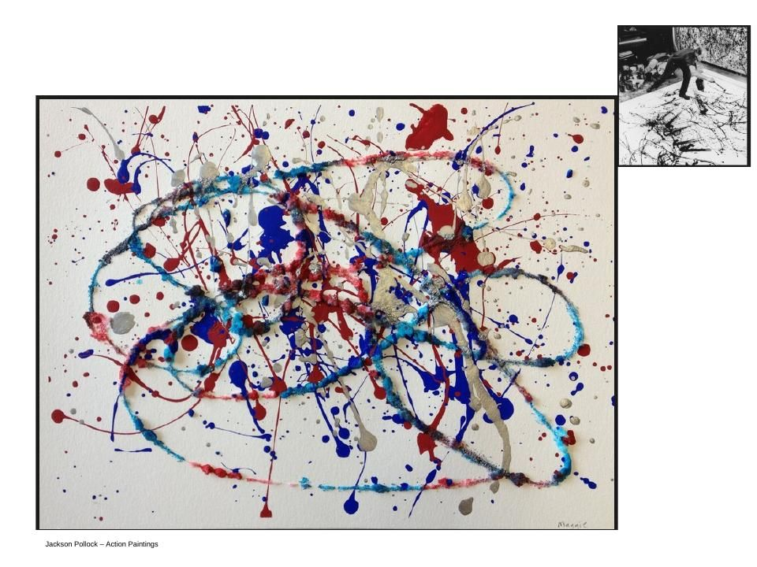{ loading=lazy style="width:40%" }

0:40:00

...di solitudine: una specie di rappresentazione del mistero che è in tutti gli uomini, e della solitudine, perché è un modo di comunicare, ma non si comunica con qualcosa di condiviso. Ecco l’altro punto: le immagini condivise, quelle che avevano valore simbolico, potevano essere decrittate, si capiva che cosa erano; ed erano valori non solo per chi le costruiva. Qui invece sono espressione della propria interiorità, della propria forza interiore: espressionismo astratto. A Pollock ci voleva una bottiglia di Johnnie Walker per fare un’opera: una bottiglia di Johnnie Walker e non so quante sigarette; arrivava in fondo alla sera, dopo aver sgocciolato tutta la sera, e le ultime cose gli venivano molto mosse – e ci sta.

0:41:02

Però, capite il punto? Il superamento di questo, il passo oltre, è la pop art. Che cos’è? Non il rifiuto dell’oggetto, ma di nuovo un’arte che non pretende di controllare totalmente l’oggetto. L’artista non è più colui che costruisce totalmente l’oggetto della propria opera. Fino ad allora l’artista era colui che realizzava il progetto e lo eseguiva, faceva interamente la propria opera. Nella pop, invece, l’artista prende cose che già ci sono: il precedente è Duchamp, il *ready-made*, il famoso orinatoio. Che cosa vuol dire? Che l’arte non è solo progettualità, o non può più esserlo, perché la progettualità e la costruzione sono della macchina, dell’industria, non più del singolo, non più dell’artista.

0:42:35

Allora, se l’arte si deve riconciliare con l’oggi, se deve essere inserita nell’oggi del proprio tempo, della produzione industriale degli oggetti, non può solo esprimere l’interiorità, che nessuno capisce, ma deve produrre oggetti che sono gli oggetti di tutti i giorni, con un significato che viene in qualche modo esaltato nella sua esemplarità. Ecco allora che l’artista pop non produce interamente, ma solo parzialmente: sceglie, presenta, mostra quelle che sono le immagini con le quali vive il cittadino, l’uomo diventato consumatore – perché siamo nella società dei consumi, che prende l’avvio negli Stati Uniti d’America: ecco perché lì la pop art si sviluppa in modo più intenso.

0:43:51

Che cosa vuol dire «diventato consumatore»? Vuol dire che nel suo comportamento e nella sua individualità si distingue, è riconosciuto come individuo che ha un’identità, attraverso certi consumi: va in giro come se si presentasse in vetrina, con il SUV. Il SUV è una vetrina per mostrare chi siamo, e tutti vorrebbero il SUV per essere identificati come gente di successo. Ma se sei sempre in città, che te ne fai di quattro ruote motrici? Oltretutto ci si sta anche un po’ scomodi dentro. Non importa: non è funzione primaria, è identificazione. La merce serve per essere identificati, il consumo ti identifica. E se il consumo ti identifica, non puoi essere identificato una volta per tutte, perché altrimenti il consumo finirebbe, e sarebbe soddisfazione di un bisogno: una cosa che non interessa per nulla alla società fordista di produzione della merce.

0:45:21

Il consumo non è soddisfazione di un bisogno primario: è realizzazione della propria identità, e quindi riconoscimento. Quello che io prendo, consumo, acquisto, deve essere anche desiderato dagli altri; e il fatto che tutti lo desiderino e solo io riesca ad averlo mi distingue come uno che ha un carattere, che si distingue, che ha un’identità. E allora bisogna tenere vivo il desiderio, cambiarlo continuamente, perché l’oggetto di consumo deve essere diverso: se no, una volta acquistata la pelliccia, sono a posto. No, perché l’anno dopo la pelliccia avrà il risvolto più corto, la gonna sarà un pochino più lunga, e avremo tre bottoni, anzi due; quella è antica, vecchia, andava sei mesi fa. Pensate alla moda, che ne è l’espressione tipica – ne parleremo un po’: prima o poi faremo una serata anche su questo, l’anno prossimo.

0:46:30

Capite? Quindi questa è l’identità. Allora l’artista pop prende l’oggetto così come è presentato nell’insieme delle immagini del suo tempo, che sono immagini – lo dicevamo in un discorso qualche tempo fa – e non più simboli: immagini, perché non portano più su qualcos’altro. Nel Medioevo c’era l’immagine della Vergine Maria, che portava su un contenuto, su un significato; oggi l’immagine non porta su altro che su altre immagini. Siamo passati dal simbolico all’immaginario. E quindi il valore qual è? Il valore è quello del mutamento delle immagini. E siamo arrivati all’arte pop, che si riconcilia con il mondo, come doveva fare l’arte, come era nell’antichità; ma si riconcilia con il mondo della merce e dei consumi, e quindi lo fa assumendo come esempio gli oggetti della rappresentazione.

0:47:45

Avete visto questo Lichtenstein, che fa i volti di donna ma li tratta a puntini? Il precedente potrebbe essere il puntinismo, o il divisionismo? Sì, è un precedente, Lichtenstein lo sa benissimo; ma è un ingrandimento, come una foto sgranata. Guardate che mantiene il contorno nero molto intenso, come il segno dei fumetti, perché non c’è più pathos nel ritratto, non c’è più partecipazione. Quell’immagine che Barilli definiva la banalità non è banale: è l’immagine dopo essere stata depurata di tutta quella intensità emozionale che non serve. Quindi abbiamo scelto il tema della pop art perché mi sembrava una via importante per arrivare a capire due o tre cose dell’arte contemporanea.

0:49:05

Proprio per questo aspetto mi piacerebbe vedere un po’ di più... c’è da mangiare. Si potrebbe vedere Hamilton: abbiamo visto Pollock, vediamo Hamilton. Hamilton, del ’59... Questo addirittura è quello... come si chiama? Del ’52, anzi del ’56. Quello dove c’è il signore con il lecca-lecca, che ha quel lecca-lecca che sembra una racchetta in mano – sì, è nella seconda parte; avanti, avanti. Eccolo, guardate, è bellissimo: questo è il manifesto della pop art. C’è la scritta in cui...

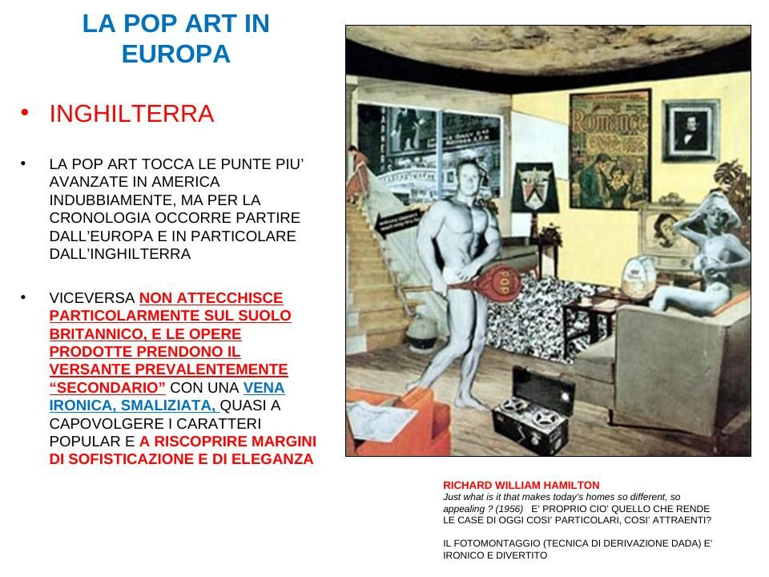{ loading=lazy style="width:32%" }

0:50:00

...la scritta, in inglese, dice in una traduzione più o meno così: «Che cosa rende le case di oggi così diverse, così attraenti?». Più o meno «così amabili, attraenti». Che cosa rende le case di oggi così? E guardate, qui c’è il riassunto: è un collage fatto da Hamilton, un collage che rappresenta l’immagine di quello che uno si aspetta dalla fama. Bellissimo. Intanto, vedete, per terra, che può fare anche da pavimento, c’è Pollock – povero Pollock, dopo il Johnnie Walker è finito per terra – lo vedete? Poi, venite al centro: c’è il paralume con il simbolo della Ford, perché la Ford è azione, lavoro, è quello che caratterizza il nostro mondo: la macchina, il fare, la fabbrica, la merce.

0:51:35

E poi guardate: c’è la televisione. Siamo tra gli anni Cinquanta e gli anni Sessanta, quindi la televisione è un mezzo di comunicazione modernissimo, che serve a rendere sempre più isolati e sempre più individuali: non si partecipa più insieme all’avvenimento, come al cinema, dove si condividono le emozioni; ognuno sta solo in casa sua e partecipa da solo all’emozione. Quindi emozioni comuni, reazioni isolate: l’uomo contemporaneo sempre più solo, mentre è sempre più globalizzato. Siamo in quegli anni, pensate, parliamo di roba vecchia.

0:52:32

E poi vediamo, è interessante il soffitto... ecco, guardate, bellissimo: è una visione della luna, quindi c’è il cielo, gli astri, che sovrastano. Era il momento in cui si parlava degli UFO; e poi c’erano i russi. Siamo nel momento in cui il mondo è diviso in blocchi, e i russi avevano dei vantaggi dal punto di vista dello spazio, erano molto più avanti; e c’era il nostro amico Nikita Krusciov, che diceva, insomma, che negli anni Sessanta vi avremmo superato, che ormai il capitalismo era finito eccetera. E quindi, dal cielo al cielo.

0:53:54

E poi guardate una cosa: questo cibo in scatola. Il cibo è già confezionato: anche quello che era cultura è diventato una cultura che serve per vendere merci. «Facciamo il ragù come lo fate voi a casa, solo per voi»... La cultura della famiglia, del cibo, della preparazione.

0:54:46

Guardate poi il protagonista di tutto, il nuovo Adamo, palestrato – probabilmente, perché se non è palestrato che Adamo è? – che porta al centro, se vedete bene, questo lecca-lecca «Pop»: qui compare per la prima volta la parola «pop», molto prima della pop art; «Pop» si legge molto bene; è un lollipop, una marca di lecca-lecca, molto grande, quasi una racchetta. E dall’altra parte c’è lei, la signora, come vedete, in forma, con il seno pronunciatissimo – vedete che atteggiamento; poi il paralume: la donna oggetto, più oggetto che mai, come quest’altro, palestrato, no? Qui un’altra, guardate, con l’aspirapolvere, il tubo: la signora che fa le pulizie sulle scale con un’astronave per pulire le scale. E dal di fuori Hollywood e i manifesti entrano in casa con le loro immagini di come si deve essere, di quelli che sono i comportamenti da condividere, perché sono ormai le uniche cose condivisibili. Questo è un collage. Qui addirittura, dove prima c’era il ritratto d’autore, c’è invece una pagina del romanzo rosa, del fumettone, perché è diventata la nuova immagine simbolica delle relazioni di oggi.

0:57:03

Questo è conciliarsi; però lui è inglese, e siccome è inglese lo vive in un altro modo: in questo suo lavoro non c’è solo l’adesione al mondo, al suo tempo; c’è anche un po’ di critica, ci si sente sotto: questa cosa non gli piace, avrebbe preferito altro, ma la assume; invece Warhol la assume in tutta la sua completezza. Grazie a voi.

0:57:44

Paolo Marcucci Bene, facciamo la prima pausa. Grazie a tutti.

\[PAUSA\]
{: .nota }

1:39:15

Paolo Marcucci Allora, riprendiamo con l’ultima parte. Prima di andare a concludere, facciamo un applauso agli amici del Caffè Centofiori per la cena. Grazie. \[Applausi\]

1:39:36

Dunque, ripartiamo con la nostra panoramica sulla pop art. Come avevo detto prima, nella prima parte abbiamo visto prevalentemente la pop art americana, che è il punto di confronto su cui poi si basano le altre; e vedremo anche un po’ la differenza rispetto alla pop art americana, come ha già illustrato ampiamente Lorenzo alla fine del suo intervento di prima. Infatti questo è il quadro di Hamilton che abbiamo visto prima: si vede anche da qui che c’è un po’ di differenza. Qui siamo già in territorio europeo, in Inghilterra; il quadro è del 1956, come diceva Lorenzo, e si vede che non c’è quell’adesione così evidente della cultura americana ai prodotti di consumo e all’immagine della società di massa. La pop art europea è più pensata, forse un po’ più sofferta, in questo caso ironica; comunque l’ha espresso bene Lorenzo prima.

**LA POP ART IN EUROPA: INGHILTERRA**

La pop art tocca le punte più avanzate indubbiamente in America, ma per la cronologia occorre partire dall’Europa e in particolare dall’Inghilterra.

Viceversa non attecchisce particolarmente sul suolo britannico, e le opere prodotte prendono il versante prevalentemente «secondario», con una vena ironica, smaliziata, quasi a capovolgere i caratteri *popular* e a riscoprire margini di sofisticazione e di eleganza.

Richard William Hamilton, *Just what is it that makes today’s homes so different, so appealing?* (1956): «che cos’è che rende le case di oggi così diverse, così attraenti?». Il fotomontaggio (tecnica di derivazione Dada) è ironico e divertito.

1:41:03

Questo è un altro artista inglese, Ronald Kitaj: in questo caso prende oggetti, figure, e li mette sulla tela, nel quadro. Qualche critico l’ha accostato un po’ a Bacon; ma mentre lui è tragico, qui invece c’è una cosmesi, dice Barilli, che lo fa risaltare in questo modo. Questo è rappresentativo della pop art europea.

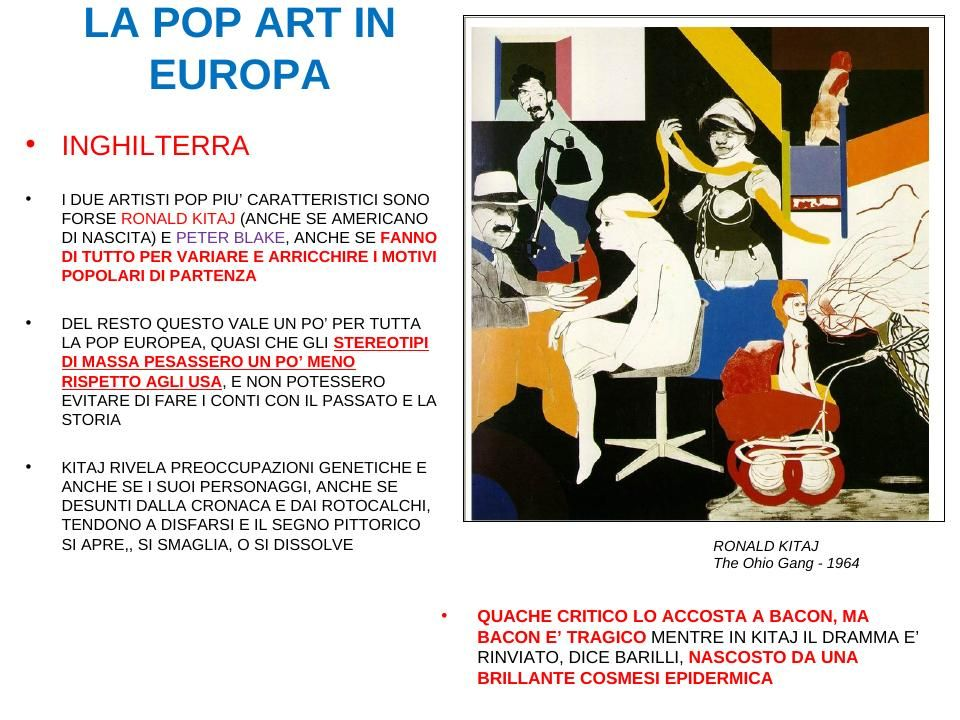{ loading=lazy style="width:30%" }

**LA POP ART IN EUROPA: INGHILTERRA**

I due artisti pop più caratteristici sono forse Ronald Kitaj (anche se americano di nascita) e Peter Blake, anche se fanno di tutto per variare e arricchire i motivi popolari di partenza.

Del resto questo vale un po’ per tutta la pop europea, quasi che gli stereotipi di massa pesassero un po’ meno rispetto agli USA, e non si potesse evitare di fare i conti con il passato e la storia.

Kitaj rivela preoccupazioni genetiche, e i suoi personaggi, anche se desunti dalla cronaca e dai rotocalchi, tendono a disfarsi, e il segno pittorico si apre, si smaglia o si dissolve (*The Ohio Gang*, 1964).

Qualche critico lo accosta a Bacon, ma Bacon è tragico, mentre in Kitaj il dramma è rinviato, dice Barilli, nascosto da una brillante cosmesi epidermica.

1:41:46

Un altro artista inglese importante per la pop art di quel Paese è Joe Tilson, che usa molto il legno e le lettere dell’alfabeto prese dalla stampa, da quei tasselli del tipografo; in questo caso le mette al centro del quadro, e usa il legno perché è un materiale povero e ricco allo stesso tempo – il legno lo ritroveremo più avanti anche nella parte italiana.

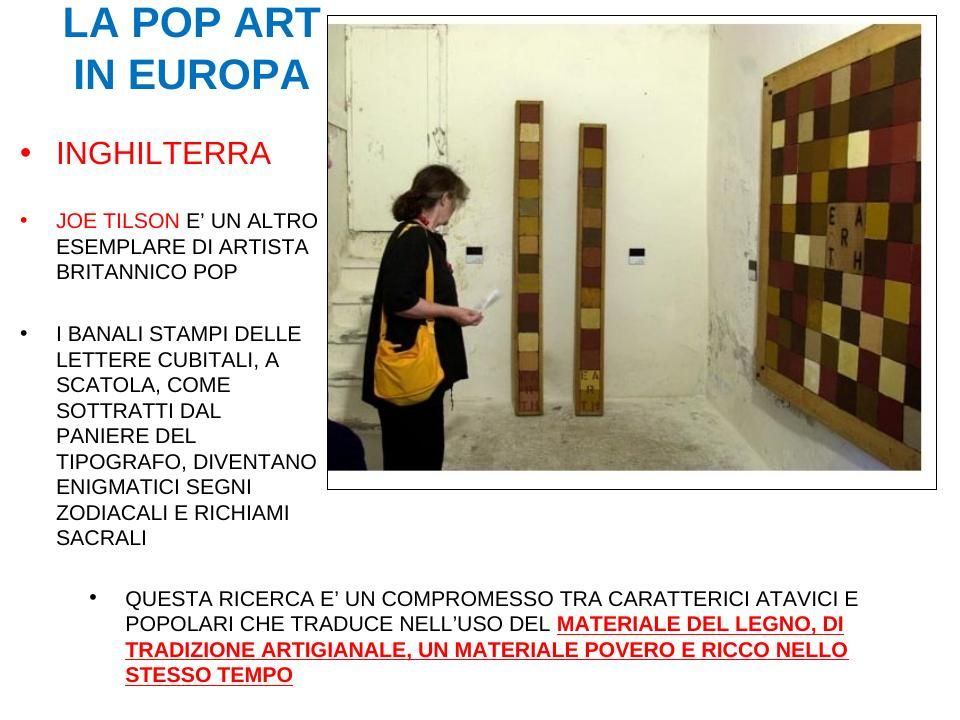{ loading=lazy style="width:38%" }

**LA POP ART IN EUROPA: INGHILTERRA**

Joe Tilson è un altro esemplare di artista britannico pop.

I banali stampi delle lettere cubitali, a scatola, come sottratti dal paniere del tipografo, diventano enigmatici segni zodiacali e richiami sacrali.

Questa ricerca è un compromesso tra caratteri atavici e popolari, che si traduce nell’uso del legno, materiale di tradizione artigianale, povero e ricco nello stesso tempo.

1:42:34

Qui invece siamo in Francia: questo è Hervé Télémaque, un quadro senza titolo del 1964, che mette sullo sfondo oggetti moderni, in questo caso indumenti, biancheria, indumenti normalissimi messi sulla tela: questa è l’interpretazione francese, nel caso di Télémaque. La Francia però si caratterizza forse di più per il riuso del *trompe-l’œil*: questo è Gilles Aillaud, specializzato nei temi del giardino zoologico: *Leoni in gabbia* (*Cage aux lions*), del 1967, con la tecnica del riuso del *trompe-l’œil*. Il ragionamento è che anche le vecchie forme del realismo, come quella corrente pittorica, possono essere riusate a loro volta come merci, rimesse in circolo, e riviste sotto altra forma, che è quella della pop art.

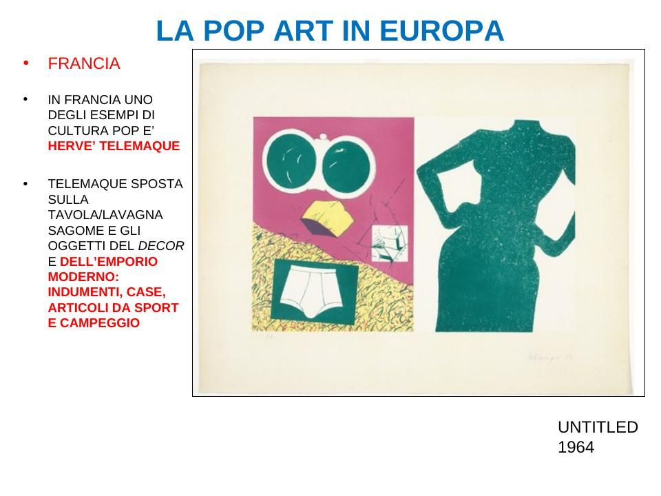{ loading=lazy style="width:32%" }

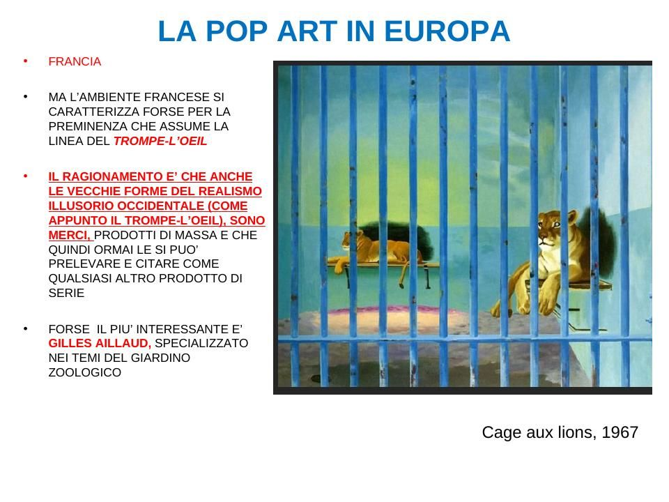{ loading=lazy style="width:30%" }

1:44:01

Arriviamo in Italia. Questo è del 1965, Mario Schifano: siamo a Roma, che è stata forse uno dei centri più importanti della pop art italiana. Schifano usa merci di largo consumo, insegne di largo consumo – famoso è anche l’uso della Coca-Cola; in questo caso usa invece il simbolo della benzina Esso, tipico degli anni Sessanta. È Mario Schifano. L’altra serie importante di Mario Schifano fu quella dei futuristi: in questo caso, se vi ricordate la differenza tra primario e secondario, siamo proprio nel mondo della secondarietà. Lui fa la citazione colta, però poi la traduce nella secondarietà della pop art; e quindi anche le forme aristocratiche, come in questo caso il movimento dei futuristi, rientrano nel repertorio di massa. E in questo caso apre la strada al citazionismo, perché farà poi anche altre opere su questa falsariga: questo è il futurismo rivisitato da Schifano (*Futurismo rivisitato*, 1966).

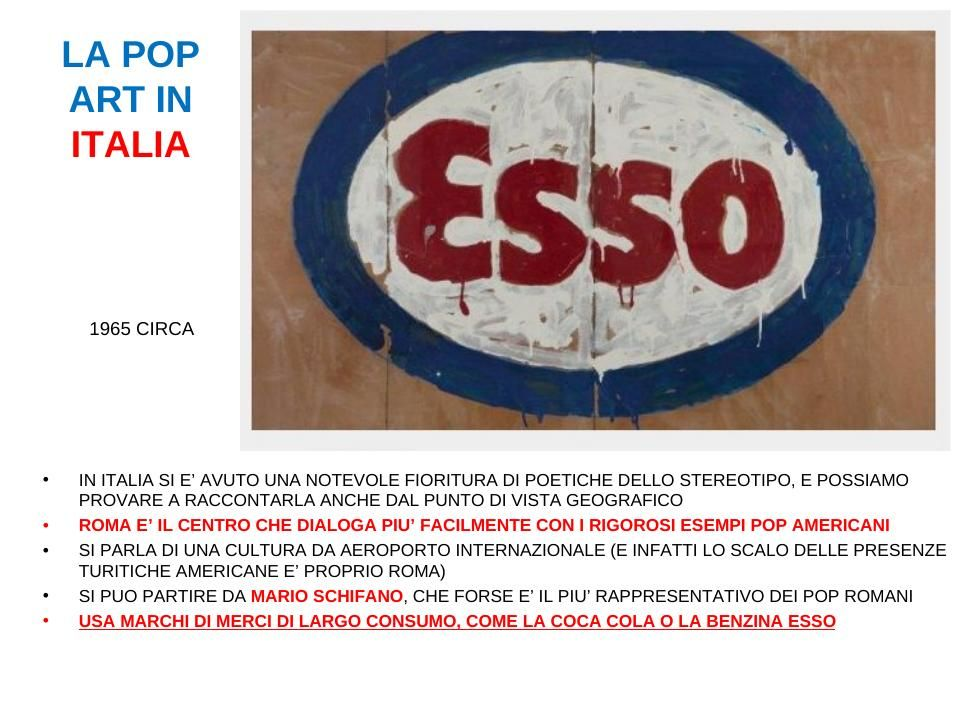{ loading=lazy style="width:35%" }

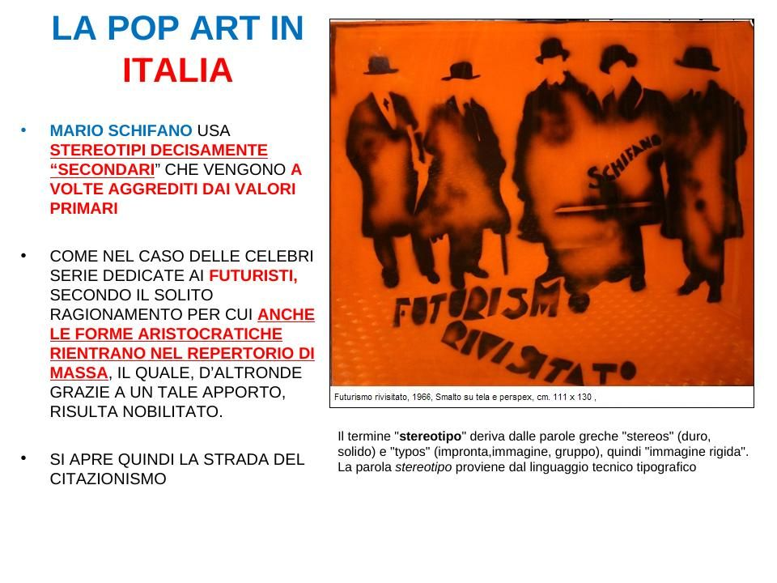{ loading=lazy style="width:30%" }

**LA POP ART IN ITALIA**

In Italia si è avuta una notevole fioritura di poetiche dello stereotipo, e possiamo provare a raccontarla anche dal punto di vista geografico.

Roma è il centro che dialoga più facilmente con i rigorosi esempi pop americani. Si parla di una cultura da aeroporto internazionale (e infatti lo scalo delle presenze turistiche americane è proprio Roma).

Si può partire da Mario Schifano, che forse è il più rappresentativo dei pop romani: usa marchi di merci di largo consumo, come la Coca-Cola o la benzina Esso (1965 circa).

Mario Schifano usa stereotipi decisamente «secondari», che vengono a volte aggrediti dai valori primari, come nel caso delle celebri serie dedicate ai futuristi, secondo il solito ragionamento per cui anche le forme aristocratiche rientrano nel repertorio di massa, il quale, d’altronde, grazie a un tale apporto risulta nobilitato. Si apre quindi la strada del citazionismo.

*Il termine «stereotipo» deriva dalle parole greche* stereós *(duro, solido) e* týpos *(impronta, immagine), quindi «immagine rigida»; proviene dal linguaggio tecnico tipografico.*

1:45:48

Dicevo prima del legno: anche in Italia il legno viene riscoperto, da un artista famosissimo, Mario Ceroli, che lo usa come strumento prevalente di espressione. Questa è l’opera *La Cina*, del 1966. Mario Ceroli è quello che porta la pop art nella terza dimensione, cioè usa materiali nuovi, in questo caso il legno, non tradizionali per la scultura, che usava altri tipi di materiale: utilizza il legno degli imballaggi, i pianali delle casse delle merci. Anche qui c’è una simbologia legata a tutto il discorso che abbiamo fatto fin qui sulla merce, sull’imballaggio della merce stessa come oggetto per farne opere d’arte.

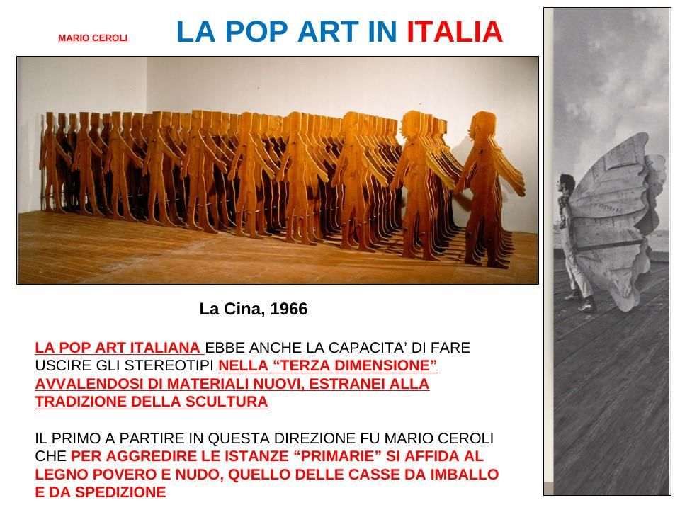{ loading=lazy style="width:59%" }

1:46:52

Un’altra serie importante di Mario Ceroli, per esempio, sono queste serie famosissime che si rifanno a dei quadri di De Chirico, i *Mobili nella valle* – li ho messi in fondo, non so se si vedono tanto bene: rifà quei mobili alla sua maniera, usando sempre il legno povero. Anche qui c’è l’idea che, pur usando la citazione colta, l’opera debba avere un nuovo destino, che la porta nei nuovi mass media e le fa fare un nuovo percorso, un nuovo viaggio, nella struttura stessa del materiale, in questo caso il legno.

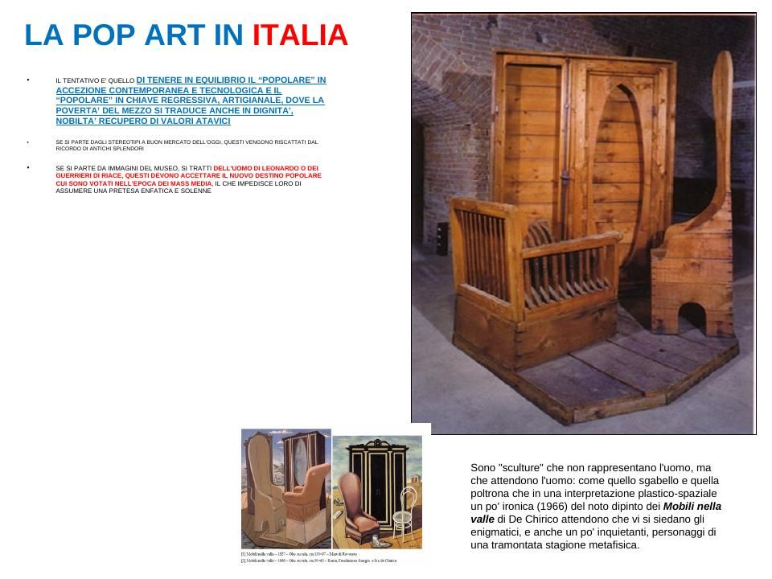{ loading=lazy style="width:59%" }

**LA POP ART IN ITALIA**

Il tentativo è quello di tenere in equilibrio il «popolare» in accezione contemporanea e tecnologica e il «popolare» in chiave regressiva, artigianale, dove la povertà del mezzo si traduce anche in dignità, nobiltà, recupero di valori atavici.

Se si parte dagli stereotipi a buon mercato dell’oggi, questi vengono riscattati dal ricordo di antichi splendori; se si parte da immagini del museo, si tratti dell’uomo di Leonardo o dei Bronzi di Riace, queste devono accettare il nuovo destino popolare a cui sono votate nell’epoca dei *mass media*, il che impedisce loro di assumere una pretesa enfatica e solenne.

Sono «sculture» che non rappresentano l’uomo, ma che attendono l’uomo: come quello sgabello e quella poltrona che, in un’interpretazione plastico-spaziale un po’ ironica (1966) del noto dipinto *Mobili nella valle* di De Chirico, attendono che vi si siedano gli enigmatici, e anche un po’ inquietanti, personaggi di una tramontata stagione metafisica.

1:47:52

Questo è un altro artista italiano, Pino Pascali – siamo sempre a Roma: questo è un modellino di un cannoncino da guerra (*Natura morta (cannone semovente)*, 1965; la slide parla di cannoncini anticarro a scala naturale), e in realtà in questo caso lui riassembla oggetti già esistenti, con il bricolage, e ricrea questa tipologia di opera. È la tecnica del *ready-made*, cioè degli oggetti tali e quali come sono; però li ricrea lui ex novo.

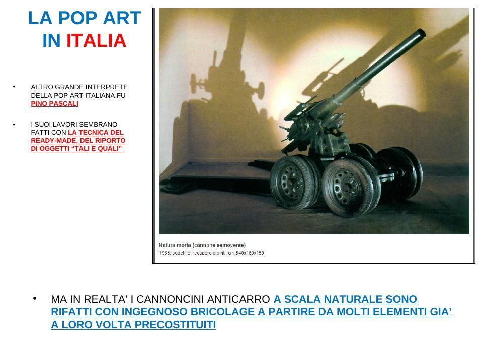{ loading=lazy style="width:59%" }

1:48:32

Da Roma la pop art si può spostare a Torino: questo è Michelangelo Pistoletto, che usa molto la fotografia, stampata poi su una lastra riflettente, e quindi con un gioco di immagini. La fotografia in quel momento è al centro dell’attenzione delle avanguardie, anche perché permette questo tipo di uso, come fa appunto Pistoletto. Qua sotto ho messo anche l’opera *Il Terzo Paradiso*, dove si vede che Pistoletto gioca sempre su quest’uso dell’immagine: in questo caso l’artista stesso spezza lo specchio con una mazza, e lo specchio, questi tre lastroni, riflettono il pubblico che assiste a sua volta allo spettacolo. Questo è il Terzo Paradiso.

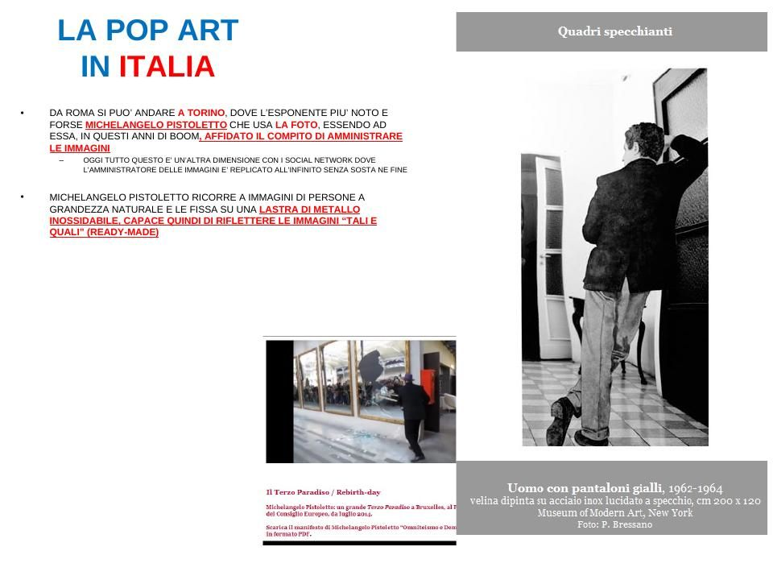{ loading=lazy style="width:59%" }

1:49:48

Lorenzo Poggi Ti interrompo un attimo, visto che abbiamo le immagini: c’è un aspetto estremamente interessante, nuovo, che caratterizza...

1:50:00

...ed è quello che la pop art vuole recuperare, cioè la partecipazione diretta, l’essere partecipi dell’opera. Siamo all’interno dell’opera. Pistoletto mette queste foto, di spalle, incollate sullo specchio: chiunque guardi l’opera si vede vicino alla foto che vi è incollata; quindi lo spettatore è dentro l’opera, e l’opera muta a seconda degli spettatori che si presentano. Quando lo specchio viene frantumato... prima lo specchio rifletteva, e quindi trasformava in immagine su una superficie fissa, la superficie specchiante, una parte di realtà; quando viene frammentato, spezzato, ogni frammento riproduce interamente, in piccolo, la parte. Quindi è una frammentazione di quello che prima era intero in una sola immagine; e quindi la partecipazione del tutto, nonostante la frammentazione, a questo gioco di immagini che si susseguono.

1:51:42

Il Terzo Paradiso: avete senz’altro visto il segno del Terzo Paradiso di Pistoletto. È l’otto, il segno dell’infinito, a cui Pistoletto aggiunge un altro cerchio centrale – quindi è come l’otto dell’infinito con un cerchio centrale. La parte centrale è più grande delle altre. Dice Pistoletto: prima c’è il primo paradiso, il rapporto dell’uomo con una natura sentita come indipendente da lui, fissa e immutabile – la necessità, il destino, quello della classicità: possiamo intervenire, possiamo conoscere, ma non possiamo mutare, dobbiamo sottoporci a questo. E poi l’altro elemento, questo più piccolo qua: la natura è qualcosa che possiamo trasformare, un mondo sotto il nostro controllo, totalmente, tanto che possiamo addirittura distruggerlo completamente con le armi atomiche. Quindi controllo totale, sottomissione della natura al soggetto umano che la domina. Dice Pistoletto: è giunto il momento del Terzo Paradiso, il momento in cui dobbiamo invece sentirci parte del tutto e tornare ad avere un atteggiamento di partecipazione. Dopo il primo e il secondo, il Terzo Paradiso dovrebbe essere, secondo Pistoletto, il destino dell’umanità; e lui ritrova questo segno in tante parti; lo si ottiene attraverso la partecipazione.

1:54:00

Allora siamo andati a disegnare il Terzo Paradiso in Piazza dei Cavalieri a Pisa. Abbiamo fatto questo disegno con i libri, perché i libri fanno parte di questo. Quindi il Terzo Paradiso, un modo nuovo di intendere la relazione con la natura, che Pistoletto esprime attraverso queste che non sono opere, sono azioni collettive – ne ha fatta una addirittura nel cortile del Louvre, vicino alla piramide: azioni collettive, perché solo nel recupero della collettività e del valore della condivisione possiamo pensare di avere una relazione diversa con la natura, e quindi di creare questo nuovo Terzo Paradiso. Di nuovo, l’arte che prende segni dall’oggi, che si colloca nell’oggi e che fa una proposta che viene da un artista ma ha anche un valore sociale. Ti ho interrotto, Paolo.

1:55:27

Paolo Marcucci Da Torino, dove era Pistoletto, ci spostiamo a Milano, dove ci sono gli ultimi due artisti che volevo farvi vedere. Qui è Valerio Adami, che usa riferimenti colti e di culto: in questo caso ho scelto James Joyce (*Figures*, 1972), ma ha fatto tutta una serie di dipinti con Mahler, Benjamin, Joyce eccetera. Qui l’artista li recupera, come abbiamo visto prima, «alla seconda», cioè non intenzionato a proporli di prima mano, ma di seconda, come fa tutta la pop art più evoluta.

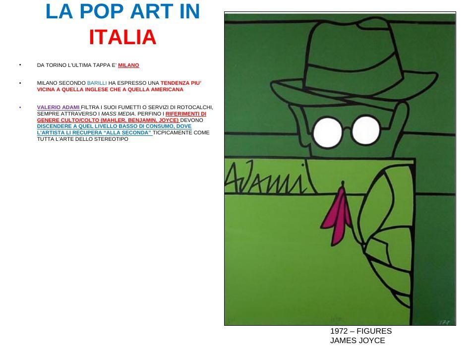{ loading=lazy style="width:59%" }

1:56:29

Per finire, un altro artista famoso della pop art, Enrico Baj, che, soprattutto nei primi tempi, va a cercare la roba dai rigattieri e la riusa assemblandola in varie forme. Famosi di Enrico Baj sono anche i lavori contro la guerra, la serie dei *Generali*: ho messo come esempio quello in alto a destra (*Personnage de guerre*, 1971). Anche lui è stato un artista molto importante di tutto il movimento pop italiano.

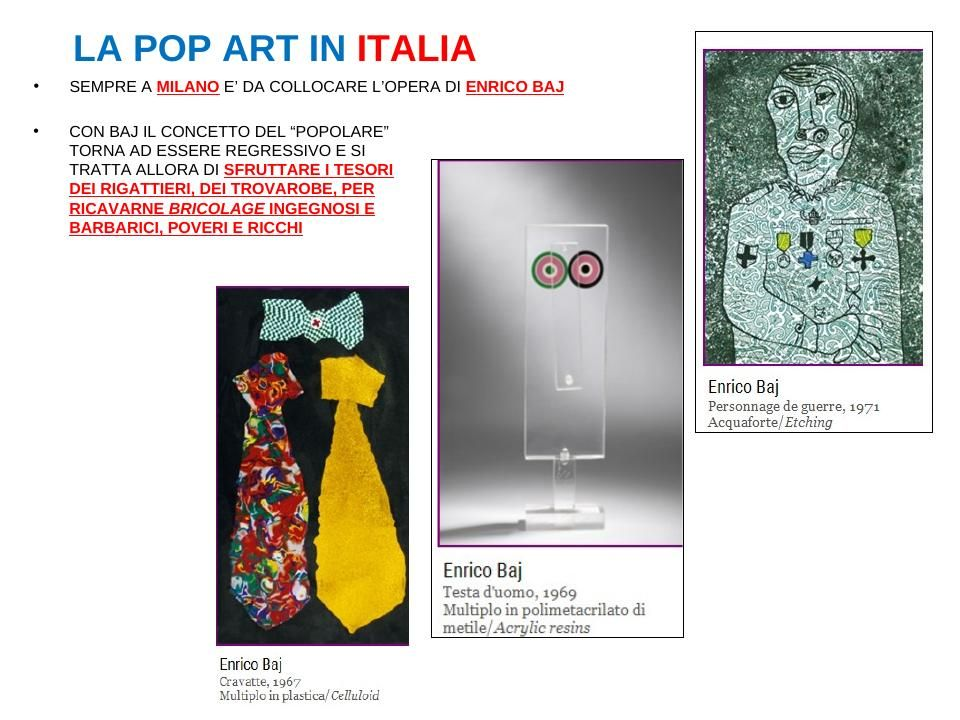{ loading=lazy style="width:59%" }

1:57:15

Questo era per far vedere la differenza che corre tra la pop art americana e quella europea, nei tre Paesi più importanti, che erano l’Inghilterra, la Francia e l’Italia. Se si mettono insieme quei tre Paesi europei si vede la differenza rispetto alla pop art americana, una differenza di fondo dovuta forse alla cultura europea, che è diversa rispetto al pragmatismo americano; però sono interpretazioni che vanno sempre in questa direzione, soprattutto dell’uso della secondarietà della materia e dell’immagine. Con questo io ho concluso, e lascio le conclusioni di carattere filosofico a Lorenzo.

1:58:18

Lorenzo Poggi Grazie. Dicevo, io penso così, fra di noi: penso che ci sia una differenza di fondo fra la cultura europea e la cultura americana, anche se c’è il pragmatismo. La differenza di fondo, riguardo a questi argomenti, sta nel modo in cui si guardano le cose: nell’arte americana c’è il presupposto che la realtà oggettiva sia già costruita, già esistente, indipendente da coloro che la guardano e la osservano. Nella cultura europea c’è invece l’idea che l’oggetto della nostra osservazione, l’oggetto della scienza, quello che chiamiamo realtà, sia comunque frutto di una storia, relativo a una costruzione. Questo è l’elemento distintivo di fondo: per cui nella nostra cultura c’è sempre l’attenzione a come si sia costruito, e nell’altra invece c’è l’accettazione, la presa, l’acquiescenza, l’introduzione della realtà così com’è, come se fosse qualcosa di indubitato.

1:59:34

Possiamo dire due parolacce? Il nostro è sì un realismo – magari no, ma siamo convinti di relazionarci alla realtà – però è un realismo epistemico. Ecco, ci è venuta la parolaccia – ma di scienza, di filosofia, e poi nemmeno tanto una parolaccia.

2:00:00

Ma deve esserci. È un realismo epistemico: siamo convinti che quella sia una realtà, la definiamo così, ma il modo in cui la definiamo viene da una lunga storia di pensiero; prima la definivamo diversamente, e non potevamo dire che fosse la stessa cosa. Invece nella cultura americana tende a prevalere un realismo metafisico, un realismo di tipo per cui in fondo le cose sono sempre state così come sono conosciute. Sono un po’ come *Gli antenati*, che avevano sempre la scavatrice, anche se era fatta di dinosauri, e il telefono, anche se era fatto di pappagalli: è sempre quella, non cambia con il tempo. La storia è sempre difficilmente accettabile; anche perché alle spalle c’è una lunga tradizione calvinista di fondo, e abbiamo già visto che il calvinismo distrugge le immagini perché sono variabili, e c’è la necessità di conservare ciò che non muta nella parola, nello scritto, nella consequenzialità. Basta, chiuso l’argomento: ci torniamo sopra nei prossimi venticinque anni.

2:01:37

Torniamo invece a due o tre caratteri dell’arte pop. Come si caratterizza rispetto a quella che è stata la tradizione dell’arte? Ha a che fare con la tradizione? Diciamo che alla tradizione non appartiene più: non c’è più nulla di tradizionale nella pop art. L’oggetto è assunto nella realtà così come è presentato dall’immagine. L’arte fino a quel momento aveva a che fare con la tradizione, era simbolica: se si faceva una figura femminile, aveva in fondo in fondo una qualche relazione con Venere, con la Vergine Maria, fino a Eva; più lontano, più vicino, per contraddizione o meno, ma c’era una tradizione. Oggi invece l’immagine della donna con il paralume non ha nulla a che vedere con questo: è un’immagine che rimanda a un’immagine, ma che non ha più nessun valore simbolico definito, fisso. Quindi non c’è più la tradizione: c’è l’assumere la realtà dell’oggi immagine per immagine, il significante per quello che è, senza chiedersi che cosa voglia dire. Non vuol dire più nulla: è quello e basta, non c’è bisogno di decrittarlo, il suo significato è tutto lì.

2:03:10

Secondo aspetto: si confronta quindi non con una realtà a cui l’immagine, l’arte, allude, o che significa o esprime, ma con altre immagini, con un immaginario, con l’immaginario nutritissimo – oggi ancora più di cinquant’anni fa, quando risalgono queste cose – della comunicazione mediatica. Su questo credo che le immagini siano talmente tante e talmente varie che è difficile anche distinguere che cosa dobbiamo credere vero e che cosa invece è costruzione.

2:04:00

Una volta c’erano i voltagabbana: c’erano le gabbane, e se uno la voltava era un voltagabbana. Oggi i voltagabbana non ci sono più, perché non ci sono più le gabbane: c’è solo il mutamento, non ci sono più segni simbolici, e quindi c’è solo l’assunzione dell’esistente nel suo valore di immagine. Ecco allora che la Camusso va a fare il discorso allo sciopero dei metalmeccanici e si mette il cappotto rosso: simbolico? No, immagine. E c’è uno che si chiama Matteo Salvini che va in giro con le felpe, cambia felpa; ora fa caldo, cambierà con la canottiera – la canottiera fa parte dell’immaginario della Lega: ma non è simbolo, è immagine. Dobbiamo sempre tenere presente questo elemento, che è la lezione della pop: l’assunzione di ciò che è, per immagini, senza più risonanza simbolica, perché quella è finita, non è più del nostro mondo; e quindi ci si confronta con le immagini.

2:05:28

Una volta l’artista traeva spunto dalla realtà: osservava il mondo, traeva spunto dal mondo e rifaceva un paesaggio, traeva spunto dall’espressione dei sentimenti umani per esprimerli in un quadro; si traeva spunto dalla realtà – «trarre spunto», la frase. Ora non si trae più spunto: la pop art non trae più spunto, si identifica con la realtà. Quello che fa Lichtenstein è un pezzo di immagine di fumetto come le altre immagini di fumetto, è un pezzo di realtà dell’immagine come le altre. Il ritratto di Marilyn di Andy Warhol, l’avrete tutti presente, è uguale alla scatola delle spugne abrasive Brillo: sia Marilyn, che è un’attrice, una persona, sia le spugne abrasive per rigovernare i piatti sono identificate come immagini nello stesso modo, con una variazione di colore, con un certo contorno nella fotografia, con più foto per vedere quale viene meglio, «se la faccio un po’ azzurra di sopra e un po’ arancio di sotto». E così Brillo, riprodotto nella sua realtà, per cui tanto ci si interroga – e Paolo ce lo ricordava – su che cosa lo distingua: niente lo distingue, è solo l’assunzione di una parte, presentata come esempio di quella che è l’immagine del nostro tempo.

2:07:40

La pop art ci insegna questo: non si trae più spunto, perché «trarre spunto» presuppone un progetto, la progettualità dell’artista, come si diceva, no? L’artista che vuole esprimere questo, e allora trae spunto per... No, qui non c’è da esprimere nulla: ci si identifica con la realtà. E ultimo: non rappresenta, coincide; non è una rappresentazione di qualcosa, coincide con la cosa rappresentata.

2:08:25

Vi volevo far vedere un’ultima immagine, se si può vedere quella di Lombardo, quella con il profilo del nostro amico Fanfani con Kennedy, al tempo. Questo è un artista pop, Sergio Lombardo (*Kennedy e Fanfani*, 1963), quasi sconosciuto – ho capito che è sconosciuto, perché non dite «come mai non lo conosco?». Lombardo che cosa fa? Prende le fotografie: questa è una foto scattata a un incontro tra Fanfani e Kennedy; quello più basso è Fanfani – va bene? Ve lo ricordate tutti; diciamo, quello più basso è Fanfani, ritagliato, in bianco e nero, si vede soltanto il dettaglio e la luce; quello più alto è Kennedy. Una foto, quindi, nulla di creazione, adesione alla realtà; però è un artista italiano ed europeo: come interviene? Vedete? Elabora, riduce solo al profilo, fa restare soltanto la luce: interviene comunque sulla realtà, non la assume e basta. E questo caratterizza tutto...

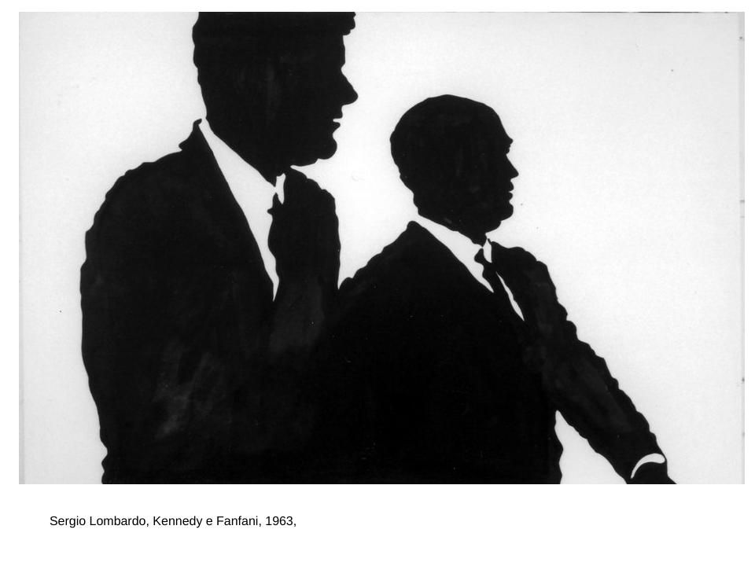{ loading=lazy style="width:47%" }

2:10:00

...tutte le opere, vi dicevo, proprio perché c’è a fondamento la consapevolezza che l’oggetto, anche l’oggetto d’arte, è frutto di costruzione; e quindi l’artista è responsabile non solo dell’assunzione, ma della sua costruzione: e quindi lo modifica, lo trasforma, ce lo presenta. C’è in fondo un intervento critico sulla realtà. Grazie, termino qui, mi sembra che abbiamo... Ah, scusate: Schifano. Vediamo Schifano.

2:10:55

Ora vi dico due cose che possono essere banali, ma forse chiariscono che cosa stavamo dicendo. È la riproduzione di un marchio di una benzina. Però Schifano che cosa introduce? Introduce la materia del colore. Non è l’esatta riproduzione, che potrebbe essere industriale: c’è la pittura, con tutti i caratteri della pittura; c’è anche una buona componente materica. Se vedete, c’è un bel colore, su tavola, fatto in un certo modo, di un’immagine, di qualcosa che poi è un marchio di fabbrica, un simbolo della società dei consumi del suo tempo, il marchio della Esso; però l’artista lo sottopone di nuovo a progetto, perché Schifano non rinuncia mai alla pittura, cioè non rinuncia mai alla possibilità di dare una veste unica alla riproduzione dell’immagine. Per cui ogni opera mantiene qualcosa di irripetibile, di unico: non è il fumetto riprodotto con tecniche riproducibili all’infinito, mantiene qualcosa dell’originalità. Cioè, benché riproduca un oggetto di comune visione – un oggetto che è una merce, una pubblicità – lo riproduce secondo la pittura, cioè un fare immagine che ne fa un’immagine unica.

2:12:55

Un’immagine unica che mantiene ancora in sé, direbbe Walter Benjamin, l’aura: l’aura che avevano le cose prima della loro riproducibilità tecnica. Le opere d’arte, secondo Benjamin, prima che fossero riproducibili tecnicamente – vedi il cinema, la fotografia eccetera – avevano qualcosa: erano un’immagine irripetibile, unica, ognuna diversa dall’altra; e questa capacità umana di simbolizzare e di rendere in immagine era qualcosa che dava all’immagine il carattere di opera d’arte. Walter Benjamin la chiama l’aura, l’aura dell’opera d’arte, che si è persa al momento della riproducibilità tecnica.

2:13:49

Schifano pensa che quest’aura sia ancora da mantenere, benché si facciano oggetti che nell’immagine sono comunissime immagini della pubblicità o dell’uso comune. Deve mantenere quest’unicità dell’aura, perché è quest’unicità che ne fa un rapporto simbolico, gestuale, dell’uomo con il mondo: simbolico, quindi, del nostro rapporto con la realtà attraverso la riduzione a immagine, che è conoscenza e che ci permette quindi di trasformare le cose. È quindi espressione simbolica di questo agire sulla realtà, di non accontentarsi del reale, ma di trasformarlo, rappresentarlo, farne qualcosa di totalmente costruito da noi, attraverso la mano che comanda al pennello o al tubetto; e quindi fa del gesto simbolico, lì nella pittura, un elemento di relazione con il mondo.

2:15:05

Questo è Schifano, perché europeo, perché convinto che questa sia una funzione dell’arte, quella della costruzione: quindi l’oggetto non c’è così, lo costruiamo; e questo ne è un esempio, anche quando facciamo immagini, se le dipingiamo così, che mantengono quest’aura. Era l’aura che c’era nelle immagini antiche, quelle condivise – non più il rito, ma condivise come il rito – che permetteva alle immagini di essere porta del sacro, cioè di ciò che non era conoscibile: accesso alla divinità, accesso a ciò che era l’essenza trascendente del mondo. Bene, come vedete, in tutto questo, nonostante la pop art, c’è quest’eredità pesante. Basta, via, sennò la facciamo lunga. Terminiamo qui, grazie.

2:16:11

Paolo Marcucci Siamo arrivati in fondo. Buonanotte a tutti. Ricordo che il 28 maggio ci sarà l’ultima serata, in cui ci salutiamo per questa stagione: abbiamo trascorso insieme l’inverno, siamo arrivati alla primavera; e chi vuole esserci, il 28 maggio parliamo di arte e filosofia. In qualche modo riprenderemo anche un po’ i temi di stasera, seppur un po’ più di sfuggita; ma si parlerà di arte e filosofia. Buonanotte a tutti e grazie.

## Appendice

Le slide proiettate durante l’incontro.

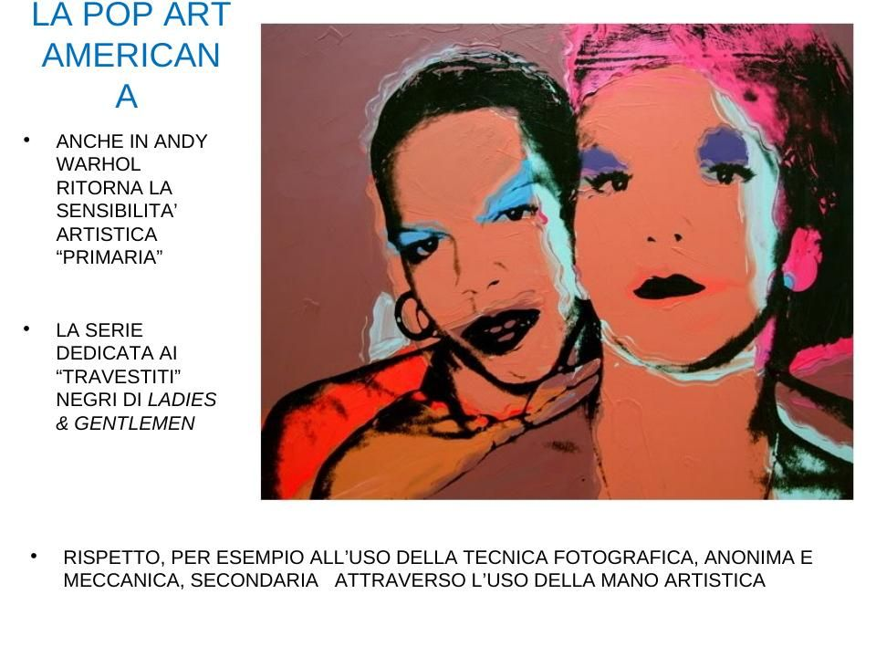{ loading=lazy style="width:47%" }

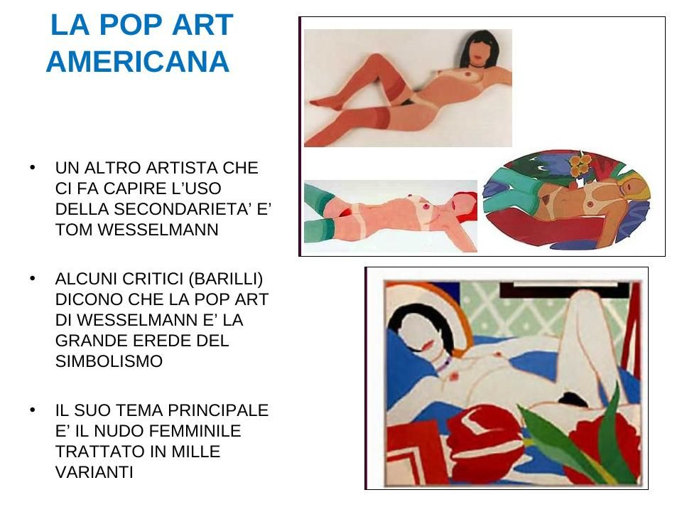{ loading=lazy style="width:47%" }

**LA POP ART AMERICANA**

Anche in Andy Warhol ritorna la sensibilità artistica «primaria», attraverso l’uso della mano artistica, rispetto per esempio all’uso della tecnica fotografica, anonima e meccanica, secondaria: la serie dedicata ai «travestiti» afroamericani di *Ladies and Gentlemen*.

Un altro artista che ci fa capire l’uso della secondarietà è Tom Wesselmann. Alcuni critici (Barilli) dicono che la pop art di Wesselmann è la grande erede del simbolismo. Il suo tema principale è il nudo femminile, trattato in mille varianti.

Forse il lavoro più noto di Tom Wesselmann è Vasca da bagno del 1963: un campionario di vari sistemi di riferimento, da quelli virtuali della sagoma femminile dipinta (con capricciosa acconciatura post-liberty) a quelli reali o concreti dello stuoino, della tenda della doccia o dell’asciugamano.

Chiude la carrellata americana James Rosenquist, che opera una mediazione tra la primarietà e la secondarietà usando la tecnica «verosimile» del cartellonismo. Rosenquist adotta anche la tecnica di decontestualizzare, accostando riquadri prelevati da contesti diversi e facendo nascere nessi insoliti.

È il caso di F-111, del 1965, grande pannello di parecchi metri di base, volto a stigmatizzare l’intervento USA in Vietnam, ma evitando la retorica della denuncia lineare e scoperta, nella quale si potessero leggere senza sforzo i riferimenti ai fatti bellici. Il pannello procede infatti per salti analogici: ad esempio il filo logico dell’ordigno militare è interrotto dal casco del parrucchiere, che rappresenta un’offensività morbida, indiretta, non palese, ma forse più allarmante e incisiva.

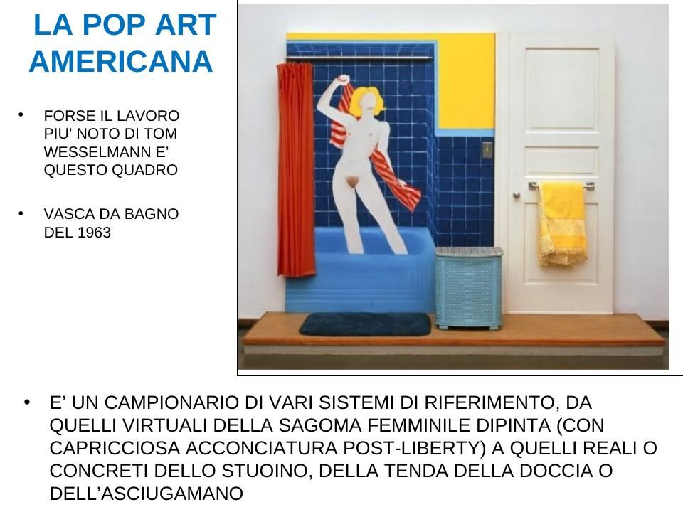{ loading=lazy style="width:30%" }

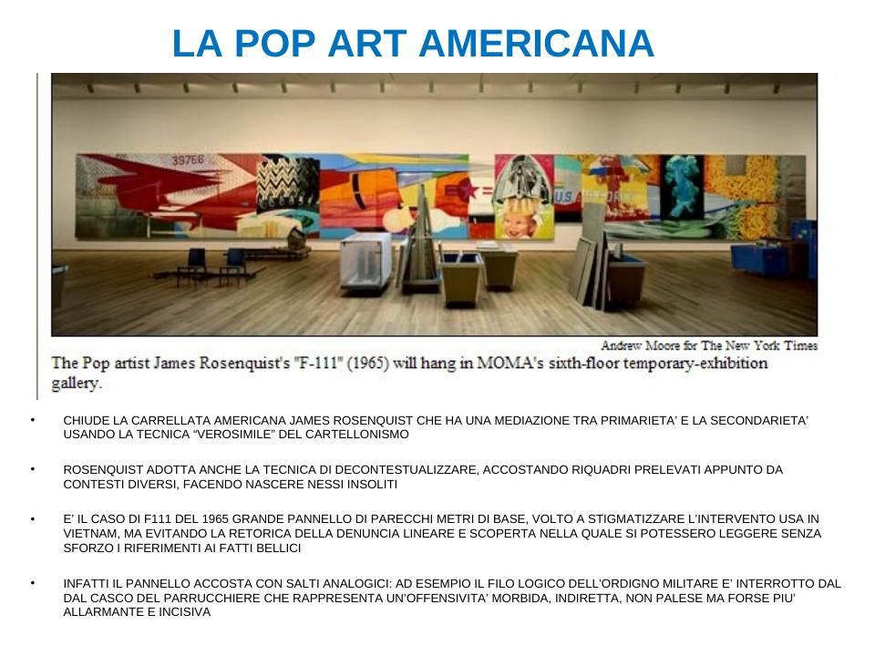{ loading=lazy style="width:42%" }

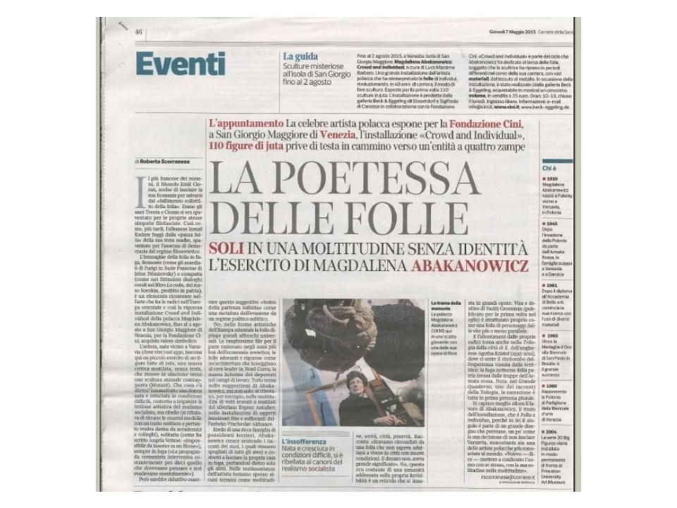{ loading=lazy style="width:35%" }

**BREVE STORIA DEL TERMINE «POP ART» – 2. IL CONTESTO SOCIALE**

*Testi tratti dalla voce «Pop art» di Filiberto Menna (sintesi)*

**Riesman e l’eterodirezione**

Riesman analizza il passaggio da una società di individui «autodiretti», che rivolgono le loro energie alla produzione di beni, a una società di individui «eterodiretti», rivolti alle frontiere in espansione dei consumi e sempre più influenzati dalle preferenze degli altri. L’eterodirezione presuppone la presenza determinante dei mezzi di comunicazione di massa, gli unici in grado di incanalare i gusti fluttuanti e il «desiderio senza oggetto» del nuovo consumatore. Dwight Macdonald, in due saggi apparsi nella *Partisan Review* e poi in *Contro l’America*, descrive accanto alla cultura alta e a quella popolare una terza cultura, la cultura di massa, prodotta per finalità commerciali: gli ingredienti sono attinti dalla cultura alta, ma confezionati per soddisfare la domanda della grande massa dei consumatori.

**Definizione**

Intorno al 1960 il termine si riferisce esclusivamente all’arte e indica le opere che si ispirano alla cultura di massa. Ha quindi due significati collegati: prima i prodotti dei *mass media* e gli oggetti di consumo corrente, poi le opere d’arte che prendono a modello le immagini e gli oggetti prodotti in serie; designa una corrente sviluppatasi soprattutto in Inghilterra e negli Stati Uniti tra la seconda metà degli anni Cinquanta e i primi anni Sessanta (Wilson, 1974).

**Il midcult e Rostow**

Il *midcult* assimila le invenzioni delle avanguardie ma le svuota della loro forza di rottura, trasformandone l’internazionalismo in un semplice cosmopolitismo linguistico. W. W. Rostow (1916-2003), economista americano noto per la sua opposizione al comunismo (*The Stages of Economic Growth*, Cambridge 1960), ha descritto l’evoluzione dalla fase paleoindustriale alla fase dei grandi consumi di massa, passando per la fase di maturità.

**Popular e Argan**

Nella fase dei consumi di massa alcuni Paesi impiegano la nuova ricchezza in una politica di potenza (la Germania), altri nel benessere, come gli Stati Uniti a partire dal New Deal rooseveltiano dopo la crisi del 1929. «Popular» ha qui un significato diverso da quello tradizionale europeo: per Argan «la pop art non è espressiva della creatività del popolo, ma della non-creatività della massa». La pop art non rinuncia a impegnarsi nei problemi dell’esistenza quotidiana, ma, a differenza delle avanguardie e dell’Informale, rinuncia a porsi come il punto focale in cui individuo e società sciolgono o denunciano le loro contraddizioni.

**Bonito Oliva**

Per Achille Bonito Oliva la pop art è un fenomeno principalmente anglosassone, che trova il suo alveo nel pragmatismo inglese e nel consumismo americano, capaci di trasformare ogni oggetto in feticcio e l’immagine in icona (Elvis Presley, Marilyn Monroe, Jackie Kennedy): non esiste quindi una pop art italiana o francese, ma una pop art «all’italiana», «alla francese». Gli artisti americani vivono questa operazione con una «coscienza felice», senza il peso dell’ideologia: il paesaggio artificiale della città diventa l’unica natura possibile.

**Highbrow, middlebrow, lowbrow**

L’artista pop opera in un contesto in cui coesistono la cultura elitaria (*highbrow*), l’industria culturale (*middlebrow*) e il *kitsch* (*lowbrow*); rinuncia a una redenzione totale, accetta di lavorare dentro il sistema e compie una sorta di inventario critico dei prodotti della produzione di massa, confrontandosi con il mercato (Boatto, 1967).

**Boatto**

Per Boatto la soluzione obbligata è accettare in partenza la trasformazione del lavoro artistico in merce. L’artista pop non si interessa al livello della produzione, sul quale l’individuo non può agire; il suo sostanziale pessimismo non si traduce in rifiuto, come nell’espressionismo astratto, ma in una vitalistica aspirazione al coinvolgimento, che si spiega forse con le radici pragmatistiche della cultura anglosassone e americana.

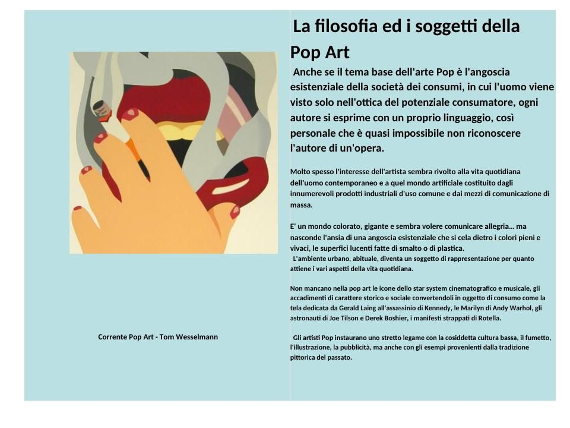{ loading=lazy style="width:59%" }

**LA FILOSOFIA E I SOGGETTI DELLA POP ART**

*Nella slide: Tom Wesselmann*
{: .didascalia }

Anche se il tema di fondo della pop art è l’angoscia esistenziale della società dei consumi, in cui l’uomo viene visto solo nell’ottica del potenziale consumatore, ogni autore si esprime con un proprio linguaggio, così personale che è quasi impossibile non riconoscere l’autore di un’opera. Molto spesso l’interesse dell’artista sembra rivolto alla vita quotidiana dell’uomo contemporaneo e a quel mondo artificiale costituito dagli innumerevoli prodotti industriali d’uso comune e dai mezzi di comunicazione di massa. È un mondo colorato, gigante, che sembra voler comunicare allegria… ma nasconde l’ansia di un’angoscia esistenziale che si cela dietro i colori pieni e vivaci, le superfici lucenti fatte di smalto o di plastica.

L’ambiente urbano, abituale, diventa un soggetto di rappresentazione per quanto attiene ai vari aspetti della vita quotidiana. Non mancano nella pop art le icone dello star system cinematografico e musicale, gli accadimenti di carattere storico e sociale convertiti in oggetto di consumo: la tela dedicata da Gerald Laing all’assassinio di Kennedy, le Marilyn di Andy Warhol, gli astronauti di Joe Tilson e Derek Boshier, i manifesti strappati di Rotella.

Gli artisti pop instaurano uno stretto legame con la cosiddetta cultura bassa, il fumetto, l’illustrazione, la pubblicità, ma anche con gli esempi provenienti dalla tradizione pittorica del passato.

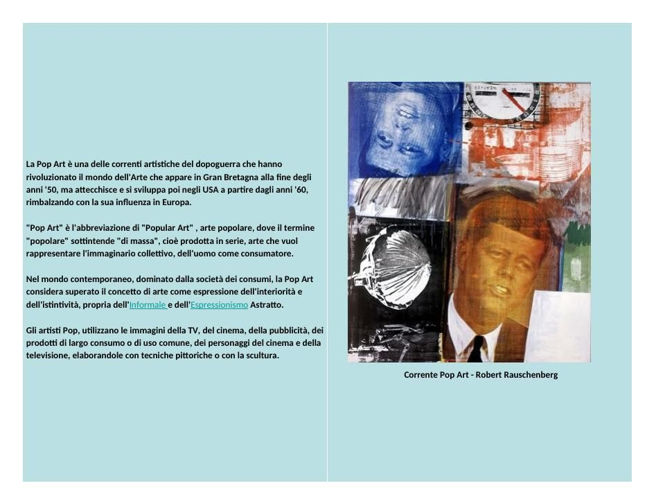{ loading=lazy style="width:59%" }

**CHE COS’È LA POP ART**

*Nella slide: Robert Rauschenberg*
{: .didascalia }

La pop art è una delle correnti artistiche del dopoguerra che hanno rivoluzionato il mondo dell’arte: appare in Gran Bretagna alla fine degli anni Cinquanta, ma attecchisce e si sviluppa poi negli Stati Uniti a partire dagli anni Sessanta, rimbalzando con la sua influenza in Europa. «Pop art» è l’abbreviazione di «popular art», arte popolare, dove il termine «popolare» sottintende «di massa», cioè prodotta in serie: un’arte che vuole rappresentare l’immaginario collettivo dell’uomo come consumatore.

Nel mondo contemporaneo, dominato dalla società dei consumi, la pop art considera superato il concetto di arte come espressione dell’interiorità e dell’istintività, proprio dell’Informale e dell’Espressionismo astratto. Gli artisti pop utilizzano le immagini della TV, del cinema, della pubblicità, dei prodotti di largo consumo o di uso comune, dei personaggi del cinema e della televisione, elaborandole con tecniche pittoriche o con la scultura.

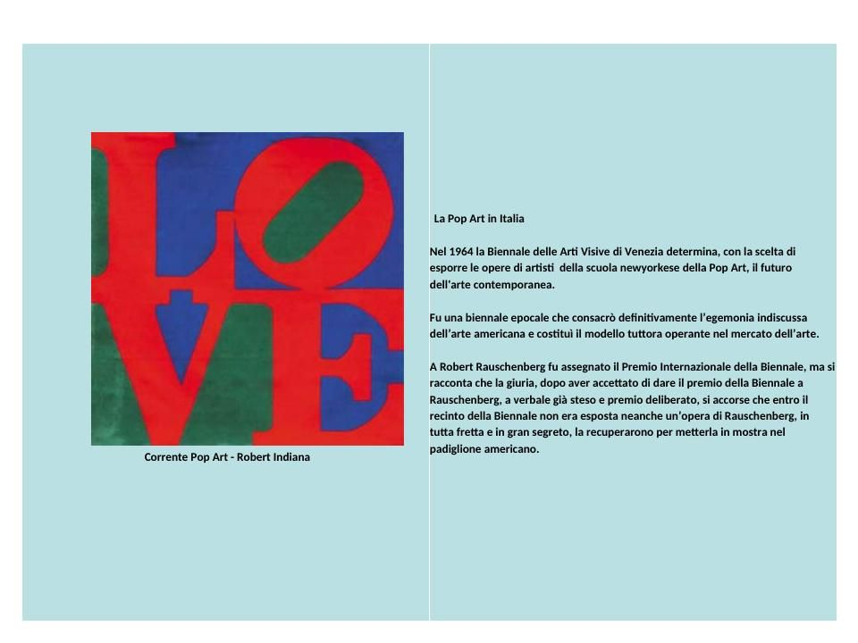{ loading=lazy style="width:59%" }

**LA POP ART IN ITALIA**

*Nella slide: Robert Indiana*
{: .didascalia }

Nel 1964 la Biennale delle Arti Visive di Venezia determina, con la scelta di esporre le opere di artisti della scuola newyorkese della pop art, il futuro dell’arte contemporanea. Fu una biennale epocale, che consacrò definitivamente l’egemonia indiscussa dell’arte americana e costituì il modello tuttora operante nel mercato dell’arte.

A Robert Rauschenberg fu assegnato il Premio internazionale della Biennale; ma si racconta che la giuria, a verbale già steso e premio deliberato, si accorse che entro il recinto della Biennale non era esposta neanche un’opera di Rauschenberg: in tutta fretta e in gran segreto la recuperarono per metterla in mostra nel padiglione americano.

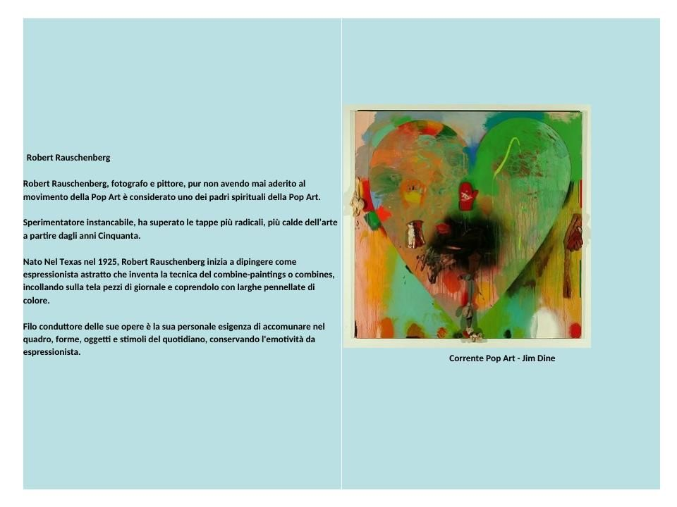{ loading=lazy style="width:59%" }

**ROBERT RAUSCHENBERG**

*Nella slide: Jim Dine*
{: .didascalia }

Robert Rauschenberg, fotografo e pittore, pur non avendo mai aderito al movimento della pop art è considerato uno dei suoi padri spirituali. Sperimentatore instancabile, ha superato le tappe più radicali, più calde dell’arte a partire dagli anni Cinquanta. Nato in Texas nel 1925, Rauschenberg inizia a dipingere come espressionista astratto; inventa la tecnica dei *combine-paintings* o *combines*, incollando sulla tela pezzi di giornale e coprendoli con larghe pennellate di colore. Filo conduttore delle sue opere è l’esigenza personale di accomunare nel quadro forme, oggetti e stimoli del quotidiano, conservando l’emotività dell’espressionista.

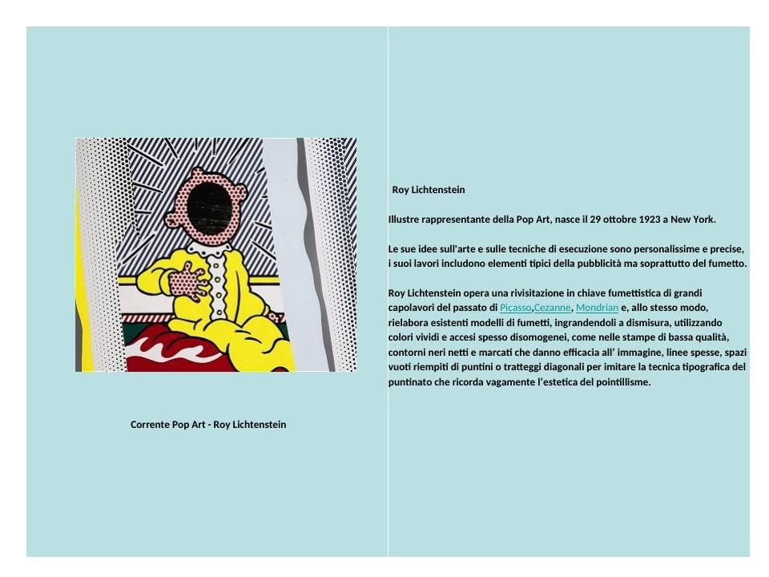{ loading=lazy style="width:59%" }

**ROY LICHTENSTEIN**

Illustre rappresentante della pop art, nasce il 27 ottobre 1923 a New York. Le sue idee sull’arte e sulle tecniche di esecuzione sono personalissime e precise; i suoi lavori includono elementi tipici della pubblicità, ma soprattutto del fumetto. Lichtenstein opera una rivisitazione in chiave fumettistica di grandi capolavori del passato, di Picasso, Cézanne, Mondrian, e allo stesso modo rielabora modelli di fumetti esistenti, ingrandendoli a dismisura, utilizzando colori vividi e accesi, spesso disomogenei come nelle stampe di bassa qualità, contorni neri netti e marcati che danno efficacia all’immagine, linee spesse, spazi vuoti riempiti di puntini o tratteggi diagonali per imitare la tecnica tipografica del puntinato, che ricorda vagamente l’estetica del *pointillisme*.

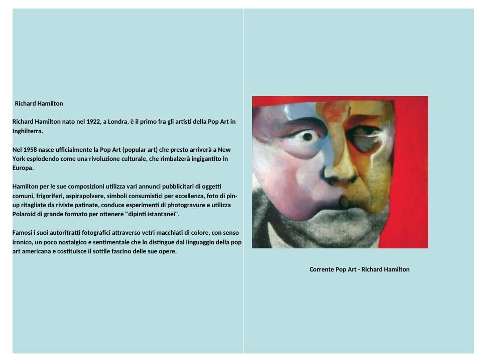{ loading=lazy style="width:59%" }

**RICHARD HAMILTON**

Richard Hamilton, nato a Londra nel 1922, è il primo fra gli artisti della pop art in Inghilterra. Nel 1958 nasce ufficialmente la pop art (*popular art*), che presto arriverà a New York esplodendo come una rivoluzione culturale, che rimbalzerà ingigantita in Europa.

Hamilton per le sue composizioni utilizza vari annunci pubblicitari di oggetti comuni – frigoriferi, aspirapolvere, simboli consumistici per eccellenza – foto di pin-up ritagliate da riviste patinate; conduce esperimenti di *photogravure* e utilizza Polaroid di grande formato per ottenere «dipinti istantanei». Famosi i suoi autoritratti fotografici attraverso vetri macchiati di colore, con un senso ironico, un poco nostalgico e sentimentale, che lo distingue dal linguaggio della pop art americana e costituisce il sottile fascino delle sue opere.

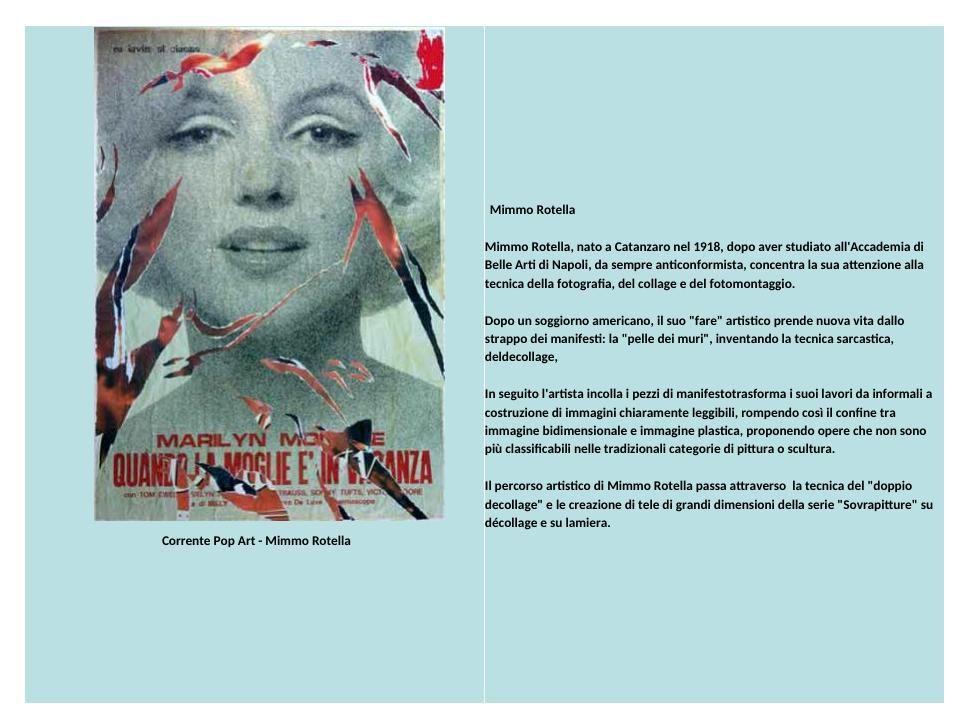{ loading=lazy style="width:59%" }

**MIMMO ROTELLA**

Mimmo Rotella, nato a Catanzaro nel 1918, dopo aver studiato all’Accademia di Belle Arti di Napoli, da sempre anticonformista, concentra la sua attenzione sulla tecnica della fotografia, del collage e del fotomontaggio. Dopo un soggiorno americano, il suo «fare» artistico prende nuova vita dallo strappo dei manifesti, la «pelle dei muri», inventando la tecnica sarcastica del *décollage*.

In seguito l’artista incolla i pezzi di manifesto e trasforma i suoi lavori da informali a costruzioni di immagini chiaramente leggibili, rompendo così il confine tra immagine bidimensionale e immagine plastica e proponendo opere che non sono più classificabili nelle tradizionali categorie di pittura o scultura. Il percorso artistico di Rotella passa attraverso la tecnica del «doppio *décollage*» e la creazione di tele di grandi dimensioni della serie *Sovrapitture*, su *décollage* e su lamiera.

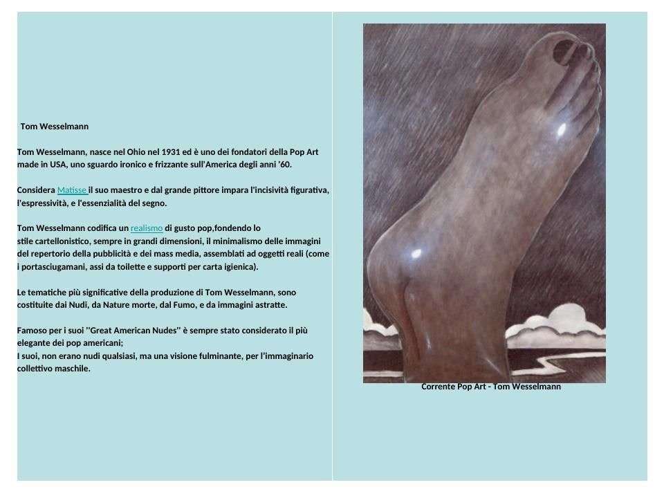{ loading=lazy style="width:59%" }

**TOM WESSELMANN**

Tom Wesselmann nasce nell’Ohio nel 1931 ed è uno dei fondatori della pop art *made in USA*: uno sguardo ironico e frizzante sull’America degli anni Sessanta. Considera Matisse il suo maestro, e dal grande pittore impara l’incisività figurativa, l’espressività e l’essenzialità del segno. Wesselmann codifica un realismo di gusto pop, fondendo lo stile cartellonistico, sempre in grandi dimensioni, il minimalismo delle immagini del repertorio della pubblicità e dei *mass media*, assemblati a oggetti reali (come portasciugamani, assi da toilette e supporti per carta igienica).

Le tematiche più significative della sua produzione sono i nudi, le nature morte, il fumo e le immagini astratte. Famoso per i suoi *Great American Nudes*, è sempre stato considerato il più elegante dei pop americani: i suoi non erano nudi qualsiasi, ma una visione fulminante per l’immaginario collettivo maschile.

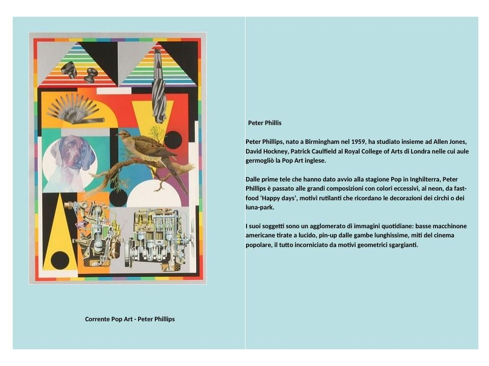{ loading=lazy style="width:59%" }

**PETER PHILLIPS**

Peter Phillips, nato a Birmingham nel 1939, ha studiato insieme ad Allen Jones, David Hockney e Patrick Caulfield al Royal College of Art di Londra, nelle cui aule germogliò la pop art inglese. Dalle prime tele, che hanno dato avvio alla stagione pop in Inghilterra, Phillips è passato alle grandi composizioni con colori eccessivi, al neon, da fast food «Happy Days», motivi rutilanti che ricordano le decorazioni dei circhi o dei luna park. I suoi soggetti sono un agglomerato di immagini quotidiane: basse macchinone americane tirate a lucido, pin-up dalle gambe lunghissime, miti del cinema popolare, il tutto incorniciato da motivi geometrici sgargianti.

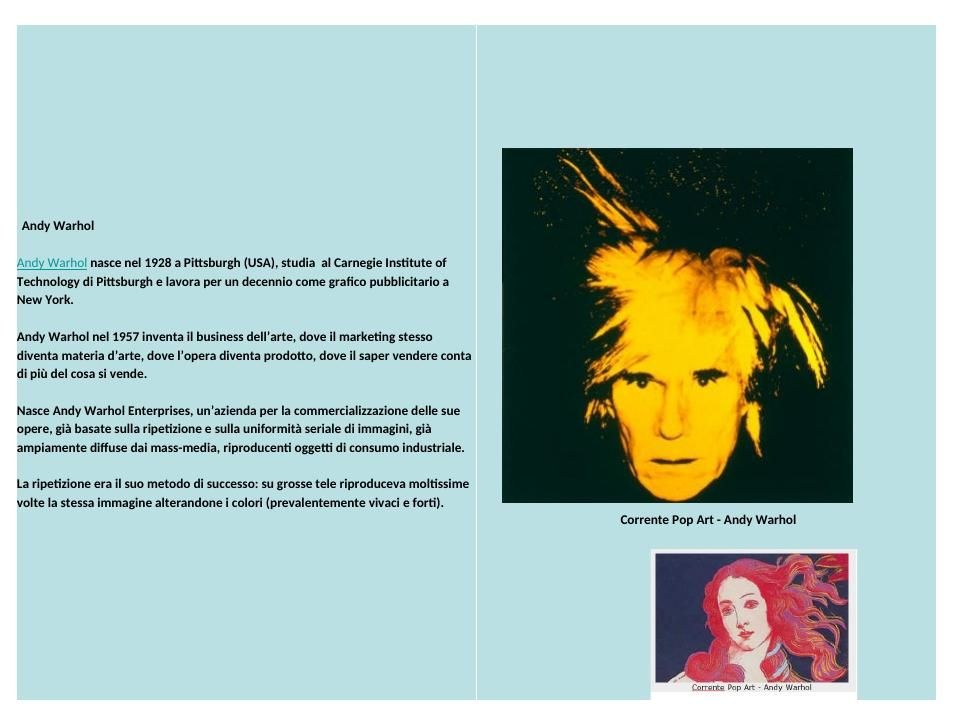{ loading=lazy style="width:59%" }

**ANDY WARHOL**

Andy Warhol nasce nel 1928 a Pittsburgh (USA), studia al Carnegie Institute of Technology di Pittsburgh e lavora per un decennio come grafico pubblicitario a New York. Nel 1957 inventa il business dell’arte, dove il marketing stesso diventa materia d’arte, dove l’opera diventa prodotto, dove il saper vendere conta di più di che cosa si vende. Nasce Andy Warhol Enterprises, un’azienda per la commercializzazione delle sue opere, già basate sulla ripetizione e sull’uniformità seriale di immagini già ampiamente diffuse dai *mass media*, che riproducono oggetti di consumo industriale. La ripetizione era il suo metodo di successo: su grandi tele riproduceva moltissime volte la stessa immagine, alterandone i colori (prevalentemente vivaci e forti).

