# Tra arte e filosofia

Le avventure della verità

**Data:** 28 maggio 2015 
**Luogo:** MMAB, Montelupo Fiorentino 
**Incontro con:** Lorenzo Poggi e Paolo Marcucci

**Interventi:** Paolo Marcucci Lorenzo Poggi Pubblico

0:07:00

Paolo Marcucci In fondo ci sentite? Sì? Provo ad alzare un po’ il microfono. Abbiamo aspettato i venti minuti accademici – da un quarto d’ora a venti minuti, venticinque: direi che si può iniziare. Parliamo di arte e filosofia. Come sapete, è l’ultima serata di questa stagione: poi iniziano le ferie, le vacanze, e probabilmente ci rivedremo, se ne avremo la possibilità, nella nuova stagione, in autunno.

0:08:09

Prima di iniziare volevo ringraziare tutti: quando un paio di serate fa abbiamo fatto la proposta sui titoli dell’anno prossimo, sono venute fuori molte proposte alternative da tutti voi, e di questo vi ringraziamo; siamo entrati anche un po’ in imbarazzo, perché i titoli erano tanti e tutti interessanti. Lorenzo si è preso anche l’estate per meditarci sopra; poi faremo una sintesi per la prossima stagione, a ottobre, e sentiremo naturalmente anche l’amministrazione, l’assessorato alla cultura, perché dovrà poi dare il suo parere. Diamo tempo agli ultimi arrivati di accomodarsi e poi iniziamo.

**I TITOLI PROPOSTI PER LA PROSSIMA STAGIONE**

1\. Paure e manie degli italiani

2\. La percezione del colore fra storia simbolica e innovazioni tecniche

3\. Dall’originale all’orinale. Breve viaggio nell’arte a cavallo di due secoli

4\. Fedeltà e tradimento nella vita amorosa

5\. L’Europa che verrà

6\. «L’ospite inquietante». Identificare se stessi al tempo della scomparsa dei valori

7\. Storia dell’anima

8\. Filosofia dell’ignoranza. Quando conosciamo sentiamo che c’è altro da conoscere, ma come sappiamo che c’è altro se non lo conosciamo?

9\. La vita in vetrina. L’esistenza fra pubblicità e spettacolo

10\. Che cos’è la moda?

11\. La donna nella storia

12\. Percezione, senso comune e conoscenza scientifica

13\. La libertà di scelta nella società dei consumi

14\. Rapporto tra cibo e anima

15\. Dalla rivoluzione femminista alla reale condizione femminile nella società e nella famiglia

16\. L’islam e il buddismo

17\. Fragilità dell’essere umano

18\. Il valore dell’amicizia

19\. La comunicazione dei tempi moderni (Facebook, Whatsapp…)

20\. «La morte in Occidente». Riflessioni

21\. Le nostre certezze: i nostri limiti?

22\. Il centenario della prima guerra mondiale

23\. Immaginale

24\. La ricchezza dell’1% copre il 99%: quale giustificazione?

25\. La solitudine dell’essere umano

26\. I ricordi del passato

27\. Il valore dei valori

28\. Si può ancora parlare di popolo?

29\. Gli specchi dell’eros maschile e femminile

30\. I miti greci e l’uomo moderno

31\. Mente e psiche

32\. Distacco dal sé superiore

0:10:10

Bene. Come sempre nelle nostre serate faremo vedere molte immagini di opere d’arte, e quindi spero che lo schermo sia visibile un po’ da tutte le postazioni.

\[Proiezione di una scena del film *Quasi amici*.\]
{: .nota }

**QUASI AMICI**

*Il dialogo dal film, riportato nella prima slide*

Driss: \[di fronte a un dipinto\] Non vorrà mica pagare questa crosta 30.000 euro?! Non è possibile!

Philippe: Oh, be’, sì, è possibile.

Driss: Mi sanguina il naso su un foglio bianco e vuole 30.000 euro?

Philippe: Secondo lei, perché la gente si interessa all’arte?

Driss: Non lo so, è un business.

Philippe: No. Perché è la sola traccia del nostro passaggio sulla terra.

0:11:40

Allora, stasera parliamo di filosofia e arte, arte e filosofia. C’è una branca della filosofia che parla d’arte, ci insegnano i nostri maestri, e si chiama estetica: l’estetica è appunto la disciplina filosofica che si occupa dello studio del bello e dell’arte. Naturalmente questo è un campo vastissimo, con secoli e secoli di studi approfonditi, e non è questa la tematica con cui vorrei introdurre l’argomento, perché su questo c’è il nostro maestro, il nostro storico della filosofia, Lorenzo, che sicuramente entrerà più nel merito da questo punto di vista. A me interessava fornire qualche elemento in più di speculazione del pensiero, ed è quello che cercheremo di vedere ora.

**ESTETICA**

Si dice in filosofia che, quando si parla di filosofia dell’arte, bisogna usare la parola «estetica».

*Estetica*, dal greco *aisthetikós*, da *aisthánesthai* («percepire»). L’estetica è la disciplina filosofica che si occupa dello studio del bello e dell’arte. Oltre ad approfondire i temi che riguardano il concetto del bello nel suo sviluppo storico, cerca di definire i canoni per cui un oggetto d’arte è da considerarsi bello o brutto. L’atteggiamento estetico, per estensione, è quello di colui che si avvicina alla vita discernendo continuamente ciò che è bello da ciò che è brutto, fino a farne una distinzione morale.

Però su questo punto abbiamo il nostro maestro… il mio contributo al tema sarà allora quello di cercare un approccio speculativo e di fornire elementi da prospettive diverse: che poi è il compito della rassegna *Pensieri a tavola*.

0:13:03

Nella scorsa serata abbiamo parlato di pop art – chi di voi c’era forse se lo ricorda. Questo è un Andy Warhol molto giovane, una delle sue prime creazioni, quella della «Brillo Box» (1964) – Brillo è una marca di detersivo – e abbiamo visto in quell’occasione che la pop art, che nasce in contemporanea con la società dei consumi, ci ha detto che ogni oggetto può essere un’opera d’arte: questo è l’emblema più rappresentativo di questo pensiero e di quello che è accaduto. Quindi bisogna partire dal concetto che ogni oggetto può essere un’opera d’arte.

**LA POP ART E ARTHUR DANTO**

La riflessione su quest’opera della pop art fa concludere ad Arthur Danto che l’arte ha ormai raggiunto il punto massimo di autocoscienza, perché con *Brillo Box* l’opera non è più distinguibile da un prodotto commerciale: qualsiasi cosa può essere un’opera d’arte, anche se nessuna opera è separabile dal suo tempo, e il suo «valore» non dipende esclusivamente da proprietà intrinseche o osservabili.

0:13:55

Quando si parla di arte nel senso filosofico, si possono per esempio mettere a confronto due stili e due pensieri diversi. In questo caso, per introdurre l’argomento, abbiamo preso un’opera classica e una di arte contemporanea, e su questi due elementi proveremo a fare qualche speculazione, come dicevo prima. Le due opere d’arte sono queste: *Dafni e Cloe* (1827) di Jean-Pierre Cortot e un’opera di Keith Haring, un contemporaneo newyorkese (*Ignorance = Fear*, 1989), sulla destra. Sono due elementi, lo vedete già dalle immagini, del tutto opposti l’uno all’altro nella loro realizzazione di opera d’arte.

0:15:08

Allora, questo è *Dafni e Cloe*, che è ispirato a un classico della letteratura greca, il Romanzo pastorale di Longo Sofista, alle vicissitudini di questi giovani amanti che, dopo varie peripezie, riescono a coronare il loro amore e a compiere la loro promessa d’amore. Se guardate queste immagini, vedete che siamo in un momento della storia in cui ci sono due giovani che si toccano, si sfiorano, ma non sono ancora travolti dalla passione dei sensi: sono all’attimo prima. Vedete com’è tutto delicato, tutto leggero in questa rappresentazione, che l’artista coglie piuttosto bene. Siamo ancora all’amore platonico. È il momento dell’attimo prima che i sensi ci travolgano, e noi pensiamo a quel punto anche di poter cambiare il mondo; perché, quando ci addentriamo nel campo dei sensi, tutta la leggerezza dell’essere dell’attimo prima che questo accada è una porta da cui non possiamo più tornare indietro. Questi due ragazzi invece sono in quell’attimo lì, magico, prima che tutto accada, e l’artista lo rappresenta bene.

**ARTE CLASSICA: DAFNI E CLOE**

Si può dire che l’arte, come la filosofia, ci dice chi siamo, o chi siamo stati, oppure chi saremo?

Di fronte a D*afni e Cloe* abbiamo la sensazione di vivere un’altra volta l’amore ancora puro, che ignora la passione per godere la contemplazione della bellezza spirituale dell’innocente. Dafni osa a stento posare il suo braccio sulla nudità della fanciulla accanto a lui.

Ancora (per poco) siamo al mito e all’amore platonico dell’anima che viaggia sulla biga trainata dai due cavalli: il protagonista di questa scultura è colto nel momento in cui ancora non cavalca il cavallo nero, allegoria della passione irrazionale, ma cerca di volare verso l’alto amore ideale insieme al cavallo bianco.

L’attimo prima che il pensiero di cambiare il mondo s’impossessi di noi…

**LONGO SOFISTA**

Longo Sofista è un autore greco del II-III secolo d.C. Il suo Romanzo, in quattro libri, narra le vicende di Dafni e Cloe che, abbandonati neonati e divenuti pastori (lui di capre, lei di pecore), dopo varie traversie sono infine riconosciuti dai ricchissimi genitori.

0:16:52

Prendiamo invece l’altra, di Haring, artista contemporaneo newyorkese: qui siamo nel campo dell’AIDS.

Vedete, le tre figure hanno la X, quasi la lettera scarlatta della letteratura, che le individua come malate. Quindi siamo già oltre l’amore platonico di cui dicevamo prima: qui siamo all’atto già consumato, e consumato in abbondanza. Siamo agli opposti di questi due mondi; ed è interessante la rappresentazione artistica di questi due fenomeni, che sono distanti mille anni luce. Questa è un’altra opera di Haring, ancora più esplicita, che fa vedere l’atto sessuale rappresentato in maniera forte.

0:18:04

A me, per esempio, le opere di Haring hanno fatto venire in mente la Lagostina: forse qualcuno se li ricorderà, quei disegni rappresentati tutti da contorni. È interessante, perché qui siamo al di là del bene e del male: l’artista newyorkese degli anni Ottanta-Novanta è al di là di tutte le mode, delle rappresentazioni storiche, classiche eccetera. Haring, morto a causa di HIV, è stato esponente della cultura alternativa della New York underground degli anni Ottanta: la sua ispirazione primaria viene dalla strada e dalla metropolitana. Il suo stile inconfondibile si riconosce facilmente per la ripetizione di forme ricorrenti dai contorni neri e dai colori vivi e brillantissimi. Haring è un omosessuale, fa tutte le esperienze possibili del mondo. È carino l’aneddoto che è stato raccontato su Madonna: lui era grande amico di Madonna, e condividevano, dice, nei gusti gli stessi uomini. A un certo punto, una sera, Haring si presenta a una festa organizzata da Madonna con un bel tipo e le dice: «Questo è tuo, è il mio regalo per il tuo compleanno». Vedete, siamo nella New York della libertà assoluta, rappresentata artisticamente in questo modo da Haring.

0:19:21

Ma torniamo allora al punto di partenza. Abbiamo detto che il titolo di stasera è *Tra arte e filosofia, le avventure della verità*. E che cos’è la verità in un’opera d’arte? Un antropologo, uno studioso dei comportamenti umani, Desmond Morris, ha detto: «Inventando quella che chiamiamo arte abbiamo trovato il modo di migliorare la nostra vita e di arricchire il breve tempo che ci è concesso di trascorrere su questo pianeta tra la luce della nascita e la tenebra della morte». Questa è la definizione dell’arte.

**ARTE E FILOSOFIA**

L’arte intanto è pittura, arte figurativa, fotografia, letteratura, musica e matematica… tutto può essere arte…

Dalla *téchne* dei filosofi greci (un termine che già i latini traducevano con *ars*, ossia «arte», e che oggi costituisce invece l’etimo di «tecnica») al concetto di arte di oggi molta strada è stata fatta. La tecnica (dal greco τέχνη, *téchne*, «arte» nel senso di «perizia», «saper fare», «saper operare») era esclusiva degli dèi, e fu donata agli uomini per sopperire alla loro debolezza.

Così l’arte e la filosofia si sono spostate nel tempo e nello spazio, seguendo il percorso del potere e dell’economia.

0:20:00

Intanto abbiamo detto che l’arte può essere tutto: abbiamo fatto il cenno alla pop art, perché qualsiasi soggetto può essere un’opera d’arte. Partendo da questo punto di vista, dalla *téchne* dei filosofi – ma non voglio prendere il posto a Lorenzo su questo – che è il saper fare; però è un saper fare che si coniuga con lo sviluppo anche economico, perché le due cose vanno sempre di pari passo. Infatti, se si va a vedere sotto quest’aspetto, si colgono messaggi interessanti.

0:20:44

C’è stato uno studio della rivista «Science», avrete sentito parlare molto in questo periodo di big data, quei computer che analizzano milioni di informazioni: attraverso questa tecnologia sono stati elaborati i dati anagrafici, di nascita e di morte, di 150.000 personalità culturalmente rilevanti, per mapparne gli spostamenti; ora li vediamo un attimo. Qui siamo nel 112 d.C., quindi agli inizi della nostra era: vedete, le lucine rosse sono concentrate a Roma. Roma è il centro del mondo, culturale, economico, politico: tutti gli artisti si concentrano a Roma. Facciamo un salto all’anno Mille: vedete la mappa, Roma è sempre al primo posto in tutto il mondo occidentale, però in tutta Europa stanno nascendo vari punti dove nascono la cultura e le opere d’arte, e c’è questa migrazione da Roma, dall’Italia, verso tutto il resto del mondo. Se prendiamo il 1500, la luminosità maggiore è sempre in Italia, a Roma e a Firenze in particolare, ma ormai c’è anche in Inghilterra, Germania, Francia, Spagna, da tutte le parti. Se prendiamo quella di oggi, vedete che la mappa della cultura è cambiata completamente. Che cosa vuol dire questo? Vuol dire che la cultura segue un po’ il processo politico-economico, e questa rappresentazione ce lo fa vedere piuttosto bene.

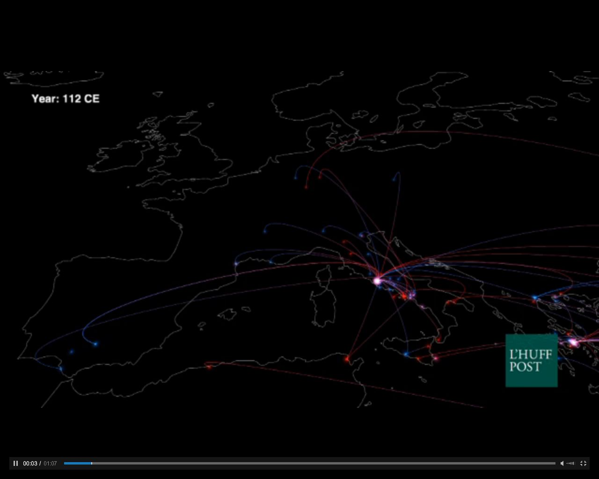{ loading=lazy style="width:40%" }

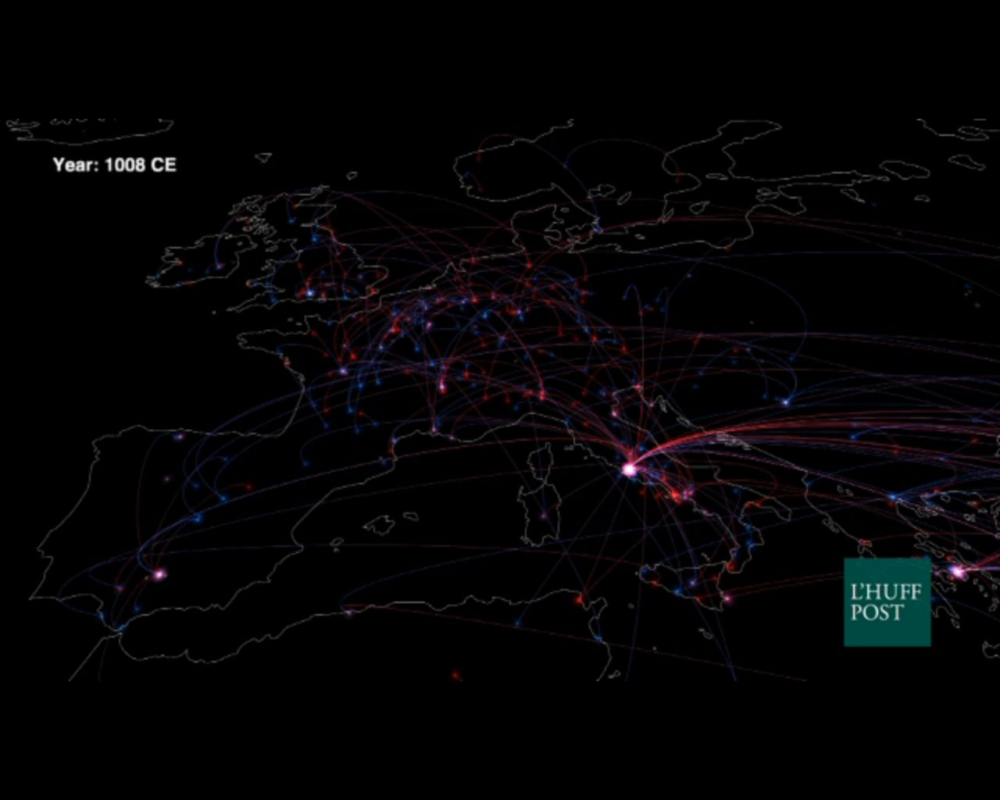{ loading=lazy style="width:39%" }

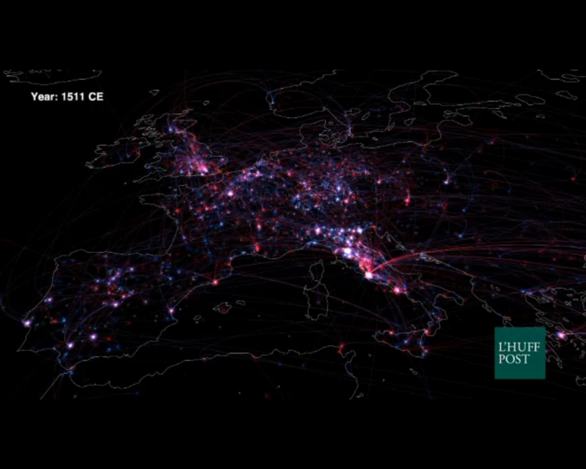{ loading=lazy style="width:42%" }

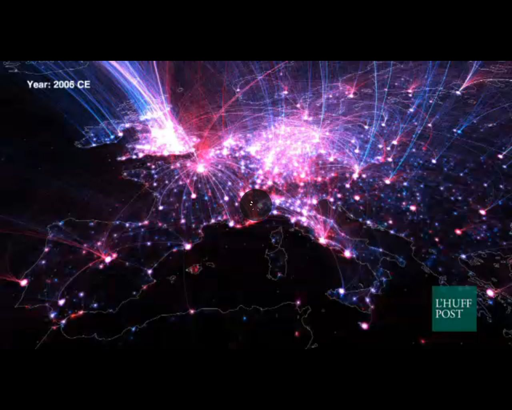{ loading=lazy style="width:43%" }

**DOVE VANNO GLI INTELLETTUALI: 2000 ANNI DI SPOSTAMENTI IN UNA VIDEOMAPPA**

*Fonte indicata nella slide: www.filosofia.rai.it*
{: .didascalia }

In principio fu Roma: 2000 anni fa filosofi, intellettuali e letterati la predilessero come città ideale per sviluppare le proprie capacità, osservare i cambiamenti sociali, fare «networking» con individui con interessi simili.

Ciò che è successo nei due millenni successivi, ovvero come siano cambiati i flussi migratori – e, di conseguenza, la geografia delle «città culturali» –, è stato analizzato dalla rivista *Science*, grazie all’utilizzo di *big data*, ovvero grandi quantità di informazioni, relative in questo caso ai luoghi di nascita e di morte di 150.000 personalità culturalmente rilevanti. Un video, realizzato dagli stessi ricercatori, mostra plasticamente le direttrici del cambiamento.

0:22:47

Però il concetto di arte, ritornando all’umano, ha per forza a che fare con la fisiologia del corpo umano. Da quando? Da quando ci siamo staccati, per esempio, dai nostri cugini, le scimmie. Questa è la Cueva de las Manos, in Patagonia, che risale a circa 13.000 anni fa. Pensate al mondo di 13.000 anni fa, ai nostri antenati che decidono, in una caverna, di rappresentare la loro vita, le loro mani tutte insieme, e affrescano in questo modo questa Cappella Sistina della preistoria. Lo stesso hanno fatto – queste sono forse le più celebri – nelle grotte di Lascaux, in Francia, di circa 20.000 anni fa, dove si rappresenta l’oggetto del desiderio, in questo caso la caccia, perché la caccia è fondamentale. Le grotte di Lascaux sono state rese virtuali per preservarle, perché sennò sarebbero state danneggiate dal troppo turismo: anche questo sarebbe un argomento interessante da affrontare, ma magari, come dice Lorenzo, lo affronteremo nei prossimi cinquanta, venticinque anni.

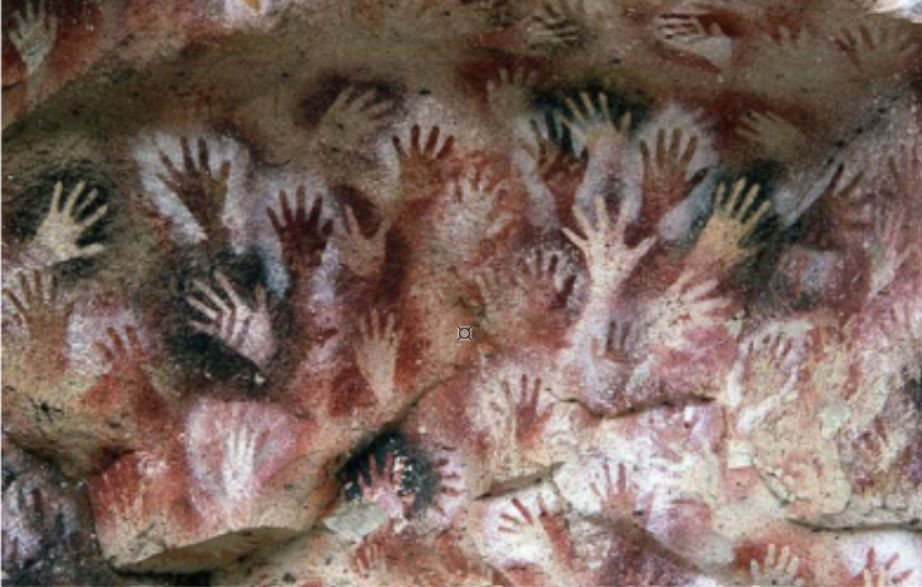{ loading=lazy style="width:46%" }

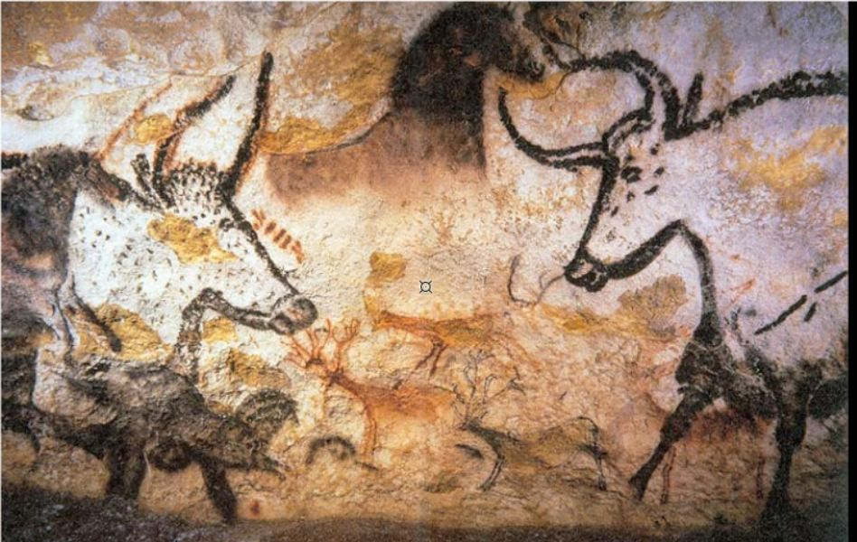{ loading=lazy style="width:49%" }

0:24:22

Come si possono spiegare queste cose? Una risposta interessante ce la dà Desmond Morris. Bisogna partire, come si diceva prima, dall’uomo di quel periodo, dalla caccia, perché la caccia è fondamentale: l’opera d’arte, come abbiamo visto, è accessoria, perché per la nostra sopravvivenza sono importanti il cibo, l’acqua, il riparo, e quindi cacciare. Queste sono le cose fondamentali; l’arte viene dopo. E come lo spiega Desmond Morris? Credo sia molto interessante. Lo spiega con il fatto che abbiamo sviluppato il nostro cervello, ed è il nostro cervello che ci ha resi più forti degli altri animali, perché è lo strumento in più che abbiamo. E il nostro cervello va nutrito: *Pensieri a tavola* l’abbiamo un po’ fatto su questa falsariga, giusto, Lorenzo?

**LA STORIA DELL’UOMO E DELL’OPERA D’ARTE**

*Da Desmond Morris, «La scimmia artistica» (2014), e dall’intervista di Paolo Foschini al «Corriere della Sera» (20 ottobre 2014)*

«L’arte è ciò che ci rende unici; però, per capire, bisogna partire dalla caccia.»

«Da un punto di vista biologico non c’è alcuna differenza estetica tra la Cappella Sistina, un tatuaggio o una semplice piuma decorativa tra i capelli.»

«Nessuna di queste attività è essenziale per la nostra sopravvivenza fisica quanto lo sono invece cibo, acqua, un riparo.»

L’uomo si è affermato come cacciatore non perché più forte degli altri animali, ma perché più intelligente; e anche il cervello va nutrito (*Pensieri a tavola*…), perché ha orrore dell’inattività. Così, dopo la caccia, anziché dormire come i leoni, l’uomo è l’unico che ha sentito il bisogno di festeggiarla, danzando, cantando, dipingendola e raccontandola: premiando il cervello, oltre alla pancia, ha scoperto che poteva «rendere la realtà più intensa».

0:25:41

Se ci pensate, l’uomo è l’unico animale che, dopo la caccia, dopo essersi nutrito, ha sentito il bisogno di festeggiarla. I leoni, dopo la caccia, dormono per lunghe ore, appagati dal cibo e dalla digestione; noi invece no: noi dovevamo festeggiare, perché era il cervello che doveva essere nutrito in un altro modo, e allora abbiamo cominciato a dipingere. Questa è una statuetta – l’abbiamo fatta vedere due o tre anni fa, quando abbiamo fatto la serata sul cibo – che risale al 9000 a.C., ritrovata a Wadi Khareitoun, nei pressi di Betlemme: fa vedere due amanti, «gli amanti di Ain Sakhri», come è stata denominata dal British Museum, e va bene in questa direzione, perché è il tempo in cui l’uomo trova spazio per se stesso e per le proprie emozioni, e quindi anche per l’arte. E questo forgia questa statuetta, dove si vedono due amanti, un uomo e una donna, che si congiungono dopo il pasto.

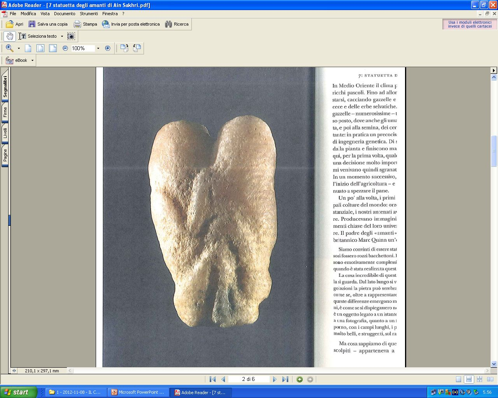{ loading=lazy style="width:39%" }

0:27:05

Questa l’avevo messa all’inizio, in copertina, se vi ricordate: è un’opera d’arte astratta degli anni Cinquanta. Di chi è quest’opera d’arte? È interessante: ecco, l’artista è lui, si chiama Congo, uno scimpanzé della metà degli anni Cinquanta, che ha dipinto il quadro che vedevamo prima. E quindi la domanda è: l’uomo è solo, o non è solo, nella rappresentazione artistica? Qui Desmond Morris è ritratto insieme a Congo nell’atto di dipingere. Dice, per esempio, che Congo usava la stessa tecnica di un bambino: la scimmia è all’alba dell’uomo, è come un bambino di tre, quattro, cinque anni; non esce dal foglio, si arrabbia quando gli viene tolto il foglio, per esempio. E c’è una seduta interessante, perché all’apice della creatività di Congo i suoi disegni trovano acquirenti in tutto il mondo, gli vengono comprati tutti, e uno lo compra anche Picasso.

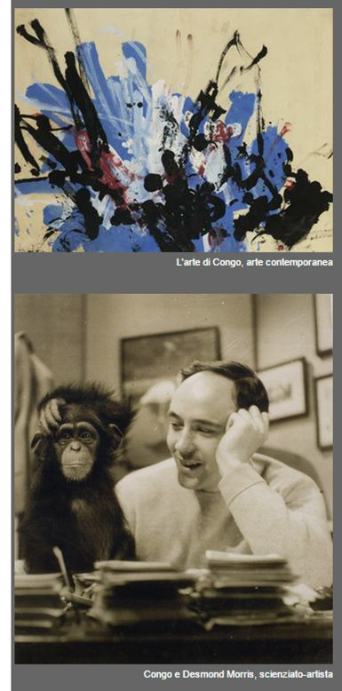{ loading=lazy style="width:46%" }

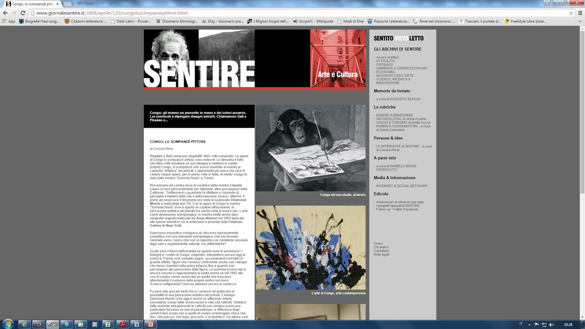{ loading=lazy style="width:47%" }

**Congo, LO SCIMPANZÉ PITTORE**

*Sintesi delle parole di Desmond Morris riportate nelle slide*

Morris ricorda lo scimpanzé Congo, a cui nel 1956 furono dati matita e colori: disegnava come un bambino alle prime armi, senza uscire dal foglio, con segni dotati di una certa coerenza («variazione su un tema»), e si infuriava se gli si toglieva la matita prima che avesse «finito». In una seduta, forse la ventiduesima, raggiunse il suo vertice: tutti i disegni di quel giorno furono comprati da collezionisti privati, e uno lo acquistò persino Picasso.

Allora verrebbe quasi da dire che l’uomo non è solo. «E invece sì», risponde Morris: il vertice dell’espressione «artistica» di una scimmia non è che il primo, elementare gradino da cui parte un bambino. «L’arte fa parte di noi, perché ne abbiamo bisogno.»

Morris sostiene inoltre che ci sono altre due o tre cose che distinguono l’uomo e lo rendono unico: la scienza, la religione e lo stupore. «L’arte è ciò che rende straordinario l’ordinario, per divertire il cervello. La scienza è ciò che rende semplice il complesso, per capire l’esistenza. La religione è ciò che rende credibile l’incredibile, per mitigare la paura della morte.»

Lo stupore, la famosa «meraviglia»: l’uomo è l’animale che trasporta pietre gigantesche per fare Stonehenge, che mette insieme tessere e due tonnellate d’oro per il mosaico del Duomo di Monreale, ma anche quello che cuce i costumi del carnevale di Rio o dipinge i caravan degli zingari. «La molla è sempre la stessa.»

**E come si è arrivati al fatto che l’uomo, a un certo punto, ha deciso che un orinatoio poteva valere milioni di dollari?**

Per Morris, il valore commerciale di un oggetto artistico è difficile da spiegare con criteri solo artistici: «Una cosa vale milioni nel momento in cui qualcuno è disposto a pagarla milioni, punto».

0:28:41

È interessante: volevo mettere una nota. Non c’è solo lo scimpanzé che dipinge – addirittura è stato presentato anche a un’edizione della Biennale: ci sono anche le elefantesse. Ci sono due elefantesse che fanno opere più grandi, ed era interessante vedere gli assistenti che reggevano loro la tavolozza, una tavolozza enorme, e le elefantesse, con la proboscide, avevano un pennello grande, e con questo facevano opere rigorosamente astratte. C’è anche l’arte dell’elefantessa.

0:29:40

Lorenzo Poggi Ci torniamo poi sul discorso. Ci sono due concetti, direi, che vengono fuori qui e che sono essenziali: quello di senso, sensibilità – lo vedremo insieme – e quello di arte intesa come modo particolare di accesso alla verità: qual è il carattere veritativo dell’arte. Su questo torniamo dopo; però mi piaceva questo discorso di Congo, che fa le cose piccole, e dell’elefantessa: è una roba eccezionale.

0:30:29

Paolo Marcucci E quindi, continuando su questa linea, l’arte fa parte di noi perché ne abbiamo bisogno come esseri umani, perché ci distingue dagli altri esseri. Chi ce l’ha fatto fare, per esempio, di trasportare pietre gigantesche per fare Stonehenge, quest’opera d’arte dell’antichità? Oppure il mosaico del Duomo di Monreale, dove ci sono due tonnellate d’oro? Sono tutte opere che l’uomo ha impiegato un tempo infinito a realizzare; però l’ha fatto, perché fa parte di noi, come abbiamo detto.

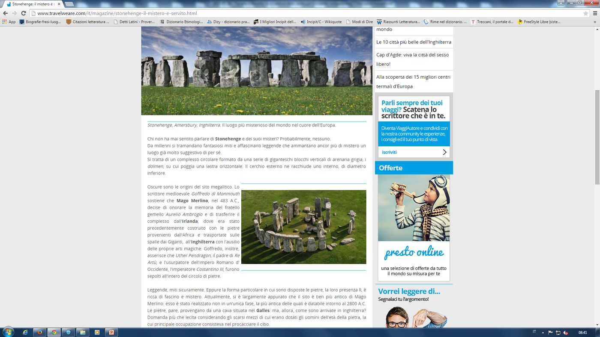{ loading=lazy style="width:47%" }

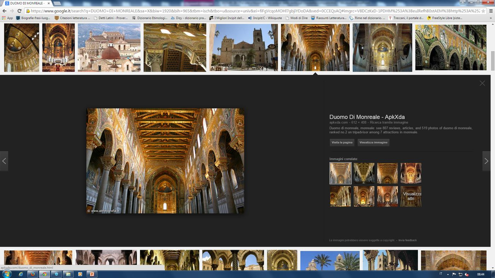{ loading=lazy style="width:45%" }

0:31:33

A questo punto la domanda che possiamo farci dal punto di vista filosofico – perché nelle nostre serate cerchiamo di porci qualche domanda – è: perché una cosa vale milioni di euro? Questo è il famoso orinatoio \[la *Fontana* di Marcel Duchamp, 1917\] – tra l’altro è anche lo spunto per uno dei possibili titoli dell’anno prossimo, di cui vi abbiamo detto all’inizio. Che cosa fa scattare la molla per cui un’opera come questa può valere milioni di euro? La risposta, in prima battuta, è il mercato: perché qualcuno è disposto a pagarla quella cifra. Però su questo possiamo porci qualche domanda. Per esempio, mi interessava indagare l’espressione d’arte come effetto di una partecipazione collettiva: su questo punto poi approfondiremo nella seconda parte. Achille Bonito Oliva, nel presentare la Biennale di Venezia di quest’anno, ha detto per esempio: «Una conferma del mio pensiero: l’arte è un massaggio al muscolo atrofizzato della sensibilità collettiva».

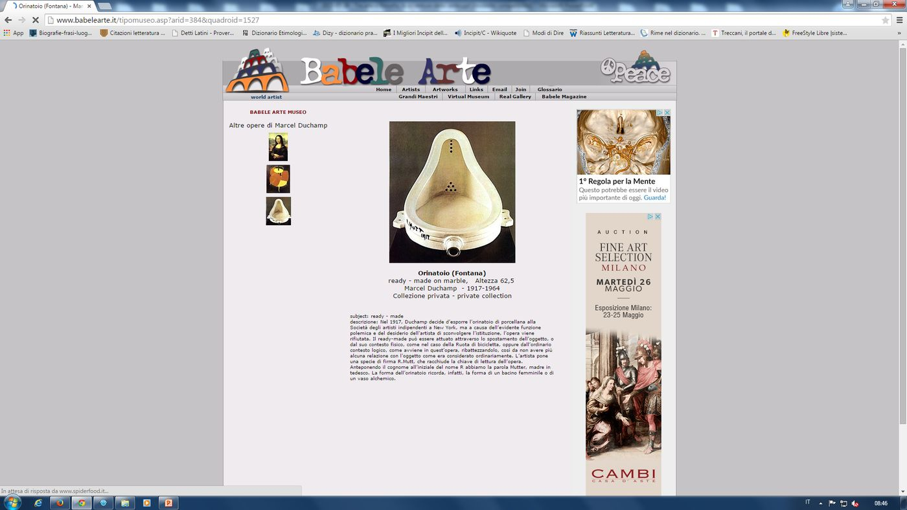{ loading=lazy style="width:34%" }

0:33:03

Dall’altro lato, della visione collettiva dell’opera d’arte c’è la versione più politica, della filosofia, che è quella di un maestro scomodo quanto si voglia, Toni Negri, però molto interessante dal punto di vista della speculazione filosofica. Dice: «Contro il cinismo spettacolare del mercato che fa dell’opera d’arte una merce tra le altre» – ricordate la Brillo che abbiamo visto all’inizio, la merce che è diventata opera d’arte – «qui si afferma un’idea dell’arte radicalmente democratica». Ma questo poi lo vediamo nella seconda parte. Ora ti lascio la parola per la tua introduzione.

0:33:50

Lorenzo Poggi Grazie. Allora, intanto voi capite che l’argomento è estremamente complesso. Cominciamo a mettere alcuni punti. Primo punto: di che cosa stiamo parlando, quando parliamo di arte e parliamo anche di verità? Arte e verità: che relazione c’è? Arte e filosofia: la filosofia indaga questa relazione; e, diceva prima Paolo, la disciplina filosofica che se ne occupa è l’estetica. Arte e verità: in che relazione si trovano? Oggi la relazione è del tutto annullata, o quasi. La verità è data dalla conoscenza scientifica; l’operare vero sul mondo è dato dall’operare tecnico, tecnologico, scientifico. L’arte riguarda un’altra parte della nostra forma mentale: l’arte è opera del gusto, si dice; chi fa arte non ha bisogno di avere conoscenze scientifiche, basta che sia una persona di gusto.

0:35:28

Quindi la separazione tra arte e verità, o, se volete, la perdita della funzione veritativa dell’arte, oggi è compiuta: le due cose si sono separate nettamente e non c’è più relazione, tanto che all’arte è riservato un compito e un posto inferiore rispetto a quello dell’altra forma di relazione con il mondo, la forma della conoscenza, dell’operatività, della funzionalità tecnica, della verità scientifica. È sempre stato così? Quando vedevamo le opere preistoriche di Lascaux, o Stonehenge, o quando guardiamo le opere dell’arte classica, anche per quel tipo di arte è immediatamente operabile questa separazione? Quella è solo arte giudicabile da un punto di vista estetico? Oppure lì dentro c’è anche la verità? E, se lì dentro c’è la verità, in che cosa consiste l’elemento veritativo dell’arte?

0:37:04

L’elemento veritativo dell’arte, quello che l’arte ha sempre fatto, o provato a fare e a proporre, è una relazione: una relazione fra sensazione, senso, percezione sensibile – in greco *aisthesis*, da cui la parola «estetica» – e conoscenza concettuale, razionale, che si chiama teoria. Teoria perché? Perché teoria vuol dire anche contemplazione. Che c’entra? C’entra perché i greci pensavano che esistesse una verità nel mondo, in sé, e che alla conoscenza umana toccasse solo di scoprire questa verità, di contemplarla, non di costruirla, non di agire. Ricordatevi Prometeo, che viene incatenato e condannato perché ha insegnato agli uomini non ad accettare la natura, ma a intervenire sulla natura con la tecnica, con il fuoco.

0:38:36

Quindi un passaggio fondamentale: nell’arte antica che cosa troviamo? Troviamo che l’arte è il momento in cui, nelle sue espressioni più belle, si riesce a mettere insieme questo mondo che esiste, che è inconoscibile razionalmente – da cui la nostra ragione trae qualcosa attraverso il concetto e la teoria –, e la sensibilità. L’amore, la bellezza di Venere, che mette insieme l’amore erotico e la perfezione della forma: mette insieme il concetto di bellezza come perfezione e la percezione del bello come sensibilità, come senso.

0:39:56

Ed ecco l’altra parola, quella fondamentale. Perché, se l’arte, quando riesce a essere tale, è realizzare un’esperienza che ci rende consapevoli, quindi un’esperienza di verità, della corrispondenza fra *aisthesis* e teoria, fra percezione e concetto, fra sensazione e verità – non dimostrandola per concetti, come fa la scienza, non in modo funzionale, come fa la tecnologia, ma attraverso l’immediatezza dell’esperienza, l’immediatezza del senso, che diventa anche elemento veritativo –, allora l’arte incide profondamente sul nostro modo di essere uomini che fanno esperienza del mondo, perché seleziona quest’esperienza, la mette sotto il segno della verità, che non contrasta, ma riprende la verità concettuale, e ci dà la sensazione unica di un vero che non è attingibile solo attraverso l’intelletto, ma che è insieme anche senso e percezione. Questo è stato a lungo l’arte.

0:41:30

Si può vedere il tempio greco – non vi voglio annoiare, ora vado rapidamente; vorrei essere chiaro, perché capiate che stiamo affrontando un tema direi molto difficile, pericoloso anche, ma tentiamo di essere chiari. Questo è il tempio greco? Sì, si può spiegare; vediamo. È una grande architettura che occupa lo spazio, lo spazio dove c’è il dio: la statua del dio non la si vede, non è qualcosa di esposto là fuori, non è il monumento della piazza; è all’interno, nel *sancta sanctorum*, è chiusa. Quindi chi ha fatto la statua del dio non l’ha fatta perché sia soltanto mostrata: quella è già viva e ha la sua funzione se è vista e sentita dal dio, perché interpreta già questa relazione, la percezione che diventa verità. Il dio esiste, è il dio che domina il caos; e sentire, conoscere percettivamente la statua, è la relazione tra caos e cosmo. E quella statua è il momento in cui percettivamente si verifica questo accordo. È un simbolo: *symballein*, si diceva quando parlavamo del diavolo, che invece separa, no? *Symballein* è ciò che mette insieme: mette insieme la nostra percezione, la nostra conoscenza percettiva sensibile, con la verità. È solo in questa parte accessibile, perché diventa la porta d’accesso al sacro, al separato, al *fanum*; e tutto l’altro spazio intorno, organizzato, viene ad avere senso e significato perché è *pro-fanum*, davanti al *fanum*.

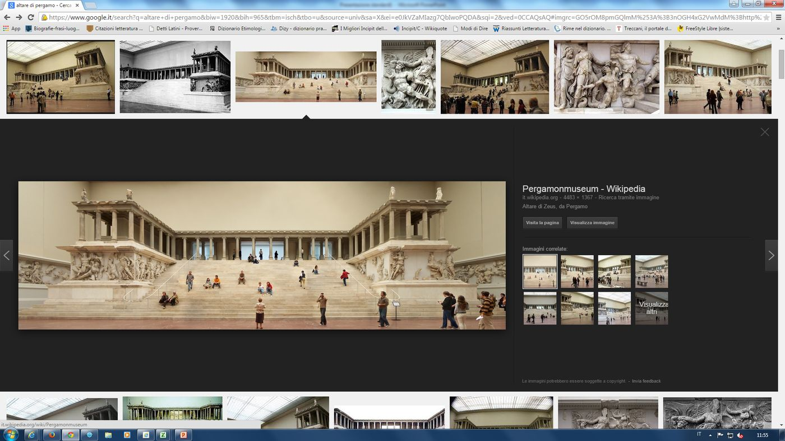{ loading=lazy style="width:47%" }

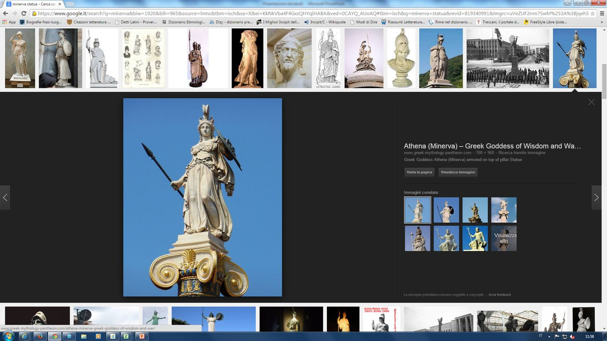{ loading=lazy style="width:32%" }

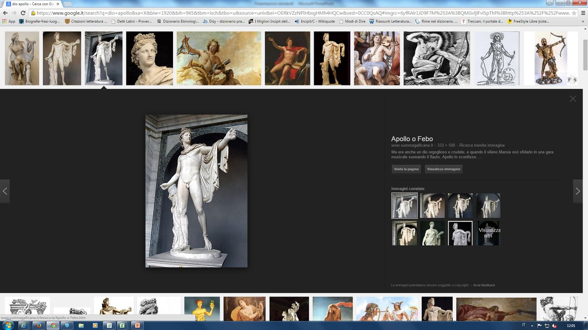{ loading=lazy style="width:30%" }

0:44:23

Nella tragedia c’è lo stesso elemento: c’è la passione, la sensibilità, c’è l’impeto dei sensi, l’impeto del sangue, c’è l’istinto della natura, e c’è la legge della città; ed è rappresentato nella tragedia, in ciò che si dice. Ma quelli non sono personaggi che imitano la vita: non c’è *mimesis*, o c’è un’imitazione estremamente elevata, estremamente superiore all’imitazione del reale, perché è un’astrazione; ed è tanto un’astrazione che, a spiegare tutto questo, interviene a un certo punto il coro. C’è il coro: stavamo vivendo una vicenda, c’erano i fatti, c’erano gli attori, e poi invece il coro interrompe e dice che cosa fa? L’azione del coro ci fa capire che non stiamo parlando della realtà, ma stiamo elevando e sublimando la realtà: perché attraverso i nostri sensi, il nostro sentire, partecipare e vedere un’azione come quella degli uomini ordinari, abbiamo qualcosa di straordinario, abbiamo cioè la relazione fra l’infinito essere e ciò che dell’essere viene esemplarmente percepito e rappresentato dall’arte tragica.

0:46:45

Poi a un certo punto si cominciò a far prevalere la conoscenza: si disse che si doveva invece intervenire nella conoscenza e nella trasformazione del mondo; e con Euripide, il coro viene soppresso. La soppressione del coro toglie questo elemento: si va, capite, piano piano verso una diminuzione dell’elemento veritativo dell’arte. E quindi non si può dire che l’Apollo è una statua che ha un valore estetico e basta: dobbiamo dire che ha insieme anche un valore veritativo. Con Platone e Socrate comincia la divisione, per cui i sensi e la sensibilità non sono ignorati, ma messi a un gradino più basso rispetto alla conoscenza del mondo, che avviene attraverso il concetto e l’idea. Chi segue l’idea non si fa trascinare dai sensi: quindi abbandoniamo il corpo, lasciamo stare i sensi, perché i sensi non danno conoscenza, anzi allontanano dalla conoscenza. La conoscenza l’intelletto la coglie in ciò che è veramente simile a lui, la coglie nell’idea, nell’eidos; e quindi dobbiamo separarci dai sensi.

0:48:35

Ma il senso, ciò che l’aisthesis conosce, e ciò che la teoria contempla e riesce a enunciare nel concetto, sussistono ancora insieme in Plotino e sussistono ancora insieme in Agostino, nel cristianesimo medievale, dove la *veritas* è la *veritas* divina, che è colta dall’artista. Tommaso d’Aquino dice che la bellezza, quella che l’arte realizza, è data dalla *integritas*, dalla *proportio* e dalla luminosità. L’integritas, si capisce: l’opera deve essere rispondente allo scopo per cui è stata fatta. Poi ci sono la *proportio* e la *claritas*. La *claritas* che cos’è? È questo il punto della sensibilità: è la luce, la luce divina che risplende in tutte le cose e che l’artista riesce a cogliere.

0:50:25

Giotto la *claritas* la fa emergere. Si può mettere qui il pezzetto di Giotto? Ecco, eccolo qua. Vedete: la luce non viene da là, la luce viene dalle figure. Questo è un *Giudizio universale* – c’è anche un pezzo di inferno sulla destra –, ma le figure sono luminose, hanno una luce loro: è la luminosità, è questa *claritas* divina. Claritas divina perché la prima cosa creata è la luce, *fiat lux*, e quindi la luce è la prima sostanza dell’universo. Quella arriva agli uomini del Medioevo, che danno luce allo spazio. Ci siamo? Ricordatevi tutte le storie di Roberto Grossatesta \[...\] – lasciamo stare, perché sennò poi finiamo tardi. Però è chiaro, no? Il concetto è la *claritas*, che l’artista fa emergere e che è la chiarezza dell’oggetto: quindi l’arte è anche verità per questa parte, è ancora veritativa, non si dice soltanto che una cosa è bella.

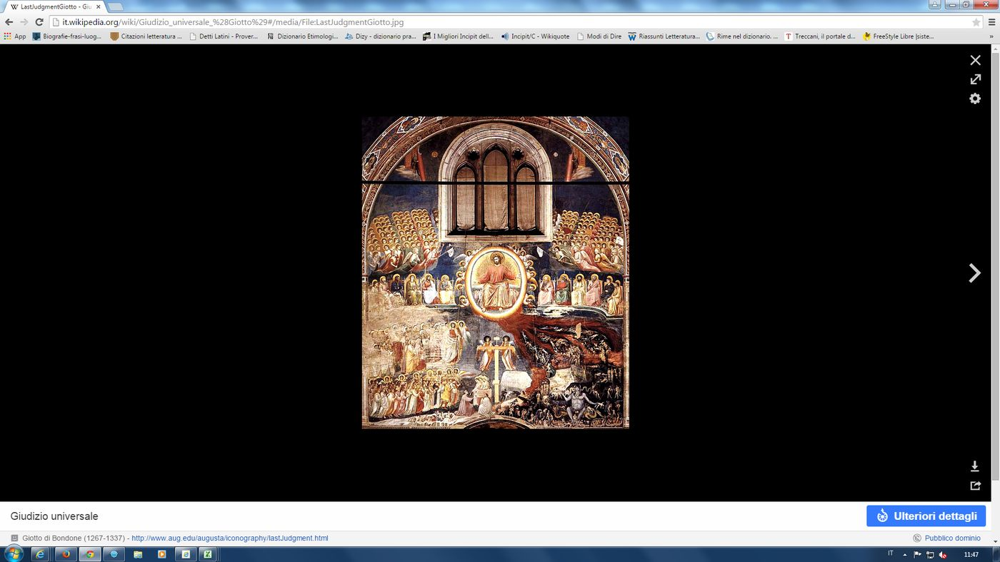{ loading=lazy style="width:31%" }

0:52:30

Il vedere fisico quando diventa solo fisico? Quando nel Seicento, con Cartesio e la scienza moderna, separeremo il vedere fisico dell’occhio, macchina, dalla *res cogitans*, che è il cervello. Ma questo è un fatto della nostra storia, non è mica sempre stato così: nel Medioevo la *visio* è un’altra cosa. La *visio* è una relazione tra l’occhio che vede e la luce che emanano le cose, tra la luce dell’occhio e la luce delle cose: la *visio* è una corrispondenza perfetta tra le cose, e questa corrispondenza perfetta in qualche modo la ordinava la provvidenza divina. Citavamo Dante in una di queste serate, parlavamo di Cartesio: pensate a Dante che parla con Farinata degli Uberti: «Io avea già il mio viso nel suo fitto; / ed el s’ergea col petto e con la fronte / com’avesse l’inferno a gran dispitto». «Il mio viso nel suo fitto»: si sono baciati, addirittura. Il suo viso, la sua *visio*, ciò che parte come luce dagli occhi di Dante, si incontra con ciò che emana come luce dagli occhi di Farinata; e i due raggi si incontrano perché? Perché la luce è tale, ordinata dalla provvidenza divina, perché ciò che pensa Farinata è in qualche modo in ordine con ciò che pensa Dante: si riconoscono.

0:54:30

Capite come vanno avanti queste cose? Vanno avanti fino al Rinascimento; rileggiamo solo alcuni aspetti, perché sennò non si finisce mai: si dovrebbe parlare di colori, di rapporti eccezionali, ma noi non ce la facciamo; mettiamo gli occhiali della filosofia e diciamo qualche cosa. Nel Rinascimento non conta tanto far emergere la lux, la *claritas*, la luce divina, quanto far emergere la capacità umana di dare ordine alle cose e al mondo. Leon Battista Alberti: non è più fatto da Dio, lo spazio è visione umana; e fa quel discorso sulla prospettiva, che dà ordine allo spazio, ordina le cose e dà senso. Misurando nello spazio, che è un misurare proporzionalmente anche nel tempo – perché come si ordina proporzionalmente nello spazio, si ordina così proporzionalmente anche nel tempo – nasce la scienza moderna: l’arte non è più verità. L’*aisthesis* è relegata in basso, nelle forme conoscitive del mondo: nel gusto e nel talento. Chi ha gusto e talento fa le cose dell’arte; chi ha intelligenza e razionalità fa le cose della scienza e della tecnologia. Perché non conta l’esperienza intesa in questo senso, ma conta la rispondenza di ciò che sperimentiamo con la teoria che abbiamo formulato.

0:56:58

Tanto che il nostro amico Galileo ci presenta degli esperimenti che non si possono fare, per dimostrarci qualche cosa che riguarda il movimento. Cita una specie di esperienza che è stata, come dire, depurata, e che non si potrà mai fare. Pensate a tutta la tensione che c’è in un’arte che è anche conoscenza, in Leonardo: quanto vigore e valore abbia l’esperienza in Leonardo, e tutta la tensione che c’è poi nel naturalismo rinascimentale. Sto facendo il professore, scusate. Giordano Bruno pensa ancora a uno spazio che non è puro spazio matematico, che è ancora qualcosa dell’esperienza; tanto che si trova a litigare con l’infinito, perché non riesce a dimostrare come all’interno dell’infinito ci siano le proporzioni: per lui nell’infinito ci stanno tante parasanghe quanti metri, anche se la parasanga è molto più lunga; ma, se è infinito, in un infinito ci stanno tante parasanghe quanti metri. Dovremo arrivare a Galileo, che matematizza tutto in astratto e rinuncia anche a questo residuo di esperienza, per arrivare a una concezione matematica dell’infinito.

0:58:50

Quindi la rinuncia: nella Critica del giudizio Kant è ancora su questo: l’arte è opera del gusto, l’arte non è dovuta all’intelletto, l’arte è un’altra cosa; si stimano le immagini, ma le immagini non rispondono all’esigenza della verità. E siamo quasi giunti a oggi: nelle immagini dell’estetica non è più possibile riconoscere alcun elemento veritativo, perché l’elemento veritativo è demandato alla scienza, alla tecnica, alla tecnologia. Vi ho fatto un discorso troppo lungo; vediamo se si arriva alla conclusione nella seconda parte. Grazie.

\[PAUSA\]
{: .nota }

1:52:15

Paolo Marcucci Bene, dopo il caffè direi che possiamo affrontare la seconda parte. Prima di tutto vi propongo un applauso al Caffè Centofiori, che ci ha fatto la cena stasera. Grazie. Allora iniziamo la seconda e ultima parte di questa serata.

1:53:03

Come ci eravamo lasciati prima, volevo affrontare il tema dell’arte, della filosofia dell’arte, dal punto di vista collettivo, perché c’è anche un filone di pensiero che esplora e teorizza la costruzione dell’opera d’arte come opera collettiva dell’uomo. E questa visione si può a sua volta declinare in un paio di soluzioni, una più tecnico-artistica e una più politica. Quella politica è quella a cui ho accennato prima, sul finale: si rifà per esempio alle teorie espresse dal filosofo Toni Negri. L’altra invece è un po’ più tecnica; ora cerchiamo di vederle insieme.

**L’OPERA D’ARTE FRUTTO DEL COLLETTIVO?**

La visione e l’interpretazione «collettiva» dell’opera d’arte può avere più punti di vista; i più interessanti per la nostra serata, cioè per un lato della possibile verità dell’opera d’arte, credo possano essere questi due: quello tecnico-artistico e quello politico.

**L’OPERA D’ARTE COME ESPRESSIONE COLLETTIVA**

Si può affrontare l’argomento dell’autorialità collettiva partendo dal presupposto che l’idea creativa, in questo caso, sia un patrimonio collettivo, frutto di un’elaborazione a più mani e più teste.

Nell’idea dell’autore collettivo dell’opera tecno-artistica c’è anche il progetto di un coinvolgimento organico dello spettatore.

L’idea filosofica di fondo è che la partecipazione del fruitore occasionale dell’opera non soltanto è prevista dalla struttura comunicativa dell’opera stessa, ma diventa addirittura essenziale affinché essa realizzi pienamente la propria sostanza espressiva: la chiusura del cerchio.

1:54:06

Sostanzialmente l’idea fondamentale è che l’opera d’arte è un patrimonio collettivo, frutto di più mani e più teste. La visione dell’opera collettiva prevede il coinvolgimento dello spettatore, anche del fruitore occasionale, che diventa a sua volta creatore dell’opera d’arte e ne influenza e ne modifica la creazione. E quindi si parte dall’artista, si va a chi vede l’opera d’arte, e c’è una chiusura del cerchio in questo senso. Si parla, per esempio, di arte come pratica reale: si parte da una concezione dell’opera d’arte come realtà immodificabile per arrivare a un’opera d’arte che si modifica continuamente, un processo continuo. Ci sono esempi significativi da questo punto di vista, soprattutto dagli anni Settanta del Novecento: per esempio i writers, il movimento punk, che è emblematico, oppure l’hackeraggio sociale. Sono tutti temi interessanti dal punto di vista del tema di stasera.

**L’ARTE COME PRATICA REALE. DALLE AVANGUARDIE AGLI HACKMEETING**

*Fonte: Tatiana Bazzichelli*
{: .didascalia }

Presentare il concetto di «arte come pratica reale» significa voler spostare l’attenzione da una concezione di arte come originalità immodificabile a una concezione di arte come pratica di vita, gestualità quotidiana, relazioni collettive orizzontali.

Significa percepire un’arte che non sia unicamente frutto dell’operato di un singolo genio, ma che sia possibilità di intervenire personalmente e collettivamente nella creazione di un prodotto artistico che diventi un processo impermanente, fluttuante e contaminabile da chiunque voglia prendervi parte.

È quanto avviene, per esempio, a partire dagli anni Settanta, fra i *writers* e nel movimento punk, fino ad arrivare ai circuiti delle reti telematiche antagoniste, al movimento dell’hackeraggio sociale e al cyberpunk.

1:55:49

Vediamo di analizzarne qualcuno. Questi sono i writers – ho preso un’immagine, ce ne sono anche qua nella nostra zona –: questa è Pisa, sono i graffiti di strada. Questa è un’opera d’arte: i writers rientrano nell’ideologia dell’arte collettiva, perché si inseriscono bene in questo filone. Il cyberpunk: anche questo è sinonimo di un’arte di matrice collettiva. Chi è stato a Berlino forse l’ha visto: questo è il Sony Center di Berlino, il simbolo maggiore in Europa del cyberpunk. È una piazza importante di Berlino, tutta al coperto, ed è un’architettura cyberpunk che si rifà a questi concetti.

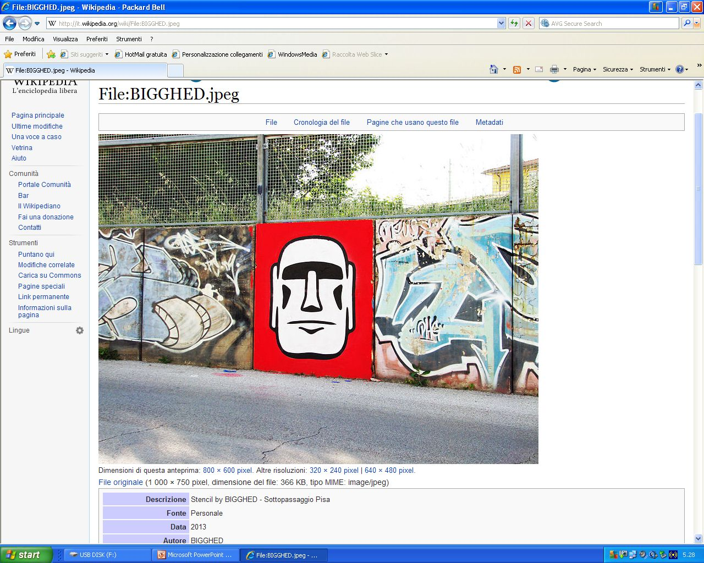{ loading=lazy style="width:44%" }

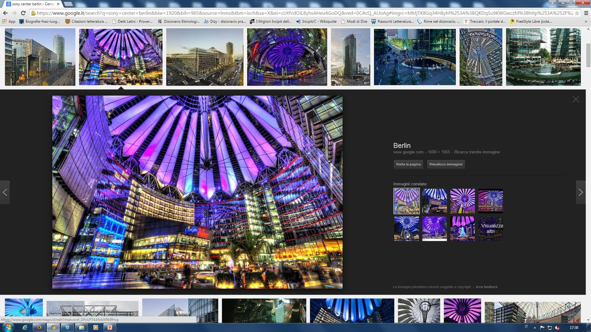{ loading=lazy style="width:50%" }

**CYBERPUNK**

Il cyberpunk è una corrente letteraria e artistica nata nei primi anni Ottanta, nell’ambito della fantascienza. Il nome deriva dall’incrocio tra cibernetica e punk: fu coniato da Bruce Bethke come titolo del suo racconto C*yberpunk*, del 1983.

Il cyberpunk tratta di scienze avanzate, come l’*information technology* e la cibernetica, accoppiate con un certo grado di ribellione o di cambiamento radicale nell’ordine sociale.

Il Sony Center di Berlino è il simbolo dell’estetica cyberpunk.

1:56:53

Oppure andiamo al concetto di arte collettiva intesa come fruizione di mezzi comunicativi e di espressione comuni e collettivi. Il punk, per esempio: la musica punk nasce in quel periodo, negli anni Settanta, perché si decide di produrre la propria arte senza passare dalle case discografiche, che manipolano il mercato: l’autogestione di questo circuito. Il cyberpunk l’abbiamo detto ora; per arrivare all’hackeraggio sociale, cioè a un tipo di arte che utilizza i mezzi, la nascente rete di comunicazione che poi diventerà internet, adoperata dagli artisti sotto questo cappello dell’hackeraggio sociale. Questo, per esempio, è l’archivio di Hacker Art – tra l’altro siamo qui in zona, perché il suo creatore è un fiorentino, Tommaso Tozzi, che lo realizzò nel 1990 come Hacker Art BBS, all’interno della rete Cybernet – al cui interno molti artisti si rifanno al movimento dell’hackeraggio sociale: prevede il coinvolgimento di chi va a vedere, perché può collegarsi al computer e trasformare l’opera d’arte stessa; quindi c’è un fluire continuo dell’opera d’arte, che si aggiorna continuamente tra l’autore principale e il fruitore, che entra e modifica l’oggetto stesso dell’arte.

**L’ARTE COME PRATICA REALE. DALLE AVANGUARDIE AGLI HACKMEETING**

Il concetto che fa da collante a tutte queste realtà è il concetto di autogestione dei mezzi comunicativi e delle pratiche artistiche.

Nel punk si manifesta nella volontà di destrutturare la bipartizione oligarchica fra artista e fruitore, dimostrando che è possibile autoprodurre la propria arte (musica, riviste, materiale informativo…) al di fuori dei circuiti di mercato; nell’ambito delle pratiche dei *writers* si manifesta nella gestualità che personalizza con delle *tag* i muri del proprio spazio di vita, attivando una comunicazione in movimento fra diverse identità anonime.

La scena cyberpunk e il movimento dell’hackeraggio sociale dimostrano che, partendo da un utilizzo consapevole e autogestito dei mezzi di comunicazione e degli strumenti del linguaggio, è possibile concepire un’arte «su cui mettere le mani», su cui «hackerare», dando vita a un evento-flusso in evoluzione collettiva e orizzontale.

L’hackeraggio sociale è nato a partire dagli anni Sessanta, ad opera di personaggi come Captain Crunch, Lee Felsenstein, Bill Gosper, Richard Greenblatt, le cui pratiche furono orientate a un utilizzo collettivo della tecnologia, al fine di una diffusione generalizzata del sapere e dei mezzi di comunicazione.

**HACKER ART BBS (WWW.HACKERART.ORG)**

All’interno della rete Cybernet, Tommaso Tozzi realizzò Hacker Art BBS (1990), un progetto tangente al mondo dell’hackeraggio sociale, che esemplifica chiaramente come l’arte possa essere considerata una pratica reale. Hacker Art BBS era una banca dati casalinga, accessibile a tutti collegandosi al computer di Tozzi attraverso il proprio computer e un modem.

Ogni individuo poteva contaminare con la propria creatività le immagini sullo schermo, originando un processo perturbativo potenzialmente senza fine.

1:58:44

Questi movimenti si rifanno a un’idea nata tra la fine degli anni Sessanta e gli anni Settanta: la più importante è il movimento Fluxus, che nasce in America – il nome fu coniato nel 1961 da George Maciunas, fondatore del movimento – ma si estende un po’ a tutto il mondo occidentale. Questo movimento dice che l’opera d’arte non è il quadro o la statua: l’opera d’arte è un concetto trasversale che riunisce tutte le arti, la musica, la pittura, la scultura, la letteratura; qualsiasi cosa è opera d’arte e dev’essere una fusione tra tutti questi stili. Vogliono dissacrare il concetto stesso di opera d’arte: il termine «opera d’arte» non indica più la nobiltà dell’oggetto che si sta costruendo; questo vogliono dimostrare gli autori di Fluxus.

**FLUXUS**

Un esempio e un’ispirazione un po’ per tutti questi movimenti è quello degli *happening* degli anni Sessanta e Settanta del gruppo Fluxus.

L’appellativo «Fluxus» fu concepito nel 1961 negli Stati Uniti, durante una serata musicale organizzata da George Maciunas, fondatore del movimento e della rivista omonima. Il progetto mirava alla fusione di tutte le arti, e dunque ad abolire ogni distinzione tra categorie fisse come arti visive, musica, teatro, letteratura, ma anche tra arte colta e popolare, arti maggiori e minori.

All’origine di questo movimento si possono individuare fenomeni strettamente connessi, quali gli *happening* (primo tentativo di fusione tra diverse forme di espressione), la lezione di Dada (in particolare di Duchamp) e l’insegnamento liberatorio della musica sperimentale di John Cage a New York. Più che un movimento che ha elaborato modi espressivi ben definiti, Fluxus è un atteggiamento nei confronti della vita, un tentativo di eliminare ogni separazione tra esistenza e creazione artistica.

Consapevoli dell’incessante divenire delle cose, gli artisti di Fluxus (George Brecht, Nam June Paik, Yoko Ono, Wolf Vostell, Robert Watts) professano l’essenza effimera, casuale e quotidiana dell’intervento artistico, non più basato su un oggetto privilegiato reso sacro dal nominativo «arte».

La parola «Fluxus» comparve stampata per la prima volta sugli inviti delle tre conferenze musicali «Musica antiqua et nova», organizzate nel 1961 da Maciunas, cui avrebbero aderito via via anche Ken Friedman, Ben Patterson, Nam June Paik, Wolf Vostell, Joseph Beuys, Charlotte Moorman, Benjamin Vautier e, in Italia, tra gli altri, i fiorentini Giuseppe Chiari e Silvano Bussotti, oltre a Gianni Emilio Simonetti.

1:59:52

C’è un fiorentino, per esempio, che aderisce a questo movimento: è Giuseppe Chiari (1926-2007). Questa, per esempio, è un’opera esposta nel 2010, nella mostra «I sei scalini sono la musica», ma che risale a qualche anno prima: ha ritrovato questo pianoforte a sei tasti e lo fotografa, perché il movimento Fluxus ha questo di particolare: la performance, che attraversa tutte le discipline artistiche, come abbiamo detto prima, viene fissata dalla fotografia. E questo pianoforte viene fotografato in centinaia di esemplari e situazioni; ne ho presa una, tanto per farvela vedere. Questo invece è del periodo in cui nasce il movimento Fluxus, il *Fluxus Street Theater*: è il giapponese Takehisa Kosugi, *Solo per violino* – vedete il violino –, e anche qui la foto è usata per raccontare, per fissare la performance dell’artista. Siamo a New York, il 23 maggio 1964 (la fotografia è di George Maciunas): è appunto un’opera che va sotto il nome del movimento Fluxus. E questa è la visione un po’ più tecnico-artistica dell’interpretazione dell’opera d’arte collettiva.

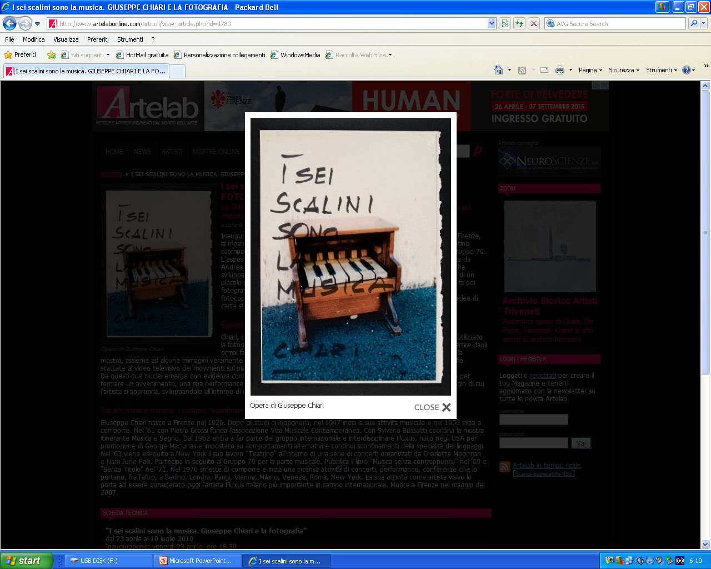{ loading=lazy style="width:30%" }

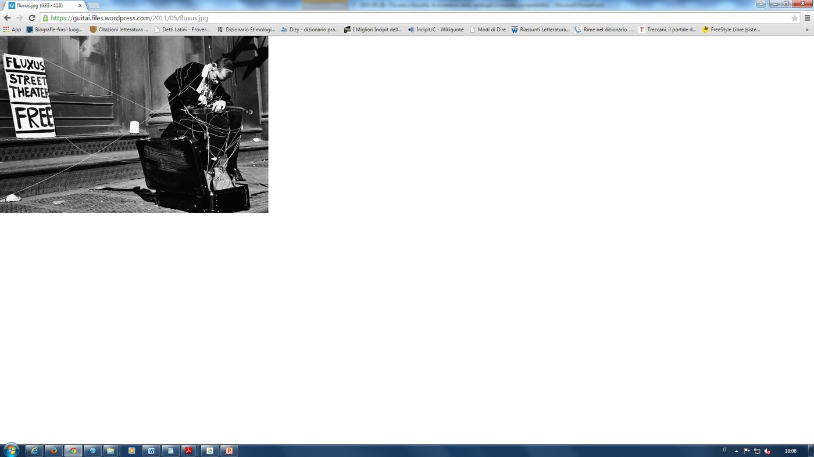{ loading=lazy style="width:46%" }

**GIUSEPPE CHIARI, I SEI SCALINI SONO LA MUSICA**

Nel 2010 la mostra «I sei scalini sono la musica» di Giuseppe Chiari, il grande artista fiorentino scomparso nel 2007, che aderì al movimento Fluxus e, in ambito musicale, al Gruppo 70.

Il ciclo trae origine dal ritrovamento di un piccolo pianoforte giocattolo a sei tasti, che Chiari trasforma in opera firmandolo, e che fa poi fotografare in varie situazioni.

Chiari, come tutti gli artisti che hanno seguito le esperienze Fluxus, ha spesso utilizzato la fotografia per fissare e testimoniare le sue *performance*: la fotografia rappresenta il mezzo per fermare un avvenimento, una sua *performance*.

**TAKEHISA KOSUGI, SOLO PER VIOLINO**

Esecuzione simultanea, 23 maggio 1964, durante il «Fluxus Street Theater», nell’ambito del «Fluxus Festival» alla Fluxhall di New York. Fotografia di George Maciunas.

La foto è usata per fissare e testimoniare le *performance*.

2:01:28

Guardiamo ora, in chiusura, una visione del pensiero filosofico, dell’interpretazione dell’opera d’arte, con un pensatore – come ho detto prima – un po’ scomodo, però interessante da questo punto di vista, che è Toni Negri. L’anno scorso è uscito questo libro, *Arte e multitudo*. Vedete, in copertina c’è un operaio, forse un metalmeccanico – penso lo riconosciate tutti –, che a noi, che siamo di questa zona, ricorda molto gli operai anche qui della Bitossi, l’industria Bitossi, con la tuta eccetera. Il concetto principale è questo: «L’arte non è il prodotto dell’angelo» – l’artista come angelo – «ma l’affermazione, ogni volta la nuova scoperta, che tutti gli uomini sono angeli». Quindi tutti gli uomini possono partecipare, anzi partecipano, perché l’opera d’arte è il frutto della storia e della compartecipazione di tutti gli uomini: questo è il pensiero di fondo a cui si rifà Toni Negri in quest’opera.

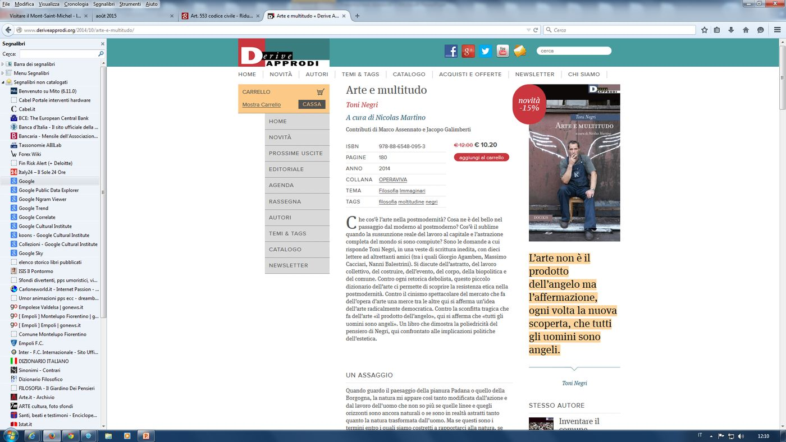{ loading=lazy style="width:30%" }

**TONI NEGRI, ARTE E MULTITUDO**

*«L’arte non è il prodotto dell’angelo, ma l’affermazione, ogni volta la nuova scoperta, che tutti gli uomini sono angeli.»*

Che cos’è l’arte, che cos’è il sublime, dopo la sostituzione totale del lavoro nel capitale? Si discute dell’astratto, del lavoro collettivo, del costruire, in una quasi resistenza etica nella postmodernità. Contro la sconfitta tragica che fa dell’arte «il prodotto dell’angelo», qui si afferma che «tutti gli uomini sono angeli».

**MULTITUDO**

*Multitudo*, s.f.: Moltitudine, massa, folla, numero. Il termine «moltitudine», che è al centro del dibattito attuale di filosofia politica, ha in Spinoza un padre illustre: in Spinoza moltitudine significa una vera e propria pluralità, che persiste positivamente in tutta una serie di azioni e affetti senza ridursi mai a un uno, ed è perciò una struttura portante delle libertà civili.

2:02:47

Dice che quando guarda la campagna – in queste interviste, in questo libro, si riferisce alla pianura Padana o alla Borgogna – vede un paesaggio che si è modificato. Pensate alla nostra Toscana – ho messo qui un’immagine per far vedere la Toscana –: di quanto il nostro paesaggio sia il frutto collettivo di un’opera d’arte. Questo non è l’opera di un singolo artista, è l’opera di secoli di lavorazioni di tutti noi, dei nostri antenati; e quindi da questo punto di vista l’arte va compresa maggiormente dal punto di vista dell’attività umana che trasforma radicalmente la natura e anche la realtà storica, da cui discende poi l’opera d’arte.

{ loading=lazy style="width:39%" }

2:03:39

E Toni Negri dice per esempio che tra la fine del XIX secolo e tutto il XX secolo cresce e si afferma una nuova figura, quella del lavoratore intellettuale, che si stacca dalla tradizione precedente perché l’espressione artistica si singolarizza: quando dal lavoro si passa alla funzione predominante del capitale, quando il lavoro viene meno, si afferma anche questa figura intellettuale. Questo è un po’ il pensiero di Toni Negri, che invece ribalta questa visione. Toni Negri non è certo un ingenuo, riguardo al mercato dell’arte; e infatti dice: «Il fatto che l’arte fosse completamente immersa nel mondo delle merci non mi turbava più». Lui sa bene che viviamo in un mondo con una certa impostazione – l’abbiamo visto anche nell’ultima serata, per chi c’era –, capitalista, finanziario eccetera; quindi l’arte è espressione stessa di questo mondo.

**L’ARTE NON È IL PRODOTTO DELL’ANGELO**

*Sintesi dei passi di Toni Negri riportati nelle slide*

Guardando il paesaggio della pianura Padana o della Borgogna, Negri osserva che la natura appare così modificata dall’azione e dal lavoro dell’uomo da non sapere più se quelle linee e quegli orizzonti siano ancora naturali o astratti: se conosciamo la natura solo come natura trasformata, «non potremo prendere in considerazione l’arte se non dal punto di vista dell’attività umana», del lavoro vivente come capacità di trasformazione radicale della natura e della realtà storica.

L’esperienza artistica rimanda dunque alle trasformazioni del lavoro: se nell’Ottocento e nel Novecento il lavoro diventa sempre più astratto, dagli anni Sessanta conosce un processo di «singolarizzazione» in una figura nuova, quella del lavoro intellettuale, immateriale, affettivo, che produce linguaggi e relazioni; è in questa trasformazione che si verifica il passaggio dalla modernità alla postmodernità.

«Il fatto che l’arte fosse completamente immersa nel mondo delle merci \[ndr: la pop art…\] non mi turbava più», scrive Negri, perché questa era anche la condizione del lavoro: era proprio in quel mondo basso, a contatto diretto con la violenza del mercato, che il lavoro vivo dell’artista prendeva talvolta l’apparenza del bello.

2:05:20

Questa è la quotazione – non so se si vede, ma conta il concetto –: il grafico del valore delle opere d’arte, che negli ultimi vent’anni si è impennato fino a raggiungere i 179 milioni di dollari di un’opera di Picasso, quindici giorni fa: *Les femmes d’Alger (Version «O»)*, venduta da Christie’s a New York l’11 maggio 2015. L’abbiamo detto prima: l’orinatoio vale milioni di euro; qui non siamo più ai milioni, siamo a 179 milioni. Quindi è qualcosa che antropologicamente ha cambiato tutta la nostra percezione dell’opera d’arte. Ci sono la specializzazione nell’arte, i master universitari specializzati nel trattare l’opera d’arte. Però è interessante – faccio una riflessione, forse la giro al nostro storico della filosofia: siamo antropologicamente di fronte a un fatto nuovo, con questa esplosione delle quotazioni? Se penso al passato, l’artista è sempre stato al soldo dei potenti di turno: quindi è vero che siamo di fronte a qualcosa di nuovo, o è qualcosa di tradizionale con vesti nuove?

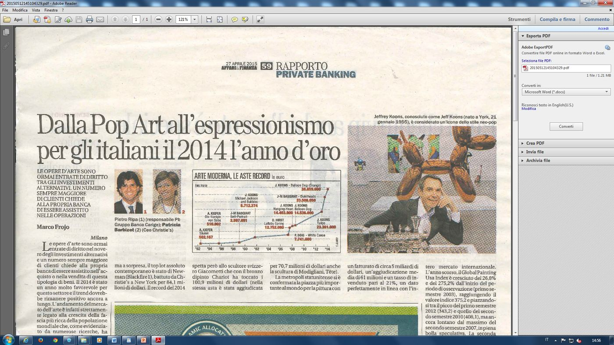{ loading=lazy style="width:68%" }

**LA DOMANDA CHE POSSIAMO FARCI**

È sempre lo stesso schema che si ripete da millenni (capitalismo o non capitalismo, di Toni Negri), con nuovi strumenti, oppure siamo davvero di fronte a qualcosa di diverso?

2:06:54

È un po’ la domanda che si fa Toni Negri, e lui si dà questa risposta: la bellezza, l’assoluto dell’opera d’arte, non si esprime se non quando si fa comunità, quando il contenuto dell’opera d’arte è immerso in un progetto comune di una moltitudine: da qui il titolo *Arte e multitudo*. «L’arte», dice Toni Negri, «non ha mai costituito uno spazio di costruzione estetica autonomo rispetto alla storicità dell’essere insieme» – vedete anche la terminologia filosofica – «e alla materialità delle tecnologie della produzione e della vita. È sempre stata dentro questi mondi, vi ha lavorato, costruendoli e spesso anticipandoli»: perché l’artista è quello che ha la visione, l’intuito, che lo rende appunto artista.

**L’ARTE NON È IL PRODOTTO DELL’ANGELO**

*Sintesi dei passi di Toni Negri riportati nelle slide*

Che cos’è allora la bellezza? L’arte è lavoro vivente, e quindi invenzione di singolarità, di figure e oggetti singolari, di segni; ma questi atti espressivi non raggiungono la bellezza e l’assoluto se non quando i segni attraverso i quali si esprimono «si fanno comunità», compresi e contenuti dentro un progetto comune. Il bello è un’invenzione di singolarità che circola e si rivela come comune nella molteplicità dei soggetti che partecipano alla costruzione del mondo: «L’arte, in questo senso, è moltitudine».

«L’arte non ha mai costituito uno spazio di costruzione estetica autonomo rispetto alla storicità dell’essere insieme e alla materialità delle tecnologie della produzione e della vita. È sempre stata dentro questi mondi, vi ha lavorato, costruendoli e spesso anticipandoli.»

**VEDIAMO ORA, IN CHIUSURA, ALCUNE OPERE LA CUI FILOSOFIA INTERNA POTREBBE ADATTARSI AL PENSIERO DI TONI NEGRI**

Il divenire dell’arte nel suo essere al contempo «merce e attività», che «sta dentro a un modo di produzione specifico e lo riproduce, o meglio, lo produce e lo contesta, lo subisce e lo distrugge»; la cui attualità risiede, in primo luogo, proprio nella sua capacità di formulare un pensiero critico nel presente, che permetta di immaginare insieme trasformazione sociale e sperimentazione artistica, creatività e comune, arte e moltitudine.

Rossella Biscotti, Oliver Ressler, Richard Serra.

2:08:06

In chiusura, due o tre opere per far vedere qualche lavoro che si può attagliare a questo concetto che ho cercato di esprimere: una produzione che in qualche modo riproduce il meccanismo del sistema capitalistico, lo subisce, ma anche lo distrugge e al tempo stesso lo contesta. Ho preso tre artisti citati da Toni Negri: Rossella Biscotti, Oliver Ressler e Richard Serra; Richard Serra forse è il più conosciuto. Rossella Biscotti è giovane, è nata a Molfetta nel 1978, ha vinto il Premio MAXXI nel 2010 e ha esposto a dOCUMENTA (13) a Kassel, alla Biennale di Venezia. Oliver Ressler è anche lui del 1970, abbastanza giovane, un filmmaker austriaco, che vive e lavora a Vienna. Richard Serra è forse il più conosciuto, un po’ più anziano: è un artista, scultore (San Francisco, 1939 – New York, 2024), che ha partecipato a tutti i movimenti d’avanguardia del Novecento.

**GLI ARTISTI**

*Rossella Biscotti* (Molfetta, 1978; vive e lavora a Bruxelles). Premio MAXXI nel 2010, ha esposto a Manifesta 9 (Genk, 2011), a dOCUMENTA (13) (Kassel, 2012) e alla Biennale di Venezia (2013); per il Museion di Bolzano ha realizzato un progetto sul lager di Bolzano (2008).

*Oliver Ressler* (Austria, 1970; vive e lavora a Vienna), artista e filmmaker, produce installazioni, progetti di arte pubblica e film su economia, democrazia, riscaldamento globale, forme di resistenza e alternative sociali; ha collaborato, tra gli altri, con Zanny Begg e con il politologo Dario Azzellini, e ha partecipato a più di 150 mostre, tra cui le biennali di Praga, Siviglia, Mosca e Taipei e la 55ª Biennale di Venezia (Padiglione delle Maldive, 2013).

*Richard Serra* (San Francisco, 2 novembre 1939 – New York, 26 marzo 2024), artista, scultore minimalista e videoartista statunitense, noto per le sue opere in lastre di metallo; ha fatto parte del movimento della *Process Art*.

2:09:29

Questa, per esempio, è un’esposizione che c’è stata nel 2013 a Palazzo Strozzi, a Firenze, alla Strozzina, intitolata *The Right of Passage* (film HD di 19 minuti di Zanny Begg e Oliver Ressler), cioè il rito di passaggio. È una performance video che raccontava, in questo periodo in cui ci sono tanti migranti, le persone che migrano da un mondo all’altro prive di quella che per noi è una banalità, ma per loro non lo è: prive di quei documenti. Vedete qui un passaporto, che ci fa intuire che cosa vuol dire l’artista con questo rito di passaggio: una mano che si tende verso questo passaggio, per afferrarlo. È un po’ questo il senso di questa tipologia di arte espressa da Ressler.

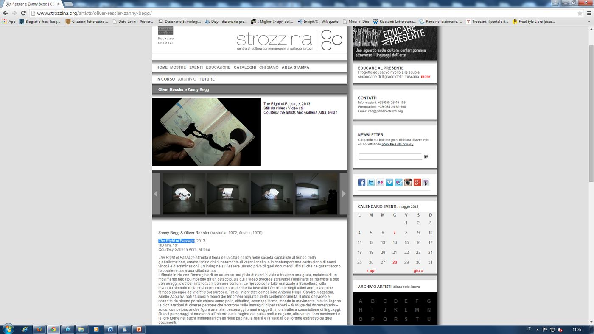{ loading=lazy style="width:55%" }

**ZANNY BEGG E OLIVER RESSLER, THE RIGHT OF PASSAGE (2013)**

*Film HD, 19’ – Strozzina, Palazzo Strozzi, Firenze*

Il film affronta il tema della cittadinanza nelle società capitaliste al tempo della globalizzazione, caratterizzate dal superamento di vecchi confini e dalla contemporanea costruzione di nuovi vincoli e discriminazioni: un’indagine sull’essere umano privo di quei documenti ufficiali che ne garantiscono l’appartenenza a una cittadinanza.

2:10:45

Questa invece è di Rossella Biscotti: ha recuperato i calchi delle cinque teste di bronzo di Vittorio Emanuele III e di Benito Mussolini (progetto «Le teste in oggetto», 2009), che dovevano essere esposte nel 1942 all’Esposizione universale di Roma, poi annullata; negli archivi è andata a recuperare queste teste, e le fa vedere ora in questo contesto, con l’idea di fare sempre i conti con la storia da cui proveniamo. E si ricollega al discorso che faceva prima Toni Negri: l’opera d’arte è sempre frutto della storia e dell’opera continua dell’uomo; ha un po’ questo senso.

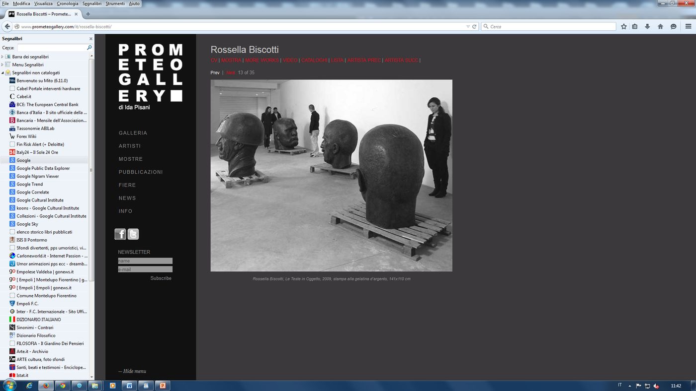{ loading=lazy style="width:38%" }

**ROSSELLA BISCOTTI, LE TESTE IN OGGETTO (2009)**

Tra le opere in mostra, i calchi del progetto «Le teste in oggetto» (2009): le cinque teste di bronzo di Vittorio Emanuele III e Benito Mussolini realizzate nel 1942 per l’esposizione universale di Roma, poi annullata.

La natura dei lavori esposti rivela molto sul modo di lavorare di Rossella Biscotti e conferma la sua predilezione per ricerche aperte, progressive. Tutte le opere esposte hanno una innegabile componente socio-politica e propongono un confronto con la storia: un confronto che non è semplice rievocazione. Come recita il titolo della mostra, citazione del filosofo francese Jacques Derrida («l’avvenire non può che appartenere ai fantasmi»), riconsiderare gli eventi passati vuol dire rappresentarli qui e ora, e quindi riflettere sul nostro presente, oltre che sul nostro passato.

2:11:41

In chiusura, Richard Serra. Questo è *Fernando Pessoa*, l’opera si chiama così: è un muro di acciaio dove si incontrano tutte le contraddizioni dell’uomo moderno. Quest’opera fu esposta alla Biennale di Venezia del 2001: Negri, alla Biennale del 2001, apprezzò in generale le «splendide forme metalliche» di Serra; «Fernando Pessoa» risulta un’opera del 2007-2008, e Toni Negri, per descriverla, usa queste parole: «sorta di giganti metallici che somigliavano a dei circuiti incaricati di esplorare l’essere, di seguirne le nervature generative». Questo è un muro che impersona l’opera d’arte come la vediamo oggi, e che si può sicuramente ricollegare al discorso dell’arte collettiva: è interessante tener conto che l’arte non sia solo il frutto dell’angelo, come abbiamo detto, ma espressione di un movimento e di una partecipazione più collettiva, rappresentativa di tutti noi. Su questo, Lorenzo, ti lascio la parola per le tue conclusioni: so che non sono facili stasera, visto l’argomento che abbiamo trattato, ma sono convinto che qualche conclusione ce la farai.

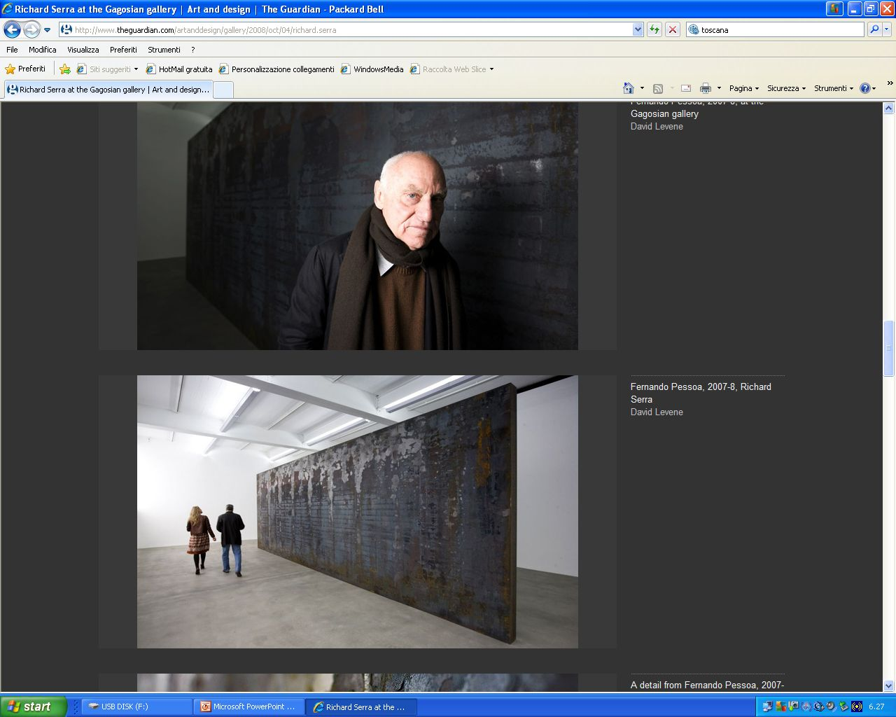{ loading=lazy style="width:47%" }

**RICHARD SERRA, FERNANDO PESSOA**

Un’installazione monumentale che consiste in un muro di ferro nero: ci parla del dolore come condizione umana necessaria, e ci fa sentire meno soli.

**TONI NEGRI E LA BIENNALE DEL 2001**

Di quell’esperienza veneziana Negri salva solo «i totem e i blocchi umani» di Joseph Beuys e le «splendide forme metalliche» di Richard Serra, «sorta di giganti metallici che somigliavano a dei circuiti incaricati di esplorare l’essere, di seguirne le nervature generative».

2:13:15

Lorenzo Poggi Sì, sì, grazie. Riprendiamo un attimo il nostro discorso e facciamo una piccola conclusione: proviamo a dare una definizione, una descrizione. L’arte in fondo ha sempre fatto, e fa, una cosa: esibisce in modo esemplare quegli aspetti che sono comuni al modo comune di percepire. Fa una specie di selezione, di scelta, esibisce particolari della nostra conoscenza sensibile; e in quest’esibizione ci si ritrova, e l’arte diventa anche collettiva, diventa anche partecipazione della nostra conoscenza sensibile – perché abbiamo detto: *aisthesis*, senso, percezione. Però questo senso e questa percezione, abbiamo visto, oggi non hanno più valore veritativo, perché il valore veritativo è demandato ad altre forme; però continuano ad avere un forte valore. Perché? Perché il senso, la sensibilità, è estremamente importante.

2:15:10

*Senso*: pensate alla parola. La parola non ha un solo significato, ne ha molteplici, e tutti estremamente interessanti. Senso non è solo percezione: diciamo anche che un percorso ha un senso, ha una direzione – ci sono anche i sensi vietati; ma senso ha anche un altro significato, più profondo: senso vuol dire ha valore, ha significato. Un’azione che per un individuo ha un grande senso, un forte senso, o una vita che ha senso, vuol dire per noi una vita che ha delle motivazioni etiche, delle motivazioni profonde, che ha un valore. Quindi il senso è un elemento fondamentale della nostra natura di esseri umani, che non può essere messo in seconda linea rispetto alla razionalità concettuale e considerato un elemento dipendente.

2:16:39

Ma il senso – due cose rapidissime – dipende moltissimo dagli strumenti di relazione che abbiamo con il mondo. Gli animali – abbiamo visto lo scimpanzé che fa il pittore, le elefantesse pittrici – l’animale ha un senso molto selettivo. Anche gli animali hanno dei sensi ed elaborano dei comportamenti, ma hanno sensi estremamente selettivi: fanno arrivare all’elaborazione mentale soltanto alcuni stimoli, alcune sensazioni, quelle che servono istintivamente alla vita. L’uomo è invece un animale imperfetto, nel senso che non ha un istinto così perfezionato e così selettivo: gli arriva tutta la molteplicità delle sensazioni, la sensazione è vastissima, e quindi deve operare artificialmente la selezione, di volta in volta, dei sensi, quelli che danno un senso umano all’esperienza. L’esperienza ha un senso, ha un significato, ha un valore; e l’arte diventa anche esibizione di un possibile senso dell’esperienza umana.

2:18:31

E quindi acquista un valore veritativo. Perché? Perché è in continuo mutamento ed è continuo stimolo, perché non si può avere una volta per tutte la classificazione e la determinazione di quello che è il senso della sensibilità in generale – scusate il gioco di parole: non lo si può definire una volta per tutte. Quando parlavamo delle immagini, dicevamo che l’immagine, rispetto alla parola scritta, ha un’enorme vastità. Perché? Perché tutte le volte che la guardiamo, anche a distanza di tempo, può assumere per noi significati diversi; muta qualcosa. Noi guardiamo le immagini di Nefertiti, che sono state fatte tanto tempo fa, guardiamo le immagini della preistoria, e hanno per noi ancora un significato sensibile ed esercitano ancora su di noi un fascino; lo stesso non farebbero altre descrizioni del mondo della sensibilità, che sarebbero completamente superate. Perché? Perché ognuna di queste è l’esibizione di un modo umano di percezione.

2:20:00

Il percepire l’esperienza della vita e le elaborazioni successive della conoscenza, compresa la conoscenza scientifica quando si rinnova, da parte degli scienziati che vogliono essere innovatori, devono ripartire da questo punto di vista. La sistemazione immaginativa che si fonda sulla percezione sensibile è il primo passo verso l’ordinamento dell’esperienza del mondo, dell’esperienza umana. Quando mettiamo in secondo piano tutto questo, quando mettiamo in secondo piano l’esperienza sensibile, questo aspetto dell’esistenza, mettiamo in secondo piano l’umanità nella sua essenza profonda. E allora avremo un’economia tecnico-scientifica che ignora le condizioni degli uomini, avremo la ricerca di risultati che poco hanno a che fare con l’esistenza umana. Il *bios*, la vita, viene trascurato, non ha più valore; mentre l’esperienza, nel suo essere fondante, l’essere dell’uomo nel mondo, le risposte alle domande fondamentali, venivano dall’arte.

2:21:43

L’arte oggi, abbiamo detto, ha perduto questo suo valore veritativo; è diffusissima, però, nella sua parte estetica, proprio a causa del mercato, del fatto di essere diventata collaboratrice della *fiction economy*, cioè dell’economia finzionale: il prodotto si vende non tanto perché risponde a un bisogno o soddisfa un’esigenza, ma perché dà una soddisfazione, ci identifica, è una vetrina. Dicevamo l’altra volta: il SUV è una vetrina nella quale io mi mostro al mondo; non ha importanza se è scomodo, se è un po’ più duro, se ingombra, se consuma: che importanza ha? La vetrina è la vetrina. Quindi la parte immaginativa, la parte finzionale dell’economia, assorbe moltissimo di quelle che sono le funzioni dell’immagine, e quindi anche dell’arte intesa come produttrice di immagini, che è diffusissima. Le sfilate di moda si fanno nei monumenti: si affittano spazi notevoli dal punto di vista storico e artistico per dare valore alle sfilate di intimo o di vestiti da sera. Avrete sicuramente visto che nei musei si ospitano manifestazioni legate alla commercializzazione di prodotti.

2:23:42

Quindi assistiamo nel nostro tempo a una diffusione e a una frammentazione di quell’esperienza percettiva del mondo che l’arte esibisce in modo esemplare per rendere conosciuto il mondo, e che non ha più valore veritativo, ma assume sempre più valore commerciale. La bellezza serve a fare gli oggetti, è ormai legata alla commercializzazione di qualsiasi oggetto: nemmeno le scatole del riso o le confezioni del sale possono essere disegnate e fatte senza un contributo estetico, e così qualsiasi altro oggetto. Quindi da una parte l’estrema frammentazione e diffusione, la perdita del valore fondamentale di elemento trainante della percezione umana.

2:24:48

E a questo si aggiunge un altro elemento fondamentale. Dicevamo prima che l’uomo ha questo tipo di sensibilità; ha fatto qualcosa di più nella sua evoluzione: ha creato delle protesi, delle protesi della sensibilità. La macchina fotografica è una protesi della sensibilità della vista: ciò che io vedo con un grandangolo, con un teleobiettivo o con un apparecchio fotografico applicato a un microscopio non lo potrò mai vedere naturalmente con i miei occhi. Protesi, ma anche protesi nel modo di rappresentare il mondo. Marshall McLuhan parla di «galassia Gutenberg» (dal titolo del suo libro del 1962): da quando la stampa ha permesso di eternare e diffondere in un certo modo le percezioni e le visioni del mondo, è mutato il modo di vedere il mondo e di percepire. Il mezzo, il medium, è il contenuto, è il messaggio. Se il medium è la scrittura lineare, io mi alleno fin da piccolo a percepire la relazione fra ciò che viene prima, a sinistra, e ciò che viene dopo, a destra, e ciò che viene prima, a sinistra, condiziona il significato di ciò che viene dopo. Si parla di sensibilità e di percezione: tutti sanno leggere, tutti si allenano a leggere, e tutti danno per scontato che la relazione causa-effetto sia una relazione di questo tipo, temporale: la temporalizzazione dell’esperienza.

2:26:53

Pensate che cosa è successo negli ultimi tempi. È successo che l’esperienza è diventata fiction: non c’è più bisogno di fare una ripresa dal vero e mettere gli attori all’interno di un paesaggio per fare un film, lo posso costruire interamente, artificialmente, con i mezzi elettronici. Quindi posso saltare l’esperienza. I nostri bambini sono molto più sensibili al paesaggio dei *games* con cui giocano al computer che al paesaggio naturale che li circonda, perché è quello il paesaggio di cui hanno esperienza. Quindi l’esperienza, il senso, il dare senso alla vita, è diventato ai nostri giorni sempre più slegato dall’elemento veritativo, che è affidato alla scienza, e sempre più legato a questo tipo di costruzione artificiale, e soprattutto programmabile e prevedibile. Perché l’esperienza sensibile, quella che si dovrebbe esemplificare e conciliare nell’arte – nelle poche volte che ciò avviene – è variabile, è contingente, non la si può fare mai una volta per tutte, perché l’esperienza segue la vita, e la vita scorre, è nel tempo, non può essere determinata una volta per tutte: qui sta l’umanità. Invece qua, dal punto di vista della ricostruzione, della rinuncia alla verità effettiva in favore della costruzione artificiale, c’è la prevedibilità, la sicurezza. Nel mondo costruito piove quando mi fa comodo, tutto è previsto, tutto è programmato, l’intera esperienza è preordinata e programmabile: non ha più nulla della vera esistenza e della vita.

2:29:45

E vengo alla conclusione, sennò facciamo troppo tardi, anche dopo cena. Molti dicono che questo sia un male, un difetto. Io a questo punto vi do la mia opinione, perché a questo punto non ci sono più teorie, sono solo opinioni, pareri: non facciamo quelli che hanno già la verità in tasca, dicendo se sia un male o no; è un carattere del nostro tempo. Il fare arte, in questo senso, nel nostro tempo, con queste protesi della sensibilità – va bene, chiamiamole così, così ci si capisce –, è diventato frammentario, è diventato tutto questo. Speriamo che si riesca lo stesso a recuperare da tutto questo che cosa? La funzione fondamentale che l’arte deve avere, cioè dare risposte esemplari, a partire dall’esibizione dell’esperienza – dell’esperienza che ha significato perché si concilia con il concetto e diventa quindi di nuovo qualcosa di conoscitivo, di veritativo, di compiuto – alle domande su che cosa siamo, che cos’è l’uomo nel nostro tempo, qual è il suo senso, qual è il suo destino, come è fatto il mondo umano: non soltanto quello previsto, prevedibile, che risponde a domande che hanno già di per sé implicita la risposta.

2:31:49

Intervento dal pubblico Mi scusi, professore: queste cose erano già state riprese da qualcun altro?

2:32:10

Lorenzo Poggi Stiamo esponendo una condizione che credo sia sotto gli occhi di tutti. Ho citato McLuhan per dire che fra i teorici è uno di quelli che hanno detto che il mezzo espressivo condiziona il contenuto: la nostra esperienza è condizionata fortemente da questo, senz’altro. Però da questo traiamo delle valutazioni; io mi sono permesso di darvi anche una mia valutazione. Ormai siamo al sesto anno di cene: se non siamo ingrassati, perlomeno abbiamo acquisito questo senso.

2:32:55

Paolo Marcucci Va bene, anche questa sera abbiamo finito. Vi ringraziamo di cuore della partecipazione, vi auguriamo una bella estate, e ci ritroveremo in autunno, a ottobre o novembre. Bene, grazie a tutti e buonanotte.

