# Capitalismo e territori

L’economia e il sociale, dai territori al mondo

**Data:** 12 maggio 2026 
**Incontro con:** Ugo Biggeri, Federica Paoletti e Simone Londi

**Interventi:** Paolo Marcucci Pubblico Ugo Biggeri Federica Paoletti Simone Londi Mario Mancini Silva Cioni Rossana

0:00:44

Paolo Marcucci Direi che abbiamo raggiunto l’ora per iniziare. Stasera cambiamo un po’ l’iter delle nostre serate e dei nostri interventi: facciamo tre interventi un po’ più lunghi del previsto, invece di fare due turni come facevamo nelle passate edizioni. D’altra parte è anche martedì, quindi non è giovedì: oggi ci è concesso un po’ tutto.

0:01:05

Allora, accanto a me c’è Ugo Biggeri, fondatore e presidente di Banca Etica – stasera le banche avranno un ruolo importante; c’è Federica Paoletti, direttrice generale di Banca Cambiano; e poi Simone Londi, sempre attento ai temi dell’economia, che ha accettato il nostro invito.

0:01:36

Questa era un po’ la scaletta che avevamo in mente, però la modifichiamo: dopo l’intervento di Federica ci saranno le nostre rubriche di libri e film sul tema della serata, di Mario Mancini e Silva Cioni, che sono in sala. Io dirò due parole di introduzione e poi lascio subito la parola ai nostri ospiti: stasera ho un compito più facile delle altre volte, perché mi tocca solo introdurre gli altri.

0:02:19

Vorrei ringraziare tutti voi di partecipare alle nostre iniziative, perché noi facciamo tutte le nostre attività sotto la Pubblica Assistenza, che è un’organizzazione di volontariato (OdV): quindi tutto quello che riusciamo a fare va a beneficio della nostra comunità.

0:02:42

Tra l’altro, ultimamente abbiamo inaugurato la nuova ambulanza. Approfitto dell’occasione per ringraziare Banca Cambiano, che ci ha onorato di un contributo per la nostra ambulanza; e quindi ogni centesimo delle nostre attività, delle nostre serate, va poi a beneficio delle nostre altre iniziative istituzionali.

0:03:10

Tra le altre attività facciamo anche le visite guidate. Approfitto per dirvi che ci sono due posti disponibili, per chi volesse approfittarne, per la visita che abbiamo organizzato a Palazzo Strozzi di Rothko: è il 23 maggio, ci ritroviamo alle 15.30 con ingresso alle 16 a Firenze. Chi volesse partecipare basta che me lo dica.

0:03:39

Approfitto anche dell’occasione per dire che l’ultimo appuntamento di questa stagione – la nostra stagione va sostanzialmente da ottobre a maggio – sarà l’evento «combo»: faremo pizza, libro e film, con «Il Gattopardo». Questo sarà l’ultimo appuntamento della stagione, e poi ci rivedremo a ottobre.

0:04:05

Veniamo invece al tema di questa sera. Quando abbiamo invitato i nostri ospiti, volevamo mettere insieme il tema dell’economia e del sociale, dai territori al mondo. È un tema forse anche ambizioso, però in qualche modo è quello che ci sta capitando tutti i giorni, perché i grandi accadimenti che la storia sembra aver fatto suoi in questo momento, con delle grandi accelerazioni, riguardano i sistemi economici di tutto il mondo.

**CAPITALISMO E VISIONI DEL MONDO NEI TERRITORI**

In una terra, sempre più grande e sempre più piccola, dove i sistemi economici si stanno sfidando con molte armi (e guerre...) e dove le grandi cose che accadono nel mondo ci passano sopra, è ancora possibile dal basso fare qualcosa?

Ne parliamo appunto con i tre nostri ospiti, con il contributo che ognuno di loro ha, partendo dall’attività che svolgono.

Ugo Biggeri – scuola di economia e docente.

Federica Paoletti – banca territoriale, che è un pilastro del sistema economico locale.

Simone Londi – sindaco di Montelupo Fiorentino che del territorio è il primo e ultimo rappresentante dell’articolazione dello Stato.

0:04:55

Attualmente, per esempio, nella nostra interpretazione del mondo si può dire che il capitalismo, nelle sue varie forme, è un po’ il sistema economico emergente, anche là dove prima era considerato il socialismo. Quindi: il capitalismo liberale – tanto per capirsi e per introdurre un po’ il tema di stasera – è quello che c’è in Europa e in America; il capitalismo con il sottoprodotto del liberismo, più in America; poi il capitalismo sociale di mercato, che è tipico delle socialdemocrazie europee; e poi il capitalismo di Stato, o di regime, che è quello dell’Asia – a grandi linee, naturalmente: la Cina, l’India, la Russia. Sono questi. I vecchi sistemi economici non esistono più, e questi quattro raggruppamenti sono in guerra tra di loro in questo momento. Lo vediamo nelle guerre in corso, che sentiamo tutti i giorni alla televisione o sui giornali.

**I SISTEMI ECONOMICI NEL MONDO**

**1\. Capitalismo liberale**

Il mercato è libero e autoregolato. La proprietà privata è la base del sistema: individui e imprese decidono autonomamente cosa produrre, come produrlo e a quale prezzo venderlo. Lo Stato interviene il meno possibile.

**2\. Neoliberismo**

Non è un sistema economico distinto, ma una corrente ideologica che dagli anni Ottanta ha ridefinito il capitalismo liberale: privatizzazioni, deregolamentazione, riduzione dello Stato sociale, apertura dei mercati finanziari.

**3\. Capitalismo sociale di mercato**

Nato nell’Europa del dopoguerra, coniuga il mercato libero con un forte sistema di protezione sociale. Lo Stato interviene per correggere le distorsioni del mercato e garantire diritti universali.

**4\. Capitalismo di Stato (o di regime)**

Il mercato esiste ma lo Stato ne controlla i settori strategici attraverso imprese pubbliche, partiti di governo o élite politiche. La proprietà formalmente privata coesiste con un controllo politico pervasivo.

**5\. Economia mista**

Nessun sistema esiste in forma pura. L’economia mista descrive il modello reale adottato dalla maggior parte dei paesi: settore privato e settore pubblico coesistono, con pesi variabili a seconda dei paesi e dei periodi storici.

**6\. Comunismo ed economia pianificata**

La proprietà privata dei mezzi di produzione è abolita. Lo Stato (o il partito) pianifica centralmente tutta la produzione e la distribuzione. L’obiettivo dichiarato è l’uguaglianza e la fine dello sfruttamento del lavoro.

**7\. Socialismo democratico**

A differenza del comunismo, il socialismo democratico non prevede la rivoluzione né la pianificazione totale. Punta a trasformare il capitalismo dall’interno, attraverso riforme democratiche e maggiore peso del settore pubblico.

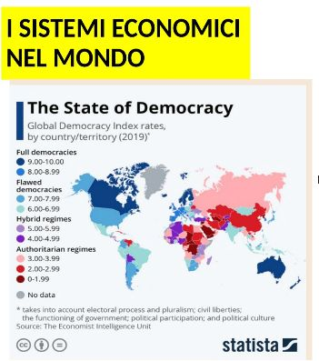{ loading=lazy style="width:44%" }

0:06:22

Ma questo che vuol dire? Vuol dire che anche noi ne subiamo gli effetti: li subiamo dal punto di vista della banca, dal punto di vista del sindaco dei nostri territori, e dal punto di vista della «Londa School of Economics» di cui Biggeri è il presidente.

0:06:52

Secondo l’ultimo studio del Fondo Monetario Internazionale, all’Italia la guerra che c’è ora sullo stretto di Hormuz costerà all’incirca 2.270 euro a famiglia; e questo senza contare i danni umani e morali. Anche solamente in termini di impatto economico, avrà un impatto all’incirca di 2.300 euro. Questo per dire come si fa a ricondurre i grandi movimenti internazionali al nostro tema di oggi, che è l’economia locale.

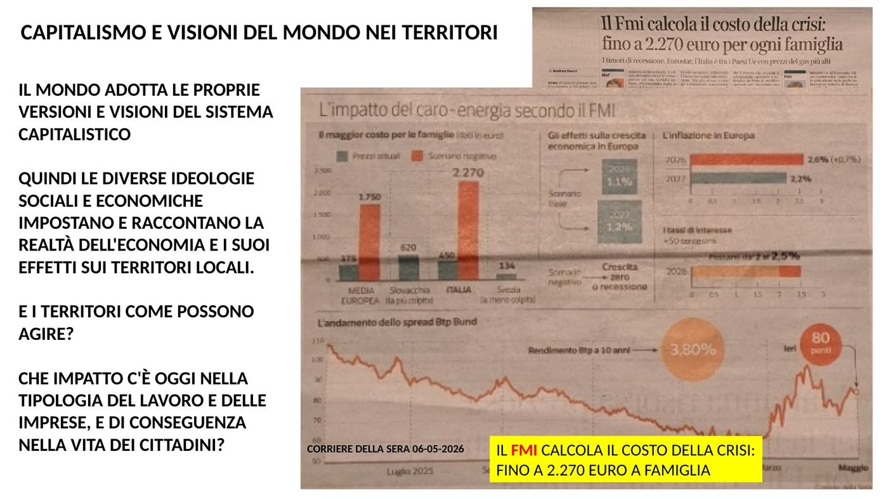{ loading=lazy style="width:59%" }

0:07:36

Fatta questa introduzione, lascio la parola a Ugo, poi seguirà Federica Paoletti e poi il nostro Simone Londi, sindaco di Montelupo. Prego, Ugo.

0:08:00

Ugo Biggeri Intanto buonasera a tutti e a tutte. Vi dico subito una cosa sulla Londa School of Economics, perché in parte è legato a quello di cui vogliamo parlare. È Londa, non è Londra – e mi è già capitato che qualcuno, quando ho detto che sono il direttore scientifico della Londa School of Economics, pensasse a tutt’altro. Londa è un comune di 1.800 abitanti, in mezzo agli Appennini. Io abito a Vicchio, in Mugello, che non è che sia tanto più grande; Londa invece è in Val di Sieve. Insieme a Chiara Nenci di LAMA – la cooperativa, l’impresa sociale dove lavora Chiara, che alcuni di voi conoscono e che ha contribuito a organizzare questo incontro – a un certo punto ci siamo detti: si parla tanto di sostenibilità, si parla tanto delle cose di cui si parla oggi, però forse la soluzione del problema non può arrivare da dove il problema è stato creato, cioè dalle grandi scuole di pensiero dell’economia mondiale, di cui per esempio fa parte la London School of Economics.

0:09:26

Il gioco nasce un pochino da questo: quando c’è stata, nel 2007, la grossa crisi finanziaria, è rimasta famosa la battuta della regina Elisabetta, che andò all’inaugurazione di un anno accademico e disse: «Ma com’è che voi, che siete la migliore scuola di economia del mondo, questa crisi non l’avevate prevista?». E penso che le girassero – non si dice che cosa, perché era una regina – perché il governo inglese aveva appena tirato fuori 47 miliardi per salvare la Royal Bank of Scotland. Quindi non è che non abbia funzionato qualcosa: abbiamo dovuto sborsare due finanziarie per salvare il sistema bancario inglese. Questa era un po’ la battuta. Quindi forse qualche spunto – non la pretesa di chissà che cosa, ma qualche spunto – può venire da quelle aree che non sono al centro dell’attenzione: anche dai piccoli comuni, dalle aree interne in particolare. E ci torniamo, su questo.

0:10:28

Voglio andare subito al punto che collega la cosa ardita di mettere insieme i territori con le visioni economiche mondiali. Vi faccio una domanda – non importa che rispondiate, però pensateci: quando pensiamo all’economia, a che cosa pensiamo? Ci hanno bacato la testa per farci pensare solo all’economia privata di mercato, cioè al mercato privato. Noi pensiamo all’impresa: che per carità, è una cosa santissima, è bene che ci sia, ma l’economia non è soltanto l’impresa.

0:11:14

C’è una cosina che sicuramente il vostro sindaco Simone conosce bene, e si chiama economia pubblica: che non è marginale, è fondamentale. Senza l’economia pubblica non esiste il mercato privato, perché l’economia pubblica – al di là del fatto che possa spendere tanto o poco – costruisce quell’infrastruttura che consente al libero mercato di esistere. Se non ci sono i tribunali, se non c’è la finanza, se non c’è la polizia, se non c’è la certezza che un contratto una volta firmato va rispettato, e che tutti operano rispettando le stesse regole – e questo non può che garantirlo l’economia pubblica, lo Stato, con le norme ma anche con gli investimenti, quindi con le spese che fa – il libero mercato non esiste. Perché il libero mercato funziona quando tutti siamo liberi di competere dentro le stesse regole e abbiamo l’iniziativa imprenditoriale libera.

0:12:16

Sì, però senza l’economia pubblica non esisterebbe l’economia privata. Questa cosa non la insegnano all’università e non ce l’abbiamo in testa neanche noi: è facilissimo parlare malissimo dell’economia pubblica, protestare sulle tasse, arrabbiarsi perché le cose non funzionano – ed è giusto arrabbiarsi se le cose non funzionano. Però attenti: senza l’economia pubblica, senza lo Stato, non esiste il libero mercato; esiste qualche altra cosa. La Thatcher diceva che non esiste la società, esistono gli individui; io direi il rovescio: senza società non c’è mercato. E questo lo diceva anche Adam Smith, quando parlava della mano invisibile – magari qualcuno l’ha sentita nominare.

0:12:58

Lui diceva: ci si affaccia sulla piazza del mercato; la piazza del mercato è in città, ci sono i negozi intorno, c’è la chiesa da una parte, c’è il comune dall’altra; il mercato agisce in libertà, ma c’è una mano invisibile che non sapeva definire, ma sapeva cos’era – ed è la società. È la società che fa sì che il macellaio... È vero che non ti vende la carne perché ti vuole bene – è l’esempio di Adam Smith – ma perché vuole fare quattrini; però è anche vero che, se ti vende una carne che fa schifo, sa che dopo un po’ non venderà più nulla. Ed è questa mano invisibile che lo costringe a vendere della carne almeno decente: almeno finché c’è questa mano della società che controlla.

0:13:46

Quindi esiste anche l’economia pubblica, e poi esiste un’altra economia – qui praticata alla grande, ma anche questa non si studia nei libri – che è l’economia della reciprocità, l’economia del dono, l’economia della cura. Quante cose probabilmente tanti di voi fanno senza essere pagati per farle! Immagino che questa sia un’organizzazione di volontariato, un’APS o una OdV, quindi ancora di più… ci saranno i volontari.

0:14:14

Quante persone ci sono che fanno volontariato? Quella non è economia? Perbacco: tiene in piedi le città, tiene in piedi alcuni servizi essenziali, ci si aiuta l’un l’altro in mille modi. Tutto il mondo del volontariato, ma non solo: banalmente, anche tutto il lavoro di cura dei propri cari, dei figlioli. Lo fanno un po’ più le donne che gli uomini – speriamo che si cambi.

Intervento dal pubblico «Il 75% della cura, nel mondo, è fatta dalle donne».

Ugo Biggeri Esatto.

0:14:52

Eppure, immaginate cosa succede se si dice: va bene, d’ora in avanti non si fa più. A parte che potrebbero almeno arrabbiarsi e dire «facciamo la metà»; ma no, diciamo che non è economia, e quindi non si fa più. Sarebbe un disastro totale, veramente un disastro totale.

0:15:03

Quindi, quando parliamo di economia, la prima cosa, il primo insegnamento che ti viene se sei radicato sui territori, è che l’economia non è solo privata: è anche pubblica, ed è anche economia della reciprocità, della cura. Un’economia tipicamente locale, che si fa a livello molto locale, e che sfugge al PIL e sfugge agli studi dell’università.

0:15:26

All’università si studia che il comportamento economico ideale è quello del perfetto egoista: quindi chi di voi fa volontariato è uno stupido. Evidentemente no. Io ne ho fatto una vita, di volontariato; ancora oggi, per mia fortuna, riesco a fare volontariato per il 50% del mio tempo, perché siamo un’associazione che fa accoglienza e mi tocca occuparmene – io faccio sempre il presidente di qualcosa, quindi tutte le rogne capitano a me. E lo faccio volentieri, e penso sia una cosa bella. Quindi c’è qualcosa di sbagliato nel pensiero economico che ci dice che l’economia è solo privata, che l’economia pubblica è un fardello e che chi fa attività di cura è un cretino. Abbiamo un po’ di cose da rimettere in fila.

0:16:18

Andando ancora più al concreto: è ovvio che oggi abbiamo tante crisi a livello economico che ci fanno dire che il capitalismo non sta funzionando più tanto bene. Una, quella più grossa di tutte, è quella ambientale, perché è irreversibile. Noi siamo abituati a crisi del tipo: mancano i diritti dei lavoratori, fai le lotte, arrivano i diritti dei lavoratori; che arrivino quest’anno o che arrivino fra quindici anni, sì, ci sarà qualche lavoratore sfruttato in più per quindici anni, ma alla fine arrivano. Mentre invece sui cambiamenti climatici, se si aspetta troppo non si torna indietro. Questa è una cosa che non abbiamo capito, ed è veramente drammatica. È il fallimento più grosso: un sistema economico che non è in grado di autocorreggersi di fronte a una catastrofe ormai dimostrata scientificamente.

0:17:17

L’altra crisi è quella sociale. Abbiamo un problema sociale, e non di poco conto. Anche qui, piano piano si è insinuata – inizialmente con un’idea positiva: aiutiamo lo Stato a garantire i diritti di base alle persone. Alla fine anche una pubblica assistenza cosa fa? Garantisce il diritto alla salute, inserita nelle attività pubbliche, quindi coordinata dal pubblico, però come libera iniziativa dei cittadini per garantire dei diritti. Però i diritti non li garantirà mai il libero mercato.

0:18:04

Anche questa cosa non ce la raccontano. Il libero mercato può migliorare alcune cose, ma i diritti no: il mercato funziona se qualcuno compra qualcosa. E se uno è una persona che ha bisogno e non ha risorse, non compra nulla. Se si pensa che questa cosa si risolva senza un intervento dell’economia pubblica, vuol dire che non si garantiscono i diritti. Quindi il libero mercato non è in grado di garantire i diritti fondamentali, sociali, delle persone: che sono tutti diritti che si vivono nei territori.

0:18:37

C’è qualche diritto – non so, il diritto di accedere a internet – che vale a Montelupo come a Londa, a Vicchio o in Uganda, a Kampala. Ma la maggior parte dei diritti – il diritto alla salute, il diritto all’istruzione – li vivi dove sei: almeno per una fase della vita di sicuro, quando sei bambino, oppure quando non ti muovi più perché sei anziano. A casa tua, nel comune dove vivi, devi far valere questi diritti.

0:19:15

Ma se la logica è solo privata, se si pensa che questi diritti si debbano garantire con una logica privata, intanto di sicuro si forza lo Stato a spendere soldi in una certa direzione; e poi – non so se c’è l’ospedale a Montelupo, ma state tranquilli – da Vicchio, dal Mugello, da queste valli dovranno andare tutti a Firenze, all’ospedale. Ma quello non è garantire il diritto alla salute di tutti quanti, perché oltre una certa distanza il diritto non lo stai garantendo. Lo stesso vale con le scuole che chiudono. Quindi i diritti si giocano localmente; e localmente si può giocare grazie all’economia della reciprocità, del volontariato, delle forme di supporto all’economia pubblica per garantire i diritti. Ma se non si mettono nello schema questi altri due aspetti – l’economia pubblica e l’economia delle comunità, dell’impegno comunitario – ecco che c’è un cortocircuito.

0:20:09

Quindi del capitalismo, secondo me, dobbiamo cambiare completamente la visione. E guardate, qualcosa è successo. Poi mi fermo, così magari si può anche dibattere – come vedete a me piace, quindi parlo tanto. Qualcosa è successo, perché ci sono stati dei timidi approcci, proprio a partire dalla finanza sostenibile. Ce ne siamo già scordati tutti, ma nella scorsa legislatura la Commissione Europea ha fatto questa cosa che si chiama Green Deal. Anche lì è diventata subito una cosa politica – c’è chi è assolutamente contro perché le macchine elettriche non le vuole, perché si va sul dettaglio di quello che succede e non si vuole vedere il resto. L’idea di fondo era: forse, se qualcosa non va nell’economia, dobbiamo riaggiustarla.

0:21:05

Questa cosa viene anche dall’ONU: l’ONU ha fatto gli obiettivi di sviluppo sostenibile, i Sustainable Development Goals. Io ho fatto volontariato nel mondo della cooperazione allo sviluppo: quando erano partiti i primi obiettivi di sviluppo, si parlava agli africani, agli asiatici, all’America Latina dicendo quali erano gli obiettivi che loro dovevano raggiungere per essere sviluppati come noi. Se oggi andate a guardare i 17 obiettivi di sviluppo, ce n’è un sacco che riguardano noi: l’aria pulita, i cambiamenti climatici, l’acqua pulita, sistemi di consumo e di produzione sostenibili, città sostenibili. Riguardano tutti noi. E questo implicitamente vuol dire che c’è qualcosa che non va: non è che il nostro sistema funziona e gli altri lo devono copiare; no, dobbiamo cambiare anche noi.

0:21:57

E l’Unione Europea cosa ha fatto? Ha detto: bene, definiamo la finanza sostenibile, poi facciamo un programma per dire come si devono comportare tutte le imprese. Poi, siccome sono dei maghi, hanno reso il tutto un incubo burocratico – quindi non ne sto parlando bene – però l’idea di fondo è quella di un legislatore che dice: fermi tutti.

0:22:22

Come del resto è scritto nella nostra Costituzione, e ce ne dimentichiamo: sulla libertà di fare impresa, la nostra Costituzione dice che si può fare impresa a patto di non fare danni sociali e di non fare danni ambientali. Questo «a patto di» ce lo siamo scordati. L’Unione Europea dice almeno *do no significant harm*: almeno, quando fai impresa, non fare danni considerevoli, cerca di ridurre il danno. Che è completamente l’opposto di quello che, di nuovo, si insegna all’università. Si dice: quando fai impresa non devi massimizzare il profitto, devi cercare di non fare danno; se sei sicuro di non fare danno, allora massimizza il profitto, cerca di fare più soldi che puoi – però prima di tutto non devi fare danno.

0:23:09

Questa cosa è già finita nel dimenticatoio: anche se la legge non è stata abrogata, semplicemente non viene applicata, perché ora abbiamo ReArm Europe. Ci dobbiamo armare, così poi spareremo alle nuvole quando avremo il cambiamento climatico, che farà venire le ondate di calore o il deserto a Montelupo.

0:23:36

Quindi effettivamente dobbiamo cambiare la visione del capitalismo, rimettendo dentro l’economia pubblica e l’economia del dono, con la dignità e con il valore che hanno, e cominciando a dire: si può fare economia, però i limiti vanno rispettati.

0:23:59

D’altra parte non è strano – e qui voglio essere un po’ positivo. Quando è finita la schiavitù... la schiavitù ha fatto muovere l’economia globale per un paio di secoli; a un certo punto l’hanno abolita, nel 1830 o giù di lì (non me lo ricordo con precisione: guardate su internet, si trova). Perché l’hanno abolita? Probabilmente perché erano cambiate tante cose, forse non conveniva più economicamente, e sicuramente non era più culturalmente accettata. E quindi a un certo punto è stata abolita. Non è che la schiavitù sia finita perché c’era la responsabilità d’impresa degli schiavisti, che facevano regolamenti per frustare un po’ meno gli schiavi: a un certo punto è arrivato lo Stato e ha detto «schiavi, finito».

0:24:43

E che cosa succedeva all’epoca? Sembrava che l’economia mondiale dovesse crollare. Gli Stati del Sud hanno fatto una guerra civile, la famosa guerra civile degli Stati Uniti, la guerra di secessione. Invece che cosa è successo con la fine della schiavitù? Che in realtà hanno cominciato ad avere operai, a dare lavoro a più persone e ad aumentare la produttività. Stessa cosa quando, alla fine della rivoluzione industriale, arrivano i diritti per gli operai: un numero massimo di ore settimanali, le ferie, un minimo di garanzie. Di nuovo sembrava che il mondo dovesse crollare; in realtà è aumentata enormemente la produttività del lavoro.

0:25:28

Mettere dei limiti – non puoi avere gli schiavi, non puoi sfruttare troppo gli operai – ha generato innovazione. I limiti generano innovazione. Invece ci hanno presentato il Green Deal come un insieme di limiti che ci fanno paura. Ma perché non hanno fatto delle cose chiare: hanno fatto un milione di piccole regoline. Se un giorno diranno «entro quindici anni non si può più estrarre petrolio», non morirà il mondo: tutti i migliori cervelli dell’umanità saranno pagati per trovare delle soluzioni, e le soluzioni arriveranno. Perché i limiti generano innovazione.

0:26:11

Questo è uno dei principi che abbiamo alla Londa School of Economics: che i limiti non sono una cosa negativa, generano innovazione, generano cambiamento, generano un futuro diverso. Quindi è possibile – perché è già successo – mettere dei limiti che sembrano assurdi. Chiaro, vanno gestiti: non si deve far pagare tutto ai più poveri. E ci sono anche studi secondo cui chi sta inquinando di più sono le persone straricche: quindi basterebbe fermare l’inquinamento dei più ricchi, piuttosto che quello delle persone che sono qui in sala.

0:26:43

Altra cosa: ci sono un sacco di soldi. Si pensa che non ci siano i soldi; i soldi ce n’è una montagna, ce ne sono tantissimi, solo che non si tassano, dove sono. È fuori moda, ma bisogna tassare i ricchi: perché se non tassi i ricchi, per lo Stato è più facile tassare tutti – poco, non tanto poco: il 46% a tutta la popolazione. Ma i ricchi non vengono tassati al 46%: Bezos non paga il 46% sul suo reddito, paga zero, perché riesce a contrattare – lui è un grande creatore di posti di lavoro, di economia. Paga veramente zero: non è che paga poco.

0:27:28

I soldi vanno presi dove sono, vanno tassati i ricchi. Se qualcuno di voi... – ora c’è anche una direttrice qui, quindi forse lei è più brava di me – ma se qualcuno in sala avesse due milioni di euro da investire, o anche dieci, venga da me e da Federica e gli diamo dei consigli ottimi. Però, anche senza avere dieci milioni e senza bisogno di fare questo scherzo: se uno di voi ha dieci milioni e va a investirli, dove finiscono questi dieci milioni? Non è che vanno a Montelupo – una minima parte. E nemmeno in attività produttive: non vanno a finanziare un artigiano o una fabbrica. Vanno tantissimo nei mercati speculativi internazionali, nei derivati, nei giochi sugli scambi di valute. Quindi non creano economia.

0:28:30

E questa roba qui è tassata pochissimo. Allora tassiamo lì, perché lì ci sono veramente tantissimi miliardi: è una frazione enorme del PIL globale – intorno al 20% del PIL globale è solo quello che si paga per fare questi derivati. I derivati sono come delle assicurazioni, quindi diciamo i premi assicurativi che si pagano per fare queste scommesse.

0:28:52

Quindi i soldi ci sono: bisogna mettere dei limiti e bisogna avere il coraggio di andare a prendere i soldi dove sono, dai ricchi, e di cambiare i mercati finanziari. In questo momento questa cosa sembra detta da un alieno arrivato da Marte, perché assolutamente nessuno... però prima o poi ci si arriva, io ne sono convinto.

0:29:14

Nel frattempo, quello che uno può fare è continuare a fare tanto a livello locale, con la consapevolezza che ci sono più livelli di economia, che i soldi ci sono, che bisogna tassare i ricchi e bisogna bloccare i derivati. Ma poi, chi si dà da fare nel locale, chi si dà da fare facendo economia civile, economia di comunità, sta contribuendo a resistere a un capitalismo che invece ignora il dono. Lo stesso vale per chi riesce a fare impresa a livello locale: quindi anche gli imprenditori, anche le banche – la Banca di Cambiano continua a lavorare a livello locale. Lì stai facendo qualcosa di resistente rispetto a un’idea di economia in cui vincono i più grossi e basta.

0:29:56

Ci sono regole uguali per tutti, per cui le banche piccole, o relativamente piccole, come sono Banca Etica e la Banca di Cambiano, devono avere le stesse regole e le stesse difficoltà di UniCredit. E chi vincerà? UniCredit, è chiaro.

0:30:15

Quindi resistere è un atto volontario: farsi una domanda su dove vanno a finire i tuoi soldi – se sono in una banca che poi li mette nelle armi o nelle speculazioni, oppure in una banca che investe localmente. Guardate, fa una differenza enorme. Quindi in realtà anche su quello possiamo fare tanto. Mi fermo qui.

0:30:46

Paolo Marcucci Grazie, Ugo. Magari dopo, se c’è spazio, facciamo qualche domanda. Federica, la parola a te. Direi che una banca territoriale come quella che stasera rappresenta Federica Paoletti, se fa bene il suo mestiere, è una spugna: assorbe la realtà del territorio dove opera. Quindi, se la realtà del territorio è in un certo modo, la banca naturalmente lo deve un po’ riflettere, perché i soldi a cui accennava prima Biggeri, per esempio, in parte vanno anche alla banca – che in questo caso stasera è la Banca di Cambiano – e la banca a sua volta li deve prestare all’economia locale. Quindi la banca è un po’ uno specchio, una spugna del territorio. Non so se ti torna, questa definizione.

0:31:49

Federica Paoletti Assolutamente. Intanto, parlare dopo Biggeri per me è già un po’ un peso, perché sono stati venti minuti da sogno: per me è un onore essere accanto al fondatore di Banca Etica. Ringrazio Paolo Marcucci per l’invito, ringrazio il sindaco, ringrazio Jenny Ciccioni, che è la mia compagna delle medie e quindi uno dei motivi che mi portano qui.

0:32:16

Uno dei motivi che mi portano qui è il mio legame con il territorio. Io sono fortemente radicata nel territorio. Io sono nata a Lastra a Signa, sono stata a scuola a Empoli per otto anni, medie e superiori; ho sempre lavorato in Toscana e ora lavoro da dieci anni a Banca Cambiano. Sono radicata con le unghie e con i denti nel territorio: i miei genitori mi dicevano «vai, gira il mondo», e io no, sono rimasta qui – questo è il posto che sento mio. Quindi questo territorio lo sento particolarmente mio, e sono particolarmente felice stasera di rappresentare Banca Cambiano.

0:32:46

Allora, io che vi dico? Rispetto ai temi che ha trattato Ugo, il mio contributo è sicuramente più terra terra, perché mi sono interrogata sul ruolo della banca, sul capitalismo, sul territorio. E con i colleghi – ce ne sono diversi qui, di colleghi di Banca Cambiano – ci interroghiamo ogni giorno, perché quello che diceva il professore è corretto: se Banca Cambiano combatte o concorre sullo stesso territorio, con le stesse regole, di UniCredit o Intesa Sanpaolo, immaginare di vincere questa battaglia è piuttosto difficile.

0:33:47

Quindi, che cosa cerchiamo di fare noi? Intanto ho riflettuto un po’ sul tessuto del territorio toscano, sulle origini del tessuto del territorio toscano. Noi partiamo da un’economia particolare: siamo un’economia di distretti industriali. Io ho fatto economia, ho avuto il professor Giacomo Becattini, che è stato il teorizzatore del distretto industriale. Siamo un territorio di sistemi locali interconnessi: la Toscana questo è.

0:34:17

E la nostra domanda è: come fare banca nel territorio, concorrendo con le stesse regole, con gli stessi principi, con gli stessi requisiti di capitale, con lo stesso SREP, con lo stesso rigore delle grandi banche? E per tornare a quello che diceva il professore, i famosi derivati sono anche nei bilanci delle banche. Se voi guardate i bilanci... una famosa che opera sui derivati è Deutsche. Che cosa comporta questo sui bilanci delle banche? Anche le banche che operano sui derivati non hanno gli appesantimenti economici di una banca che opera nel credito. Una banca che opera nel credito, come è la Banca di Cambiano, che è un credito cooperativo, opera nel credito e basta: e basta che l’azienda, la persona, la famiglia abbia un minimo segnale – magari ti paga dopo due giorni invece che subito – e devi immediatamente fare le rettifiche di valore. Vi do un dato: nel nostro bilancio, che sarà pubblicato il 12 giugno, la voce delle rettifiche di valore sui crediti quest’anno vale 34 milioni. Quindi sono 34 milioni che sono stati accantonati e che hanno ovviamente ridotto l’utile, che è di 7 milioni.

0:36:07

Quindi, come intendiamo essere di aiuto rispetto a questo problema? Perché onestamente certe regole non si combattono: il capitalismo non lo si può combattere, non gli si può andare contro. Però lascia, a mio avviso, degli spazi ampi su cui noi possiamo lavorare: le banche, il comune, la rete locale. Ci sono ampi spazi. E per esempio mi sono interrogata sul ruolo di Banca Cambiano nel territorio.

0:36:49

Intanto: qual è la differenza tra Cambiano, UniCredit o Intesa? Spero non sia il tasso, la risposta. La differenza, intanto, è la conoscenza: la conoscenza diretta delle persone, delle famiglie, delle imprese e del territorio. Noi, per esempio, non abbiamo i famosi semafori – il semaforo verde, giallo e rosso a seconda del patrimonio o dell’indebitamento tributario. Noi conosciamo il cliente che abbiamo davanti, conosciamo l’impresa che abbiamo davanti, e per questo non siamo solo un rating, non siamo solo un semaforo.

0:37:38

Poi possiamo essere di sostegno all’intero distretto, all’intera filiera: perché magari, conoscendo l’impresa capofila, si può essere banca anche per i fornitori o per i clienti, quindi si può essere a sostegno dell’intera filiera. Si può supportare il passaggio generazionale, conoscendo i proprietari, i soci, le società: si può essere di supporto a un passaggio generazionale, cosa che succede nelle nostre aziende e nei nostri territori.

0:38:10

E poi una cosa che ultimamente per noi è di particolare pregio: siamo in controtendenza rispetto alla desertificazione bancaria. Noi abbiamo aperto l’anno scorso uno sportello a Ponte Buggianese, dove Intesa lasciava. Quindi noi guardiamo un po’ dove le grandi banche lasciano, e andiamo a presidio del territorio.

0:38:33

E questo aprire una filiale non vuol dire che Banca Cambiano non debba seguire anch’essa la digitalizzazione: altrimenti ti perdi un pezzo di mercato, ti perdi un pezzo di innovazione, quindi è chiaro che in quella direzione ci si deve andare, al pari di come fanno le altre banche. Ma noi siamo convinti che la filiale sia il punto di presidio del territorio, il punto dove trovi una faccia, anche se hai da criticare e da arrabbiarti. Tant’è che, come avete visto, abbiamo riaperto anche il pomeriggio: questa è stata una battaglia che abbiamo condotto, ed è proprio perché la filiale deve essere un punto di incontro, un punto da cui si parte.

0:39:19

Può essere magari che il ragazzo... – io ho una figlia di 22 anni, in banca non ci viene nemmeno a morire, fa tutto dalla app. Però non ci sono solo ragazzi di 22 anni nel territorio: quindi il fatto di avere la filiale è sicuramente un servizio sia per i commercianti sia per le persone che hanno un’età più avanzata. È uno strumento di tenuta sociale, perché è un presidio nel territorio, è il luogo dove si incontrano persone, dove si fa relazione, dove ci si arrabbia se si vuole, dove si fa consulenza, dove si fa un’operazione allo sportello, dove si mette una cassetta di sicurezza nel caso possa servire.

0:39:52

E poi, come diceva il professore, Banca Cambiano reinveste nel territorio: noi impieghiamo nel territorio toscano, quindi i soldi raccolti vengono tutti reinvestiti nel territorio della Toscana. Ora abbiamo tre filiali fuori Toscana e stiamo facendo dei ragionamenti anche su questo, però la nostra volontà è quella di essere la banca della Toscana: ci teniamo a essere la banca della Toscana.

0:40:22

Quindi noi facciamo impieghi economici. Per darvi dei numeri: negli anni del Covid, nel 2021, abbiamo fatto più di 300 milioni di impieghi. Questo vuol dire che, in un periodo difficile per il territorio, noi abbiamo contribuito a sostenere il territorio.

0:40:50

In più la banca, che come dicevo è un’ex banca di credito cooperativo, è credito cooperativo nell’anima, perché la mutualità e il terzo settore per noi sono di fondamentale importanza. Quindi sponsorizziamo la festa del baccello a San Quirico, sponsorizziamo tante sagre e feste paesane, la festa della ceramica di Montelupo, la festa del vetro, l’ambulanza; supportiamo le cooperative sociali, le scuole, i ragazzi giovani, le società sportive. E quindi che cosa pensiamo di essere? Pensiamo di essere un ammortizzatore contro gli shock della globalizzazione, e ci pregiamo di essere questo.

0:41:46

Siamo evidentemente un’eccezione nel sistema bancario: la nostra storia è francamente un po’ particolare, abbiamo fatto la *way out*, quindi eravamo una banca di credito cooperativo e ci siamo trasformati in S.p.A.; ma come dicevo, l’anima ce l’abbiamo da credito cooperativo.

0:42:05

Sempre interrogandomi su questo: la banca è un po’ un ponte tra lo sviluppo produttivo locale e le risorse europee. Per esempio, noi finanziamo l’innovazione e la ricerca: attraverso un prodotto a sostegno dell’innovazione riusciamo a ottenere anche delle garanzie da fondi europei, che garantiscono gli investimenti delle nostre aziende locali che fanno innovazione e investimenti. Quindi siamo un ponte tra le risorse pubbliche europee e lo sviluppo locale. Siamo a sostegno ovviamente dei bandi regionali, dell’imprenditoria giovanile, dell’imprenditoria femminile, della transizione ecologica: abbiamo dei finanziamenti, dei prodotti dedicati alla transizione ecologica.

0:42:58

Una cosa importante, e qui mi permetto di parlare a nome del nostro presidente Paolo Regini – persona nel territorio sicuramente assolutamente più conosciuta di me: a presidio del territorio, da un paio di anni abbiamo aperto un centro culturale a Castelfiorentino, il centro culturale Cambio, al quale vi invito, perché ora c’è in esposizione la mostra del Novecento, ma c’è anche un bellissimo ristorante al piano più alto, dove si può prendere un meraviglioso aperitivo. Questo centro culturale è di proprietà della Fondazione, finanziato e sostenuto dalla banca.

0:43:38

Quindi è anche una rigenerazione urbana, perché il comune di Castelfiorentino, come sapete, aveva necessità: quello è l’ex cinema, e aveva francamente necessità di una rigenerazione dal punto di vista urbano. Sostegno ai giovani, anche perché in questo centro culturale si fa scuola di musica, si fa scuola di lingue, ci sono scuole di fotografia, c’è la possibilità di sviluppare circoli di lettura, c’è una libreria, e c’è il patrimonio artistico: proprio perché è un centro culturale, c’è l’esposizione permanente delle opere della banca e poi c’è un’esposizione temporanea.

0:44:11

Quindi questo è quello che noi facciamo, è quello su cui riteniamo di essere capaci, è il nostro modo di fare banca – sempre interrogandoci.

0:44:33

Preparando l’intervento di oggi mi sono rivolta al passato: sono andata a Olivetti, che circa settant’anni fa si chiedeva se l’industria potesse darsi dei fini, o se invece questi fini si esaurissero soltanto nella generazione del profitto. La risposta è che l’industria non può basarsi solo sul profitto, ma deve distribuire ricchezza, cultura, servizi, democrazia. E questo è un po’ anche il nostro modo di fare banca.

0:45:11

Quindi, che dire? La domanda iniziale era se il territorio è agito o agisce. Direi che ci sono degli spazi in cui il territorio agisce, e magari il capitalismo lo si può definire un capitalismo paziente, un capitalismo umano. O forse, nel nostro caso, un’economia che ha tempo: che ha il tempo delle imprese e dei clienti, un’economia che può aspettare il proprio cliente, la propria famiglia, la propria industria.

0:45:47

Per esempio, un fondo di private equity che entra in un’impresa ha un tempo, lo si sa: massimo cinque anni. In cinque anni capitalizza il suo investimento e se ne esce. E anche una banca quotata ha un altro tempo: ogni tre mesi deve pubblicare il dato di bilancio, quindi il tempo è quello. Noi abbiamo la fortuna di poter avere ancora del tempo, di poter essere pazienti nei limiti del possibile, nei confronti del nostro territorio di riferimento.

0:46:28

L’ultimo pensiero che mi viene riguarda il legame tra i soggetti di questo territorio: i legami tra le istituzioni, tra le banche, tra le persone. Perché Banca Cambiano da sola non sarebbe palesemente niente, non avrebbe niente; una banca, un comune da solo probabilmente non basterebbe. Sono tutti gli attori di una rete, di un territorio, che fanno – in questo momento siamo alla Pubblica Assistenza, per riprendere quello che si diceva prima. E sono tutte cose che non sono scritte: queste relazioni tra tutti gli attori del territorio non sono scritte. E finché noi avremo, secondo me, questa forza, questa resilienza, questo legame tra le persone, tra le istituzioni, tra i territori, ci sarà sempre una risposta al capitalismo. E questo è il nostro modo, la nostra idea: non resistere al capitalismo, ma invadere gli spazi in cui il capitalismo non arriva, o non arriva come vorrebbe.

0:47:46

Paolo Marcucci Simone, a te; poi magari, se c’è spazio, facciamo qualche domanda alla fine.

0:47:55

Simone Londi Sì. Allora, grazie intanto al circolo. Io partecipo – l’ha detto Paolo all’inizio – partecipo sempre volentieri a queste serate. Volevo dire che queste serate sull’economia non sono così facili: forse è un tema che appassiona un po’ meno rispetto ad altri temi più culturali. Quindi vi ringrazio per fare anche questo presidio, perché non sono così scontate le serate all’interno dei circoli, ma le serate in generale: se cercate serate che non siano la presentazione di un libro, in cui l’autore deve vendere il proprio libro e quindi si parla di quello, sono abbastanza rare.

0:48:49

Grazie per quello che fate durante tutto l’anno, perché credo che sia un ambito di cose importanti: il discorso della tenuta della società passa anche attraverso i momenti di convivenza e di approfondimento fatti tra pari. Quindi, vedo che è una cosa che funziona: continuate così, perché c’è veramente bisogno di uscire e di non limitarsi a leggere le stesse notizie solo tramite i social o tramite il telefono.

0:49:10

Grazie ovviamente agli ospiti, Ugo Biggeri per i tantissimi argomenti che ha toccato, io me ne sono segnato qualcuno che ora mi piacerebbe approfondire, e ovviamente a Banca Cambiano, che non è stata neanche abbastanza prolissa nell’elencare la quantità di attività che invece finanzia. Io... solo per dirvi che a Montelupo, neanche sei mesi fa, hanno finanziato la mostra su Eugenio Taccini. E noi sappiamo tutte le volte che, quando c’è bisogno di una mano, di un aiuto o di un sostegno, sappiamo sempre dove andare a bussare e trovare un interlocutore. Non è ovviamente scontato: più la dimensione cresce, più questo è complicato. Le banche a Montelupo sono rimaste poche, sono tutte abbastanza reattive da questo punto di vista – mi fa piacere – ma verosimilmente più cresce la dimensione, più questo rapporto è difficile. È difficile avere il numero del presidente di UniCredit o di Intesa; quello della Cambiano ce l’hanno in tanti.

0:50:21

Non solo: Cambiano ha anche la tesoreria del comune. E guardate che se qualche anno fa essere la tesoreria del comune era una gara – «vediamo chi vince» – e partecipavano in tanti, anche perché pagavano tutti, ora bisogna pregare che qualcuno partecipi. Perché c’è il rischio, delle volte, che fai l’avviso e non partecipa nessuno: quindi, se qualcuno vuole fare dei pagamenti ordinari, non c’è nessuna banca che ha dato la disponibilità. Quindi grazie anche a Cambiano per questo, perché non è assolutamente banale.

0:50:55

Lo diceva lei prima: i giovani in banca non ci vanno. Chi deve fare operazioni ordinarie – non parlo di imprenditori o società, che devono fare investimenti particolari – il cliente ordinario della banca riesce con l’app a fare il 99% delle operazioni: tranne i bonifici sopra una certa soglia, quando deve comprare quella macchina particolare o comprare casa. Per le operazioni quotidiane l’app è più che sufficiente. Quindi che cosa fa l’economia del profitto? Comincia a dismettere tutte le filiali sul territorio, perché tanto fa due più due e vede che i dipendenti e le sedi in azienda sono la principale voce di costo, e quindi si parte sempre da lì.

0:51:50

Ed è il fenomeno che vedete anche voi: sono sparite, e stanno sparendo ogni anno sempre di più, le filiali. Devo dire che fortunatamente ora forse questa ondata comincia in qualche modo ad assestarsi: vedo tante banche che cominciano a mettere gli sportelli interattivi, cioè dove magari non c’è la persona lì fisicamente – perché sarebbe un costo eccessivo tenere la persona allo sportello – però hai questo grosso schermo in cui, appena entri, ti connetti e vedi la persona, che magari ti risponde da Milano o da Roma, e in quel momento riesce a rispondere alle esigenze che arrivano da tutta Italia. Quindi effettivamente la tecnologia può essere utilizzata anche in questo senso, per tornare un po’ più vicini alle persone. Tutto questo per dire che la Banca di Cambiano è presente, e anche questo forse è il valore aggiunto che poi permette di scegliere una banca piuttosto che un’altra.

0:52:56

Sui tantissimi temi toccati, io volevo partire da un tema che tra l’altro ho visto proprio oggi, che secondo me fa riflettere e sul quale vorrei portare l’attenzione.

0:53:17

Io ho studiato economia, sia a Firenze sia a Roma, quindi l’economia ha sempre fatto parte del mio percorso di studi, ed effettivamente c’è sempre stato un certo fascino per quello che è il modello di business angloamericano: si cerca sempre di guardare soprattutto agli Stati Uniti – che fanno poi anche la parte della globalizzazione, del mercato globale – si cerca sempre di studiare quei modelli e di capire quali risultati riescono a raggiungere, confrontati con i nostri.

0:53:57

In questo schema, che ora vi leggo brevemente, sono elencati da una parte i classici indicatori, quelli di cui si diceva prima, dove emerge chiaramente uno strapotere degli Stati Uniti. Il parametro è USA-Europa, anche perché altrimenti USA-Italia avrebbe poco senso, per lo squilibrio della popolazione; USA-Europa invece è un parametro che, almeno dal punto di vista economico, sia di popolazione sia di prodotto interno lordo, comincia a reggere.

0:54:31

Se si guardano gli indicatori puramente economici, che sono indicati in qualsiasi tabella – potete provare anche voi – vedrete che gli Stati Uniti vincono su tutto: vincono sul PIL pro capite 40.000 vs 86.000, vincono sulla produttività 70 vs 85, sul salario mediano, sulla crescita, sulla capitalizzazione in borsa. Tutti questi indicatori prettamente economici li vincono gli Stati Uniti.

0:55:00

Il bello di questa grafica è che sopra mettono tutti altri indicatori, tanti altri che fanno parte della vita di ognuno di noi: l’aspettativa di vita – 81 anni in Europa contro 78 –, la mortalità infantile, molto inferiore in Europa, il tasso di povertà relativa, gli omicidi volontari, le ferie pagate, le ore di volontariato, la popolazione carceraria, la mortalità sul lavoro, il debito studentesco, la spesa sanitaria. Ecco, in tutti questi parametri – potrei continuare, ce ne sono pagine: il tasso di obesità – in tutti questi parametri invece l’Europa vince sugli Stati Uniti.

0:55:42

Forse anche noi, quando giudichiamo le notizie, delle volte guardiamo un singolo dato, e non si fa un buon servizio nemmeno alla statistica prendendo un dato solo nel considerare il valore, il tipo di valore di una società. Se ci dovessimo basare prettamente sui dati economici viene fuori un quadro; se ci basiamo invece su dati un po’ più sociali, di welfare... Anche semplicemente le ferie: negli Stati Uniti non sono un concetto, le ferie di fatto non esistono. E al di là del fatto che non esistono, c’è anche una remora, quasi una vergogna: perché magari, anche se si ha il diritto, non è così scontato chiederle, non è così assodato il fatto di andare in ferie o comunque non è una cosa socialmente accettata.

0:56:30

Quindi, guardando la società nel suo complesso, ci rendiamo conto che in fondo noi europei – effettivamente, con tutte le difficoltà che ci sono, non voglio negarlo – siamo riusciti a costruire negli anni, nei decenni, nei secoli, un modello di società che quantomeno prova a dare una risposta dal punto di vista sociale.

0:57:01

Ovviamente abbiamo tantissime mancanze, potremmo stare ore e ore, ci vorrebbero serate dedicate ai problemi dell’Europa e a come contrastare queste crisi emergenti, che sono sempre più frequenti e globali.

0:57:21

Per calarmi poi nella territorialità: leggevo oggi un bellissimo articolo del «Post», che sceglie sempre molto bene i titoli, e diceva che se i comuni avranno meno soldi, se vedrete più buche nelle strade, i comuni potranno dare la colpa allo stretto di Hormuz. E poi faceva tutta un’analisi del perché: perché il bitume costerà molto di più, così come altre materie chimiche derivanti dal petrolio, che vedono l’incremento dei prezzi. E quindi il comune, la provincia, qualunque ente pubblico, con gli stessi 100.000 euro o con lo stesso milione riesce a fare un numero minore di interventi.

0:58:02

Per dire che ormai, in qualsiasi crisi, nessuna società si può chiamare fuori: qualsiasi battito d’ali di farfalla ci influenza, veramente, fino alla buca per strada. È un esempio estremo, però ci fa capire la situazione. Ma non importa fare esempi estremi: basta recarsi alla pompa di benzina per vedere gli effetti sottomano.

0:58:23

Quindi c’è da dare una risposta in senso globale. È un po’ come dire – bellissima la riflessione sui limiti, mi è piaciuta tantissimo, si diceva che i limiti generano innovazione – che per far valere questi limiti una condizione è essenziale: che non ci sia un solo soggetto ad applicarli. Perché se si è da soli, o se si è in pochi, o se si è minoranza, è molto ma molto difficile creare le condizioni perché quei limiti vengano applicati.

0:59:09

Da questo punto di vista, credo veramente che l’Europa che si esprime con una voce sola sia molto più forte delle singole nazioni: quindi bisognerebbe, soprattutto nei settori strategici, tecnologici e ambientali, cercare di avere una voce sola. Perché se ogni venti miglia si passa la frontiera e abbiamo un’altra legislazione dal punto di vista della tecnologia, della moneta, dell’ambiente, diventa veramente difficile, soprattutto con le grandi corporation, cercare di far rispettare determinati limiti.

0:59:31

I limiti funzionano nel momento in cui – come quando gli Stati Uniti d’America hanno detto che la schiavitù si toglie per tutti: non si toglie solo negli Stati del Nord, la togliamo anche negli Stati del Sud. C’è un collegamento molto bello, su questa schiavitù degli Stati Uniti e su come è stata rimossa, che secondo me dà anche la misura di quanto sia importante la società per dare i limiti. La schiavitù sicuramente sarà stata rimossa per nobili motivi, senza dubbio; ma anche lì, probabilmente pochi sanno che c’erano questioni economiche dietro.

1:00:14

Nel senso: che cosa stava succedendo? Un numero sempre maggiore di operai del Nord – quindi occupati, pagati, con un sindacato – cominciava a trovare nella manodopera schiavile, eccessivamente a basso costo, una concorrenza sleale. Quindi questi operai, da New York e soprattutto quelli degli Stati della costa, hanno cominciato a premere anche sul governo, che sarà stato mosso ovviamente da nobili motivi, però in qualche modo diceva: questa concorrenza sleale va in qualche modo minata.

1:00:55

Questo per far capire quanto siano importanti delle volte, per condizionare e per creare questi limiti, e anche per indirizzare l’economia, i nostri comportamenti: la nostra capacità di parlare con una voce sola, la nostra capacità anche di capire quali possono essere le materie sulle quali dobbiamo veramente indirizzare la discussione.

1:01:16

Altri argomenti… ovviamente siamo in un posto – come si diceva prima – del volontariato. Molto bella la definizione dell’economia della reciprocità: l’ho detto anche all’inaugurazione dell’ambulanza. Che cosa sarebbe il nostro sistema sanitario – per tornare al discorso degli Stati Uniti – se non ci fossero davvero quei cittadini, quelle centinaia di volontari? Le Misericordie, le Pubbliche Assistenze; ma potrei citarne tante altre in giro. Danno una mano concreta alla tenuta del nostro sistema di welfare. Cioè, quell’economia lì quanto pesa? Quanto pesa all’interno del PIL un volontario? Quanto viene valorizzato all’interno della spesa sanitaria? Probabilmente zero, nel senso che non ha una paga oraria: è veramente difficile da quantificare.

1:02:13

Sarebbe interessante riuscire a trovare dei parametri per dargli un senso, perché forse gli renderebbero giustizia: perché se un dato non esiste, è come se non esistessero nemmeno le persone che ci sono dentro. Leggevo che sempre di più si sta cercando di dare concretezza a dati che sono immateriali, perché solo in questo modo si può far prendere coscienza di un fenomeno: un fenomeno che effettivamente non è solo un esercizio di stile – «vado a passare un pomeriggio, quindi voglio essere egoista, crea un beneficio solo per me» – ma che raggiunge veramente una massa critica che determina una differenza nella vita delle persone.

1:02:55

Basta parlare con chi, se avete amici o vi è capitato – spero di no – di chiamare un’ambulanza. Non vi dico nel resto d’Europa, ma in altre parti d’Italia: vedrete che vi racconteranno la differenza di tempistica su determinati territori, in cui c’è una presenza molto alta di volontari e di associazioni, rispetto ad altri dove invece magari questa presenza è minore. Perché va da sé che, se lo Stato volesse garantire lo stesso servizio a pagamento, dovrebbe pagare molto di più rispetto a quello che sta facendo. Quindi lo Stato deve dire grazie al volontariato per tantissime cose: ho fatto l’esempio della salute, ma vale anche per la protezione civile. Noi abbiamo dei sistemi di protezione civile incredibilmente efficienti a dei costi che sono sostanzialmente irrisori – dei rimborsi spese verso le associazioni – grazie a persone che, quando c’è un’allerta arancione, alle 23.30, non vanno a letto, e si mettono veramente a girare il territorio. Quelli non sono straordinari pagati, turni di notte: sono persone che si mettono veramente a disposizione, ovviamente supportate da chi invece lo fa di lavoro. Ecco, per dire che il nostro livello di welfare e la nostra economia sono fortemente sostenuti da tante associazioni che svolgono servizi di qualità.

1:04:27

Un’altra cosa che dico sempre e di cui riconosco il valore: perché poi mi fa veramente piacere, da sindaco di questo comune: ci sono tantissime associazioni sportive, veramente tantissime. Difficilmente un ragazzo – non dico a Montelupo, ma nell’Empolese, tra Montelupo ed Empoli, in due comuni – non riesce a trovare quello che è il proprio sport, perché c’è una panoramica veramente vasta di offerte e di differenziazione, che risponde a tutte quelle che possono essere le esigenze. E anche in questi casi ritroviamo una fortissima componente di persone che si mettono a disposizione.

1:04:56

Probabilmente, quando parliamo di calcio, per esempio, parliamo solo degli stipendi milionari, della serie A, dei bilanci di queste società, e poi effettivamente non vediamo anche quella persona che invece va a dare una mano a pulire gli spogliatoi o a far fare gli allenamenti ai bambini in maniera gratuita. Quindi bisognerebbe riuscire, a mio avviso – per tornare al discorso di prima degli indicatori – a tenerne conto quando si giudica una società o una comunità: cercare di dare dignità a queste società, a queste persone, perché davvero fanno un servizio importante.

1:05:38

L’economia pubblica: vorrei toccare questo tema, e poi lascio anch’io spazio a eventuali domande. Non solo non è considerata, ma pochissimi sanno che l’economia degli enti locali e i bilanci degli enti locali sono completamente diversi dalla contabilità degli enti privati. Già nei corsi di economia – se non è cambiato di recente il corso di studi, oppure se non ci si va a specializzare nello specifico – pur avendo tutti i comuni il proprio bilancio, non ci sono corsi dedicati generalisti sull’economia e sulla contabilità degli enti locali. Questo per dire che non solo magari non si dà così tanto peso alla cosa, ma delle volte non si hanno nemmeno gli strumenti per riconoscerla. Il conto economico una volta l’anno ce l’abbiamo anche noi, però come funziona è anche difficile: è difficile trovare professionalità per lavorare nella ragioneria, perché non posso magari semplicemente spostare un ragioniere che il giorno prima era in un’azienda – da azienda ad azienda si può andare, ma da azienda a enti locali vi assicuro che non è così immediato. Però svolge un ruolo importante, un ruolo veramente decisivo.

1:07:04

E quello che dico io: io una volta al mese cerco di andare in visita alle aziende del territorio. Non perché io, come comune, possa risolvere quei problemi – questo lo sanno anche loro quando entro dalla loro porta, e lo so anch’io, perché non abbiamo ovviamente possibilità legislativa su quelli che sono i principali problemi del mondo del lavoro. Però magari riescono a farti capire quelli che sono invece gli investimenti che in qualche modo possono sconvolgere in positivo il territorio.

1:07:41

Abbiamo proprio qui, a nemmeno qualche chilometro, questa nuova infrastruttura che sarà il ponte di Fibbiana-Limite, che sarà un’opera da oltre 30 milioni di euro messa in campo dal pubblico e che veramente avrà un impatto importante su quella che è l’economia – non solo di Montelupo, ma dell’intero territorio. Quindi davvero: il pubblico, quando fa investimenti importanti ma oculati, ragionati, cercando di parlare con il territorio, riesce davvero a essere un catalizzatore e un motore di sviluppo dell’intero territorio. Quindi l’ascolto, da questo punto di vista, è fondamentale: e si riesce a fare questo soltanto cercando di fare una sintesi tra quelle che sono le esigenze delle persone e le esigenze delle imprese.

1:08:21

In questa nostra società, che è governata da microimprese – sono scale diverse già quando vai nel Nord Europa, sono scale completamente diverse quando vai negli Stati Uniti – ci sono pro e contro da tutte le parti: i vantaggi della grande impresa e i vantaggi della piccola impresa; anche qui si potrebbe parlare ore e ore di questo. Sicuramente chi è sopravvissuto a quella grossa crisi del 2008 – probabilmente una delle crisi più forti dal punto di vista economico, più forte anche di quella del Covid e di quelle che sono potute arrivare negli anni successivi – ha trovato una dimensione, soprattutto l’artigiano, con un discorso di relazione umana, per tornare al discorso della relazione umana delle realtà operative che stanno sul territorio, che magari la grande impresa non riesce ad avere.

1:09:27

Faccio giusto un esempio, e concludo davvero. Io, in questo giro che faccio nelle aziende – non faccio nomi, per correttezza – chiedo ovviamente la disponibilità di andare in visita. Chiedo sempre se è gradita o se non è gradita ecc., e la risposta generalmente è sempre positiva. L’unica azienda con cui in qualche modo non sono riuscito – non mi ha detto di no, proprio non sono riuscito ad avere una risposta – è stata un’azienda di proprietà di un fondo. Cioè, nel senso: dove non c’è la persona da chiamare e dire «che dici se domani si passa a trovarti».

1:10:09

Non bisogna perdere questo, ma non bisogna nemmeno demonizzare: perché in realtà ci sono anche tantissimi casi positivi di fondi. Penso all’operazione di Sammontana: se vedete quanto è cresciuta – l’estate prossima si espanderà negli Stati Uniti per la prima volta; il gelato verrà da qui, non proprio da qui perché la fabbrica è laggiù, però si troverà negli Stati Uniti, Sammontana, la cui sede è a Empoli, e avremo un nome e una frazione veramente sulla costa della California. Quella è stata un’operazione resa possibile da un fondo di investimento, che ha permesso di crescere di scala e di entrare in nuovi mercati. Quindi non sto assolutamente demonizzando quello che è il settore del private equity. È ovvio che qualcosa si perde, perché quella dimensione della persona che si chiama e si dice «si passa a trovarti», quella confidenzialità, quel rapporto stretto, ne viene verosimilmente compromesso.

1:11:20

Concludo dicendo due cose. La prima: è verissimo che bisogna prendere i soldi dove sono. Io quello che dico sempre è che l’economia pubblica si regge sulla tassazione pubblica: cioè il comune non è una banca, il comune non vende, non abbiamo negozi dove vendiamo cose. Quindi abbiamo gli introiti, magari quelli che possono essere i biglietti dei musei, ma sono abbastanza residuali: ci reggiamo ovviamente sulla tassazione, come tutti gli enti pubblici. Quindi in qualche modo è bellissimo prendere i soldi dove sono, però in realtà noi ereditiamo la tassazione, nel senso che difficilmente abbiamo la possibilità di decidere: «i soldi sono qua, quindi faccio una misura per prenderli qua». Non è ovviamente una nostra possibilità, non potendo noi fare leggi impositive.

1:12:22

Un’altra stortura che noto, per tornare al discorso dei derivati e dell’investimento: si parlava prima di dieci milioni o più, o anche delle volte centinaia di milioni. Spesso lì la tassazione è più bassa, mentre il piccolo risparmiatore che va allo sportello e investe cento euro – magari sono i primi investimenti che fa – paga lo stesso 26%. Ecco, anche questo effettivamente è un dato: nel senso che delle volte la tassazione tratta nello stesso modo i grandi patrimoni e il piccolo risparmiatore, che prova quantomeno a investire, se non proprio a guadagnare, almeno per compensare quelli che sono gli effetti inflattivi. Ecco, si trovano delle volte tassazioni che non sono adeguate.

1:13:00

Concludo dicendo un messaggio di speranza, perché altrimenti ho parlato troppo di cose anche negative. Noi tendiamo spesso a guardare al futuro in maniera negativa, o comunque dicendo che ci saranno delle conseguenze importanti, stante l’attuale situazione. Io credo molto nella capacità di resilienza degli individui e della società, e faccio sempre questo esempio.

1:13:41

È un esempio della Londra del 1894, che ha un nome abbastanza buffo: la grande crisi del letame. Cercatela, è molto carina. Perché nella Londra del 1894 avevano stimato che, stante il numero dei cavalli e stante la crescita percentuale anno dopo anno dei cavalli, Londra entro cinquant’anni sarebbe stata sommersa. Gli scienziati dell’epoca studiavano i numeri e dicevano che entro dieci o quindici anni non ce l’avrebbero potuta fare, quindi bisognava trovare delle alternative. Che cosa è successo? Poco dopo, due anni dopo, sarebbe arrivata l’automobile, che avrebbe completamente eliminato un problema che fino all’anno prima sembrava insormontabile.

1:14:34

Tutto questo per dire: benissimo tutte le nostre considerazioni, benissimo tutte le nostre preoccupazioni, ma non perdiamo la speranza, perché effettivamente – come diceva Ugo prima – si possono trovare soluzioni che a oggi, stasera, qui al circolo, ci sfuggono completamente. Grazie mille.

1:15:06

Paolo Marcucci Bene, grazie Simone. Chiamo Mario per la nostra rubrica di cinema.

Mario Mancini – Rubrica di Cinema

1:15:29

Mario Mancini Ho scelto alcuni film di grande valore; c’è anche una serie tv che trovate su Sky. Sono tutti film sul territorio, perché il cinema assorbe quello che viene dalla società civile e lo trasforma in narrazione. E qui vedrete delle realizzazioni veramente notevoli. Partiamo con il primo.

{ loading=lazy style="width:59%" }

**LA TERRA IN CONTO CAPITALE**

5 FILM E SERIE TV SU CAPITALISMO E TERRITORIO

*Nelle locandine, da sinistra:*

Leviathan – Potentissimo (il Fatto Quotidiano) · Meraviglioso (The New York Times) · Un film che racconta un paese umiliato (Il Corriere della Sera) · Magnifico (The Guardian) · Un capolavoro… del genere capolavoro (Le Figaro) · Oscar · Golden Globe · Festival di Cannes · Leviathan · regia di Andrej Zvjagincev

Chernobyl – CHERNOBYL · HBO ORIGINAL

Il male non esiste – dal regista premio Oscar · Il male non esiste · “Evil does not exist” · Leone d’argento a Venezia · un film di Ryūsuke Hamaguchi

Promised Land – un film che la lobby del petrolio ha cercato di sabotare · Matt Damon · John Krasinski · Frances McDormand · Promised Land · un film di Gus Van Sant

Erin Brockovich – Julia Roberts is Erin Brockovich

*Leviathan*

1:16:01

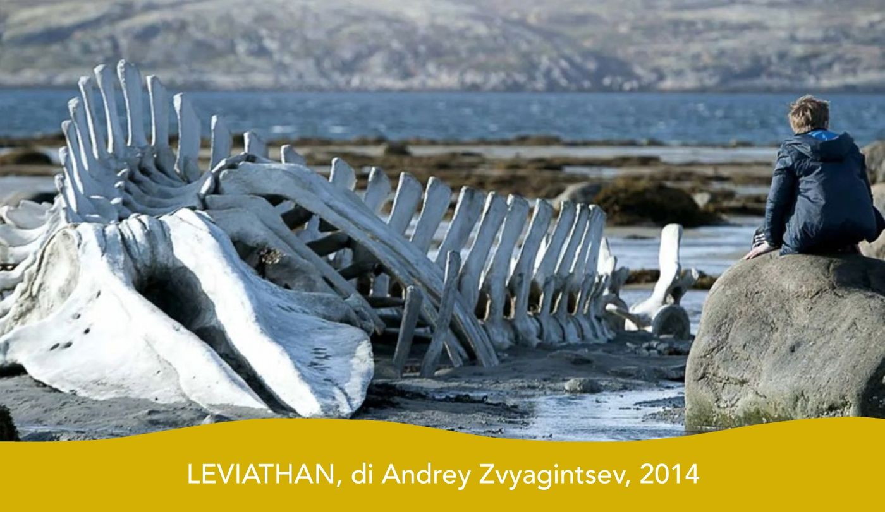{ loading=lazy style="width:59%" }

**LEVIATHAN, di Andrej Zvjagincev, 2014**

Questo è un film russo, di un regista russo che adesso vive a Parigi perché combatte il putinismo, e che sarà presente a Cannes con un suo film che si chiama *Minotauro*. Come vedete ha questa predisposizione per i titoli un po’ biblici: questo è *Leviathan* – il Leviatano di Hobbes e della Bibbia, il mostro.

1:16:32

Vedete, si svolge in Siberia, ci sono dei paesaggi bellissimi nel film, questo è il mare di Barents; ci sono delle carcasse di balene, ci sono delle situazioni industriali dismesse. Ma chi è questo Leviatano? Il Leviatano è lo Stato: lo Stato e il capitalismo di Stato, quindi il potere, la violenza istituzionale che si esprime attraverso le istituzioni nella società russa contemporanea. È una critica fortissima alle istituzioni russe sotto il putinismo, e infatti il regista se ne è dovuto andare. Quindi questo film lo consiglio non solo per questo tema importantissimo, ma anche per la bellezza della fotografia. Lo trovate sui servizi di streaming ed è veramente degno di essere visto.

**LEVIATHAN (Левиафан)**

*Scheda dalla brochure*

Tratto da una storia contemporanea che intreccia cronaca giudiziaria e suggestioni bibliche (il Leviatano come simbolo del potere)

Presentato in concorso al Festival di Cannes 2014, dove ha vinto il premio per la migliore sceneggiatura

Film, 2014; regia di Andrej Zvjagincev; con Aleksej Serebrjakov (Kolja), Elena Ljadova, Vladimir Vdovičenkov; durata 140 min.

› Apple TV, Chili

**Quando il potere divora i luoghi**

**Il territorio come posta in gioco**

C’è un momento in “Leviathan” in cui la macchina da presa si solleva lentamente sulle rive del Mare di Barents. Emergono carcasse di balene sbiancate dal tempo accanto ai relitti arrugginiti di vecchie imbarcazioni. È un’immagine che non spiega, ma rivela: la natura ridotta a scheletro, testimone muto di una forza che consuma e abbandona. Quella forza, nel film di Andrej Zvjagincev, ha un nome preciso: potere. Diffuso, opaco, inestirpabile.

“Leviathan” racconta la storia di Nikolaj, un meccanico che vive con la seconda moglie Liljana e il figlio adolescente Romka in una casa affacciata su un fiordo della Russia settentrionale. Quella casa non è solo un bene: è memoria, identità, radicamento.

Il sindaco della cittadina, Vadim, decide di espropriare il terreno per un progetto dai contorni vaghi, e proprio per questo ancora più inquietante. Non conta lo scopo, conta il gesto: un atto di prepotenza burocratica rivestito di legalità.

**L’individuo contro l’apparato**

La sentenza del tribunale non giudica, ratifica. Prende atto di un esito già scritto. Nikolaj resiste, si affida a un avvocato amico arrivato da Mosca, continua a credere che esista uno spazio in cui la ragione possa ancora incidere. È questa ostinazione, insieme tragica e ingenua, il vero motore del film.

Zvjagincev costruisce una parabola sul rapporto tra individuo, terra e potere con una precisione formale rigorosa. Nulla è enfatico, e proprio per questo tutto pesa. I paesaggi sconfinati non liberano ma comprimono, le architetture degradate gravano sui personaggi come presenze materiali. Il territorio non è sfondo ma coprotagonista: è la vera posta in gioco.

La terra di Nikolaj non ha valore perché può essere venduta, ma perché è il luogo in cui una vita ha preso forma. Ed è proprio questo valore irriducibile che il sistema non può riconoscere.

**Il Leviatano e le sue complicità**

Il titolo rimanda al Leviatano di Hobbes, ma anche al Libro di Giobbe. Nikolaj è un uomo travolto da forze che lo eccedono, e nessuna istanza superiore interviene: né lo Stato, né la Chiesa ortodossa, qui rappresentata come silenziosa alleata del potere.

La critica al sistema russo contemporaneo è evidente, ma il film non si esaurisce in una denuncia politica. Zvjagincev allarga il campo e costruisce una riflessione più ampia sul modo in cui le istituzioni, politiche, giuridiche e religiose, finiscono per proteggere chi già possiede, mentre chi appartiene a un luogo ne viene progressivamente espulso.

In questo senso, Leviathan è cinema civile nel suo significato più esigente: non proclama, ma osserva; non semplifica, ma stratifica. E nella specificità geografica e culturale della Russia contemporanea riesce a far emergere una verità più generale, in cui l’espropriazione non è solo economica, ma riguarda la possibilità stessa di abitare il mondo.

*Un dramma austero e bellissimo, al tempo stesso intimo e grandioso. “The New York Times”*

*Chernobyl*

1:17:35

Questo è *Chernobyl*: siamo ancora in Ucraina, ex Unione Sovietica, sapete cosa è successo a Chernobyl. Qui c’è una serie di episodi veramente drammatica. E da questa serie si vede che noi forse siamo qui per il merito di tre o quattro persone che hanno resistito al potere, alle menzogne del potere, e hanno portato avanti la verità. Sono veramente un pugno di persone, che si sono anche sacrificate, perché poi sono stati colpiti, e che hanno salvato la situazione. Sono riusciti – eravamo nel primo anno di Gorbaciov, quando è successa questa cosa – anche grazie all’apertura di Gorbaciov, a convincere il potere che stava succedendo qualcosa di veramente grave, che lo Stato negava. Questo è veramente qualcosa che nella serie si vede e che tocca moltissimo. Andiamo al successivo.

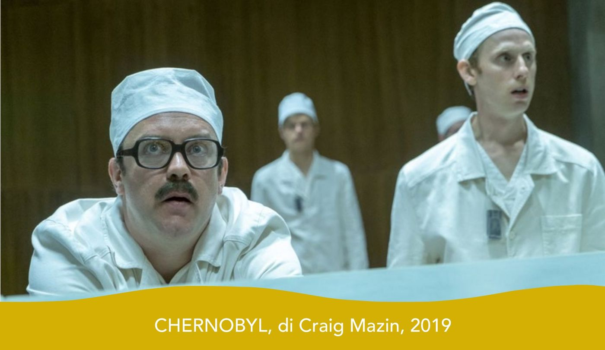{ loading=lazy style="width:60%" }

**CHERNOBYL, di Craig Mazin, 2019**

**CHERNOBYL (Чернобыль)**

*Scheda dalla brochure*

Tratto da eventi reali: il disastro nucleare del 1986 e le sue conseguenze politiche, scientifiche e umane

Miniserie acclamata dalla critica e vincitrice di numerosi premi, tra cui Emmy e Golden Globe; considerata una delle migliori produzioni televisive degli ultimi anni

Serie TV, 2019; creata da Craig Mazin; con Jared Harris (Valerij Legasov), Stellan Skarsgård (Boris Ščerbina), Emily Watson; 5 episodi, durata complessiva circa 330 min.

› Sky, NOW TV, Prime Video

**Il prezzo della menzogna**

**Il territorio come vittima del potere**

Ci sono luoghi che la storia trasforma in simboli. Pripyat, la città satellite costruita per ospitare i lavoratori della centrale nucleare Vladimir Lenin, era una vetrina del socialismo reale: moderna, ordinata, progettata per dimostrare che il progresso sovietico poteva competere con l’Occidente.

Dopo il 26 aprile 1986 diventa altro: un deserto radioattivo, una città fantasma in cui il tempo si è arrestato all’improvviso, lasciando bambole sui letti, piatti apparecchiati, una ruota panoramica mai inaugurata. Craig Mazin e Johan Renck trasformano questa geografia della catastrofe nel vero protagonista della serie: il territorio non è soltanto lo scenario del disastro, è la sua vittima più silenziosa e duratura, il luogo in cui la violenza del potere continua a sedimentarsi nel tempo.

**Una profezia senza simboli**

Chernobyl è, in superficie, una ricostruzione rigorosa dell’esplosione del reattore numero 4 e delle settimane convulse che seguirono. Ma è soprattutto un’analisi lucida del modo in cui un sistema, politico, burocratico, economico, può preferire la propria sopravvivenza simbolica a quella concreta degli esseri umani e dell’ambiente.

La menzogna non è qui un incidente: è il principio organizzativo. Funzionari che occultano dati, scienziati costretti al silenzio, liquidatori inviati allo sbaraglio senza protezioni adeguate. La serie mostra come il potere produca realtà alternative pur di non incrinare la propria narrazione. Il parallelo con il presente è inevitabile: anche oggi i costi ambientali vengono spesso rimossi, spostati, diluiti fino a diventare invisibili. Mazin non insiste, ma costruisce un sistema di segni che rende questa continuità difficile da ignorare.

La serie raggiunge il suo punto più alto nel modo in cui mette in scena i corpi: quelli dei vigili del fuoco, dei minatori, dei soldati chiamati a contenere l’incontenibile. Corpi esposti, consumati, trattati come risorse da impiegare fino all’esaurimento. La scena degli uomini costretti a spalare grafite sul tetto del reattore, dopo il fallimento dei robot, è una delle immagini più dure mai prodotte dalla televisione sul rapporto tra potere e sacrificio umano.

Il paesaggio ucraino, le foreste di betulle, i fiumi, i campi, appare come qualcosa di irrimediabilmente ferito, contaminato da decisioni prese altrove, nei corridoi del potere, dove il costo della verità veniva pesato in termini politici. Chernobyl ci ricorda che ogni disastro ambientale è prima di tutto un fallimento morale: il risultato di una scelta, spesso deliberata, di sacrificare luoghi e vite in nome della stabilità di un sistema.

*Un racconto teso e senza sconti che trasforma una tragedia storica in una riflessione universale sul potere e sulla menzogna. “la Repubblica”*

*Il male non esiste*

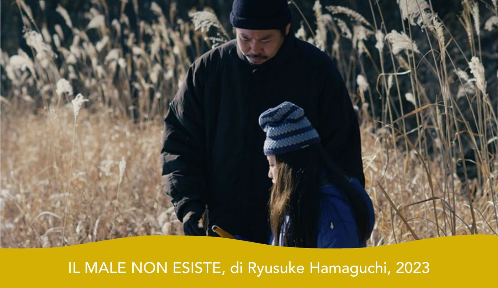{ loading=lazy style="width:59%" }

**IL MALE NON ESISTE, di Ryūsuke Hamaguchi, 2023**

1:18:55

Il regista Hamaguchi ha già vinto un Oscar con un film che si chiama *Drive My Car*, che vi consiglio di vedere perché è un film veramente bello: è un viaggio da Tokyo a Hiroshima; guardatelo, perché è veramente bello. Questo invece è un altro film: che cosa succede in questo film?

1:19:17

Succede un po’ la tesi di Elinor Ostrom, la premio Nobel che ha studiato i beni comuni. Qui c’è una comunità di montagna che gestisce il territorio, le risorse idriche, le risorse economiche, la foresta, ecc. Una società di Tokyo intende aprire un campeggio di lusso in quest’area. E che cosa succede? Quando i funzionari della compagnia di Tokyo vanno a proporre questo progetto alla comunità, la comunità mostra la fallacia del progetto: cioè la comunità conosce a tal punto il territorio che gli stessi funzionari della compagnia devono ammetterlo. Però si va avanti lo stesso, e purtroppo c’è un finale tragico, che ci dice che la natura alla fine si ribella, e fa qualcosa di veramente drammatico. Andiamo al successivo.

**IL MALE NON ESISTE (aku wa sonzai shinai)**

*Scheda dalla brochure*

Tratto da una storia contemporanea che intreccia ecologia, comunità e tensioni tra sviluppo e natura

Presentato alla Mostra del Cinema di Venezia 2023, dove ha vinto il Leone d’Argento – Gran Premio della Giuria; considerato uno dei film più rigorosi e misteriosi del cinema contemporaneo giapponese

Film, 2023; regia di Ryūsuke Hamaguchi; con Hitoshi Omika (Takumi), Ryo Nishikawa, Ryūji Kosaka; durata 106 min.

› Mubi

**L’equilibrio spezzato**

**Un ecosistema come personaggio**

C’è un prologo di straordinaria durata in Il male non esiste: la macchina da presa scivola lentamente tra i rami spogli degli alberi invernali, seguendo una traiettoria verticale che sembra misurare la distanza tra il suolo e il cielo. Nessun dialogo, nessuna musica invasiva, solo il rumore della foresta, il crepitio dei rami, il silenzio denso di Mizubiki, villaggio di montagna a poche ore da Tokyo. Ryūsuke Hamaguchi, già autore di Drive My Car, usa questo incipit per dichiarare subito le sue intenzioni: il territorio non è cornice, è soggetto.

La foresta di Mizubiki possiede una propria logica, un equilibrio, una temporalità che precede gli uomini e che potrebbe sopravvivere loro. È su questo equilibrio che si abbatte, con la discrezione operativa di una ruspa, la logica del mercato.

**La grammatica del capitalismo**

La minaccia prende la forma di un progetto: una società di Tokyo intende costruire a Mizubiki un campeggio di lusso, un “glamping resort”, sfruttando i fondi governativi post-pandemia destinati alla rivitalizzazione delle aree rurali.

Due dipendenti dell’azienda, Takahashi e Mayuzumi, vengono inviati al villaggio per presentare il piano in un’assemblea pubblica. Questa scena è il cuore politico del film: gli abitanti, contadini, artigiani, persone che conoscono ogni metro di quel territorio, mostrano con precisione le lacune del progetto, con una competenza tecnica e una pazienza che mettono a disagio i rappresentanti aziendali.

La fossa settica è mal posizionata, rischia di contaminare le falde da cui dipende l’acqua del villaggio. Nessuno alza la voce, nessuno minaccia. La critica è chirurgica, e proprio per questo devastante.

Hamaguchi mostra come il capitalismo estrattivo non si presenti quasi mai con il volto della brutalità o della prevaricazione, ma con quello dell’opportunità, del progresso, dello sviluppo.

**La colpa senza colpevoli**

Il titolo del film è una dichiarazione filosofica prima ancora che narrativa. In Il male non esiste non ci sono antagonisti evidenti: Takahashi e Mayuzumi sono persone comuni, intrappolate in una struttura che li utilizza come ingranaggi. Quando iniziano a comprendere davvero le conseguenze del progetto su Mizubiki, qualcosa in loro si incrina, ma il sistema che li ha inviati lì resta intatto.

È questa la trappola più sottile del capitalismo contemporaneo: distribuire la responsabilità fino a dissolverla, rendere impossibile individuare un colpevole mentre il danno si produce comunque.

Il finale, perturbante e deliberatamente opaco, suggerisce che la natura possiede una propria forma di risposta, non morale ma ecologica, non giusta ma inevitabile. Il male non esiste è un film sulla violenza gentile del mercato, quella che non lascia tracce evidenti finché non è troppo tardi.

*Un film di una bellezza austera e misteriosa, che osserva con lucidità implacabile le fratture tra uomo e natura. “Le Monde”*

*Promised land*

1:20:23

Non so se avete seguito il dibattito sui data center negli Stati Uniti: adesso sapete che ci sono degli investimenti enormi per costruire data center in alcune comunità, e sono impattanti sul territorio in modo drammatico, perché sono centri enormi, consumano energia, consumano acqua, e in realtà l’occupazione non è così importante come sembrerebbe.

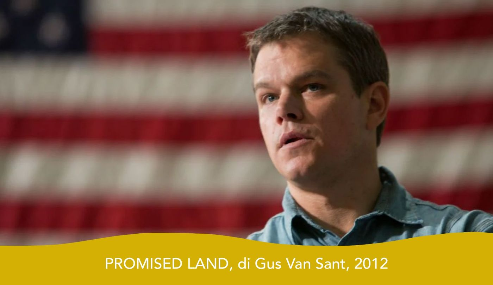{ loading=lazy style="width:59%" }

**PROMISED LAND, di Gus Van Sant, 2012**

1:20:47

Bene, ma che cosa succede? Succede che la comunità pensa di trarre un beneficio da questo investimento: all’inizio è favorevole, perché chiaramente smuove – *promised land*, la terra promessa, d’accordo? Qui si sta parlando di fracking, cioè di un metodo per tirar fuori il gas naturale. E questo ragazzo, Matt Damon, che è una persona onesta, rappresenta la compagnia e deve fare questo lavoro: si presenta a questa comunità e cerca di convincerla della bontà di questo investimento, perché la comunità ne trarrà vantaggio, ne trarrà risorse, ne trarrà occupazione. Però alla fine lui stesso – come succede nel film dei giapponesi – si convince della fallacia di questa situazione, perché l’impatto sarà talmente devastante che il territorio ne sarà non voglio dire distrutto, ma fortemente contaminato. Andiamo al successivo.

**PROMISED LAND**

*Scheda dalla brochure*

Tratto da una storia originale di Matt Damon e John Krasinski; dramma contemporaneo sul conflitto tra sviluppo energetico e comunità rurali

Presentato nel 2012; considerato un film chiave nel dibattito sul fracking e sulle trasformazioni del territorio nell’America contemporanea

Film, 2012; regia di Gus Van Sant; con Matt Damon (Steve Butler), Frances McDormand (Sue Thomason), John Krasinski, Hal Holbrook; durata 106 min.

› Apple TV, Prime Video per noleggio o acquisto

**A chi appartiene il sottosuolo?**

**Il venditore di sogni**

Steve Butler arriva a Caledonia, Pennsylvania, con una valigetta, un sorriso controllato e una storia da raccontare. È un uomo di campagna – o almeno così si presenta – cresciuto in una cittadina agricola del Midwest divorata dalla crisi economica, e sa perfettamente come parlare alla gente che vuole convincere.

Lavora per una grande compagnia energetica che ha identificato sotto quei campi enormi riserve di gas naturale estraibili attraverso la fratturazione idraulica, il fracking.

Il suo compito è semplice: comprare i diritti sul sottosuolo dai proprietari terrieri, persone spesso anziane, indebitate, tentate da cifre che non hanno mai visto. Gus Van Sant costruisce attorno a questa figura un ritratto ambivalente e onesto: Steve non è un predatore consapevole, è un uomo che crede davvero di portare salvezza economica dove c’è disperazione.

Ed è precisamente questa buona fede – parziale, comoda, interessata – a rendere il film politicamente più sofisticato di un semplice pamphlet ambientalista.

**Il viaggio attraverso le lame**

Caledonia non è una preda passiva. Quando un insegnante di scienze in pensione, Frank Yates, comincia a sollevare domande pubbliche sui rischi ambientali del fracking, e quando un attivista di nome Dustin Noble arriva in città con fotografie di terreni devastati, la comunità si divide, non semplicemente tra chi vuole i soldi e chi vuole proteggere la terra, ma lungo linee più sottili e più reali.

C’è chi ha già perso tutto e non può permettersi il lusso dell’ambiente, chi teme per l’acqua dei pozzi e per i pascoli, chi diffida di entrambi i contendenti. Il regista restituisce questa complessità senza forzare simpatie: il territorio è conteso non solo fisicamente ma simbolicamente.

Il film mostra chiaramente che il capitalismo estrattivo vince spesso non con la coercizione ma con la divisione, insinuandosi nelle fratture già esistenti di una comunità impoverita.

**Il sottosuolo e la sovranità**

Il film pone una domanda che raramente il cinema affronta con questa chiarezza: a chi appartiene il sottosuolo? La proprietà terriera americana, con la sua tradizione di mineral rights separati dai surface rights, diventa nel film una metafora perfetta del modo in cui il capitalismo riesce a scindere l’appartenenza dalla sovranità: si può possedere la superficie, coltivare, abitare, amare un luogo, ma ciò che sta sotto può essere venduto, perforato, svuotato da altri.

Il finale del film, con il suo colpo di scena che rimescola le carte sull’attivismo ambientalista, introduce un elemento ulteriore: anche la resistenza può essere sfruttata dal mercato, trasformata in strumento di competizione tra interessi economici contrapposti.

*Un dramma sobrio e intelligente che affronta con equilibrio il conflitto tra sviluppo economico e responsabilità ambientale. “The New York Times”*

*Erin Brockovich*

1:22:13

Questo è il film con il quale Julia Roberts ha vinto l’Oscar, uno dei grandi film del 2000. Volevo far vedere un pezzettino di questo film, proprio pochi minuti. Che cosa succede? Siamo in un deserto in California: c’è una comunità che ha le falde acquifere inquinate da una società chimica, e questa gente sta morendo di cancro, perché l’acqua è contaminata. A quel punto uno studio legale del luogo inizia a far causa a questa società di San Francisco, che è responsabile di questa situazione, e ingaggia questa donna, che non ha basi legali, non ha studi: semplicemente è una donna che ha una reazione spaventosa e si batte per la comunità.

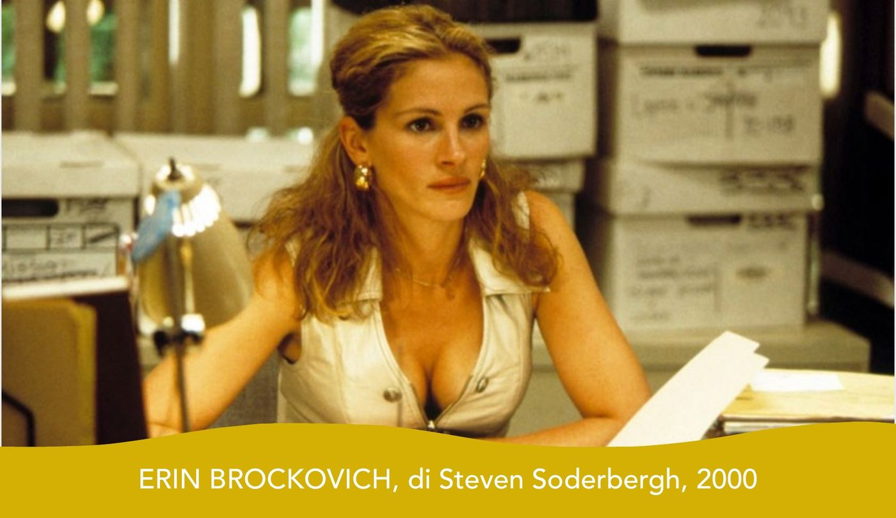{ loading=lazy style="width:59%" }

**ERIN BROCKOVICH, di Steven Soderbergh, 2000**

1:23:18

La scena che vedremo adesso, in due minuti: praticamente lo studio legale si appoggia a un grosso studio di San Francisco perché lo supporti nella battaglia legale con questa compagnia, che è veramente enorme; e lo studio mette in discussione la competenza di questa persona, se sia qualificata per portare avanti questo progetto. Adesso lo vediamo: è una scena bellissima, in cui c’è veramente una Julia Roberts travolgente.

1:23:51

\[Viene proiettata la scena del film.\]
{: .nota }

1:25:28

Bene, avete visto che scena bellissima è questa. E bisogna anche dire come, per caso, si incontrino queste persone che veramente riescono a portare avanti situazioni importanti.

**ERIN BROCKOVICH**

*Scheda dalla brochure*

Tratto da una storia vera; dramma civile sul conflitto tra potere industriale e tutela ambientale

Presentato nel 2000; considerato uno dei film più incisivi sul tema della responsabilità aziendale e della giustizia ambientale; ha valso l’Oscar a Julia Roberts come miglior attrice protagonista

Film, 2000; regia di Steven Soderbergh; con Julia Roberts (Erin Brockovich), Albert Finney, Aaron Eckhart; durata 131 min.

› Apple TV, Prime Video per noleggio o acquisto

**Veleno nel pozzo**

**Una donna, un fascicolo, una comunità**

Erin Brockovich non è un’ambientalista. Non ha una formazione scientifica, non appartiene a nessuna organizzazione, non conosce il linguaggio del diritto. È una madre single con tre figli, senza lavoro, che per una serie di circostanze finisce a fare l’assistente nello studio di un avvocato di provincia.

Eppure è lei – con la sua testardaggine, la sua capacità di ascolto, la sua rabbia genuina – a scoprire che la Pacific Gas and Electric Company ha contaminato per decenni le falde acquifere di Hinkley, una piccola comunità del deserto californiano, con cromo esavalente, sostanza altamente cancerogena scaricata illegalmente nei terreni circostanti.

Steven Soderbergh costruisce attorno a questa figura un film di genere riuscito, il legal thriller sociale, ma ha l’intelligenza di non ridurre mai Erin a eroina di cartapesta. La sua forza sta proprio nella sua ordinarietà: non combatte per un principio astratto, combatte perché ha guardato negli occhi le persone di Hinkley e sa che stanno morendo.

Hinkley è un luogo che il film trasforma in emblema. Case basse nel deserto, giardini aridi, pozzi da cui esce acqua che ha sapore strano. Gli abitanti si sono ammalati in modo sistematico, tumori, malformazioni, malattie autoimmuni, senza riuscire a connettere i puntini, perché nessuno glieli ha connessi.

La PG&E sapeva: i documenti interni che Erin dissotterra mostrano che l’azienda era consapevole della contaminazione da anni, aveva persino offerto agli abitanti di Hinkley di acquistare le loro proprietà a prezzi gonfiati per farli allontanare senza fare domande.

È questo il modo di agire del capitalismo industriale nei confronti del territorio: usarlo come discarica, tacere, comprare il silenzio quando possibile, negare quando necessario. Il danno ambientale non è un effetto collaterale accidentale, ma è una scelta economica razionale, il risultato di un calcolo in cui il costo dello smaltimento legale supera il costo del rischio legale.

Il film si conclude con una vittoria: il più grande risarcimento mai ottenuto in una causa di diritto civile nella storia degli Stati Uniti fino a quel momento, 333 milioni di dollari distribuiti tra i 333 abitanti di Hinkley.

Il regista ha il merito di lasciare che questa vittoria sappia di amaro. I soldi non restituiscono la salute perduta, non ripuliscono le falde acquifere, non restituiscono agli abitanti la fiducia nel territorio in cui vivono. Il film capisce che il sistema giuridico può sanzionare il capitalismo estrattivo ma non può invertirne la logica: finché il danno ambientale è una voce di bilancio da ottimizzare.

Erin Brockovich è cinema popolare nel senso più nobile.

*Una Julia Roberts straordinaria restituisce dignità e forza a una storia di giustizia contro il potere. “la Repubblica”*

1:25:40

Paolo Marcucci Grazie Mario.

Silva – Rubrica di libri

1:25:58

Silva Cioni Stasera forse sono andata un po’ fuori tema, perché non ho parlato di territori, ma vi propongo una raccolta di libri che sicuramente migliorerà la vostra conoscenza dell’economia – una materia che condiziona in maniera imponente la nostra vita e che spesso in Italia, e anche altrove… Il 50% delle persone è analfabeta da questo punto di vista; e anche un terzo delle persone non riesce più a leggere un testo complesso.

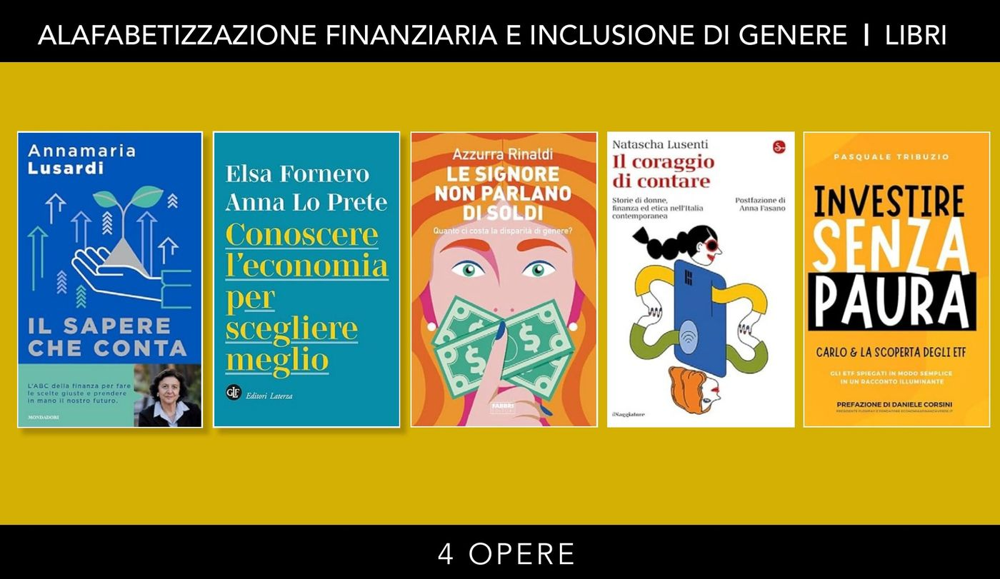{ loading=lazy style="width:59%" }

**ALFABETIZZAZIONE FINANZIARIA E INCLUSIONE DI GENERE \| LIBRI**

5 OPERE

*Nelle copertine, da sinistra:*

Annamaria Lusardi, IL SAPERE CHE CONTA – L’ABC della finanza per fare le scelte giuste e prendere in mano il nostro futuro. (MONDADORI)

Elsa Fornero, Anna Lo Prete, Conoscere l’economia per scegliere meglio (Editori Laterza)

Azzurra Rinaldi, LE SIGNORE NON PARLANO DI SOLDI – Quanto ci costa la disparità di genere? (FABBRI EDITORI)

Natascha Lusenti, Il coraggio di contare – Storie di donne, finanza ed etica nell’Italia contemporanea · Postfazione di Anna Fasano (Il Saggiatore)

PASQUALE TRIBUZIO, INVESTIRE SENZA PAURA – CARLO & LA SCOPERTA DEGLI ETF · GLI ETF SPIEGATI IN MODO SEMPLICE IN UN RACCONTO ILLUMINANTE · PREFAZIONE DI DANIELE CORSINI (PRESIDENTE FLOWPAY E FONDATORE ECONOMIAEFINANZAVERDE.IT)

1:26:38

Quindi ho proposto dei libri che vi aiuteranno a fare delle scelte, perché l’economia è alla base delle scelte della nostra vita, di tutte le nostre scelte.

*Il sapere che conta*

1:26:52

Il primo libro è di un’economista – ho scelto tutte economiste di sesso femminile, perché si occupano di più di questi temi. *Il sapere che conta* espone in maniera semplice, in parole alla portata di tutti, la convinzione che l’economia debba essere insegnata nelle scuole proprio come si insegna a leggere e a scrivere, perché condiziona tutte le nostre scelte. L’autrice, che è una professoressa e insegna anche a Stanford, sostiene che l’investimento migliore che possiamo fare nella nostra vita è investire sulla nostra educazione, perché ci renderà un rendimento più alto di tutti, dandoci condizioni di vita migliori.

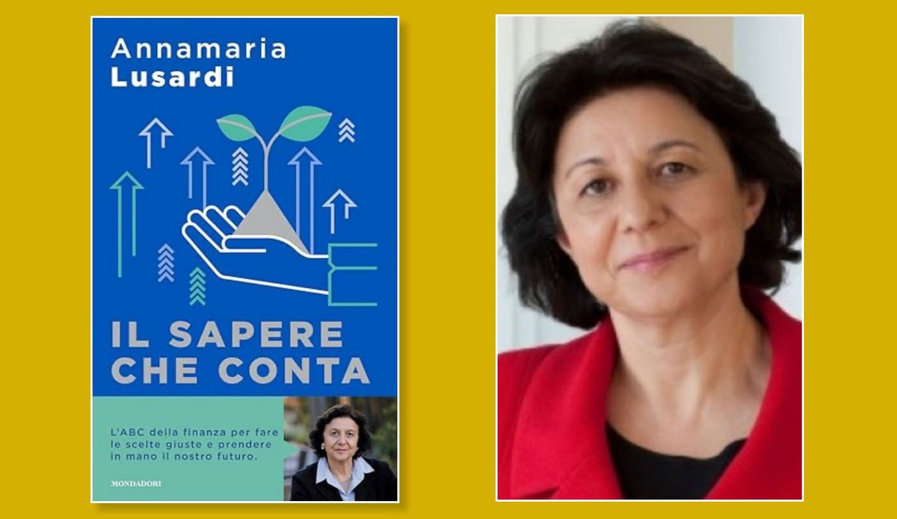{ loading=lazy style="width:59%" }

**ANNAMARIA LUSARDI, IL SAPERE CHE CONTA**

*Nessun testo sulla slide oltre alla copertina:*

Annamaria Lusardi

IL SAPERE CHE CONTA

L’ABC della finanza per fare le scelte giuste e prendere in mano il nostro futuro.

MONDADORI

1:28:08

E qui c’è un problema che hanno avuto le donne: c’è un gap di conoscenza tra i due sessi. Già a 15 anni i maschi sono molto più interessati all’economia delle donne, e il gap è del 20%. Quindi bisogna abituare le nostre donne, le nostre figlie, all’idea che si deve investire sulla conoscenza e non sperare di fare un buon matrimonio o di diventare un’influencer ricca.

**IL SAPERE CHE CONTA**

*Scheda dalla brochure*

Saggio di Annamaria Lusardi; Mondadori, 2024, pp. 240

Pioniera nella ricerca e nella divulgazione della necessità dell’educazione finanziaria a partire proprio dalle scuole, la professoressa Lusardi ci aiuta ad entrare in un argomento per molte persone difficile, con parole semplici alla portata di tutte e tutti. Convinta che la conoscenza di base dell’economia e della finanza sia necessaria come leggere e scrivere per vivere nel mondo di oggi, la scrittrice fornisce le nozioni di base che sono necessarie per compiere quasi tutte le scelte della nostra vita. Per fare un esempio un capitolo è interamente dedicato alla necessità di “investire” nella propria educazione per essere più consapevoli e capaci di migliorare le condizioni di vita per sé e per tutta la comunità intorno a noi. Questo è molto importante per tutti e soprattutto per le donne che hanno accumulato, e non solo in Italia, un maggiore ritardo degli uomini su questo argomento, mentre al contrario una donna ha un moltiplicatore maggiore per migliorare il benessere della famiglia e della comunità a parità di conoscenze di un uomo.

*Conoscere l'economia per scegliere meglio*

1:28:49

Passiamo al secondo libro. Questa è la nostra Elsa Fornero, che tutti conoscono, con un’altra economista piemontese. Anche in questo caso ci parla dell’importanza che hanno le scelte, della conoscenza di come investire e di come risparmiare per vivere meglio; ma soprattutto ci parla anche del tema cruciale dell’indipendenza economica delle donne, che in molte statistiche risulta ancora una dipendenza dagli uomini: in Italia il 42% delle donne non ha un conto corrente proprio su cui poter operare liberamente. E questo ovviamente ne condiziona le scelte.

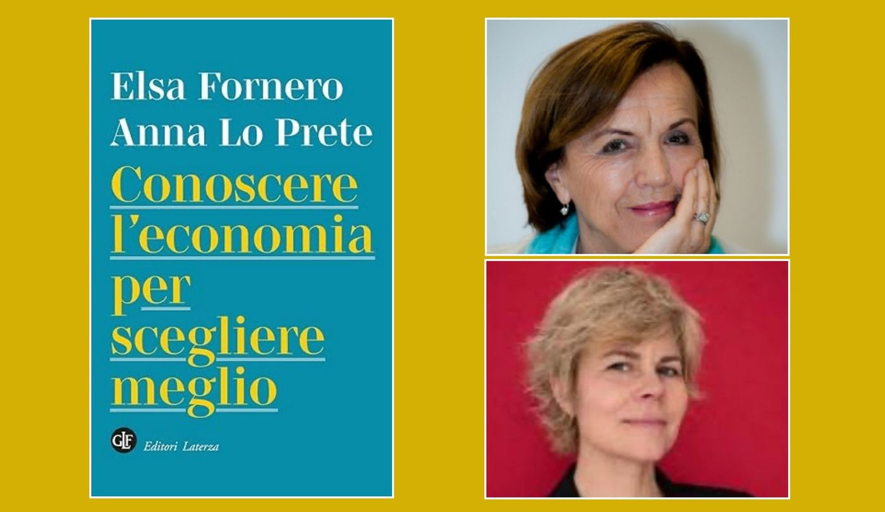{ loading=lazy style="width:59%" }

**ELSA FORNERO E ANNA LO PRETE, CONOSCERE L’ECONOMIA PER SCEGLIERE MEGLIO**

*Nessun testo sulla slide oltre alla copertina:*

Elsa Fornero

Anna Lo Prete

Conoscere l’economia per scegliere meglio

Editori Laterza

**CONOSCERE L’ECONOMIA PER SCEGLIERE MEGLIO**

*Scheda dalla brochure*

Saggio di Elsa Fornero e Anna Lo Prete; Laterza, 2025, pp. 160

Dall’introduzione delle autrici: “Le condizioni che hanno favorito l’aumento del benessere nei decenni passati, in un quadro geo-politico caratterizzato da relativa pace e cooperazione (almeno in un’ampia parte del pianeta), sembrano essere venute meno; guerre, pandemie, migrazioni, cambiamenti climatici, crisi economiche hanno aumentato l’incertezza (almeno quella percepita), rendendo complicato orientarsi in un mondo che appare sempre più complicato.” Questo libro è un valido supporto per migliorare la nostra vita: può orientarci e aiutarci ad impostare le scelte che necessariamente dobbiamo fare di continuo nel cercare di realizzare i nostri desideri. Scelte che dovranno sempre essere misurate tra la scarsità delle risorse e la mancanza di certezze. Nel libro si tratta anche approfonditamente il tema cruciale dell’indipendenza economica delle donne, che in molte statistiche risultano avere minore familiarità con i concetti di base dell’economia e per la quale invece passa la conquista effettiva della parità di genere.

*Le signore non parlano di soldi*

1:29:47

Poi abbiamo l’economista femminista Azzurra Rinaldi – l’ho chiamata femminista perché lei si definisce così. Questo libro si intitola *Le signore non parlano di soldi*. In realtà lei lo voleva intitolare *Capitalismo e patriarcato*, ma la casa editrice glielo ha impedito. Comunque è un libro che ci parla di quel PIL di cui dicevamo prima, che ci danno tutti i giorni, scritto su tutti i giornali, ma che è un valore che... quando l’abbiamo sentito, che cosa sappiamo di più del minuto prima? Sappiamo che il 75% dei lavori di cura che fanno le donne non c’è. E, ritornando anche ai film di cui parlava Mario: probabilmente nel PIL c’era quello che aveva prodotto l’industria farmaceutica, ma non tutto quello che aveva fatto all’ambiente. Questo il PIL non lo misura. Comunque questo libro è di facile lettura e secondo me vale la pena leggerlo e farlo leggere anche ai nostri figli.

{ loading=lazy style="width:59%" }

**AZZURRA RINALDI, LE SIGNORE NON PARLANO DI SOLDI**

Azzurra Rinaldi

LE SIGNORE NON PARLANO DI SOLDI

Quanto ci costa la disparità di genere?

FABBRI EDITORI

**LE SIGNORE NON PARLANO DI SOLDI**

*Scheda dalla brochure*

Saggio di Azzurra Rinaldi; Fabbri, 2023, pp. 224

Azzurra Rinaldi, economista femminista docente di economia politica all’Università degli Studi di Roma Unitelma Sapienza ci spiega come la disparità di genere ci costi moltissimo, non solo in termini di ingiustizia sociale e benessere, ma anche dal punto di vista economico. L’autrice che avrebbe voluto intitolare il libro “Capitalismo e patriarcato”, (titolo assolutamente censurato dalla casa editrice!) affronta i temi cruciali che investono la parità di genere a partire dall’attività di cura, della famiglia, degli anziani, dei malati ecc. attività che a livello mondiale è demandata al 75% alle donne e non è retribuita. Si calcola che l’ammontare del lavoro svolto dalle donne e non retribuito ammonti a circa 12.000 miliardi US$. Le tesi del libro sono supportate da una enorme quantità di dati che a leggerli fanno tremare i polsi: una donna su 5 lascia il lavoro alla nascita del primo figlio, tra tutte le dimissioni volontarie del 2020 il 73% erano donne ecc. Quindi leggete questo libro e poi ribattete senza paura a coloro che ancora continuano a dire che le donne ormai sono arrivate ovunque.

*Il coraggio di contare*

1:31:23

*Il coraggio di contare* è un libro scritto da una giornalista, Natascha Lusenti, che parla di buone notizie, perché parla di uomini e donne che hanno saputo gestire i soldi e li hanno reimmessi nella società per motivi etici o per scopi che hanno aiutato la collettività intorno a loro. È dimostrato che il volano dell’economia messo in movimento dalle donne – gli investimenti fatti dalle donne – è più efficace a livello sociale di quelli fatti dagli uomini.

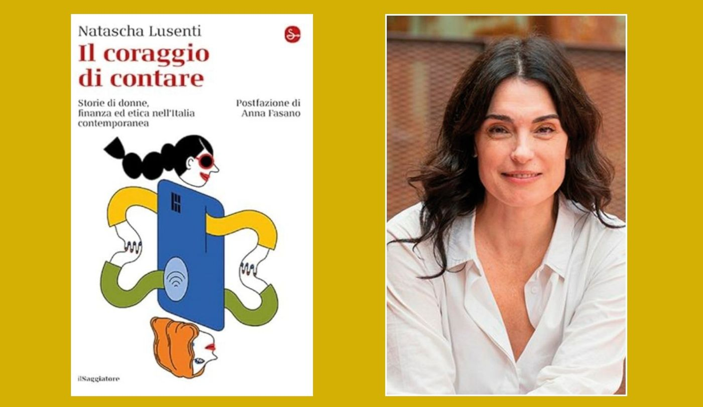{ loading=lazy style="width:59%" }

**NATASCHA LUSENTI, IL CORAGGIO DI CONTARE**

Natascha Lusenti

Il coraggio di contare

Storie di donne, finanza ed etica nell’Italia contemporanea

Postfazione di Anna Fasano

Il Saggiatore

**IL CORAGGIO DI CONTARE**

*Scheda dalla brochure*

Saggio di Natascha Lusenti; Il Saggiatore, 2024, pp. 232

L’autrice è giornalista e conduttrice radiofonica e questo libro è un’esplorazione del denaro come prodotto umano, mezzo di cambiamento, strumento etico: una raccolta di notizie, di donne che ogni giorno lavorano per trasformare la ricchezza in qualcosa di tangibile e positivo per la comunità. In un paese in cui ancora molte donne non hanno un proprio conto corrente e non sono finanziariamente autonome, sono dipendenti dalla famiglia di origine o dal compagno e perciò esposte a fenomeni di violenza economica, è necessaria una presa di coscienza per garantire indipendenza e felicità anche a chi ne è stato storicamente escluso. Conosceremo studentesse, imprenditrici, lavoratrici del terzo settore, psicologhe che ogni giorno operano con il denaro in funzione della collettività: da chi lotta contro la violenza di genere a chi con il cinema è riuscito a sensibilizzare milioni di persone sul posto nel mondo che a lungo è toccato alle donne, da chi promuove il giusto compenso per superare le divisioni sociali a chi sostiene che il lavoro di cura andrebbe retribuito, dal mondo delle cooperative a quello della finanza etica. Il suo è un cammino che unisce pensatrici femministe come Judith Butler o la premio Nobel Claudia Goldin all’esperienza delle donne che ha intervistato, passando per intellettuali quali Anna Bravo, Audre Lorde, Mark Fisher e Zygmunt Bauman. Lusenti dà vita a un dialogo tra donne del presente e del passato che hanno immaginato e trovato il «coraggio di contare», indicando un futuro migliore per ogni persona.

*Investire senza paura*

1:32:06

E infine c’è un libro che è scritto da un uomo, però io l’ho messo perché *Investire senza paura* è proprio un manualetto per riuscire a capire come organizzare, in base alle proprie esigenze, il proprio risparmio: ti dà anche tutte le indicazioni precise su dove andare e cosa fare attraverso l’azione che compie il protagonista di questa storia, protagonista che si chiama Carlo – ancora una volta – avrebbe dovuto chiamarsi Carla.

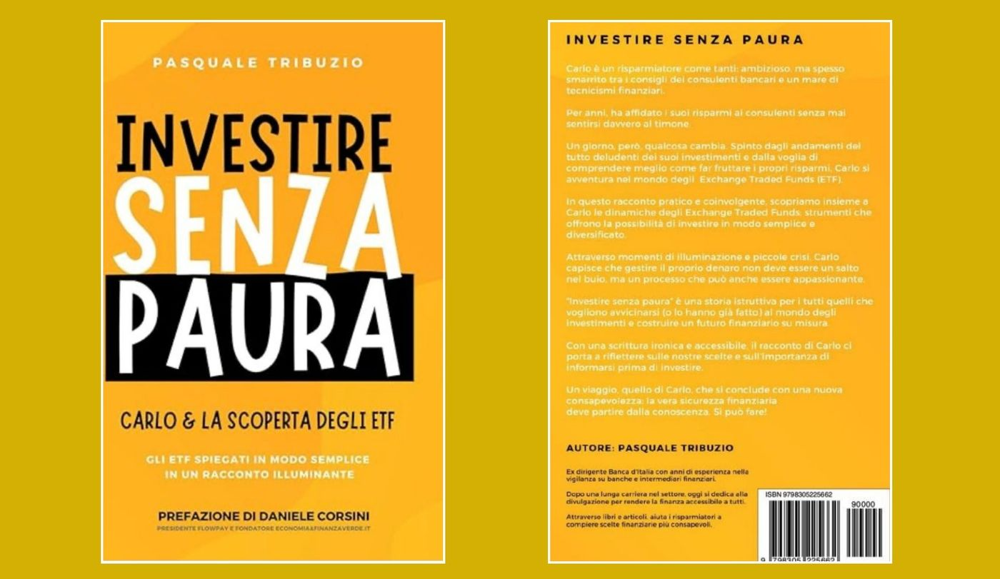{ loading=lazy style="width:59%" }

**PASQUALE TRIBUZIO, INVESTIRE SENZA PAURA**

*Copertina*

PASQUALE TRIBUZIO

INVESTIRE SENZA PAURA

CARLO & LA SCOPERTA DEGLI ETF

GLI ETF SPIEGATI IN MODO SEMPLICE IN UN RACCONTO ILLUMINANTE

PREFAZIONE DI DANIELE CORSINI

PRESIDENTE FLOWPAY E FONDATORE ECONOMIAEFINANZAVERDE.IT

*Retro*

INVESTIRE SENZA PAURA

Carlo è un risparmiatore come tanti: ambizioso, ma spesso smarrito tra i consigli dei consulenti bancari e un mare di tecnicismi finanziari.

Per anni, ha affidato i suoi risparmi ai consulenti senza mai sentirsi davvero al timone.

Un giorno, però, qualcosa cambia. Spinto dagli andamenti del tutto deludenti dei suoi investimenti e dalla voglia di comprendere meglio come far fruttare i propri risparmi, Carlo si avventura nel mondo degli Exchange Traded Funds (ETF).

In questo racconto pratico e coinvolgente, scopriamo insieme a Carlo le dinamiche degli Exchange Traded Funds: strumenti che offrono la possibilità di investire in modo semplice e diversificato.

Attraverso momenti di illuminazione e piccole crisi, Carlo capisce che gestire il proprio denaro non deve essere un salto nel buio, ma un processo che può anche essere appassionante.

“Investire senza paura” è una storia istruttiva per tutti quelli che vogliono avvicinarsi (o lo hanno già fatto) al mondo degli investimenti e costruire un futuro finanziario su misura.

Con una scrittura ironica e accessibile, il racconto di Carlo ci porta a riflettere sulle nostre scelte e sull’importanza di informarsi prima di investire.

Un viaggio, quello di Carlo, che si conclude con una nuova consapevolezza: la vera sicurezza finanziaria deve partire dalla conoscenza. Si può fare!

AUTORE: PASQUALE TRIBUZIO

Ex dirigente Banca d’Italia con anni di esperienza nella vigilanza su banche e intermediari finanziari.

Dopo una lunga carriera nel settore, oggi si dedica alla divulgazione per rendere la finanza accessibile a tutti.

Attraverso libri e articoli, aiuta i risparmiatori a compiere scelte finanziarie più consapevoli.

ISBN 9798305225662

**INVESTIRE SENZA PAURA, CARLO E LA SCOPERTA DEGLI ETF**

*Scheda dalla brochure*

Saggio di Pasquale Tribuzio; Pubblicazione indipendente, pp. 176

Il libro è un manuale prezioso per iniziare a capire come scegliere gli investimenti per mettere al riparo i propri risparmi senza avvalersi degli intermediari finanziari e risparmiare i costi di gestione. Il libro fornisce anche istruzioni precise su quali siti visitare e quali informazioni recuperare e valutare prima di costruirsi un proprio portafoglio. Il più grande difetto di questo libro è che il nostro investitore campione protagonista del libro si chiama Carlo e non Carla.

1:32:53

Paolo Marcucci Siamo arrivati quasi in fondo, mancano pochi minuti. Direi, se i nostri ospiti sono d’accordo, di vedere se ci sono domande; altrimenti facciamo un giro breve tra i nostri ospiti. C’è qualcuno che ha qualche domanda? Altrimenti ne faccio una io a Ugo. Oh, vieni Rossana, vieni!

1:33:21

Rossana Vorrei raccontare una cosa che riguarda sia Banca Cambiano sia Banca Etica. Negli anni Novanta la Banca di Cambiano ha aperto la sua sede a Montelupo, e quindi il presidente Regini ovviamente aveva chiamato tutti i sindaci all’inaugurazione, per presentare quella che era un po’ la novità del territorio: una banca nata dal territorio, con a capo un ex sindaco e con una serie di azionisti e fondatori che erano tutti soggetti del territorio.

1:34:17

In quel momento il sindaco di Montelupo era Marco Montagni, e noi assessori eravamo tre o quattro donne giovani, e avevamo portato una delibera affinché si facesse l’adesione a Banca Etica. Il Comune di Montelupo è stato socio di Banca Etica fino a qualche anno fa, poi ci siamo sentiti, per altri motivi, con un vostro rappresentante, perché forse il Comune di Montelupo aveva chiesto di uscire dalla compagine societaria. In quel caso il signor Mantovani, che era una persona sempre molto decisa, guardava con molta ammirazione quello che era riuscito a fare Regini, Paolo; però noi quella volta la spuntammo. In quell’occasione, durante il buffet, Mantovani disse: «Io avrei voluto essere socio di quella banca, ma...».

1:35:29

E poi dovevo fare un piccolo collegamento con le pubblicazioni che ha presentato Silva, perché a volte collaboro con delle persone che hanno una trasmissione radio dove si parla di finanza al femminile. Ormai l’abbiamo capito: le donne, che da sempre fanno economia domestica gestendo fin dalla notte dei tempi lo stipendio che portava il marito, adesso sono quelle rimaste indietro, perché non si sono poi così avvicinate alle scelte in ordine finanziario. Quindi mediamente le donne non si occupano di questa cosa; e anche il fatto – che spero venga superato da questa nuova normativa – per cui le donne lavoratrici fanno accreditare il loro stipendio su un conto corrente intestato ad altra persona, che quasi normalmente è il marito o il padre. Perché capita anche di incontrare delle ragazze che sono al loro primo impiego e non hanno un conto corrente intestato.

1:36:40

Questo è un limite che dobbiamo superare, anche da scoraggiare per quanto riguarda l’azione sociale della banca... bisognerebbe dare alle donne la consapevolezza che la gestione del denaro non è cosa di altri, ma che da lì dipende anche la propria autonomia e la propria capacità di mandare avanti la famiglia. Perché spesso poi chi prende le decisioni e chi gestisce in maniera accurata il denaro sono le donne. Quindi io direi che ogni tanto una campagna in favore dell’avvicinamento delle donne alla finanza sarebbe molto opportuna.

1:37:40

Così come sarebbe opportuno – come diceva Simone – chiedersi perché all’università non ci fanno entrare nel merito della formazione del bilancio di un ente locale. Però l’ente locale non è solo attraverso il suo bilancio che crea economia nel territorio, ma anche attraverso le scelte che fa e le leve che muove: già decidere di dotarsi di certi servizi è un sostegno all’impresa. Montelupo è sempre stato apprezzato per la velocità con cui gestiva le pratiche, le pratiche edilizie e altre pratiche: questa è una leva che aiuta l’economia del territorio a determinare le proprie scelte, i propri investimenti. Se noi impieghiamo dieci anni per dare una risposta su una pratica edilizia, e ne impieghiamo altri tre per dire se si può fare un cambio di destinazione urbanistica, noi sicuramente siamo un ostacolo allo sviluppo economico del nostro territorio. Grazie.

1:39:02

Paolo Marcucci Ugo, puoi dire qualche conclusione dal tuo punto di vista?

1:39:08

Ugo Biggeri Intanto: se il patrimonio riguarda i soldi e il matrimonio riguarda le famiglie, già capiamo quanto sia radicata nella nostra cultura questa divisione di cui si parla.

1:39:23

Pensavo di portarvi soltanto due spunti che mi sono venuti in mente ascoltando anche gli altri relatori, su quello che vedo in giro nel mondo – perché il lavoro che faccio oggi è lavorare in una rete di banche simili a Banca Etica nel mondo.

1:39:39

Intanto, per esempio, sulla questione femminile: paradossalmente le banche che fanno microcredito, che fanno microfinanza nel Sud del mondo, puntano tantissimo sulle donne. C’è un motivo di empowerment, perché alla fine, anche in contesti in cui le donne sono emarginate, o comunque sono in condizioni di disparità di genere più forti delle nostre, la leva economica è una leva che tutti capiscono. Si può usare anche in positivo la finanza per dare empowerment, per ridurre le differenze di genere in tante parti del mondo.

1:40:10

Poi Simone parlava degli Stati Uniti: a volte noi guardiamo agli Stati Uniti. In effetti, bisogna sempre guardare agli Stati Uniti, perché diverse banche che sono in questa rete internazionale sono banche di credito cooperativo, credit union, negli Stati Uniti – perché vanno, come diceva Federica, ad aprire dove le altre banche vanno via.

1:40:29

E quindi, quando parliamo di una visione diversa del capitalismo, significa anche avere la consapevolezza che le realtà locali hanno un valore. Va bene, è chiaro che non può essere microscopico, però neanche deve essere per forza nazionale o sovranazionale, perché quell’anticiclicità di cui aveva parlato Federica la si tocca con mano a livello internazionale.

1:41:11

Una banca grande, se c’è una catastrofe di qualunque tipo... – non parliamo di qua, parliamo di altrove, però è un esempio concreto e conosciuto. In Tessaglia, in Grecia, tre anni fa, a settembre, c’è stata un’alluvione. La banca locale di credito cooperativo è l’unica banca che ha dato credito a tutti e ha aperto i cordoni della borsa. Perché? Perché lavorava solo lì: quindi se l’economia si bloccava, chiudeva... Su 80.000 abitanti, 14.000 erano soci della banca: vuol dire che ogni famiglia aveva un socio della banca. Se una banca è radicata in un territorio, se le cose vanno male non va via. Ma se una banca è la Banca del Pireo, che aveva le filiali a Karditsa: fermi tutti, c’è stata un’alluvione, non do soldi a nessuno perché non si capisce come vanno le cose. Ed è così, infatti, che si ritirano dal territorio.

1:41:55

Questa logica facciamo fatica a capirla: a volte la banca online o la banca grande sembra più efficiente, sembra più solida, però poi, quando ci sono i problemi, in realtà sono le banche locali che sono veramente vicine alle persone, o le banche che hanno la missione di stare vicino alle persone.

1:42:23

Per concretizzare un po’ quello che abbiamo detto oggi: fare economia, riconoscere che si fa economia quando si fa volontariato, ricordarsi che l’economia pubblica è importante, che non va denigrata ma semmai aiutata, e scegliere le cose che si possono fare a livello locale, rafforzare tutti i presidi comunitari: sono modi per far capire che c’è un limite all’espansione del capitalismo nelle nostre vite.

1:42:37

Federica a un certo punto ha detto una cosa che mi sono segnato, perché mi era piaciuta: invadere gli spazi dove il capitalismo non arriva. Bisogna anche liberare spazi dal mercato – vado un pochino oltre: alcune cose non c’è bisogno per forza che dobbiamo comprarle e venderle, dobbiamo liberare degli spazi. Quindi non tutto dobbiamo giudicarlo in funzione di quanto vale. A volte, avendo fatto il banchiere, stai lì a discutere perché ti offrono lo 0,1 in meno; ma lo sappiamo quanto è lo 0,1 di 1.000 euro o di 10.000 euro? Stiamo parlando di qualcosa che probabilmente spendiamo quando si va al bar con gli amici. Eppure su quello noi – noi banche – facciamo la nostra fortuna, perché ci hanno inculcato che quello 0,1 è così importante che perdiamo la capacità di giudizio. Forse conviene anche rendersi conto di che cosa puoi avere, oltre allo 0,1 in più o in meno, se fai una scelta che aiuta la tua comunità oppure no.

1:43:58

Paolo Marcucci Prego, prego, se vuoi.

1:44:00

Federica Paoletti Niente da aggiungere, se non un cenno a quanto diceva Rossana. Io sono da qualche mese la condirettrice generale di Banca Cambiano: sono una donna, so che cosa significa essere una donna anche in un mondo che – come avete detto bene anche parlando di libri – è prevalentemente maschile. Ho una figlia femmina di 22 anni, e quindi raccolgo molto volentieri l’invito a promuovere l’educazione finanziaria anche alle ragazze che si affacciano al mondo del lavoro, perché so bene che cosa vuol dire. Grazie.

1:44:54

Paolo Marcucci Simone, una battuta, perché stiamo per sforare.

1:44:58

Simone Londi Sì, solo per dire che, giustamente, come diceva Rossana, ci siamo posti questa questione lo scorso anno. Sapete che facciamo sempre le iniziative per le pari opportunità: a maggio dell’anno scorso, tra l’altro, Azzurra Rinaldi venne proprio alla fine, al MMAB, a presentare il suo libro, perché abbiamo fatto incontri dedicati all’educazione finanziaria femminile – ci accorgevamo anche noi che questa era una delle leve, un ulteriore elemento di sfruttamento, al netto di quelli più conosciuti. Quindi decidemmo di investire su questo tema: affrontare le questioni da altre prospettive spesso aiuta.

1:45:25

Grazie mille per la serata e per l’invito. Grazie.

1:45:47

Paolo Marcucci Grazie, grazie a tutti, buonanotte e al prossimo appuntamento.

